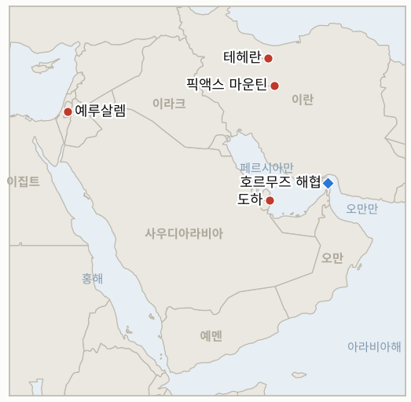

# 중동 일일 브리핑

**2026년 11월 5일**

- **보고 기간:** 약 24시간, 11월 4일 15:00 ~ 11월 5일 09:00 (한국시간)
- **종합 평가:** 미국 중간선거에서 민주당이 의회를 장악했고 트럼프는 이란 전쟁이 패배에 기여했다고 인정했다(§1.1). 전쟁이 더 빨리 끝날 것이라는 베팅에 유가는 약 9% 급락했다(§1.2). 이란 최고지도자 모즈타바 하메네이는 미국 정치 변화가 워싱턴의 적대를 바꾸지 못하며 미국이 공격하면 전쟁이 확대될 것이라고 답했으나, 마수드 페제시키안 대통령은 정부가 새 협상 권한을 받았다고 밝혔고 카타르는 잠정 합의에 낙관을 유지했다(§1.3). 이스라엘은 어느 진영도 과반이 아닌 총선 결과를 확정했고(§1.4), 코스피는 장중 급락 뒤 5,683.80으로 반등했으나 외국인은 2조 5,000억 원을 순매도했다(§1.5).

---

## 1. 무슨 일이 있었나

<figure style="float:right; width:46%; margin:2pt 0 8pt 14pt;">

<figcaption style="font-size:8pt; color:#666; text-align:center; margin-top:3pt; font-style:italic;">주요 논의 지점</figcaption>
</figure>

### 1.1 민주당이 의회를 장악하고 트럼프는 이란 전쟁이 패배에 기여했다고 인정한다

로이터는 민주당이 트럼프에 대한 압도적 심판 속에 의회를 장악했다고 보도했고, 인기 없는 이란 전쟁과 물가 상승에 대한 유권자 분노가 원인으로 꼽혔다([Korea Times](https://www.koreatimes.co.kr/world/20261104/democrats-seize-us-congress-in-sweeping-midterm-repudiation-of-trump)). 트럼프는 전쟁이 패배에 기여했다는 말이 "대체로 사실"이라고 하면서도 전쟁은 정당했다고 주장하고 "터무니없는" 법안은 거부권을 행사하겠다고 말했다. JD 밴스 부통령은 전쟁의 타당성에 의문을 표하는 듯한 발언을 했다([Al Jazeera](https://www.aljazeera.com/news/2026/11/4/no-regrets-trump-says-iran-war-justified-despite-polls-drubbing); [Korea Times](https://www.koreatimes.co.kr/world/20261105/trump-says-largely-true-iran-war-caused-midterms-loss)). 새 의회는 1월에야 출범하며, 민주당 다수는 조사와 예산 제약은 가능하나 대통령의 타격 명령 권한을 없애지는 못한다. 트럼프는 파이낸셜타임스에 전면전 복귀는 "필요하지 않을 수도 있다"고 하면서 미국은 "준비가 끝났다"고 말했다. **신뢰도: 선거 결과와 트럼프 발언은 높음, 타격 결정에 미칠 영향은 추론이므로 중간.**

### 1.2 의회가 전쟁 종식을 압박할 것이라는 베팅에 브렌트유가 약 9% 급락한 94.62달러, WTI는 88.12달러에 정산된다

수요일 유가가 급락해 한 보도는 브렌트유 정산가를 94.62달러, WTI를 88.12달러로 전했고, 다른 보도는 2027년 1월물 브렌트유를 93.52달러로 제시해 계약과 시점에 따라 수치가 다르다([MarketScreener](https://www.marketscreener.com/news/oil-prices-fall-as-investors-weigh-u-s-midterm-results-iran-risks-commodities-roundup-ce785fdfdc8ff725); [Korea Times](https://www.koreatimes.co.kr/world/20261105/us-stocks-surge-brent-oils-price-drops-below-95-per-barrel)). 밴스가 공화당 패배를 전쟁과 연결한 뒤 낙폭이 가장 컸고, 다우지수는 장중 약 2.9% 올랐으며 방산주와 석유 대기업은 내렸다. 로이터 기반 보도에 따르면 10월 중동 원유 흐름은 하루 1,710만 배럴로 전쟁 전의 약 4분의 3이어서 가격이 떨어졌어도 실물 공급 차질은 이어지고 있다. **신뢰도: 정확한 정산가는 2차 보도 간 약 1달러 차이로 중간, 방향과 폭은 높음.**

### 1.3 하메네이가 미국이 공격하면 전쟁이 확대된다고 경고하는 가운데 페제시키안과 카타르는 합의 여지를 시사한다

모즈타바 하메네이는 서면 성명에서 미국의 정책 변화를 기대하는 이들은 "심각하게 잘못 생각하고 있다"며 추가 군사 행동이 전쟁을 확대할 것이라고 밝혔다. 그는 3월 집권 이후 공개 석상에 나타난 적이 없다([Korea Times](https://www.koreatimes.co.kr/world/20261105/iran-warns-of-wider-war-if-us-attacks-after-trump-election-rout)). 페제시키안은 하메네이가 정부에 이전에는 금지됐던 사안까지 협상할 새 권한을 줬다고 말했고, 카타르 대변인 마제드 알안사리는 양측이 카타르 제안을 검토 중이며 잠정 합의에 낙관한다고 밝혔으며, 중국은 적대 행위 재개 방지를 최우선 과제로 꼽았다. 이란은 호르무즈 재개방 기간을 이틀로 줄이겠다고 제안했으나 분석가들은 해협 통제권 문제가 남은 전술적 양보로 본다([Al Jazeera](https://www.aljazeera.com/news/2026/11/4/who-determines-irans-fighting-and-negotiating-position-amid-us-threats)). 트럼프는 픽액스 마운틴을 포함해 표적이 한두 곳 남았다고도 말했다. **신뢰도: 발언 사실은 높음, 합의 진전의 신호인지는 낮음.**

### 1.4 이스라엘이 어느 진영도 61석에 못 미친 총선 결과를 확정하고 헤르초그가 협의를 시작한다

이스라엘 중앙선거관리위원회는 11월 4일 10월 27일 총선 결과를 확정했다. 네타냐후 진영 53석, 아이젠코트 야권 진영 48석, 아랍계 정당 사상 최다 19석으로 어느 쪽도 과반 61석이 아니다([Al Jazeera](https://www.aljazeera.com/news/2026/11/4/israel-vote-results-confirmed-as-election-commission-rejects-fraud-claims)). 네타냐후와 동맹은 아랍계 정당이 선거를 "훔쳤다"고 근거 없이 주장했으나 위원회는 결과를 바꿀 부정을 찾지 못했고, 리쿠드와 샤스는 승인 표결에 기권했다. 이츠하크 헤르초그 대통령은 이틀간 협의를 시작했으며, 지명된 후보는 28일 안에 연정을 구성해야 하고 14일 연장이 가능하다. 실패하면 재선거가 열린다. **신뢰도: 결과와 절차는 높음, 누가 지명될지는 낮음.**

### 1.5 코스피가 장중 5,421.72까지 밀렸다가 0.62% 오른 5,683.80에 마감하고 외국인이 2조 5,000억 원을 순매도한다

코스피는 2.43% 상승 출발한 뒤 미국 중간선거 개표가 진행되던 낮에 5,421.72까지 떨어졌다가 회복해 거래가 한산한 가운데 35.01포인트 오른 5,683.80에 마감했다. 외국인은 2조 5,000억 원을 순매도했고 기관과 개인은 순매수했다([JoongAng Daily](https://www.koreajoongangdaily.com/business/kospi-closes-higher-on-early-us-midterm-election-outcome/12955854)). 민주당의 재생에너지 지원 기대에 삼성SDI가 11.57%, LG에너지솔루션이 5.03% 올라 배터리주가 상승을 이끌었고, 삼성전자(0.68% 하락)와 SK하이닉스(0.14% 하락)는 미국의 AI 데이터센터 규제 강화 우려로 밀렸다. 원·달러 환율은 0.5원 오른 1,341.5원에 마감했다. 시노코에 대한 한국 정부의 새 입장은 찾지 못했다. **신뢰도: 종가와 수급은 높음, 업종별 원인은 중간.**

---

## 2. 심층 분석: 유인과 동기

### 2.1 하메네이는 왜 선거 결과에 문호 개방이 아닌 경고로 답했는가?

미국 정치가 상황을 바꿨다고 인정하면 이란의 압박이 트럼프의 약화 덕에만 통했다는 비판을 부르고 워싱턴이 요구하는 값도 올라간다. 공개적 강경 노선은 이란이 카타르를 통해 강한 위치에서 협상하게 하고, 페제시키안의 새 권한은 물밑 타협의 여지를 남긴다.

### 2.2 트럼프는 왜 전쟁이 패배에 기여했다고 인정하면서도 전쟁이 정당했다고 주장하는가?

유권자에게 떠밀린 모습은 테헤란과 네타냐후 앞에서 그의 입지를 약화시키므로 피해야 한다. 전면전이 필요하지 않을 수도 있다는 말은 방침 번복을 인정하지 않고 긴장을 낮출 길을 열어 준다.

### 2.3 정치 결과일 뿐 호르무즈에 변화가 없는데 유가는 왜 약 9% 하락했는가?

시장은 선거 후 대규모 타격 작전의 가능성이 낮아졌다고 보고 전쟁 위험 프리미엄을 줄였고, 10월 급등 뒤 차익 실현에도 나섰다. 실물 공급 부족은 그대로여서 새 유조선 공격이 나오면 하락분은 쉽게 되돌려질 수 있다.

### 2.4 네타냐후는 왜 완패하지 않은 선거 결과에 이의를 제기하는가?

61석이 없으면 야권을 분열시키거나 재선거를 치러야 하며, "도난당한 선거" 서사는 지지층을 결집시키고 헤르초그를 압박한다. 아랍계 정당을 공격하면 그들에게 의존하는 연정의 정당성도 약해진다.

### 2.5 코스피가 오른 날 외국인은 왜 2조 5,000억 원을 팔았는가?

외국인은 장중 급락 뒤 반등 국면에서 차익을 실현하고 AI 투자 규제 우려에 대응했으며, 국내 기관과 개인이 물량을 받았다. 배터리주 순환매는 걸프 상황이 아닌 미국 정책에 대한 베팅을 반영한다.

---

## 3. 한국에 대한 정책적 함의

**노출도 현황:** 한국은 원유의 약 70.7%, LNG의 약 20.4%를 중동에서 들여온다(`instructions/korea-exposure.md`, 갱신 불필요). 11월 4일 수요일 최신 수치: 코스피 5,683.80(0.62% 상승), 원·달러 1,341.5원, 브렌트유 약 94.62달러, WTI 약 88.12달러.

**전개별 함의:**

- **중간선거(§1.1):** 민주당 의회는 대규모 미국 작전의 가능성은 낮추지만 제한 타격 가능성은 낮추지 못하므로 서울은 호르무즈 비상 계획을 유지해야 한다(IND-20261105-1, IND-20261104-2).
- **유가 급락(§1.2):** 브렌트유 100달러 아래는 수입 부담과 원화 압력을 덜지만 실물 흐름은 여전히 전쟁 전보다 약 4분의 1 적어 완화는 물량이 아닌 가격에 그친다(IND-20261103-2는 가능성 낮아짐).
- **하메네이와 카타르(§1.3):** 합의 틀이 나와야 한국의 에너지 부담 완화와 선박 복귀가 현실이 되는데, 공개 강경 발언 탓에 시점은 불확실하다(IND-20261104-1, IND-20261105-2).
- **이스라엘(§1.4):** 연정 구성 공방은 이스라엘이 결정적 새 전선을 열 여력을 줄여 걸프 안정에 소폭 긍정적이다(IND-20261028-2).
- **시장(§1.5):** 코스피는 걸프보다 미국 정책과 AI 자금 조달에 좌우되며 외국인 매도가 전달 경로다(IND-20261104-3, IND-20261105-3).

**오늘 종결:** IND-20261017-1 **만료**(11월 4일까지 픽액스 마운틴 등 핵시설 타격 공개 없음). IND-20261019-2와 IND-20260923-1도 **만료**(기한이 지났으나 이번 조사에서 미 재무부 면허나 동서 송유관 처리량 보도를 찾지 못해 어느 쪽도 확인되지 않음).

**검증 가능한 지표:**

- **IND-20261105-1**(진행 중, 신규): 중간선거 이후 미국의 이란 영토 타격이 2026-11-12까지 공개되면 무력 사용 지속 확인, 없으면 반증.
- **IND-20261105-2**(진행 중, 신규): 미국과 이란의 잠정 합의 또는 호르무즈 약정이 2026-11-15까지 서명되거나 공동 발표되면 확인, 없으면 반증.
- **IND-20261105-3**(진행 중, 신규): 브렌트유 정산가가 2026-11-12까지 한 번이라도 100달러를 넘으면 이번 하락이 일시적이었음을 확인, 없으면 반증.
- **IND-20261104-1, -2, -3**(진행 중): 합의 틀 공개 발표 2026-11-10까지, 호르무즈 대공망을 넘는 타격 2026-11-10까지, 코스피 5,500 미만 마감 2026-11-09까지.
- **IND-20261103-1, -2, -3**(진행 중): "첫날 조치" 확인 2026-11-10까지, 브렌트유 정산가 110달러 초과 2026-11-06까지, 코스피 6,000 초과 마감 2026-11-06까지.
- **IND-20261102-2**(진행 중): 밴스 서한에 대한 이란의 서면 회신 확인 2026-11-06까지.
- **IND-20261101-1, -3**(진행 중): 미국·이란 협의 공개 2026-11-06까지, 일일 호르무즈 통과 70척 이상 공표 2026-11-08까지.
- **IND-20261031-1, -3**(진행 중): 흡착 기뢰 또는 기뢰 공격 재발 2026-11-07까지, 브렌트유 120달러 초과 2026-11-06까지.
- **IND-20261030-1**(진행 중): 남부 항로 타격의 독립 확인 2026-11-06까지.
- **IND-20261029-1**(진행 중): 시노코에 대한 과태료·억류·나포 2026-11-08까지.
- **IND-20261028-2**(진행 중): 헤르초그의 후보 지명 2026-11-10까지.
- **IND-20261027-1**(진행 중): 이집트 병력 배치 2026-11-10까지.
- **IND-20261025-2**(진행 중): 이란 소행으로 지목된 걸프 해저 케이블 절단 2026-11-06까지.
- **IND-20261023-1**(진행 중): 11월 한국은행 금리 인상.

---

## 4. 관찰 목록

- **트럼프가 임기 말 공백기에 타격하는지, 긴장을 낮추는지(IND-20261105-1, IND-20261104-2).**
- **카타르 중재 잠정 합의와 이란의 서면 회신(IND-20261105-2, IND-20261104-1, IND-20261102-2).**
- **9% 급락 뒤 브렌트유 반등 위험(IND-20261105-3).**
- **헤르초그의 협의와 네타냐후의 결과 불복(IND-20261028-2).**
- **외국인 매도와 AI 자금 조달 압박이 코스피에 미치는 영향(IND-20261104-3).**
- **후티의 사우디·타이즈 공격과 걸프 해상 사건(IND-20261031-1).**
- **시노코 집행과 서울의 입장(IND-20261029-1).**

---

## 5. 출처 품질 요약

| 주장 | 출처 | 신뢰도 |
| --- | --- | --- |
| 민주당 의회 장악, 이란 전쟁이 요인으로 지목됨 | 로이터(Korea Times 경유) | 높음 |
| 트럼프의 "대체로 사실" 발언, 전쟁은 정당 | Korea Times, Al Jazeera | 높음 |
| 브렌트유 약 94.62달러, WTI 88.12달러 정산(약 9%, 8% 하락) | MarketScreener, Korea Times(장중), 검색 요약 | 중간 |
| 10월 지역 원유 흐름 하루 1,710만 배럴 | Business Recorder(로이터) | 중간 |
| 하메네이의 확전 경고, 페제시키안의 새 협상 권한 | Korea Times, Al Jazeera | 발언 사실은 높음 |
| 카타르 잠정 합의 낙관, 중국 우선순위 | Korea Times | 중간 |
| 이스라엘 결과 53 / 48 / 19, 헤르초그 협의 | Al Jazeera | 높음 |
| 코스피 5,683.80(+0.62%), 저점 5,421.72, 외국인 2조 5,000억 원 순매도, 원 1,341.5 | JoongAng Daily | 높음 |
| 호르무즈 통과 건수 | 보도 없음 | 보도 없음 |
