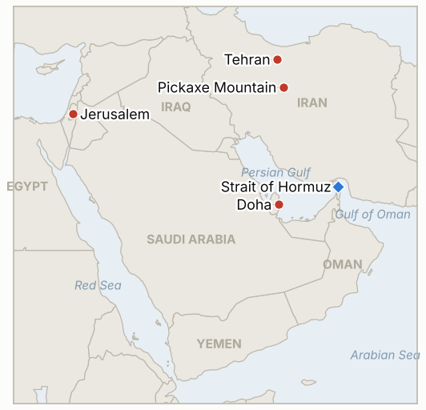

# Middle East Daily Briefing

**November 5, 2026**

- **Reporting window:** ~24 hours, November 4, 15:00 to November 5, 09:00 KST
- **Overall assessment:** The US midterms handed Democrats control of Congress, with Trump conceding the Iran war helped cause the loss (§1.1), and oil fell about 9% as traders bet on a faster end to the war (§1.2). Iran's supreme leader Mojtaba Khamenei answered that US politics will not change Washington's hostility and that the war will widen if the US attacks, even as President Pezeshkian says Tehran has new authority to negotiate and Qatar stays hopeful on an interim deal (§1.3). Israel certified an election that left neither bloc with a majority (§1.4), and the KOSPI rebounded to 5,683.80 after a violent intraday swing while foreigners sold 2.5 trillion won (§1.5).

---

## 1. What Happened

<figure style="float:right; width:46%; margin:2pt 0 8pt 14pt;">

<figcaption style="font-size:8pt; color:#666; text-align:center; margin-top:3pt; font-style:italic;">Major places of discussion</figcaption>
</figure>

### 1.1 Democrats win Congress, and Trump concedes the Iran war contributed to the loss

Reuters reported that Democrats took control of Congress in a sweeping repudiation of Trump, with voter anger over the unpopular Iran war and higher costs cited as drivers ([Korea Times](https://www.koreatimes.co.kr/world/20261104/democrats-seize-us-congress-in-sweeping-midterm-repudiation-of-trump)). Trump said it was "largely true" that the war contributed to the defeat, while insisting the war was justified and vowing to veto "insane" bills; Vice President Vance appeared to question the war's merits ([Al Jazeera](https://www.aljazeera.com/news/2026/11/4/no-regrets-trump-says-iran-war-justified-despite-polls-drubbing); [Korea Times](https://www.koreatimes.co.kr/world/20261105/trump-says-largely-true-iran-war-caused-midterms-loss)). The new Congress is not seated until January, and a Democratic majority can investigate and constrain funding but does not remove the president's authority to order strikes. Trump told the Financial Times a full return to war "may not be necessary" while saying the US is "locked and loaded." **Confidence: High on the election outcome and Trump's remarks; Medium on its effect on strike decisions, which is inference.**

### 1.2 Brent falls about 9% to $94.62 and WTI to $88.12 on bets that Congress will force an end to the war

Oil dropped sharply on Wednesday, with one report putting the Brent settle at $94.62 and WTI at $88.12, while another showed the January 2027 Brent contract at $93.52; the sources differ by contract and timing ([MarketScreener](https://www.marketscreener.com/news/oil-prices-fall-as-investors-weigh-u-s-midterm-results-iran-risks-commodities-roundup-ce785fdfdc8ff725); [Korea Times](https://www.koreatimes.co.kr/world/20261105/us-stocks-surge-brent-oils-price-drops-below-95-per-barrel)). The sharpest leg followed Vance linking the Republican defeat to the war, and the Dow rose about 2.9% at midday while defense and oil stocks fell. Reuters-based reporting put Middle East crude flows at 17.1 million bpd in October, about three quarters of prewar levels, so physical supply remains impaired despite the price drop. **Confidence: Medium on exact settles (secondary reports disagree by about $1); High on direction and size.**

### 1.3 Khamenei warns the war will widen if the US attacks, while Pezeshkian and Qatar signal room for a deal

Mojtaba Khamenei said in a written statement that those expecting a US policy shift are "seriously mistaken" and that further US military action would widen the war; he has not appeared in public since taking power in March ([Korea Times](https://www.koreatimes.co.kr/world/20261105/iran-warns-of-wider-war-if-us-attacks-after-trump-election-rout)). Pezeshkian said Khamenei gave the government new authority to negotiate on issues previously off limits, Qatar's spokesman Majed Al Ansari said both sides are reviewing Qatari proposals and Doha remains hopeful on an interim deal, and China called preventing a return to hostilities a top priority. Iran has offered to shorten Hormuz reopening to two days, but analysts see it as a tactical concession that leaves control of the strait unresolved ([Al Jazeera](https://www.aljazeera.com/news/2026/11/4/who-determines-irans-fighting-and-negotiating-position-amid-us-threats)). Trump has also said one or two targets remain, including Pickaxe Mountain. **Confidence: High on the statements; Low on whether they signal movement toward an agreement.**

### 1.4 Israel certifies an election with neither bloc at 61, and Herzog opens consultations

Israel's Central Elections Committee certified the October 27 results on November 4: Netanyahu's bloc has 53 seats, Eisenkot's opposition bloc 48, and Arab-led parties a record 19, so no side has the 61 needed ([Al Jazeera](https://www.aljazeera.com/news/2026/11/4/israel-vote-results-confirmed-as-election-commission-rejects-fraud-claims)). Netanyahu and allies claimed without evidence that Arab-led parties "stole" the vote; the committee found no irregularities that changed the outcome, and Likud and Shas abstained from ratification. President Herzog began two days of consultations, after which a candidate gets 28 days to build a coalition, with a possible 14 day extension; failure means another election. **Confidence: High on the results and process; Low on who will be tapped.**

### 1.5 KOSPI closes up 0.62% at 5,683.80 after an intraday low of 5,421.72 as foreigners sell 2.5 trillion won

The KOSPI opened 2.43% higher, fell to 5,421.72 around midday as US midterm votes were counted, then recovered to close at 5,683.80, up 35.01 points on thin turnover; foreigners net sold 2.5 trillion won while institutions and individuals bought ([JoongAng Daily](https://www.koreajoongangdaily.com/business/kospi-closes-higher-on-early-us-midterm-election-outcome/12955854)). Batteries led, with Samsung SDI up 11.57% and LG Energy Solution up 5.03% on hopes of Democratic support for renewables, while Samsung Electronics (down 0.68%) and SK hynix (down 0.14%) slipped on worries over tighter US AI data center rules. The won closed at 1,341.5 per dollar, 0.5 won weaker. I found no Korean government statement on Sinokor. **Confidence: High on the close and flows; Medium on the attributed sector drivers.**

---

## 2. Deep Dive: Incentives and Motives

### 2.1 Why did Khamenei answer the election with a warning rather than an opening?

Conceding that US politics changes anything would invite the charge that Iran's pressure won concessions only because Trump weakened, and would raise Washington's price. A public hard line lets Tehran negotiate through Qatar from strength while Pezeshkian's new authority gives it room to deal quietly.

### 2.2 Why does Trump keep saying the war was justified while conceding it hurt him?

He needs to avoid looking forced by the voters, which would weaken his hand with Tehran and Netanyahu. Saying a full return to war may not be necessary lets him de-escalate without admitting a reversal.

### 2.3 Why did oil fall about 9% on a political result rather than on any Hormuz change?

Traders priced a lower probability of a large post-election strike campaign, shrinking the war risk premium, and they took profits after an October rally. The physical flow shortfall is unchanged, so the move is fragile to any new tanker attack.

### 2.4 Why does Netanyahu contest an election he did not lose outright?

Without 61 seats he must either split the opposition or face a new vote, and a "stolen election" narrative mobilizes his base and pressures Herzog. Attacking the Arab-led parties also lowers the legitimacy of any coalition that depends on them.

### 2.5 Why did foreigners sell 2.5 trillion won on a day the KOSPI rose?

They sold into the rebound after the intraday plunge and on concern over AI investment limits, while local institutions and individuals absorbed it. Rotation into batteries reflects bets on US policy, not on the Gulf.

---

## 3. Policy Implications for South Korea

**Exposure snapshot:** South Korea draws about 70.7% of its crude and 20.4% of its LNG from the Middle East (`instructions/korea-exposure.md`, no update needed). Latest prints, Wednesday November 4: KOSPI 5,683.80 (up 0.62%), USD/KRW 1,341.5, Brent about $94.62, WTI about $88.12.

**Implications by development:**

- **Midterms (§1.1):** A Democratic Congress lowers the odds of a large US campaign but not of limited strikes, so Seoul should keep Hormuz contingency planning in place (IND-20261105-1, IND-20261104-2).
- **Oil drop (§1.2):** Brent below $100 eases Korea's import bill and won pressure, but physical flows are still about a quarter below prewar, so the relief is price not volume (IND-20261103-2 now unlikely).
- **Khamenei and Qatar (§1.3):** A framework would be the real trigger for Korean energy relief and for return of Korean ships; the hard line in public makes timing uncertain (IND-20261104-1, IND-20261105-2).
- **Israel (§1.4):** A drawn out coalition fight reduces Israel's capacity for a decisive new front, a modest positive for Gulf stability (IND-20261028-2).
- **Markets (§1.5):** The KOSPI is trading on US policy and AI funding more than on the Gulf; foreign selling is the transmission channel (IND-20261104-3, IND-20261105-3).

**Resolved today:** IND-20261017-1 **expired** (no disclosed strike on Pickaxe Mountain or another nuclear site by November 4). IND-20261019-2 **expired** and IND-20260923-1 **expired** (deadlines passed; I found no Treasury license or East-West throughput report in this run's research, so neither condition is established).

**Testable indicators:**

- **IND-20261105-1** (open, new): A disclosed US strike on Iranian territory after the midterms by ~2026-11-12 confirms continued use of force; none falsifies.
- **IND-20261105-2** (open, new): A signed or jointly announced US-Iran interim agreement or Hormuz arrangement by ~2026-11-15; none falsifies.
- **IND-20261105-3** (open, new): Brent settle back above $100 on any session by ~2026-11-12 confirms the drop was a transient dip; none falsifies.
- **IND-20261104-1, -2, -3** (open): Public framework announcement by ~2026-11-10; strike beyond Hormuz air defenses by ~2026-11-10; KOSPI close below 5,500 by ~2026-11-09.
- **IND-20261103-1, -2, -3** (open): "Day one" measures confirmed by ~2026-11-10; Brent settle above $110 by ~2026-11-06; KOSPI close above 6,000 by ~2026-11-06.
- **IND-20261102-2** (open): Confirmed Iranian written reply to the Vance letter by ~2026-11-06.
- **IND-20261101-1, -3** (open): Disclosed US-Iran session by ~2026-11-06; published Hormuz transit count of 70 or more by ~2026-11-08.
- **IND-20261031-1, -3** (open): Another limpet or mine attack by ~2026-11-07; Brent above $120 by ~2026-11-06.
- **IND-20261030-1** (open): Independent confirmation of a southern route strike by ~2026-11-06.
- **IND-20261029-1** (open): Sinokor fine, detention or seizure by ~2026-11-08.
- **IND-20261028-2** (open): Herzog's mandate to a candidate by ~2026-11-10.
- **IND-20261027-1** (open): Egyptian deployment by ~2026-11-10.
- **IND-20261025-2** (open): Gulf undersea cable cut attributed to Iran by ~2026-11-06.
- **IND-20261023-1** (open): Bank of Korea hike in November.

---

## 4. Watch List

- **Whether Trump uses the lame duck window for strikes, or de-escalates (IND-20261105-1, IND-20261104-2).**
- **Qatari mediated interim deal and Iran's written reply (IND-20261105-2, IND-20261104-1, IND-20261102-2).**
- **Brent rebound risk after a 9% drop (IND-20261105-3).**
- **Herzog's consultations and Netanyahu's challenge to the result (IND-20261028-2).**
- **Foreign selling and AI funding pressure on the KOSPI (IND-20261104-3).**
- **Houthi attacks on Saudi Arabia and Taiz, and Gulf shipping incidents (IND-20261031-1).**
- **Sinokor enforcement and any Seoul statement (IND-20261029-1).**

---

## 5. Source Quality Summary

| Claim | Sources | Confidence |
| --- | --- | --- |
| Democrats win Congress; Iran war cited as driver | Reuters via Korea Times | High |
| Trump says "largely true" war contributed; war justified | Korea Times, Al Jazeera | High |
| Brent about $94.62, WTI $88.12 settle (about -9%, -8%) | MarketScreener, Korea Times (midday), search summaries | Medium |
| October regional crude flows 17.1m bpd | Business Recorder (Reuters) | Medium |
| Khamenei warns war would widen; Pezeshkian new negotiating authority | Korea Times, Al Jazeera | High that said |
| Qatar hopeful on interim deal; China priority | Korea Times | Medium |
| Israel result 53 / 48 / 19; Herzog consultations | Al Jazeera | High |
| KOSPI 5,683.80 (+0.62%), low 5,421.72; foreigners sold 2.5tn won; won 1,341.5 | JoongAng Daily | High |
| Hormuz transit count | Not reported | Not reported |
