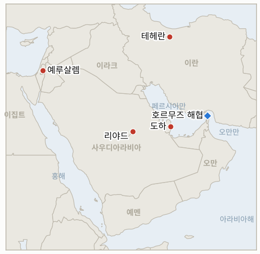

# 중동 일일 브리핑

**2026년 11월 6일**

- **보고 기간:** 약 24시간, 11월 5일 15:00 ~ 11월 6일 09:00 (한국시간)
- **종합 평가:** 테헤란은 미국의 공격을 돕는 모든 나라가 "정당한 표적"이라고 경고했고, 미국에서는 군이 대규모 전투 재개를 준비한다는 보도가 나왔으며, 트럼프는 당장 공격할 계획은 없다고 밝혔다(§1.1, §1.2). 유가는 두 달 만의 저점인 93.6달러 안팎에서 거래됐으나 목요일 정산가는 확인하지 못했다(§1.3). 더 큰 충격은 서울에서 나왔다. 외국인이 3조 4,000억 원을 팔면서 코스피가 5.28% 급락한 5,383.80으로 4월 3일 이후 최저치를 기록했고, 원인은 걸프보다 AI와 반도체 우려였다(§1.4). 이스라엘 대통령의 협의가 이어졌고 아이젠코트가 첫 조각 권한을 받을 것으로 예상된다(§1.5).

---

## 1. 무슨 일이 있었나

<figure style="float:right; width:46%; margin:2pt 0 8pt 14pt;">

<figcaption style="font-size:8pt; color:#666; text-align:center; margin-top:3pt; font-style:italic;">주요 논의 지점</figcaption>
</figure>

### 1.1 이란이 미국의 공격을 돕는 모든 나라는 "정당한 표적"이라고 경고하고 워싱턴은 대규모 전투를 준비한다는 보도가 나온다

Al Jazeera 실시간 보도에 따르면 이란은 미국의 공격을 돕는 나라는 "정당한 표적"이라고 밝혔고, 아라그치 외무장관은 미국 공격 우려 속에 사우디아라비아, 오만, 카타르 외무장관과 통화했다. 뉴욕타임스는 미군이 트럼프의 명령에 따라 대규모 전투 작전을 재개할 태세라고 보도했다([Al Jazeera](https://www.aljazeera.com/news/liveblog/2026/11/5/iran-war-live-trump-admits-war-caused-election-loss-but-had-to-do-it)). Gulf News는 악시오스를 인용해 미국 관리들이 군이 대규모 전투 가능성에 대비한 준비를 마무리하고 있다고 전했으며, 이란 측은 양측이 합의와 거리가 멀다고 말한다고 보도했다([Gulf News](https://gulfnews.com/business/energy/crude-slides-toward-93-wti-drops-to-87-as-trump-rules-out-immediate-iran-strikes-1.500736498)). 카타르는 양측이 협상 의지를 유지하고 있다고 밝혔고, 이란은 호르무즈 재개방에 대한 미국의 최근 답변이 "설득력이 없다"고 평가한다. 호르무즈에서 유조선 2척과 예인선에 불이 났다는 혁명수비대 주장은 검색 요약으로만 확인되어 교차 확인하지 못했다. **신뢰도: 경고 발언은 높음, 미국의 준비 태세 보도는 중간(전언), 유조선 화재는 낮음.**

### 1.2 트럼프가 이란 공격 계획이 당장은 없다고 밝히면서 전쟁이 공화당에 타격이 됐다고 인정한다

트럼프는 미국이 당장 이란을 공격할 계획이 없다고 말했고 시장은 이를 단기 확전 위험 하락으로 읽었으며, 그는 전쟁이 중간선거 패배에 기여했다고 인정했다([Gulf News](https://gulfnews.com/business/energy/crude-slides-toward-93-wti-drops-to-87-as-trump-rules-out-immediate-iran-strikes-1.500736498); [Al Jazeera](https://www.aljazeera.com/news/2026/11/5/congress-defeat-how-trumps-allies-are-distancing-themselves-from-iran-war)). Al Jazeera는 트럼프의 우군이 전쟁과 거리를 두고 헤그세스 국방장관 경질 압박이 커지고 있다고 전했다. 신호는 엇갈린다. "당장 계획 없음"이라는 발언이 공격 준비 완료 보도와 나란히 있고, 이번 주 초 케슘섬에 대한 제한적 "방어" 타격은 미국이 대규모 작전 문턱 아래에서 여전히 움직이고 있음을 보여준다. **신뢰도: 정확한 표현은 중간(출처가 의역), 우군의 거리두기는 높음, 타격 일정은 낮음.**

### 1.3 브렌트유가 두 달 만의 저점인 93.6달러 안팎에서 거래되지만 목요일 정산가는 확인되지 않는다

목요일 아시아 거래에서 브렌트유 선물은 약 93.63달러, WTI는 87.13달러로 약 1% 내렸다. 다른 매체들은 이른 시간 97달러 부근까지 반등했다고 전했고, 브렌트유는 수요일 94.62달러에 정산됐다([Gulf News](https://gulfnews.com/business/energy/crude-slides-toward-93-wti-drops-to-87-as-trump-rules-out-immediate-iran-strikes-1.500736498); [FXStreet](https://www.fxstreet.com/news/wti-slumps-below-8650-as-midterm-elections-fuel-hope-for-an-end-to-iran-war-202611050640)). 무르반 실물 원유는 100.90달러로 브렌트 선물보다 약 7달러 높아, 걸프 실물 물량이 장부상 가격보다 빡빡함을 시사한다. 유라시아그룹은 상당한 확전 시 브렌트유가 110~125달러에 이를 수 있다고 추산했다. 믿을 만한 목요일 정산가를 찾지 못해 오늘 차트와 머리말에는 새 유가 지점을 싣지 않는다. **신뢰도: 장중 수준은 중간, 정산가는 보도 없음.**

### 1.4 외국인이 3조 4,000억 원을 순매도하면서 코스피가 5.28% 폭락한 5,383.80으로 4월 3일 이후 최저를 기록한다

코스피는 300.00포인트 내린 5,383.80에, 코스닥은 5.11% 내린 678.41에 마감했고 매도 사이드카가 발동됐다. 외국인은 약 3조 4,000억 원(매체별 3조 3,900억~3조 4,200억 원)을 순매도해 5거래일 연속 순매도를 이어갔고 삼성전자와 SK하이닉스가 중심이었다([라이센스뉴스](https://www.lcnews.co.kr/news/articleView.html?idxno=210930); [네이트 뉴스](https://m.news.nate.com/view/20261105n25761)). 원은 달러당 1,342.1원으로 0.6원 올라 마감해 4거래일 연속 1,340원대를 유지했고, 주식 폭락이 환율 폭락으로 번지지는 않았다([파이낸셜뉴스](https://www.fnnews.com/news/202611051533024481)). 국내 보도는 민주당 의회가 AI 데이터센터 규제를 강화해 반도체 수요가 둔화할 수 있다는 우려를 주된 원인으로 꼽았고 걸프 요인은 아니었다. 이번 조사에서 정부의 시장안정 조치는 확인하지 못했다. **신뢰도: 종가와 수급은 높음, 원인 해석은 중간.**

### 1.5 헤르초그의 협의가 이어지고 아이젠코트가 첫 조각 권한을 받을 것으로 예상된다

보고 기간 이전 보도에 따르면 헤르초그는 수요일부터 모든 정파와 협의하며 금요일까지 이어질 가능성이 크고, 베네트, 리베르만, 골란이 지지하는 아이젠코트가 첫 조각 권한을 받을 것으로 예상된다([Northeast Times](https://northeasttimes.com/2026/11/02/israel-coalition-talks-liberman-bennett-golan-back-eisenkot-herzog-consultations/); [Ynet](https://www.ynetnews.com/article/bkotdiqsmg)). 네타냐후는 아이젠코트 진영과는 정부를 구성할 수 없다고 말하며, 헤르초그가 네타냐후와 아이젠코트의 통합 정부를 제안했다는 보도는 대통령실이 부인했고 아이젠코트, 라피드, 골란도 거부했다. 이번 기간 중 조각 권한 결정 자체에 대한 보도는 찾지 못했다. **신뢰도: 중간(기간 이전 출처), 누가 정부를 구성할지는 낮음.**

---

## 2. 심층 분석: 유인과 동기

### 2.1 테헤란은 왜 미국의 공격을 돕는 나라들을 위협하는가?

사우디아라비아, 오만, 카타르를 잠재적 "정당한 표적"으로 지목하면 미국 작전에 협조하는 걸프 국가의 비용이 커지고, 이들이 워싱턴에 자제를 요청할 이유가 생긴다. 아라그치의 통화는 위협과 외교적 접촉을 함께 묶은 것으로, 걸프 외교를 통한 억지다.

### 2.2 워싱턴은 왜 준비 태세와 자제를 동시에 내보내는가?

공격 준비 완료는 카타르 협상에서 협상력을 유지하고, "당장 계획 없음"은 유권자의 심판과 곧 전쟁 예산을 제약할 의회를 존중한다. 둘을 함께 유지하면 트럼프는 떠밀린 모습을 보이지 않고 협상할 수 있다.

### 2.3 무르반은 왜 브렌트 선물보다 이렇게 높은가?

장부상 브렌트는 외교를 가격에 반영하는 반면 무르반은 여전히 손상된 해협을 통해 걸프를 빠져나가야 하는 실물을 반영한다. 이 격차는 가격 하락 중 얼마가 공급이 아니라 심리인지를 보여준다.

### 2.4 걸프에 새로운 확전이 없던 날 코스피는 왜 5% 빠졌는가?

방아쇠는 호르무즈가 아니라 미국의 AI 정책이었다. 투자자들은 민주당 의회가 데이터센터 확충을 제한해 지수를 지배하는 반도체주가 타격을 입을 것을 우려했고, 외국인은 이미 5거래일째 순매도 중이었다. 걸프는 배경의 위험 프리미엄이고, 이번 충격은 특정 업종과 수급 충격이다.

### 2.5 네타냐후는 왜 자신 없이는 정부 구성이 불가능하다고 고집하는가?

진영이 53석인 그는 이탈표를 끌어오거나 재선거를 치러야 하며, 아이젠코트 주도 연정을 거부하면 야권이 분열되기를 기다리는 동안 지지층과 리쿠드를 결속할 수 있다.

---

## 3. 한국에 대한 정책적 함의

**노출도 현황:** 한국은 원유의 약 70.7%, LNG의 약 20.4%를 중동에서 들여온다(`instructions/korea-exposure.md`, 갱신 불필요). 11월 5일 목요일 최신 수치: 코스피 5,383.80(5.28% 하락), 원·달러 1,342.1원, 브렌트유 장중 약 93.6달러, WTI 약 87.1달러(정산가 확인 안 됨).

**전개별 함의:**

- **걸프 주최국 위협(§1.1):** 사우디, 오만, 카타르의 공급과 해운은 모두 한국의 생명선이므로 확전은 유가 헤드라인이 시사하는 것보다 큰 위험이다. 비축분과 우회 경로 계획을 유지해야 한다(IND-20261106-1, IND-20261105-1).
- **트럼프 신호(§1.2):** 엇갈린 신호는 안도보다 대비를 요구한다(IND-20261105-2).
- **유가(§1.3):** 값싼 원유는 수입 부담을 덜지만 무르반 프리미엄은 실물 긴축이 이어짐을 보여준다(IND-20261106-3).
- **코스피 급락(§1.4):** 낙폭은 대체로 AI 정책과 외국인 수급 문제이므로 서울의 대응은 에너지가 아니라 시장 안정과 반도체 공급망 정책에 맞춰야 하며, 당국이 조치를 발표하는지 지켜봐야 한다(IND-20261106-2).
- **이스라엘(§1.5):** 더딘 연정 구성은 이스라엘이 새 전선을 열 의지를 제한한다(IND-20261028-2).

**오늘 해소된 지표:** IND-20261104-3 **확정**: 코스피가 11월 5일 5,383.80에 마감해 5,500 기준선 아래로 내려갔다.

**검증 가능한 지표:**

- **IND-20261106-1** (신규, 진행 중): 미국 군 주둔과 연계된 걸프 국가 영토나 해운에 대한 이란 또는 대리 세력의 공격, 또는 호르무즈 연안을 넘어선 미국의 공개 타격이 ~2026-11-13까지 나오면 위협이 실행되고 있음이 확인되고, 없으면 반증된다.
- **IND-20261106-2** (신규, 진행 중): 코스피가 ~2026-11-13까지 어느 거래일이든 5,200 아래로 마감하면 추가 하락이 확인되고, 아니면 반증된다.
- **IND-20261106-3** (신규, 진행 중): 브렌트유 정산가가 ~2026-11-13까지 어느 거래일이든 90달러 아래로 내려가면 외교 베팅의 연장이 확인되고, 아니면 반증된다.
- **IND-20261105-1, -2, -3** (진행 중): ~2026-11-12까지 미국의 공개 타격, ~2026-11-15까지 미국·이란 잠정 합의, ~2026-11-12까지 브렌트유 정산가 100달러 초과.
- **IND-20261104-1, -2** (진행 중): ~2026-11-10까지 공개 합의 틀 발표, ~2026-11-10까지 호르무즈 방공망을 넘어선 타격.
- **IND-20261103-1, -2, -3** (진행 중): ~2026-11-10까지 "첫날" 조치, ~2026-11-06까지 브렌트유 110달러 초과(가능성 낮음), ~2026-11-06까지 코스피 6,000 초과(가능성 낮음).
- **IND-20261102-2, IND-20261101-1, -3** (진행 중): ~2026-11-06까지 이란의 서면 회신과 공개 미국·이란 회담, ~2026-11-08까지 호르무즈 통과 70건 이상.
- **IND-20261031-1, -3, IND-20261030-1, IND-20261029-1** (진행 중): ~2026-11-07까지 추가 흡착 지뢰나 기뢰 공격, ~2026-11-06까지 브렌트유 120달러 초과, ~2026-11-06까지 남부 경로 타격의 독립 확인, ~2026-11-08까지 시노코르 조치.
- **IND-20261028-2, IND-20261027-1, IND-20261025-2, IND-20261023-1** (진행 중): ~2026-11-10까지 헤르초그의 조각 권한 부여, ~2026-11-10까지 이집트 파병, ~2026-11-06까지 걸프 해저 케이블 절단, 11월 한국은행 금리 인상.

---

## 4. 관찰 목록

- **걸프 주최국을 겨냥한 이란의 "정당한 표적" 경고의 실행 여부(IND-20261106-1).**
- **워싱턴의 준비 태세 보도가 타격이나 카타르 중재 합의로 이어지는지(IND-20261105-1, IND-20261105-2).**
- **코스피 급락에 대한 한국 당국의 대응과 이어지는 외국인 매도(IND-20261106-2).**
- **무르반 프리미엄 대비 95달러 아래 브렌트유의 경로(IND-20261106-3).**
- **헤르초그의 조각 권한 결정과 네타냐후의 대응(IND-20261028-2).**
- **헤그세스의 거취와 전쟁 예산을 둘러싼 의회 움직임.**

---

## 5. 출처 품질 요약

| 주장 | 출처 | 신뢰도 |
| --- | --- | --- |
| 이란이 미국 공격을 돕는 나라를 경고, 아라그치의 걸프 외무장관 통화 | Al Jazeera 실시간 보도 | 높음 |
| 미군이 대규모 전투 재개 태세 | 뉴욕타임스(Al Jazeera 경유), 악시오스(Gulf News 경유) | 중간 |
| 트럼프: 당장 공격 계획 없음, 전쟁이 공화당에 타격 인정 | Gulf News(의역), Al Jazeera | 중간 |
| 혁명수비대: 유조선 2척과 예인선 화재 | Al Jazeera 검색 요약, 교차 확인 안 됨 | 낮음 |
| 브렌트유 장중 약 93.63달러, WTI 87.13달러, 무르반 100.90달러 | Gulf News, FXStreet | 중간 |
| 목요일 유가 정산가 | 확인 못함 | 보도 없음 |
| 코스피 5,383.80(-5.28%), 코스닥 678.41, 외국인 약 3조 4,000억 원 순매도 | 라이센스뉴스, 네이트 뉴스 | 높음 |
| 원 1,342.1 | 파이낸셜뉴스 | 높음 |
| 헤르초그 협의, 아이젠코트가 첫 조각 권한 예상 | Northeast Times, Ynet(기간 이전) | 중간 |
| 호르무즈 통과 건수 | 보도 없음 | 보도 없음 |
