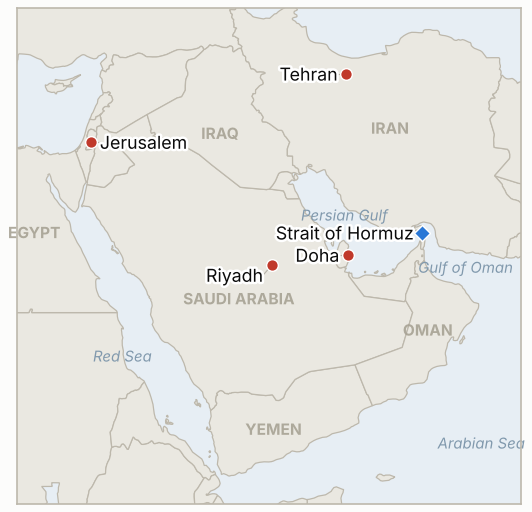

# Middle East Daily Briefing

**November 6, 2026**

- **Reporting window:** ~24 hours, November 5, 15:00 to November 6, 09:00 KST
- **Overall assessment:** Tehran warned that any country helping a US attack is a "legitimate target" while US reports said the military is ready to resume major combat, and Trump said he has no immediate plans to strike (§1.1, §1.2). Oil traded near a two month low around $93.6, but I could not find the Thursday settle (§1.3). The larger shock was in Seoul: the KOSPI fell 5.28% to 5,383.80, its lowest since April 3, as foreigners sold 3.4 trillion won, driven mainly by AI and chip worries rather than the Gulf (§1.4). Israel's president continued consultations with Eisenkot expected to get the first mandate (§1.5).

---

## 1. What Happened

<figure style="float:right; width:46%; margin:2pt 0 8pt 14pt;">

<figcaption style="font-size:8pt; color:#666; text-align:center; margin-top:3pt; font-style:italic;">Major places of discussion</figcaption>
</figure>

### 1.1 Iran warns that any nation helping a US attack is a "legitimate target" as Washington reportedly readies major combat

Al Jazeera's live coverage reported Iran saying any nation that helps a US attack is a "legitimate target," while Foreign Minister Araghchi phoned his Saudi, Omani and Qatari counterparts amid fears of a US strike; the New York Times reported the US military is poised to resume major combat operations on Trump's order ([Al Jazeera](https://www.aljazeera.com/news/liveblog/2026/11/5/iran-war-live-trump-admits-war-caused-election-loss-but-had-to-do-it)). Gulf News, citing Axios, said US officials told the outlet the military is finishing preparations for possible major combat, and that Iranian officials say the sides remain far from agreement ([Gulf News](https://gulfnews.com/business/energy/crude-slides-toward-93-wti-drops-to-87-as-trump-rules-out-immediate-iran-strikes-1.500736498)). Qatar says both capitals remain committed to negotiating, and Iran calls Washington's latest answer on reopening Hormuz "unconvincing." An IRGC claim that two tankers and a tugboat caught fire in the strait came through a search summary and I could not corroborate it. **Confidence: High that the warnings were issued; Medium on the US readiness reports (relayed, not primary); Low on the tanker fire.**

### 1.2 Trump says there are no immediate plans to strike Iran, while admitting the war hurt Republicans

Trump said the US has no immediate plans to strike Iran, which markets read as lowering near term escalation risk, and he acknowledged the war contributed to the midterm loss ([Gulf News](https://gulfnews.com/business/energy/crude-slides-toward-93-wti-drops-to-87-as-trump-rules-out-immediate-iran-strikes-1.500736498); [Al Jazeera](https://www.aljazeera.com/news/2026/11/5/congress-defeat-how-trumps-allies-are-distancing-themselves-from-iran-war)). Al Jazeera reported Trump's allies distancing themselves from the war and mounting pressure to fire Defense Secretary Hegseth. The signal is mixed: a "no immediate plans" line sits beside reports of finished strike preparations, and limited "defensive" strikes on Qeshm earlier this week show the US still acts below the threshold of a major campaign. **Confidence: Medium on the exact wording (paraphrased in the source); High that allies are distancing; Low on any strike timetable.**

### 1.3 Brent trades near $93.6, a two month low, but the Thursday settle was not found

Brent futures were about $93.63 and WTI $87.13 in Asian trading on Thursday, down about 1%, after an early bounce toward $97 reported by other outlets; Brent had settled at $94.62 on Wednesday ([Gulf News](https://gulfnews.com/business/energy/crude-slides-toward-93-wti-drops-to-87-as-trump-rules-out-immediate-iran-strikes-1.500736498); [FXStreet](https://www.fxstreet.com/news/wti-slumps-below-8650-as-midterm-elections-fuel-hope-for-an-end-to-iran-war-202611050640)). Murban physical crude was $100.90, about $7 above Brent futures, which says Gulf barrels are tighter than paper prices imply. Eurasia Group put a significant escalation at $110 to $125 Brent. I did not find a reliable Thursday settle, so the chart and front matter carry no new oil point today. **Confidence: Medium on intraday levels; settle not reported.**

### 1.4 KOSPI plunges 5.28% to 5,383.80, its lowest since April 3, as foreigners sell 3.4 trillion won

The KOSPI fell 300.00 points to 5,383.80 and the KOSDAQ fell 5.11% to 678.41, triggering a sell side sidecar; foreigners net sold roughly 3.4 trillion won (3.39 to 3.42 trillion won by outlet), a fifth straight session of net selling, led by Samsung Electronics and SK hynix ([Lcnews](https://www.lcnews.co.kr/news/articleView.html?idxno=210930); [Nate News](https://m.news.nate.com/view/20261105n25761)). The won closed at 1,342.1 per dollar, up 0.6 won, its fourth straight close in the 1,340s, so the stock rout did not become a currency rout ([Financial News](https://www.fnnews.com/news/202611051533024481)). Korean reports attribute the fall mainly to fears that a Democratic Congress will tighten rules on AI data centers and slow chip demand, not to the Gulf; I found no government stabilization measure in this run's research. **Confidence: High on the close and flows; Medium on attributed causes.**

### 1.5 Herzog's consultations continue, with Eisenkot expected to get the first mandate

Reporting before the window said Herzog would consult every faction from Wednesday, with the process likely to run into Friday, and that Eisenkot is expected to receive the first mandate because Bennett, Liberman and Golan back him ([Northeast Times](https://northeasttimes.com/2026/11/02/israel-coalition-talks-liberman-bennett-golan-back-eisenkot-herzog-consultations/); [Ynet](https://www.ynetnews.com/article/bkotdiqsmg)). Netanyahu says no government can be formed with Eisenkot's bloc, and a report that Herzog floated a Netanyahu and Eisenkot unity government was denied by his office, with Eisenkot, Lapid and Golan rejecting it. I found no report of the mandate decision itself in this window. **Confidence: Medium (pre window sourcing); Low on who forms a government.**

---

## 2. Deep Dive: Incentives and Motives

### 2.1 Why does Tehran threaten the countries that would help a US attack?

Naming Saudi Arabia, Oman and Qatar as potential "legitimate targets" raises the cost to Gulf hosts of any US operation and gives them a reason to lobby Washington for restraint. Araghchi's calls pair the threat with outreach, which is deterrence by Gulf diplomacy.

### 2.2 Why does Washington signal both readiness and restraint?

Finished strike preparations preserve leverage in Qatari talks, while "no immediate plans" respects a voter verdict and a Congress that will soon constrain funding. Keeping both lets Trump negotiate without appearing forced.

### 2.3 Why is Murban so far above Brent futures?

Paper Brent prices diplomacy, while Murban prices barrels that must physically exit the Gulf through a still impaired strait. The gap is a measure of how much of the price drop is sentiment rather than supply.

### 2.4 Why did the KOSPI fall 5% on a day with no new Gulf escalation?

The trigger was US AI policy, not Hormuz: investors feared a Democratic Congress would curb data center buildout, hitting the chip stocks that dominate the index, and foreigners had already been net sellers for five sessions. The Gulf is a background risk premium; this was a concentrated sector and flow shock.

### 2.5 Why does Netanyahu insist no government is possible without him?

With his bloc at 53 seats he needs defections or a new vote, and rejecting an Eisenkot led coalition keeps his base and Likud loyal while he waits for the opposition to fracture.

---

## 3. Policy Implications for South Korea

**Exposure snapshot:** South Korea draws about 70.7% of its crude and 20.4% of its LNG from the Middle East (`instructions/korea-exposure.md`, no update needed). Latest prints, Thursday November 5: KOSPI 5,383.80 (down 5.28%), USD/KRW 1,342.1; Brent about $93.6 and WTI about $87.1 intraday (settle not found).

**Implications by development:**

- **Threats to Gulf hosts (§1.1):** Saudi, Omani and Qatari supply and shipping are all Korean lifelines, so a widened war is a larger risk than the headline oil price suggests; keep contingency stocks and routing plans (IND-20261106-1, IND-20261105-1).
- **Trump signals (§1.2):** Mixed signals argue for readiness rather than relief (IND-20261105-2).
- **Oil (§1.3):** Cheaper crude helps the import bill, but the Murban premium says physical tightness persists (IND-20261106-3).
- **KOSPI rout (§1.4):** The drawdown is mostly an AI policy and foreign flow story, so Seoul's response should focus on market stability and chip supply chain policy, not energy; watch whether authorities announce measures (IND-20261106-2).
- **Israel (§1.5):** A slow coalition process limits Israel's appetite for a new front (IND-20261028-2).

**Resolved today:** IND-20261104-3 **confirmed**: the KOSPI closed at 5,383.80 on November 5, below the 5,500 threshold.

**Testable indicators:**

- **IND-20261106-1** (open, new): An Iranian or proxy attack on a Gulf state's territory or shipping explicitly tied to hosting US forces, or a disclosed US strike beyond the Hormuz coast, by ~2026-11-13 confirms the threat is being executed; none falsifies.
- **IND-20261106-2** (open, new): A KOSPI close below 5,200 on any session by ~2026-11-13 confirms further drawdown; none falsifies.
- **IND-20261106-3** (open, new): A Brent settle below $90 on any session by ~2026-11-13 confirms the diplomacy trade is extending; none falsifies.
- **IND-20261105-1, -2, -3** (open): Disclosed US strike by ~2026-11-12; US-Iran interim agreement by ~2026-11-15; Brent settle above $100 by ~2026-11-12.
- **IND-20261104-1, -2** (open): Public framework announcement by ~2026-11-10; strike beyond Hormuz air defenses by ~2026-11-10.
- **IND-20261103-1, -2, -3** (open): "Day one" measures by ~2026-11-10; Brent above $110 by ~2026-11-06 (unlikely); KOSPI above 6,000 by ~2026-11-06 (unlikely).
- **IND-20261102-2, IND-20261101-1, -3** (open): Iranian written reply and a disclosed US-Iran session by ~2026-11-06; Hormuz count of 70 or more by ~2026-11-08.
- **IND-20261031-1, -3, IND-20261030-1, IND-20261029-1** (open): Another limpet or mine attack by ~2026-11-07; Brent above $120 by ~2026-11-06; independent confirmation of a southern route strike by ~2026-11-06; Sinokor action by ~2026-11-08.
- **IND-20261028-2, IND-20261027-1, IND-20261025-2, IND-20261023-1** (open): Herzog mandate by ~2026-11-10; Egyptian deployment by ~2026-11-10; Gulf cable cut by ~2026-11-06; Bank of Korea hike in November.

---

## 4. Watch List

- **Execution of Iran's "legitimate target" warning against Gulf hosts (IND-20261106-1).**
- **Whether Washington's readiness reports turn into strikes or a Qatari deal (IND-20261105-1, IND-20261105-2).**
- **Korean authorities' response to the KOSPI drop and continued foreign selling (IND-20261106-2).**
- **Brent's path below $95 versus the Murban premium (IND-20261106-3).**
- **Herzog's mandate and Netanyahu's response (IND-20261028-2).**
- **Hegseth's position and congressional moves on war funding.**

---

## 5. Source Quality Summary

| Claim | Sources | Confidence |
| --- | --- | --- |
| Iran warns nations aiding US attack; Araghchi calls Gulf counterparts | Al Jazeera live blog | High |
| US military poised to resume major combat | NYT via Al Jazeera, Axios via Gulf News | Medium |
| Trump: no immediate plans to strike; admits war hurt GOP | Gulf News (paraphrase), Al Jazeera | Medium |
| IRGC says two tankers and a tugboat on fire | Search summary of Al Jazeera, uncorroborated | Low |
| Brent about $93.63, WTI $87.13 intraday; Murban $100.90 | Gulf News, FXStreet | Medium |
| Thursday oil settle | Not found | Not reported |
| KOSPI 5,383.80 (-5.28%), KOSDAQ 678.41; foreigners sold about 3.4tn won | Lcnews, Nate News | High |
| Won 1,342.1 | Financial News | High |
| Herzog consultations; Eisenkot expected first mandate | Northeast Times, Ynet (pre window) | Medium |
| Hormuz transit count | Not reported | Not reported |
