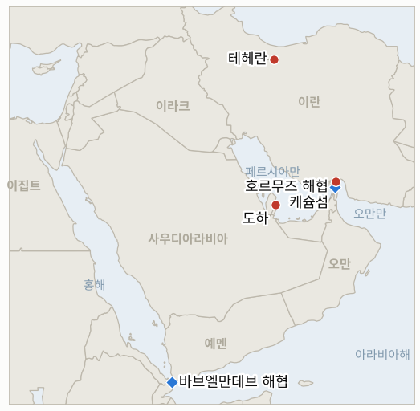

# 중동 일일 브리핑

**2026년 11월 7일**

- **보고 기간:** 약 24시간, 11월 6일 15:00 ~ 11월 7일 09:00 (한국시간)
- **종합 평가:** 트럼프는 카타르 군주와 통화한 뒤 미국이 테헤란 대표들과 대화 중이라고 밝혔으나 동시에 이란의 "나머지를 파괴"해야 할 수도 있다고 경고했고, IRGC는 유조선 2척이 호르무즈의 비공인 항로에서 기뢰에 피격됐다고 주장했다(§1.1, §1.2). 브렌트유는 2020년 이후 최대의 주간 하락세지만 금요일 정산가는 확인하지 못했다(§1.3). 서울에서는 코스피가 서킷브레이커 발동 속에 6.02% 급락한 5,059.69로 마감해 전날보다 낙폭이 커졌으며, 원인은 걸프가 아니라 반도체주 급락과 AI 규제 우려였다(§1.4).

**정정 및 업데이트:** 11월 6일 브리핑에는 목요일 브렌트유 정산가가 없었다. 이후 보도는 98.29달러(+3.9%)로 전했으므로, "93.6달러 부근의 두 달 만의 저점"은 종가가 아니라 아시아 장중 호가였다(11월 5일 자료에 반영).

---

## 1. 무슨 일이 있었나

<figure style="float:right; width:46%; margin:2pt 0 8pt 14pt;">

<figcaption style="font-size:8pt; color:#666; text-align:center; margin-top:3pt; font-style:italic;">주요 논의 지점</figcaption>
</figure>

### 1.1 트럼프, 미국이 테헤란 대표들과 대화 중이라면서 이란의 "나머지를 파괴"할 수도 있다고 경고

알자지라 라이브 블로그에 따르면 트럼프는 카타르 타밈 군주와 전화 통화한 뒤 미국이 테헤란 대표들과 대화하고 있으며 "매우 잘 되고 있다"고 말했다. 같은 블로그의 다른 판본은 미국이 이란의 "나머지를 파괴"해야 할 수도 있고 재건에 수십 년이 걸릴 것이라는 경고를 실었다([Al Jazeera](https://www.aljazeera.com/news/liveblog/2026/11/6/iran-war-live-trump-warns-us-may-have-to-destroy-rest-of-iran)). 검색 요약에는 이란이 7개 요구 충족을 조건으로 카타르 중재자를 통해 핵 관련 제안을 보냈다는 내용이 있으나 1차 출처로 확인하지 못했다. 더 내셔널은 트럼프가 안보 참모들과 협의한 뒤 공격 재개와 합의 중 하나를 택하겠다고 말했다고 전했다([The National](https://thenationalnews.com/business/energy/2026/11/06/oil-prices-set-for-weekly-drop-on-trumps-election-rout)). **신뢰도: 발언 자체는 높음, 이란 제안은 낮음(전달된 요약), 워싱턴의 선택은 낮음.**

### 1.2 IRGC, 호르무즈 "비공인" 항로에서 유조선 2척이 기뢰에 피격됐고 케슘섬 상공에서 미군 드론을 격추했다고 주장

IRGC는 유조선 2척이 비공인 항로를 이용하다 기뢰에 부딪혀 화재가 발생했다고 밝혔고, 별도로 한 유조선이 통과 중 폭발을 보고했으며, 케슘섬 상공에서 미군 드론을 격추했다고 주장했다([Al Jazeera](https://www.aljazeera.com/news/liveblog/2026/11/6/iran-war-live-trump-warns-us-may-have-to-destroy-rest-of-iran)). 오일앤가스360은 선박 공격이 기록적 수준에 가깝고 제품유 운반선에서 인명 피해를 낸 폭발이 있었다고 전했다([Oil & Gas 360](https://www.oilandgas360.com/oil-heads-for-steepest-weekly-decline-since-2020-as-iran-diplomacy-hopes-grow/)). 블로그 판본에 따라 유조선이 2척 또는 3척으로 달랐고, 드론 주장에 대한 미 중부사령부나 UKMTO의 확인은 찾지 못했다. **신뢰도: 기뢰 피격 발생은 중간, 정확한 척수와 드론은 낮음.**

### 1.3 브렌트유, 2020년 이후 최대 주간 하락세이나 금요일 정산가는 확인 못함

브렌트유 1월물은 금요일 오전 약 98.60달러, WTI는 91.00달러였고, 브렌트의 주간 하락률은 매체에 따라 12~16%로 LSEG 기록상 최대 달러 기준 낙폭이다([Oil & Gas 360](https://www.oilandgas360.com/oil-heads-for-steepest-weekly-decline-since-2020-as-iran-diplomacy-hopes-grow/); [The National](https://thenationalnews.com/business/energy/2026/11/06/oil-prices-set-for-weekly-drop-on-trumps-election-rout)). 걸프 오후 장에서는 약 96.75달러였고 목요일 정산가는 3.9% 상승한 98.29달러로 보도됐다. 하락 요인은 민주당 압승이 협상 압박으로 해석된 점, 중동 수출 회복, 10월 일평균 140만 배럴 공급 과잉이라는 JP모건 추정이다. 금요일 정산가를 찾지 못해 목요일 값만 시계열에 추가했다. **신뢰도: 수준과 주간 범위는 중간, 정산가는 미보도.**

### 1.4 코스피 6.02% 폭락한 5,059.69, 서킷브레이커 발동…2월 이후 처음 5,000선 시험

코스피는 324.11포인트 내린 5,059.69에 마감했으며 장중 저점은 4,911.28(−8.78%)이었다. 9시 3분부터 20분간 1단계 서킷브레이커가 발동했고 두 시장 모두 이틀 연속 매도 사이드카가 걸렸다([Businesskorea](https://www.businesskorea.co.kr/news/articleView.html?idxno=280719); [Newspim](https://www.newspim.com/news/view/20261106000997)). 외국인은 약 2조 7,700억 원 순매도해 6거래일 연속이자 10월 30일 이후 약 12조 원을 팔았으며, SK하이닉스 1조 9,200억 원 매도 속에 SK하이닉스는 10.44%, 삼성전자는 6.35% 하락했다. 원화는 장중 1,362.2원까지 약세를 보인 뒤 1달러당 1,356.6원(14.5원 약세)에 마감했다([뉴스1](https://www.news1.kr/finance/market-exr/6345976)). 보도는 필라델피아 반도체지수의 12% 넘는 전날 급락과 중간선거 이후 AI 데이터센터 규제 우려를 원인으로 꼽았으며, 정부의 시장 안정 조치는 찾지 못했다. **신뢰도: 종가와 수급은 높음, 원인은 중간.**

### 1.5 후티의 사우디 유조선 공격과 사우디 송유관 가동 중단이 잔존 공급 위험으로 거론

더 내셔널은 바브엘만데브 해협에서의 후티 사우디 유조선 공격과 9월 11~22일 사우디 동서 송유관 가동 중단을 유가를 계속 지지하는 요인으로 열거했다([The National](https://thenationalnews.com/business/energy/2026/11/06/oil-prices-set-for-weekly-drop-on-trumps-election-rout)). 이는 단일 출처의 배경 설명이며 보고 기간 중 새 사건이 아니고, 이스라엘 조각이나 레바논 전선에 관한 새 보도도 찾지 못했다. **신뢰도: 배경은 중간, 홍해의 새 사건은 낮음.**

---

## 2. 심층 분석: 유인과 동기

### 2.1 트럼프는 왜 합의와 이란 파괴를 동시에 말하는가?

두 발언은 하나의 협상 자세다. 위협은 카타르 채널이 열려 있는 동안 협상력을 유지하고, 진전을 말하는 것은 시장과 전쟁에 반대표를 던진 여론을 안심시킨다. 새 의회가 1월에야 개원하므로 그때까지 행동의 자유를 보존한다.

### 2.2 IRGC는 왜 "비공인" 항로의 기뢰 피격을 공개하는가?

미국이 홍보하는 남쪽 항로가 위험하다고 규정해 통항 통제권과 수수료 체계를 방어하려는 것이다. 기뢰 사건은 공식적 확전 없이 협상 지렛대를 준다.

### 2.3 해협 공격이 계속되는데 유가는 왜 이렇게 크게 떨어졌는가?

시장은 안전한 통항이 아니라 선거의 정치적 신호와 수출 회복을 가격에 반영했다. 하락폭은 프리미엄 중 전쟁 지속 기간에 대한 베팅이 얼마나 컸는지 보여주며, 협상이 결렬되면 빠르게 되돌려질 수 있다는 뜻이기도 하다.

### 2.4 걸프에 새 확전이 없던 날 코스피는 왜 6% 빠졌는가?

방아쇠는 미국 반도체주 붕괴와 AI 데이터센터 규제 우려였고, 지수를 지배하는 SK하이닉스와 삼성전자에 집중됐다. 6거래일 연속 외국인 매도와 원화 약세가 증폭시켰고 국내 기관은 물량을 다 받아내지 못했다.

### 2.5 서울은 왜 지원 조치를 내놓지 않았는가?

당국은 통상 서킷브레이커를 넘는 무질서 상태를 기다리며, 분석가들은 대체로 공황이라고 봤고 핵심 미국 고용보고서가 그날 밤 예정돼 있었다. 다만 이 조사에서 조치를 찾지 못한 것이 준비된 조치가 없다는 증거는 아니다.

---

## 3. 한국에 대한 정책적 함의

**익스포저 현황:** 한국은 원유의 약 70.7%, LNG의 약 20.4%를 중동에서 들여온다(`instructions/korea-exposure.md`, 갱신 불필요). 최신 수치(11월 6일 금요일): 코스피 5,059.69(−6.02%), 원/달러 1,356.6원, 브렌트유 목요일 정산가 98.29달러(금요일 정산가 미확인), WTI 장중 약 89~91달러.

**사안별 함의:**

- **협상과 위협(§1.1):** 엇갈린 미국 메시지는 안도보다 대비를 요구하며, 결렬 시 한국 에너지 생명선에 현재 유가가 시사하는 것보다 큰 타격을 줄 수 있다(IND-20261105-1, IND-20261105-2).
- **기뢰 피격(§1.2):** 비공인 항로 공격이 이어지면 한국 관련 유조선의 보험료와 우회 비용이 오른다(IND-20261029-1).
- **유가(§1.3):** 주간 12~16% 하락은 수입 비용과 원화에 도움이 되지만 되돌려질 수 있다(IND-20261106-3).
- **코스피와 원화(§1.4):** 반도체 및 수급 충격에 원화 약세가 겹친 것으로, 서울의 수단은 에너지가 아니라 시장 안정과 반도체 공급망 정책이다(IND-20261107-1, IND-20261107-2).
- **홍해(§1.5):** 한국행 사우디산 원유에 대한 두 번째 초크포인트 위험이다(IND-20261107-3).

**오늘 해소된 지표:** IND-20261106-2 **확인**(코스피 5,059.69 마감, 5,200 하회). IND-20261031-1과 IND-20261030-1 **확인**(11월 6일 유조선 기뢰 피격 보도). IND-20261103-2, IND-20261103-3, IND-20261031-3, IND-20261101-1, IND-20261102-2 **반증**(브렌트 정산가가 110달러나 120달러를 넘지 않음, 코스피 6,000 미달, 기한 내 공개된 미·이란 협의나 확인된 서면 답신 없음). IND-20261025-2 **만료**(걸프 해저케이블 절단 보도 없음).

**검증 가능한 지표:**

- **IND-20261107-1**(진행 중, 신규): 2026-11-14경까지 코스피가 4,800 아래로 마감하면 추가 낙폭이 확인되고, 없으면 반증된다.
- **IND-20261107-2**(진행 중, 신규): 2026-11-12경까지 정부나 감독당국이 시장 안정 조치(안정기금, 공매도 제한, 대책 포함 긴급회의)를 발표하면 확인되고, 없으면 반증된다.
- **IND-20261107-3**(진행 중, 신규): 2026-11-14경까지 UKMTO나 선사가 홍해 또는 바브엘만데브에서 사우디 연계 유조선 공격을 확인하면 확인되고, 없으면 반증된다.
- **IND-20261106-1, -3**(진행 중): 2026-11-13경까지 "정당한 표적" 위협 실행 또는 호르무즈 해안 너머의 미국 공격 공개; 2026-11-13경까지 브렌트 정산가 90달러 하회.
- **IND-20261105-1, -2, -3**(진행 중): 2026-11-12경까지 미국 공격 공개; 2026-11-15경까지 잠정 합의; 2026-11-12경까지 브렌트 정산가 100달러 상회.
- **IND-20261104-1, -2**(진행 중): 2026-11-10경까지 틀 합의 공식 발표; 2026-11-10경까지 호르무즈 방공망 너머 공격.
- **IND-20261103-1, IND-20261101-3, IND-20261029-1**(진행 중): 2026-11-10경까지 "첫날" 조치; 2026-11-08경까지 호르무즈 통항 70척 이상; 2026-11-08경까지 시노코르 관련 조치.
- **IND-20261028-2, IND-20261027-1, IND-20261023-1**(진행 중): 2026-11-10경까지 헤르조그의 조각 위임; 2026-11-10경까지 이집트 파병; 11월 한국은행 금리 인상.

---

## 4. 관찰 목록

- **카타르를 통한 미·이란 접촉이 틀 합의 발표 또는 공격으로 이어지는지(IND-20261104-1, IND-20261105-1).**
- **호르무즈 항로의 기뢰 사건과 시노코르 분쟁(IND-20261029-1).**
- **코스피 5,000선 하회와 외국인 매도에 대한 서울의 대응(IND-20261107-1, IND-20261107-2).**
- **2020년 이후 최대 주간 하락 이후 브렌트유 경로(IND-20261106-3, IND-20261105-3).**
- **홍해와 사우디 수출 경로(IND-20261107-3).**
- **헤르조그의 조각 위임 결정(IND-20261028-2).**

---

## 5. 출처 신뢰도 요약

| 주장 | 출처 | 신뢰도 |
| --- | --- | --- |
| 트럼프, 테헤란 대표들과 대화 중; 카타르 군주와 통화 | 알자지라 라이브 블로그 | 높음 |
| 트럼프: 이란의 "나머지를 파괴"할 수도 | 알자지라 라이브 블로그(다른 판본) | 중간 |
| 카타르 경유 이란 핵 제안 | 검색 요약, 미확인 | 낮음 |
| 유조선 2척 기뢰 피격; 유조선 폭발 | 알자지라 라이브 블로그, 오일앤가스360 | 중간 |
| 케슘섬 상공 미군 드론 격추 | IRGC 주장(알자지라 경유), 교차확인 없음 | 낮음 |
| 브렌트 약 98.60 / WTI 91.00 오전, 이후 약 96.75; 주간 12~16% 하락 | 오일앤가스360, 더 내셔널 | 중간 |
| 목요일 브렌트 정산가 98.29달러 | 검색 요약 | 중간 |
| 금요일 유가 정산가 | 확인 못함 | 미보도 |
| 코스피 5,059.69(−6.02%), 서킷브레이커, 외국인 2.77조 원 순매도 | Businesskorea, 뉴스핌 | 높음 |
| 원/달러 1,356.6원 | 뉴스1, 서울파이낸스, 베타뉴스 | 높음 |
| 후티의 사우디 유조선 공격; 사우디 송유관 중단 | 더 내셔널(단일 출처, 배경) | 중간 |
| 호르무즈 통항 건수 | 확인 못함 | 미보도 |
