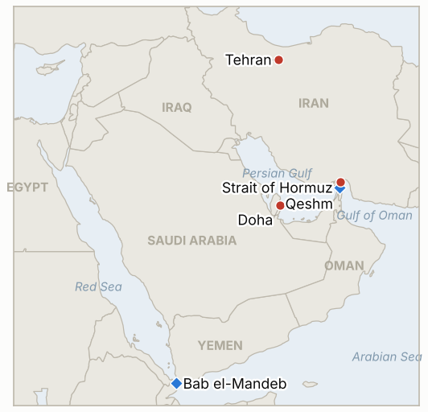

# Middle East Daily Briefing

**November 7, 2026**

- **Reporting window:** ~24 hours, November 6, 15:00 to November 7, 09:00 KST
- **Overall assessment:** Trump said the US is talking to Tehran's representatives after a call with Qatar's emir, yet also warned the US may have to "destroy" the rest of Iran, while the IRGC said two tankers hit mines on unauthorised Hormuz routes (§1.1, §1.2). Brent is heading for its steepest weekly fall since 2020, but I could not find Friday's settle (§1.3). In Seoul the KOSPI fell 6.02% to 5,059.69 after a circuit breaker, a larger rout than Thursday's, driven by a chip sell-off and AI regulation fears rather than the Gulf (§1.4).

**Corrections and updates:** The November 6 brief carried no Thursday Brent settle; later reports put it at $98.29 (+3.9%), so the "two month low near $93.6" was an intraday Asian print, not the close (consistent with the Nov 5 data row now added).

---

## 1. What Happened

<figure style="float:right; width:46%; margin:2pt 0 8pt 14pt;">

<figcaption style="font-size:8pt; color:#666; text-align:center; margin-top:3pt; font-style:italic;">Major places of discussion</figcaption>
</figure>

### 1.1 Trump says the US is talking to Tehran's representatives, and also that it may have to "destroy" the rest of Iran

Al Jazeera's live blog reported Trump saying the US is talking with Tehran's representatives and that it is "doing very well," after he spoke by phone with Qatar's Emir Sheikh Tamim; a separate version of the blog carried his warning that the US may have to "destroy" the rest of Iran, with rebuilding taking decades ([Al Jazeera](https://www.aljazeera.com/news/liveblog/2026/11/6/iran-war-live-trump-warns-us-may-have-to-destroy-rest-of-iran)). Search summaries add that Iran sent a nuclear proposal to Washington through Qatari mediators while insisting its seven demands be met, but I could not confirm that from a primary page. The National reported Trump saying he will choose between resuming attacks and an agreement after consulting his security advisers ([The National](https://thenationalnews.com/business/energy/2026/11/06/oil-prices-set-for-weekly-drop-on-trumps-election-rout)). **Confidence: High that the statements were made; Low on the Iranian proposal (relayed summary); Low on which path Washington takes.**

### 1.2 IRGC says two tankers hit mines on "unauthorised" Hormuz routes and a US drone was downed over Qeshm

The IRGC said two oil tankers struck mines and caught fire in the Strait of Hormuz while using unauthorised routes, a tanker separately reported an explosion while transiting, and the IRGC said it shot down a US drone over Qeshm Island ([Al Jazeera](https://www.aljazeera.com/news/liveblog/2026/11/6/iran-war-live-trump-warns-us-may-have-to-destroy-rest-of-iran)). Oil & Gas 360 noted attacks on vessels remain near record levels and cited a fatal explosion on a products tanker ([Oil & Gas 360](https://www.oilandgas360.com/oil-heads-for-steepest-weekly-decline-since-2020-as-iran-diplomacy-hopes-grow/)). The incident count differs between versions of the blog (two versus three tankers), and I found no CENTCOM or UKMTO confirmation of the drone claim. **Confidence: Medium that mine strikes occurred; Low on the exact count and the drone.**

### 1.3 Brent heads for its steepest weekly fall since 2020, but Friday's settle was not found

Brent January futures were about $98.60 and WTI $91.00 in Friday morning trading, with Brent on course for a weekly loss of roughly 12% to 16% depending on the outlet, the largest dollar fall in LSEG records ([Oil & Gas 360](https://www.oilandgas360.com/oil-heads-for-steepest-weekly-decline-since-2020-as-iran-diplomacy-hopes-grow/); [The National](https://thenationalnews.com/business/energy/2026/11/06/oil-prices-set-for-weekly-drop-on-trumps-election-rout)). By the afternoon Gulf session Brent was about $96.75, and Thursday's settle was reported at $98.29 after a 3.9% rise. Drivers were the Democratic sweep read as pressure to negotiate, recovering Middle East exports and a JPMorgan estimate of a 1.4 million barrel per day surplus in October. I did not find Friday's settle, so only the Thursday value is added to the series. **Confidence: Medium on levels and the weekly range; settle not reported.**

### 1.4 KOSPI crashes 6.02% to 5,059.69 after a circuit breaker, its first test of 5,000 since February

The KOSPI fell 324.11 points to 5,059.69, after an intraday low of 4,911.28 (−8.78%); a level one circuit breaker halted trading for 20 minutes from 9:03 and sell sidecars fired on both boards for a second day ([Businesskorea](https://www.businesskorea.co.kr/news/articleView.html?idxno=280719); [Newspim](https://www.newspim.com/news/view/20261106000997)). Foreigners net sold about 2.77 trillion won, a sixth straight session and roughly 12 trillion won since October 30, led by 1.92 trillion won of SK hynix, which fell 10.44%; Samsung Electronics fell 6.35%. The won closed at 1,356.6 per dollar, 14.5 won weaker, after touching 1,362.2 ([News1](https://www.news1.kr/finance/market-exr/6345976)). Reports tie the move to an overnight plunge of over 12% in the Philadelphia Semiconductor Index and fears of AI data center regulation after the midterms; I found no government stabilization measure. **Confidence: High on closes and flows; Medium on attributed causes.**

### 1.5 Houthi attacks on Saudi tankers and Saudi pipeline outage are cited as lingering supply risks

The National listed Houthi attacks on Saudi tankers in the Bab el-Mandeb strait and Saudi Arabia's East West pipeline shutdown between September 11 and 22 among the factors still supporting prices ([The National](https://thenationalnews.com/business/energy/2026/11/06/oil-prices-set-for-weekly-drop-on-trumps-election-rout)). This is background context in a single source, not a new incident in the window, and I found no fresh reporting on Israel's government formation or the Lebanon front. **Confidence: Medium on the background; Low on any new Red Sea incident.**

---

## 2. Deep Dive: Incentives and Motives

### 2.1 Why does Trump talk of both a deal and destroying Iran?

The two lines serve one negotiating posture: the threat keeps leverage while the Qatari channel is open, and the talk of progress reassures markets and a public that has just voted against the war. With the new Congress not seated until January, he keeps freedom of action until then.

### 2.2 Why does the IRGC publicize mine strikes on "unauthorised" routes?

It frames the US promoted southern route as unsafe, defending its claim to control transit and the authority's fee regime. Mine incidents give Iran leverage in talks without a formal escalation.

### 2.3 Why did oil fall so far while shipping attacks continued?

Markets priced the political signal from the election and recovering exports, not safe passage. The fall shows how much of the premium was a bet on the war's duration, which also means it can reverse quickly on a failed round of talks.

### 2.4 Why did the KOSPI fall 6% on a day with no Gulf escalation?

The trigger was a collapse in US chip stocks and fear of AI data center regulation, concentrated in SK hynix and Samsung that dominate the index. Foreign selling for six sessions and a weaker won amplified it, and domestic institutions could not absorb the flow.

### 2.5 Why did Seoul not announce support measures?

Authorities usually wait for disorderly conditions beyond the circuit breaker; analysts framed the move as largely panic, and the key US jobs report was due that night. The absence of a measure in my research is not proof none was prepared.

---

## 3. Policy Implications for South Korea

**Exposure snapshot:** South Korea draws about 70.7% of its crude and 20.4% of its LNG from the Middle East (`instructions/korea-exposure.md`, no update needed). Latest prints, Friday November 6: KOSPI 5,059.69 (down 6.02%), USD/KRW 1,356.6; Brent settle $98.29 on Thursday (Friday settle not found), WTI about $89 to $91 intraday.

**Implications by development:**

- **Talks and threats (§1.1):** Mixed US messages argue for readiness over relief; a breakdown would hit Korean energy lifelines harder than the oil price now implies (IND-20261105-1, IND-20261105-2).
- **Mine strikes (§1.2):** Continued attacks on unauthorised routes raise insurance and routing costs for Korean-linked tankers (IND-20261029-1).
- **Oil (§1.3):** A weekly 12% to 16% fall helps the import bill and the won, but is reversible (IND-20261106-3).
- **KOSPI and won (§1.4):** The rout is a chip and flow shock with a weaker won; Seoul's levers are market stabilization and chip supply chain policy, not energy (IND-20261107-1, IND-20261107-2).
- **Red Sea (§1.5):** A second chokepoint risk for Saudi crude bound for Korea (IND-20261107-3).

**Resolved today:** IND-20261106-2 **confirmed** (KOSPI closed at 5,059.69, below 5,200). IND-20261031-1 and IND-20261030-1 **confirmed** (IRGC and others reported mine strikes on tankers November 6). IND-20261103-2, IND-20261103-3, IND-20261031-3, IND-20261101-1 and IND-20261102-2 **falsified** (Brent never settled above $110 or $120; KOSPI never above 6,000; no disclosed US-Iran session or confirmed written reply by the deadline). IND-20261025-2 **expired** (no Gulf cable cut reported).

**Testable indicators:**

- **IND-20261107-1** (open, new): A KOSPI close below 4,800 on any session by ~2026-11-14 confirms further drawdown; none falsifies.
- **IND-20261107-2** (open, new): An announced Korean government or regulator market stabilization measure (stabilization fund, short selling limit, emergency meeting with measures) by ~2026-11-12 confirms; none falsifies.
- **IND-20261107-3** (open, new): A UKMTO or operator confirmed attack on a Saudi-linked tanker in the Red Sea or Bab el-Mandeb by ~2026-11-14 confirms; none falsifies.
- **IND-20261106-1, -3** (open): Execution of the "legitimate target" threat or disclosed US strike beyond the Hormuz coast by ~2026-11-13; Brent settle below $90 by ~2026-11-13.
- **IND-20261105-1, -2, -3** (open): Disclosed US strike by ~2026-11-12; interim agreement by ~2026-11-15; Brent settle above $100 by ~2026-11-12.
- **IND-20261104-1, -2** (open): Public framework announcement by ~2026-11-10; strike beyond Hormuz air defenses by ~2026-11-10.
- **IND-20261103-1, IND-20261101-3, IND-20261029-1** (open): "Day one" measures by ~2026-11-10; Hormuz count of 70 or more by ~2026-11-08; Sinokor action by ~2026-11-08.
- **IND-20261028-2, IND-20261027-1, IND-20261023-1** (open): Herzog mandate by ~2026-11-10; Egyptian deployment by ~2026-11-10; Bank of Korea hike in November.

---

## 4. Watch List

- **Whether US-Iran contacts via Qatar produce an announced framework or a strike (IND-20261104-1, IND-20261105-1).**
- **Mine incidents on Hormuz routes and the Sinokor dispute (IND-20261029-1).**
- **KOSPI below 5,000 and Seoul's response to foreign selling (IND-20261107-1, IND-20261107-2).**
- **Brent's path after the steepest weekly fall since 2020 (IND-20261106-3, IND-20261105-3).**
- **Red Sea and Saudi export routes (IND-20261107-3).**
- **Herzog's mandate decision (IND-20261028-2).**

---

## 5. Source Quality Summary

| Claim | Sources | Confidence |
| --- | --- | --- |
| Trump says US is talking to Tehran's representatives; call with Qatar's emir | Al Jazeera live blog | High |
| Trump: may have to "destroy" rest of Iran | Al Jazeera live blog (alternate version) | Medium |
| Iran nuclear proposal sent via Qatar | Search summary, unconfirmed | Low |
| Two tankers hit mines; tanker explosion | Al Jazeera live blog, Oil & Gas 360 | Medium |
| US drone downed over Qeshm | IRGC claim via Al Jazeera, uncorroborated | Low |
| Brent ~$98.60 / WTI $91.00 morning; ~$96.75 later; weekly fall 12% to 16% | Oil & Gas 360, The National | Medium |
| Thursday Brent settle $98.29 | Search summary | Medium |
| Friday oil settle | Not found | Not reported |
| KOSPI 5,059.69 (−6.02%), circuit breaker, foreigners −2.77tn won | Businesskorea, Newspim | High |
| Won 1,356.6 | News1, Seoul Finance, Betanews | High |
| Houthi attacks on Saudi tankers; Saudi pipeline outage | The National (single source, background) | Medium |
| Hormuz transit count | Not reported | Not reported |
