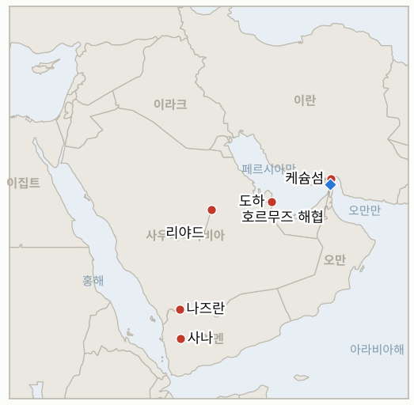

# 중동 일일 브리핑

**2026년 11월 8일**

- **보고 기간:** 약 24시간, 11월 7일 15:00 ~ 11월 8일 09:00 (한국시간)
- **종합 평가:** 주말 소식은 무력과 중재가 뒤섞였다. 미국은 금요일 밤 케슘섬의 이란 방공망을 타격했고, 트럼프는 "우리는 싸우고 있지 않다"고 말했으며 카타르는 중재를 계속한다고 밝혔다. 이란은 카타르의 제안을 검토하면서도 기존 조건을 고수하고 있다(§1.1, §1.2). 시장이 휴장이어서 핵심 데이터 보완은 금요일 유가 정산가(브렌트유 98.32달러, WTI 90.83달러)와 어제 놓친 서울의 안정화 조치다(§1.3, §1.5). 후티는 리야드 공항과 아람코 시설을 타격했다고 주장했으나 리야드는 확인하지 않았다(§1.4). 월요일 코스피 장이 서울 조치의 첫 시험대다.

**정정 및 업데이트:** 11월 7일 브리핑은 한국 정부의 증시 안정화 조치를 찾지 못했다고 썼다. 실제로는 11월 6일 금요일 F4 긴급 회의가 증권사의 신용융자 담보비율(140%) 유지의무를 11월 9일부터 3개월간 면제하고, 변동성이 커지면 추가 조치를 준비하겠다고 밝혔다. 따라서 IND-20261107-2는 확인으로 종결한다. 같은 브리핑은 금요일 유가 정산가를 찾지 못했다고 썼으나, 브렌트유 1월물은 98.32달러, WTI는 90.83달러로 마감했고 1월물 기준 브렌트유 주간 하락률은 약 13.2%다(다른 매체는 최대 16%로 전했다).

---

## 1. 무슨 일이 있었나

<figure style="float:right; width:46%; margin:2pt 0 8pt 14pt;">

<figcaption style="font-size:8pt; color:#666; text-align:center; margin-top:3pt; font-style:italic;">주요 논의 지점</figcaption>
</figure>

### 1.1 미국, 케슘섬 이란 방공망 타격… 트럼프는 협상에서 "많은 진전" 주장

금요일 밤 미국은 케슘섬의 방공 시스템에 대한 제한적 타격을 실시했다. 트럼프는 이를 "사소한" 조치라 부르며 표적이 몇 분 안에 무력화됐다고 말했고, 카타르 주도 협상에서 "많은 진전"이 있다며 "우리는 싸우고 있지 않다"고 강조했다([Euronews](https://www.euronews.com/2026/11/07/us-launches-new-targeted-strikes-on-iran-as-trump-claims-progress-in-talks-with-tehran)). 이란 국영매체는 미사일 2발이 케슘섬 수자 지역에 떨어졌다고만 전했고 표적은 밝히지 않았다. 혁명수비대(IRGC)는 미군 드론을 격추했다고 주장했으나 미국은 확인하지 않았다. 민주당의 중간선거 승리 이후 첫 미국의 타격이며, 월요일 케슘, 헹감, 반다르아바스 인근의 "방어적" 타격에 이은 것이다. **신뢰도: 미국의 타격 사실은 높음(트럼프 본인 설명), 피해는 중간, 드론은 낮음.**

### 1.2 카타르 "중재 계속"… 이란은 제안을 검토하며 조건을 재확인

카타르는 협상 결렬 보도를 부인했다. 셰이크 무함마드 빈 압둘라흐만 총리는 위기를 "방치할 수 없다"며 카타르의 관여가 계속될 것이라고 밝혔고, 트럼프는 타밈 군주와, 헤그세스 장관은 카타르 국방 담당자와 통화했다([Euronews](https://www.euronews.com/2026/11/07/us-launches-new-targeted-strikes-on-iran-as-trump-claims-progress-in-talks-with-tehran)). AP에 따르면 중동 당국자 2명은 이란이 핵 분쟁에 관한 카타르 제안을 검토 중이지만, 미국이 해상 봉쇄 해제, 제재 완화, 자산 동결 해제, 보상, 레바논 포함 지역 전체의 적대행위 종식을 이행하기 전에는 핵 활동을 협상하지 않겠다는 입장이라고 전했다. 아라그치 외무장관은 이틀간 최소 12개국 외무장관과 통화했다고 밝혔다. **신뢰도: 발언은 높음, 합의 근접 여부는 출처가 엇갈려 낮음.**

### 1.3 금요일 유가 정산가: 브렌트유 98.32달러, WTI 90.83달러, 주간 약 13% 하락

금요일 브렌트유 1월물은 98.32달러(+0.03%), WTI 12월물은 90.83달러(+0.3%)로 정산됐고, 근월물 선물은 주간 약 13.2% 하락해 2022년 이후 최대 주간 낙폭을 기록했다([Rigzone](https://www.rigzone.com/news/oil_posts_biggest_weekly_drop_since_2022-06-nov-2026-185035-article)). 요인으로는 외교 기대, 사우디와 UAE의 전쟁 이전 수준 선적 복귀(리야드는 아시아 구매자 가격을 6년 만의 최저로 인하), 위험 회피 속 주식 매도, 달러 강세가 거론됐다. 다른 매체는 계약과 기준에 따라 주간 16% 하락, "2020년 이후" 비교를 제시했다. **신뢰도: 정산가는 높음, 주간 하락률은 중간.**

### 1.4 후티, 리야드 공항과 아람코 시설 타격 주장… 사우디는 확인 안 해

후티 대변인 야히아 사리는 탄도·순항미사일과 드론으로 사우디를 겨냥한 6건의 작전을 주장했다. 대상은 킹 칼리드 공항과 리야드·쿠라이스의 아람코 시설, 나즈란의 국가방위군 캠프, 다와드미의 8번 펌프장이며, 후티 보건 당국이 사나 인근 사우디 공습으로 최소 25명이 숨졌다고 주장한 데 대한 보복이라고 했다([India TV](https://www.indiatvnews.com/news/world/houthis-claim-strikes-on-riyadh-airport-aramco-oil-facility-saudi-military-after-25-killed-in-yemen-strikes-2026-11-07-1058925)). 사우디는 공격이나 피해를 확인하지 않았으나, 민방위 당국이 나즈란에 경보를 내렸다가 해제했고 동맹군은 리야드로 향하던 순항미사일을 요격했다고 밝혔다. 독립적으로 검증된 것은 없으며 시장이 휴장이어서 유가 반응은 없었다. **신뢰도: 공격 시도는 중간, 피해는 낮음.**

### 1.5 서울의 주말: F4 회의 후 신용융자 담보비율 면제가 월요일부터 시행

금요일 코스피가 장중 최대 8.5% 하락한 뒤, 경제부총리가 2일 연속 F4(재정경제부, 한국은행, 금융위원회, 금융감독원 수장) 회의를 열어 반대매매 방지를 위해 증권사의 신용융자 담보비율 유지의무를 11월 9일부터 3개월간 면제하고, 변동성이 커지면 추가 안정화 조치를 준비한다고 밝혔다([News1](https://www.news1.kr/economy/trend/6345258), [Fnnews](https://www.fnnews.com/news/202611061003530468)). 140%라는 수치와 참석자는 검색 요약과 헤드라인에 근거하며 기사 전문으로 확인하지 못했다. 주말에는 장이 열리지 않아 월요일이 첫 시장 시험이다. **신뢰도: 면제 발표는 높음, 140%와 3개월 조건은 중간.**

---

## 2. 심층 분석: 유인과 동기

### 2.1 미국은 왜 케슘을 타격하면서 동시에 "싸우고 있지 않다"고 말하나?

방공망에 대한 제한적 타격은 공격 재개 옵션의 신뢰성과 항공기 안전을 지키고, "사소한"이라는 표현은 전쟁에 반대표를 던진 국내 여론과 카타르 중재자에게 이것이 확전이 아님을 알린다. 워싱턴은 채널을 깨지 않고 협상 레버리지를 유지한다.

### 2.2 이란은 왜 제안을 검토하면서도 핵 의제부터 논의하기를 거부하나?

테헤란은 핵이라는 핵심 협상 카드를 내놓기 전에 봉쇄, 제재, 자산 문제가 먼저 움직이는 순서를 원한다. 카타르 문서를 검토하는 것은 비용이 적고 도하와 걸프국을 자기편으로 유지해 주지만, 공개한 조건 목록은 국내적으로 양보 폭을 제약한다.

### 2.3 카타르는 왜 협상이 결렬되지 않았다고 강하게 말하나?

도하는 미군 기지와 라스라판을 품고 있어 전쟁이 확대되면 노출이 크므로 빠른 잠정 합의가 이익이다. 공개적 낙관은 어느 쪽이든 협상장을 떠나는 정치적 비용을 높이는 효과도 있다.

### 2.4 후티는 왜 지금 리야드 타격을 공개했나?

민간인 사망에 대한 보복이라는 틀은 후티의 국내 서사를 뒷받침하고, 사우디 에너지 시설 공격은 후티가 검증하거나 유지할 수 있는 범위 이상의 대사우디 압박 효과를 낸다. 사우디가 피해에 침묵하는 것은 피해가 작거나 유가를 건드리고 싶지 않다는 뜻일 수 있다.

### 2.5 서울은 왜 기금이 아니라 신용융자 규정으로 대응했나?

레버리지 포지션의 강제 청산이 하락장에서 가장 빠른 악순환 고리였고, 규정 면제는 비용이 적고 되돌릴 수 있으며 즉시 효과가 나므로, 증시안정기금이나 공매도 제한 같은 무거운 수단은 예비로 남겨 둔 것이다.

---

## 3. 한국에 대한 정책적 함의

**익스포저 현황:** 한국은 원유의 약 70.7%, LNG의 약 20.4%를 중동에서 들여온다(`instructions/korea-exposure.md`, 갱신 불필요). 11월 6일 금요일 최신 수치: 코스피 5,059.69(−6.02%), 원-달러 환율 1,356.6원, 브렌트유 98.32달러, WTI 90.83달러. 11월 7~8일은 휴장.

**사안별 함의:**

- **케슘 타격과 협상(§1.1, §1.2):** 무력과 중재가 동시에 진행되므로 한국은 조기 타결도 전면 재개도 가정하지 않고 대비해야 한다(IND-20261104-1, IND-20261108-3).
- **유가(§1.3):** 브렌트유 98달러와 사우디·UAE 수출 회복은 수입 부담을 낮추지만, 협상이 깨지면 13% 주간 하락은 되돌려질 수 있다(IND-20261106-3, IND-20261105-3).
- **후티의 사우디 시설 주장(§1.4):** 어느 하나라도 확인되면 사우디산 원유는 홍해와 국내 인프라 위험에 노출된다(IND-20261108-1, IND-20261107-3).
- **신용융자 면제(§1.5):** 강제 청산 경로 하나를 줄이지만 반도체와 외국인 자금 흐름은 그대로이며, 월요일 장이 효과 여부를 보여 줄 것이다(IND-20261108-2, IND-20261107-1).

**오늘 종결:** IND-20261107-2 **확인**(신용융자 담보비율 면제 11월 6일 발표). IND-20261105-1 **확인**(트럼프가 케슘 타격을 공개). IND-20261101-3 **반증**(70척 이상 전체 선박 호르무즈 통항 집계 발표 없음). IND-20261029-1 **반증**(확인된 시노코 선박 벌금·억류·나포 없음, 한국어 검색은 제한적).

**검증 가능한 지표:**

- **IND-20261108-1**(신규, 진행): 사우디 정부 또는 아람코가 특정 시설의 피해나 가동 중단을 ~2026-11-15까지 확인하면 확인, 없으면 반증.
- **IND-20261108-2**(신규, 진행): 2026-11-09 코스피 종가가 5,059.69 위면 안정화 확인, 이하면 반증.
- **IND-20261108-3**(신규, 진행): 카타르 제안에 대한 이란의 공식 답변이 ~2026-11-13까지 확인되면 확인, 없으면 반증.
- **IND-20261107-1, -3**(진행): ~2026-11-14까지 코스피 종가 4,800 미만; 홍해에서 사우디 연계 유조선 공격 확인.
- **IND-20261106-1, -3**(진행): ~2026-11-13까지 걸프 주최국 공격 또는 호르무즈 해안 밖 미국 타격; 브렌트유 정산가 90달러 미만.
- **IND-20261105-2, -3**(진행): ~2026-11-15까지 잠정 합의; ~2026-11-12까지 브렌트유 정산가 100달러 초과.
- **IND-20261104-1, -2**(진행): ~2026-11-10까지 합의된 틀; 호르무즈 해안 방공망을 넘는 타격.
- **IND-20261103-1, IND-20261028-2, IND-20261027-1, IND-20261023-1**(진행): ~2026-11-10까지 "첫날" 조치; 헤르조그의 조각 위임; 이집트 파병; 11월 한국은행 금리 인상.

---

## 4. 관찰 목록

- **카타르 제안에 대한 이란의 답변과 케슘식 타격의 확전 여부(IND-20261108-3, IND-20261104-2).**
- **월요일 코스피 개장과 추가 F4 조치(IND-20261108-2, IND-20261107-1).**
- **후티 타격에 대한 사우디의 확인 또는 부인(IND-20261108-1).**
- **주간 급락 이후 브렌트유 경로(IND-20261106-3, IND-20261105-3).**
- **11월 10일 크네세트 선서와 헤르조그의 조각 위임(IND-20261028-2).**
- **호르무즈 기뢰 사고와 검증되지 않은 혁명수비대 주장.**

---

## 5. 출처 신뢰도 요약

| 주장 | 출처 | 신뢰도 |
| --- | --- | --- |
| 미국의 케슘 방공망 제한적 타격; 트럼프 "사소한", "싸우고 있지 않다" | Euronews(트럼프 발언 인용) | 높음 |
| 수자 지역 이란 미사일 피격; IRGC 드론 격추 | 이란 국영매체, IRGC(Euronews 경유), 미국 미확인 | 낮음 |
| 카타르 결렬 부인; 이란 제안 검토; 조건 목록 | Euronews, AP(Euronews 경유) | 중간 |
| 브렌트유 98.32달러, WTI 90.83달러 정산; 주간 13.2% 하락 | Rigzone | 높음 |
| 주간 16% 하락 | 타 매체 경유 로이터 검색 요약 | 낮음 |
| 후티의 사우디 시설 6건 공격 주장 | India TV(후티 대변인, AP) | 중간 |
| 사나 인근 사우디 공습 사망 25명 | 후티 보건부(AP 경유), 미검증 | 낮음 |
| 신용융자 담보비율 면제, 11월 9일부터 3개월 | Fnnews, News1, 디지털데일리 헤드라인; 140%는 검색 요약 | 중간 |
| 호르무즈 통항 집계 | 보도 없음 | 미보도 |
