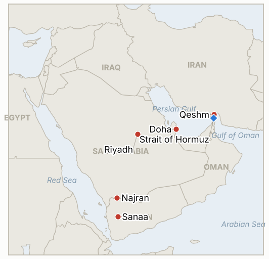

# Middle East Daily Briefing

**November 8, 2026**

- **Reporting window:** ~24 hours, November 7, 15:00 to November 8, 09:00 KST
- **Overall assessment:** Weekend news was a mix of force and mediation: the US struck Iranian air defences on Qeshm on Friday night while Trump said "we are not fighting" and Qatar said its mediation continues, with Iran still reviewing Qatari proposals and holding to its conditions (§1.1, §1.2). Markets were closed, so the main data fix is Friday's oil settles ($98.32 Brent, $90.83 WTI) and a Seoul stabilization step I missed yesterday (§1.3, §1.5). The Houthis claimed strikes on Riyadh's airport and Aramco sites, which Riyadh has not confirmed (§1.4). Monday's KOSPI session is the first test of Seoul's measure.

**Corrections and updates:** The November 7 brief said I found no Korean government stabilization measure. In fact the F4 emergency meeting on Friday, November 6 exempted securities firms from the 140% margin loan collateral maintenance rule for three months from November 9, and said further measures were being prepared; IND-20261107-2 is therefore resolved confirmed. The same brief said Friday's oil settle was not found: Brent January settled at $98.32 and WTI at $90.83, and the weekly Brent fall was about 13.2% on the January contract (other outlets cited up to 16%).

---

## 1. What Happened

<figure style="float:right; width:46%; margin:2pt 0 8pt 14pt;">

<figcaption style="font-size:8pt; color:#666; text-align:center; margin-top:3pt; font-style:italic;">Major places of discussion</figcaption>
</figure>

### 1.1 The US strikes Iranian air defences on Qeshm while Trump claims "a lot of progress" in talks

On Friday night the US carried out what it called limited strikes on air defence systems on Qeshm Island; Trump called the action "minor," said the target was knocked out within minutes, and insisted "we are not fighting" while citing "a lot of progress" through Qatari-led talks ([Euronews](https://www.euronews.com/2026/11/07/us-launches-new-targeted-strikes-on-iran-as-trump-claims-progress-in-talks-with-tehran)). Iranian state media said two missiles hit the Suza area of Qeshm without naming targets, and the IRGC claimed a US drone was downed, which the US did not confirm. It was the first US strike since the Democratic midterm win and followed Monday's "defensive" strikes near Qeshm, Hengam and Bandar Abbas. **Confidence: High that a US strike occurred (Trump's own account); Medium on damage; Low on the drone.**

### 1.2 Qatar says mediation continues; Iran is reviewing proposals and restates its conditions

Qatar denied reports that the talks had collapsed, and Prime Minister Sheikh Mohammed bin Abdulrahman said the crisis "cannot be left unresolved" and Qatar's engagement will continue; Trump spoke with Emir Sheikh Tamim and Hegseth with his Qatari counterpart ([Euronews](https://www.euronews.com/2026/11/07/us-launches-new-targeted-strikes-on-iran-as-trump-claims-progress-in-talks-with-tehran)). Per AP, two officials said Iran was reviewing Qatari proposals on the nuclear dispute but would not negotiate its nuclear activities until the US ends its naval blockade, lifts sanctions, unfreezes assets, pays compensation and ends hostilities region wide including Lebanon. Foreign Minister Araghchi said he called at least 12 counterparts over two days, and an army spokesman vowed enemy bases would never be rebuilt. **Confidence: High on the statements; Low on how close a deal is, since sources conflict.**

### 1.3 Friday's oil settles: Brent $98.32, WTI $90.83, a weekly fall of about 13%

Brent January settled at $98.32 (+0.03%) and WTI December at $90.83 (+0.3%) on Friday, with front month futures down about 13.2% on the week, the largest percentage fall since 2022 by that measure ([Rigzone](https://www.rigzone.com/news/oil_posts_biggest_weekly_drop_since_2022-06-nov-2026-185035-article)). Drivers cited were diplomacy hopes, Saudi Arabia and the UAE restoring shipments toward prewar levels (Riyadh cut prices for Asian buyers to a six year low), risk-off equity selling and a firmer dollar. Other outlets cite a 16% weekly fall and "since 2020" comparisons, depending on contract and base. **Confidence: High on the settles; Medium on the weekly percentage.**

### 1.4 Houthis claim strikes on Riyadh airport and Aramco sites; Riyadh confirms nothing

Houthi spokesman Yahya Saree claimed six operations against Saudi Arabia with ballistic and cruise missiles and drones, naming King Khalid airport and Aramco facilities in Riyadh, Khurais, a National Guard camp in Najran and Pumping Station No. 8 at Dawadmi, as retaliation for Saudi strikes that Houthi health officials said killed at least 25 near Sanaa ([India TV](https://www.indiatvnews.com/news/world/houthis-claim-strikes-on-riyadh-airport-aramco-oil-facility-saudi-military-after-25-killed-in-yemen-strikes-2026-11-07-1058925)). Saudi Arabia did not confirm the attacks or damage, though civil defence issued and then cleared a Najran alert and the coalition said it intercepted a cruise missile bound for Riyadh. Nothing was verified independently, and oil prices did not react because markets were closed. **Confidence: Medium that attacks were attempted; Low on any damage.**

### 1.5 Seoul's weekend: margin collateral waiver takes effect Monday after Friday's F4 meeting

After the KOSPI fell as much as 8.5% intraday on Friday, the finance minister convened the F4 heads (finance ministry, Bank of Korea, Financial Services Commission, Financial Supervisory Service) for a second straight day and exempted securities firms from the margin loan collateral maintenance requirement for three months from November 9, to prevent forced liquidation, while saying more stabilization steps were prepared if volatility rose ([News1](https://www.news1.kr/economy/trend/6345258); [Fnnews](https://www.fnnews.com/news/202611061003530468)). The 140% figure and attendee list come from a search summary and headlines, not a full article. No session was held on the weekend, so Monday is the first market test. **Confidence: High that a waiver was announced; Medium on its 140% and three month terms.**

---

## 2. Deep Dive: Incentives and Motives

### 2.1 Why strike Qeshm and say "we are not fighting" at the same time?

A narrow strike on air defences keeps the US option to resume attacks credible and protects aircraft, while the "minor" framing tells a public that just voted against the war, and the Qatari mediators, that this is not escalation. Washington keeps leverage without breaking the channel.

### 2.2 Why does Iran review proposals but refuse to discuss the nuclear file first?

Tehran wants sequencing in which the blockade, sanctions and assets move before its main bargaining chip does. Reviewing Qatari papers costs little and keeps Doha and the Gulf states on side, while the public list of conditions limits what it can concede at home.

### 2.3 Why is Qatar so insistent that talks have not collapsed?

Doha hosts US forces and Ras Laffan and is exposed if the war widens, so its interest is a quick interim deal. Public optimism also raises the political price for either side of walking away.

### 2.4 Why did the Houthis publicize strikes on Riyadh now?

They frame them as retaliation for civilian deaths in Yemen, which supports their domestic narrative, and attacks on Saudi energy sites carry leverage over Riyadh beyond what Houthi forces can verify or hold. Saudi silence on damage suggests either small effects or a wish not to move oil markets.

### 2.5 Why did Seoul act through margin rules rather than a fund?

Forced selling of leveraged positions was the fastest feedback loop in a falling market, and a rule waiver is cheap, reversible and immediate, leaving heavier tools such as a stabilization fund or short selling limits in reserve.

---

## 3. Policy Implications for South Korea

**Exposure snapshot:** South Korea draws about 70.7% of its crude and 20.4% of its LNG from the Middle East (`instructions/korea-exposure.md`, no update needed). Latest prints, Friday November 6: KOSPI 5,059.69 (down 6.02%), USD/KRW 1,356.6, Brent $98.32 and WTI $90.83 settles. No sessions on November 7 or 8.

**Implications by development:**

- **Qeshm strike and talks (§1.1, §1.2):** Force and mediation are running together, so Korean planning should assume neither a quick deal nor a full resumption (IND-20261104-1, IND-20261108-3).
- **Oil (§1.3):** A $98 Brent and recovering Saudi and UAE exports lower the import bill, but the 13% weekly fall is reversible if talks break (IND-20261106-3, IND-20261105-3).
- **Houthi claims on Saudi sites (§1.4):** Korea's crude from Saudi Arabia faces a Red Sea and domestic infrastructure risk if any claim is confirmed (IND-20261108-1, IND-20261107-3).
- **Margin waiver (§1.5):** It removes one forced selling channel, but the chip and foreign flow drivers are untouched; Monday shows whether it matters (IND-20261108-2, IND-20261107-1).

**Resolved today:** IND-20261107-2 **confirmed** (margin collateral waiver announced November 6). IND-20261105-1 **confirmed** (Trump disclosed the Qeshm strike). IND-20261101-3 **falsified** (no all vessel Hormuz count of 70 or more published). IND-20261029-1 **falsified** (no confirmed Sinokor fine, detention or seizure found; Korean-language search was limited).

**Testable indicators:**

- **IND-20261108-1** (open, new): A Saudi government or Aramco confirmation of damage or an outage at a named facility by ~2026-11-15 confirms; none falsifies.
- **IND-20261108-2** (open, new): A KOSPI close above 5,059.69 on 2026-11-09 confirms stabilization; a close at or below it falsifies.
- **IND-20261108-3** (open, new): A confirmed formal Iranian reply to the Qatari proposals by ~2026-11-13 confirms; none falsifies.
- **IND-20261107-1, -3** (open): KOSPI close below 4,800 by ~2026-11-14; confirmed attack on a Saudi-linked tanker in the Red Sea by ~2026-11-14.
- **IND-20261106-1, -3** (open): Attack on a Gulf host state or US strike beyond the Hormuz coast by ~2026-11-13; Brent settle below $90 by ~2026-11-13.
- **IND-20261105-2, -3** (open): Interim agreement by ~2026-11-15; Brent settle above $100 by ~2026-11-12.
- **IND-20261104-1, -2** (open): Agreed framework by ~2026-11-10; strike beyond Hormuz coastal defences by ~2026-11-10.
- **IND-20261103-1, IND-20261028-2, IND-20261027-1, IND-20261023-1** (open): "Day one" measures by ~2026-11-10; Herzog mandate by ~2026-11-10; Egyptian deployment by ~2026-11-10; Bank of Korea hike in November.

---

## 4. Watch List

- **Iran's reply to Qatari proposals and whether Qeshm style strikes escalate (IND-20261108-3, IND-20261104-2).**
- **Monday's KOSPI open under the margin waiver, and any further F4 steps (IND-20261108-2, IND-20261107-1).**
- **Saudi confirmation or denial of Houthi hits (IND-20261108-1).**
- **Brent after the weekly fall (IND-20261106-3, IND-20261105-3).**
- **Israel's Knesset swearing in on November 10 and Herzog's mandate (IND-20261028-2).**
- **Hormuz mine incidents and unverified IRGC claims.**

---

## 5. Source Quality Summary

| Claim | Sources | Confidence |
| --- | --- | --- |
| US limited strike on Qeshm air defences; Trump "minor," "not fighting" | Euronews (citing Trump statements) | High |
| Iranian missile hits at Suza; IRGC drone downing | Iranian state media, IRGC via Euronews; US unconfirmed | Low |
| Qatar denies collapse; Iran reviewing proposals; conditions list | Euronews, AP via Euronews | Medium |
| Brent $98.32, WTI $90.83 settles; weekly fall 13.2% | Rigzone | High |
| Weekly fall of 16% | Search summary of Reuters via other outlets | Low |
| Houthi claims of six operations on Saudi sites | India TV (Houthi spokesman, AP) | Medium |
| Saudi strikes killed 25 near Sanaa | Houthi health ministry via AP, unverified | Low |
| Seoul margin collateral waiver, three months from Nov 9 | Fnnews, News1, Digital Daily headlines; 140% from search summary | Medium |
| Hormuz transit count | Not reported | Not reported |
