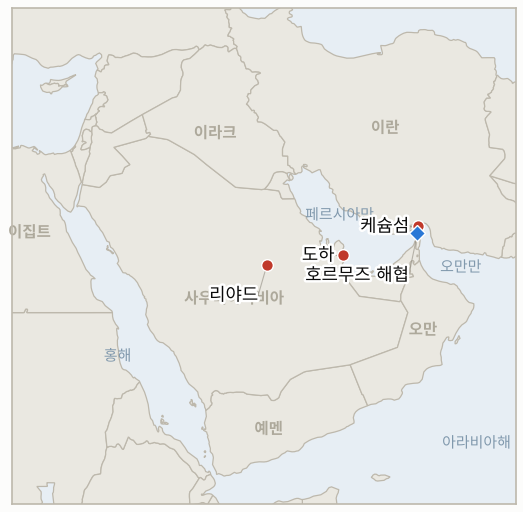

# 중동 일일 브리핑

**2026년 11월 9일**

- **보고 기간:** 약 24시간, 11월 8일 15:00 ~ 11월 9일 06:00 (한국시간)
- **종합 평가:** 조용한 일요일이었다. 새로운 타격도, 이란의 답변도, 합의도 나타나지 않았고 어제의 구도가 유지된다. 미국의 케슘섬 "사소한 타격", 카타르의 48시간 이행 계획 추진, 이란의 검토 지속이다(§1.1, §1.2). 서울의 신용융자 면제가 오늘 시행되며 코스피는 주간 11.7% 하락한 상태다(§1.3). 작성 시점에 월요일 서울장과 ICE 가격이 나오지 않아 새 가격 데이터는 추가하지 않았고, 오늘 오후 코스피 장이 첫 시험대다. 해당 시간대 검색 결과가 빈약해 뉴스 부재는 약한 근거로만 봐야 한다.

---

## 1. 무슨 일이 있었나

<figure style="float:right; width:46%; margin:2pt 0 8pt 14pt;">

<figcaption style="font-size:8pt; color:#666; text-align:center; margin-top:3pt; font-style:italic;">주요 논의 지점</figcaption>
</figure>

### 1.1 케슘섬 후속: 이란은 미군 드론 격추 주장, 트럼프는 계속 "사소한" 타격이라 강조

트럼프는 미국이 "사소한 타격을 한다"며 이란이 최근 수자 지역에 구축한 대공 시스템을 파괴했다고 말했고, 이란과의 협상에서 "많은 진전"이 있다고 주장했다([JPost](https://www.jpost.com/middle-east/iran-news/article-914097), [Newscord 23개 매체 비교](https://newscord.org/article/trump-confirms-us-strikes-on-irans-qeshm-island-says-its-not-a-war--Story_20261108_TrumpconfirmsUSstrik9ae8b43c)). 이란 국영매체는 케슘 상공에서 미군 MQ-9 드론을 격추했다고 전했고 타스님은 피해에 대한 공식 정보가 없다고 했으나, 워싱턴은 드론 손실을 확인하지 않았다. 이 시간대에 이란 영토에 대한 추가 미국·이스라엘 타격은 확인되지 않았다. **신뢰도: 미국 타격 사실은 높음, 드론 주장은 낮음, 피해는 중간.**

### 1.2 카타르, 48시간 계획 추진… 이란은 검토 중이며 공식 답변은 없음

카타르는 양측과 조율하며 중재를 계속한다고 밝혔다. 보도에 따르면 구상은 미국이 호르무즈 봉쇄를 풀고 일부 동결 자산을 해제하는 대신 이란이 피해를 입은 핵 시설에 IAEA 사찰단을 받아들이는 방안이다([House of Saud](https://houseofsaud.com/trump-qeshm-strikes-mediators-nov7/), [Kiprinform](https://www.kiprinform.com/en/news/qatar-says-us-iran-mediation-continues-as-reports-emerge-of-missile-strikes-on-qeshm-island/)). 한 보도는 트럼프가 이란의 7일 계획을 아직 거부했다고 전하며, 이란은 미국 자산이 표적이라는 입장을 재확인했다. 이란의 공식 답변이나 합의된 틀은 발표되지 않았다. **신뢰도: 협상 지속은 높음, 구상 세부는 단일·취합 출처라 낮음.**

### 1.3 서울: 면제 오늘 시행(1월 31일까지), 코스피 주간 11.7% 하락

금융감독원과 금융투자협회에 따르면 신용융자 담보비율(140%) 유지의무는 11월 9일부터 1월 31일까지 면제되며, 신용융자에만 적용되고 미수 거래 반대매매는 제외된다([서울경제 영문판](https://en.sedaily.com/finance/2026/11/08/korea-eases-margin-collateral-rules-to-curb-forced-stock)). 코스피는 주간 11.7% 하락했고 외국인은 약 40억 달러를 순매도했으며([서울경제 영문판](https://en.sedaily.com/finance/2026/11/08/kospi-sinks-117-percent-in-a-week-as-foreigners-dump-4)), 바닥 여부에 대한 분석은 엇갈린다. 2차 출처에 따르면 대만은 공매도를 제한하고 150억 달러 기금을 준비 중인데, 서울은 이를 예비 수단으로 남겨 두고 있다. 월요일 장은 이 브리핑 작성 이후 마감되므로 결과는 반영되지 않았다. **신뢰도: 면제 조건은 높음, 주간 수치는 중간, 대만 세부는 낮음(ZeroHedge).**

### 1.4 후티의 사우디 시설 공격 주장은 여전히 미확인

11월 7일 후티가 주장한 킹 칼리드 공항, 리야드, 쿠라이스, 다와드미 피해에 대해 사우디 정부나 아람코의 확인은 나오지 않았으며(IND-20261108-1), 이 시간대 새 공격도 검색되지 않았다. 참고로 후티는 10월 10일 리야드 공항을 실제로 타격해 사우디 당국 발표로 12명이 숨졌으므로, 이번 건이 미검증이더라도 재발 가능성은 있다([Al Jazeera](https://www.aljazeera.com/amp/news/2026/10/10/attack-on-airport-in-saudi-capital-riyadh-leaves-several-injured)). **신뢰도: 11월 7일 주장은 낮음, 10월 사례는 높음.**

---

## 2. 심층 분석: 유인과 동기

### 2.1 협상이 진행되는 동안 워싱턴은 왜 타격을 계속 "사소한" 것이라 부르나?

이 표현은 도하와의 채널과 전쟁에 지친 유권자를 보호하는 한편, 타격은 이란 방공망이 해협 주변에 자리 잡는 것을 막는다. 제한적 교전을 테헤란이 어디까지 용인하는지 시험하는 효과도 있다.

### 2.2 이란은 왜 드론 격추는 알리면서 카타르에 대한 답변은 내놓지 않나?

눈에 보이는 군사적 대응은 강경파에게 적은 비용으로 답할 수 있지만, 서면 답변은 봉쇄와 제재가 움직이기 전에 순서를 약속하게 만든다. 침묵은 두 선택지를 모두 열어 둔다.

### 2.3 서울은 왜 1월 31일까지 이어지는 면제를 택했나?

겨울을 넘기는 명확한 종료일은 레버리지 투자자에게 예측 가능한 시계를 주고 국가 비용은 없다. 위험은 당국이 불안이 길어질 것으로 본다는 신호가 될 수 있다는 점이며, 더 무거운 수단은 예비로 남아 있다.

---

## 3. 한국에 대한 정책적 함의

**익스포저 현황:** 한국은 원유의 약 70.7%, LNG의 약 20.4%를 중동에서 들여온다(`instructions/korea-exposure.md`, 갱신 불필요). 최신 수치는 11월 6일 금요일 기준으로 코스피 5,059.69, 원-달러 환율 1,356.6원, 브렌트유 98.32달러, WTI 90.83달러다. 작성 시점에 11월 9일 수치는 없었다.

**사안별 함의:**

- **케슘 타격과 카타르 계획(§1.1, §1.2):** 제한적 무력과 미결 중재가 겹쳐 유가는 90~100달러 구간에서 양방향 이벤트 위험을 안는다(IND-20261104-1, IND-20261108-3).
- **면제와 코스피(§1.3):** 면제는 강제 청산 경로 하나를 줄이지만 외국인 매도 요인은 그대로이므로, 안정화 여부는 외국인 수급이 더 잘 보여 준다(IND-20261108-2, IND-20261109-1, IND-20261109-2).
- **사우디 익스포저(§1.4):** 미확인 주장이지만 확인될 경우 사우디산 원유가 최대 단일 공급 위험이다(IND-20261108-1).

**오늘 종결:** 없음.

**검증 가능한 지표:**

- **IND-20261109-1**(신규, 진행): ~2026-11-13까지 코스피에서 외국인 순매수 세션이 한 번이라도 나오면 확인(매도세 완화), 없으면 반증.
- **IND-20261109-2**(신규, 진행): ~2026-11-13까지 추가 안정화 조치(기금, 공매도 제한, 금리 조치) 발표가 있으면 확인, 없으면 반증.
- **IND-20261108-1, -2, -3**(진행): ~2026-11-15까지 사우디의 피해 확인; 2026-11-09 코스피 종가 5,059.69 초과; ~2026-11-13까지 이란의 공식 답변.
- **IND-20261107-1, -3, IND-20261106-1, -3, IND-20261105-2, -3, IND-20261104-1, -2, IND-20261103-1, IND-20261028-2, IND-20261027-1, IND-20261023-1**(진행): `tracking/indicators.md` 참조.

---

## 4. 관찰 목록

- **월요일 코스피 장과 외국인 수급(IND-20261108-2, IND-20261109-1).**
- **이란의 공식 답변과 48시간 계획(IND-20261108-3, IND-20261104-1).**
- **케슘 너머의 추가 미국 타격(IND-20261104-2, IND-20261106-1).**
- **후티 타격에 대한 사우디의 확인(IND-20261108-1).**
- **13% 주간 급락 이후 브렌트유(IND-20261106-3, IND-20261105-3).**
- **11월 10일 이스라엘 크네세트 선서(IND-20261028-2).**

---

## 5. 출처 신뢰도 요약

| 주장 | 출처 | 신뢰도 |
| --- | --- | --- |
| 미국의 케슘 방공망 사소한 타격 | JPost, 트럼프 발언을 인용한 취합 매체 | 높음 |
| 이란의 미군 MQ-9 격추 | 이란 국영매체(취합 매체 경유), 미국 침묵 | 낮음 |
| 카타르 48시간 계획과 구상 내용 | House of Saud, Kiprinform | 낮음 |
| 면제 11월 9일~1월 31일 | 서울경제 영문판(금감원, 금융투자협회) | 높음 |
| 코스피 주간 11.7% 하락, 외국인 40억 달러 순매도 | 서울경제 영문판 | 중간 |
| 대만 공매도 제한과 150억 달러 기금 | ZeroHedge | 낮음 |
| 후티 주장 미확인; 10월 사례 | Al Jazeera | 낮음 / 높음 |
| 호르무즈 통항 집계 | 보도 없음 | 미보도 |
