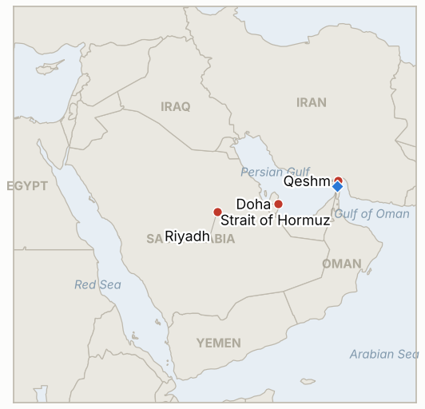

# Middle East Daily Briefing

**November 9, 2026**

- **Reporting window:** ~24 hours, November 8, 15:00 to November 9, 06:00 KST
- **Overall assessment:** A quiet Sunday: no new strike, no Iranian reply and no deal surfaced, and the picture from yesterday holds, with the US "minor strikes" on Qeshm, Qatar pressing a 48 hour implementation plan and Iran still reviewing (§1.1, §1.2). Seoul's margin waiver takes effect today with the KOSPI down 11.7% on the week (§1.3). Markets in Seoul and on ICE had not yet produced a Monday print at run time, so no new price data is added; today's first test is the KOSPI session this afternoon. Search coverage of the window was thin, so absence of news here is weak evidence.

---

## 1. What Happened

<figure style="float:right; width:46%; margin:2pt 0 8pt 14pt;">

<figcaption style="font-size:8pt; color:#666; text-align:center; margin-top:3pt; font-style:italic;">Major places of discussion</figcaption>
</figure>

### 1.1 Qeshm aftermath: Iran says it downed a US drone, Trump keeps calling the strikes minor

Trump said the US "do minor strikes" and that an anti-aircraft system Iran had recently built at Suza on Qeshm was destroyed, while claiming "a lot of progress" with Iran ([JPost](https://www.jpost.com/middle-east/iran-news/article-914097); [Trump Confirms U.S. Strikes, 23 outlets compared](https://newscord.org/article/trump-confirms-us-strikes-on-irans-qeshm-island-says-its-not-a-war--Story_20261108_TrumpconfirmsUSstrik9ae8b43c)). Iranian state media said it shot down a US MQ-9 drone over Qeshm and Tasnim said there was no official information on damage; Washington has not confirmed the loss. No further US or Israeli strike on Iranian territory was found in the window. **Confidence: High that a US strike occurred; Low on the drone claim; Medium on damage.**

### 1.2 Qatar presses a 48 hour plan; Iran is still reviewing and no reply is public

Qatar said mediation continues in coordination with both capitals, and reporting describes a package in which the US would lift its Hormuz blockade and release some frozen assets while Iran could admit IAEA inspectors to damaged nuclear sites ([House of Saud](https://houseofsaud.com/trump-qeshm-strikes-mediators-nov7/); [Kiprinform](https://www.kiprinform.com/en/news/qatar-says-us-iran-mediation-continues-as-reports-emerge-of-missile-strikes-on-qeshm-island/)). One report says Trump has so far rejected Iran's own seven day plan, and Iran has restated that US assets are targets. No formal Iranian reply or agreed framework was announced. **Confidence: High that talks continue; Low on the package details (single or aggregator sources).**

### 1.3 Seoul: waiver in force from today through January 31, KOSPI down 11.7% on the week

Regulators will suspend the 140% margin loan collateral maintenance rule from November 9 through January 31, covering margin loans but not forced sales over unpaid share purchases, per the Financial Supervisory Service and the Korea Financial Investment Association ([Seoul Economic Daily](https://en.sedaily.com/finance/2026/11/08/korea-eases-margin-collateral-rules-to-curb-forced-stock)). The KOSPI fell 11.7% over the week and foreigners sold roughly $4 billion ([Seoul Economic Daily](https://en.sedaily.com/finance/2026/11/08/kospi-sinks-117-percent-in-a-week-as-foreigners-dump-4)); analysts are split on whether a bottom is in. A secondary source says Taiwan is curbing short selling and readying a $15 billion fund, which Seoul has so far held in reserve. The Monday session closes after this run, so its result is not in this brief. **Confidence: High on the waiver terms; Medium on weekly figures; Low on the Taiwan details (ZeroHedge).**

### 1.4 Houthi claims on Saudi sites remain unconfirmed

No Saudi or Aramco confirmation of damage at King Khalid airport, Riyadh, Khurais or Dawadmi surfaced after the Houthi claims of November 7 (IND-20261108-1), and searches turned up no new attack in the window. Context: Houthi strikes did hit Riyadh airport on October 10 (12 killed per Saudi authorities), so a repeat is plausible even though this round is unverified ([Al Jazeera](https://www.aljazeera.com/amp/news/2026/10/10/attack-on-airport-in-saudi-capital-riyadh-leaves-several-injured)). **Confidence: Low on the November 7 claims; High on the October precedent.**

---

## 2. Deep Dive: Incentives and Motives

### 2.1 Why does Washington keep describing strikes as "minor" while the talks run?

The label protects the channel with Doha and a war-weary electorate while the strikes keep Iran's air defences from consolidating around the strait. Each such strike also tests how far Tehran will let a limited exchange go without walking out.

### 2.2 Why would Iran publicize a drone shootdown but not a reply to Qatar?

A visible military response answers hardliners at home at little cost, whereas a written reply would commit Tehran to sequencing before the blockade and sanctions move. Silence keeps both options open.

### 2.3 Why did Seoul choose a waiver that runs to January 31?

A fixed end date past the winter gives leveraged investors a known horizon, and the cost to the state is zero. The risk is that it signals regulators expect trouble to last, and heavier tools remain in reserve.

---

## 3. Policy Implications for South Korea

**Exposure snapshot:** South Korea draws about 70.7% of its crude and 20.4% of its LNG from the Middle East (`instructions/korea-exposure.md`, no update needed). Latest prints remain Friday November 6: KOSPI 5,059.69, USD/KRW 1,356.6, Brent $98.32, WTI $90.83. No November 9 print was available at run time.

**Implications by development:**

- **Qeshm and Qatari plan (§1.1, §1.2):** Limited force plus unresolved mediation keeps oil in a $90 to $100 range with event risk both ways (IND-20261104-1, IND-20261108-3).
- **Waiver and KOSPI (§1.3):** The waiver removes one forced selling channel but not the foreign selling driver; foreign flows are the better read of stabilization (IND-20261108-2, IND-20261109-1, IND-20261109-2).
- **Saudi exposure (§1.4):** Unconfirmed claims, but crude from Saudi Arabia is the largest single supplier risk if confirmed (IND-20261108-1).

**Resolved today:** none.

**Testable indicators:**

- **IND-20261109-1** (open, new): KOSPI foreign net buying on any session by ~2026-11-13 confirms easing outflows; none falsifies.
- **IND-20261109-2** (open, new): An announced further stabilization step (fund, short selling curb or rate action) by ~2026-11-13 confirms; none falsifies.
- **IND-20261108-1, -2, -3** (open): Saudi confirmation of damage by ~2026-11-15; KOSPI close above 5,059.69 on 2026-11-09; formal Iranian reply by ~2026-11-13.
- **IND-20261107-1, -3, IND-20261106-1, -3, IND-20261105-2, -3, IND-20261104-1, -2, IND-20261103-1, IND-20261028-2, IND-20261027-1, IND-20261023-1** (open): see `tracking/indicators.md`.

---

## 4. Watch List

- **Monday's KOSPI session and foreign flows (IND-20261108-2, IND-20261109-1).**
- **Iran's formal reply and the 48 hour plan (IND-20261108-3, IND-20261104-1).**
- **Further US strikes beyond Qeshm (IND-20261104-2, IND-20261106-1).**
- **Saudi confirmation of Houthi hits (IND-20261108-1).**
- **Brent after the 13% weekly fall (IND-20261106-3, IND-20261105-3).**
- **Israel's Knesset swearing in on November 10 (IND-20261028-2).**

---

## 5. Source Quality Summary

| Claim | Sources | Confidence |
| --- | --- | --- |
| US minor strike on Qeshm air defence | JPost, aggregators citing Trump | High |
| Iran downed a US MQ-9 | Iranian state media via aggregators; US silent | Low |
| Qatar 48 hour plan and package terms | House of Saud, Kiprinform | Low |
| Waiver Nov 9 to Jan 31 | Seoul Economic Daily (FSS, KOFIA) | High |
| KOSPI -11.7% on the week, $4bn foreign selling | Seoul Economic Daily | Medium |
| Taiwan short curbs and $15bn fund | ZeroHedge | Low |
| Houthi claims unconfirmed; October precedent | Al Jazeera | Low / High |
| Hormuz transit count | Not reported | Not reported |
