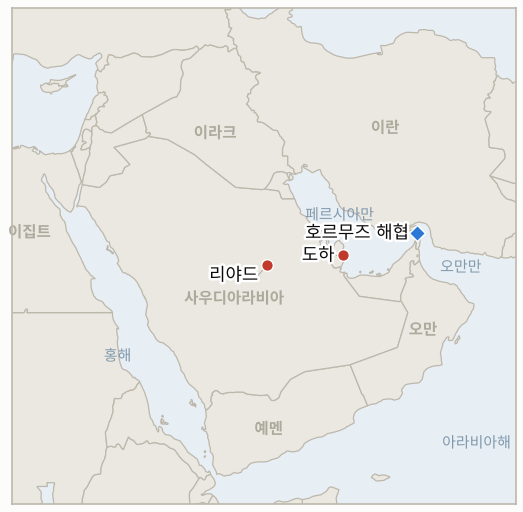

# 중동 일일 브리핑

**2026년 11월 10일**

- **보고 기간:** 약 24시간, 11월 9일 15:00 ~ 11월 10일 06:00 (한국시간)
- **종합 평가:** 외교와 압박이 동시에 진행됐다. 카타르 총리가 백악관에서 트럼프와 만났지만 루비오는 이란의 조건을 수용할 수 없다고 했고, 트럼프는 "필요하면" 타격을 재개할 수 있다고 밝혔다(§1.1, §1.2). 코스피는 금요일 종가를 밑돌아 안정화 시험을 통과하지 못했다(§1.3, IND-20261108-2). 월요일 유가 정산가를 찾지 못해 새 유가는 추가하지 않았다. 작성 시점에 회담 결과는 보도되지 않았고, 해당 시간대 검색 결과도 빈약하다.

---

## 1. 무슨 일이 있었나

<figure style="float:right; width:46%; margin:2pt 0 8pt 14pt;">

<figcaption style="font-size:8pt; color:#666; text-align:center; margin-top:3pt; font-style:italic;">주요 논의 지점</figcaption>
</figure>

### 1.1 트럼프, 카타르 총리 접견: 워싱턴의 엇갈린 신호

트럼프는 월요일 백악관에서 셰이크 무함마드 카타르 총리와 비공개 회담을 가질 예정이었고, 밴스 부통령도 총리와 만났다([알자지라](https://www.aljazeera.com/news/2026/11/9/qatar-pm-to-meet-trump-whats-the-latest-on-us-iran-negotiations)). 트럼프는 이후 로이터에 카타르와 사우디가 평화적 해법을 원하지만 필요하면 미국이 타격을 재개할 수 있다고 말했다([US News/로이터](https://www.usnews.com/news/world/articles/2026-11-09/trump-says-qatar-saudi-arabia-want-peaceful-solution-on-iran-but-us-ready-for-strikes-if-necessary-reuters-interview)). 일요일에는 강력한 합의가 나오면 대규모 신규 타격은 "매우 가능성이 낮다"고 하면서도 다리 38곳을 표적으로 식별했다고 했다. 루비오는 협상이 진전이 없고 이란의 요구가 비현실적이라고 했으며, 제재 완화·동결 자금·호르무즈 항로 인정·전 전선 전쟁 종식 등 이란의 7개 조건은 그대로다. 작성 시점에 회담의 공동 결과는 보도되지 않았다. **신뢰도: 회담 개최와 각측 입장은 높음, 합의안 세부는 낮음.**

### 1.2 봉쇄 강화: 선박 무력화, 아이언 게이트 태스크포스

미국은 토요일 이란 항구 봉쇄를 뚫으려 했다는 상선을 사격으로 무력화했고, 트럼프는 육로 수입까지 차단하는 새 태스크포스 아이언 게이트를 언급했다([알자지라](https://www.aljazeera.com/news/2026/11/9/qatar-pm-to-meet-trump-whats-the-latest-on-us-iran-negotiations); [investingLive](https://investinglive.com/commodities/qatar-says-us-iran-talks-alive-as-trump-meets-qatari-pm-oil-swings-on-mixed-signals/)). 아라그치는 공격이 재개되면 "지옥을 퍼붓겠다"고 경고했고, 헤그세스와 중부사령관이 트럼프에게 타격 재개를 압박한다는 보도가 있다(악시오스, 알자지라 인용). 보고 기간에 이란 영토에 대한 새 미국 타격은 확인되지 않았다. **신뢰도: 봉쇄 조치는 높음, 미국 내부 압박은 중간(단일 보도 계통).**

### 1.3 서울: 코스피 5,018.85 마감, 외국인 7거래일 연속 순매도

코스피는 장중 5,100선을 넘었다가 0.81% 하락한 5,018.85에 마감했다. 외국인은 약 6,580억 원 순매도, 기관은 약 7,190억 원 순매수였고 원화는 달러당 1,347.1원으로 강세였다([코리아타임스/연합뉴스](https://www.koreatimes.co.kr/economy/20261109/kospi-barely-holds-5000-fails-to-regain-momentum); [코리아타임스](https://www.koreatimes.co.kr/economy/policy/20261109/korean-won-strengthens-on-dollar-sales-risk-taking-mood)). 신용융자 담보비율 면제는 시행됐으나 추가 안정화 조치는 발표되지 않았다. 외국인 순매도를 6,930억 원으로 집계한 매체도 있다. **신뢰도: 종가와 환율은 높음, 수급 수치는 중간.**

### 1.4 에너지와 걸프 위험: 유가 등락, 코르모르 중단·후티 주장은 미확인

원유는 트럼프 발언에 하락 출발했다가 루비오 발언 뒤 회복했고, 브렌트는 장중 93~95달러로 보도됐으며 정산가는 찾지 못했다([investingLive](https://investinglive.com/commodities/qatar-says-us-iran-talks-alive-as-trump-meets-qatari-pm-oil-swings-on-mixed-signals/)). 같은 보도는 이란 드론 공격 의심으로 이라크 코르모르 가스전 생산이 중단됐고 후티가 리야드 아람코 타워와 사우디 저장시설을 타격했다고 전하나, 사우디와 이라크의 확인은 없었다(IND-20261108-1). **신뢰도: 코르모르·후티 건은 낮음(단일 종합 매체), 가격 수준도 낮음.**

---

## 2. 심층 분석: 동기와 유인

### 2.1 워싱턴은 왜 카타르 총리를 맞으면서 다리 타격을 거론하는가?

압박은 이란의 지연 비용을 키우면서 도하를 협상 통로로 유지한다. 중재자를 초청하는 동시에 표적을 거론하면 트럼프는 합의든 타격 재개의 명분이든 주장할 수 있다.

### 2.2 왜 루비오는 이란 조건을 수용 불가라 하고 트럼프는 진전을 말하는가?

역할 분담으로 제재와 자금에 대해 공개적 강경 노선을 지키면서 대통령이 원하는 문은 열어 둔다. 중부사령부와 국방부 강경파에 대한 대비책이기도 하다.

### 2.3 왜 서울은 담보비율 면제 외에 추가 조치를 내지 않았나?

당국은 펀드나 공매도 제한 같은 강한 수단을 외국인 매도가 소진 신호를 보일 때까지 아껴 두는 것으로 보인다. 일찍 쓰면 위기감을 키울 수 있기 때문이다.

---

## 3. 한국에 대한 정책적 함의

**노출 현황:** 한국은 원유의 약 70.7%, LNG의 약 20.4%를 중동에서 들여온다(`instructions/korea-exposure.md`, 갱신 불필요). 최신 수치: 코스피 5,018.85, 원/달러 1,347.1(11월 9일), 브렌트 98.32달러·WTI 90.83달러(11월 6일 정산가, 월요일 정산가는 확인 못함).

**전개별 함의:**

- **협상과 위협(§1.1, §1.2):** 유가는 헤드라인에 따라 90~100달러 선에서 움직인다. 카타르 경로가 실패하면 호르무즈 위험이 다시 부각된다(IND-20261110-1, IND-20261103-1).
- **코스피와 수급(§1.3):** 월요일 시험 실패와 7거래일 연속 외국인 매도는 원화와 수출주를 계속 압박한다. 추가 조치는 4,800선이 깨질 때 나올 가능성이 크다(IND-20261107-1, IND-20261109-2).
- **걸프 공급(§1.4):** 코르모르는 한국의 공급선이 아니지만 이라크·사우디 차질은 원유와 LNG 조달에 영향을 준다(IND-20261110-2, IND-20261108-1).

**오늘 종결:** IND-20261108-2 반증: 코스피가 5,018.85로 마감해 5,059.69를 밑돌았다.

**검증 가능한 지표:**

- **IND-20261110-1** (신규, 진행 중): 미·이란 회담 일정 또는 이란의 공식 답변이 ~2026-11-15까지 발표되면 확인, 없으면 반증.
- **IND-20261110-2** (신규, 진행 중): 이라크 또는 쿠르드 당국이 ~2026-11-14까지 사흘 넘는 코르모르 가동 중단을 확인하면 확인, 아니면 반증.
- **IND-20261109-1, -2** (진행 중): ~2026-11-13까지 외국인 순매수 발생, 추가 안정화 조치 발표.
- **IND-20261108-1, -3** (진행 중): ~2026-11-15까지 사우디 피해 확인, ~2026-11-13까지 이란 공식 답변.
- **IND-20261107-1, -3, IND-20261106-1, -3, IND-20261105-2, -3, IND-20261104-1, -2, IND-20261103-1, IND-20261028-2, IND-20261027-1, IND-20261023-1** (진행 중): `tracking/indicators.md` 참조. IND-20261103-1, IND-20261104-1, IND-20261104-2는 오늘 기한이며 새로운 사실이 없으면 다음 브리핑에서 종결한다.

---

## 4. 관찰 목록

- **트럼프·카타르 총리 회담 결과(IND-20261110-1).**
- **화요일 코스피 장과 외국인 수급(IND-20261109-1, IND-20261107-1).**
- **다리 등 기반시설 표적 타격(IND-20261104-2, IND-20261106-1).**
- **아이언 게이트 태스크포스 하의 봉쇄 사건.**
- **사우디·이라크 시설 피해 확인(IND-20261108-1, IND-20261110-2).**
- **11월 10일 이스라엘 크네세트 선서(IND-20261028-2).**

---

## 5. 출처 품질 요약

| 주장 | 출처 | 신뢰도 |
| --- | --- | --- |
| 트럼프·카타르 총리 회담, 타격 가능성 발언 | 알자지라, 로이터(US News) | 높음 |
| 루비오의 이란 조건 거부, 이란 7개 요구 | 알자지라 | 높음 |
| 선박 무력화, 아이언 게이트 | 알자지라, investingLive | 중간 |
| 코스피 5,018.85, 외국인 6,580억 원 순매도, 원/달러 1,347.1 | 코리아타임스(연합뉴스) | 높음 |
| 코르모르 중단, 리야드 후티 타격 | investingLive | 낮음 |
| 브렌트 장중 93~95달러 | investingLive, 종합 매체 | 낮음 |
| 호르무즈 통항 건수 | 보도 없음 | 보도 없음 |
