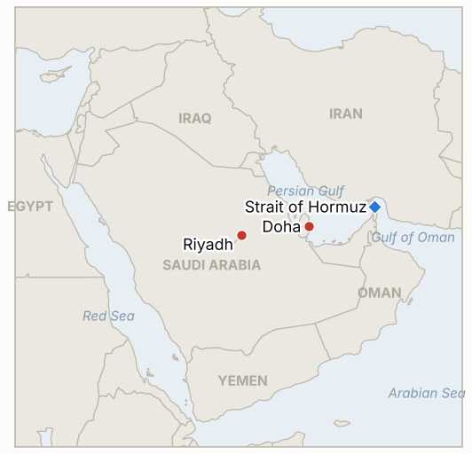

# Middle East Daily Briefing

**November 10, 2026**

- **Reporting window:** ~24 hours, November 9, 15:00 to November 10, 06:00 KST
- **Overall assessment:** Diplomacy and pressure ran in parallel: Qatar's prime minister met Trump at the White House while Rubio called Iran's terms unacceptable and Trump said strikes could resume "if necessary" (§1.1, §1.2). The KOSPI closed below Friday's level, so the stabilization test failed (§1.3, IND-20261108-2). Oil settlements were not found for Monday, so no new oil price is added. The outcome of the Trump meeting was not yet reported at run time, and search coverage of the window was thin.

---

## 1. What Happened

<figure style="float:right; width:46%; margin:2pt 0 8pt 14pt;">

<figcaption style="font-size:8pt; color:#666; text-align:center; margin-top:3pt; font-style:italic;">Major places of discussion</figcaption>
</figure>

### 1.1 Trump hosts Qatar's prime minister; Washington sends mixed signals

Trump was due to hold closed door talks with Qatari Prime Minister Sheikh Mohammed bin Abdulrahman Al Thani at the White House on Monday, with Vice President Vance also meeting him ([Al Jazeera](https://www.aljazeera.com/news/2026/11/9/qatar-pm-to-meet-trump-whats-the-latest-on-us-iran-negotiations)). Trump told Reuters afterward that Qatar and Saudi Arabia want a peaceful solution but the US is ready to resume strikes if necessary ([US News/Reuters](https://www.usnews.com/news/world/articles/2026-11-09/trump-says-qatar-saudi-arabia-want-peaceful-solution-on-iran-but-us-ready-for-strikes-if-necessary-reuters-interview)); on Sunday he had called major new strikes "highly unlikely" given a strong agreement, while saying 38 bridges had been identified as targets. Rubio said the talks had not progressed and Iran's demands were unrealistic, and Iran's seven conditions (sanctions relief, frozen funds, Hormuz route recognition, an end to the war on all fronts) are unchanged. No joint outcome of the meeting was reported at run time. **Confidence: High that the meeting took place and on the stated positions; Low on any package details.**

### 1.2 Blockade tightens: a ship disabled, Task Force Iron Gate declared

The US fired on and disabled a merchant ship on Saturday that it said was trying to breach the blockade of Iranian ports, and Trump described a new task force, Iron Gate, meant to stop imports by land as well as sea ([Al Jazeera](https://www.aljazeera.com/news/2026/11/9/qatar-pm-to-meet-trump-whats-the-latest-on-us-iran-negotiations); [investingLive](https://investinglive.com/commodities/qatar-says-us-iran-talks-alive-as-trump-meets-qatari-pm-oil-swings-on-mixed-signals/)). Araghchi warned Iran will "rain down hell" if attacks resume, and reports say Hegseth and CENTCOM's commander are pressing Trump to resume strikes (Axios via Al Jazeera). No new US strike on Iranian territory was found in the window. **Confidence: High on the blockade action; Medium on internal US pressure (single chain of reporting).**

### 1.3 Seoul: KOSPI ends at 5,018.85, foreigners sell for a seventh session

The KOSPI closed down 0.81% at 5,018.85 after briefly rising above 5,100; foreigners net sold about 658 billion won, institutions bought about 719 billion won, and the won firmed to 1,347.1 per dollar ([Korea Times/Yonhap](https://www.koreatimes.co.kr/economy/20261109/kospi-barely-holds-5000-fails-to-regain-momentum); [Korea Times](https://www.koreatimes.co.kr/economy/policy/20261109/korean-won-strengthens-on-dollar-sales-risk-taking-mood)). The margin collateral waiver took effect, but no further stabilization step was announced. Other outlets give 693 billion won for foreign selling. **Confidence: High on the close and FX; Medium on the flow figure.**

### 1.4 Energy and Gulf risk: oil swings, Khor Mor halt and Houthi claims unconfirmed

Crude fell at the open on Trump's remarks and recovered after Rubio's, with Brent reported around $93 to $95 intraday; no settlement was found ([investingLive](https://investinglive.com/commodities/qatar-says-us-iran-talks-alive-as-trump-meets-qatari-pm-oil-swings-on-mixed-signals/)). The same report cites a suspected Iranian drone attack that halted production at Iraq's Khor Mor gas field and Houthi strikes on Riyadh's Aramco Tower and Saudi storage; neither Saudi nor Iraqi confirmation was found (IND-20261108-1). **Confidence: Low on the Khor Mor and Houthi items (single aggregator); Low on price levels.**

---

## 2. Deep Dive: Incentives and Motives

### 2.1 Why does Washington pair a Qatari welcome with threats of bridge strikes?

Pressure raises the price of Iranian delay while keeping Doha as the channel. Naming targets and hosting the mediator at once lets Trump claim either a deal or a justified resumption.

### 2.2 Why does Rubio call Iran's terms unacceptable while Trump speaks of progress?

The split lets the administration hold a hard public line on sanctions and funds without closing the door the president wants open. It also hedges against hawks at CENTCOM and the Pentagon.

### 2.3 Why has Seoul not added to the margin waiver?

Regulators appear to be holding heavier tools, such as a fund or short selling limits, in reserve until foreign selling shows exhaustion, since acting early risks signalling alarm.

---

## 3. Policy Implications for South Korea

**Exposure snapshot:** South Korea draws about 70.7% of its crude and 20.4% of its LNG from the Middle East (`instructions/korea-exposure.md`, no update needed). Latest prints: KOSPI 5,018.85 and USD/KRW 1,347.1 (November 9); Brent $98.32 and WTI $90.83 (November 6 settles, Monday settles not found).

**Implications by development:**

- **Talks and threats (§1.1, §1.2):** Oil stays headline driven in a roughly $90 to $100 band; a failed Qatar track would put Hormuz risk back on the table (IND-20261110-1, IND-20261103-1).
- **KOSPI and flows (§1.3):** The failed Monday test and a seventh selling session keep pressure on the won and on exporters; a further step would likely follow only if the 4,800 line breaks (IND-20261107-1, IND-20261109-2).
- **Gulf supply (§1.4):** Khor Mor is not a Korean supply line, but Iraqi and Saudi disruptions would matter for crude and LNG sourcing (IND-20261110-2, IND-20261108-1).

**Resolved today:** IND-20261108-2 falsified: the KOSPI closed at 5,018.85, below 5,059.69.

**Testable indicators:**

- **IND-20261110-1** (open, new): A Washington, Doha or Tehran announcement of a scheduled US-Iran session or an Iranian formal reply by ~2026-11-15 confirms momentum; none falsifies.
- **IND-20261110-2** (open, new): Iraqi or Kurdistan authorities confirm a Khor Mor outage lasting beyond three days by ~2026-11-14 confirms; none falsifies.
- **IND-20261109-1, -2** (open): Foreign net buying on any session by ~2026-11-13; an announced further stabilization step by ~2026-11-13.
- **IND-20261108-1, -3** (open): Saudi confirmation of damage by ~2026-11-15; formal Iranian reply by ~2026-11-13.
- **IND-20261107-1, -3, IND-20261106-1, -3, IND-20261105-2, -3, IND-20261104-1, -2, IND-20261103-1, IND-20261028-2, IND-20261027-1, IND-20261023-1** (open): see `tracking/indicators.md`; IND-20261103-1, IND-20261104-1 and IND-20261104-2 reach their deadline today and will be closed in the next brief if nothing lands.

---

## 4. Watch List

- **Outcome of the Trump and Qatari prime minister meeting (IND-20261110-1).**
- **Tuesday's KOSPI session and foreign flows (IND-20261109-1, IND-20261107-1).**
- **US strikes on infrastructure targets such as bridges (IND-20261104-2, IND-20261106-1).**
- **Blockade incidents under Task Force Iron Gate.**
- **Saudi and Iraqi confirmation of Gulf facility damage (IND-20261108-1, IND-20261110-2).**
- **Israel's Knesset swearing in on November 10 (IND-20261028-2).**

---

## 5. Source Quality Summary

| Claim | Sources | Confidence |
| --- | --- | --- |
| Trump meets Qatar PM; Trump says strikes possible | Al Jazeera, Reuters via US News | High |
| Rubio rejects Iran's terms; Iran's seven demands | Al Jazeera | High |
| Ship disabled; Task Force Iron Gate | Al Jazeera, investingLive | Medium |
| KOSPI 5,018.85, foreigners -658bn won, won 1,347.1 | Korea Times (Yonhap) | High |
| Khor Mor halt, Houthi hits on Riyadh | investingLive | Low |
| Brent about $93 to $95 intraday | investingLive, aggregators | Low |
| Hormuz transit count | Not reported | Not reported |
