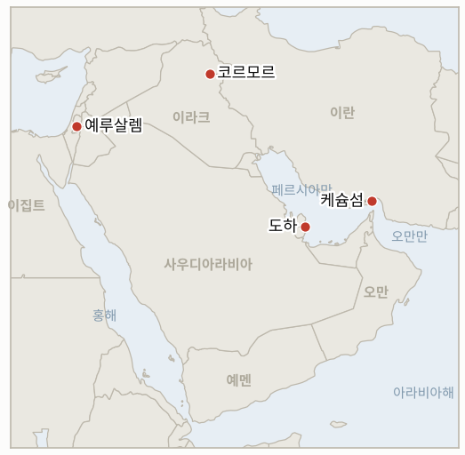

# 중동 일일 브리핑

**2026년 11월 11일**

- **보고 기간:** 약 24시간, 11월 10일 15:00 ~ 11월 11일 06:00 (한국시간)
- **종합 평가:** 시장은 월요일 백악관 회담을 긴장 완화로 읽었다. 트럼프는 이란 전쟁이 "사실상 끝났다"며 추가 타격은 "가능성이 꽤 낮다"고 했고, 브렌트는 잠시 90달러 아래로 내려갔으며, 코스피는 외국인이 8거래일 만에 순매수로 돌아서며 몇 주 만의 최대 상승을 기록했다(§1.1~§1.3). 테헤란은 회담 계획을 공개적으로 부인하고 있어 이번 흐름은 합의가 아니라 워싱턴의 어조에 기대고 있으며, 합의 틀이나 확전과 연계된 지표 3개는 충족되지 않은 채 기한을 넘겼다. 이스라엘에서는 아이젠코트가 정부 구성권을 쥔 가운데 새 크네세트가 선서했다(§1.4).

**정정 및 갱신:**

- 11월 10일 브리핑은 코르모르 가스전 중단의 신뢰도를 낮음(단일 종합 매체)으로 평가했다. 이후 운영사 다나 가스가 11월 8일 밤 드론 공격과 생산 중단 지속을 확인했다(§1.5).
- 11월 10일 브리핑에는 월요일 유가 정산가가 없었다. 11월 9일 브렌트는 92.57달러(−5.85%), WTI는 86.85달러(−4.38%)로 정산했으며(FinanceFeeds 인용 로이터), 시계열에 소급 추가했다.
- 11월 10일 브리핑은 월요일을 외국인 7거래일 연속 순매도로 적었으나, 코리아타임스는 화요일 외국인 순매수를 8거래일 만의 첫 순매수로 집계한다.

---

## 1. 무슨 일이 있었나

<figure style="float:right; width:46%; margin:2pt 0 8pt 14pt;">

<figcaption style="font-size:8pt; color:#666; text-align:center; margin-top:3pt; font-style:italic;">주요 논의 지점</figcaption>
</figure>

### 1.1 트럼프 "이란 전쟁 사실상 끝났다", 테헤란은 회담 계획 부인

트럼프는 셰이크 무함마드 빈 압둘라흐만 알사니 카타르 총리, 밴스 부통령과 회담한 뒤 "훌륭한 대화"였다며 이란은 "군사적으로 사실상 끝났다"고 했고, 미국은 "장전 완료" 상태이지만 추가 타격은 "가능성이 꽤 낮다"고 말했다. 그는 걸프 국가들이 현상 유지, 즉 해상 봉쇄와 아이언 게이트 육상 작전을 선호한다고 했다([유로뉴스](https://www.euronews.com/2026/11/10/trump-says-iran-war-effectively-over-as-tehran-denies-planned-talks); [UPI](https://www.upi.com/Top_News/US/2026/11/10/Trump-Qatar-meeting-Iran-negotiations/7831794293830/); [코리아타임스](https://www.koreatimes.co.kr/world/20261110/trump-sees-positive-momentum-on-iran-after-qatar-pm-talks)). 테헤란은 반박했다. 레자에이는 워싱턴에 "가상의 회담에 관한 가짜 뉴스 제조"를 멈추라고 했고, 아라그치는 예정된 회담이 없다고 부인했으며, 타스님은 미국이 이란의 7개 조건에 구체적 조치를 취하기 전에는 협상하지 않는다고 전했다. 이브라힘 칼린 튀르키예 정보청장이 카타르가 다음 주 밴스·레자에이 회동을 주최할 것이라고 말했다는 보도도 나왔으나 이란은 이를 부인했다. 이란 당국은 일요일 밤부터 월요일 사이 케슘섬이 공격받았다고 했고, 트럼프는 이를 "경미한 타격"이라고 불렀다([CNBC](https://www.cnbc.com/2026/11/10/oil-prices-trump-iran.html)). **신뢰도: 각측 입장은 높음, 밴스·레자에이 회동 보도는 낮음.**

### 1.2 유가: 브렌트, 8월 이후 처음 90달러 아래로

브렌트는 장중 89.16달러까지 내려 8월 이후 처음 90달러를 밑돈 뒤 화요일 91.49달러(−1.17%)에 정산했고, WTI는 86.04달러(−0.93%)에 정산했다. 월요일 5.85% 급락해 92.57달러를 기록한 데 이은 것이다([CNBC](https://www.cnbc.com/2026/11/10/oil-prices-trump-iran.html); [FinanceFeeds](https://financefeeds.com/brent-crude-oil-price-91-tuesday-after-5-85-percent-plunge-cpi-today-bull-98-bear-88/)). 해운은 회복 중이지만 정상과는 거리가 멀다. 11월 10일까지 UKMTO 주간 보고는 출항 170회, 입항 155회로 분쟁 전보다 약 65% 적다. 반면 10월 걸프 LNG 선적은 전쟁 중 최고치였고(케플러: 42카고, 라스라판 35카고), 그중에는 소하르 앞바다에서 선박 간 환적을 거쳐 한국으로 향하는 화물도 있다([걸프뉴스](https://gulfnews.com/world/mena/hormuz-shipping-below-normal-but-not-stalled-ukmto-1.500741839); [TimesLIVE/로이터](https://www.timeslive.co.za/news/world/2026-11-10-hormuz-lng-traffic-in-october-at-highest-since-iran-war-began/)). 호르무즈 일일 통항 건수는 발표되지 않았다. **신뢰도: 정산가는 높음, 통항 수치는 중간(집계 기준 상이).**

### 1.3 서울: 코스피 4.39% 급등, 외국인 복귀

코스피는 중동 긴장 완화와 미국 반도체 랠리로 위험 선호가 살아나며 4.39% 오른 5,239.13에 마감했다. 외국인은 3,532억 원을 순매수해 8거래일 만에 순매수로 돌아섰고, 기관은 4,980억 원 순매수, 개인은 1조 3,400억 원 순매도였다([코리아타임스](https://www.koreatimes.co.kr/economy/20261110/korean-stocks-surge-over-4-as-risk-appetite-returns)). SK하이닉스가 6.69%, 삼성전자가 4.74% 올랐고 전력기기주는 8~13% 뛰었다. 원화는 9.6원 강세를 보이며 달러당 1,337.5원으로 마감했다. **신뢰도: 높음.**

### 1.4 이스라엘: 제26대 크네세트 선서, 정부 구성권은 아이젠코트에

제26대 크네세트 의원 120명이 화요일 선서했고, 의사당 밖에서는 우파 시위대 약 200명이 시위를 벌였다([예루살렘포스트](https://www.jpost.com/israel-election-2026/article-914409); [프랑스24](https://france24.com/en/middle-east/20261110-live-new-israeli-parliament-sworn-in-eisenkot-aims-to-form-government-netanyahu-knesset)). 헤르초그 대통령은 일요일 두 아랍계 정당 19석을 포함한 67명의 추천을 받은 가디 아이젠코트에게 정부 구성권을 부여했으며, 46명의 추천에 그친 네타냐후는 과도 총리로 남는다. 아이젠코트 진영은 리쿠드의 아미르 오하나 의장을 야샤르의 마탄 카하나로 교체하는 과반 서명 동의안을 제출했으나, 작성 시점에 표결 결과는 보도되지 않았다. **신뢰도: 선서와 정부 구성권은 높음, 의장 표결 시점은 낮음.**

### 1.5 이라크: 운영사, 드론 공격에 따른 코르모르 가동 중단 확인

다나 가스는 11월 8일 밤 이라크 쿠르드 지역 코르모르 가스전에 드론이 명중해 화재가 났다가 진화됐으며, 피해 평가가 끝날 때까지 생산이 중단된 상태라고 확인했다([쿠르디스탄24](https://www.kurdistan24.net/en/story/951712/dana-gas-confirms-khor-mor-drone-attack-production-remains-suspended); [알모니터](https://www.al-monitor.com/originals/2026/11/iraqs-khor-mor-gas-field-halted-after-drone-attack-operator-says)). 쿠르드 지역 전역에서 2,500~2,800메가와트의 발전량이 끊긴 것으로 보도됐다. 배후를 자처한 단체는 없으나, 카타이브 헤즈볼라가 하루 전 이 가스전을 언급했고 톰 배럭 미국 특사는 공격을 규탄했다([롱워저널](https://www.longwarjournal.org/archives/2026/11/attack-targets-khor-mor-gas-field-in-iraqi-kurdistan.php)). **신뢰도: 가동 중단은 높음, 전력 손실 수치는 중간, 배후는 낮음.**

---

## 2. 심층 분석: 동기와 유인

### 2.1 트럼프는 왜 합의 없이 전쟁이 사실상 끝났다고 선언하는가?

중간선거 패배 이후 트럼프는 전쟁을 승리로, 봉쇄를 안정적이고 비용이 낮은 현상 유지로 제시하는 데서 얻는 것이 많다. 승리 선언은 비용이 큰 타격 재개 압력을 줄이고, 겨울을 앞두고 유가 하락을 이어가며, 봉쇄를 지렛대로 남겨 둔다. 그래서 성공을 주장하는 데 이란의 서명이 필요하지 않다.

### 2.2 테헤란은 왜 카타르와 튀르키예가 언급하는 회담을 부인하는가?

이란 지도부는 7개 조건에 대한 구체적 조치를 먼저 얻지 않고서는 봉쇄 아래 협상하는 모습을 보일 수 없다. 부인은 국내 강경 입장을 지키고 워싱턴이 먼저 움직이도록 압박하면서, 카타르 채널은 보이지 않는 곳에서 계속 작동하게 한다.

### 2.3 이란 연계 세력은 왜 지금 코르모르를 공격하는가?

지역 발전소에 연료를 대는 쿠르드 가스를 타격하면, 미국의 직접 타격이 잦아드는 와중에도 이란의 네트워크가 미국 협력국에 비용을 지울 수 있음을 보여 준다. 수출 원유가 아닌 전력을 겨냥한 저비용·부인 가능한 메시지로, 국제 유가를 움직이지 않으면서 바그다드와 아르빌을 압박한다.

### 2.4 외국인은 왜 화요일 서울로 돌아왔나?

매도세는 AI 투자 우려와 전쟁 위험이 함께 몰고 왔다. 미국 반도체 랠리와 누그러진 이란 전망이 두 요인을 동시에 완화했고, 최근 한 달 사이 약 17% 하락한 뒤라 밸류에이션이 숏커버링과 저가 매수를 불렀다.

---

## 3. 한국에 대한 정책적 함의

**노출 현황:** 한국은 원유의 약 70.7%, LNG의 약 20.4%를 중동에서 들여온다(`instructions/korea-exposure.md`, 갱신 불필요). 최신 수치: 코스피 5,239.13, 원/달러 1,337.5(11월 10일), 브렌트 91.49달러·WTI 86.04달러(11월 10일 정산가).

**전개별 함의:**

- **긴장 완화 발언과 유가 하락(§1.1, §1.2):** 브렌트가 90달러 안팎이면 한국의 수입 부담과 물가 압력이 줄고 원화가 지지된다. 다만 이 흐름은 이란이 회담을 거부하는 가운데 발언에 기대고 있어, 협상이 깨지면 빠르게 되돌려질 수 있다(IND-20261111-1, IND-20261106-3).
- **LNG 회복(§1.2):** 라스라판 선적 증가와 한국행 화물은 한국가스공사의 겨울 가스 조달 부담을 덜지만, 카타르 물량은 여전히 전쟁 전의 절반 수준이다.
- **시장 반등(§1.3):** 외국인 순매수는 자금 유출이 돌아설 수 있음을 보여 주지만 하루로 낙폭이 지워지지는 않는다. 11월 5일 종가를 회복하면 공포 국면이 지났다는 신호가 된다(IND-20261111-2, IND-20261107-1).
- **이스라엘 정치(§1.4):** 아이젠코트 주도 정부는 미국 중재 해법에 더 열려 있을 가능성이 크며, 이스라엘 내 한국 방산·건설 계약에 미치는 영향은 제한적이다(IND-20261111-3).
- **코르모르(§1.5):** 한국의 공급선은 아니지만, 미·이란 전선이 잠잠해져도 걸프 에너지 자산이 여전히 표적임을 보여 준다(IND-20261110-2).

**오늘 종결:**

- IND-20261028-2 확인: 헤르초그가 11월 8일 아이젠코트에게 정부 구성권을 부여했다.
- IND-20261109-1 확인: 외국인이 11월 10일 3,532억 원을 순매수했다.
- IND-20261103-1 반증: 11월 10일까지 미국의 1일차 조치나 호르무즈 재개방 확인이 없었다.
- IND-20261104-1 반증: 11월 10일까지 합의된 틀이나 양해각서 발표가 없었다.
- IND-20261104-2 반증: 케슘 일대 타격만 보도됐고 호르무즈 연안 방공망 범위를 넘는 타격은 없었다.
- IND-20261027-1 반증: 11월 10일까지 사우디 내 이집트 방공망·항공기 배치 확인을 찾지 못했다(제한적 검색).

**검증 가능한 지표:**

- **IND-20261111-1** (신규, 진행 중): ~2026-11-20까지 카타르에서 밴스와 레자에이, 또는 다른 미국·이란 고위 인사 간 회동이 공개되면 확인, 없으면 반증.
- **IND-20261111-2** (신규, 진행 중): ~2026-11-17까지 코스피가 어느 거래일이든 5,383.80(11월 5일 종가)을 넘어 마감하면 회복 확인, 없으면 반증.
- **IND-20261111-3** (신규, 진행 중): ~2026-11-18까지 마탄 카하나가 크네세트 의장에 선출되면 아이젠코트 진영의 의사일정 장악 확인, 그때까지 오하나가 자리를 지키면 반증.
- **IND-20261110-1, -2** (진행 중): ~2026-11-15까지 미·이란 회담 일정 또는 공식 답변, ~2026-11-14까지 사흘 넘는 코르모르 중단 확인(운영사가 이미 중단을 확인).
- **IND-20261109-2** (진행 중): ~2026-11-13까지 추가 안정화 조치.
- **IND-20261108-1, -3, IND-20261107-1, -3, IND-20261106-1, -3, IND-20261105-2, -3, IND-20261023-1** (진행 중): `tracking/indicators.md` 참조. IND-20261106-3(~11-13까지 브렌트 90달러 미만 정산)은 근접했다. 화요일 저점은 89.16달러였으나 정산가는 90달러를 지켰다.

---

## 4. 관찰 목록

- **카타르의 다음 주 미·이란 회동 주최 여부(IND-20261111-1, IND-20261110-1).**
- **브렌트의 90달러 시험과 미국 CPI(IND-20261106-3).**
- **서울 외국인 매수 지속 여부(IND-20261111-2).**
- **크네세트 의장 표결과 아이젠코트의 연정 협상(IND-20261111-3).**
- **코르모르 재가동과 쿠르드 지역 전력 공급(IND-20261110-2).**
- **추가 봉쇄 사건과 케슘 일대 타격.**

---

## 5. 출처 품질 요약

| 주장 | 출처 | 신뢰도 |
| --- | --- | --- |
| 트럼프: 전쟁 "사실상 끝났다", 타격 "가능성 꽤 낮다" | 유로뉴스, UPI, 코리아타임스, CNBC | 높음 |
| 이란의 회담 계획 부인(레자에이, 아라그치, 타스님) | 유로뉴스 | 높음 |
| 카타르 밴스·레자에이 회동 보도 | 유로뉴스(칼린 발언 인용), 이란 부인 | 낮음 |
| 브렌트 91.49달러·WTI 86.04달러 정산, 월요일 92.57·86.85달러 | CNBC, FinanceFeeds 인용 로이터 | 높음 |
| UKMTO 주간 통항, 분쟁 전 대비 약 65% 감소 | 걸프뉴스(UKMTO) | 중간 |
| 10월 LNG 선적 전쟁 중 최고, 한국행 화물 | TimesLIVE 인용 로이터(케플러, S&P 글로벌) | 높음 |
| 코스피 5,239.13, 외국인 3,532억 원 순매수, 원/달러 1,337.5 | 코리아타임스 | 높음 |
| 크네세트 선서, 아이젠코트 정부 구성권, 의장 동의안 | 예루살렘포스트, 프랑스24, 하레츠 | 높음 |
| 드론 공격에 따른 코르모르 중단 | 쿠르디스탄24·알모니터(다나 가스), 롱워저널 | 높음 |
| 호르무즈 일일 통항 건수 | 보도 없음 | 보도 없음 |
