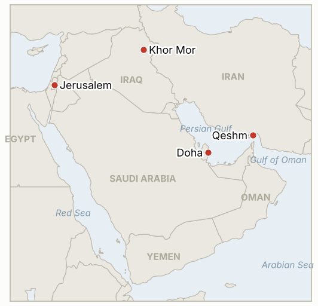

# Middle East Daily Briefing

**November 11, 2026**

- **Reporting window:** ~24 hours, November 10, 15:00 to November 11, 06:00 KST
- **Overall assessment:** The market read Monday's White House meeting as de-escalation: Trump said the Iran war is "effectively over" and new strikes are "quite unlikely," Brent briefly broke below $90, and the KOSPI posted its best day in weeks with the first foreign net buying in eight sessions (§1.1 to §1.3). Tehran publicly denies any planned talks, so the move rests on Washington's tone rather than a deal; three indicators tied to a framework or wider strikes expired unmet. In Israel the new Knesset was sworn in with Eisenkot holding the mandate (§1.4).

**Corrections and updates:**

- The November 10 brief rated the Khor Mor gas field halt Low confidence (single aggregator). Operator Dana Gas has since confirmed the drone attack on the night of November 8 and that production remains suspended (§1.5).
- The November 10 brief had no Monday oil settlements. Brent settled at $92.57 (−5.85%) and WTI at $86.85 (−4.38%) on November 9 (Reuters via FinanceFeeds); these are added to the series as backfill.
- The November 10 brief called Monday a seventh straight session of foreign selling in Seoul; Korea Times now counts Tuesday's foreign buying as the first in eight sessions.

---

## 1. What Happened

<figure style="float:right; width:46%; margin:2pt 0 8pt 14pt;">

<figcaption style="font-size:8pt; color:#666; text-align:center; margin-top:3pt; font-style:italic;">Major places of discussion</figcaption>
</figure>

### 1.1 Trump calls the Iran war effectively over; Tehran denies any planned talks

After meeting Qatari Prime Minister Sheikh Mohammed bin Abdulrahman Al Thani and Vice President Vance, Trump called it an "excellent conversation," said Iran "militarily, is effectively over," and called further strikes "quite unlikely" while the US stays "locked and loaded"; he said Gulf states prefer the status quo, meaning the naval blockade plus the Iron Gate land operation ([Euronews](https://www.euronews.com/2026/11/10/trump-says-iran-war-effectively-over-as-tehran-denies-planned-talks); [UPI](https://www.upi.com/Top_News/US/2026/11/10/Trump-Qatar-meeting-Iran-negotiations/7831794293830/); [Korea Times](https://www.koreatimes.co.kr/world/20261110/trump-sees-positive-momentum-on-iran-after-qatar-pm-talks)). Tehran pushed back: Rezaei told Washington to stop "manufacturing fake news about imaginary talks," Araghchi denied any meeting was planned, and Tasnim said Iran will not talk until the US takes concrete steps on its seven conditions. Turkey's intelligence chief Ibrahim Kalin was reported as saying Qatar would host a Vance and Rezaei meeting next week, which Iran denied. Iranian officials also said Qeshm was targeted overnight Sunday to Monday, which Trump called "minor strikes" ([CNBC](https://www.cnbc.com/2026/11/10/oil-prices-trump-iran.html)). **Confidence: High on the stated positions; Low on the reported Vance and Rezaei meeting.**

### 1.2 Oil: Brent dips below $90 for the first time since August

Brent settled at $91.49 on Tuesday (−1.17%) after touching $89.16, its first trade below $90 since August, and WTI settled at $86.04 (−0.93%); that followed Monday's 5.85% drop to $92.57 ([CNBC](https://www.cnbc.com/2026/11/10/oil-prices-trump-iran.html); [FinanceFeeds](https://financefeeds.com/brent-crude-oil-price-91-tuesday-after-5-85-percent-plunge-cpi-today-bull-98-bear-88/)). Shipping is recovering but well short of normal: UKMTO's weekly report to November 10 counts 170 outbound and 155 inbound transits, about 65% below pre-conflict levels, while October LNG loadings in the Gulf hit a wartime high (Kpler: 42 cargoes, 35 from Ras Laffan), including a cargo bound for South Korea after a ship-to-ship transfer off Sohar ([Gulf News](https://gulfnews.com/world/mena/hormuz-shipping-below-normal-but-not-stalled-ukmto-1.500741839); [TimesLIVE/Reuters](https://www.timeslive.co.za/news/world/2026-11-10-hormuz-lng-traffic-in-october-at-highest-since-iran-war-began/)). No daily Hormuz count was published. **Confidence: High on settlements; Medium on transit figures (different counting bases).**

### 1.3 Seoul: KOSPI jumps 4.39% and foreigners return

The KOSPI closed up 4.39% at 5,239.13 as easing Middle East tension and a US chip rally lifted risk appetite; foreigners net bought 353.2 billion won, their first net buying in eight sessions, institutions bought 498 billion won and individuals sold 1.34 trillion won ([Korea Times](https://www.koreatimes.co.kr/economy/20261110/korean-stocks-surge-over-4-as-risk-appetite-returns)). SK hynix rose 6.69% and Samsung Electronics 4.74%, with power equipment makers up 8% to 13%. The won strengthened 9.6 won to 1,337.5 per dollar. **Confidence: High.**

### 1.4 Israel: 26th Knesset sworn in with Eisenkot holding the mandate

The 120 members of the 26th Knesset were sworn in on Tuesday while about 200 right-wing protesters demonstrated outside ([Jerusalem Post](https://www.jpost.com/israel-election-2026/article-914409); [France 24](https://france24.com/en/middle-east/20261110-live-new-israeli-parliament-sworn-in-eisenkot-aims-to-form-government-netanyahu-knesset)). President Herzog gave Gadi Eisenkot the mandate on Sunday after 67 recommendations, including 19 from the two Arab parties, against 46 for Netanyahu, who stays caretaker prime minister. Eisenkot's bloc filed a majority-signed motion to replace Likud's Amir Ohana as speaker with Yashar's Matan Kahana; no vote result was reported at run time. **Confidence: High on the swearing in and mandate; Low on the timing of the speaker vote.**

### 1.5 Iraq: operator confirms Khor Mor halt after drone attack

Dana Gas confirmed that a drone hit the Khor Mor gas field in Iraqi Kurdistan on the night of November 8, causing a fire that was put out, and that production remains suspended pending a damage assessment ([Kurdistan24](https://www.kurdistan24.net/en/story/951712/dana-gas-confirms-khor-mor-drone-attack-production-remains-suspended); [Al-Monitor](https://www.al-monitor.com/originals/2026/11/iraqs-khor-mor-gas-field-halted-after-drone-attack-operator-says)). Reports put the lost power generation at 2,500 to 2,800 megawatts across the Kurdistan Region. No group claimed it; Kataib Hezbollah had named the field a day earlier and US envoy Tom Barrack condemned the attack ([Long War Journal](https://www.longwarjournal.org/archives/2026/11/attack-targets-khor-mor-gas-field-in-iraqi-kurdistan.php)). **Confidence: High on the halt; Medium on the power loss figure; Low on attribution.**

---

## 2. Deep Dive: Incentives and Motives

### 2.1 Why does Trump declare the war effectively over without a deal?

After the midterm losses, Trump gains from presenting the war as won and the blockade as a stable, low-cost status quo. Declaring victory lowers pressure to resume costly strikes, keeps oil prices falling before winter, and leaves the blockade as leverage, so he does not need Iran's signature to claim success.

### 2.2 Why does Tehran deny talks that Qatar and Turkey describe?

Iran's leadership cannot be seen negotiating under blockade without first getting concrete steps on its seven conditions. Denials protect the hardline position at home and push Washington to move first, while letting the Qatari channel keep working out of view.

### 2.3 Why would Iran-aligned groups hit Khor Mor now?

Hitting Kurdish gas, which feeds regional power plants, signals that Iran's network can raise costs for US partners even as direct US strikes wind down. It is a low-cost, deniable message that targets electricity, not export oil, so it pressures Baghdad and Erbil without moving global prices.

### 2.4 Why did foreign investors return to Seoul on Tuesday?

The sell-off had been driven by AI spending worries and war risk together. A US chip rally and a softer Iran outlook eased both at once, and after a fall of roughly 17% over the past month, valuations invited short covering and bargain buying.

---

## 3. Policy Implications for South Korea

**Exposure snapshot:** South Korea draws about 70.7% of its crude and 20.4% of its LNG from the Middle East (`instructions/korea-exposure.md`, no update needed). Latest prints: KOSPI 5,239.13 and USD/KRW 1,337.5 (November 10); Brent $91.49 and WTI $86.04 (November 10 settles).

**Implications by development:**

- **De-escalation talk and cheaper oil (§1.1, §1.2):** Brent near $90 lowers Korea's import bill and inflation pressure and supports the won; the risk is that the move rests on rhetoric while Iran rejects talks, so a breakdown could reverse it quickly (IND-20261111-1, IND-20261106-3).
- **LNG recovery (§1.2):** Rising Ras Laffan loadings and a Korea-bound cargo ease winter gas procurement for KOGAS, though Qatari volumes remain about half the pre-war pace.
- **Market rebound (§1.3):** Foreign buying confirms that outflows can turn, but one session does not erase the drawdown; recovering the November 5 close would signal the panic phase has passed (IND-20261111-2, IND-20261107-1).
- **Israeli politics (§1.4):** An Eisenkot-led government would likely be more open to a US-brokered settlement, with modest effects on Korean defense and construction contracts in Israel (IND-20261111-3).
- **Khor Mor (§1.5):** Not a Korean supply line, but it shows Gulf energy assets remain targets even as the US-Iran front quiets (IND-20261110-2).

**Resolved today:**

- IND-20261028-2 confirmed: Herzog gave the mandate to Eisenkot on November 8.
- IND-20261109-1 confirmed: foreigners net bought 353.2 billion won on November 10.
- IND-20261103-1 falsified: no confirmation of day-one US measures or Hormuz reopening by November 10.
- IND-20261104-1 falsified: no agreed framework or MOU announced by November 10.
- IND-20261104-2 falsified: only Qeshm-area strikes reported, none beyond the Hormuz coastal air defence set.
- IND-20261027-1 falsified: no confirmed Egyptian air defence or aircraft deployment in Saudi Arabia found by November 10 (limited searching).

**Testable indicators:**

- **IND-20261111-1** (open, new): A disclosed meeting between Vance and Rezaei, or another named US and Iranian official, in Qatar by ~2026-11-20 confirms; none falsifies.
- **IND-20261111-2** (open, new): A KOSPI close above 5,383.80 (the November 5 close) on any session by ~2026-11-17 confirms recovery; none falsifies.
- **IND-20261111-3** (open, new): Matan Kahana elected Knesset speaker by ~2026-11-18 confirms the Eisenkot bloc's control of the agenda; Ohana retaining the post by then falsifies.
- **IND-20261110-1, -2** (open): a scheduled US-Iran session or formal reply by ~2026-11-15; Khor Mor outage beyond three days confirmed by ~2026-11-14 (operator already confirms suspension).
- **IND-20261109-2** (open): a further stabilization step by ~2026-11-13.
- **IND-20261108-1, -3, IND-20261107-1, -3, IND-20261106-1, -3, IND-20261105-2, -3, IND-20261023-1** (open): see `tracking/indicators.md`. IND-20261106-3 (Brent settle below $90 by ~11-13) is close: Tuesday's low was $89.16 but the settle held above $90.

---

## 4. Watch List

- **Whether Qatar hosts a US and Iranian meeting next week (IND-20261111-1, IND-20261110-1).**
- **Brent's test of $90 and US CPI (IND-20261106-3).**
- **Follow-through in foreign buying in Seoul (IND-20261111-2).**
- **The Knesset speaker vote and Eisenkot's coalition talks (IND-20261111-3).**
- **Khor Mor restart and Kurdistan power supply (IND-20261110-2).**
- **Further blockade incidents and any strikes around Qeshm.**

---

## 5. Source Quality Summary

| Claim | Sources | Confidence |
| --- | --- | --- |
| Trump: war "effectively over," strikes "quite unlikely" | Euronews, UPI, Korea Times, CNBC | High |
| Iran denies planned talks (Rezaei, Araghchi, Tasnim) | Euronews | High |
| Reported Vance and Rezaei meeting in Qatar | Euronews citing Kalin remarks; denied by Iran | Low |
| Brent $91.49, WTI $86.04 settles; Monday $92.57 and $86.85 | CNBC; Reuters via FinanceFeeds | High |
| UKMTO weekly transits about 65% below pre-conflict | Gulf News (UKMTO) | Medium |
| October LNG loadings at wartime high; Korea-bound cargo | Reuters via TimesLIVE (Kpler, S&P Global) | High |
| KOSPI 5,239.13, foreigners +353.2bn won, won 1,337.5 | Korea Times | High |
| Knesset sworn in; Eisenkot mandate; speaker motion | Jerusalem Post, France 24, Haaretz | High |
| Khor Mor halted by drone attack | Dana Gas via Kurdistan24, Al-Monitor, Long War Journal | High |
| Hormuz daily transit count | Not reported | Not reported |
