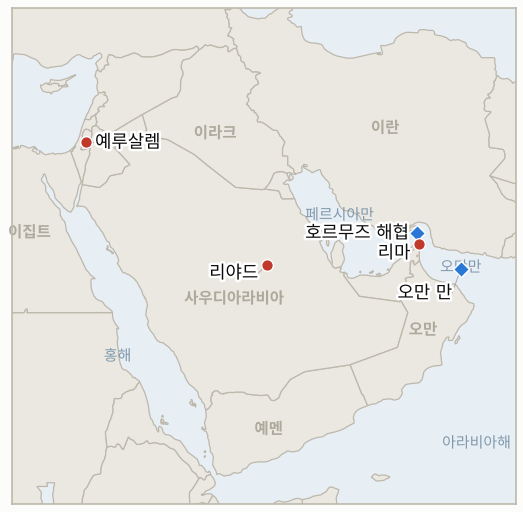

# 중동 일일 브리핑

**2026년 11월 12일**

- **보고 기간:** 약 24시간, 11월 11일 15:00 ~ 11월 12일 06:00 (한국시간)
- **종합 평가:** 테헤란은 워싱턴의 "전쟁은 사실상 끝났다"는 메시지에 완화가 아니라 강경으로 응수했다. 호르무즈 동쪽 "비인가 항로"에서 유조선이 기뢰에 맞아 불탔다고 발표하고, 7개 조건이 충족될 때까지 해협을 닫아 두겠다고 했으며, 농축 우라늄의 국외 반출을 배제했다(§1.1, §1.2). 유가는 하락분 일부를 되찾아 브렌트가 92.76달러로 정산했지만, 서울 증시는 미국 물가 지표가 예상을 웃돈 뒤에도 외국인 매수에 힘입어 상승을 이어갔다(§1.3, §1.4). 워싱턴의 어조와 테헤란의 조건 사이의 간극이 이번 주 안도 랠리의 가장 큰 위험 요인이다.

---

## 1. 무슨 일이 있었나

<figure style="float:right; width:46%; margin:2pt 0 8pt 14pt;">

<figcaption style="font-size:8pt; color:#666; text-align:center; margin-top:3pt; font-style:italic;">주요 논의 지점</figcaption>
</figure>

### 1.1 호르무즈: 이란, 유조선 기뢰 피격 주장하며 해협 봉쇄 유지

이란군은 해협 동쪽의 "금지 구역"에서 유조선 1척이 해상 기뢰에 맞아 불이 났다고 밝혔다. 그 하루 전에는 혁명수비대 해군이 "비인가 항로"에서 유조선 2~3척이 불탔다고 했으며, 이란은 안전한 통항을 위해서는 자국군과의 조율이 필요하다고 주장한다([Al Jazeera](https://www.aljazeera.com/news/2026/11/11/iran-denies-talks-with-us-says-hormuz-will-stay-shut-until-demands-are-met); [Arab News](https://www.arabnews.com/middle-east/iran-says-oil-tanker-hit-mine-and-caught-fire-in-strait-of-hormuz-3011095); [Ynet](https://www.ynetnews.com/article/r1ykccw0gl)). 영국 해사무역기구(UKMTO)는 유조선 2척과 관련된 사건 신고를 접수했고 그중 1척은 오만 리마 북동쪽에서 정체불명의 발사체에 맞았다고 했으나, 기뢰 여부와 피해·사상자는 확인하지 않았다. 미군은 최근 해협의 기뢰 제거를 마쳤다고 밝힌 바 있다. 워싱턴근동정책연구소는 10월 한 달 해협과 인근에서 선박 공격이 37건으로 개전 이후 월간 최다였다고 집계했다([CNBC/Reuters](https://www.cnbc.com/2026/11/11/oil-rises-from-two-month-low-as-hormuz-shipping-attacks-offset-iran-truce-hopes.html)). **신뢰도: 사건 발생은 높음, 이란의 기뢰 설명과 선박 수는 낮음.**

### 1.2 테헤란: 회담은 없고 우라늄 반출도 없으며 7개 조건이 먼저

모흐센 레자에이 최고국가안보회의 사무총장은 카타르 회담·회동 보도를 "완전한 거짓"이라고 일축하고, 이란은 7개 조건에 대한 미국의 답을 기다리고 있으며 미국의 첫 답변은 "불충분하고 기만적"이었다고 말했다. 그는 레바논 알마야딘과의 인터뷰에서 "농축 핵물질은 단 한 톨도 이란을 떠나지 않을 것"이라고 했다([Al Jazeera](https://www.aljazeera.com/news/2026/11/11/iran-denies-talks-with-us-says-hormuz-will-stay-shut-until-demands-are-met); [Ynet](https://www.ynetnews.com/article/r1ykccw0gl)). 알려진 조건에는 제재 해제, 해상 봉쇄 종료, 모든 전선, 특히 레바논에서의 전투 종식이 포함되며, 아바스 아라그치 외무장관은 조건이 충족되면 이틀 안에 호르무즈를 다시 열 수 있다고 했다. G7 외교장관회의 참석차 파리에 머문 마코 루비오 미국 국무장관은 워싱턴이 "외교에 열려 있다"며 경제 압박이 "파괴적"으로 작동하고 있어 대규모 전투는 필요 없다고 말했고, 카타르 총리는 파리에서 사우디 외무장관 및 유럽 외교장관 4명과 만났다. 워싱턴에서는 하원이 211대 204로 토머스 매시 의원의 피트 헤그세스 국방장관 탄핵소추안을 위원회에 회부해, 이번 회기에는 사실상 폐기됐다([Stars and Stripes](https://www.stripes.com/theaters/us/2026-11-10/house-vote-hegseth-impeachment-massie-23427346.html); [Time](https://time.com/article/2026/11/10/hegseth-impeachment-procedural-vote-house/)). **신뢰도: 높음.**

### 1.3 유가, 두 달 만의 저점에서 반등

호르무즈 공격이 휴전 기대를 상쇄하면서 브렌트는 92.76달러(+1.39%), WTI는 86.53달러(+0.57%)로 정산해 이번 주 하락분 일부를 되찾았다([Reuters via AOL](https://www.aol.com/articles/oil-rises-two-month-low-020102000.html)). 업계 자료에 따르면 지난주 미국 원유 재고는 약 900만 배럴 늘었고, 공식 EIA 자료는 재향군인의 날 휴일로 목요일로 하루 늦춰졌다. 10월 OPEC+ 생산은 사우디아라비아 주도로 늘었다. LSEG 분석가들은 합의가 이뤄지더라도 호르무즈 물동량 증가는 기뢰 제거, 보험료, 선주의 의지에 달려 있다고 봤다. 일일 호르무즈 통항 집계는 발표되지 않았다. **신뢰도: 정산가는 높음, 재고 수치(업계 추정)는 중간.**

### 1.4 서울: 코스피 랠리 지속, 청해부대 작전구역 확대안 국회로

코스피는 미국 10월 소비자물가지수(CPI)가 예상을 웃돈(전월 대비 +0.4%, 근원 +0.3%) 여파로 약세 출발했지만 2.60% 오른 5,375.36으로 마감해 11월 5일 종가 5,383.80에 바짝 다가섰고, 외국인은 약 6,553억 원을 순매수했다([Seoul Economic Daily](https://en.sedaily.com/market/2026/11/11/kospi-closes-up-260-percent-at-537536); [BigGo Finance](https://finance.biggo.com/news/007a367e-afa3-498a-abe9-caae5bf95532); [CNBC](https://www.cnbc.com/2026/11/10/cpi-inflation-report-october-2026.html)). 원화는 반도체 수출기업의 달러 매도로 3.9원 강세를 보여 달러당 1,333.6원에 마감했다([파이낸셜뉴스](https://www.fnnews.com/news/202611111537427959)). 한편 국무회의는 11월 10일 청해부대의 작전구역을 아덴만에서 오만 남쪽 해역까지 넓히고 해상초계기와 폭발물처리(EOD)팀을 추가하는 동의안을 의결했다. 이란이 서울에 병력을 보내지 말라고 촉구하고 진보 정당들이 "우회 파병"이라고 비판하는 가운데, 동의안은 이제 국회 동의를 기다린다([Korea JoongAng Daily](https://www.koreajoongangdaily.com/korea/seoul-stresses-noninvolvement-as-hormuz-mission-expands/12965233); [Korea Herald](https://www.koreaherald.com/article/10932274)). **신뢰도: 높음.**

### 1.5 크네세트 의장 표결 일정 확정, 후티는 리야드 공격 지속

아미르 오하나 크네세트 의장은 야샤르의 마탄 카하나를 의장으로 선출하자는 의원 67명 서명 요청을 받고, 11월 17일(화) 오후 4시에 후임 의장 표결을 잡았다. 조인트 리스트는 카하나를 지지하고 토라 유대교 연합(UTJ)은 지지하지 않겠다고 밝혔다([IBTimes UK](https://www.ibtimes.co.uk/netanyahu-ally-knesset-speaker-vote-opposition-1831645); [Times of Israel](https://www.timesofisrael.com/liveblog_entry/tibi-says-joint-list-will-vote-for-kahana-as-knesset-speaker-we-want-to-be-part-of-the-change/)). 사우디아라비아에서는 연합군이 수요일 리야드를 향해 발사된 후티 순항미사일 3발을 요격했다고 밝혔다. 화요일에는 탄도미사일과 순항미사일 각 1발이 날아왔고, 일요일 공격으로 금융지구의 아람코 고층 건물이 손상됐다는 보도도 있으나 사우디 정부와 아람코는 이를 확인하지 않았다([Gulf News](https://gulfnews.com/world/gulf/saudi/saudi-coalition-says-intercepted-3-houthi-missiles-fired-at-riyadh-1.500744072); [Asharq Al-Awsat](https://english.aawsat.com/gulf/5340211-coalition-air-defenses-destroy-3-cruise-missiles-launched-houthis-toward-riyadh-region)). **신뢰도: 표결 일정과 요격은 높음, 아람코 피해는 낮음.**

---

## 2. 심층 분석: 동기와 유인

### 2.1 이란은 왜 워싱턴이 평화를 말하는 바로 지금 기뢰 피격을 알리는가?

기뢰 주장은 선주들에게 오만 연안의 "비인가" 남쪽 항로가 위험하며 통항은 이란의 조율을 거쳐야 한다는 메시지를 준다. 이는 워싱턴이 전쟁 종료를 말하는 순간에도 호르무즈를 이란의 핵심 협상 카드로 유지하고, 봉쇄와 기뢰 제거로 해협 통제를 되찾았다는 미국의 설명을 반박한다.

### 2.2 레자에이는 왜 지금 농축 우라늄 반출을 배제하는가?

고농축 비축분 반출은 최종 합의를 위한 워싱턴의 핵심 요구다. 이를 공개적으로 배제하면 어떤 회동에 앞서 이란의 출발점을 정해 두고, 강경파를 굴복 비판에서 보호하며, 레자에이가 지난주 방문한 모스크바에도 이란이 지렛대를 제3국에 넘기지 않겠다는 신호를 보낸다.

### 2.3 워싱턴은 왜 전투가 필요 없다고 거듭 말하는가?

중간선거에서 패하고 물가가 오르며 연준이 금리 인상 쪽으로 기우는 상황에서, 행정부에는 새 타격보다 유가 하락이 더 중요하다. 경제 압박이 효과를 내고 있다는 루비오의 논리는 미국이 추가 비용 없이 봉쇄를 유지하게 해 주고, 헤그세스 탄핵소추안 보류는 전쟁 관리에 대한 단기적 국내 도전을 걷어 낸다.

### 2.4 서울은 왜 불개입을 강조하면서 청해부대 작전구역을 넓히는가?

한국의 원유·LNG 운반선은 오만 만을 지나고, 워싱턴은 동맹국이 해상 보호 부담을 나누기를 원한다. 오만 남쪽의 해상초계기와 기뢰 대응 전력은 낮은 정치적 비용으로 한국 선박을 보호하며, 이를 자국민 보호로 규정하면 테헤란 및 국내 진보 진영과의 마찰을 줄일 수 있다.

---

## 3. 한국에 대한 정책적 함의

**노출 현황:** 한국은 원유의 약 70.7%, LNG의 약 20.4%를 중동에서 들여온다(`instructions/korea-exposure.md`, 갱신 불필요). 최신 수치: 코스피 5,375.36, 원/달러 1,333.6(11월 11일), 브렌트 92.76달러·WTI 86.53달러(11월 11일 정산가).

**전개별 함의:**

- **호르무즈 기뢰 주장(§1.1):** 확인되지 않았더라도 기뢰 보도는 한국 정유사 유조선의 전쟁위험 보험료를 끌어올리고, 유가 하락이 전제한 물동량 회복을 늦춘다(IND-20261112-2).
- **테헤란의 강경 노선(§1.2):** 회담도 우라늄 반출도 없다는 것은 긴장 완화 흐름이 합의가 아니라 미국의 자제에 기대고 있다는 뜻이어서 빠르게 뒤집힐 수 있다(IND-20261111-1, IND-20261110-1).
- **유가 반등(§1.3):** 브렌트가 92달러 위로 돌아오면서 수입 비용 경감 폭이 줄었다. 95달러 쪽으로 다시 오르면 리스크 프리미엄이 재형성되고 있다는 신호다(IND-20261112-3, IND-20261106-3).
- **서울 시장과 청해부대(§1.4):** 미국 물가 지표에도 외국인 매수는 이어졌지만, CPI 상회는 원화에 부담이 되는 연준 금리 인상 가능성을 높인다. 청해부대 동의안은 한국 전력을 호르무즈에 더 가깝게 두며, 국회 동의와 테헤란의 반응이 다음 시험대다(IND-20261112-1, IND-20261111-2).
- **리야드와 크네세트(§1.5):** 리야드를 향한 후티의 공격이 이어지면서 사우디 수출과 사우디 내 한국 사업장이 계속 노출돼 있다(IND-20261108-1). 11월 17일 표결은 아이젠코트가 크네세트 의사일정을 장악했는지를 보여 줄 것이다(IND-20261111-3).

**오늘 종결:**

- IND-20261105-3 반증: 11월 12일까지 브렌트가 100달러 위에서 정산한 적이 없다. 지표 개설 이후 최고 정산가는 98.32달러였고, 수요일 정산가는 92.76달러다.

**검증 가능한 지표:**

- **IND-20261112-1** (신규, 진행 중): ~2026-11-30까지 국회가 청해부대 작전구역 확대 동의안에 동의하면 확인, 그때까지 표결이 없거나 부결되면 반증.
- **IND-20261112-2** (신규, 진행 중): ~2026-11-19까지 UKMTO, 선적국 또는 선사가 호르무즈 안팎에서 이름이 특정된 유조선의 기뢰 피격을 확인하면 확인, 없으면 반증(이란 측 주장만으로는 인정하지 않음).
- **IND-20261112-3** (신규, 진행 중): ~2026-11-19까지 브렌트가 어느 거래일이든 95달러 위에서 정산하면 호르무즈 리스크 프리미엄 재형성 확인, 없으면 반증.
- **IND-20261111-2** (진행 중): 코스피는 5,375.36으로 마감해 기준선 5,383.80에 8.44포인트 못 미쳤다.
- **IND-20261111-3** (진행 중): 의장 표결이 기한 안인 11월 17일로 잡혔다.
- **IND-20261108-3, IND-20261110-1** (진행 중): 이란의 공식 답변이나 예정된 회담은 없다. 레자에이는 이란이 미국을 기다리고 있다고 말한다.
- **IND-20261110-2** (진행 중): 코르모르 재가동 보도는 없으며, 운영사의 마지막 발표에서도 생산은 중단 상태였다.
- **IND-20261108-1** (진행 중): Gulf News가 아람코 건물 피해를 보도했으나 사우디 정부나 아람코의 확인은 없다.
- **IND-20261106-1, -3, IND-20261107-1, -3, IND-20261109-2, IND-20261105-2, IND-20261111-1, IND-20260910-3, IND-20261023-1** (진행 중): `tracking/indicators.md` 참조.

---

## 4. 관찰 목록

- **호르무즈 기뢰 피격에 대한 독립적 확인과 UKMTO의 추가 권고(IND-20261112-2).**
- **이란 7개 조건에 대한 미국의 답변, 또는 밴스와 레자에이의 회동(IND-20261111-1, IND-20261110-1).**
- **목요일로 늦춰진 EIA 재고 발표와 브렌트 흐름(IND-20261112-3, IND-20261106-3).**
- **청해부대 동의안의 국회 처리(IND-20261112-1).**
- **11월 17일 크네세트 의장 표결(IND-20261111-3).**
- **리야드를 향한 후티 공격과 아람코의 입장 표명 여부(IND-20261108-1).**

---

## 5. 출처 품질 요약

| 주장 | 출처 | 신뢰도 |
| --- | --- | --- |
| 호르무즈 동쪽에서 유조선 기뢰 피격·화재 | 이란군·혁명수비대 발표(Al Jazeera, Arab News, Ynet 인용) | 낮음 |
| UKMTO, 유조선 사건 2건 접수, 리마 인근 발사체 피격 1건 | Al Jazeera, CNBC/Reuters | 높음 |
| 10월 선박 공격 37건 | 워싱턴근동정책연구소(Reuters 인용) | 중간 |
| 레자에이: 회담은 "완전한 거짓", 우라늄 반출 불가, 7개 조건 | Al Jazeera, Ynet(알마야딘 인터뷰) | 높음 |
| 루비오 "외교에 열려 있다", 대규모 전투 불필요 | Al Jazeera, CBS News | 높음 |
| 하원, 헤그세스 탄핵소추안 211대 204로 위원회 회부 | Stars and Stripes, Time, CNN | 높음 |
| 브렌트 92.76달러, WTI 86.53달러 정산 | Reuters via AOL | 높음 |
| 미국 원유 재고 약 900만 배럴 증가 | API 수치(Reuters 인용) | 중간 |
| 코스피 5,375.36, 외국인 약 6,553억 원 순매수 | Seoul Economic Daily, BigGo Finance | 높음 |
| 원/달러 1,333.6원 | 파이낸셜뉴스, 아시아경제 | 높음 |
| 미국 10월 CPI +0.4%, 근원 +0.3% | CNBC, BLS | 높음 |
| 국무회의, 청해부대 작전구역 확대 의결 | Korea JoongAng Daily, Korea Herald | 높음 |
| 의원 67명 서명 뒤 11월 17일 의장 표결 | IBTimes UK, Times of Israel, Jerusalem Post | 높음 |
| 리야드 인근 후티 순항미사일 3발 요격 | Gulf News, Asharq Al-Awsat | 높음 |
| 리야드 아람코 건물 손상 | Gulf News(사우디·아람코 확인 없음) | 낮음 |
| 호르무즈 일일 통항 집계 | 보도 없음 | 보도 없음 |
