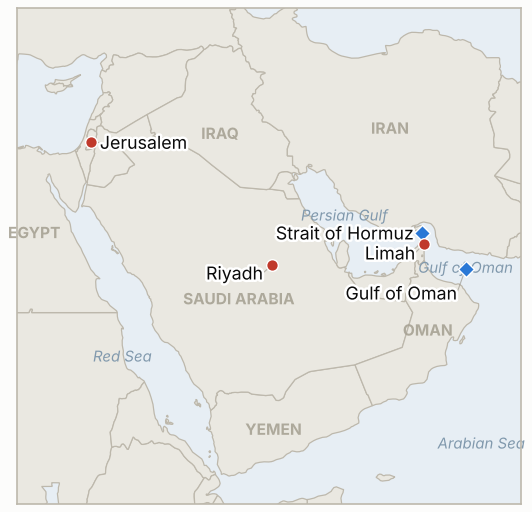

# Middle East Daily Briefing

**November 12, 2026**

- **Reporting window:** ~24 hours, November 11, 15:00 to November 12, 06:00 KST
- **Overall assessment:** Tehran answered Washington's "war is effectively over" message by tightening, not easing: it reported tankers burning after hitting mines on an "unauthorized route" in Hormuz, said the strait stays shut until its seven conditions are met, and ruled out sending enriched uranium abroad (§1.1, §1.2). Oil recovered part of its slide and Brent settled at $92.76, but Seoul kept rallying on foreign buying even after a hot US inflation print (§1.3, §1.4). The gap between Washington's tone and Tehran's terms is the main risk to this week's relief trade.

---

## 1. What Happened

<figure style="float:right; width:46%; margin:2pt 0 8pt 14pt;">

<figcaption style="font-size:8pt; color:#666; text-align:center; margin-top:3pt; font-style:italic;">Major places of discussion</figcaption>
</figure>

### 1.1 Hormuz: Iran reports tankers hitting mines and keeps the strait shut

Iran's army said a tanker hit a naval mine and caught fire in a "prohibited area" of the eastern strait, after the IRGC Navy said two or three tankers had burned on an "unauthorized route" the day before; Iran says safe passage requires coordination with its forces ([Al Jazeera](https://www.aljazeera.com/news/2026/11/11/iran-denies-talks-with-us-says-hormuz-will-stay-shut-until-demands-are-met); [Arab News](https://www.arabnews.com/middle-east/iran-says-oil-tanker-hit-mine-and-caught-fire-in-strait-of-hormuz-3011095); [Ynet](https://www.ynetnews.com/article/r1ykccw0gl)). UKMTO received reports of incidents involving two tankers, one struck by an unknown projectile northeast of Limah, Oman, but has not confirmed mines, damage or casualties, and the US military had recently said the strait was cleared of mines. The Washington Institute counted 37 attacks on ships in and near the strait in October, the most of any month since the war began ([CNBC/Reuters](https://www.cnbc.com/2026/11/11/oil-rises-from-two-month-low-as-hormuz-shipping-attacks-offset-iran-truce-hopes.html)). **Confidence: High that incidents occurred; Low on the Iranian mine account and ship count.**

### 1.2 Tehran: no talks, no uranium export, seven conditions first

Security chief Mohsen Rezaei called reports of talks or a meeting in Qatar "a pure lie," said Iran is waiting for a US answer to its seven conditions (the US initial response was "insufficient and deceptive"), and told Al Mayadeen that "not a single particle of enriched nuclear material will leave Iran" ([Al Jazeera](https://www.aljazeera.com/news/2026/11/11/iran-denies-talks-with-us-says-hormuz-will-stay-shut-until-demands-are-met); [Ynet](https://www.ynetnews.com/article/r1ykccw0gl)). The known conditions include lifting sanctions, ending the naval blockade and ending fighting on all fronts, especially Lebanon; Araghchi said Hormuz could reopen within two days if they are met. In Paris for the G7 foreign ministers, Rubio said Washington is "open to diplomacy" and sees no need for major combat because the economic campaign is "devastating," while Qatar's prime minister met the Saudi foreign minister and four European counterparts there. In Washington the House voted 211 to 204 to refer Thomas Massie's impeachment articles against Defense Secretary Hegseth to committee, effectively shelving them for this Congress ([Stars and Stripes](https://www.stripes.com/theaters/us/2026-11-10/house-vote-hegseth-impeachment-massie-23427346.html); [Time](https://time.com/article/2026/11/10/hegseth-impeachment-procedural-vote-house/)). **Confidence: High.**

### 1.3 Oil rebounds from a two month low

Brent settled at $92.76 (+1.39%) and WTI at $86.53 (+0.57%), recovering part of the week's slide as Hormuz attacks offset hopes of a truce ([Reuters via AOL](https://www.aol.com/articles/oil-rises-two-month-low-020102000.html)). Industry data showed US crude stocks up about 9 million barrels last week, with official EIA data delayed to Thursday by Veterans Day, and OPEC+ output rose in October, led by Saudi Arabia. LSEG analysts said any rise in Hormuz flows depends on mine clearance, insurance and shipowner willingness even if a deal is reached. No daily Hormuz transit count was published. **Confidence: High on settlements; Medium on inventory figures (industry estimate).**

### 1.4 Seoul: KOSPI extends rally; Cheonghae Unit expansion goes to parliament

The KOSPI rose 2.60% to 5,375.36, just short of the November 5 close of 5,383.80, after opening lower on a hot US October CPI (+0.4% on the month, core +0.3%, both above forecast), with foreigners net buying about 655 billion won ([Seoul Economic Daily](https://en.sedaily.com/market/2026/11/11/kospi-closes-up-260-percent-at-537536); [BigGo Finance](https://finance.biggo.com/news/007a367e-afa3-498a-abe9-caae5bf95532); [CNBC](https://www.cnbc.com/2026/11/10/cpi-inflation-report-october-2026.html)). The won firmed 3.9 won to 1,333.6 per dollar as chip exporters sold dollars ([Financial News](https://www.fnnews.com/news/202611111537427959)). Separately, the Cabinet on November 10 approved a motion to extend the Cheonghae Unit's area of operations from the Gulf of Aden to waters south of Oman, adding a maritime patrol aircraft and an explosive ordnance disposal team; it now needs National Assembly consent, after Iran urged Seoul not to send forces and progressive parties called it a "backdoor deployment" ([Korea JoongAng Daily](https://www.koreajoongangdaily.com/korea/seoul-stresses-noninvolvement-as-hormuz-mission-expands/12965233); [Korea Herald](https://www.koreaherald.com/article/10932274)). **Confidence: High.**

### 1.5 Knesset speaker vote set; Houthis keep firing at Riyadh

Speaker Amir Ohana scheduled a vote on his replacement for Tuesday, November 17, at 4 p.m., after receiving a request signed by 67 members to elect Yashar's Matan Kahana; the Joint List will back Kahana and United Torah Judaism will not ([IBTimes UK](https://www.ibtimes.co.uk/netanyahu-ally-knesset-speaker-vote-opposition-1831645); [Times of Israel](https://www.timesofisrael.com/liveblog_entry/tibi-says-joint-list-will-vote-for-kahana-as-knesset-speaker-we-want-to-be-part-of-the-change/)). In Saudi Arabia the coalition said it intercepted three Houthi cruise missiles fired toward Riyadh on Wednesday, after a ballistic and a cruise missile on Tuesday and a Sunday strike that reportedly damaged an Aramco tower in the financial district, which neither Riyadh nor Aramco has confirmed ([Gulf News](https://gulfnews.com/world/gulf/saudi/saudi-coalition-says-intercepted-3-houthi-missiles-fired-at-riyadh-1.500744072); [Asharq Al-Awsat](https://english.aawsat.com/gulf/5340211-coalition-air-defenses-destroy-3-cruise-missiles-launched-houthis-toward-riyadh-region)). **Confidence: High on the vote date and interceptions; Low on Aramco damage.**

---

## 2. Deep Dive: Incentives and Motives

### 2.1 Why is Iran advertising mine strikes just as Washington talks of peace?

The mine claims tell shipowners that the "unauthorized" southern route along Oman is unsafe and that passage runs through Iranian coordination. That keeps Hormuz as Iran's main bargaining chip at the moment Washington claims the war is over, and it pushes back on the US story that the blockade and mine clearance have restored control of the strait.

### 2.2 Why does Rezaei rule out exporting enriched uranium now?

Removal of the highly enriched stockpile is Washington's core demand for a final deal. Ruling it out publicly sets Iran's opening position before any meeting, protects the hardline camp from charges of surrender, and signals to Moscow, which Rezaei visited last week, that Iran will not hand its leverage to a third country.

### 2.3 Why does Washington keep saying combat is unnecessary?

With the midterms lost, rising inflation, and a Fed leaning toward hikes, lower oil prices matter more to the administration than new strikes. Rubio's line that the economic campaign is working lets the US hold the blockade without new costs, while the shelving of the Hegseth impeachment removes a near-term domestic challenge to the war's management.

### 2.4 Why does Seoul expand the Cheonghae Unit while insisting on non-involvement?

Korea's crude and LNG tankers pass through the Gulf of Oman, and Washington wants allies to share the burden of protecting shipping. A patrol aircraft and mine-clearing team south of Oman protect Korean ships at a low political cost, while framing the move as protection of nationals limits friction with Tehran and the domestic left.

---

## 3. Policy Implications for South Korea

**Exposure snapshot:** South Korea draws about 70.7% of its crude and 20.4% of its LNG from the Middle East (`instructions/korea-exposure.md`, no update needed). Latest prints: KOSPI 5,375.36 and USD/KRW 1,333.6 (November 11); Brent $92.76 and WTI $86.53 (November 11 settles).

**Implications by development:**

- **Hormuz mine claims (§1.1):** Even unconfirmed, mine reports raise war-risk premiums for Korean refiners' tankers and slow the recovery in flows that cheaper oil assumed (IND-20261112-2).
- **Tehran's hard line (§1.2):** No talks and no uranium export mean the de-escalation trade rests on US restraint rather than a deal, so it can reverse quickly (IND-20261111-1, IND-20261110-1).
- **Oil rebound (§1.3):** Brent back above $92 limits the import bill relief; a move back toward $95 would signal the risk premium is rebuilding (IND-20261112-3, IND-20261106-3).
- **Seoul markets and the Cheonghae Unit (§1.4):** Foreign buying continued despite US inflation, but a hot CPI raises the odds of a Fed hike that would pressure the won. The Cheonghae motion puts Korean assets closer to Hormuz; parliamentary approval and Tehran's reaction are the next tests (IND-20261112-1, IND-20261111-2).
- **Riyadh and the Knesset (§1.5):** Continued Houthi fire at Riyadh keeps Saudi export and Korean project sites in Saudi Arabia exposed (IND-20261108-1); the November 17 vote will show whether Eisenkot controls the Knesset agenda (IND-20261111-3).

**Resolved today:**

- IND-20261105-3 falsified: Brent did not settle above $100 by November 12; the highest settle since was $98.32 and Wednesday's was $92.76.

**Testable indicators:**

- **IND-20261112-1** (open, new): National Assembly consent to the Cheonghae Unit expansion motion by ~2026-11-30 confirms; no vote or a rejection by then falsifies.
- **IND-20261112-2** (open, new): UKMTO, a flag state or the operator confirms a mine strike on a named tanker in or near Hormuz by ~2026-11-19 confirms; none falsifies (Iranian claims alone do not count).
- **IND-20261112-3** (open, new): A Brent settle above $95 on any session by ~2026-11-19 confirms the Hormuz risk premium is rebuilding; none falsifies.
- **IND-20261111-2** (open): KOSPI closed at 5,375.36, 8.44 points short of the 5,383.80 threshold.
- **IND-20261111-3** (open): the speaker vote is set for November 17, inside the deadline.
- **IND-20261108-3, IND-20261110-1** (open): no formal Iranian reply or scheduled session; Rezaei says Iran is waiting for the US.
- **IND-20261110-2** (open): no restart reported at Khor Mor; the operator's last update still showed production suspended.
- **IND-20261108-1** (open): Gulf News reports Aramco tower damage but there is no Saudi or Aramco confirmation.
- **IND-20261106-1, -3, IND-20261107-1, -3, IND-20261109-2, IND-20261105-2, IND-20261111-1, IND-20260910-3, IND-20261023-1** (open): see `tracking/indicators.md`.

---

## 4. Watch List

- **Independent confirmation of the Hormuz mine strikes and any new UKMTO advisories (IND-20261112-2).**
- **A US reply to Iran's seven conditions, or a Vance and Rezaei meeting (IND-20261111-1, IND-20261110-1).**
- **Thursday's delayed EIA inventory data and Brent's path (IND-20261112-3, IND-20261106-3).**
- **National Assembly handling of the Cheonghae Unit motion (IND-20261112-1).**
- **The November 17 Knesset speaker vote (IND-20261111-3).**
- **Houthi fire at Riyadh and any Aramco statement (IND-20261108-1).**

---

## 5. Source Quality Summary

| Claim | Sources | Confidence |
| --- | --- | --- |
| Tankers hit mines and burned in eastern Hormuz | Iranian army and IRGC via Al Jazeera, Arab News, Ynet | Low |
| UKMTO reports two tanker incidents, one projectile strike near Limah | Al Jazeera, CNBC/Reuters | High |
| 37 ship attacks in October | Washington Institute via Reuters | Medium |
| Rezaei: talks "a pure lie," no uranium export, seven conditions | Al Jazeera, Ynet (Al Mayadeen interview) | High |
| Rubio "open to diplomacy," no need for major combat | Al Jazeera, CBS News | High |
| House refers Hegseth impeachment to committee, 211 to 204 | Stars and Stripes, Time, CNN | High |
| Brent $92.76, WTI $86.53 settles | Reuters via AOL | High |
| US crude stocks up about 9 million barrels | API figures via Reuters | Medium |
| KOSPI 5,375.36, foreigners about +655bn won | Seoul Economic Daily, BigGo Finance | High |
| Won 1,333.6 per dollar | Financial News, Asia Economy | High |
| US October CPI +0.4%, core +0.3% | CNBC, BLS | High |
| Cabinet approves Cheonghae Unit expansion | Korea JoongAng Daily, Korea Herald | High |
| Speaker vote November 17 after 67 signatures | IBTimes UK, Times of Israel, Jerusalem Post | High |
| Three Houthi cruise missiles intercepted near Riyadh | Gulf News, Asharq Al-Awsat | High |
| Aramco tower damaged in Riyadh | Gulf News (no Saudi or Aramco confirmation) | Low |
| Hormuz daily transit count | Not reported | Not reported |
