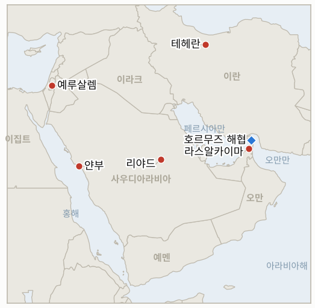
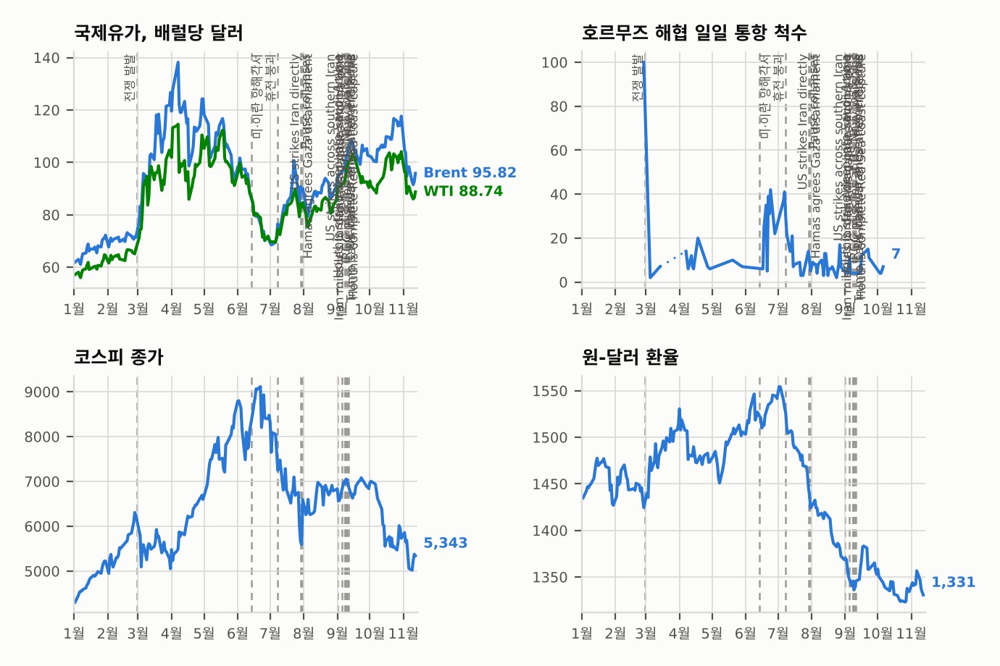

# 중동 일일 브리핑

**2026년 11월 13일**

- **보고 기간:** 약 24시간, 11월 12일 15:00 ~ 11월 13일 06:00 (한국시간)
- **종합 평가:** 위험 프리미엄이 한 번의 거래일 만에 되살아났다. 트럼프는 워싱턴이 더는 이란과의 합의가 필요 없다고 했고, 이란은 호르무즈에서 유조선 4척이 추가로 피격됐다고 주장했으며, 후티는 걸프 원유가 해협을 우회하는 통로인 사우디 동서 송유관과 얀부를 공격했다고 주장했다. 브렌트는 3.3% 급등한 95.82달러로 정산했다(§1.1~§1.3). 이란 전문가회의는 NPT 탈퇴 검토가 필연이라고 밝혀 핵 차원의 변수를 더했다(§1.4). 서울 증시의 랠리는 외국인 매도로 숨을 골랐지만 원화는 강세를 지켰다(§1.5). 양측 모두 회담이 필요 없다고 말하는 지금, 지난 한 주의 긴장 완화 거래는 취약해 보인다.

---

## 1. 무슨 일이 있었나

<figure style="float:right; width:46%; margin:2pt 0 8pt 14pt;">

<figcaption style="font-size:8pt; color:#666; text-align:center; margin-top:3pt; font-style:italic;">주요 논의 지점</figcaption>
</figure>

### 1.1 트럼프, 이란과 "합의는 필요 없다"

아시아 장 초반 유가가 내리자 트럼프는 "그런 시절은 이미 오래전에 지나갔다"며 워싱턴은 더는 이란과의 합의가 필요 없다고 게시하고, "우리는 그들의 돈, 수천억 달러를 갖고 있고 그들의 해협도 갖고 있다!"고 덧붙였다. 동결 자산 언급에 대한 설명은 없었다([CBS News](https://www.cbsnews.com/live-updates/iran-war-us-nuclear-strait-of-hormuz/); [Reuters via Central Oregon Daily](https://www.centraloregondaily.com/news/consumer/oil-gains-over-2-on-attacks-on-saudi-energy-sites-strait-of-hormuz-disruptions/article_de1d33b7-34a5-5873-9889-f94c2b117ea8.html)). 테헤란에서는 호세인 타에브 바시지 사령관이 7개 조건이 충족된 뒤에야 이란이 협상의 "방식과 의제"를 정하겠다고 했고, 모하마드 바게르 갈리바프 수석 협상대표는 알자지라에 미국 당국자들이 블라디미르 푸틴에게 이란을 직접 협상으로 끌어내 달라고 요청했다고 말했다. 백악관은 직접 답하지 않았고, 우크라이나 문제로 열린 위트코프·쿠슈너의 크렘린 회동에서도 이란은 공개적으로 언급되지 않았다. **신뢰도: 트럼프 게시물과 타에브 발언은 높음, 푸틴 요청은 중간(갈리바프 설명만 있음).**

### 1.2 호르무즈: 이란, 유조선 4척 피격 주장, 발사체 피격 1건은 독립 확인

이슬람혁명수비대(IRGC)는 400만 배럴 이상을 실은 초대형 유조선 2척이 "비인가 항로"에서 "사고"로 멈춰 불타고 있다고 했고, 이란군은 다른 유조선 2척이 경고를 무시하다 해협 동쪽에서 기뢰에 걸렸다고 밝혔다([CBS News](https://www.cbsnews.com/live-updates/iran-war-us-nuclear-strait-of-hormuz/)). 로이터는 이를 확인하지 못했다. 영국 해상 리스크 자문사 앰브레이는 수요일 아랍에미리트(UAE) 라스알카이마에서 14해리 떨어진 해상에서 상선이 발사체에 맞아 기관실 화재가 났으며 알려진 부상자는 없다고 확인했다. 영국 해사무역기구(UKMTO)는 해협 내 다른 위치에서 유조선 사건을 보고해, 두 보고가 같은 선박인지는 불분명하다. 특정 선박의 기뢰 피격은 확인되지 않았고 일일 통항 수치도 발표되지 않았다. **신뢰도: 발사체 피격 발생은 높음, 이란의 유조선 4척·기뢰 주장은 낮음.**

### 1.3 후티, 사우디 우회로 공격 주장, 유가 3.3% 급등

후티는 사우디 동서 송유관의 펌프장, 홍해 연안 얀부의 석유 시설, 리야드의 아람코 건물을 공격했다고 주장했다. 사우디 주도 연합군은 리야드 지역과 동부주 상공에서 드론 2대를 격추했다고 밝혔고, 사우디는 피해를 확인하지 않았다([Reuters via Central Oregon Daily](https://www.centraloregondaily.com/news/consumer/oil-gains-over-2-on-attacks-on-saudi-energy-sites-strait-of-hormuz-disruptions/article_de1d33b7-34a5-5873-9889-f94c2b117ea8.html)). 브렌트는 95.82달러(+3.06달러, +3.3%), WTI는 88.74달러(+2.21달러, +2.6%)로 정산했지만 주간으로는 둘 다 약 2.5% 낮다([Rallies/Reuters](https://rallies.ai/news/oil-settles-3-higher-on-attacks-on-saudi-energy-sites-strait-of-hormuz-disruptions-274558af43909ac1)). 늦게 나온 미국 에너지정보청(EIA) 보고서에서는 원유·휘발유·중간유분 재고가 모두 늘었고, OPEC+ 자료에서는 사우디 생산량이 전쟁 전 수준에 가깝게 회복됐다([Hankyung](https://www.hankyung.com/article/202611121753i)). **신뢰도: 정산가는 높음, 후티의 피해 주장은 낮음.**

### 1.4 이란 전문가회의, NPT 탈퇴 검토는 필연

최고지도자를 감독하는 88명 규모의 성직자 기구인 전문가회의는 핵확산금지조약(NPT) 탈퇴 검토가 필연이 됐다고 밝히고, 이란 핵 프로그램에 대한 반복된 공격을 근거로 국방 교리 재검토와 억지력 강화를 촉구했다([Mehr](https://en.mehrnews.com/news/249357/Assembly-of-Experts-backs-NPT-exit-warns-against-escalation); [TASS](https://tass.com/world/2217265)). 탈퇴 자체를 요구하지는 않았으며, 결정은 최고지도자의 몫이다. 한 의원은 11월 9일 NPT 탈퇴 법안 9건이 의회(마즐리스) 의제에 올라 있다고 말했다. 에스마일 바가에이 외무부 대변인은 "직간접적" 침략이나 "경제 테러"를 적대 행위로 간주하겠다고 경고했다. **신뢰도: 성명은 높음, 법안 건수는 중간.**

### 1.5 서울은 숨 고르기, 아이젠코트 진영은 크네세트 의사 일정 장악

코스피는 장중 5,400을 넘었다가 엔비디아 경영진 거취를 둘러싼 불확실성과 옵션 만기일 기관 매도로 미국 반도체주 강세 효과가 상쇄되면서 0.61% 내린 5,342.73에 마감했다. 외국인은 이틀 연속 순매수 뒤 약 4,272억 원을 순매도했다([Seoul Economic Daily](https://www.sedaily.com/article/20113582); [Businesskorea](https://www.businesskorea.co.kr/news/articleView.html?idxno=281164); [Namdo Ilbo](https://www.namdonews.com/news/articleView.html?idxno=929099)). 그래도 원화는 2.9원 오른 달러당 1,330.7원을 기록했다([Nate/Yonhap](https://m.news.nate.com/view/20261112n27769)). 청해부대 동의안(병력 395명 이내, P-8A 해상초계기와 폭발물처리(EOD)팀, 오만 남방 해역, 2027년 말까지)은 국회 국방위원회 심사를 기다리고 있으며, 국방부는 호르무즈 투입에는 별도의 동의안이 필요하다고 밝혔다([News1](https://www.news1.kr/diplomacy/defense-diplomacy/6349715); [Segye Ilbo](https://www.segye.com/newsView/20261110516082)). 이스라엘에서는 아이젠코트 진영이 63 대 50 표결로 야샤르의 로이 폴크만이 이끄는 크네세트 조정위원회를 구성했고, 네타냐후는 과도 총리직을 유지하고 있다([Haaretz](https://haaretz.com/israel-news/israel-politics/2026-11-12/ty-article/.premium/eisenkot-controls-the-knesset-netanyahu-is-still-pm-what-each-bloc-is-planning/000001a1-ce67-dfd7-a7a3-ce7757c70000)). **신뢰도: 높음.**

---

## 2. 심층 분석: 동기와 유인

### 2.1 트럼프는 왜 더는 합의가 필요 없다고 말하는가?

트럼프는 교착 상태를 승리 선언으로 바꾸고 있다. 이란 자산이 동결되고 봉쇄가 유지되는 한, 합의가 없는 상태를 실패가 아닌 성공으로 내세울 수 있고, 제재 완화와 레바논 휴전이라는 이란의 대가를 치르지 않아도 된다. 이 게시물은 테헤란의 "7개 조건이 먼저"라는 입장에 같은 거부로 맞서며 이란이 먼저 움직이도록 압박한다. 대가는 원유 트레이더들이 이를 단기 외교의 종언으로 읽었다는 점이며, 그래서 가격이 몇 시간 만에 반전했다.

### 2.2 후티는 왜 사우디의 우회로를 노리는가?

동서 송유관과 얀부는 사우디 원유가 호르무즈를 거치지 않고 시장에 닿는 통로다. 이를 위협하면 리야드와 한국 같은 구매국에 우회로도 안전하지 않다는 신호를 보내고, 이란의 호르무즈 지렛대 가치를 높인다. 또 생산량을 전쟁 전 수준으로 되돌려 유가 상단을 누르고 이란의 지렛대를 약화시킨 사우디를 응징하는 의미도 있다.

### 2.3 전문가회의는 왜 지금 NPT를 꺼내는가?

최고지도자와 가까운 성직자 기구가 탈퇴 검토를 지지하면, 하메네이를 구속하지 않으면서도 강경파에 공식 무대를 열어 준다. 이는 트럼프의 "합의 불필요" 게시물에 이란 나름의 확전 위협으로 답하는 것이며, 농축 우라늄 비축분을 국외로 내보내지 않겠다는 이번 주 레자에이의 입장을 강화한다. 협상가들에게는 협상장을 떠나는 비용을 높인다.

### 2.4 원화가 강세인데 외국인은 왜 서울에서 팔았나?

매도는 SK하이닉스에 집중됐고 중동 리스크가 아니라 미국 기술주 심리와 옵션 만기와 연결됐으며, 수출업체는 계속 달러를 팔았다. 유가 급등은 서울 장 마감 후에 나왔으므로, 금요일 장이 한국이 되살아난 위험 프리미엄을 어떻게 반영하는지 보여 줄 첫 시험대다.

---

## 3. 한국에 대한 정책적 함의

**노출 현황:** 한국은 원유의 약 70.7%, LNG의 약 20.4%를 중동에서 들여온다(`instructions/korea-exposure.md`, 갱신 불필요). 최신 수치: 코스피 5,342.73, 원/달러 1,330.7(11월 12일), 브렌트 95.82달러·WTI 88.74달러(11월 12일 정산가).

**전개별 함의:**

- **트럼프의 "합의 불필요" 게시물(§1.1):** 합의 없는 장기 봉쇄는 호르무즈 물동량을 극소 수준에 묶어 두며, 한국 정유사는 우회로와 전략비축유에 계속 의존하게 된다(IND-20261111-1, IND-20261110-1).
- **호르무즈 사건(§1.2):** UAE 앞바다 발사체 피격이 독립적으로 확인되면서, 기뢰 피격이 확인되지 않아도 한국행 유조선의 전쟁위험 할증료는 높게 유지된다(IND-20261112-2).
- **사우디 우회로(§1.3):** 동서 송유관과 얀부는 한국이 사우디 원유를 들여오는 주요 대체 경로다. 이곳의 가동 중단이 확인되면 호르무즈 소식보다 한국의 도입 비용에 더 직접적인 타격이 된다(IND-20261108-1, IND-20261113-1).
- **NPT 검토(§1.4):** NPT 탈퇴 쪽으로 움직이면 미국이나 이스라엘의 재공격 가능성과 유가가 함께 높아지며, 테헤란을 상대로 한 서울의 비확산 입장도 복잡해진다(IND-20261113-2).
- **서울 시장과 청해부대(§1.5):** 원화는 버텼지만 브렌트의 3달러 급등은 서울 장 마감 후에 나왔다. 원화가 다시 1,350원을 넘으면 유가가 환율로 전이되고 있다는 신호다(IND-20261113-3, IND-20261111-2, IND-20261112-1).

**오늘 종결:**

- IND-20261112-3 확인: 브렌트가 11월 12일 95.82달러로 정산해 95달러를 넘었다.
- IND-20261106-3 반증: 11월 13일까지 브렌트가 90달러 아래로 정산하지 않았다. 최저 정산가는 91.49달러(11월 10일)였다.
- IND-20261106-1 반증: 11월 13일까지 미군 주둔을 이유로 한 이란의 걸프 국가 공격이나 호르무즈 연안을 넘어선 미국의 공습 공개는 없었다. 라스알카이마 발사체 피격은 주체가 밝혀지지 않았다.
- IND-20261108-3 반증: 11월 13일까지 카타르 제안에 대한 이란의 공식 답변은 확인되지 않았다. 타에브는 7개 조건 충족 뒤에야 조건을 논의하겠다고 했다.
- IND-20261109-2 반증: 11월 13일까지 한국의 추가 시장 안정 조치는 확인되지 않았다(제한적 검색).

**검증 가능한 지표:**

- **IND-20261113-1** (신규): 2026년 11월 20일경까지 어느 거래일이든 브렌트가 100달러를 넘어 정산하면 위험 프리미엄 재확대를 확인하며, 없으면 반증한다.
- **IND-20261113-2** (신규): 2026년 11월 30일경까지 마즐리스가 NPT 탈퇴 법안을 어느 독회에서든 통과시키거나 이란이 공식 탈퇴를 통보하면 확인하며, 둘 다 없으면 반증한다.
- **IND-20261113-3** (신규): 2026년 11월 20일경까지 어느 거래일이든 원/달러가 1,350원을 넘어 마감하면 유가 리스크의 원화 전이를 확인하며, 없으면 반증한다.
- **IND-20261111-2** (진행 중): 코스피는 장중 5,400을 넘었으나 5,342.73에 마감해 기준선 5,383.80에 못 미쳤다.
- **IND-20261112-2** (진행 중): 앰브레이가 확인한 것은 기뢰가 아니라 발사체 피격이며, 특정 선박의 기뢰 피격은 확인되지 않았다.
- **IND-20261108-1** (진행 중): 후티가 펌프장·얀부·아람코 건물 공격을 새로 주장했으나 연합군은 드론 격추만 발표했다.
- **IND-20261107-1, -3, IND-20261110-1, -2, IND-20261111-1, -3, IND-20261112-1, IND-20261105-2, IND-20260910-3, IND-20261023-1** (진행 중): `tracking/indicators.md` 참조.

---

## 4. 관찰 목록

- **동서 송유관이나 얀부에 대한 사우디 또는 아람코의 발표(IND-20261108-1).**
- **브렌트 급등에 대한 금요일 서울 증시와 원화의 반응(IND-20261113-3, IND-20261111-2).**
- **마즐리스의 NPT 법안 처리와 국제원자력기구(IAEA)의 반응(IND-20261113-2).**
- **양측의 "회담 없음" 입장에도 러시아 채널이나 카타르 회동이 열리는지(IND-20261111-1, IND-20261110-1).**
- **호르무즈에서 특정 유조선 피해의 확인(IND-20261112-2).**
- **11월 17일 크네세트 의장 표결(IND-20261111-3).**

---

## 5. 출처 품질 요약

| 주장 | 출처 | 신뢰도 |
| --- | --- | --- |
| 트럼프: 합의 불필요, "그들의 해협을 갖고 있다" | CBS News, Reuters | 높음 |
| 타에브: 7개 조건 충족 뒤에야 협상 조건 논의 | CBS News | 높음 |
| 미국, 푸틴에게 이란의 직접 협상 압박 요청 | 갈리바프(Al Jazeera 인터뷰), CBS News | 중간 |
| 호르무즈에서 유조선 4척 폭발·기뢰 피격 | IRGC·이란군(CBS News, Reuters, 미확인) | 낮음 |
| 라스알카이마 14해리 해상 선박 발사체 피격 | 앰브레이(CBS News) | 높음 |
| 후티의 동서 송유관·얀부·아람코 건물 공격 | 후티 주장(Reuters) | 낮음 |
| 연합군, 후티 드론 2대 격추 | 사우디 주도 연합군(Reuters, CBS News) | 높음 |
| 브렌트 95.82달러, WTI 88.74달러 정산 | Reuters via Central Oregon Daily, Rallies | 높음 |
| EIA: 원유·휘발유·중간유분 재고 증가 | EIA(Reuters) | 높음 |
| 사우디 생산량 전쟁 전 수준 근접 | OPEC+ 자료(Hankyung, Reuters) | 중간 |
| 전문가회의: NPT 탈퇴 검토는 필연 | Mehr, TASS | 높음 |
| 마즐리스 의제에 NPT 탈퇴 법안 9건 | 의원 발언(2차 보도) | 중간 |
| 코스피 5,342.73, 외국인 약 4,272억 원 순매도 | Seoul Economic Daily, Businesskorea, Namdo Ilbo | 높음 |
| 원/달러 1,330.7원 | Nate/Yonhap | 높음 |
| 청해부대 동의안 내용과 국회 절차 | News1, Segye Ilbo, Digital Times | 높음 |
| 아이젠코트 진영, 63 대 50으로 조정위원회 구성 | Haaretz | 중간 |
| 호르무즈 일일 통항 수치 | 미보고 | 미보고 |
