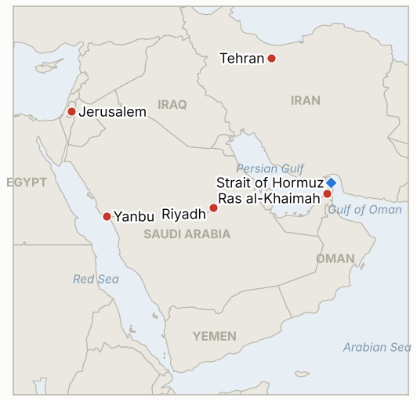

# Middle East Daily Briefing

**November 13, 2026**

- **Reporting window:** ~24 hours, November 12, 15:00 to November 13, 06:00 KST
- **Overall assessment:** The risk premium came back in a single session. Trump said Washington no longer needs a deal with Iran, Iran claimed four more tankers were hit in Hormuz, and the Houthis claimed strikes on Saudi Arabia's East-West pipeline and Yanbu, the routes that carry Gulf crude around the strait; Brent jumped 3.3% to $95.82 (§1.1 to §1.3). Iran's Assembly of Experts added a nuclear dimension by calling a review of leaving the NPT a necessity (§1.4). Seoul's rally paused on foreign selling, but the won held firm (§1.5). With both sides now saying they do not need talks, the de-escalation trade of the past week looks fragile.

---

## 1. What Happened

<figure style="float:right; width:46%; margin:2pt 0 8pt 14pt;">

<figcaption style="font-size:8pt; color:#666; text-align:center; margin-top:3pt; font-style:italic;">Major places of discussion</figcaption>
</figure>

### 1.1 Trump: "We don't need a deal" with Iran

After oil fell in early Asian trading, Trump posted that Washington no longer needs a deal with Iran because "those days have long since passed," adding: "We've got their money, Hundreds of Billions of Dollars, and we've got their Strait!" He did not explain the reference to frozen assets ([CBS News](https://www.cbsnews.com/live-updates/iran-war-us-nuclear-strait-of-hormuz/); [Reuters via Central Oregon Daily](https://www.centraloregondaily.com/news/consumer/oil-gains-over-2-on-attacks-on-saudi-energy-sites-strait-of-hormuz-disruptions/article_de1d33b7-34a5-5873-9889-f94c2b117ea8.html)). In Tehran, Basij chief Hossein Taeb said Iran will set the "manner and subjects" of any talks only after its seven conditions are met, and chief negotiator Mohammad Bagher Qalibaf told Al Jazeera that US officials had asked Vladimir Putin to press Iran into direct talks; the White House did not respond directly, and Witkoff and Kushner's Kremlin meeting on Ukraine made no public mention of Iran. **Confidence: High on Trump's post and Taeb; Medium on the Putin request (Qalibaf's account only).**

### 1.2 Hormuz: Iran claims four tankers hit; one projectile strike independently confirmed

The IRGC said two supertankers carrying more than four million barrels were immobilized and burning after an "accident" on an "unauthorized route," and Iran's army said two more tankers hit mines east of the strait after ignoring warnings ([CBS News](https://www.cbsnews.com/live-updates/iran-war-us-nuclear-strait-of-hormuz/)). Reuters could not verify the account. The UK risk firm Ambrey confirmed that a projectile hit a commercial ship 14 nautical miles off Ras al-Khaimah, UAE, on Wednesday, causing an engine room fire with no known injuries, while UKMTO reported a tanker incident in the strait at a different location; it is unclear whether the reports cover the same ships. No mine strike on a named vessel has been confirmed, and no daily transit count was published. **Confidence: High that a projectile strike occurred; Low on the Iranian four-tanker and mine claims.**

### 1.3 Houthis claim Saudi bypass routes; oil jumps 3.3%

The Houthis said they attacked a pumping station on Saudi Arabia's East-West pipeline, an oil facility in Yanbu on the Red Sea, and an Aramco building in Riyadh; the Saudi-led coalition said it destroyed two drones, one over the Riyadh region and one over the Eastern Province, and Riyadh confirmed no damage ([Reuters via Central Oregon Daily](https://www.centraloregondaily.com/news/consumer/oil-gains-over-2-on-attacks-on-saudi-energy-sites-strait-of-hormuz-disruptions/article_de1d33b7-34a5-5873-9889-f94c2b117ea8.html)). Brent settled at $95.82 (+$3.06, +3.3%) and WTI at $88.74 (+$2.21, +2.6%), though both were still about 2.5% lower on the week ([Rallies/Reuters](https://rallies.ai/news/oil-settles-3-higher-on-attacks-on-saudi-energy-sites-strait-of-hormuz-disruptions-274558af43909ac1)). The delayed EIA report showed US crude, gasoline and distillate stocks all rose, and OPEC+ data showed Saudi output back near prewar levels ([Hankyung](https://www.hankyung.com/article/202611121753i)). **Confidence: High on settlements; Low on Houthi damage claims.**

### 1.4 Iran's Assembly of Experts calls an NPT exit review a necessity

The 88-member clerical body that oversees the supreme leader said examining withdrawal from the Nuclear Non-Proliferation Treaty has become a necessity and called for a review of Iran's defense doctrine and stronger deterrence, citing repeated attacks on Iran's nuclear program ([Mehr](https://en.mehrnews.com/news/249357/Assembly-of-Experts-backs-NPT-exit-warns-against-escalation); [TASS](https://tass.com/world/2217265)). It stopped short of demanding exit, a decision that rests with the supreme leader; a lawmaker said on November 9 that nine NPT withdrawal bills are on the Majles agenda. Foreign Ministry spokesman Esmaeil Baqaei warned that "direct or indirect" aggression or "economic terrorism" would be treated as hostile. **Confidence: High on the statement; Medium on the number of bills.**

### 1.5 Seoul pauses; Eisenkot bloc takes control of the Knesset agenda

The KOSPI fell 0.61% to 5,342.73 after topping 5,400 intraday, as uncertainty over Nvidia's leadership and options expiry selling by institutions offset strong US chip shares; foreigners net sold about 427.2 billion won after two days of buying ([Seoul Economic Daily](https://www.sedaily.com/article/20113582); [Businesskorea](https://www.businesskorea.co.kr/news/articleView.html?idxno=281164); [Namdo Ilbo](https://www.namdonews.com/news/articleView.html?idxno=929099)). The won still firmed 2.9 won to 1,330.7 per dollar ([Nate/Yonhap](https://m.news.nate.com/view/20261112n27769)). The Cheonghae Unit motion (up to 395 personnel, a P-8A patrol aircraft and an EOD team south of Oman, through end-2027) awaits the National Assembly's defense committee; the defense ministry says any Hormuz deployment would need a separate motion ([News1](https://www.news1.kr/diplomacy/defense-diplomacy/6349715); [Segye Ilbo](https://www.segye.com/newsView/20261110516082)). In Israel, Eisenkot's bloc won a 63 to 50 vote to set up the Knesset Arrangements Committee under Yashar's Roy Folkman, while Netanyahu stays caretaker prime minister ([Haaretz](https://haaretz.com/israel-news/israel-politics/2026-11-12/ty-article/.premium/eisenkot-controls-the-knesset-netanyahu-is-still-pm-what-each-bloc-is-planning/000001a1-ce67-dfd7-a7a3-ce7757c70000)). **Confidence: High.**

---

## 2. Deep Dive: Incentives and Motives

### 2.1 Why does Trump say he no longer needs a deal?

Trump is turning the stalemate into a claim of victory: with Iranian assets frozen and the blockade holding, he can present the absence of a deal as success rather than failure, and avoid paying Iran's price of sanctions relief and a Lebanon ceasefire. The post also answers Tehran's "seven conditions first" stance with a matching refusal, raising pressure on Iran to move first. The cost is that oil traders read it as the end of near-term diplomacy, which is why prices reversed within hours.

### 2.2 Why are the Houthis hitting Saudi Arabia's bypass routes?

The East-West pipeline and Yanbu are how Saudi crude reaches markets without Hormuz. Threatening them tells Riyadh, and buyers like Korea, that the bypass is not safe either, which raises the value of Iran's Hormuz leverage. It also punishes Saudi Arabia for raising output back to prewar levels, which has helped cap prices and undercut Iran's leverage.

### 2.3 Why does the Assembly of Experts raise the NPT now?

A clerical body close to the supreme leader backing an exit review gives the hardline camp a formal platform without committing Khamenei. It answers Trump's "no deal" post with Iran's own escalation threat, and it strengthens the position Rezaei set out this week that the enriched uranium stockpile will not leave the country. For negotiators, it raises the cost of walking away.

### 2.4 Why did foreigners sell Seoul even as the won firmed?

The sale was concentrated in SK Hynix and tied to US tech sentiment and options expiry, not to Middle East risk, while exporters kept selling dollars. The oil jump came after Seoul's close, so Friday's session is the first real test of how Korea prices the renewed risk premium.

---

## 3. Policy Implications for South Korea

**Exposure snapshot:** South Korea draws about 70.7% of its crude and 20.4% of its LNG from the Middle East (`instructions/korea-exposure.md`, no update needed). Latest prints: KOSPI 5,342.73 and USD/KRW 1,330.7 (November 12); Brent $95.82 and WTI $88.74 (November 12 settles).

**Implications by development:**

- **Trump's "no deal" post (§1.1):** A long blockade without a settlement keeps Hormuz flows at a trickle; Korean refiners stay dependent on bypass routes and strategic reserves (IND-20261111-1, IND-20261110-1).
- **Hormuz incidents (§1.2):** An independently confirmed projectile strike off the UAE keeps war-risk premiums high for Korea-bound tankers even without a confirmed mine (IND-20261112-2).
- **Saudi bypass routes (§1.3):** The East-West pipeline and Yanbu are Korea's main alternative supply routes for Saudi crude; any confirmed outage there would hit Korea's import costs more directly than Hormuz news (IND-20261108-1, IND-20261113-1).
- **NPT review (§1.4):** A move toward NPT exit would raise the odds of renewed US or Israeli strikes and push oil higher; it also complicates Seoul's nonproliferation stance with Tehran (IND-20261113-2).
- **Seoul markets and the Cheonghae Unit (§1.5):** The won held up, but Brent's $3 jump landed after Seoul closed; a won move back above 1,350 would show oil feeding into FX (IND-20261113-3, IND-20261111-2, IND-20261112-1).

**Resolved today:**

- IND-20261112-3 confirmed: Brent settled at $95.82 on November 12, above $95.
- IND-20261106-3 falsified: Brent did not settle below $90 by November 13; the lowest settle was $91.49 (November 10).
- IND-20261106-1 falsified: no attack attributed to Iran over a Gulf state's hosting of US forces and no disclosed US strike beyond the Hormuz coast by November 13; the Ras al-Khaimah projectile strike is unattributed.
- IND-20261108-3 falsified: no confirmed formal Iranian reply to Qatar's proposals by November 13; Taeb says terms come only after the seven conditions are met.
- IND-20261109-2 falsified: no further Korean market stabilization step found by November 13 (limited searching).

**Testable indicators:**

- **IND-20261113-1** (open, new): A Brent settle above $100 on any session by ~2026-11-20 confirms the renewed risk premium is building; none falsifies.
- **IND-20261113-2** (open, new): The Majles passes an NPT withdrawal bill in any reading, or Iran formally notifies withdrawal, by ~2026-11-30 confirms; neither falsifies.
- **IND-20261113-3** (open, new): A USD/KRW close above 1,350 on any session by ~2026-11-20 confirms oil risk feeding into the won; none falsifies.
- **IND-20261111-2** (open): KOSPI closed at 5,342.73, below the 5,383.80 threshold, after an intraday high above 5,400.
- **IND-20261112-2** (open): Ambrey confirmed a projectile strike, not a mine; no named mine strike confirmed.
- **IND-20261108-1** (open): Houthis claim new strikes on a pumping station, Yanbu and an Aramco building; the coalition reports only drone interceptions.
- **IND-20261107-1, -3, IND-20261110-1, -2, IND-20261111-1, -3, IND-20261112-1, IND-20261105-2, IND-20260910-3, IND-20261023-1** (open): see `tracking/indicators.md`.

---

## 4. Watch List

- **Any Saudi or Aramco statement on the East-West pipeline or Yanbu (IND-20261108-1).**
- **Seoul's Friday response to Brent's jump, and the won (IND-20261113-3, IND-20261111-2).**
- **Majles moves on NPT bills and any IAEA reaction (IND-20261113-2).**
- **A Russian channel or Qatar meeting despite both sides' "no talks" line (IND-20261111-1, IND-20261110-1).**
- **Confirmation of named tanker casualties in Hormuz (IND-20261112-2).**
- **The November 17 Knesset speaker vote (IND-20261111-3).**

---

## 5. Source Quality Summary

| Claim | Sources | Confidence |
| --- | --- | --- |
| Trump: US does not need a deal, "we've got their Strait" | CBS News, Reuters | High |
| Taeb: terms only after seven conditions | CBS News | High |
| US asked Putin to press Iran into direct talks | Qalibaf via Al Jazeera, CBS News | Medium |
| Four tankers hit by explosions or mines in Hormuz | IRGC and Iranian army via CBS News, Reuters (unverified) | Low |
| Projectile hit ship 14 nm off Ras al-Khaimah | Ambrey via CBS News | High |
| Houthi strikes on East-West pipeline, Yanbu, Aramco building | Houthi claims via Reuters | Low |
| Coalition destroys two Houthi drones | Saudi-led coalition via Reuters, CBS News | High |
| Brent $95.82, WTI $88.74 settles | Reuters via Central Oregon Daily, Rallies | High |
| EIA: crude, gasoline, distillate stocks rose | EIA via Reuters | High |
| Saudi output back near prewar level | OPEC+ data via Hankyung, Reuters | Medium |
| Assembly of Experts: NPT exit review a necessity | Mehr, TASS | High |
| Nine NPT withdrawal bills on Majles agenda | Majles member via secondary reports | Medium |
| KOSPI 5,342.73, foreigners about -427.2bn won | Seoul Economic Daily, Businesskorea, Namdo Ilbo | High |
| Won 1,330.7 per dollar | Nate/Yonhap | High |
| Cheonghae motion details and Assembly process | News1, Segye Ilbo, Digital Times | High |
| Eisenkot bloc wins 63 to 50 Arrangements Committee vote | Haaretz | Medium |
| Hormuz daily transit count | Not reported | Not reported |
