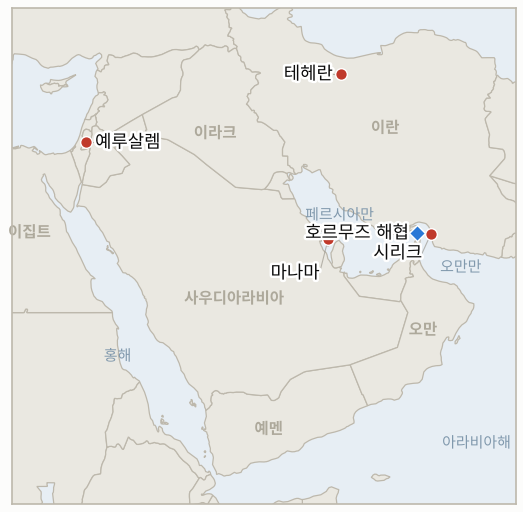

# 중동 일일 브리핑

**2026년 11월 14일**

- **보고 기간:** 약 24시간, 11월 13일 15:00 ~ 11월 14일 06:00 (한국시간)
- **종합 평가:** 이란은 자국 호르무즈 연안에 대한 미군 공격에 맞서, 수개월 만에 처음으로 걸프 국가 내 미군 시설인 바레인의 레이더를 타격했다고 주장했다. 다만 미 중부사령부(CENTCOM)는 드론 2기를 모두 격추했고 피해는 없다고 밝혔다(§1.1). 이란은 또 다섯 번째 유조선인 LNG 운반선이 기뢰에 피격됐다고 주장했고, 이스라엘 모사드 국장은 워싱턴에서 공습 재개를 촉구했으며, 이란은 국제원자력기구(IAEA)에 위협이 계속되는 한 사찰단 복귀는 없다고 통보했다(§1.2, §1.3). 유가는 이를 대수롭지 않게 넘겼다. IEA가 4분기 공급과잉을 전망하는 가운데 브렌트는 95.84달러로 보합 마감하며 2주 연속 주간 하락을 기록했다(§1.4). 서울 증시는 장 초반 급등분을 반납하고 외국인 대량 매도에 하락 마감했으며 원화는 약세로 돌아섰다(§1.5). 긴장 고조는 실재하지만 아직 통제된 범위 안에 있으며, 시장은 확전보다 장기 교착을 가격에 반영하고 있다.

---

## 1. 무슨 일이 있었나

<figure style="float:right; width:46%; margin:2pt 0 8pt 14pt;">

<figcaption style="font-size:8pt; color:#666; text-align:center; margin-top:3pt; font-style:italic;">주요 논의 지점</figcaption>
</figure>

### 1.1 혁명수비대, 바레인 미군 레이더 타격 주장; 중부사령부는 피해 부인

이란 혁명수비대는 항공우주군이 바레인의 미군 조기경보 레이더를 파괴했다며, 이는 이란 호르무즈 연안 시리크의 통신탑에 대한 미군 공습 이후 "미국에 공격을 멈추라는 엄중한 경고"라고 밝혔다. 이런 주장은 수개월 만에 처음이다([AP via CBS News](https://www.cbsnews.com/live-updates/iran-war-us-nuclear-strait-of-hormuz/); [investingLive](https://investinglive.com/commodities/iran-s-guards-claim-strike-on-us-radar-in-bahrain-warn-firms-over-hormuz-oil-trade/)). 미 중부사령부는 바레인을 향해 발사된 일방향 공격 드론 2기를 격추했으며 인명·시설 피해는 없다고 밝혔다([Fox News](https://www.foxnews.com/live-news/oil-prices-war-strikes-donald-trump-iran-11-13-26)). 혁명수비대는 호르무즈 원유 수송에서 미국과 협력하는 기업은 "더 엄중한 처벌"을 받을 것이며, 자국 군은 "무제한 대결"에 대비하고 있다고 덧붙였다. **신뢰도: 주장 자체, 이란이 밝힌 시리크 공격 계기, 중부사령부의 부인은 높음; 이란의 피해 주장은 낮음.**

### 1.2 이란, LNG 운반선 기뢰 피격 주장… 이틀 새 다섯 번째

혁명수비대 해군은 해협 남쪽의 "비인가 항로"를 이용하던 액화천연가스(LNG) 운반선이 "기뢰에 맞아 격렬하게 폭발했다"고 밝혔으나 선박명은 공개하지 않았다([AFP via CBS News](https://www.cbsnews.com/live-updates/iran-war-us-nuclear-strait-of-hormuz/); [Al Arabiya](https://english.alarabiya.net/News/middle-east/2026/11/13/iran-says-tanker-carrying-lng-hit-mine-suffered-explosion-in-hormuz)). 이란 국영 매체는 목요일 4척에 이어 이틀 새 폭발 피해를 입은 다섯 번째 유조선이라고 했다. 미군은 해협 항로의 기뢰를 제거했다는 입장이며, 해상 보안 기관이나 선주가 이 사건을 확인한 바는 없다. 베리스크 메이플크로프트는 10월 걸프 지역에서 확인된 상선 공격이 36건으로 개전 이후 최다였다고 집계했다([Bloomberg via Rigzone](https://www.rigzone.com/news/crude_fluctuates_as_iran_tensions_persist-13-nov-2026-185085-article)). 일일 통항 집계는 발표되지 않았다. **신뢰도: 이란의 주장 자체는 높음; 기뢰 피격 사실은 낮음.**

### 1.3 모사드, 공습 재개 로비… 이란은 사찰 문 닫아

로만 고프만 모사드 국장이 워싱턴에서 미 당국자들에게 대이란 공습 재개를 촉구했으며 네타냐후 총리도 트럼프를 압박하고 있다고 보도됐다(Axios, [Fox News](https://www.foxnews.com/live-news/oil-prices-war-strikes-donald-trump-iran-11-13-26) 및 [Rigzone](https://www.rigzone.com/news/crude_fluctuates_as_iran_tensions_persist-13-nov-2026-185085-article) 경유). 이스라엘 채널13은 이스라엘이 미국과의 합동 작전을 포함한 전투 재개 가능성에 대비하고 있으며 이란이 월 약 50기의 지대지 미사일을 생산하고 있다고 전했다. 다만 군 참모총장은 즉각적인 공격이 필요하다고 보지 않는 것으로 알려졌다. 이란은 IAEA에 자국 핵시설을 겨냥한 미국의 위협이 계속되는 한 사찰을 재개할 수 없다고 통보했고, 블룸버그는 트럼프가 밴스 부통령에게 국내 문제에 집중하라고 지시해 물밑 협상이 위축됐다고 보도했다. **신뢰도: 모사드 방문과 채널13 보도는 중간(전언); 이란의 IAEA 입장은 높음.**

### 1.4 IEA 공급과잉 전망 속 유가 보합, 2주 연속 주간 하락

브렌트유 1월물은 2센트 오른 배럴당 95.84달러, WTI 12월물은 0.2% 내린 88.56달러로 정산했다. 브렌트는 전주 16% 급락에 이어 이번 주 약 2% 하락했다([Bloomberg via Rigzone](https://www.rigzone.com/news/crude_fluctuates_as_iran_tensions_persist-13-nov-2026-185085-article); [CNBC](https://www.cnbc.com/amp/2026/11/13/oil-prices-set-for-second-weekly-decline-as-trump-to-stay-with-iran-blockade.html)). 국제에너지기구(IEA)는 소비가 크게 타격을 받으면서 이번 분기 시장이 개전 이후 처음으로 공급과잉에 들어설 것이라고 밝혔고, 미국 원유·석유제품 재고도 늘었다. 목요일 밤 유엔 안전보장이사회는 영국이 작성한 후티 공격 규탄 결의를 만장일치로 채택하고 제재를 2027년 11월 14일까지 연장했다([AP via CBS News](https://www.cbsnews.com/live-updates/iran-war-us-nuclear-strait-of-hormuz/)). 프랑스는 후티가 사우디 등에 대한 공격을 멈추도록 압박을 강화해야 한다고 촉구했다. **신뢰도: 높음.**

### 1.5 서울 증시 장 초반 급등분 반납, 원화 약세 전환

코스피는 2.05% 오른 채 출발해 5,504.44까지 올랐으나 12시 30분께 하락 전환해 0.98% 내린 5,290.53에 마감했다. 엔비디아가 젠슨 황 최고경영자(CEO)의 즉각 사임을 발표한 뒤 외국인은 SK하이닉스 4,714억 원을 포함해 7,033억 원을 순매도했다([시사저널e](https://www.sisajournal-e.com/news/articleView.html?idxno=425037); [뉴스핌](https://www.newspim.com/news/view/20261113001251)). 원·달러 환율은 6.0원 오른 1,336.7원으로 5거래일 만에 반등했다. 유가 상승, 중동 긴장, 미국 금리 상승이 달러를 밀어 올렸고, 반도체 수출기업의 달러 매도가 상승 폭을 제한했다([뉴스1](https://www.news1.kr/finance/market-exr/6353557); [서울경제](https://www.sedaily.com/article/20114156)). 청해부대 동의안은 여전히 국회 국방위원회 심사를 기다리고 있다. **신뢰도: 높음.**

---

## 2. 심층 분석: 동기와 유인

### 2.1 이란은 왜 바레인의 표적을 택했나?

테헤란은 자국 영토에 대한 미국의 모든 공격은, 설령 통신탑이라 해도, 주둔국 내 미군 시설에 대한 대응을 부른다는 규칙을 되살리려 한다. 레이더를 겨냥했다는 주장은 계산된 선택이다. 미국인 사상자 없이 타격 능력을 과시할 수 있고, 드론이 격추된 덕에 양측 모두 물러설 여지가 생긴다. 호르무즈 수송에서 미국과 협력하는 기업에 대한 경고가 더 실질적인 지렛대로, 유조선 운항 여부를 결정하는 보험사와 용선주를 겨냥한다.

### 2.2 이란은 왜 미국이 있을 수 없다는 기뢰 피격을 부각하나?

"비인가" 항로를 쓰는 선박이 피격됐다는 주장이 나올 때마다, 선주들은 미국이 정리한 항로가 안전하지 않고 이란과 조율된 통항만이 안전하다는 메시지를 받는다. 기뢰가 실재하든 아니든 이런 주장은 전쟁 위험 할증료를 끌어올리고, 워싱턴이 해협을 장악하고 있다는 트럼프의 주장을 훼손한다. LNG 운반선을 고른 것도 의도적이다. 아시아의 LNG 구매국은 원유 구매국보다 우회로가 적었기 때문이다.

### 2.3 이스라엘은 왜 지금 공습 재개를 압박하나?

네타냐후는 아이젠코트 진영이 장악한 크네세트를 상대하는 과도정부 총리이며, 미국의 대이란 공세 재개는 그가 가장 강한 안보 의제로 정국을 되돌릴 것이다. 이스라엘이 내세우는 우려는 월 약 50기로 알려진 이란의 미사일 생산이 교착 상태가 허용하는 것보다 빠르게 전력을 재건한다는 점이다. "합의가 필요 없다"는 트럼프의 발언은 장기 봉쇄와 새로운 공습 모두에 여지를 남기며, 이스라엘은 후자를 위해 로비하고 있다.

### 2.4 유가는 왜 긴장 고조를 무시했나?

트레이더들은 사우디 생산이 전쟁 전 수준에 근접하고 미국 재고가 쌓이면서 시장이 공급과잉으로 이동한다고 보기 때문에, 물량 흐름을 끊지 않는 사건은 할인해서 받아들인다. 바레인 주장은 곧바로 부인됐고 기뢰 주장은 검증되지 않았다. 걸프 수출 기반시설에 대한 확인된 타격이나 미국·이스라엘의 공습 재개가 이런 안일함을 시험할 것이다.

---

## 3. 한국에 대한 정책적 함의

**노출 현황:** 한국은 원유의 약 70.7%, LNG의 20.4%를 중동에서 들여온다(`instructions/korea-exposure.md`, 갱신 불필요). 최근 수치: 코스피 5,290.53, 원·달러 1,336.7원(11월 13일); 브렌트 95.84달러, WTI 88.56달러(11월 13일 정산가).

**동향별 함의:**

- **바레인 레이더 주장(§1.1):** 호르무즈 연안 공격을 둘러싼 맞대응이 반복되면 미군 주둔국이 실제로 피격될 가능성이 커진다. 미국과 협력하는 기업에 대한 혁명수비대의 위협은 한국이 의존하는 화물을 실어 나르는 용선주를 위축시킬 수 있다(IND-20261114-1).
- **LNG 기뢰 주장(§1.2):** 한국의 LNG 노출을 고려하면, LNG 운반선의 피해가 확인될 경우 원유 유조선 피격 주장보다 파급이 크다. 한국가스공사의 도입 화물과 보험 비용이 전달 경로다(IND-20261114-2, IND-20261112-2).
- **모사드 로비와 IAEA 거부(§1.3):** 미국이나 이스라엘의 공습이 재개되면 브렌트는 100달러를, 원화는 1,350원을 넘어설 가능성이 크다. 이란의 사찰 거부로 출구 하나가 사라졌다(IND-20261114-1, IND-20261114-3, IND-20261113-2).
- **IEA 공급과잉(§1.4):** 물량 흐름이 유지되는 한 공급과잉은 한국의 수입 부담을 완화한다. 유가가 헤드라인을 따라가지 않는 주된 이유다(IND-20261113-1).
- **서울 시장(§1.5):** 금요일 외국인 매도는 걸프가 아니라 엔비디아의 경영진 충격에서 비롯됐지만, 원화의 약세 전환은 유가와 미국 금리가 여전히 전이되고 있음을 보여준다(IND-20261113-3, IND-20261111-2).

**오늘 종결:**

- IND-20261107-1 반증: 코스피는 11월 14일까지 4,800 아래로 마감하지 않았다. 기간 중 최저 종가는 5,018.85(11월 9일)였고, 11월 13일 종가는 5,290.53이다.
- IND-20261107-3 반증: 11월 14일까지 홍해나 바브엘만데브에서 사우디 관련 유조선에 대한 공격은 확인되지 않았다. 이번 주 후티의 주장은 사우디 육상 기반시설을 겨냥했다.
- IND-20261110-2 만료: 다나 가스는 11월 8일 공격 이후 코르모르 생산 중단을 확인했으나 11월 10일 이후의 업데이트를 찾지 못해, 중단이 3일을 넘겼는지 확인할 수 없다.

**검증 가능한 지표:**

- **IND-20261114-1** (신규): 2026년 11월 27일경까지 호르무즈 연안을 넘어선 이란 영토에 대한 미국 또는 이스라엘의 공습이 공개되면 공습 재개 압박이 성공한 것으로 확인; 없으면 반증.
- **IND-20261114-2** (신규): 2026년 11월 21일경까지 호르무즈 해협 또는 인근에서 선박명이 확인된 LNG 운반선의 피해가 독립적으로(UKMTO, 앰브레이, 선주 또는 기국) 확인되면 확인; 없으면 반증(이란 측 주장만으로는 인정하지 않음).
- **IND-20261114-3** (신규): 2026년 11월 30일경까지 이란 내에서 IAEA 사찰 또는 검증 방문이 이뤄지면 해빙으로 확인; 없으면 반증.
- **IND-20261113-1** (진행 중): 브렌트 정산가 95.84달러로 100달러 미만.
- **IND-20261113-3** (진행 중): 원·달러 종가 1,336.7원으로 1,350원 미만.
- **IND-20261111-2** (진행 중): 코스피는 장중 5,504.44를 찍었으나 종가 5,290.53으로 기준선 5,383.80 아래.
- **IND-20261112-2** (진행 중): 이란은 다섯 번째 유조선 피격을 주장하지만, 선박명이 확인된 기뢰 피격은 여전히 독립적으로 확인되지 않았다.
- **IND-20261105-2, IND-20261108-1, IND-20261110-1** (진행 중, 11월 15일경 마감): 아직 합의 발표나 사우디의 피해 확인은 없다.
- **IND-20260910-3** (진행 중, 11월 17일경 마감): 시리크 공격과 바레인 드론을 포함해 교전이 계속되고 있다.
- **IND-20261111-1, -3, IND-20261112-1, IND-20261113-2, IND-20261023-1, IND-20260714-4** (진행 중): `tracking/indicators.md` 참조.

---

## 4. 관찰 목록

- **바레인 드론 공격에 대한 미국의 대응, 또는 이란 연안에 대한 추가 공격(IND-20261114-1).**
- **피격 주장이 나온 LNG 운반선의 선주·선적 정보(IND-20261114-2).**
- **11월 15일 카타르 중재의 발표 시한(IND-20261105-2, IND-20261110-1).**
- **걸프 헤드라인이 쏟아진 주말 뒤 월요일 서울 개장(IND-20261111-2, IND-20261113-3).**
- **11월 17일 크네세트 의장 선출 표결(IND-20261111-3).**
- **IAEA 이사회 11월 회기와 이란 관련 결의 여부(IND-20261114-3).**

---

## 5. 출처 품질 요약

| 주장 | 출처 | 신뢰도 |
| --- | --- | --- |
| 혁명수비대, 바레인 미군 조기경보 레이더 파괴 주장 | IRGC via IRNA, AP via CBS News, investingLive | 높음(주장 사실); 낮음(피해) |
| 시리크 통신탑에 대한 미군 공격 이후 타격 | IRGC 성명 via AP | 중간 |
| 중부사령부: 드론 2기 격추, 인명·시설 피해 없음 | CENTCOM via Fox News, Rigzone | 높음 |
| 혁명수비대, 호르무즈 원유 수송에서 미국과 협력하는 기업에 경고 | IRGC via investingLive | 높음 |
| LNG 운반선, "비인가 항로"에서 기뢰 피격 | IRGC via AFP, Al Arabiya | 낮음 |
| 10월 걸프 해운 공격 36건 확인 | Verisk Maplecroft via Bloomberg/Rigzone | 높음 |
| 모사드 국장, 워싱턴서 공습 재개 촉구 | Axios via Fox News, Rigzone | 중간 |
| 이스라엘, 전투 재개 가능성 대비; 이란 월 약 50기 미사일 생산 | 채널13 via Fox News | 중간 |
| 이란, IAEA에 위협 속 사찰 재개 불가 통보 | Fox News | 높음 |
| 트럼프, 밴스에 국내 문제 집중 지시 | Bloomberg via Rigzone | 중간 |
| 브렌트 95.84달러, WTI 88.56달러 정산; 2주 연속 주간 하락 | Bloomberg via Rigzone, CNBC | 높음 |
| IEA, 4분기 공급과잉 전망 | IEA via Rigzone | 높음 |
| 유엔 안보리, 후티 공격 규탄·제재 2027년 11월까지 연장 | AP via CBS News | 높음 |
| 코스피 5,290.53, 외국인 약 7,033억 원 순매도 | 시사저널e, 뉴스핌 | 높음 |
| 엔비디아 젠슨 황 CEO 사임 | 시사저널e | 높음 |
| 원·달러 1,336.7원 | 뉴스1, 서울경제 | 높음 |
| 호르무즈 일일 통항 집계 | 보도 없음 | 보도 없음 |
