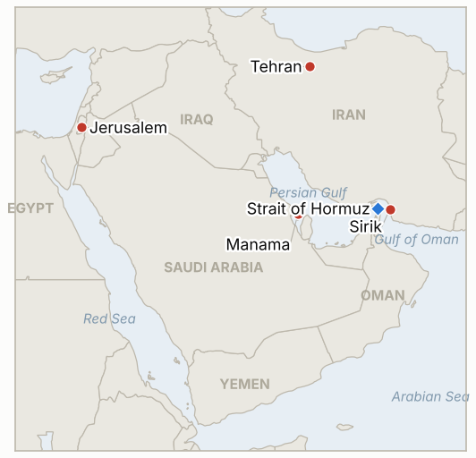

# Middle East Daily Briefing

**November 14, 2026**

- **Reporting window:** ~24 hours, November 13, 15:00 to November 14, 06:00 KST
- **Overall assessment:** Iran answered a US strike on its Hormuz coast with its first claimed hit on a US facility in a Gulf state in months, a radar in Bahrain, though CENTCOM says it shot down both drones and nothing was damaged (§1.1). Tehran also claimed a fifth tanker, an LNG carrier, was hit by a mine, while Israel's Mossad chief lobbied Washington to resume strikes and Iran told the IAEA inspectors cannot return under threat (§1.2, §1.3). Oil shrugged it off: Brent settled flat at $95.84 for a second weekly loss as the IEA projected a fourth quarter surplus (§1.4). Seoul gave back an early surge to close lower on heavy foreign selling and the won weakened (§1.5). The escalation is real but so far contained; the market is pricing a long stalemate rather than a wider war.

---

## 1. What Happened

<figure style="float:right; width:46%; margin:2pt 0 8pt 14pt;">

<figcaption style="font-size:8pt; color:#666; text-align:center; margin-top:3pt; font-style:italic;">Major places of discussion</figcaption>
</figure>

### 1.1 IRGC claims a strike on a US radar in Bahrain; CENTCOM denies damage

Iran's Revolutionary Guards said their aerospace force destroyed a US early warning radar in Bahrain, calling it "a serious warning to the U.S. to cease its strikes" after a US air attack on a telecommunications tower in Sirik on Iran's Hormuz coast; it was the first such claim in months ([AP via CBS News](https://www.cbsnews.com/live-updates/iran-war-us-nuclear-strait-of-hormuz/); [investingLive](https://investinglive.com/commodities/iran-s-guards-claim-strike-on-us-radar-in-bahrain-warn-firms-over-hormuz-oil-trade/)). US Central Command said US forces shot down two one way attack drones launched toward Bahrain, with no injuries or damage ([Fox News](https://www.foxnews.com/live-news/oil-prices-war-strikes-donald-trump-iran-11-13-26)). The IRGC added that companies cooperating with the US on Hormuz oil shipments would face "more severe penalties" and that its forces were ready for "unlimited confrontation." **Confidence: High on the claim, the Sirik trigger as described by Iran, and CENTCOM's denial; Low on Iran's damage claim.**

### 1.2 Iran says an LNG tanker hit a mine, the fifth tanker claim in two days

The IRGC navy said a liquefied natural gas carrier using an "unauthorized passage" south of the strait "was hit by a naval mine and exploded violently"; the ship was not named ([AFP via CBS News](https://www.cbsnews.com/live-updates/iran-war-us-nuclear-strait-of-hormuz/); [Al Arabiya](https://english.alarabiya.net/News/middle-east/2026/11/13/iran-says-tanker-carrying-lng-hit-mine-suffered-explosion-in-hormuz)). Iranian state media called it the fifth tanker to suffer an explosion in two days, after four claimed on Thursday; the US military says it has cleared the strait's routes of mines, and no maritime security agency or owner has confirmed the incident. Verisk Maplecroft counted 36 confirmed attacks on commercial ships in the Gulf region in October, the most since the war began ([Bloomberg via Rigzone](https://www.rigzone.com/news/crude_fluctuates_as_iran_tensions_persist-13-nov-2026-185085-article)). No daily transit count was published. **Confidence: High that Iran made the claim; Low on the mine strike itself.**

### 1.3 Mossad lobbies for renewed strikes; Iran shuts the door on inspections

Mossad director Roman Gofman was reported to be in Washington urging US officials to resume strikes on Iran, with Netanyahu also pressing Trump (Axios, via [Fox News](https://www.foxnews.com/live-news/oil-prices-war-strikes-donald-trump-iran-11-13-26) and [Rigzone](https://www.rigzone.com/news/crude_fluctuates_as_iran_tensions_persist-13-nov-2026-185085-article)). Israel's Channel 13 said Israel is preparing for possible renewed fighting, including a joint operation with the US, and estimated Iran is producing about 50 surface to surface missiles a month, though the military chief reportedly sees no immediate need to attack. Iran told the IAEA that inspections cannot resume while US threats against its nuclear facilities continue, and Bloomberg reported Trump told Vance to focus on domestic issues, damping back channel talks. **Confidence: Medium on the Mossad visit and Channel 13 report (secondhand); High on Iran's IAEA position.**

### 1.4 Oil flat for a second weekly loss as the IEA sees a surplus

Brent for January settled up 2 cents at $95.84 and WTI for December fell 0.2% to $88.56; Brent lost about 2% on the week after a 16% fall the week before ([Bloomberg via Rigzone](https://www.rigzone.com/news/crude_fluctuates_as_iran_tensions_persist-13-nov-2026-185085-article); [CNBC](https://www.cnbc.com/amp/2026/11/13/oil-prices-set-for-second-weekly-decline-as-trump-to-stay-with-iran-blockade.html)). The IEA said the market will be in surplus this quarter for the first time since the war began, as consumption has taken a significant hit, and US crude and product stocks rose. On Thursday night the UN Security Council unanimously adopted a UK drafted resolution condemning Houthi attacks and extending sanctions to November 14, 2027 ([AP via CBS News](https://www.cbsnews.com/live-updates/iran-war-us-nuclear-strait-of-hormuz/)); France called for more pressure on the Houthis to stop attacks on Saudi Arabia. **Confidence: High.**

### 1.5 Seoul reverses an early surge; the won weakens

The KOSPI opened 2.05% higher and touched 5,504.44 but turned lower around 12:30 and closed down 0.98% at 5,290.53, as foreigners net sold 703.3 billion won, led by 471.4 billion won of SK Hynix, after Nvidia said Jensen Huang would step down immediately as CEO ([Sisa Journal e](https://www.sisajournal-e.com/news/articleView.html?idxno=425037); [Newspim](https://www.newspim.com/news/view/20261113001251)). The won weakened 6.0 won to 1,336.7 per dollar, its first decline in five sessions, as higher oil prices, Middle East tension and US yields lifted the dollar, while chip exporters' dollar sales capped the move ([News1](https://www.news1.kr/finance/market-exr/6353557); [Seoul Economic Daily](https://www.sedaily.com/article/20114156)). The Cheonghae Unit motion still awaits the National Assembly's defense committee. **Confidence: High.**

---

## 2. Deep Dive: Incentives and Motives

### 2.1 Why did Iran reach for a target in Bahrain?

Tehran is trying to restore a rule that every US strike on its territory, even on a telecom tower, draws a response on a US facility in a host state. A claim against a radar is a calibrated choice: it signals reach without killing Americans, and the drones' interception lets both sides step back. The warning to companies working with the US on Hormuz shipments is the more practical lever, aimed at the insurers and charterers who decide whether tankers move.

### 2.2 Why is Iran publicizing mine strikes the US says cannot happen?

Each claimed hit on a ship using an "unauthorized" route tells shipowners that the US cleared lanes are not safe and that only Iranian coordinated passage is. Whether or not the mines are real, the claims raise war risk premiums and undercut Trump's line that Washington controls the strait. An LNG carrier is a pointed choice, since LNG buyers in Asia have so far had fewer bypass options than crude buyers.

### 2.3 Why is Israel pressing for renewed strikes now?

Netanyahu is a caretaker facing a Knesset run by Eisenkot's bloc, and a renewed US campaign against Iran would shift the agenda back to security, where he is strongest. Israel's stated worry is Iran's missile production, reported at about 50 a month, rebuilding faster than a stalemate allows for. Trump's "no deal needed" line leaves room for either a long blockade or new strikes, and Israel is lobbying for the second.

### 2.4 Why did oil ignore the escalation?

Traders see a market moving into surplus, with Saudi output back near prewar levels and US stocks building, so incidents that do not stop flows are discounted. The Bahrain claim was quickly denied and the mine claims are unverified. A confirmed hit on Gulf export infrastructure or a resumption of US or Israeli strikes would test that complacency.

---

## 3. Policy Implications for South Korea

**Exposure snapshot:** South Korea draws about 70.7% of its crude and 20.4% of its LNG from the Middle East (`instructions/korea-exposure.md`, no update needed). Latest prints: KOSPI 5,290.53 and USD/KRW 1,336.7 (November 13); Brent $95.84 and WTI $88.56 (November 13 settles).

**Implications by development:**

- **Bahrain radar claim (§1.1):** A tit for tat cycle over Hormuz coast strikes raises the chance of a US host state being hit for real; the IRGC threat to firms cooperating with the US could deter charterers moving cargoes Korea relies on (IND-20261114-1).
- **LNG mine claim (§1.2):** Korea's LNG exposure makes a confirmed casualty on an LNG carrier more material than another crude tanker claim; KOGAS cargo and insurance costs are the channel (IND-20261114-2, IND-20261112-2).
- **Mossad lobbying and IAEA refusal (§1.3):** Renewed US or Israeli strikes would likely push Brent through $100 and the won past 1,350; Iran's refusal of inspections removes one off ramp (IND-20261114-1, IND-20261114-3, IND-20261113-2).
- **IEA surplus (§1.4):** A surplus cushions Korea's import bill as long as flows hold; it is the main reason oil has not followed the headlines (IND-20261113-1).
- **Seoul markets (§1.5):** Friday's foreign selling was driven by Nvidia's leadership shock, not the Gulf, but the won's turn weaker shows oil and US yields still feed through (IND-20261113-3, IND-20261111-2).

**Resolved today:**

- IND-20261107-1 falsified: the KOSPI did not close below 4,800 by November 14; the lowest close in the window was 5,018.85 (November 9), and it closed at 5,290.53 on November 13.
- IND-20261107-3 falsified: no confirmed attack on a Saudi linked tanker in the Red Sea or Bab el Mandeb by November 14; Houthi claims this week targeted Saudi land infrastructure.
- IND-20261110-2 expired: Dana Gas confirmed production at Khor Mor was suspended after the November 8 attack, but no update after November 10 was found, so whether the outage outlasted three days cannot be established.

**Testable indicators:**

- **IND-20261114-1** (open, new): A disclosed US or Israeli strike on Iranian territory beyond the Hormuz coast by ~2026-11-27 confirms that the push to resume strikes succeeded; none falsifies.
- **IND-20261114-2** (open, new): Independent confirmation (UKMTO, Ambrey, owner or flag state) of damage to a named LNG carrier in or near Hormuz by ~2026-11-21 confirms; none falsifies (Iranian claims alone do not count).
- **IND-20261114-3** (open, new): Any IAEA inspection or verification visit inside Iran by ~2026-11-30 confirms a thaw; none falsifies.
- **IND-20261113-1** (open): Brent settled at $95.84, below $100.
- **IND-20261113-3** (open): USD/KRW closed at 1,336.7, below 1,350.
- **IND-20261111-2** (open): KOSPI touched 5,504.44 intraday but closed at 5,290.53, below the 5,383.80 threshold.
- **IND-20261112-2** (open): Iran claims a fifth tanker hit; still no named mine strike confirmed independently.
- **IND-20261105-2, IND-20261108-1, IND-20261110-1** (open, due ~2026-11-15): no announced agreement and no Saudi confirmation of damage so far.
- **IND-20260910-3** (open, due ~2026-11-17): fighting continues, including the Sirik strike and Bahrain drones.
- **IND-20261107-1, -3** resolved above; **IND-20261111-1, -3, IND-20261112-1, IND-20261113-2, IND-20261023-1, IND-20260714-4** (open): see `tracking/indicators.md`.

---

## 4. Watch List

- **Any US response to the Bahrain drone attack, or a further strike on Iran's coast (IND-20261114-1).**
- **Ownership or flag details on the claimed LNG carrier (IND-20261114-2).**
- **Qatar's mediation deadline for an announcement on November 15 (IND-20261105-2, IND-20261110-1).**
- **Monday's Seoul open after a weekend of Gulf headlines (IND-20261111-2, IND-20261113-3).**
- **The November 17 Knesset speaker vote (IND-20261111-3).**
- **The IAEA Board's November session and any resolution on Iran (IND-20261114-3).**

---

## 5. Source Quality Summary

| Claim | Sources | Confidence |
| --- | --- | --- |
| IRGC claims it destroyed a US early warning radar in Bahrain | IRGC via IRNA, AP via CBS News, investingLive | High (claim made); Low (damage) |
| Strike followed a US attack on a telecom tower in Sirik | IRGC statement via AP | Medium |
| CENTCOM: two drones shot down, no injuries or damage | CENTCOM via Fox News, Rigzone | High |
| IRGC warns firms cooperating with US on Hormuz oil shipments | IRGC via investingLive | High |
| LNG carrier hit a mine on an "unauthorized passage" | IRGC via AFP, Al Arabiya | Low |
| 36 confirmed attacks on Gulf shipping in October | Verisk Maplecroft via Bloomberg/Rigzone | High |
| Mossad director in Washington urging renewed strikes | Axios via Fox News, Rigzone | Medium |
| Israel preparing for possible renewed fighting; ~50 missiles a month | Channel 13 via Fox News | Medium |
| Iran tells IAEA inspections cannot resume under threat | Fox News | High |
| Trump told Vance to focus on domestic issues | Bloomberg via Rigzone | Medium |
| Brent $95.84, WTI $88.56 settles; second weekly loss | Bloomberg via Rigzone, CNBC | High |
| IEA sees fourth quarter surplus | IEA via Rigzone | High |
| UNSC condemns Houthi attacks, extends sanctions to Nov 2027 | AP via CBS News | High |
| KOSPI 5,290.53, foreigners about -703.3bn won | Sisa Journal e, Newspim | High |
| Nvidia CEO Jensen Huang to step down | Sisa Journal e | High |
| Won 1,336.7 per dollar | News1, Seoul Economic Daily | High |
| Hormuz daily transit count | Not reported | Not reported |
