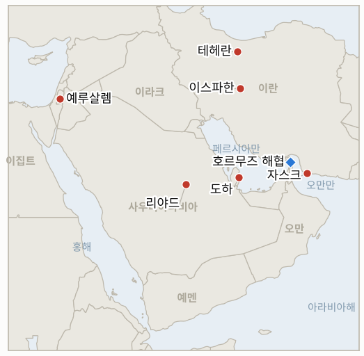

# 중동 일일 브리핑

**2026년 11월 15일**

- **보고 기간:** 약 24시간, 11월 14일 06:00 ~ 11월 15일 06:00 (한국시간)
- **종합 평가:** 장이 열리지 않은 조용한 토요일이었지만, 전쟁 재개 여부를 가늠할 신호가 이어졌다. 로이터는 사우디 왕세자와 튀르키예의 에르도안이 자제를 촉구한 뒤 트럼프가 이란과 후티가 도발하지 않는 한 공격하지 않을 수 있다고 참모들에게 말했다고 보도했다. 다만 세 번째 미 항공모함이 역내로 이동 중이다(§1.1). 이란은 유조선 3척이 추가로 기뢰에 피격됐다고 주장했으나 이번에도 선박명은 공개되지 않았고 검증되지 않았다(§1.2). 국제원자력기구(IAEA) 보고서는 이란 신고 핵물질의 전용 가능성을 배제할 수 없다고 밝혔다(§1.3). 이스라엘에서는 네타냐후가 이란 위협을 내세워 아이젠코트에게 통합 정부를 제안했다가 거절당했다(§1.4). 카타르 중재 발표의 11월 중순 시한은 성과 없이 지나갔다(§1.5). 종합하면 미국은 새 공습보다 장기 봉쇄 쪽으로 기울고 있지만, 이스라엘의 압박과 검증되지 않은 핵 상황 때문에 방향 전환 위험은 여전히 살아 있다.

---

## 1. 무슨 일이 있었나

<figure style="float:right; width:46%; margin:2pt 0 8pt 14pt;">

<figcaption style="font-size:8pt; color:#666; text-align:center; margin-top:3pt; font-style:italic;">주요 논의 지점</figcaption>
</figure>

### 1.1 트럼프, 도발 없으면 자제 시사… 동맹국들은 공습 재개 만류

사정을 아는 세 사람이 로이터에 밝힌 바에 따르면, 트럼프는 이란이나 후티의 새로운 도발이 없다면 이란 공격을 보류할 수 있다고 고위 참모들에게 말했다. 그는 사우디의 무함마드 빈 살만 왕세자와 튀르키예의 에르도안에게 의견을 물었고, 두 사람 모두 공격 재개를 만류했다([Reuters via Times of Israel](https://www.timesofisrael.com/trump-tells-advisers-he-may-not-attack-iran-as-long-as-it-doesnt-provoke-us-sources-say/)). 보도에 따르면 미 정보당국은 봉쇄와 제재가 이란 경제에 타격을 주고 있으며 공습을 재개해도 이란의 요구는 크게 달라지지 않을 것으로 판단하고, 일부 미군 탄약 비축량은 우려스러운 수준이며, 세 번째 항공모함이 역내로 이동 중이다. 트럼프는 "당장 끝낼 수 있다"면서도 동맹국의 요청으로 속도를 늦추고 있다고 했고, 임기 말에도 이란 정권이 남아 있다면 패배로 여길 것이라고 말했다. 백악관 관계자는 "무엇을 언제 할지는 트럼프 대통령만 안다"고 했다. **신뢰도: 중간(익명 소식통, 단일 통신); 트럼프의 공개 발언은 높음.**

### 1.2 이란, 유조선 3척 추가 기뢰 피격 주장… 여전히 선박명 없어

이란 해군과 혁명수비대는 유조선 3척이 기뢰에 부딪혀 화재가 났다고 밝혔다. 2척은 해협 남쪽(그중 1척은 초대형 유조선), 1척은 해협 동쪽 "금지 구역"에서였으며, 선박들이 비인가 항로를 이용하려고 위치추적 장치를 끈 상태였다고 주장했다([AFP via Business Recorder](https://www.brecorder.com/news/40448900/iran-reports-three-incidents-of-oil-tankers-hit-by-mines-in-hormuz); [Middle East Eye](https://www.middleeasteye.net/live-blog/live-blog-update/irans-revolutionary-guards-say-three-oil-tankers-hit-mines-strait-hormuz)). 이로써 11월 10일부터 14일까지 매일 피격 주장이 나왔지만, 공개적으로 확인된 선박은 하나도 없고 미군은 주요 항로의 기뢰를 제거했다는 입장이다. 이번 주 독립적으로 확인된 사건은 여전히 11월 11일 라스알카이마 앞바다의 발사체 피격뿐이다. 영국해사무역기구(UKMTO)는 11월 11일까지 한 주 동안 해협 안팎에서 최소 7척의 유조선이 공격받았다고 집계했으나 기뢰 탓으로 돌리지는 않았다([MLQ summary of UKMTO](https://mlq.ai/news/what-irans-hormuz-mine-claims-mean-for-oil-the-weeks-tanker-strikes-the-transit-permit-regime-and-what-to-watch-monday/)). 일일 통항 집계는 발표되지 않았다. **신뢰도: 이란의 주장 자체는 높음; 피격 사실은 낮음.**

### 1.3 IAEA, 이란 핵물질 전용 가능성 배제 못 해

금요일 빈에서 회람된 13쪽 분량의 IAEA 기밀 보고서는 "신고 핵물질의 전용이 없었다고 결론 내릴 수 없다"고 밝혔다. 보고서는 또 1년여 전 이란 고농축 우라늄에 대한 지속적 파악(continuity of knowledge)을 잃었고, 이란이 지난해 신고한 이스파한 농축시설(IFEP)의 정확한 위치, 안전조치상 지위, 핵물질 보관 여부를 알지 못한다고 했다([Bloomberg via The National](https://www.thenationalnews.com/news/mena/2026/11/13/iaea-expresses-concern-over-iranian-underground-uranium-enrichment-plant/); [Times of Israel](https://www.timesofisrael.com/liveblog_entry/un-agency-cant-confirm-iran-hasnt-diverted-nuclear-material-from-peaceful-activity-report-says)). 60% 농축 우라늄 400kg 이상의 행방이 여전히 묘연하고, 사찰단은 2025년 6월 공습 이후 부셰르를 제외하고는 접근하지 못했다. 이사회가 9월 이란을 안보리에 회부한 데 이어, 이번 보고서는 11월 IAEA 이사회 회기의 논의 기반이 된다. 이란은 미국의 위협이 계속되는 한 사찰을 재개할 수 없다고 밝힌 바 있다. **신뢰도: 높음.**

### 1.4 네타냐후, 이란 위협 내세워 아이젠코트 회유… 아이젠코트는 거부

네타냐후는 아이젠코트에게 유대계 다수 정당이 모두 참여하는 통합 정부에 "전제조건 없이" 합류하라고 촉구했다. 아랍계 정당에 기대는 정부로는 이란에 맞설 수 없다며 "이 실존적 위협을 완전히 제거해야 한다"고 했고, 이전 제안과 달리 자신이 정부를 이끌겠다고는 말하지 않았다([Times of Israel](https://www.timesofisrael.com/liveblog-november-14-2026/)). 아이젠코트는 이를 "또 다른 언론 플레이"라고 일축하며 리쿠드와는 손잡을 수 있어도 네타냐후와는 아니라고 했고, 화요일 야샤르 소속 마탄 카하나의 크네세트 의장 선출 표결을 리쿠드의 시험대로 꼽았다. 채널12는 네타냐후가 모사드 국장의 워싱턴 방문을 아이젠코트에게 알리지 않았으며, 이스라엘군(IDF)은 대이란 행동을 지지하되 시점에서는 이견이 있고 이란 핵 프로그램이 이스라엘의 레드라인에 이르지 않았다고 판단한다고 보도했다. **신뢰도: 발언은 높음; 채널12 세부 내용은 중간.**

### 1.5 11월 중순 시한 경과… 합의도, 사우디 확인도 없어

11월 15일까지 미·이란 합의나 카타르의 발표는 나오지 않았다. 로이터에 따르면 큰 간극에도 협상은 계속되고 있으며, 이란은 고농축 우라늄의 국외 반출은 거부하되 유엔 감독하 희석(다운블렌딩)은 논의할 수 있다는 입장이고, 제재 해제·전쟁 배상·호르무즈 통항료를 요구하지만 미국은 이를 거부했다([Reuters via Times of Israel](https://www.timesofisrael.com/trump-tells-advisers-he-may-not-attack-iran-as-long-as-it-doesnt-provoke-us-sources-say/)). 타임스 오브 이스라엘은 세 당사국 협상가 모두 네타냐후가 협상을 무산시킬까 우려한다고 보도했다. 사우디와 아람코는 후티가 타격했다고 주장한 어느 시설에 대해서도 피해를 확인하지 않았고, 연합군은 요격만 발표하고 있다([Al Jazeera](https://www.aljazeera.com/news/2026/11/12/yemens-houthis-renew-strikes-on-saudi-arabia-as-unsc-extends-sanctions)). **신뢰도: 발표 부재는 높음; 협상 상황은 중간.**

---

## 2. 심층 분석: 동기와 유인

### 2.1 합의가 필요 없다던 트럼프가 왜 지금 공격을 보류하나?

두 입장은 서로 맞물린다. 봉쇄가 이란을 압박하고 워싱턴이 이란의 자금과 해협을 쥐고 있다면 기다리는 비용은 작다. 반면 새 공습은 탄약을 소모하고 걸프 기반시설을 위험에 빠뜨리며, 중간선거 전 미국인 55%가 비용 대비 가치가 없다고 본 전쟁을 다시 키운다. 경제와 우회 수송로가 노출된 리야드와 앙카라는 인내를 설득하고 있다. "도발이 없으면"이라는 조건은 혁명수비대나 후티가 선을 넘을 경우 트럼프에게 곧바로 명분을 준다.

### 2.2 미국이 자제를 말하는 사이 이란은 왜 기뢰 주장을 늘리나?

무력으로 깰 수 없는 봉쇄 속에서 이 주장들은 이란의 지렛대다. 선주들이 미군이 정리한 항로에 기뢰가 있다고 믿으면, 이란은 선박명이 확인되는 배를 침몰시켜 트럼프에게 "도발"의 근거를 주지 않고도 통항료와 허가 요구에 실질적 무게를 실을 수 있다. 선박을 익명으로 두면 부인할 여지가 남고 명확한 촉발 요인도 피할 수 있다. 위험은 실제로 확인된 피해 선박이 나오면 트럼프가 밝힌 문턱이 시험대에 오른다는 점이다.

### 2.3 IAEA 보고서는 왜 시점보다 더 중요한가?

보고서는 의도에 관한 논쟁을 정보에 관한 논쟁으로 바꾼다. 17개월간 접근하지 못한 끝에 IAEA는 더 이상 핵물질이 전용되지 않았다고 말할 수 없게 됐고, 이는 이사회의 추가 조치를 정당화하는 표현이자 이스라엘에게 가장 강력한 공개적 근거가 된다. 테헤란으로서는 사찰단을 막는 비용이 커지지만, 이란은 비축분의 위치를 숨기는 편이 투명성보다 자신을 더 잘 지켜 준다고 계산하고 있다.

### 2.4 네타냐후는 왜 이란을 내세워 아이젠코트를 회유하나?

네타냐후 진영은 과반을 잃었고 정부 구성 권한은 아이젠코트에게 있다. 따라서 권력 복귀 경로는 아이젠코트 연합을 쪼개거나, 통합 정부가 불가피해 보이게 만드는 위기뿐이다. 이란을 유대계 다수의 단결이 필요한 실존적 위협으로 규정한 것은 아이젠코트 진영의 우파를 겨냥한 것이고, 정부를 이끌겠다는 주장을 접은 것은 유연성을 보여 주려는 신호다. 이란이 이스라엘의 레드라인을 넘지 않았다는 IDF의 판단은 그가 내세우는 시급성을 약화시킨다.

---

## 3. 한국에 대한 정책적 함의

**노출 현황:** 한국은 원유의 약 70.7%, LNG의 20.4%를 중동에서 들여온다(`instructions/korea-exposure.md`, 갱신 불필요). 11월 14일에는 장이 열리지 않았으며 최근 수치는 금요일 기준이다: 코스피 5,290.53, 원·달러 1,336.7원; 브렌트 95.84달러, WTI 88.56달러(11월 13일 정산가).

**동향별 함의:**

- **트럼프의 자제 (§1.1):** 새 공습 없는 장기 봉쇄는 IEA가 공급과잉을 전망하는 가운데 브렌트를 100달러 아래로 묶어 두는, 한국에 가장 유리한 유가 경로다. 세 번째 항공모함과 이스라엘의 로비는 꼬리 위험을 남긴다(IND-20261114-1, IND-20261115-1, IND-20261115-3).
- **유조선 기뢰 주장 (§1.2):** 검증되지 않은 주장도 한국행 화물의 전쟁 위험 할증료에 반영된다. 소해 장비를 포함한 청해부대 작전구역 확대는 국회 동의를 기다리고 있다(IND-20261112-1, IND-20261112-2, IND-20261114-2).
- **IAEA 보고서 (§1.3):** 이사회 결의나 이란의 NPT 탈퇴 조치가 다음 확전 단계이며, 서울은 빈에서 서방 입장에 보조를 맞추라는 요청을 받을 가능성이 크다(IND-20261115-2, IND-20261113-2, IND-20261114-3).
- **이스라엘 정치 (§1.4):** 화요일 크네세트 의장 표결은 네타냐후가 공습 재개를 밀어붙일 지렛대를 되찾을 수 있을지 가늠하는 가까운 시험대다(IND-20261111-3).
- **협상 정체 (§1.5):** 합의가 없는 만큼 월요일 서울 개장은 타결이 아닌 주말의 자제 보도를 반영할 것이다(IND-20261111-2, IND-20261113-3).

**오늘 종결:**

- IND-20261105-2 반증: 11월 15일까지 미·이란 합의 발표 없음. 카타르 중재는 큰 간극 속에 계속 중이다.
- IND-20261108-1 반증: 11월 15일까지 후티가 주장한 어느 시설에 대해서도 사우디나 아람코의 피해·가동 중단 확인 없음.
- IND-20261110-1 반증: 카타르 총리의 백악관 회동 이후 11월 15일까지 발표 없음.

**검증 가능한 지표:**

- **IND-20261115-1** (진행 중, 신규): ~2026-11-27까지 브렌트가 어느 거래일이든 90달러 아래로 정산되면 공급과잉·자제 서사가 우세함을 확인한다. 그렇지 않으면 반증.
- **IND-20261115-2** (진행 중, 신규): ~2026-11-30까지 IAEA 이사회가 11월 회기에서 이란 관련 결의를 채택하면 확인, 결의가 없으면 반증.
- **IND-20261115-3** (진행 중, 신규): ~2026-11-27까지 세 번째 항공모함이 중부사령부 관할 구역에 진입했다고 미국이 공식 확인하면 확인. 그렇지 않으면 반증.
- **IND-20261114-1** (진행 중): 호르무즈 연안 너머에 대한 미국·이스라엘의 공습은 공개되지 않았다. 트럼프는 공습에 소극적인 것으로 보도됐다.
- **IND-20261114-2, IND-20261112-2** (진행 중): 추가로 3척 피격 주장이 나왔으나 선박명 공개나 독립 확인은 없다.
- **IND-20261114-3** (진행 중): IAEA 보고서는 부셰르 외 접근이 없음을 확인했다.
- **IND-20261113-1, IND-20261113-3, IND-20261111-2** (진행 중): 11월 14일 휴장. 최근 브렌트 95.84달러, 원화 1,336.7원, 코스피 5,290.53.
- **IND-20260910-3** (진행 중, 기한 ~2026-11-17): 휴전이나 타결은 없고 해상 교전은 계속되고 있다.
- **IND-20261111-3** (진행 중, 기한 ~2026-11-18): 의장 표결은 11월 17일 화요일로 잡혀 있다.
- **IND-20261111-1, IND-20261112-1, IND-20261113-2, IND-20261023-1, IND-20260714-4** (진행 중): `tracking/indicators.md` 참조.

---

## 4. 관찰 목록

- **월요일 서울 개장과 자제 보도에 대한 유가 반응(IND-20261111-2, IND-20261113-1, IND-20261115-1).**
- **11월 17일 크네세트 의장 표결과 리쿠드·야샤르 협상(IND-20261111-3).**
- **세 번째 항공모함 도착, 트럼프가 도발로 볼 수 있는 혁명수비대나 후티의 움직임(IND-20261115-3, IND-20261114-1).**
- **IAEA 이사회 회기와 전용 관련 표현에 대한 이란의 대응(IND-20261115-2, IND-20261113-2).**
- **이란이 주장한 기뢰 피격 선박 중 실명 확인 여부(IND-20261112-2, IND-20261114-2).**
- **11월 17일로 끝나는 트럼프의 "선거 후 전쟁 종료" 시한(IND-20260910-3).**

---

## 5. 출처 품질 요약

| 주장 | 출처 | 신뢰도 |
| --- | --- | --- |
| 트럼프, 도발 없으면 공격 보류 가능하다고 참모들에게 언급 | Reuters via Times of Israel (소식통 3명) | 중간 |
| 빈 살만·에르도안, 공습 재개 만류 | Reuters via Times of Israel | 중간 |
| 세 번째 미 항공모함 역내 이동 | Reuters via Times of Israel | 중간 |
| 트럼프: 임기 말 정권 존속 시 패배로 간주 | Reuters via Times of Israel | 높음 |
| 이란, 초대형 유조선 포함 3척 기뢰 피격 주장 | 혁명수비대·해군 via AFP, Middle East Eye | 높음(주장); 낮음(사건) |
| UKMTO: 11월 11일까지 한 주간 최소 7척 피격 | UKMTO via MLQ | 중간 |
| IAEA, 전용 없음 결론 불가; IFEP 위치 미상 | Bloomberg via The National, Times of Israel | 높음 |
| 60% 농축 우라늄 400kg 이상 행방 불명 | The National | 높음 |
| 네타냐후 통합 정부 제안; 아이젠코트 거부 | Times of Israel 라이브블로그 | 높음 |
| IDF, 시점에 이견; 이란은 레드라인 미달 | 채널12 via Times of Israel | 중간 |
| 협상 지속; 이란, 유엔 감독하 희석 논의 가능 | Reuters via Times of Israel | 중간 |
| 후티 주장 피해에 대한 사우디 확인 없음 | Al Jazeera, 연합군 발표 | 높음 |
| 시장 | 11월 14일 휴장; 금요일 수치는 11월 14일 브리핑 기준 | 높음 |
| 호르무즈 일일 통항 집계 | 발표 없음 | 발표 없음 |
