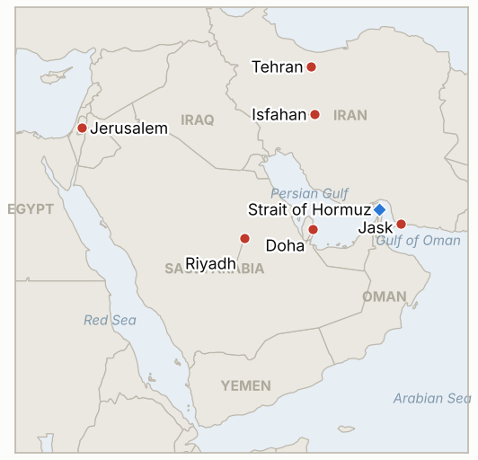

# Middle East Daily Briefing

**November 15, 2026**

- **Reporting window:** ~24 hours, November 14, 06:00 to November 15, 06:00 KST
- **Overall assessment:** A quiet Saturday with no market sessions turned on signals about whether the war resumes. Reuters reported that Trump has told advisers he may not attack Iran as long as Tehran and the Houthis do not provoke him, after Saudi Arabia's crown prince and Turkey's Erdogan urged restraint, even as a third US carrier moves into the region (§1.1). Iran claimed three more tankers hit mines, again unnamed and unverified (§1.2), and an IAEA report said the agency cannot rule out diversion of Iran's declared nuclear material (§1.3). In Israel, Netanyahu invoked the Iran threat to court Eisenkot into a unity government and was rebuffed (§1.4). The mid November deadlines for a Qatari brokered announcement passed with nothing to show (§1.5). Net: the US leans toward a long blockade rather than new strikes, but Israel's pressure and the unverified nuclear picture keep the risk of a reversal live.

---

## 1. What Happened

<figure style="float:right; width:46%; margin:2pt 0 8pt 14pt;">

<figcaption style="font-size:8pt; color:#666; text-align:center; margin-top:3pt; font-style:italic;">Major places of discussion</figcaption>
</figure>

### 1.1 Trump signals restraint unless provoked; allies urge him not to resume strikes

Trump has told senior advisers he may hold off on attacking Iran if there are no new provocations from Tehran or the Houthis, three people familiar with the matter told Reuters; he asked Saudi Crown Prince Mohammed bin Salman and Turkey's Erdogan for their views and both urged him not to resume attacks ([Reuters via Times of Israel](https://www.timesofisrael.com/trump-tells-advisers-he-may-not-attack-iran-as-long-as-it-doesnt-provoke-us-sources-say/)). The report says US intelligence judges the blockade and sanctions are hurting Iran's economy and that renewed strikes would not much change Iran's demands, some US munitions stocks are at worrying levels, and a third aircraft carrier is moving into the region. Trump said he could "end it immediately" but is going slower at allies' request, and that he would count it a defeat if Iran's regime were still in power at the end of his term; a White House official said "only President Trump knows what he will do, and when." **Confidence: Medium (anonymously sourced, single wire), High on Trump's on record remarks.**

### 1.2 Iran claims three more tankers hit mines; still no ship named

Iran's navy and Revolutionary Guards said fires broke out on three oil tankers that struck mines, two in the south of the strait, one of them a supertanker, and one in a "prohibited zone" east of it, saying the ships had switched off their tracking systems to use unauthorized routes ([AFP via Business Recorder](https://www.brecorder.com/news/40448900/iran-reports-three-incidents-of-oil-tankers-hit-by-mines-in-hormuz); [Middle East Eye](https://www.middleeasteye.net/live-blog/live-blog-update/irans-revolutionary-guards-say-three-oil-tankers-hit-mines-strait-hormuz)). That makes claimed strikes on each day from November 10 to 14; none of the vessels has been publicly identified, and the US military says it has cleared the main routes. The only independently confirmed incident this week remains the November 11 projectile strike off Ras al Khaimah; UKMTO counted at least seven tankers attacked in and around the strait in the week to November 11 without attributing them to mines ([MLQ summary of UKMTO](https://mlq.ai/news/what-irans-hormuz-mine-claims-mean-for-oil-the-weeks-tanker-strikes-the-transit-permit-regime-and-what-to-watch-monday/)). No daily transit count was published. **Confidence: High that Iran made the claims; Low on the strikes themselves.**

### 1.3 IAEA cannot rule out diversion of Iran's nuclear material

A confidential 13 page IAEA report circulated in Vienna on Friday says the agency "is not able to conclude that there has been no diversion of declared nuclear material," that it lost continuity of knowledge over Iran's highly enriched uranium more than a year ago, and that it does not know the exact location, safeguards status or contents of the Isfahan Fuel Enrichment Plant Iran declared last year ([Bloomberg via The National](https://www.thenationalnews.com/news/mena/2026/11/13/iaea-expresses-concern-over-iranian-underground-uranium-enrichment-plant/); [Times of Israel](https://www.timesofisrael.com/liveblog_entry/un-agency-cant-confirm-iran-hasnt-diverted-nuclear-material-from-peaceful-activity-report-says)). More than 400 kg of 60% enriched uranium remains unaccounted for, and apart from Bushehr inspectors have had no access since the June 2025 strikes. The report sets up the Board of Governors' November session, after the board referred Iran to the Security Council in September; Iran has said inspections cannot resume while US threats continue. **Confidence: High.**

### 1.4 Netanyahu courts Eisenkot with the Iran threat; Eisenkot says no

Netanyahu called on Eisenkot to join a unity government of all Jewish majority parties "without preconditions," arguing a government relying on Arab parties cannot confront Iran and that "we must remove this existential threat from us once and for all"; unlike earlier offers he did not say he would lead it ([Times of Israel](https://www.timesofisrael.com/liveblog-november-14-2026/)). Eisenkot called it "another spin," said he would partner with Likud but not with Netanyahu, and named Tuesday's vote on Yashar's Matan Kahana as Knesset speaker as Likud's test. Channel 12 reported Netanyahu did not tell Eisenkot about the Mossad chief's Washington trip, and that the IDF backs action against Iran but differs on timing, judging Iran's program has not reached Israel's red lines. **Confidence: High on the statements; Medium on the Channel 12 details.**

### 1.5 Mid November deadlines pass with no deal and no Saudi confirmation

No US Iran agreement or Qatari announcement emerged by November 15; Reuters reports talks continue despite major gaps, with Iran refusing to ship its highly enriched uranium abroad but open to down blending under UN supervision, and demanding sanctions relief, reparations and Hormuz tolls that Washington rejects ([Reuters via Times of Israel](https://www.timesofisrael.com/trump-tells-advisers-he-may-not-attack-iran-as-long-as-it-doesnt-provoke-us-sources-say/)). The Times of Israel reports negotiators from all three sides fear Netanyahu could torpedo the talks. Saudi Arabia and Aramco have still not confirmed damage at any site the Houthis claimed to hit, and the coalition reports only interceptions ([Al Jazeera](https://www.aljazeera.com/news/2026/11/12/yemens-houthis-renew-strikes-on-saudi-arabia-as-unsc-extends-sanctions)). **Confidence: High on the absence of an announcement; Medium on the state of the talks.**

---

## 2. Deep Dive: Incentives and Motives

### 2.1 Why would Trump hold off now, after saying he does not need a deal?

The two lines fit together: if the blockade is squeezing Iran and Washington holds Iran's money and the strait, waiting costs Trump little, while new strikes cost munitions, risk Gulf infrastructure and run against a war 55% of Americans called not worth it before the midterms. Riyadh and Ankara, whose economies and bypass routes are exposed, are lobbying for patience. Making restraint conditional on "no provocation" also hands Trump a ready justification if the IRGC or the Houthis overreach.

### 2.2 Why is Iran stepping up mine claims as the US talks restraint?

The claims are Iran's leverage in a blockade it cannot break by force: if shipowners believe US cleared lanes are mined, Iran's demand for tolls and authorization gains practical weight without Tehran having to sink a named ship and hand Trump his "provocation." Keeping the ships anonymous preserves deniability and avoids a clear trigger. The risk is that a real, identified casualty would test Trump's stated threshold.

### 2.3 Why does the IAEA report matter more than its timing suggests?

It turns an argument about intent into one about knowledge: after 17 months without access, the agency can no longer say material has not been diverted, which is the language that justifies further Board action and gives Israel its strongest public case. For Tehran, it raises the cost of keeping inspectors out, but Iran is betting that hiding the stockpile's location protects it better than transparency would.

### 2.4 Why is Netanyahu using Iran to court Eisenkot?

Netanyahu's bloc lost its majority and Eisenkot holds the mandate, so the only routes back to power run through splitting Eisenkot's coalition or a crisis that makes a unity government look necessary. Framing Iran as an existential threat requiring Jewish majority unity is aimed at Eisenkot's right flank; dropping the claim to lead it signals flexibility. The IDF's view that Iran has not crossed Israel's red lines undercuts the urgency he is selling.

---

## 3. Policy Implications for South Korea

**Exposure snapshot:** South Korea draws about 70.7% of its crude and 20.4% of its LNG from the Middle East (`instructions/korea-exposure.md`, no update needed). No market session on November 14; latest prints are Friday's: KOSPI 5,290.53 and USD/KRW 1,336.7; Brent $95.84 and WTI $88.56 (November 13 settles).

**Implications by development:**

- **Trump restraint (§1.1):** A long blockade without new strikes is the oil price path that suits Korea best, keeping Brent under $100 as the IEA projects a surplus; the third carrier and Israel's lobbying keep a tail risk alive (IND-20261114-1, IND-20261115-1, IND-20261115-3).
- **Tanker mine claims (§1.2):** Unverified claims still feed war risk premiums on Korean bound cargoes; the Cheonghae Unit expansion, including mine countermeasure equipment, awaits Assembly consent (IND-20261112-1, IND-20261112-2, IND-20261114-2).
- **IAEA report (§1.3):** A Board resolution or Iranian NPT exit steps would be the next escalation rung, with Seoul likely asked to align with Western positions in Vienna (IND-20261115-2, IND-20261113-2, IND-20261114-3).
- **Israeli politics (§1.4):** Tuesday's Knesset speaker vote is a near test of whether Netanyahu can regain leverage to push for renewed strikes (IND-20261111-3).
- **Talks stall (§1.5):** With no deal, Monday's Seoul open trades on the weekend's restraint report rather than a settlement (IND-20261111-2, IND-20261113-3).

**Resolved today:**

- IND-20261105-2 falsified: no announced US Iran agreement by November 15; Qatari mediation continues with major gaps.
- IND-20261108-1 falsified: no Saudi or Aramco confirmation of damage or an outage at any named facility the Houthis claimed by November 15.
- IND-20261110-1 falsified: no announcement followed the Qatar PM's White House meeting by November 15.

**Testable indicators:**

- **IND-20261115-1** (open, new): A Brent settle below $90 on any session by ~2026-11-27 confirms that the surplus and restraint narrative dominates; none falsifies.
- **IND-20261115-2** (open, new): An IAEA Board of Governors resolution on Iran adopted at its November session, by ~2026-11-30, confirms; no resolution falsifies.
- **IND-20261115-3** (open, new): Official US confirmation that a third aircraft carrier has entered the CENTCOM area by ~2026-11-27 confirms; none falsifies.
- **IND-20261114-1** (open): no disclosed US or Israeli strike beyond the Hormuz coast; Trump reportedly leaning against.
- **IND-20261114-2, IND-20261112-2** (open): three more claimed tankers, none named or independently confirmed.
- **IND-20261114-3** (open): IAEA report confirms no access beyond Bushehr.
- **IND-20261113-1, IND-20261113-3, IND-20261111-2** (open): no session November 14; last Brent $95.84, won 1,336.7, KOSPI 5,290.53.
- **IND-20260910-3** (open, due ~2026-11-17): no ceasefire or settlement; fighting continues at sea.
- **IND-20261111-3** (open, due ~2026-11-18): speaker vote set for Tuesday, November 17.
- **IND-20261111-1, IND-20261112-1, IND-20261113-2, IND-20261023-1, IND-20260714-4** (open): see `tracking/indicators.md`.

---

## 4. Watch List

- **Monday's Seoul open and oil's reaction to the restraint report (IND-20261111-2, IND-20261113-1, IND-20261115-1).**
- **The Knesset speaker vote on November 17 and the Likud Yashar talks (IND-20261111-3).**
- **Third carrier's arrival and any IRGC or Houthi move Trump could call a provocation (IND-20261115-3, IND-20261114-1).**
- **IAEA Board session and Iran's response to the diversion language (IND-20261115-2, IND-20261113-2).**
- **Any named vessel among Iran's claimed mine strikes (IND-20261112-2, IND-20261114-2).**
- **Trump's "war ends after the election" window closing on November 17 (IND-20260910-3).**

---

## 5. Source Quality Summary

| Claim | Sources | Confidence |
| --- | --- | --- |
| Trump told advisers he may hold off absent provocations | Reuters via Times of Israel (three sources) | Medium |
| MBS and Erdogan urged Trump not to resume strikes | Reuters via Times of Israel | Medium |
| Third US carrier moving into the region | Reuters via Times of Israel | Medium |
| Trump: would count surviving regime at term's end a defeat | Reuters via Times of Israel | High |
| Iran claims three tankers hit mines, one a supertanker | IRGC and navy via AFP, Middle East Eye | High (claim); Low (event) |
| UKMTO: at least seven tankers attacked in week to Nov 11 | UKMTO via MLQ | Medium |
| IAEA cannot conclude no diversion; IFEP location unknown | Bloomberg via The National, Times of Israel | High |
| 400+ kg of 60% uranium unaccounted for | The National | High |
| Netanyahu unity government offer; Eisenkot rejects | Times of Israel liveblog | High |
| IDF differs on timing; Iran short of Israel's red lines | Channel 12 via Times of Israel | Medium |
| Talks continue; Iran open to down blending under UN supervision | Reuters via Times of Israel | Medium |
| No Saudi confirmation of Houthi claimed damage | Al Jazeera, coalition statements | High |
| Markets | No session November 14; Friday figures from November 14 brief | High |
| Hormuz daily transit count | Not reported | Not reported |
