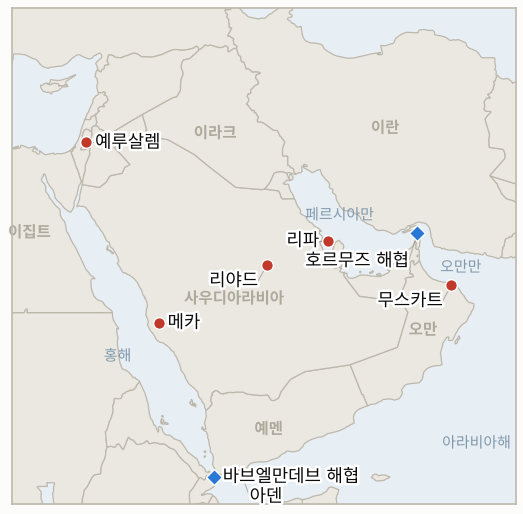

# 중동 일일 브리핑

**2026년 11월 16일**

- **보고 기간:** 약 24시간, 11월 15일 06:00 ~ 11월 16일 06:00 (한국시간)
- **종합 평가:** 트럼프가 도발이 없는 한 이란 공격을 보류할 수 있다는 로이터 보도가 나온 다음 날, 이란과 그 동맹 세력은 세 전선에서 동시에 압박을 가했다. 이란 혁명수비대(IRGC)는 사흘 새 두 번째로 바레인의 미군 레이더를 드론으로 공격했다고 주장했고 바레인은 이를 요격했다고 밝혔다(§1.1). 예멘에서는 사우디가 지원하는 정부군이 바브엘만데브 해협 해안을 후티에 내줬고, 후티의 미사일과 드론이 리야드·메카·메디나 상공에서 격추됐다(§1.2). 혁명수비대는 원유를 실은 초대형 유조선이 기뢰에 부딪혀 침몰했다고 주장했으며, 영국 해사무역기구(UKMTO)는 걸프 해역 내 유조선 피격에 관한 독립적 보고를 며칠 만에 처음 전달했다(§1.3). 워싱턴은 무력이 아니라 경제 지표로 대응했고(§1.4), 이스라엘에서는 네타냐후 총리실이 선거일 체포를 기획했을 수 있다는 보도로 국내 위기가 깊어졌다(§1.5). 종합하면 구조적 변화는 후티의 바브엘만데브 장악이다. 걸프와 아시아를 잇는 항로의 두 관문이 모두 이란 진영의 사정권 아래 놓였고, 트럼프의 도발 기준선은 시험받고 있지만 아직 넘어서지는 않았다.

---

## 1. 무슨 일이 있었나

<figure style="float:right; width:46%; margin:2pt 0 8pt 14pt;">

<figcaption style="font-size:8pt; color:#666; text-align:center; margin-top:3pt; font-style:italic;">주요 논의 지점</figcaption>
</figure>

### 1.1 혁명수비대, 사흘 새 두 번째 바레인 레이더 공격 주장… 바레인은 요격했다고 밝혀

혁명수비대는 파르스 통신을 통해 일요일 새벽 "미국의 적대 행위"에 대응해 바레인 리파 공군기지의 미군 방공 레이더에 드론 6대를 발사했다고 밝혔고, 호르무즈 해협은 여전히 폐쇄 상태이며 미국의 호위 시도는 실패했다고 거듭 주장했다([Al Jazeera](https://aljazeera.com/news/2026/11/15/iran-says-it-targets-us-radar-in-bahrain-what-do-we-know)). 바레인 내무부는 그리니치 표준시 01시 30분께부터 두 차례 대피 경보를 발령했고, 바레인 방위군은 이란의 "공중 공격" 여러 건을 방공망으로 격파했다고 밝혔다. 바레인 외교부는 안보리 결의 2817호에 따른 조치를 촉구했다([Fox News live](https://foxnews.com/live-news/iran-war-strikes-donald-trump-strait-hormuz-irgc-november-15); [CBS News live](https://www.cbsnews.com/live-updates/us-iran-war-trump-nuclear-material-no-deal/)). 미군은 보고 기간 말까지 논평하지 않았다. 금요일 첫 번째 주장 때 미 중부사령부(CENTCOM)는 드론 2대를 격추했고 피해는 없다고 밝혔다. **신뢰도: 공격 시도와 요격은 높음; 피해 여부는 낮음.**

### 1.2 예멘 정부군, 바브엘만데브 해안 철수… 후티는 리야드와 성지 겨냥 발사

사우디가 지원하는 정부 편에서 싸우는 남부군은 아덴 방어와 타이즈 지원을 위해 두바브 공항과 바브엘만데브 일대에서 재배치한다고 밝혔다. 로이터는 이를 6주간의 반격을 끝내고 후티가 해협 동쪽 해안을 장악하게 만든 중대한 좌절이라고 평가했다([Reuters via US News](https://www.usnews.com/news/world/articles/2026-11-15/yemen-government-forces-withdraw-from-area-near-bab-el-mandeb-strait-houthis-in-control); [Al Jazeera](https://www.aljazeera.com/news/2026/11/15/yemeni-government-forces-redeploy-from-bab-al-mandeb-to-defend-aden)). 알자지라에 따르면 후티는 아덴 북쪽 고지대를 장악했고 아덴 진격을 준비 중이라고 밝혔다. 연합군은 리야드를 겨냥한 탄도미사일 2발과 메카·메디나 지역 및 동부주 상공의 드론을 격추했으며 사상자는 보고되지 않았다고 밝혔다. 후티는 킹칼리드 국제공항과 금융 중심지를 겨냥했다면서 메카를 노렸다는 주장은 부인했다([Gulf News](https://gulfnews.com/world/gulf/saudi/saudi-arabia-intercepts-drones-over-mecca-and-medina-ballistic-missiles-targeting-riyadh-1.500748432); [Arab News](https://www.arabnews.com/saudi-arabia/coalition-forces-intercept-2-houthi-missiles-targeting-riyadh-3-drones-in-eastern-province-3011963)). **신뢰도: 철수와 요격은 높음; 후티의 아덴 진격은 중간.**

### 1.3 혁명수비대, 원유 적재 초대형 유조선 침몰 주장… UKMTO는 인도 당국의 피격 보고 전달

혁명수비대 해군은 해협 남쪽 "비인가 항로"에서 유조선 2척이 기뢰에 부딪혀 화재가 났고, 그중 원유 200만 배럴 이상을 실은 초대형 유조선 1척이 침몰했다고 주장했다. 선박명은 공개되지 않았고 로이터는 이를 검증하지 못했다([Arab News](https://www.arabnews.com/middle-east/two-tankers-on-fire-after-hitting-naval-mines-in-the-strait-of-hormuz-irans-irgc-says-3012053); [Kurdistan24](https://www.kurdistan24.net/en/story/953220/iran-says-oil-super-tanker-carrying-2-million-barrels-sinks-in-strait-of-hormuz)). 이와 별도로 UKMTO는 해협 진입 전 걸프 해역에서 동쪽으로 항행하던 유조선이 공격받았다는 인도 해운 당국의 보고를 인지하고 있으며, 선원은 무사하고 피해 규모는 알 수 없다고 밝혔다. 이것이 이란이 언급한 사건과 같은지는 불분명하다고 했다([Anadolu](https://aa.com.tr/en/middle-east/tanker-comes-under-attack-in-gulf-waters-uk-maritime-agency/4125797)). 침몰에 부합하는 유출, 구난, 선주 발표는 나오지 않았으며, 폭스뉴스에 따르면 미 중부사령부는 미국의 보호 아래 원유 17억 배럴 이상이 호르무즈를 통과했다고 밝혔다. 일일 통항 집계는 발표되지 않았다. **신뢰도: 유조선 피격 보고 자체는 높음; 침몰은 낮음.**

### 1.4 미국은 경제적 압박 부각, 이란은 독일의 농축 중단 요구 거부

베센트 재무장관은 제재가 이란을 압박하고 있다며 2027년 3월까지 이란 회계연도에 경제가 25% 위축될 것으로 내다봤고, 토미 피곳 국무부 대변인은 "이코노믹 아웃캐스트 작전이 실질적 효과를 내고 있다"며 300~400%의 물가상승률을 거론했다([Fox News live](https://foxnews.com/live-news/iran-war-strikes-donald-trump-strait-hormuz-irgc-november-15)). 에스마일 바가이 이란 외무부 대변인은 핵확산금지조약(NPT)상 권리를 들어 독일의 농축 중단 요구를 거부하고 이스파한 문제와 관련해 IAEA를 비판했다([CBS News live](https://www.cbsnews.com/live-updates/us-iran-war-trump-nuclear-material-no-deal/)). 폭스뉴스는 아라그치 외무장관이 화요일 무스카트를 방문해 오만의 바드르 알부사이디 외무장관과 호르무즈 관리 문제를 논의한다고 보도했다. 이스라엘에서는 로만 고프만 모사드 국장이 존 랫클리프 CIA 국장, 스티브 위트코프 특사와의 회동을 마치고 귀국해 선거 후 첫 안보내각 회의에 참석했다([Times of Israel](https://www.timesofisrael.com/liveblog-november-15-2026/)). **신뢰도: 발언은 높음; 무스카트 방문은 중간(단일 보도).**

### 1.5 총리실의 선거일 체포 기획 의혹 보도… 의장 표결은 화요일

채널12의 탐사 프로그램 '우브다'는 검찰총장과 경찰이, 총리실이 정보를 흘려 선거일 베두인 남성 3명이 체포되도록 했는지 조사하고 있다고 보도했다. 이들은 기소 없이 모두 풀려났지만, 이 체포는 아랍계 정당이 선거를 훔쳤다는 네타냐후의 주장을 뒷받침하는 데 쓰였다. 보도는 또 다비드 지니 신베트 국장이 선거일에 아랍계 의원 5명에 대한 도청을 요청했다고 전했다([Times of Israel](https://www.timesofisrael.com/liveblog-november-15-2026/)). 총리실은 보도가 허위이며 명예훼손 소송 사유라고 반박했고, 아이젠코트는 조사위원회 설치를 약속하며 네타냐후가 "단 1분도 더" 자리에 남아서는 안 된다고 했다. 야샤르와 리쿠드의 협상은 진전이 없었고 샤스는 네타냐후와 함께하겠다고 밝힌 가운데, 오하나 의장을 마탄 카하나로 교체하는 표결이 11월 17일 화요일 오후 4시로 잡혀 있다([IBTimes](https://www.ibtimes.co.uk/netanyahu-ally-knesset-speaker-vote-opposition-1831645)). 가자에서는 이스라엘군과 하마스 모두 이스라엘 공습으로 하마스 라파 여단 사령관 사미르 아부 유니스가 사망했다고 확인했다. **신뢰도: 보도와 반응은 높음; 의혹의 실체는 중간(입증되지 않은 주장).**

---

## 2. 심층 분석: 유인과 동기

### 2.1 트럼프가 자제 신호를 보낸 직후 혁명수비대는 왜 바레인을 겨냥하나?

혁명수비대는 각 행동을 트럼프의 "도발" 기준선 아래에 두면서 그 선이 어디인지 시험하고 있다. 제3국에 있는 레이더를 향한 드론 공격이 요격되고 미군 사상자도 없다면, 미 중부사령부로서는 보복할 명분이 약하고 테헤란은 봉쇄에 비용이 따른다는 점을 보여줄 수 있다. 걸프의 미군 주둔국도 압박을 받는다. 이란은 안보리에 바레인 등이 공모하고 있다고 주장했고, 마나마에 경보가 울릴 때마다 미군 주둔의 국내 정치적 비용이 커진다. 위험은 누적된다. 드론 한 대가 방공망을 뚫고 미국인을 숨지게 하면, 탐색전은 트럼프의 자제를 거둬들일 바로 그 계기로 바뀐다.

### 2.2 바브엘만데브 철수는 왜 미사일 공격보다 더 중요한가?

리야드를 향한 미사일은 매일 요격되지만, 해협 연안의 땅은 쉽게 되찾을 수 없다. 동쪽 해안을 장악하면 후티는 근거리에서 홍해 통항을 위협할 선택지를 갖게 되며, 여기에는 사우디가 호르무즈를 우회해 수출하는 통로인 얀부발 원유도 포함된다. 사우디가 지원하는 세력은 관문 대신 아덴을 지키는 쪽을 택했다. 이는 본토에 후티의 공격을 받으며 트럼프에게 자제를 요청하는 사우디가 두 전선에서 싸울 의지나 능력이 부족하다는 신호다.

### 2.3 이란은 왜 보여주지도 않은 침몰을 주장하나?

원유를 가득 실은 초대형 유조선의 침몰은 보험사와 용선주에게 보낼 수 있는 가장 강력한 억지 메시지다. 미국이 기뢰를 제거한 항로가 안전하지 않으며 이란의 허가 체계만이 안전한 통항로라는 뜻이기 때문이다. 선박명을 밝히지 않으면 부인 가능성을 유지하고 워싱턴에 입증 가능한 피해 사례를 넘겨주지 않을 수 있다. 인도 당국의 보고는 며칠 만에 처음으로 이란 주장에 독립적 근거를 제공했지만, 200만 배럴급 침몰이라면 보통 선주, 선원 송출업체, 유출 감시를 통해 곧 드러난다. 침묵이 계속된다면 정보전으로 봐야 한다.

### 2.4 워싱턴은 왜 공습 대신 물가를 이야기하나?

경제 지표는 행정부가 기다림을 정당화하는 수단이다. 25% 경제 위축 전망과 세 자릿수 물가상승률을 내세우면, 트럼프는 성과를 보여야 할 시점 전까지 탄약, 걸프 기반시설, 미국인의 생명을 걸지 않고도 봉쇄가 이기고 있다고 주장할 수 있다. 이는 막 워싱턴을 찾아 공습 재개를 설득한 모사드 국장, 곧 이스라엘에 대한 답이기도 하다. 시간은 미국 편이라는 논리다.

---

## 3. 한국에 대한 정책적 함의

**익스포저 현황:** 한국은 원유의 약 70.7%, LNG의 20.4%를 중동에서 들여온다(`instructions/korea-exposure.md`, 갱신 불필요). 11월 14일과 15일에는 장이 열리지 않았으며 최근 수치는 금요일 기준이다: 코스피 5,290.53, 원·달러 1,336.7원; 브렌트 95.84달러, WTI 88.56달러(11월 13일 정산가). 월요일 서울 개장은 이번 보고 기간 이후다.

**사안별 함의:**

- **바레인 공격(§1.1):** 걸프에 주둔한 미군 자산에 대한 혁명수비대의 반복 공격은 트럼프의 자제를 뒤집고 유가를 다시 끌어올릴 가장 유력한 계기다(IND-20261116-1, IND-20261114-1, IND-20261113-1).
- **바브엘만데브(§1.2):** 후티의 해협 연안 장악은 얀부에서 한국으로 오는 사우디 원유와 아시아·유럽 컨테이너 교역이 의존하는 홍해 구간을 위협한다. 확대가 추진 중인 청해부대의 오만 남방 작전구역은 바브엘만데브보다 호르무즈에 가까워, 기존 아덴만 임무 자체의 위험이 커진다(IND-20261116-2, IND-20261112-1).
- **유조선 주장(§1.3):** 인도 당국이 보고한 걸프 해역 내 선박 피격은 확인되지 않았더라도 한국 정유사 화물의 전쟁 위험 보험료를 끌어올린다. 선박명 공개 여부를 지켜봐야 한다(IND-20261112-2, IND-20261114-2).
- **외교(§1.4):** 호르무즈 관리를 둘러싼 오만 채널은 전면 합의 전에 한국이 활용할 수 있는 통항 방안을 내놓을 가능성이 가장 큰 무대다(IND-20261116-3, IND-20261111-1).
- **이스라엘 정치(§1.5):** 화요일 의장 표결은 네타냐후가 새 정부 출범을 늦추고 공습을 밀어붙일 지렛대를 유지할지를 가른다(IND-20261111-3).

**오늘 종결:** 없음. 이번 보고 기간에 확증 또는 반증 조건을 충족한 진행 중 지표는 없다.

**검증 가능한 지표:**

- **IND-20261116-1** (진행, 신규): 2026년 11월 23일께까지 미 당국이 혁명수비대의 바레인 등 걸프 주둔국 공격에 대한 대응이라고 공개적으로 규정한 이란 영토 타격이 공개되면 도발 기준선을 넘은 것으로 확증; 없으면 반증.
- **IND-20261116-2** (진행, 신규): 2026년 11월 30일께까지 바브엘만데브 또는 홍해 남부에서 후티의 상선 공격에 관한 UKMTO 또는 JMIC 보고가 나오면 후티가 새로 장악한 연안을 선박 공격에 활용하는 것으로 확증; 없으면 반증.
- **IND-20261116-3** (진행, 신규): 2026년 11월 19일께까지 아라그치와 오만의 바드르 알부사이디의 무스카트 회동이 공식 확인되면 확증; 회동이 없으면 반증.
- **IND-20261112-2, IND-20261114-2** (진행): 혁명수비대는 초대형 유조선 침몰을 주장; UKMTO는 미상 유조선 피격에 관한 인도 당국 보고를 전달했으나 원인은 밝히지 않음. 어느 조건도 충족되지 않음.
- **IND-20261114-1** (진행): 공개된 미국·이스라엘의 이란 타격 없음; 바레인을 향한 혁명수비대 드론은 요격됨.
- **IND-20261111-2** (진행, 11월 17일께 기한): 월요일과 화요일 장이 남아 있음; 코스피가 5,383.80을 넘어 마감해야 함.
- **IND-20260910-3** (진행, 11월 17일께 기한): 휴전이나 합의 없음; 이란, 후티, 미국의 행동 지속.
- **IND-20261111-3** (진행, 11월 18일께 기한): 의장 표결이 11월 17일 화요일 오후 4시로 확정.
- **IND-20261113-1, IND-20261113-3, IND-20261115-1** (진행): 휴장; 최근 브렌트 95.84달러, 원·달러 1,336.7원.
- **IND-20261111-1, IND-20261112-1, IND-20261113-2, IND-20261114-3, IND-20261115-2, IND-20261115-3, IND-20261023-1, IND-20260714-4** (진행): `tracking/indicators.md` 참조.

---

## 4. 관찰 목록

- **월요일 서울 개장, 바레인 공격과 바브엘만데브 상실에 대한 브렌트의 첫 반응(IND-20261111-2, IND-20261113-1, IND-20261115-1).**
- **리파 공격에 관한 미 중부사령부 발표 또는 미국의 대응(IND-20261116-1, IND-20261114-1).**
- **바브엘만데브 연안에서의 후티 해상 행동과 아덴을 향한 지상 진격(IND-20261116-2).**
- **인도 당국 보고 속 유조선, 또는 이란이 주장한 침몰 초대형 유조선의 신원 확인(IND-20261112-2, IND-20261114-2).**
- **아라그치의 무스카트 방문과 호르무즈 관리에 관한 오만의 틀(IND-20261116-3).**
- **11월 17일 크네세트 의장 표결과 '우브다' 보도의 파장(IND-20261111-3).**
- **"선거 직후 전쟁 종료"라는 트럼프 주장의 시한이 11월 17일 마감(IND-20260910-3).**

---

## 5. 출처 신뢰도 요약

| 주장 | 출처 | 신뢰도 |
| --- | --- | --- |
| 혁명수비대, 리파 미군 레이더에 드론 6대 발사; 바레인 요격 | 파르스 경유 혁명수비대, 바레인 방위군, via Al Jazeera, Fox, CBS | 높음(공격); 낮음(피해) |
| 미국, 일요일 주장에 논평 없음 | Al Jazeera | 높음 |
| 예멘 정부군, 두바브와 바브엘만데브 일대에서 철수 | Reuters via US News, Al Jazeera | 높음 |
| 후티, 아덴 진격 준비 | Al Jazeera | 중간 |
| 연합군, 리야드 겨냥 미사일 2발과 메카·메디나·동부주 상공 드론 요격 | 연합군 via Gulf News, Arab News, Fox | 높음 |
| 혁명수비대: 유조선 2척 기뢰 피격, 원유 적재 초대형 유조선 침몰 | 혁명수비대 via Arab News, Kurdistan24 | 높음(주장); 낮음(사건) |
| UKMTO: 동쪽 항행 유조선 피격에 관한 인도 당국 보고, 선원 무사 | UKMTO via Anadolu | 높음 |
| 미 중부사령부: 미국 보호 아래 원유 17억 배럴 호르무즈 통과 | 미 중부사령부 via Fox | 중간 |
| 베센트: 25% 경제 위축; 국무부의 이코노믹 아웃캐스트 작전 언급 | Fox live | 높음 |
| 바가이, 독일의 농축 중단 요구 거부 | CBS live | 높음 |
| 아라그치, 화요일 무스카트 방문 | Fox live | 중간 |
| 모사드 국장, 랫클리프·위트코프 회동 후 안보내각 참석 | Maariv via Times of Israel | 중간 |
| 선거일 체포에 대한 총리실 역할 조사; 지니의 도청 요청 | 채널12 '우브다' via Times of Israel | 중간 |
| 의장 표결 11월 17일 오후 4시 | IBTimes, 크네세트 의장 발표 | 높음 |
| 하마스 라파 여단 사령관 사미르 아부 유니스 사망 | 이스라엘군·하마스 via Times of Israel | 높음 |
| 시장 | 11월 14일·15일 휴장; 금요일 수치는 11월 14일 브리핑 기준 | 높음 |
| 호르무즈 일일 통항 집계 | 발표 없음 | 발표 없음 |
