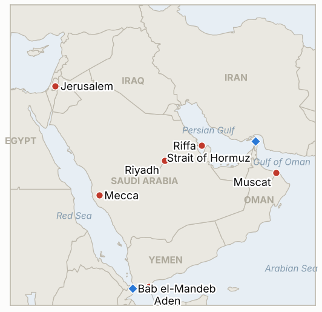

# Middle East Daily Briefing

**November 16, 2026**

- **Reporting window:** ~24 hours, November 15, 06:00 to November 16, 06:00 KST
- **Overall assessment:** A day after Reuters reported that Trump may hold off on Iran unless provoked, Iran's allies and proxies pressed on three fronts at once. The IRGC claimed a second drone attack in three days on US radar in Bahrain, which Bahrain says it intercepted (§1.1); in Yemen, Saudi backed forces abandoned the Bab el-Mandeb shoreline to the Houthis while Houthi missiles and drones were shot down over Riyadh, Mecca and Medina (§1.2); and the IRGC claimed a laden supertanker sank after hitting a mine, as UKMTO relayed the first independent report in days of an attack on a tanker inside the Gulf (§1.3). Washington answered with economic messaging rather than force (§1.4), and Israel's domestic crisis deepened with a report that Netanyahu's office may have engineered election day arrests (§1.5). Net: the Houthi gain at Bab el-Mandeb is the structural change; both chokepoints on the Gulf to Asia route now sit under the guns of Iran's camp, and Trump's provocation threshold is being probed without yet being crossed.

---

## 1. What Happened

<figure style="float:right; width:46%; margin:2pt 0 8pt 14pt;">

<figcaption style="font-size:8pt; color:#666; text-align:center; margin-top:3pt; font-style:italic;">Major places of discussion</figcaption>
</figure>

### 1.1 IRGC claims second Bahrain radar attack in three days; Bahrain says it intercepted it

The IRGC said through Fars that it launched six drones at a US air defence radar at the Riffa air base in Bahrain early Sunday in response to "hostile US actions," repeating that the Strait of Hormuz remains closed and that US escort efforts had failed ([Al Jazeera](https://aljazeera.com/news/2026/11/15/iran-says-it-targets-us-radar-in-bahrain-what-do-we-know)). Bahrain's interior ministry sounded two shelter alerts from about 01:30 GMT, and the Bahrain Defence Force said its air defences destroyed several Iranian "aerial attacks"; Bahrain's foreign ministry urged Security Council action under Resolution 2817 ([Fox News live](https://foxnews.com/live-news/iran-war-strikes-donald-trump-strait-hormuz-irgc-november-15); [CBS News live](https://www.cbsnews.com/live-updates/us-iran-war-trump-nuclear-material-no-deal/)). The US military had not commented by the end of the window; after Friday's first claim CENTCOM said it downed two drones with no damage. **Confidence: High that the attack was launched and intercepted; Low on any damage.**

### 1.2 Yemeni government forces quit Bab el-Mandeb shore; Houthi fire at Riyadh and the holy cities

The Southern Armed Forces fighting for the Saudi backed government said they were redeploying from Dhubab airport and the Bab el-Mandeb area to defend Aden and relieve Taiz, which Reuters called a major setback that ends a six week counteroffensive and leaves the Houthis in control of the strait's eastern shore ([Reuters via US News](https://www.usnews.com/news/world/articles/2026-11-15/yemen-government-forces-withdraw-from-area-near-bab-el-mandeb-strait-houthis-in-control); [Al Jazeera](https://www.aljazeera.com/news/2026/11/15/yemeni-government-forces-redeploy-from-bab-al-mandeb-to-defend-aden)). Al Jazeera reports the Houthis have taken highland areas north of Aden and say they are preparing to advance on the city. The coalition said it destroyed two ballistic missiles aimed at Riyadh and drones over the Mecca and Medina regions and the Eastern Province, with no casualties reported; the Houthis said they targeted King Khalid airport and a financial centre and denied targeting Mecca ([Gulf News](https://gulfnews.com/world/gulf/saudi/saudi-arabia-intercepts-drones-over-mecca-and-medina-ballistic-missiles-targeting-riyadh-1.500748432); [Arab News](https://www.arabnews.com/saudi-arabia/coalition-forces-intercept-2-houthi-missiles-targeting-riyadh-3-drones-in-eastern-province-3011963)). **Confidence: High on the withdrawal and interceptions; Medium on the Houthi advance toward Aden.**

### 1.3 IRGC claims a laden supertanker sank; UKMTO relays an Indian report of an attack

The IRGC navy said two tankers on an "unauthorised route" in the southern strait hit mines and caught fire, and that one, a supertanker carrying more than 2 million barrels of crude, sank; no vessel was named and Reuters could not verify the claim ([Arab News](https://www.arabnews.com/middle-east/two-tankers-on-fire-after-hitting-naval-mines-in-the-strait-of-hormuz-irans-irgc-says-3012053); [Kurdistan24](https://www.kurdistan24.net/en/story/953220/iran-says-oil-super-tanker-carrying-2-million-barrels-sinks-in-strait-of-hormuz)). Separately, UKMTO said it was aware of a report by Indian shipping authorities of an attack on an eastbound tanker in the Gulf before the strait, with the crew safe and damage unknown; it said it was unclear whether this was the incident Iran described ([Anadolu](https://aa.com.tr/en/middle-east/tanker-comes-under-attack-in-gulf-waters-uk-maritime-agency/4125797)). No spill, salvage or owner statement consistent with a sinking has appeared, and Fox reports CENTCOM says more than 1.7 billion barrels of crude have moved through Hormuz under US protection. No daily transit count was published. **Confidence: High that an attack on a tanker was reported; Low on any sinking.**

### 1.4 Washington leans on the economic squeeze; Tehran rejects German enrichment demand

Treasury Secretary Bessent said sanctions are squeezing Iran and projected a 25% economic contraction over the Iranian year to March 2027, and State Department spokesman Tommy Pigott said "Operation Economic Outcast is having real impact," citing inflation of 300 to 400% ([Fox News live](https://foxnews.com/live-news/iran-war-strikes-donald-trump-strait-hormuz-irgc-november-15)). Iran's foreign ministry spokesman Esmail Baghaei rejected Germany's demand that Tehran halt enrichment, citing NPT rights and criticising the IAEA over Isfahan ([CBS News live](https://www.cbsnews.com/live-updates/us-iran-war-trump-nuclear-material-no-deal/)). Fox reports Foreign Minister Araghchi will visit Muscat on Tuesday to meet Oman's Badr Al Busaidi on Hormuz oversight; in Israel, Mossad chief Roman Gofman returned from meetings with CIA Director Ratcliffe and envoy Witkoff and joined the first post election security cabinet ([Times of Israel](https://www.timesofisrael.com/liveblog-november-15-2026/)). **Confidence: High on the statements; Medium on the Muscat trip (single report).**

### 1.5 Report that Netanyahu's office engineered election day arrests; speaker vote Tuesday

Channel 12's Uvda reported that the attorney general and police are examining whether the Prime Minister's Office planted information that led to Election Day arrests of three Bedouin men, since freed without charge, which bolstered Netanyahu's claim that Arab parties stole the vote; it also reported Shin Bet chief David Zini sought to wiretap five Arab lawmakers on Election Day ([Times of Israel](https://www.timesofisrael.com/liveblog-november-15-2026/)). The PMO called the report false and grounds for a defamation suit; Eisenkot pledged a commission of inquiry and said Netanyahu must not stay "for even one minute longer." Yashar Likud talks made no progress and Shas said it stays with Netanyahu, ahead of the 4pm vote on Tuesday, November 17, to replace speaker Ohana with Matan Kahana ([IBTimes](https://www.ibtimes.co.uk/netanyahu-ally-knesset-speaker-vote-opposition-1831645)). In Gaza, the IDF and Hamas confirmed an Israeli strike killed Hamas Rafah Brigade commander Samir Abu Younis. **Confidence: High on the report and reactions; Medium on its substance (unproven allegations).**

---

## 2. Deep Dive: Incentives and Motives

### 2.1 Why is the IRGC hitting at Bahrain right after Trump signalled restraint?

The IRGC is testing where Trump's "provocation" line sits while keeping each act below it: drones at a radar in a third country, intercepted, with no US casualties, give CENTCOM little reason to retaliate and let Tehran show the blockade has costs. It also pressures Gulf hosts: Iran told the Security Council that Bahrain and others are complicit, and each alert in Manama raises the domestic price of hosting US forces. The risk is cumulative; a drone that gets through and kills Americans would convert a probing campaign into exactly the trigger Trump's restraint was conditioned on.

### 2.2 Why does the Bab el-Mandeb withdrawal matter more than the missile fire?

Missiles at Riyadh are intercepted daily; ground at the strait is not easily retaken. Holding the eastern shore gives the Houthis the option to threaten Red Sea traffic at short range, including Saudi crude moved from Yanbu, the very bypass that lets Riyadh export around Hormuz. Riyadh's backers chose to secure Aden rather than the chokepoint, signalling Saudi Arabia lacks the appetite or capacity to fight on two fronts while it absorbs Houthi strikes at home and lobbies Trump for restraint.

### 2.3 Why would Iran claim a sinking it has not shown?

A sunk laden VLCC is the strongest possible deterrent message to insurers and charterers: it says US cleared lanes are not safe and that Iran's permit regime is the only safe passage. Leaving the ship unnamed preserves deniability and avoids handing Washington a provable casualty. The Indian report gives the claims their first independent anchor in days, but a 2 million barrel sinking would normally surface quickly through owners, crew agencies and spill monitoring; continued silence would mark it as information warfare.

### 2.4 Why is Washington talking about inflation rather than strikes?

Economic metrics are how the administration justifies waiting: a forecast 25% contraction and triple digit inflation let Trump argue the blockade is winning without risking munitions, Gulf infrastructure or US lives before he has to show results. It also answers Israel, whose Mossad chief has just lobbied Washington for renewed strikes, by framing time as on America's side.

---

## 3. Policy Implications for South Korea

**Exposure snapshot:** South Korea draws about 70.7% of its crude and 20.4% of its LNG from the Middle East (`instructions/korea-exposure.md`, no update needed). No market session on November 14 or 15; latest prints are Friday's: KOSPI 5,290.53 and USD/KRW 1,336.7; Brent $95.84 and WTI $88.56 (November 13 settles). Monday's Seoul open falls after this window.

**Implications by development:**

- **Bahrain attack (§1.1):** Repeated IRGC strikes on Gulf hosted US assets are the most likely trigger for a reversal of Trump's restraint and a renewed oil spike (IND-20261116-1, IND-20261114-1, IND-20261113-1).
- **Bab el-Mandeb (§1.2):** Houthi control of the strait's shore threatens the Red Sea leg that Korean bound Saudi crude from Yanbu and Asia Europe container trade rely on; the proposed Cheonghae Unit area south of Oman sits closer to Hormuz than to Bab el-Mandeb, so the Gulf of Aden mandate itself becomes more exposed (IND-20261116-2, IND-20261112-1).
- **Tanker claims (§1.3):** An attack inside the Gulf on a ship reported by Indian authorities raises war risk premiums for Korean refiners' cargoes even unconfirmed; watch whether the vessel is named (IND-20261112-2, IND-20261114-2).
- **Diplomacy (§1.4):** An Oman channel on Hormuz oversight is the forum most likely to produce a shipping arrangement Korea could use before a full deal (IND-20261116-3, IND-20261111-1).
- **Israeli politics (§1.5):** Tuesday's speaker vote decides whether Netanyahu keeps a lever to delay a new government and push for strikes (IND-20261111-3).

**Resolved today:** None. No open indicator met its confirmation or falsification condition in this window.

**Testable indicators:**

- **IND-20261116-1** (open, new): A disclosed US strike on Iranian territory, publicly framed by US officials as a response to IRGC attacks on Bahrain or other Gulf hosts, by ~2026-11-23 confirms the provocation threshold has been crossed; none falsifies.
- **IND-20261116-2** (open, new): A UKMTO or JMIC report of a Houthi attack on a commercial vessel in the Bab el-Mandeb or southern Red Sea by ~2026-11-30 confirms the Houthis are using their new shoreline control against shipping; none falsifies.
- **IND-20261116-3** (open, new): A publicly confirmed meeting between Araghchi and Oman's Badr Al Busaidi in Muscat by ~2026-11-19 confirms; no meeting falsifies.
- **IND-20261112-2, IND-20261114-2** (open): IRGC claims a supertanker sank; UKMTO relays an Indian report of an attack on an unnamed tanker, cause unstated. Neither condition met.
- **IND-20261114-1** (open): no disclosed US or Israeli strike on Iran; IRGC drones at Bahrain intercepted.
- **IND-20261111-2** (open, due ~2026-11-17): Monday and Tuesday sessions remain; needs a KOSPI close above 5,383.80.
- **IND-20260910-3** (open, due ~2026-11-17): no ceasefire or settlement; Iran, Houthi and US actions continue.
- **IND-20261111-3** (open, due ~2026-11-18): speaker vote confirmed for 4pm Tuesday, November 17.
- **IND-20261113-1, IND-20261113-3, IND-20261115-1** (open): no session; last Brent $95.84, won 1,336.7.
- **IND-20261111-1, IND-20261112-1, IND-20261113-2, IND-20261114-3, IND-20261115-2, IND-20261115-3, IND-20261023-1, IND-20260714-4** (open): see `tracking/indicators.md`.

---

## 4. Watch List

- **Monday's Seoul open and Brent's first reaction to the Bahrain attack and the Bab el-Mandeb loss (IND-20261111-2, IND-20261113-1, IND-20261115-1).**
- **Any CENTCOM statement on the Riffa attack, or a US response (IND-20261116-1, IND-20261114-1).**
- **Houthi moves at sea from the Bab el-Mandeb shore and on the ground toward Aden (IND-20261116-2).**
- **Identification of the tanker in the Indian report, or of Iran's claimed sunk supertanker (IND-20261112-2, IND-20261114-2).**
- **Araghchi in Muscat and any Oman framework on Hormuz oversight (IND-20261116-3).**
- **Knesset speaker vote on November 17 and fallout from the Uvda report (IND-20261111-3).**
- **The window for Trump's "war ends after the election" claim closing on November 17 (IND-20260910-3).**

---

## 5. Source Quality Summary

| Claim | Sources | Confidence |
| --- | --- | --- |
| IRGC launched six drones at US radar at Riffa; Bahrain intercepted | IRGC via Fars, Bahrain Defence Force, via Al Jazeera, Fox, CBS | High (attack); Low (damage) |
| US had not commented on the Sunday claim | Al Jazeera | High |
| Yemeni government forces withdraw from Dhubab and Bab el-Mandeb area | Reuters via US News, Al Jazeera | High |
| Houthis preparing to advance on Aden | Al Jazeera | Medium |
| Coalition intercepted two missiles at Riyadh and drones over Mecca, Medina, Eastern Province | Coalition via Gulf News, Arab News, Fox | High |
| IRGC: two tankers hit mines, laden supertanker sank | IRGC via Arab News, Kurdistan24 | High (claim); Low (event) |
| UKMTO: Indian report of attack on eastbound tanker, crew safe | UKMTO via Anadolu | High |
| CENTCOM: 1.7bn barrels moved through Hormuz under US protection | CENTCOM via Fox | Medium |
| Bessent: 25% contraction; State Dept on Economic Outcast | Fox live | High |
| Baghaei rejects German call to halt enrichment | CBS live | High |
| Araghchi to visit Muscat Tuesday | Fox live | Medium |
| Mossad chief met Ratcliffe and Witkoff, joined security cabinet | Maariv via Times of Israel | Medium |
| Police probe of PMO role in election day arrests; Zini wiretap request | Channel 12 Uvda via Times of Israel | Medium |
| Speaker vote at 4pm November 17 | IBTimes, Knesset speaker announcement | High |
| Hamas Rafah commander Samir Abu Younis killed | IDF and Hamas via Times of Israel | High |
| Markets | No session November 14 or 15; Friday figures from November 14 brief | High |
| Hormuz daily transit count | Not reported | Not reported |
