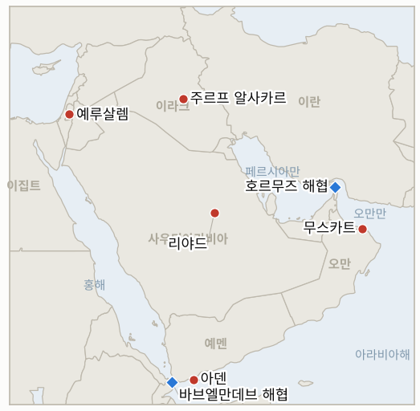

# 중동 일일 브리핑

**2026년 11월 17일**

- **보고 기간:** 약 24시간, 11월 16일 06:00 ~ 11월 17일 06:00 (한국시간)
- **종합 평가:** 시장과 전장이 반대 방향으로 움직였다. UKMTO가 일주일간 이어진 이란의 기뢰 주장 가운데 처음으로 선명이 확인된 선박, 즉 오만 앞바다에서 발사체에 맞은 유조선을 발표했는데도(§1.1), 유가는 IEA의 공급 과잉 전망과 걸프 수출 회복에 장중 3% 넘게 내렸다. 이란은 '이틀 내 호르무즈 재개방' 구상에 대한 역내 외교전을 펴는 동시에 전쟁이 "영구 종식"될 때까지 IAEA 접근을 불허한다고 밝혔고, 미 항공모함이 세 번째로 도착했다(§1.2). 후티는 아덴에서 약 80~100km 거리까지 다가섰고(§1.3), 바그다드는 카타이브 헤즈볼라 거점에 군 진입을 명령했으며(§1.4), 이스라엘의 선거일 체포 의혹은 크네세트 의장 표결 전날 경찰청장에게까지 번졌다(§1.5). 한국에 이날의 충격은 걸프발이 아니었다. 코스피는 반도체 급락으로 3.59% 내렸고 원화는 안정적이었다. 종합하면, 시장은 관리되는 교착 상태를 가격에 반영하고 있으며, 중간선거 직후 전쟁이 끝난다던 트럼프의 예측은 기한을 채우고도 실현되지 않았다.

---

## 1. 무슨 일이 있었나

<figure style="float:right; width:46%; margin:2pt 0 8pt 14pt;">

<figcaption style="font-size:8pt; color:#666; text-align:center; margin-top:3pt; font-style:italic;">주요 논의 지점</figcaption>
</figure>

### 1.1 UKMTO, 오만 앞바다 피격 유조선 선명 공개… 혁명수비대는 이틀간 6척 침몰 주장

UKMTO는 월요일 05시 58분(UTC)께 호르무즈 해협을 빠져나오던 유조선이 "미상의 발사체"에 맞아 기관실 화재가 났고 승조원은 전원 무사하다고 밝혔다. 이 선박은 파나마 선적 ON PHOENIX로, 오만에서 약 3해리 떨어진 곳에서 피격됐다([Times of Israel](https://www.timesofisrael.com/third-us-aircraft-carrier-arrives-in-mideast-as-iran-rules-out-nuclear-inspections/); [CBS News live](https://www.cbsnews.com/live-updates/iran-war-us-nuclear-oil-strait-of-hormuz/)). 이란 해군은 국영 매체를 통해 이 유조선이 "제한 구역"에서 기뢰에 접촉했다고 주장했고 이후 24시간 내 네 번째 기뢰 접촉을 주장했다. 혁명수비대 해군은 미국이 지원하는 남쪽 항로에 기뢰가 깔려 있으며 일요일과 월요일에 유조선 6척이 불타 침몰했다고 밝혔으나, 로이터는 이를 확인하지 못했다([Oilprice.com](https://oilprice.com/Latest-Energy-News/World-News/Iran-Claims-Two-More-Oil-Tankers-Hit-Mines-in-Strait-of-Hormuz.html); [CNBC](https://www.cnbc.com/2026/11/16/oil-prices-brent-wti-latest.html)). 갈리바프 국회의장은 Al Jazeera에 해협 통항이 전쟁 이전 상태로 돌아가지 않을 것이며 1982년 유엔해양법협약(UNCLOS)은 "해협에 적용되지 않는다"고 말했다. 일일 통항량 집계는 발표되지 않았다. **신뢰도: ON PHOENIX 피격은 높음; 기뢰가 원인이라는 점과 침몰 주장은 낮음.**

### 1.2 아라그치, 이틀 내 재개방 구상에 역내 지지 주장… 이란은 IAEA 차단, 미 항모 세 번째 도착

아라그치 외무장관은 이슬라마바드에서 열린 10개국 경제협력기구(ECO) 회의가, 동결 자산 해제와 미국의 봉쇄 해제 등 7개 조건이 충족되면 초기 휴전 후 이틀 안에 호르무즈를 재개방한다는 이란의 구상을 지지했다고 밝혔다. 다른 참가국 정부는 이를 확인하지 않았고, 미국은 이 요구를 수용 불가라고 해 왔다([CBS News live](https://www.cbsnews.com/live-updates/iran-war-us-nuclear-oil-strait-of-hormuz/)). 그는 아심 무니르 파키스탄 육군참모총장을 만났으며 화요일 무스카트에서 바드르 알부사이디 오만 외무장관과 회담할 예정이다([Muscat Daily](https://www.muscatdaily.com/2026/11/16/iranian-fm-to-visit-muscat-for-talks/); [Al Arabiya](https://english.alarabiya.net/News/middle-east/2026/11/15/iran-s-foreign-minister-to-visit-pakistan-oman-for-talks-this-week)). 가리브아바디 외무차관은 "이란의 조건이 충족되고 전쟁이 영구적으로 종식될 때까지" 피해 시설에 대한 IAEA의 접근을 허용하지 않겠다고 말했다. 항공모함 시어도어 루스벨트함이 일요일 도착해 조지 H.W. 부시함, 조지 워싱턴함에 합류했다. 미 중부사령부는 인도양에 있는 루스벨트함 사진을 게시하고 세 척이 오래 겹쳐 머물지는 않을 것이라고 밝혔다([Times of Israel](https://www.timesofisrael.com/third-us-aircraft-carrier-arrives-in-mideast-as-iran-rules-out-nuclear-inspections/)). 메흐르 통신은 이스파한 상공에서 방공망이 가동됐다고 전했으나 원인은 밝히지 않았다. **신뢰도: 발언과 항모 도착은 높음; ECO의 실제 지지 여부는 낮음.**

### 1.3 후티, 아덴에 접근… 사우디 공습과 후티 드론 공격 지속

군 소식통들은 로이터에 정부군이 바브엘만데브 연안을 떠난 뒤 후티 병력이 아덴 서쪽 약 100km의 코르 오마이라에 도달했다고 말했고, Al Jazeera가 인용한 분석가는 후티가 약 80km 떨어진 토르 알바하에 있다고 봤다([NBC News](https://www.nbcnews.com/world/yemen/yemen-houthi-rebels-saudi-arabia-backed-forces-retreat-aden-rcna609670); [Al Jazeera](https://www.aljazeera.com/news/2026/11/16/houthis-edge-closer-to-aden-as-yemeni-forces-pull-out-of-bab-al-mandeb)). 후티는 아덴의 부라이카 구역에 탄도미사일 2발을 쐈고 라히즈주에서 교전이 보고됐다. 후티 보건 당국은 사우디의 공습으로 사나와 암란에서 어린이 1명을 포함해 3명이 숨졌고 24시간 동안 37명이 죽거나 다쳤다고 밝혔다. 연합군은 메카와 리야드 지역을 겨냥한 드론 2대를 격파했다고 밝혔다([CBS News live](https://www.cbsnews.com/live-updates/iran-war-us-nuclear-oil-strait-of-hormuz/)). 파키스탄은 메카 공동방위협정에 따라 이달 사우디와 튀르키예 당국자들을 초청해 회의를 연다고 밝혔다. **신뢰도: 진격은 높음; 거리와 사상자 수치는 중간.**

### 1.4 바그다드, 카타이브 헤즈볼라 거점에 군 진입 명령

알리 알자이디 이라크 총리는 바그다드 남쪽 약 60km에 있는 카타이브 헤즈볼라의 거점 주르프 알사카르에 군이 진입하도록 명령하고 이 조직에 철수 시한을 제시했다고 정부 대변인이 국영 통신에 밝혔다. 한 보안 소식통은 시한이 금요일이라고 전했다([Asharq Al-Awsat](https://english.aawsat.com/arab-world/5342044-iraq-orders-army-enter-jurf-al-sakhar-confrontation-kataib-hezbollah-escalates); [Arab News](https://www.arabnews.com/middle-east/iraq-orders-army-to-enter-stronghold-of-iran-backed-group-3012279)). 이 명령은 그곳에서 은닉된 펌프 설비와 비밀 정유 시설이 발견됐다는 석유 밀수 수사에 뒤이은 것이며, 이 조직은 밀수를 부인한다. 외곽에 전차가 배치된 것으로 전해졌고, 이라크 언론은 인계 문제를 두고 조직 지도부가 분열됐다고 보도했다. **신뢰도: 명령은 높음; 시한과 무력 사용 여부는 중간.**

### 1.5 이스라엘 경찰청장 "총리실이 우리를 속였을 수 있다"… 통합 정부 가능성은 0으로 평가

채널12는 다니 레비 경찰청장이 비공개 회의에서 선거일에 베두인 남성 3명을 체포한 일과 관련해 "총리실이 우리를 속였을 가능성이 있다"고 말했으며, 검찰이 형사 수사를 검토하는 가운데 검찰총장이 경찰청장의 내부 감찰을 중단시켰다고 보도했다([Times of Israel](https://www.timesofisrael.com/liveblog-november-16-2026/)). 아이젠코트 진영의 고위 인사는 칸 방송에 통합 정부 가능성이 "0으로 떨어졌다"며 이번 사건을 "쿠데타 시도"라고 불렀다. 스모트리치는 아랍계 의원이 부의장이 되지 않는 경우에만 마탄 카하나를 의장으로 지지하겠다고 제안했으나 카하나는 이를 거부하는 것으로 보인다. 의장 표결은 이번 보고 기간 이후인 화요일 오후 4시로 잡혀 있다. 레바논에서는 이스라엘이 동부 베카 지역에서 헤즈볼라의 무기 수송이라고 규정한 표적을 타격했는데, 이 지역 타격은 수개월 만에 처음이다. 마이크 왈츠 미국 대사는 베이루트에서 "어떤 나라도 두 개의 군대를 가질 수 없다"고 말했다. **신뢰도: 보도와 발언은 높음; 의혹의 실체는 중간.**

---

## 2. 심층 분석: 유인과 동기

### 2.1 유조선이 피격되는데 유가는 왜 내리나?

트레이더들은 사건이 아니라 물량을 가격에 반영하고 있다. IEA는 이제 4분기 공급이 수요를 하루 170만 배럴 웃돌 것으로 보고, 골드만삭스는 시장이 해운 위험에 적응했다고 평가하며, 중국의 정제 처리량은 전년 대비 8.1% 줄었다. 승조원이 무사한 기관실 화재 한 건은 아시아에 도착하는 배럴 수를 바꾸지 못한다. 잔해도, 유출도, 선주 발표도 없는 선명 미상의 "침몰" 6건은 더욱 그렇다. 이 논리의 위험은 안일함이다. 지금의 프리미엄은 이란의 교란이 성가신 수준에 머물고 트럼프가 자제를 이어간다는 가정 위에 서 있다.

### 2.2 이란은 왜 같은 날 역내 기구에 구애하면서 IAEA는 차단하나?

두 조치는 하나의 협상 입지를 위한 것이다. ECO 지지 주장은 사실 여부와 무관하게 이란의 이틀 내 재개방 제안을 미국만이 가로막는 역내 합의처럼 보이게 하며, 이는 해협 개방을 바라는 아시아 수입국과 걸프 이웃들에게 가장 크게 작용한다. 전쟁이 "영구 종식"될 때까지 사찰단을 막는 것은 핵 불투명성을 협상 카드로 바꾼다. 농축 우라늄의 소재를 아는 일이 미국이 휴전으로 값을 치러야 하는 대상이 되는 것이다. 두 갈래가 만날 수 있는 곳은 무스카트다. 오만은 해협을 공유하고 있고 이전의 모든 채널을 중재했다.

### 2.3 바그다드는 왜 지금 카타이브 헤즈볼라를 겨냥하나?

알자이디에게 동기와 명분이 드물게 맞아떨어졌다. 석유 밀수는 종파적이거나 친미적인 명분이 아닌 법 집행의 명분을 준다. 이코노믹 아웃캐스트 작전에 따른 미국의 제재 압박은 민병대의 석유 조직망을 용인하는 비용을 높인다. 그리고 압박받으며 전쟁 중인 이란은 대리 세력을 보호할 여력이 줄었다. 인계 문제를 둘러싼 조직 내부 분열 보도는 바그다드가 전차를 보여주는 것만으로 충분할 수 있는 시점이라고 본다는 점을 시사한다. 그렇지 않다면 수도에서 한 시간 거리에서 벌어지는 교전은 주요 산유국 내부에 새 전선을 열게 된다.

### 2.4 경찰청장의 발언은 왜 이란 전쟁에 중요한가?

네타냐후가 전쟁 정책에 행사하는 영향력은 정권 이양기 동안 자리를 지키는 데 달려 있기 때문이다. 경찰 스스로 이용당했을 수 있다고 말하면 형사 수사를 막기 어려워지고, 통합 협상은 아이젠코트 진영 내 마지막 후원자를 잃으며, 화요일 의장 표결은 크네세트 의사일정 통제권을 야권에 넘기게 된다. 수사 대상이 된 과도 총리는 안보 위기를 추구할 이유는 더 커지고 그것을 일으킬 권위는 더 줄어든다. 아이젠코트 진영이 모사드 국장과 신베트 국장까지 겨냥하는 이유다.

---

## 3. 한국에 대한 정책적 함의

**익스포저 현황:** 한국은 원유의 약 70.7%, LNG의 20.4%를 중동에서 들여온다(`instructions/korea-exposure.md`, 갱신 불필요). 월요일 코스피는 3.59% 내린 5,100.50으로 3거래일 연속 하락했고 외국인은 약 1조 3,800억 원을 순매도했다. 원인은 걸프가 아니라 엔비디아 경영진 교체 이후의 반도체 급락(삼성전자 -4.47%, SK하이닉스 -7.89%)이었다([인포스탁데일리 via Investing.com](https://kr.investing.com/news/stock-market-news/article-2176965)). 원·달러 환율은 금요일 종가보다 1.0원 내린 1,335.7원에 마감했다([서울경제](https://m.sedaily.com/article/20114942)). 보고 기간 내 월요일 유가 종가는 확인되지 않았다. 마지막 장중 시세는 브렌트 92.44달러(-3.55%), WTI 약 85.72달러(-3.21%)이며([CNBC](https://www.cnbc.com/2026/11/16/us-crude-oil-declines-to-87-a-barrel-on-recovering-middle-east-exports.html)), 금요일 종가는 각각 95.84달러와 88.56달러였다.

**사안별 함의:**

- **유조선 피격(§1.1):** 출항 항로의 오만 3해리 앞바다에서 선명이 확인되고 독립적으로 보고된 피격은, 유가 자체가 내리는 중에도 한국행 화물의 전쟁위험 보험료를 움직이는 종류의 사건이다. 다만 이란의 기뢰 서사를 확증하지는 않는다(IND-20261112-2, IND-20261114-2).
- **외교와 항모(§1.2):** 이란의 이틀 내 재개방 제안은 현재 테이블에 오른 것 가운데 통항 방안에 가장 가깝고, 지켜볼 장소는 무스카트다. 세 번째 항모는 트럼프가 보류하는 동안에도 미국의 타격 능력을 높인다(IND-20261116-3, IND-20261111-1, IND-20261114-1, IND-20261114-3).
- **예멘(§1.3):** 아덴이 위협받으면 청해부대의 핵심 작전 구역인 아덴만이 교전 전선과 맞닿게 되며, 이는 국회가 오만 방면으로 작전 구역을 넓히는 파견 연장안을 심의하는 시점과 겹친다(IND-20261117-1, IND-20261116-2, IND-20261112-1).
- **이라크(§1.4):** 이라크는 한국의 주요 원유 공급국이다. 바그다드 인근 교전이 남부 수출 터미널에 직접 닿지는 않겠지만 바스라산 유종에 위험 프리미엄을 더할 것이다(IND-20261117-2).
- **시장:** 유가 하락과 안정된 원화는 한국의 수입 부담을 덜어 주지만, 외국인 매도가 이끈 3.6%의 주가 하락은 이번 주 한국 자산의 지배적 위험이 걸프가 아니라 AI 사이클임을 보여 준다(IND-20261117-3, IND-20261115-1, IND-20261113-3).

**오늘 종결:**

- **IND-20260910-3: 반증.** 전쟁이 "선거 직후 끝날 것"이라는 트럼프의 예측은 11월 17일께까지 휴전, 합의 또는 미국의 철수 결정을 요구했다. 중간선거 2주 뒤인 지금 그 어느 것도 없다. 유조선이 피격되고, 이란은 걸프 주둔 미군 자산을 공격하며, 세 번째 항모가 도착했다.
- **IND-20261115-3: 확증.** 시어도어 루스벨트함이 일요일 역내에 도착했다. 미 중부사령부는 사진을 게시하고 부시함, 조지 워싱턴함에 합류한다고 밝혔다.

**검증 가능한 지표:**

- **IND-20261117-1** (진행, 신규): 2026년 11월 30일께까지 로이터 또는 AP가 후티 지상군이 아덴 시에서 50km 이내에 있다고 보도하거나 아덴주 안에서 지상 교전을 보도하면 진격 지속으로 확증; 둘 다 없으면 반증.
- **IND-20261117-2** (진행, 신규): 2026년 11월 24일께까지 이라크 연방군의 주르프 알사카르 진입이 확인되면(INA, 로이터 또는 AP) 바그다드가 명령을 집행한 것으로 확증; 진입이 없으면 반증.
- **IND-20261117-3** (진행, 신규): 2026년 11월 24일께까지 어느 거래일이든 코스피가 5,000 아래에서 마감하면 외국인 주도 매도 심화로 확증; 없으면 반증.
- **IND-20261111-2** (진행, 11월 17일께 기한): 월요일 종가 5,100.50은 5,383.80에 크게 못 미침; 화요일 장만 남음.
- **IND-20261112-2, IND-20261114-2** (진행): ON PHOENIX의 선명은 확인됐으나 UKMTO는 기뢰가 아닌 미상의 발사체로 보고했고, 이 선박은 LNG 운반선이 아닌 유조선임. 두 조건 모두 미충족.
- **IND-20261116-3** (진행, 11월 19일께 기한): 이란 외무부가 아라그치의 화요일 무스카트 방문을 확인; 회담은 아직 열리지 않음.
- **IND-20261111-3** (진행, 11월 18일께 기한): 의장 표결은 보고 기간 이후인 화요일 오후 4시.
- **IND-20261113-1, IND-20261115-1** (진행): 브렌트 마지막 장중 시세 92.44달러; 100달러 초과 또는 90달러 미만 종가 없음.
- **IND-20261113-3** (진행): 원·달러 1,335.7원 마감, 1,350원 미만.
- **IND-20261114-1, IND-20261116-1** (진행): 공개된 미국·이스라엘의 이란 타격 없음; 이스파한 방공망 가동의 원인은 미상.
- **IND-20261114-3** (진행): 이란, 전쟁이 영구 종식될 때까지 IAEA 접근 불허.
- **IND-20261111-1, IND-20261112-1, IND-20261113-2, IND-20261115-2, IND-20261116-2, IND-20261023-1, IND-20260714-4** (진행): `tracking/indicators.md` 참조.

---

## 4. 관찰 목록

- **월요일 유가 공식 종가, 그리고 이번 주 브렌트가 90달러 아래에서 마감하는지 여부(IND-20261115-1, IND-20261113-1).**
- **무스카트의 아라그치와 알부사이디, 호르무즈 통항 방안에 관한 오만의 발표(IND-20261116-3).**
- **화요일 오후 4시 크네세트 의장 표결과 총리실에 대한 형사 수사 여부(IND-20261111-3).**
- **아덴을 향한 후티의 이동과 바브엘만데브 연안발 선박 공격 여부(IND-20261117-1, IND-20261116-2).**
- **주르프 알사카르의 금요일 시한(IND-20261117-2).**
- **엔비디아 실적 발표를 앞둔, 반도체 급락 이후의 화요일 서울 장(IND-20261117-3, IND-20261111-2).**
- **ON PHOENIX 피격 또는 혁명수비대의 추가 걸프 주둔국 공격에 대한 미국의 대응(IND-20261116-1, IND-20261114-1).**
- **IAEA 이사회 회의와 이란의 사찰 금지(IND-20261115-2, IND-20261114-3).**

---

## 5. 출처 신뢰도 요약

| 주장 | 출처 | 신뢰도 |
| --- | --- | --- |
| 호르무즈를 빠져나오던 유조선이 미상의 발사체에 피격, 기관실 화재, 승조원 무사 | UKMTO via CBS, Times of Israel | 높음 |
| 해당 선박은 파나마 선적 ON PHOENIX, 오만 약 3해리 앞바다 | UKMTO, Vanguard via Times of Israel | 높음 |
| 유조선이 기뢰에 접촉; 24시간 내 네 번째 기뢰 접촉 | 이란 해군 via 국영 TV | 낮음 |
| 일요일과 월요일 유조선 6척이 불타 침몰 | 혁명수비대 해군 via Mehr, Oilprice.com, Reuters via CNBC | 높음(주장); 낮음(사실) |
| 갈리바프: 전쟁 이전 통항으로 복귀 없음; UNCLOS 적용 안 됨 | Al Jazeera via Oilprice.com | 높음 |
| ECO 회원국들이 이란의 이틀 내 재개방 구상 지지 | 아라그치 via CBS | 높음(발언); 낮음(지지 여부) |
| 아라그치, 무니르 면담; 화요일 무스카트 방문 | CBS, Muscat Daily, Al Arabiya | 높음 |
| 전쟁 영구 종식 전까지 IAEA 접근 불허 | 가리브아바디 via CBS, Times of Israel | 높음 |
| 시어도어 루스벨트함, 일요일 세 번째 항모로 도착 | Axios via Times of Israel; 미 중부사령부 게시물 via CBS | 높음 |
| 이스파한 상공 방공망 가동 | Mehr via Times of Israel | 중간 |
| 후티, 아덴에서 약 100km인 코르 오마이라, 약 80km인 토르 알바하에 도달 | Reuters via NBC; Al Jazeera 분석가 | 중간 |
| 부라이카에 미사일; 사우디 공습으로 3명 사망; 24시간 사상자 37명 | CBS; 후티 보건 당국 | 중간 |
| 연합군, 메카·리야드 지역 겨냥 드론 2대 격추 | 연합군 via CBS | 높음 |
| 알자이디, 주르프 알사카르에 군 진입 명령; 시한은 금요일 | INA via Asharq Al-Awsat, Arab News, CBS | 높음(명령); 중간(시한) |
| 경찰청장: 총리실이 "우리를 속였을" 수 있음; 검찰총장이 내부 감찰 중단 | 채널12 via Times of Israel | 중간 |
| 통합 정부 가능성 "0으로 떨어졌다" | 칸 via Times of Israel | 중간 |
| 이스라엘, 동부 베카에서 무기 수송 타격 | 이스라엘군, NNA via CBS, Times of Israel | 높음 |
| 코스피 5,100.50, 3.59% 하락; 외국인 약 1조 3,800억 원 순매도 | 인포스탁데일리, 서울경제 | 높음 |
| 원·달러 15시 30분 1,335.7원 | 서울경제 | 높음 |
| 브렌트 92.44달러, WTI 85.72달러(장중 시세, 종가 아님) | CNBC | 중간 |
| 호르무즈 일일 통항량 | 미보고 | 미보고 |
