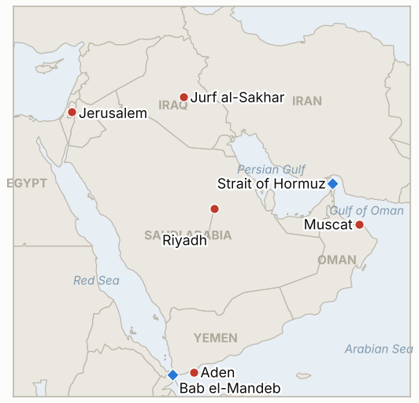

# Middle East Daily Briefing

**November 17, 2026**

- **Reporting window:** ~24 hours, November 16, 06:00 to November 17, 06:00 KST
- **Overall assessment:** Markets and the battlefield pulled in opposite directions. Oil fell more than 3% intraday on the IEA's surplus forecast and recovering Gulf exports even as UKMTO named the first vessel in a week of Iranian mine claims, a tanker hit by a projectile off Oman (§1.1). Tehran paired a regional diplomatic push for its two day Hormuz reopening plan with a refusal of IAEA access until the war has "permanently ended," while a third US carrier arrived (§1.2). The Houthis closed to within about 80 to 100 km of Aden (§1.3), Baghdad ordered its army into Kataib Hezbollah's stronghold (§1.4), and Israel's election arrests scandal reached the police chief on the eve of the Knesset speaker vote (§1.5). For Korea the day's shock was not the Gulf: the KOSPI fell 3.59% on a chip sell off while the won held steady. Net: the market is pricing a managed stalemate, and Trump's prediction that the war would end right after the midterms has now run out its window unmet.

---

## 1. What Happened

<figure style="float:right; width:46%; margin:2pt 0 8pt 14pt;">

<figcaption style="font-size:8pt; color:#666; text-align:center; margin-top:3pt; font-style:italic;">Major places of discussion</figcaption>
</figure>

### 1.1 UKMTO names a tanker hit off Oman; IRGC claims six tankers sank in two days

UKMTO said a tanker leaving the Strait of Hormuz was struck by an "unknown projectile" at about 05:58 UTC on Monday, starting an engine room fire, with all crew accounted for; the vessel was identified as the Panama flagged ON PHOENIX, hit about three nautical miles off Oman ([Times of Israel](https://www.timesofisrael.com/third-us-aircraft-carrier-arrives-in-mideast-as-iran-rules-out-nuclear-inspections/); [CBS News live](https://www.cbsnews.com/live-updates/iran-war-us-nuclear-oil-strait-of-hormuz/)). Iran's navy said through state media that the tanker hit a mine in a "restricted zone," later claiming a fourth mine strike in 24 hours, and the IRGC navy said six tankers had caught fire and sunk on Sunday and Monday on the US backed southern route, which it called mined; Reuters could not verify the claims ([Oilprice.com](https://oilprice.com/Latest-Energy-News/World-News/Iran-Claims-Two-More-Oil-Tankers-Hit-Mines-in-Strait-of-Hormuz.html); [CNBC](https://www.cnbc.com/2026/11/16/oil-prices-brent-wti-latest.html)). Parliament speaker Ghalibaf told Al Jazeera that navigation will not return to its pre war state and that the 1982 Law of the Sea convention "does not apply to the strait." No daily transit count was published. **Confidence: High that ON PHOENIX was hit; Low on a mine as the cause and on any sinking.**

### 1.2 Araghchi claims regional backing for a two day reopening plan; Tehran bars the IAEA; third US carrier arrives

Foreign Minister Araghchi said the ten nation Economic Cooperation Organization, meeting in Islamabad, backed Iran's plan to reopen Hormuz within two days of an initial ceasefire if seven conditions are met, including release of frozen assets and an end to the US blockade; no other attending government confirmed this, and Washington has called the demands unacceptable ([CBS News live](https://www.cbsnews.com/live-updates/iran-war-us-nuclear-oil-strait-of-hormuz/)). He met Pakistan's army chief Asim Munir and is due in Muscat on Tuesday for talks with Oman's Badr Al Busaidi ([Muscat Daily](https://www.muscatdaily.com/2026/11/16/iranian-fm-to-visit-muscat-for-talks/); [Al Arabiya](https://english.alarabiya.net/News/middle-east/2026/11/15/iran-s-foreign-minister-to-visit-pakistan-oman-for-talks-this-week)). Deputy Foreign Minister Gharibabadi said Iran will not grant the IAEA access to damaged sites "until Iran's conditions are met and the war has permanently ended." The carrier USS Theodore Roosevelt arrived on Sunday, joining the George H.W. Bush and George Washington; CENTCOM posted a photo of it in the Indian Ocean and said the three are not expected to overlap for long ([Times of Israel](https://www.timesofisrael.com/third-us-aircraft-carrier-arrives-in-mideast-as-iran-rules-out-nuclear-inspections/)). Mehr reported air defences activated over Isfahan without giving a cause. **Confidence: High on the statements and the carrier; Low on actual ECO endorsement.**

### 1.3 Houthis close on Aden; Saudi strikes and Houthi drones continue

Military sources told Reuters that Houthi fighters reached Khor Omairah, about 100 km west of Aden, after government forces left the Bab el-Mandeb shore; an analyst cited by Al Jazeera put them at Tor al-Baha, about 80 km away ([NBC News](https://www.nbcnews.com/world/yemen/yemen-houthi-rebels-saudi-arabia-backed-forces-retreat-aden-rcna609670); [Al Jazeera](https://www.aljazeera.com/news/2026/11/16/houthis-edge-closer-to-aden-as-yemeni-forces-pull-out-of-bab-al-mandeb)). The Houthis fired two ballistic missiles at Aden's Buraiqeh district, and clashes were reported in Lahj. Houthi health officials said Saudi strikes killed three people, including a child, in Sanaa and Amran, and that 37 people were killed or wounded in 24 hours; the coalition said it destroyed two drones aimed at the Mecca and Riyadh regions ([CBS News live](https://www.cbsnews.com/live-updates/iran-war-us-nuclear-oil-strait-of-hormuz/)). Pakistan said it will host Saudi and Turkish officials this month under the Mecca Joint Defense Agreement. **Confidence: High on the advance; Medium on distances and casualty figures.**

### 1.4 Baghdad orders the army into Kataib Hezbollah's stronghold

Iraqi Prime Minister Ali al-Zaidi ordered the armed forces to enter Jurf al-Sakhar, the Kataib Hezbollah stronghold about 60 km south of Baghdad, and set a deadline for the group to leave, a government spokesman told the state news agency; a security source put the deadline at Friday ([Asharq Al-Awsat](https://english.aawsat.com/arab-world/5342044-iraq-orders-army-enter-jurf-al-sakhar-confrontation-kataib-hezbollah-escalates); [Arab News](https://www.arabnews.com/middle-east/iraq-orders-army-to-enter-stronghold-of-iran-backed-group-3012279)). The order follows an oil smuggling investigation that reported hidden pumping equipment and a concealed refinery there; the group denies smuggling. Tanks were reported on the outskirts, and Iraqi media describe a split in the group's leadership over a handover. **Confidence: High on the order; Medium on the deadline and whether force will be used.**

### 1.5 Israel's police chief: the Prime Minister's Office may have "fooled us"; unity chances put at zero

Channel 12 reported that Police Commissioner Danny Levy told closed meetings "it is possible that the Prime Minister's Office fooled us" over the Election Day arrests of three Bedouin men, and that the attorney general halted his internal review while prosecutors weigh a criminal probe ([Times of Israel](https://www.timesofisrael.com/liveblog-november-16-2026/)). A senior Eisenkot bloc official told Kan the chance of a unity government is "down to zero" and called the affair "an attempted coup"; Smotrich offered to back Matan Kahana for speaker only if no Arab lawmakers become deputies, terms Kahana appears to reject. The speaker vote is set for 4pm Tuesday, after this window. In Lebanon, Israel struck what it called a Hezbollah arms shipment in the eastern Beqaa, its first strike there in months, and US ambassador Mike Waltz said in Beirut that "no country can have two armies." **Confidence: High on the reports and statements; Medium on the underlying allegations.**

---

## 2. Deep Dive: Incentives and Motives

### 2.1 Why is oil falling while tankers are being hit?

Traders are pricing volumes, not incidents. The IEA now sees fourth quarter supply 1.7 million barrels a day above demand, Goldman Sachs says the market has adapted to shipping risk, and Chinese refinery runs fell 8.1% from a year earlier. A single engine room fire, with the crew safe, does not change the count of barrels reaching Asia; six unnamed "sinkings" with no wreck, spill or owner statement change it even less. The risk in this logic is complacency: the premium now rests on the assumption that Iran's harassment stays at nuisance level and that Trump stays restrained.

### 2.2 Why would Tehran court a regional bloc and shut out the IAEA on the same day?

The two moves serve one bargaining position. The ECO claim, true or not, presents Iran's two day reopening offer as a regional consensus that Washington alone is blocking, which matters most to Asian importers and Gulf neighbours who want the strait open. Barring inspectors until the war has "permanently ended" converts nuclear opacity into a bargaining chip: knowledge of where the enriched uranium is becomes something the US must pay for with a ceasefire. Muscat is where the two tracks could meet, since Oman shares the strait and has brokered every prior channel.

### 2.3 Why is Baghdad moving against Kataib Hezbollah now?

Zaidi has a rare alignment of motive and cover. Oil smuggling gives him a law enforcement pretext rather than a sectarian or pro American one; US sanctions pressure under the Economic Outcast campaign raises the cost of tolerating militia oil networks; and Iran, squeezed and at war, has less capacity to protect its client. The reported split inside the group over a handover suggests Baghdad sees a moment when a show of tanks may be enough. If it is not, a fight an hour from the capital would open a new front inside a major oil exporter.

### 2.4 Why does the police chief's remark matter for the Iran war?

Because Netanyahu's leverage over war policy depends on staying in office through the transition. If the police themselves say they may have been used, a criminal probe becomes harder to stop, unity talks lose their last sponsor in Eisenkot's camp, and Tuesday's speaker vote would hand the opposition control of the Knesset agenda. A caretaker premier under investigation has both more reason to seek a security crisis and less authority to launch one, which is why the Eisenkot bloc is also targeting the Mossad and Shin Bet chiefs.

---

## 3. Policy Implications for South Korea

**Exposure snapshot:** South Korea draws about 70.7% of its crude and 20.4% of its LNG from the Middle East (`instructions/korea-exposure.md`, no update needed). On Monday the KOSPI fell 3.59% to 5,100.50, its third straight decline, as foreigners net sold about 1.38 trillion won; the cause was a chip sell off after the Nvidia leadership change (Samsung Electronics down 4.47%, SK hynix down 7.89%), not the Gulf ([Infostock Daily via Investing.com](https://kr.investing.com/news/stock-market-news/article-2176965)). The won closed at 1,335.7 per dollar, 1.0 won stronger than Friday's close ([Seoul Economic Daily](https://m.sedaily.com/article/20114942)). No Monday oil settlement was found in the window; the last intraday quotes were Brent $92.44, down 3.55%, and WTI about $85.72, down 3.21% ([CNBC](https://www.cnbc.com/2026/11/16/us-crude-oil-declines-to-87-a-barrel-on-recovering-middle-east-exports.html)), against Friday settles of $95.84 and $88.56.

**Implications by development:**

- **Tanker strike (§1.1):** A named, independently reported hit three miles off Oman on the outbound lane is the kind of event that moves war risk premiums on Korean cargoes even as flat prices fall; it does not confirm Iran's mine narrative (IND-20261112-2, IND-20261114-2).
- **Diplomacy and carrier (§1.2):** Iran's two day reopening offer is the nearest thing to a shipping arrangement on the table, and Muscat is the venue to watch; a third carrier raises US strike capacity while Trump holds off (IND-20261116-3, IND-20261111-1, IND-20261114-1, IND-20261114-3).
- **Yemen (§1.3):** A threat to Aden would put the Gulf of Aden, the Cheonghae Unit's core operating area, next to an active front just as the National Assembly weighs extending the unit's mandate toward Oman (IND-20261117-1, IND-20261116-2, IND-20261112-1).
- **Iraq (§1.4):** Iraq is a major crude supplier to Korea; fighting near Baghdad would not touch southern export terminals directly but would add a risk premium to Basra grades (IND-20261117-2).
- **Markets:** Cheaper oil and a steady won ease Korea's import bill, but a 3.6% equity fall led by foreign selling shows the dominant risk to Korean assets this week is the AI cycle, not the Gulf (IND-20261117-3, IND-20261115-1, IND-20261113-3).

**Resolved today:**

- **IND-20260910-3: Falsified.** Trump's prediction that the war "will end immediately after the election" required a ceasefire, settlement or US withdrawal decision by about November 17. Two weeks after the midterms there is none: tankers are being hit, Iran is attacking Gulf hosted US assets, and a third carrier has arrived.
- **IND-20261115-3: Confirmed.** The USS Theodore Roosevelt arrived in the region on Sunday; CENTCOM posted an image of it and said it joins the Bush and the George Washington.

**Testable indicators:**

- **IND-20261117-1** (open, new): Reuters or AP reporting Houthi ground forces within 50 km of Aden city, or ground fighting inside Aden governorate, by ~2026-11-30 confirms the advance is continuing; neither falsifies.
- **IND-20261117-2** (open, new): Confirmed entry of Iraqi federal forces into Jurf al-Sakhar (INA, Reuters or AP) by ~2026-11-24 confirms Baghdad enforced its order; no entry falsifies.
- **IND-20261117-3** (open, new): A KOSPI close below 5,000 on any session by ~2026-11-24 confirms the foreign led sell off is deepening; none falsifies.
- **IND-20261111-2** (open, due ~2026-11-17): Monday's close of 5,100.50 is far below 5,383.80; only Tuesday's session remains.
- **IND-20261112-2, IND-20261114-2** (open): ON PHOENIX named, but UKMTO reports an unknown projectile, not a mine, and it is an oil tanker, not an LNG carrier. Neither condition met.
- **IND-20261116-3** (open, due ~2026-11-19): Araghchi's Muscat visit confirmed for Tuesday by Iran's foreign ministry; meeting not yet held.
- **IND-20261111-3** (open, due ~2026-11-18): speaker vote at 4pm Tuesday, after this window.
- **IND-20261113-1, IND-20261115-1** (open): Brent last quoted $92.44 intraday; no settle above $100 or below $90.
- **IND-20261113-3** (open): won closed 1,335.7, below 1,350.
- **IND-20261114-1, IND-20261116-1** (open): no disclosed US or Israeli strike on Iran; Isfahan air defence activation unexplained.
- **IND-20261114-3** (open): Iran rules out IAEA access until the war has permanently ended.
- **IND-20261111-1, IND-20261112-1, IND-20261113-2, IND-20261115-2, IND-20261116-2, IND-20261023-1, IND-20260714-4** (open): see `tracking/indicators.md`.

---

## 4. Watch List

- **Monday's official oil settlement and whether Brent closes below $90 this week (IND-20261115-1, IND-20261113-1).**
- **Araghchi and Al Busaidi in Muscat, and any Omani statement on Hormuz arrangements (IND-20261116-3).**
- **Knesset speaker vote at 4pm Tuesday and any criminal probe of the Prime Minister's Office (IND-20261111-3).**
- **Houthi movement toward Aden and any attack on shipping from the Bab el-Mandeb shore (IND-20261117-1, IND-20261116-2).**
- **Friday's reported deadline at Jurf al-Sakhar (IND-20261117-2).**
- **Tuesday's Seoul session after the chip rout, ahead of Nvidia earnings (IND-20261117-3, IND-20261111-2).**
- **Any US response to the ON PHOENIX strike or to further IRGC attacks on Gulf hosts (IND-20261116-1, IND-20261114-1).**
- **The IAEA Board of Governors session and Iran's inspection ban (IND-20261115-2, IND-20261114-3).**

---

## 5. Source Quality Summary

| Claim | Sources | Confidence |
| --- | --- | --- |
| Tanker struck by unknown projectile leaving Hormuz, engine room fire, crew safe | UKMTO via CBS, Times of Israel | High |
| Vessel is the Panama flagged ON PHOENIX, about 3 nm off Oman | UKMTO and Vanguard via Times of Israel | High |
| Tanker hit a mine; fourth mine strike in 24 hours | Iranian navy via state TV | Low |
| Six tankers caught fire and sank Sunday and Monday | IRGC navy via Mehr, Oilprice.com, Reuters via CNBC | High (claim); Low (event) |
| Ghalibaf: no return to pre war navigation; UNCLOS does not apply | Al Jazeera via Oilprice.com | High |
| ECO states backed Iran's two day reopening plan | Araghchi via CBS | High (statement); Low (endorsement) |
| Araghchi met Munir; Muscat visit Tuesday | CBS, Muscat Daily, Al Arabiya | High |
| No IAEA access until war permanently ended | Gharibabadi via CBS, Times of Israel | High |
| USS Theodore Roosevelt arrived Sunday as third carrier | Axios via Times of Israel; CENTCOM post via CBS | High |
| Air defences activated over Isfahan | Mehr via Times of Israel | Medium |
| Houthis at Khor Omairah, about 100 km from Aden; Tor al-Baha, about 80 km | Reuters via NBC; Al Jazeera analyst | Medium |
| Missiles at Buraiqeh; Saudi strikes killed three; 37 casualties in 24 hours | CBS; Houthi health authorities | Medium |
| Coalition downed two drones aimed at Mecca and Riyadh regions | Coalition via CBS | High |
| Zaidi orders army into Jurf al-Sakhar; deadline Friday | INA via Asharq Al-Awsat, Arab News, CBS | High (order); Medium (deadline) |
| Police chief: PMO may have "fooled us"; AG halted internal review | Channel 12 via Times of Israel | Medium |
| Unity chance "down to zero" | Kan via Times of Israel | Medium |
| Israeli strike on arms shipment in eastern Beqaa | IDF, NNA via CBS, Times of Israel | High |
| KOSPI 5,100.50, down 3.59%; foreigners net sold about 1.38 trillion won | Infostock Daily, Seoul Economic Daily | High |
| USD/KRW 1,335.7 at 3:30pm | Seoul Economic Daily | High |
| Brent $92.44, WTI $85.72 (intraday, not settlements) | CNBC | Medium |
| Hormuz daily transit count | Not reported | Not reported |
