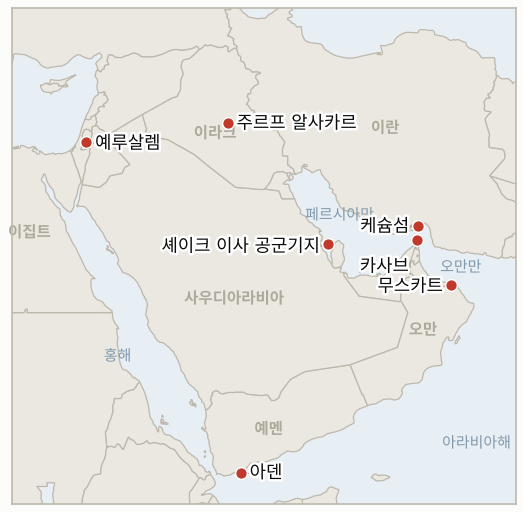

# 중동 일일 브리핑

**2026년 11월 18일**

- **보고 기간:** 약 24시간, 11월 17일 06:00 ~ 11월 18일 06:00 (한국시간)
- **종합 평가:** 월요일 시장이 가격에 반영한 자제 기조가 화요일에 시험대에 올랐다. 혁명수비대가 닷새 사이 세 번째로 바레인의 미군 레이더를 드론으로 공격하자 미 전투기가 케슘섬의 혁명수비대 미사일 기지를 타격했고, 미 당국자는 이를 자위 조치라고 불렀다(§1.1). 해상에서는 이틀 사이 두 번째로 선명이 확인된 선박의 피격이 확인됐고 선원 1명이 실종됐으며, 이란은 자국과 조율하지 않는 선박에 해협이 폐쇄됐다고 선언했다(§1.2). 외교는 CNN의 이란 더티밤 계획 보도가 드리운 그늘 속에서 무스카트와 도하에서 병행됐다(§1.3). 후티는 사우디의 우회 송유관 타격을 주장했고(§1.4), 이스라엘 야권은 크네세트 의장직 확보에 나섰다(§1.5). 유가는 1% 미만 올라 93달러 부근에 머물렀다. 한국에 더 큰 움직임은 이번에도 주식시장에서 나왔다. 코스피가 2월 이후 처음으로 5,000 아래에서 마감했다. 종합하면 양측은 중재국을 통해 대화하면서 제한적 교전을 주고받고 있고, 원유 시장은 여전히 이 교전을 통제된 것으로 본다.

**정정 및 업데이트:**

- 11월 17일 브리핑은 종가를 찾지 못해 월요일 유가를 장중 시세로 기록했다. 화요일 보도로 그 수준이 종가였음이 확인됐다. 브렌트 92.44달러(3.55% 하락), WTI 85.72달러(3.21% 하락)다. 데이터 파일에는 이제 종가로 기록했다.
- 11월 17일 브리핑은 후티 병력이 아덴에서 약 80~100km 떨어져 있다고 전했다(Reuters, Al Jazeera). AFP의 군·정부 소식통은 약 60km 거리인 라지주 알카라즈 캠프에 있다고 전한다. 추정치가 서로 엇갈리며, 더 가까운 수치는 독립적으로 검증되지 않았다.

---

## 1. 무슨 일이 있었나

<figure style="float:right; width:46%; margin:2pt 0 8pt 14pt;">

<figcaption style="font-size:8pt; color:#666; text-align:center; margin-top:3pt; font-style:italic;">주요 논의 지점</figcaption>
</figure>

### 1.1 미 전투기, 세 번째 바레인 공격 뒤 케슘섬의 혁명수비대 미사일 기지 타격

혁명수비대는 화요일 새벽 미국 드론의 이란 영공 침범을 이유로 바레인 셰이크 이사 공군기지의 미군 레이더를 드론으로 겨냥했다고 밝혔다. 바레인은 대피 경보를 발령하고 날아온 탄을 파괴했다고 발표했으며, 미 중부사령부(CENTCOM)는 명중 주장을 "거짓"이라고 일축하고 드론이 요격돼 피해나 부상이 없다고 밝혔다([CBS News live](https://www.cbsnews.com/live-updates/iran-war-us-nuclear-oil-strait-of-hormuz/); [ABC News live](https://abcnews.com/International/live-updates/iran-live-updates-tanker-attacked-strait-hormuz-ukmto/?id=138171071)). 몇 시간 뒤 미군 당국자는 전투기가 "미국 인원과 자산을 겨냥한" 혁명수비대의 "공격 행위"에 맞서 "자위 차원에서" 케슘섬의 혁명수비대 미사일 발사 기지에 정밀유도탄을 사용했다고 말했다([Arab News/AFP](https://arabnews.com/middle-east/us-attacks-irans-qeshm-island-in-strait-of-hormuz-official-3012499)). IRNA는 5~6차례 폭발음을 보도했고, 아흐마드 나피시 호르모즈간 부지사는 주거·상업·기반시설에 피해가 없다고 말했다. 이 당국자는 익명으로 발언했으며, 백악관이나 국방부의 공식 실명 발표는 확인되지 않았다. **신뢰도: 타격 사실은 높음; 표적과 효과는 중간.**

### 1.2 LPG 운반선 TARA GAS 두 번째 피격, 선원 1명 실종… 이란은 해협 폐쇄 선언

UKMTO는 월요일 19시(UTC)께 오만 카사브 북쪽 7해리 해상에서 처음 피격된 유조선이 화요일 다시 피격돼 새로 화재가 났고 승조원의 소재가 확인되지 않는다고 밝혔다([Anadolu](https://aa.com.tr/en/middle-east/-oil-tanker-struck-twice-in-strait-of-hormuz-catches-fire-uk-maritime-agency/4127562)). gCaptain은 이 선박을 파나마 선적 LPG 운반선 TARA GAS로 확인했다. 인도 외무부는 인도인 선원 24명 가운데 21명이 카사브로 대피했고 2명은 입원했으며 1명은 실종 상태라고 밝혔고, 인도 해운장관은 이를 미사일 공격이라고 불렀다([gCaptain](https://gcaptain.com/second-strike-on-lpg-tanker-in-strait-of-hormuz-leaves-one-missing-two-injured/)). 이 선박은 월요일 앞서 피격된 ON PHOENIX와는 다른 선박이다. 이란군은 화요일 유조선 3척이 추가로 기뢰에 접촉했다고 주장했고, 이란 해군은 이란군과 조율하지 않는 선박에 해협이 "폐쇄됐다"고 선언했다. 미 중부사령부는 10월 말 남측 항로의 기뢰가 제거됐다고 밝힌 바 있다. 일일 통항량은 발표되지 않았다. **신뢰도: 두 번째 피격과 선원 실종은 높음; 이란의 기뢰 주장은 낮음; 공격 주체는 독립적으로 확인되지 않음.**

### 1.3 더티밤 보도 속에 무스카트와 도하 회담 진행

아라그치 외무장관이 무스카트에서 바드르 알부사이디 오만 외무장관과 회담했다. 오만 외무부는 두 장관이 해상 통로를 열어 두는 방안과 추가 확전을 막기 위한 대화 재개를 논의했다고 밝혔으며, 구체적인 호르무즈 통항 방안은 발표되지 않았다([The National](https://www.thenationalnews.com/news/gulf/2026/11/17/iran-and-oman-discuss-maritime-security-amid-rising-attacks-in-strait-of-hormuz/); [Arab News](https://www.arabnews.com/middle-east/iran-and-oman-discuss-shipping-amid-hormuz-blockade-3012408)). 마제드 알안사리 카타르 대변인은 카타르와 이란 당국자들이 화요일 만나 제안 간 격차를 좁히는 문제를 논의했다고 밝히고, 확전이 합의에 "극히 중대한 위험"이 된다고 경고했다. 이와 별도로 CNN은 미 당국자 7명을 인용해, 이란이 워싱턴에서 미 고위 당국자를 더티밤이나 화학무기로 겨냥하는 선택지를 마련하고 있음을 정보 당국이 파악했으나 임박한 공격의 징후는 없다고 보도했다([CNN](https://www.cnn.com/2026/11/16/politics/us-intelligence-iran-dirty-bomb)). 트럼프는 이란이 시도한다면 "어떤 나라도 치른 적 없는 대가를 치를 것"이라고 말했고, 백악관은 "본토에 대한 신빙성 있는 위협은 없다"고 밝혔으며, 아라그치는 이 보도를 "쓰레기"라고 불렀다([CNBC](https://www.cnbc.com/2026/11/17/trump-iran-dirty-bomb-washington.html)). **신뢰도: 회담과 발언은 높음; 보도된 계획의 실체는 낮음.**

### 1.4 후티, 사우디 송유관 타격 주장… 사우디는 사령관 교체, 카타이브 헤즈볼라는 바그다드에 불복

후티는 호르무즈의 주된 우회로인 사우디 동서 송유관의 8번과 9번 펌프장을 드론으로 타격했다고 주장했다. 사우디는 공격이 나흘째 이어진 가운데 리야드 인근에서 드론 1대를 격추했다는 사실만 확인했다([CBS News live](https://www.cbsnews.com/live-updates/iran-war-us-nuclear-oil-strait-of-hormuz/)). 살만 국왕은 월요일 연합군 사령관을 교체하고 파야드 알루와일리 총참모장에게 합동군 지휘를 맡겼다. 후티 고위 인사 후세인 알에지는 아덴 쪽으로 더 진격할 의도가 없다고 말했다([Middle East Monitor](https://www.middleeastmonitor.com/20261117-saudi-king-replaces-coalition-commander-as-houthis-advance-toward-yemens-aden/)). 이라크에서는 카타이브 헤즈볼라 지휘관 아부 탈레브 알사이디가 AFP에 "우리 시신을 넘고서도" 주르프 알사카르를 떠나지 않겠다고 말했다([Al Arabiya](https://english.alarabiya.net/News/middle-east/2026/11/17/iraqs-kataib-hezbollah-refuses-to-withdraw-from-its-stronghold-near-baghdad-commander)). Alhurra는 조정 프레임워크 소식통을 인용해 알자이디 총리와 가아니 쿠드스군 사령관이 "조만간" 철수하는 데 합의했다고 보도했다([Alhurra](https://alhurra.com/en/55345)). 이라크는 또 튀르키예행 송유관 가동을 하루 12만 배럴 규모로 재개했다. **신뢰도: 발언은 높음; 송유관 타격과 이라크 합의 보도는 낮음.**

### 1.5 크네세트, 의장 교체 위해 소집… 보고 기간 내 결과 미확인

크네세트는 화요일 저녁 리쿠드 소속 아미르 오하나 의장을 가디 아이젠코트의 야샤르 소속 마탄 카하나로 교체하는 표결을 위해 소집됐다. 조인트 리스트와 라암이 지지를 확인해 카하나는 120석 가운데 67명의 지지 표명을 확보했고, 리쿠드는 샤스와 토라 유대교 연합(UTJ)의 지지를 받는 오피르 카츠를 후보로 냈다([Times of Israel](https://www.timesofisrael.com/liveblog_entry/knesset-convenes-to-vote-on-new-speaker-with-yashars-kahana-expected-to-win/); [Jerusalem Post](https://www.jpost.com/israel-news/politics-and-diplomacy/article-915171)). 카하나는 아랍계 의원을 부의장직에서 배제하라는 요구를 거부했다. 이 보고 기간이 끝날 때까지 최종 표결 결과는 확인되지 않았으며, 긴 연설로 표결이 밤늦게까지 밀릴 수 있다는 보도가 있었다. 선거일 체포 사건과 관련해 중앙선거관리위원회는 신베트가 선거 결과에 영향을 줄 규모의 매표 행위에 대해 지금까지 "증거를 찾지 못했다"고 밝혔고, 경찰청 차장은 제보가 총리실에서 왔다고 말했다([Times of Israel](https://www.timesofisrael.com/liveblog-november-17-2026/)). **신뢰도: 지지 표명 과반은 높음; 표결 결과는 미확인.**

---

## 2. 심층 분석: 유인과 동기

### 2.1 미국은 자제 신호를 보낸 뒤 왜 지금 타격했나?

로이터는 지난주 트럼프가 도발이 없으면 이란 공격을 보류할 것이라고 보도했다. 닷새 동안 미군 시설을 겨냥한 세 차례의 공격 시도가 그 도발이 됐고, 대응 없이 넘어간 공격 하나하나가 혁명수비대에게 다음 공격의 비용을 낮춰 주었다. 대응은 그에 맞는 크기였다. 해협 안 섬의 미사일 기지 한 곳이었고, 대통령의 발표가 아니라 익명의 군 당국자의 설명으로 알려졌다. 이렇게 하면 새로운 법적·정치적 근거가 필요 없는 "자위" 범주 안에 머물고, 도하와 무스카트 채널이 이어질 여지도 남는다. 이는 미군에 대한 공격에 대한 응수이지, 이스라엘 지도부가 촉구해 온 작전의 재개가 아니다.

### 2.2 이란은 왜 외무장관이 무스카트에서 대화하는 동안 바레인을 계속 공격하나?

두 갈래는 서로 다른 기관이 운영하지만 목표는 같다. 혁명수비대는 걸프 국가의 미군 기지가 주둔국에 부담이라는 점, 그리고 수개월의 폭격 뒤에도 이란이 여전히 비용을 부과할 수 있다는 점을 보여 준다. 외무부는 출구를 제시한다. 제재 완화와 봉쇄 해제를 대가로 이틀 안에 호르무즈를 재개방한다는 것이다. 주둔국에 대한 압박은 이 제안의 값을 높인다. 지금까지 공격은 모두 요격됐고 보고된 피해가 없다는 점에서, 살상이 아니라 신호를 보내도록 수위가 조절된 것으로 보인다. 화요일의 미국 타격은 그 수위 조절이 문턱을 잘못 읽었을 수 있다는 첫 증거다.

### 2.3 더티밤 보도는 왜 지금 나왔고, 누가 이득을 보나?

이 보도는 비상 계획 수준의 준비를 묘사하며, 당국자들은 이란이 이를 실행할 능력이나 의지가 있는지 여전히 논쟁 중이라고 CNN에 말했다. 보도는 현 이란 지도부가 남아 있는 한 전쟁을 끝낼 수 없다고 주장하는 워싱턴과 예루살렘의 세력에 힘을 실어 주고, 트럼프가 확전을 택할 경우 쓸 수 있는 명분을 제공한다. 이란으로서는 강하게 부인하는 데 비용이 들지 않지만, 이 보도는 중재국의 공간을 좁힌다. 전례 없는 대가를 경고한 대통령이 같은 주에 이란의 7개 조건을 받아들이는 모습을 보이기는 어렵다.

### 2.4 후티는 왜 사우디 송유관을 타격하면서 아덴 진격은 배제하나?

아덴은 인구 약 100만의 도시로, 독자적 대의를 가진 남부 세력이 지키고 있다. 이곳을 점령하려면 비용이 크고, 지금은 분열된 적들을 뭉치게 할 수 있다. 동서 송유관은 닿기가 더 쉽고 더 중요하다. 사우디 원유가 호르무즈를 피하는 경로이기 때문이다. 후티는 우회로를 위협하고 바브엘만데브 연안을 쥠으로써, 포위전 없이도 자신들의 영토에 대한 사우디의 봉쇄에 맞설 지렛대를 얻는다. 알에지의 발언은 남부 주민들에게 개입하지 말라는 메시지로 읽는 것이 타당하며, 사우디의 사령관 교체는 지금의 접근이 실패했음을 인정한 것이다.

---

## 3. 한국에 대한 정책적 함의

**익스포저 현황:** 한국은 원유의 약 70.7%, LNG의 20.4%를 중동에서 들여온다(`instructions/korea-exposure.md`, 갱신 불필요). 화요일 코스피는 2.59% 내린 4,968.48로 4거래일 연속 하락했고, 2월 2일 이후 처음으로 5,000 아래에서 마감했다. 외국인이 약 1조 5,600억 원을 순매도했고 기관과 개인은 순매수했다([뉴스인사이드](https://www.newsinside.kr/news/articleView.html?idxno=5050396); [MBC](https://imnews.imbc.com/news/2026/econo/article/6866303_36932.html)). 필라델피아 반도체 지수(SOX)가 5.28% 급락한 뒤 삼성전자는 약 3.3%, SK하이닉스는 약 2% 내렸다. 원·달러 환율은 장중 1,342.9원까지 오른 뒤 2.5원 오른 1,338.2원에 마감했다. 브렌트는 70센트 오른 93.14달러, WTI는 29센트 오른 86.01달러에 마감했다([Reuters via Minute Mirror](https://minutemirror.com.pk/oil-edges-higher-on-middle-east-tensions-expected-drop-in-us-crude-stocks-662109/)). 미국 전략비축유는 2억 7,640만 배럴로 1982년 이후 최저로 줄었다.

**사안별 함의:**

- **케슘섬 타격(§1.1):** 해협 안에서의 미국 타격은 로이터가 트럼프의 자제를 보도한 이후 한국 당국이 지켜봐 온 확전 단계다. 1% 미만이라는 시장 반응은 거래자들이 이를 통제된 것으로 본다는 뜻이다. 혁명수비대가 걸프 주둔국을 다시 공격하면 그 판단이 시험대에 오른다(IND-20261118-1, IND-20261114-1).
- **유조선 공격(§1.2):** 이틀 사이 선명이 확인된 선박 2척이 피격되고 그중 1척은 두 차례 피격돼 선원이 실종된 것은, 유가 자체가 잠잠하더라도 보험사와 선원들에게는 실질적인 변화다. TARA GAS는 한국 석유화학 업계가 걸프에서 대량으로 들여오는 화물인 LPG를 실었다. 이란의 "폐쇄" 선언은 한국 선주들에게 이란과의 조율과 미국 호위 항로 사이에서 선택하라는 압박을 키운다(IND-20261118-2, IND-20261112-2, IND-20261114-2).
- **외교(§1.3):** 무스카트 회담은 통로 개방에 관한 문구를 내놨지만 통항 방안은 내놓지 못했다. 더티밤 보도로 미국의 단기 양보 가능성은 더 낮아졌다(IND-20261111-1, IND-20261114-3).
- **사우디 우회로와 예멘(§1.4):** 동서 송유관은 한국이 얀부를 통해 의존하는 호르무즈 비경유 사우디 물량을 나른다. 펌프장 피격이 검증된다면 케슘섬 타격보다 한국의 수급에 더 큰 의미를 갖는다. 다만 이 주장은 검증되지 않았다. 국회에 계류 중인 청해부대 파견 연장안은 조직적인 반대에 직면해 있다(IND-20261116-2, IND-20261117-1, IND-20261112-1).
- **시장:** 5,000 붕괴는 유가가 아니라 외국인의 반도체주 매도가 이끌었다. 원화의 제한적인 움직임은 이 매도가 아직 한국 자산 전반의 이탈로 번지지 않았음을 시사한다(IND-20261118-3, IND-20261113-3, IND-20261023-1).

**오늘 종결:**

- **IND-20261116-1: 확증.** 미군 당국자는 닷새 사이 세 번째 바레인 공격 몇 시간 뒤, 미 전투기가 "미국 인원과 자산을 겨냥한" 혁명수비대의 "공격 행위"에 맞서 자위 차원에서 케슘섬의 혁명수비대 미사일 기지를 타격했다고 말했다. 이 당국자는 익명이었고 바레인을 직접 거명하지 않았으나, 설명의 틀은 지표와 부합한다.
- **IND-20261116-3: 확증.** 오만 외무부가 아라그치와 알부사이디의 화요일 무스카트 회담을 확인했다.
- **IND-20261117-3: 확증.** 코스피가 지표 개설 하루 만에 5,000 아래인 4,968.48에 마감했다.
- **IND-20261111-2: 반증.** 코스피는 11월 17일까지 어느 거래일에도 5,383.80 위에서 마감하지 못했다.

**검증 가능한 지표:**

- **IND-20261118-1** (진행, 신규): 2026년 11월 25일께까지 혁명수비대가 걸프 주둔국의 미군 시설을 추가로 공격하면(혁명수비대의 주장 또는 미 중부사령부나 주둔국의 확인) 케슘섬 타격이 억지에 실패한 것으로 확증; 없으면 반증.
- **IND-20261118-2** (진행, 신규): 2026년 11월 24일께까지 UKMTO가 호르무즈 해협 또는 인근에서 세 번째 별개 상선의 피격을 보고하면 지속적 공격으로 확증; 없으면 반증. 이란의 기뢰 주장만으로는 인정하지 않음.
- **IND-20261118-3** (진행, 신규): 2026년 11월 25일께까지 어느 거래일이든 코스피가 5,100.50 위에서 마감하면 반등으로 확증; 없으면 반증.
- **IND-20261111-3** (진행, 11월 18일께 기한): 카하나 지지 표명 67명; 보고 기간 내 최종 표결 결과 미확인.
- **IND-20261112-2, IND-20261114-2** (진행): TARA GAS는 선명과 피해가 확인됐으나, 인도는 기뢰가 아닌 미사일 공격이라 하고 이 선박은 LNG 운반선이 아닌 LPG 운반선임. 두 조건 모두 미충족.
- **IND-20261114-1** (진행): 케슘섬은 해협 안에 있어 이번 타격은 "호르무즈 연안 너머"가 아님; 이스라엘의 타격 없음.
- **IND-20261113-1, IND-20261115-1** (진행): 브렌트 종가 92.44달러와 93.14달러; 100달러 초과도 90달러 미만도 아님.
- **IND-20261113-3** (진행): 원·달러 1,338.2원 마감, 1,350원 미만.
- **IND-20261117-1** (진행): AFP 소식통은 후티가 아덴에서 약 60km 거리에 있다고 전함; 후티 인사는 추가 진격을 배제.
- **IND-20261117-2** (진행, 11월 24일께 기한): 주르프 알사카르 진입 없음; 카타이브 헤즈볼라는 철수 거부; 철수 합의 보도는 미확인.
- **IND-20261111-1, IND-20261112-1, IND-20261113-2, IND-20261114-3, IND-20261115-2, IND-20261116-2, IND-20261023-1, IND-20260714-4** (진행): `tracking/indicators.md` 참조.

---

## 4. 관찰 목록

- **케슘섬 타격에 대한 이란의 대응, 그리고 이에 관한 미국의 공식 실명 발표 여부(IND-20261118-1).**
- **크네세트 의장 표결 결과와 새 다수파가 처음 상정할 법안(IND-20261111-3).**
- **실종된 TARA GAS 선원 수색과 두 차례 피격의 공격 주체 규명(IND-20261118-2).**
- **동서 송유관 펌프장 피해에 대한 사우디의 확인 또는 부인(IND-20261116-2).**
- **주르프 알사카르의 금요일 시한과 알자이디·가아니 합의 보도(IND-20261117-2).**
- **수요일 서울 장과 엔비디아 실적; 외국인 매도가 원화로 번지는지 여부(IND-20261118-3, IND-20261113-3).**
- **수요일 EIA 재고 통계와 브렌트의 90~95달러 범위 이탈 여부(IND-20261115-1, IND-20261113-1).**
- **더티밤 보도에 대한 미 의회나 정보기관의 후속 조치.**

---

## 5. 출처 신뢰도 요약

| 주장 | 출처 | 신뢰도 |
| --- | --- | --- |
| 혁명수비대 드론이 셰이크 이사 공군기지의 미군 레이더를 겨냥; 요격, 피해 없음 | 혁명수비대 via Fars; 바레인 방위군; 미 중부사령부 via CBS, ABC | 높음 |
| 미 전투기가 "자위 차원에서" 케슘섬의 혁명수비대 미사일 발사 기지를 타격 | 익명의 미군 당국자 via AFP, CBS, ABC | 높음(타격); 중간(표적) |
| 5~6차례 폭발; 민간·기반시설 피해 없음 | IRNA; 호르모즈간 부지사 via Arab News | 중간 |
| 카사브 앞바다 유조선 두 번째 피격; 승조원 소재 미확인 | UKMTO via Anadolu, ABC | 높음 |
| 해당 선박은 파나마 선적 LPG 운반선 TARA GAS; 인도인 선원 1명 실종, 2명 입원 | gCaptain; 인도 외무부, 해운장관 | 높음 |
| 화요일 유조선 3척 추가 기뢰 접촉; 조율 없이는 해협 "폐쇄" | 이란군·해군 via 국영 매체 | 높음(주장); 낮음(사실) |
| 아라그치와 알부사이디, 무스카트 회담; 해상 통로 개방 논의 | 오만 외무부 via The National, Arab News, Tehran Times | 높음 |
| 카타르와 이란 당국자 화요일 회동 | 카타르 외무부 대변인 via CBS | 높음 |
| 미 정보 당국, 이란의 워싱턴 더티밤·화학무기 공격 계획 준비 파악 | CNN, 익명의 미 당국자 7명 | 낮음~중간 |
| 트럼프: 이란은 "대가를 치를 것"; 백악관: 신빙성 있는 위협 없음; 이란: "쓰레기" | CNBC, CBS, Al Arabiya | 높음 |
| 후티 드론이 동서 송유관 8번·9번 펌프장 타격 | 후티 주장 via CBS | 낮음 |
| 사우디 주도 연합군, 리야드 인근에서 드론 1대 격추 | 연합군 대변인 via CBS | 높음 |
| 살만 국왕, 연합군 사령관 교체 | 사우디 국영 통신 via Middle East Monitor | 높음 |
| 후티, 아덴에서 약 60km; 알에지는 추가 진격 계획 없다고 발언 | AFP 소식통; 후티 인사 | 중간 |
| 카타이브 헤즈볼라, 주르프 알사카르 철수 거부 | 지휘관 via AFP, Al Arabiya | 높음 |
| 알자이디와 가아니, "조만간" 철수에 합의 | 조정 프레임워크 소식통 via Alhurra | 낮음 |
| 이라크, 튀르키예행 송유관을 하루 12만 배럴로 재가동 | 이라크 석유장관 via CBS | 높음 |
| 카하나, 의장 표결에서 67명 지지 표명 확보; 리쿠드는 카츠 출마 | Times of Israel, Jerusalem Post, Haaretz | 높음 |
| 의장 표결 최종 결과 | 보고 기간 내 미확인 | 미보고 |
| 신베트, 결과를 좌우할 규모의 매표 "증거를 찾지 못했다" | 중앙선거관리위원회 via Times of Israel | 높음 |
| 코스피 4,968.48, 2.59% 하락; 외국인 약 1조 5,600억 원 순매도 | 뉴스인사이드, MBC | 높음 |
| 원·달러 15시 30분 1,338.2원 | 뉴스인사이드 | 높음 |
| 브렌트 93.14달러, WTI 86.01달러(화요일 종가) | Reuters via Minute Mirror | 중간~높음 |
| 호르무즈 일일 통항량 | 미보고 | 미보고 |
