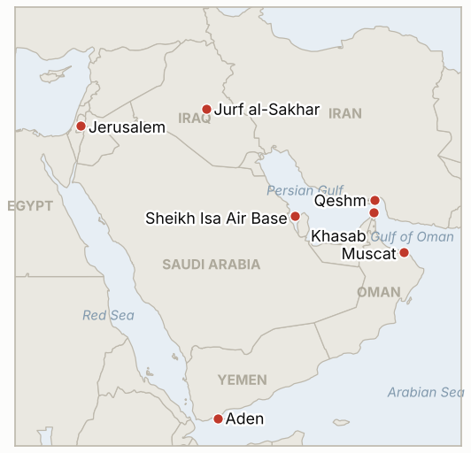

# Middle East Daily Briefing

**November 18, 2026**

- **Reporting window:** ~24 hours, November 17, 06:00 to November 18, 06:00 KST
- **Overall assessment:** The restraint that markets priced on Monday was tested on Tuesday. After the IRGC's third drone attack on a US radar in Bahrain in five days, US jets struck an IRGC missile site on Qeshm Island, an action a US official called self defense (§1.1). At sea, a second named vessel in two days was confirmed hit, with one seafarer missing, while Iran declared the strait closed to ships that do not coordinate with it (§1.2). Diplomacy ran in parallel in Muscat and Doha, under the shadow of a CNN report of an Iranian dirty bomb plan (§1.3). The Houthis claimed strikes on Saudi Arabia's bypass pipeline (§1.4), and Israel's opposition moved to take the Knesset speakership (§1.5). Oil rose less than 1% and stayed near $93. For Korea the sharper move was again in equities: the KOSPI closed below 5,000 for the first time since February. Net: both sides are exchanging limited fire while talking through mediators, and the oil market still treats the exchange as contained.

**Corrections and updates:**

- The November 17 brief logged Monday's oil prices as intraday quotes because no settlement was found. Tuesday reporting confirms those levels were the settlements: Brent $92.44 (down 3.55%) and WTI $85.72 (down 3.21%). The data files now record them as settles.
- The November 17 brief placed Houthi forces about 80 to 100 km from Aden (Reuters, Al Jazeera). AFP's military and government sources put them about 60 km away, at the Al-Kharaz camp in Lahj. The estimates conflict and the nearer figure is not independently verified.

---

## 1. What Happened

<figure style="float:right; width:46%; margin:2pt 0 8pt 14pt;">

<figcaption style="font-size:8pt; color:#666; text-align:center; margin-top:3pt; font-style:italic;">Major places of discussion</figcaption>
</figure>

### 1.1 US jets strike an IRGC missile site on Qeshm after a third Bahrain attack

The IRGC said its drones targeted a US radar at Sheikh Isa Air Base in Bahrain early Tuesday, citing US drone violations of Iranian airspace; Bahrain sounded shelter alerts and said it destroyed the incoming munitions, and CENTCOM called the claimed hit "FALSE," saying the drones were intercepted with no damage or injuries ([CBS News live](https://www.cbsnews.com/live-updates/iran-war-us-nuclear-oil-strait-of-hormuz/); [ABC News live](https://abcnews.com/International/live-updates/iran-live-updates-tanker-attacked-strait-hormuz-ukmto/?id=138171071)). Hours later a US military official said fighter jets used precision munitions on an IRGC missile launch site on Qeshm Island "in self-defense" against IRGC "aggression targeting US personnel and assets" ([Arab News/AFP](https://arabnews.com/middle-east/us-attacks-irans-qeshm-island-in-strait-of-hormuz-official-3012499)). IRNA reported five to six explosions; Hormozgan's deputy governor Ahmad Nafisi said there was no damage to residential, commercial or infrastructure sites. The official spoke anonymously, and no on the record White House or Pentagon statement was found. **Confidence: High that the strike occurred; Medium on its target and effect.**

### 1.2 LPG tanker TARA GAS hit a second time; one seafarer missing; Iran declares the strait closed

UKMTO said a tanker first struck at about 19:00 UTC on Monday seven nautical miles north of Khasab, Oman, was hit again on Tuesday, starting a new fire, with the crew unaccounted for ([Anadolu](https://aa.com.tr/en/middle-east/-oil-tanker-struck-twice-in-strait-of-hormuz-catches-fire-uk-maritime-agency/4127562)). gCaptain identified it as the Panama flagged LPG tanker TARA GAS; India's foreign ministry said 21 of 24 Indian crew were evacuated to Khasab, two were hospitalized and one is missing, and India's shipping minister called it a missile attack ([gCaptain](https://gcaptain.com/second-strike-on-lpg-tanker-in-strait-of-hormuz-leaves-one-missing-two-injured/)). It is a different vessel from the ON PHOENIX, hit earlier on Monday. Iran's armed forces said three more tankers struck mines on Tuesday, and its navy declared the strait "closed" to ships that do not coordinate with Iranian forces; CENTCOM said in late October that the southern lanes were cleared of mines. No daily transit count was published. **Confidence: High on the second strike and the missing seafarer; Low on Iran's mine claims; attribution is not independently established.**

### 1.3 Muscat and Doha talks proceed under a dirty bomb report

Foreign Minister Araghchi met Oman's Badr Al Busaidi in Muscat; Oman's foreign ministry said they discussed keeping maritime corridors open and reviving dialogue to prevent further escalation, and no concrete Hormuz arrangement was announced ([The National](https://www.thenationalnews.com/news/gulf/2026/11/17/iran-and-oman-discuss-maritime-security-amid-rising-attacks-in-strait-of-hormuz/); [Arab News](https://www.arabnews.com/middle-east/iran-and-oman-discuss-shipping-amid-hormuz-blockade-3012408)). Qatar's spokesman Majed Al Ansari said Qatari and Iranian officials met on Tuesday to narrow gaps between proposals and warned that escalation posed an "extremely grave danger" to a deal. Separately, CNN reported, citing seven US officials, that intelligence indicates Iran is developing options to target senior US officials in Washington with a dirty bomb or chemical weapon, without signs of an imminent attack ([CNN](https://www.cnn.com/2026/11/16/politics/us-intelligence-iran-dirty-bomb)). Trump said Iran would "pay a price the likes of which no country has ever paid before" if it tried; the White House said there are "no credible threats to the homeland"; Araghchi called the report "RUBBISH" ([CNBC](https://www.cnbc.com/2026/11/17/trump-iran-dirty-bomb-washington.html)). **Confidence: High on the meetings and statements; Low on the underlying plot.**

### 1.4 Houthis claim Saudi pipeline strikes; Riyadh changes commander; Kataib Hezbollah defies Baghdad

The Houthis claimed drone strikes on Pumping Stations 8 and 9 of Saudi Arabia's East-West pipeline, the main Hormuz bypass; Saudi Arabia confirmed only that it downed a drone near Riyadh, on a fourth straight day of attacks ([CBS News live](https://www.cbsnews.com/live-updates/iran-war-us-nuclear-oil-strait-of-hormuz/)). King Salman replaced the coalition's commander on Monday, putting General Staff chief Fayyad Al-Ruwaili in charge of the Joint Forces; senior Houthi official Hussein al-Ezzi said the movement does not intend to advance further toward Aden ([Middle East Monitor](https://www.middleeastmonitor.com/20261117-saudi-king-replaces-coalition-commander-as-houthis-advance-toward-yemens-aden/)). In Iraq, Kataib Hezbollah commander Abu Taleb al-Saidi told AFP the group will not leave Jurf al-Sakhar, "not even over our dead bodies" ([Al Arabiya](https://english.alarabiya.net/News/middle-east/2026/11/17/iraqs-kataib-hezbollah-refuses-to-withdraw-from-its-stronghold-near-baghdad-commander)); Alhurra reported, from Coordination Framework sources, a deal between Prime Minister al-Zaidi and Quds Force chief Qaani for a withdrawal "soon" ([Alhurra](https://alhurra.com/en/55345)). Iraq also restarted its pipeline to Turkey at 120,000 barrels a day. **Confidence: High on the statements; Low on the pipeline strikes and the reported Iraq deal.**

### 1.5 Knesset convenes to replace the speaker; result not confirmed in the window

The Knesset met on Tuesday evening to vote on replacing Likud speaker Amir Ohana with Matan Kahana of Gadi Eisenkot's Yashar party. The Joint List and Ra'am confirmed their support, giving Kahana 67 declared backers in the 120 seat chamber; Likud fielded Ofir Katz with Shas and United Torah Judaism behind him ([Times of Israel](https://www.timesofisrael.com/liveblog_entry/knesset-convenes-to-vote-on-new-speaker-with-yashars-kahana-expected-to-win/); [Jerusalem Post](https://www.jpost.com/israel-news/politics-and-diplomacy/article-915171)). Kahana rejected a demand to bar Arab lawmakers from deputy posts. No final tally was found by the end of this window, and reports warned that long speeches could push the vote into the night. On the election arrests affair, the Central Elections Committee said the Shin Bet has found "no evidence" so far of vote buying on a scale that could affect results, and a deputy police commissioner said the tip came from the Prime Minister's Office ([Times of Israel](https://www.timesofisrael.com/liveblog-november-17-2026/)). **Confidence: High on the declared majority; the outcome is unconfirmed.**

---

## 2. Deep Dive: Incentives and Motives

### 2.1 Why did Washington strike now after signalling restraint?

Reuters reported last week that Trump would hold off on Iran absent provocation. Three attempted strikes on US installations in five days supplied the provocation, and each unanswered attack lowered the cost to the IRGC of the next. The response was sized to match: one missile site, on an island in the strait, described by an unnamed military official rather than announced by the president. That keeps it inside the "self defense" category, which needs no new legal or political case, and leaves room for the Doha and Muscat channels to continue. It is a reply to attacks on US forces, not a resumption of the campaign Israel's leadership has been urging.

### 2.2 Why does Iran keep attacking Bahrain while its foreign minister talks in Muscat?

The two tracks are run by different institutions with a shared aim. The IRGC shows that US bases in Gulf states are a liability for their hosts, and that Iran can still impose costs after months of bombing. The foreign ministry offers the way out: a two day reopening of Hormuz in exchange for sanctions relief and an end to the blockade. Pressure on hosts raises the value of the offer. The attacks have so far been intercepted and have caused no reported damage, which suggests they are calibrated to signal rather than to kill; Tuesday's US strike is the first evidence that the calibration may have misjudged the threshold.

### 2.3 Why did the dirty bomb report appear now, and who gains from it?

The report describes contingency planning, and officials told CNN they still debate whether Iran can or will act on it. Its publication helps those in Washington and Jerusalem who argue the war cannot end with the current Iranian leadership in place, and it gives Trump a ready justification should he choose to escalate. For Tehran, a forceful denial costs nothing, but the story narrows the space for the mediators: a president who has just warned of an unprecedented price cannot easily be seen accepting Iran's seven conditions the same week.

### 2.4 Why would the Houthis rule out Aden while striking Saudi pipelines?

Aden is a city of roughly a million people held by southern forces with their own cause; taking it would be costly and could unite opponents who are now divided. The East-West pipeline is cheaper to reach and matters more: it is the route by which Saudi crude avoids Hormuz. By threatening the bypass and holding the Bab el-Mandeb shore, the Houthis gain leverage over Riyadh's blockade of their territory without a siege. Al-Ezzi's statement is best read as a message to southerners to stay out, and a change of Saudi commander is an admission that the current approach has failed.

---

## 3. Policy Implications for South Korea

**Exposure snapshot:** South Korea draws about 70.7% of its crude and 20.4% of its LNG from the Middle East (`instructions/korea-exposure.md`, no update needed). On Tuesday the KOSPI fell 2.59% to 4,968.48, its fourth straight decline and its first close below 5,000 since February 2; foreigners net sold about 1.56 trillion won while institutions and individuals bought ([News Inside](https://www.newsinside.kr/news/articleView.html?idxno=5050396); [MBC](https://imnews.imbc.com/news/2026/econo/article/6866303_36932.html)). Samsung Electronics fell about 3.3% and SK hynix about 2%, after a 5.28% drop in the Philadelphia semiconductor index. The won closed at 1,338.2 per dollar, 2.5 won weaker, after touching 1,342.9. Brent settled at $93.14, up 70 cents, and WTI at $86.01, up 29 cents ([Reuters via Minute Mirror](https://minutemirror.com.pk/oil-edges-higher-on-middle-east-tensions-expected-drop-in-us-crude-stocks-662109/)); the US strategic reserve fell to 276.4 million barrels, its lowest since 1982.

**Implications by development:**

- **Qeshm strike (§1.1):** A US strike inside the strait is the escalation step Korean planners have watched for since Reuters reported Trump's restraint. The market's response, under 1%, says traders see it as contained; a further IRGC attack on a Gulf host would test that (IND-20261118-1, IND-20261114-1).
- **Tanker attacks (§1.2):** Two named vessels struck in two days, one of them twice and with a seafarer missing, is a material change for insurers and crews even if flat prices are calm. TARA GAS carried LPG, a cargo Korea's petrochemical sector imports heavily from the Gulf; Iran's "closed" declaration raises pressure on Korean owners to choose between coordination with Tehran and US escorted lanes (IND-20261118-2, IND-20261112-2, IND-20261114-2).
- **Diplomacy (§1.3):** The Muscat meeting produced language on open corridors but no arrangement. The dirty bomb report makes a near term US concession less likely (IND-20261111-1, IND-20261114-3).
- **Saudi bypass and Yemen (§1.4):** The East-West pipeline carries the non Hormuz Saudi barrels Korea relies on through Yanbu. A verified hit on a pump station would matter more to Korean supply than the Qeshm strike; the claim is unverified. The Cheonghae Unit's extension, still before the National Assembly, faces organized opposition (IND-20261116-2, IND-20261117-1, IND-20261112-1).
- **Markets:** The fall below 5,000 is driven by foreign selling of chip stocks, not oil. The won's limited move suggests the selling has not yet become a broader flight from Korean assets (IND-20261118-3, IND-20261113-3, IND-20261023-1).

**Resolved today:**

- **IND-20261116-1: Confirmed.** A US military official said US jets struck an IRGC missile site on Qeshm Island in self defense against IRGC "aggression targeting US personnel and assets," hours after the third Bahrain attack in five days. The official was unnamed and did not cite Bahrain by name, but the framing matches the indicator.
- **IND-20261116-3: Confirmed.** Oman's foreign ministry confirmed that Araghchi and Al Busaidi met in Muscat on Tuesday.
- **IND-20261117-3: Confirmed.** The KOSPI closed at 4,968.48, below 5,000, one day after the indicator was opened.
- **IND-20261111-2: Falsified.** The KOSPI did not close above 5,383.80 on any session through November 17.

**Testable indicators:**

- **IND-20261118-1** (open, new): A further IRGC attack on a US installation in a Gulf host state, claimed by the IRGC or acknowledged by CENTCOM or the host, by ~2026-11-25 confirms the Qeshm strike did not deter; none falsifies.
- **IND-20261118-2** (open, new): A UKMTO report of a strike on a third distinct commercial vessel in or near the Strait of Hormuz by ~2026-11-24 confirms a sustained campaign; none falsifies. Iranian mine claims alone do not count.
- **IND-20261118-3** (open, new): A KOSPI close back above 5,100.50 on any session by ~2026-11-25 confirms a rebound; none falsifies.
- **IND-20261111-3** (open, due ~2026-11-18): Kahana has 67 declared backers; no final tally found in the window.
- **IND-20261112-2, IND-20261114-2** (open): TARA GAS is named and damaged, but India calls it a missile attack, not a mine, and it is an LPG tanker, not an LNG carrier. Neither condition met.
- **IND-20261114-1** (open): Qeshm lies in the strait, so the strike is not "beyond the Hormuz coast"; no Israeli strike.
- **IND-20261113-1, IND-20261115-1** (open): Brent settled $92.44 and $93.14; neither above $100 nor below $90.
- **IND-20261113-3** (open): won closed 1,338.2, below 1,350.
- **IND-20261117-1** (open): AFP sources put the Houthis about 60 km from Aden; a Houthi official rules out a further advance.
- **IND-20261117-2** (open, due ~2026-11-24): no entry into Jurf al-Sakhar; Kataib Hezbollah refuses to leave; a withdrawal deal is reported but unconfirmed.
- **IND-20261111-1, IND-20261112-1, IND-20261113-2, IND-20261114-3, IND-20261115-2, IND-20261116-2, IND-20261023-1, IND-20260714-4** (open): see `tracking/indicators.md`.

---

## 4. Watch List

- **Any Iranian response to the Qeshm strike, and any on the record US statement about it (IND-20261118-1).**
- **The Knesset speaker result and the first legislation the new majority brings (IND-20261111-3).**
- **The search for the missing TARA GAS seafarer, and any attribution of the two strikes (IND-20261118-2).**
- **Saudi confirmation or denial of damage to East-West pipeline pump stations (IND-20261116-2).**
- **Friday's reported deadline at Jurf al-Sakhar and the reported al-Zaidi and Qaani deal (IND-20261117-2).**
- **Wednesday's Seoul session and Nvidia earnings; whether foreign selling extends to the won (IND-20261118-3, IND-20261113-3).**
- **Wednesday's EIA inventory data and whether Brent leaves the $90 to $95 range (IND-20261115-1, IND-20261113-1).**
- **Any follow up to the dirty bomb report from Congress or the intelligence agencies.**

---

## 5. Source Quality Summary

| Claim | Sources | Confidence |
| --- | --- | --- |
| IRGC drones targeted a US radar at Sheikh Isa Air Base; intercepted, no damage | IRGC via Fars; Bahrain Defence Force; CENTCOM via CBS, ABC | High |
| US jets struck an IRGC missile launch site on Qeshm "in self-defense" | Unnamed US military official via AFP, CBS, ABC | High (strike); Medium (target) |
| Five to six explosions; no damage to civilian or infrastructure sites | IRNA; Hormozgan deputy governor via Arab News | Medium |
| Tanker off Khasab hit a second time; crew unaccounted for | UKMTO via Anadolu, ABC | High |
| Vessel is the Panama flagged LPG tanker TARA GAS; one Indian seafarer missing, two hospitalized | gCaptain; India's foreign ministry and shipping minister | High |
| Three more tankers struck mines Tuesday; strait "closed" without coordination | Iranian armed forces and navy via state media | High (claim); Low (event) |
| Araghchi and Al Busaidi met in Muscat; discussed open maritime corridors | Oman foreign ministry via The National, Arab News, Tehran Times | High |
| Qatari and Iranian officials met Tuesday | Qatar foreign ministry spokesman via CBS | High |
| US intelligence indicates Iranian planning for a dirty bomb or chemical attack in Washington | CNN, seven unnamed US officials | Low to Medium |
| Trump: Iran would "pay a price"; White House: no credible threats; Iran: "RUBBISH" | CNBC, CBS, Al Arabiya | High |
| Houthi drones hit East-West pipeline Pumping Stations 8 and 9 | Houthi claim via CBS | Low |
| Saudi coalition downed a drone near Riyadh | Coalition spokesman via CBS | High |
| King Salman replaced the coalition commander | Saudi Press Agency via Middle East Monitor | High |
| Houthis about 60 km from Aden; al-Ezzi says no further advance planned | AFP sources; Houthi official | Medium |
| Kataib Hezbollah will not leave Jurf al-Sakhar | Commander via AFP, Al Arabiya | High |
| Al-Zaidi and Qaani agreed a withdrawal "soon" | Coordination Framework sources via Alhurra | Low |
| Iraq restarted the pipeline to Turkey at 120,000 barrels a day | Iraqi oil minister via CBS | High |
| Kahana has 67 declared backers for speaker; Likud fields Katz | Times of Israel, Jerusalem Post, Haaretz | High |
| Final speaker vote tally | Not found in window | Not reported |
| Shin Bet has found "no evidence" so far of decisive vote buying | Central Elections Committee via Times of Israel | High |
| KOSPI 4,968.48, down 2.59%; foreigners net sold about 1.56 trillion won | News Inside, MBC | High |
| USD/KRW 1,338.2 at 3:30pm | News Inside | High |
| Brent $93.14, WTI $86.01 (Tuesday settlements) | Reuters via Minute Mirror | Medium to High |
| Hormuz daily transit count | Not reported | Not reported |
