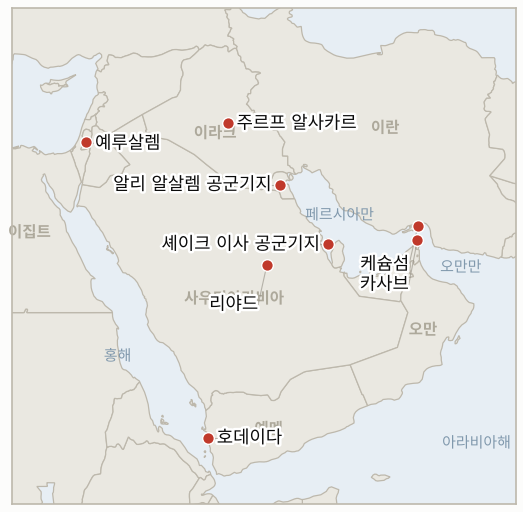

# 중동 일일 브리핑

**2026년 11월 19일**

- **보고 기간:** 약 24시간, 11월 18일 06:00 ~ 11월 19일 06:00 (한국시간)
- **종합 평가:** 이란은 화요일 미국의 케슘섬 타격에 몇 시간 만에 응수하면서 표적 범위를 넓혔다. 이란 정규군은 쿠웨이트의 미군 방공체계를 드론으로 타격했다고 주장했고, 이는 9월 이후 첫 쿠웨이트 공격이다. 바레인도 추가 요격을 발표했다(§1.1). 호르무즈 해협에서는 이틀 사이 세 번째 상선의 피격이 확인됐고 이번에도 선원 1명이 실종됐다(§1.2). 사우디와 후티의 전쟁은 양방향으로 격화됐으며, 로이터는 사우디가 이 전쟁이 2027년까지 이어질 것으로 본다고 보도했다(§1.3). 이스라엘에서는 야권이 크네세트 의장직을 차지했고(§1.4), 이라크와 카타이브 헤즈볼라의 대치는 시한을 이틀 앞두고도 풀리지 않았다(§1.5). 그런데도 유가는 내렸다. 미국 재고가 크게 늘면서 브렌트는 91.95달러로, WTI는 8월 이후 최저로 떨어졌다. 서울 시장은 회복해 코스피가 5,000선을 되찾았고 원화도 강세를 보였다. 종합하면, 교전은 더 많은 걸프 주둔국으로 번지고 있고, 기지를 겨냥한 공격은 여전히 모두 요격되고 있으며, 원유 시장은 계속해서 위험보다 공급 과잉에 값을 매기고 있다.

**정정 및 업데이트:**

- 11월 18일 브리핑은 사우디 동서 송유관에 대한 후티의 주장이 8번과 9번 펌프장을 지목했다고 전했다(CBS). 같은 주장에 대한 신화통신 보도는 7번과 8번 펌프장을 지목하며, 로이터는 드론 5대가 펌프장 2곳을 향해 발사됐다고 전한다. 펌프장 번호가 서로 엇갈린다. 주장 자체는 여전히 검증되지 않았고 사우디는 피해를 확인하지 않았다.

---

## 1. 무슨 일이 있었나

<figure style="float:right; width:46%; margin:2pt 0 8pt 14pt;">

<figcaption style="font-size:8pt; color:#666; text-align:center; margin-top:3pt; font-style:italic;">주요 논의 지점</figcaption>
</figure>

### 1.1 이란, 케슘섬 타격 뒤 쿠웨이트로 공격 확대

이란 정규군(아르테시)은 수요일 새벽 미국의 케슘섬 타격에 대한 보복으로 전투 드론이 쿠웨이트 알리 알살렘 공군기지의 미군 패트리엇 방공체계와 발사대를 타격했다고 밝혔다. 쿠웨이트군은 방공망이 드론을 요격했다며 피해를 보고하지 않았고, 쿠웨이트 외무부는 거듭된 공격을 "범죄적"이라고 규탄했다([AP via Anchorage Daily News](https://www.adn.com/nation-world/2026/11/18/iran-widens-gulf-attacks-by-targeting-us-air-base-in-kuwait-and-sites-in-bahrain/); [ABC News live](https://abcnews.com/International/live-updates/iran-live-updates-tanker-attacked-strait-hormuz-ukmto/?id=138171071)). 바레인은 대피 경보를 두 차례 발령하고 이란의 공격 여러 건을 요격했다고 밝혔다. 마나마 주재 미국 대사관은 일주일 사이 이란의 공격 시도가 최소 네 차례 있었다며 자국민에게 경고했고, 미 중부사령부(CENTCOM)는 발사체가 모두 요격됐으며 다친 미군 인원은 없다고 밝혔다([CBS News live](https://www.cbsnews.com/live-updates/iran-war-us-gulf-retaliation-strikes-strait-of-hormuz/)). 아미르 하타미 이란 육군 참모총장은 미국이 다시 행동하면 이란은 "지리적 제한 없이 더 강력하고 혹독하게" 대응하겠다고 말했다. 같은 날 브래드 쿠퍼 미 중부사령관은 텔아비브에서 이스라엘군 참모총장과 모사드 국장을 만났다. 로이터는 이란과 오만·카타르 중재국 사이의 협의가 이어졌다고 전했으며, 결과는 공개되지 않았다. **신뢰도: 공격이 있었고 요격됐다는 점은 높음; 이란의 명중 주장은 낮음.**

### 1.2 해협에서 세 번째 선박 피격, 선원 1명 실종

UKMTO는 수요일 뒤늦게 낸 경보에서 화요일 저녁 카사브 북쪽, 오만 해안에서 약 13해리 떨어진 해상에서 유조선 1척이 미상의 발사체에 맞았고 선원 1명의 소재가 확인되지 않아 수색이 진행 중이라고 밝혔다. UAE의 ADNOC L&S는 자사 선박 1척이 화요일 저녁 해협에서 공격받아 선원 1명이 실종되고 11명이 다쳤으며 나머지는 대피했다고 밝혔다. 세부 내용은 UKMTO 경보와 일치하며, 회사는 선명을 밝히지 않았다([The National](https://www.thenationalnews.com/business/energy/2026/11/18/adnoc-ls-ship-attacked-at-strait-of-hormuz-with-one-crew-member-missing/); [Reuters via US News](https://www.usnews.com/news/world/articles/2026-11-18/uaes-adnoc-l-s-says-one-crew-member-missing-after-attack-on-its-vessel-in-hormuz)). The National은 카사브 북쪽 7해리 해상에서 피격된 LPG 운반선 TARA GAS를 별개의 선박으로 기술한다. 이로써 ON PHOENIX를 포함해 월요일 이후 피격된 선박은 3척이 된다. 공격을 자처한 주체는 없다. LSEG는 선박 데이터로 볼 때 "현 여건에서는 호르무즈 통항 흐름의 정상화가 여전히 불가능하다"고 밝혔다. 한 추적 사이트는 윈드워드를 인용해 화요일 통항량을 4척으로 전하지만, 본 브리핑은 이 수치를 원출처에서 확인하지 못했다. **신뢰도: 공격과 인명 피해는 높음; 공격 주체는 규명되지 않음.**

### 1.3 사우디와 후티의 교전 격화, 사우디는 장기전 대비

사우디 주도 연합군은 사나, 암란, 사다, 호데이다에서 "정당한 군사 표적 60곳"을 파괴했다고 밝혔다. 후티는 최소 17명이 숨졌으며 그중 15명은 호데이다의 스펀지 공장에서 숨졌다고 발표했다([CBS News live](https://www.cbsnews.com/live-updates/iran-war-us-gulf-retaliation-strikes-strait-of-hormuz/)). 이어 후티 군 대변인 야히아 사리는 "다수의 순항미사일"이 리야드의 킹칼리드 국제공항과 금융지구에 명중했다고 주장했다. 연합군은 순항미사일 2기와 드론 2대를 요격했다고 밝혔다. 주민들과 AFP는 큰 폭발음과 공항 인근의 연기를 전했으며, 피해나 사상자는 확인되지 않았다. 로이터는 서방 당국자 2명을 인용해 사우디가 전쟁이 2027년까지 이어질 것에 대비하고 있으며 협상 복귀에 앞서 지상에서 성과를 거두기를 기대한다고 보도했다([Reuters via Euronext](https://live.euronext.com/en/financial-news/oil-down-1-us-oil-stocks-post-larger-expected-rise-eia-says)). **신뢰도: 공습과 요격은 높음; 후티의 명중 주장은 낮음; 사우디의 계획은 중간.**

### 1.4 크네세트, 야권 의장 선출

크네세트는 네타냐후 총리 진영이 6시간 넘게 필리버스터를 벌인 끝에 66 대 52로 가디 아이젠코트의 야샤르 소속 마탄 카하나를 의장으로 선출했다. 리쿠드 소속 아미르 오하나가 물러났다([Times of Israel](https://www.timesofisrael.com/liveblog_entry/knesset-votes-66-52-to-elect-yashars-matan-kahana-as-speaker-after-six-hour-filibuster-by-netanyahu-bloc/); [JTA](https://www.jta.org/2026/11/17/israel/knesset-elects-speaker-from-the-change-bloc-opposing-netanyahu)). 카하나는 아이젠코트 진영 48명과 아랍계 두 정당 의원 19명 가운데 18명의 표를 얻었다. 수요일에는 나프탈리 베네트가 네타냐후와 비공개로 만났다. 아이젠코트 진영 소식통들은 이 회동을 진영의 단합에 대한 "전략적 공격"이라고 불렀고, 진영 지도부는 이후 네타냐후 교체가 "최우선 과제"라고 선언했다([Jerusalem Post](https://www.jpost.com/israel-news/politics-and-diplomacy/article-915329); [Ynet](https://www.ynetnews.com/article/bj9l1morgg)). **신뢰도: 높음.**

### 1.5 이라크의 대치, 시한 이틀 앞두고 지속… 미국은 헤즈볼라 자금망 제재

알리 알자이디 이라크 총리가 수요일로 예정됐던 레바논 방문을 연기했다. 한 정부 당국자는 The National에 이 연기가 주르프 알사카르 대치와 관련돼 있다고 말했다. 이곳에서는 금요일 철수 시한을 앞두고 전차와 장갑차가 카타이브 헤즈볼라의 거점을 둘러싸고 있다([The National](https://www.thenationalnews.com/news/gulf/2026/11/18/iraqi-pm-delays-lebanon-visit-amid-standoff-with-iran-backed-militia/)). 에스마일 가아니 혁명수비대 쿠드스군 사령관의 중재는 화요일 저녁까지 돌파구를 내지 못했다. 한 민병대 지도자는 인민동원군(PMF)의 다른 부대가 카타이브 헤즈볼라를 대체하는 방식의 타협이 만들어지고 있다고 말했다. 충돌은 보고되지 않았다. 이란은 혁명수비대 준장 압돌레자 마스가리안을 바그다드 주재 대사로 지명했다. 이와 별도로 미 재무부는 헤즈볼라와 연계된 자선단체와, 쿠드스군과 함께 운영되는 금·현금 밀수 조직을 제재했다. **신뢰도: 방문 연기와 제재는 높음; 타협 보도는 낮음.**

---

## 2. 심층 분석: 유인과 동기

### 2.1 이란은 왜 정규군을 통해, 그리고 왜 쿠웨이트에서 응수했나?

앞선 바레인 공격은 혁명수비대가 자처했다. 이번 공격은 재래식 군대인 정규군(아르테시)이 자처했고 다른 주둔국을 겨냥했다. 두 가지 해석이 들어맞는다. 첫째, 이번 대응이 혁명수비대의 독자 행동이 아니라 국가의 결정임을 보여 준다. 혁명수비대를 분리 가능한 행위자로 다루려 해 온 워싱턴의 청중에게는 중요한 대목이다. 둘째, 쿠웨이트로 옮겨 간 것은 아직 아무것도 맞히지 않으면서도 미군이 주둔한 걸프 국가 모두가 표적 범위 안에 있다는 점을 알린다. 하타미의 "지리적 제한 없이"라는 표현은 같은 뜻을 말로 밝힌 것이다. 공격은 요격될 만한 규모로 짜였다. 메시지는 피해가 아니라 범위의 확대다.

### 2.2 미국은 왜 다시 타격하지 않았나?

케슘섬 타격은 미국 인원에 대한 공격에 맞선 자위 조치로 규정됐다. 이란의 응수는 피해도 사상자도 내지 않았으므로, 같은 논리로는 2차 타격이 자동으로 뒤따르지 않는다. 전쟁을 "정리하고" 싶다는 신호를 보내 온 대통령은 요격된 공격을 그냥 넘길 수 있다. 그러나 이 구도는 불안정하다. 주고받을 때마다 주둔국 하나와 이란의 군 조직 하나가 더해지고, 드론 한 대만 뚫고 들어와도 계산이 달라진다. 미 중부사령관의 텔아비브 방문은 더 큰 선택지에 대한 계획이 병행되고 있음을 보여 준다.

### 2.3 선박이 피격되는데 유가는 왜 내리나?

시장은 사건이 아니라 물량을 재고 있다. 미국 원유 재고는 예상치 5만 8,000배럴 증가를 크게 웃도는 340만 배럴 증가를 기록했고, 휘발유 재고는 예상의 세 배로 늘었으며, 두 유종 모두 공급 과잉 전망 속에 이달 들어 약 20% 내렸다. 선박 3척에 대한 공격은 아직 측정 가능한 공급을 없애지 못했다. 사우디와 이라크의 우회로를 통한 수출이 늘고 있기 때문이다. WTI가 브렌트보다 훨씬 많이 내린 것은 한 트레이더의 지적대로 미국산 원유의 아시아·유럽행 차익거래가 막혀 있어서다. 이 가격 차이는 한국 구매자에게 대서양 물량은 싸지만 옮기기 어렵고, 걸프 물량에는 위험 프리미엄이 붙어 있다는 점을 말해 준다.

### 2.4 사우디는 왜 2027년까지의 전쟁을 계획하나?

사우디는 후티를 국경과 수출로에서 밀어내려고 예멘 전쟁에 다시 들어갔다. 그러나 지금 후티는 바브엘만데브 연안을 쥐고 있고, 아덴에서 약 60km 거리에 있으며, 날마다 리야드를 향해 발사하고 있다. 지금 협상으로 돌아가면 이 성과를 굳혀 주게 된다. 먼저 지상에서 진전을 보겠다는 사우디의 기대는 월요일의 사령관 교체와 수요일 공습의 규모를 설명해 준다. 그 대가로 호르무즈 우회로인 동서 송유관은 전쟁이 이어지는 내내 위협 아래 놓인다.

---

## 3. 한국에 대한 정책적 함의

**익스포저 현황:** 한국은 원유의 약 70.7%, LNG의 20.4%를 중동에서 들여온다(`instructions/korea-exposure.md`, 갱신 불필요). 수요일 코스피는 1.99% 오른 5,067.44로 4거래일 연속 하락을 끝내고 5,000선을 되찾았다. 기관이 약 5,490억 원을 순매수했고 외국인은 약 3,280억 원을 순매도했는데, 이는 화요일 매도 규모의 5분의 1 수준이다([뉴스핌](https://www.newspim.com/news/view/20261118001065)). 엔비디아 실적에 힘입어 삼성전자는 2.31%, SK하이닉스는 4.19% 올랐다. 원·달러 환율은 5.2원 내린 1,333.0원에 마감했다([뉴시스](https://newsis.com/view/NISX20261118_0003873523)). 브렌트는 1.19달러 내린 91.95달러, WTI는 2.75달러 내린 83.26달러에 마감했으며 WTI는 8월 26일 이후 최저다([Reuters via Euronext](https://live.euronext.com/en/financial-news/oil-down-1-us-oil-stocks-post-larger-expected-rise-eia-says)).

**사안별 함의:**

- **쿠웨이트·바레인 공격(§1.1):** 쿠웨이트는 한국 정유사에 원유를 직접 공급하는 나라여서, 쿠웨이트가 표적 범위에 들어온 것은 바레인에 대한 또 한 번의 공격보다 한국에 더 큰 의미가 있다. 맞은 것은 없고 선적 차질도 보고되지 않았다. 지켜볼 위험은 미국의 2차 타격과 그에 대한 이란의 응수다(IND-20261119-1, IND-20261114-1).
- **세 번째 선박 피격(§1.2):** 이틀 사이 3척이 피격되고 그중 2척에서 선원이 실종된 것은 개별 사건이 아니라 지속적 공격임을 확인해 준다. 한국 선주와 보험사는 유가가 내리는 동안에도 해협의 전쟁위험 보험 조건이 까다로워질 것으로 봐야 한다(IND-20261119-2, IND-20261112-2, IND-20261114-2).
- **사우디와 후티의 전쟁(§1.3):** 전쟁이 2027년까지 간다는 것은 호르무즈를 피하는 사우디 물량이 지나는 얀부 경로가 몇 달 더 후티의 사정권에 놓인다는 뜻이다. 이는 아직 국회 표결을 기다리는 청해부대 작전구역 확대의 근거를 강화한다(IND-20261116-2, IND-20261117-1, IND-20261112-1).
- **이스라엘과 이라크(§1.4, §1.5):** 둘 다 한국의 단기 수급을 바꾸지 않는다. 야권 의장의 등장은 입법 공백을 틈탄 네타냐후 주도 확전의 가능성을 낮춘다. 주르프 알사카르에서 교전이 벌어지면 튀르키예를 통해 막 재개된 이라크 수출이 위협받는다(IND-20261117-2).
- **시장:** 유가 하락과 원화 강세는 한국의 수입 부담을 다소 덜어 준다. 증시 반등은 반도체주와 국내 기관이 이끌었고 외국인은 여전히 순매도였다(IND-20261118-3, IND-20261119-3, IND-20261115-1, IND-20261023-1).

**오늘 종결:**

- **IND-20261111-3: 확증.** 크네세트가 66 대 52로 마탄 카하나를 의장으로 선출해 아미르 오하나를 교체했다.
- **IND-20261118-1: 확증.** 케슘섬 타격 하루 만에 이란이 쿠웨이트와 바레인의 미군 시설을 공격했고 두 주둔국 모두 공격을 확인했다. 쿠웨이트 공격은 혁명수비대가 아니라 이란 정규군이 자처했으므로, 이 지표는 문구 그대로가 아니라 주둔국의 확인과 실질에 근거해 충족된 것으로 본다.
- **IND-20261118-2: 확증.** UKMTO가 화요일 저녁 오만 해안에서 약 13해리 떨어진 해상에서 유조선 1척이 피격됐다고 보고했고, 이는 ADNOC L&S가 자사 선박에 대해 낸 발표와 일치한다. The National은 이를 TARA GAS와 별개로 다루며, 이로써 월요일 이후 세 번째 별개 선박이 된다.

**검증 가능한 지표:**

- **IND-20261119-1** (진행, 신규): 2026년 11월 26일께까지 미국이 이란 영토 또는 병력을 두 번째로 타격한 사실이 미 당국자나 미 중부사령부를 통해 공개되면 교전 지속으로 확증; 없으면 반증.
- **IND-20261119-2** (진행, 신규): 2026년 11월 26일께까지 UKMTO가 호르무즈 해협 또는 인근에서 네 번째 별개 상선에 대한 공격을 보고하면 공격 지속으로 확증; 없으면 반증. 이란의 기뢰 주장만으로는 인정하지 않음.
- **IND-20261119-3** (진행, 신규): 2026년 11월 26일께까지 어느 거래일이든 원·달러 환율이 15시 30분 종가 기준 1,325원 아래에서 마감하면 걸프 교전에도 원화 강세가 이어지는 것으로 확증; 없으면 반증.
- **IND-20261118-3** (진행): 코스피 5,067.44 마감, 5,000은 웃돌았으나 5,100.50에는 미달.
- **IND-20261112-2** (진행, 11월 19일께 기한), **IND-20261114-2** (진행): ADNOC 선박은 발사체에 맞았고 선명 미공개; 확인된 기뢰 접촉 없음, LNG 운반선도 아님.
- **IND-20261113-1, IND-20261115-1** (진행): 브렌트 종가 91.95달러; 100달러 초과도 90달러 미만도 아님.
- **IND-20261113-3** (진행): 원·달러 1,333.0원 마감, 1,350원 미만.
- **IND-20261114-1** (진행): 호르무즈 연안 너머에 대한 미국이나 이스라엘의 타격 없음; 미 중부사령관이 이스라엘군 지휘부와 회동.
- **IND-20261111-1** (진행, 11월 20일께 기한): 중재국 협의는 지속; 카타르에서의 미·이란 회동은 공개된 바 없음.
- **IND-20261117-1** (진행): 후티는 여전히 아덴에서 약 60km 거리로 보도됨; 아덴주 내 교전 보도 없음.
- **IND-20261117-2** (진행, 11월 24일께 기한): 주르프 알사카르 진입 없음; 금요일 시한을 앞두고 중재 지속.
- **IND-20261112-1, IND-20261113-2, IND-20261114-3, IND-20261115-2, IND-20261116-2, IND-20261023-1, IND-20260714-4** (진행): `tracking/indicators.md` 참조.

---

## 4. 관찰 목록

- **쿠웨이트·바레인 공격에 대한 미국의 대응, 그리고 이란이 또 다른 주둔국을 지목하는지 여부(IND-20261119-1).**
- **ADNOC L&S 선박의 선명 확인, 실종 선원 2명, 그리고 공격을 자처하는 주체의 등장 여부(IND-20261119-2).**
- **주르프 알사카르의 금요일 시한과 인민동원군 인계 발표 여부(IND-20261117-2).**
- **리야드와 동서 송유관 피해에 대한 사우디의 확인 또는 부인(IND-20261116-2).**
- **주말 전 도하나 무스카트에서 미·이란 접촉이 공개되는지 여부(IND-20261111-1).**
- **재고 증가와 매파적인 연준이 가격을 누르는 가운데 브렌트가 90달러를 시험하는지 여부(IND-20261115-1).**
- **목요일 서울 장: 외국인 매수가 돌아오고 코스피가 5,100을 넘는지 여부(IND-20261118-3, IND-20261119-3).**
- **IAEA 이사회 회의와 이란 관련 결의 채택 여부(IND-20261115-2).**
- **카하나 의장이 정하는 첫 의사일정과 베네트·네타냐후 회동이 연정 협상에 미치는 영향.**

---

## 5. 출처 신뢰도 요약

| 주장 | 출처 | 신뢰도 |
| --- | --- | --- |
| 이란 정규군, 알리 알살렘 공군기지의 패트리엇 체계 드론 타격 주장 | 이란 정규군 via 국영 방송; AP, ABC, CBS | 높음(주장); 낮음(명중) |
| 쿠웨이트가 드론 요격; 보고된 피해 없음; 공격을 "범죄적"이라 규탄 | 쿠웨이트군·외무부 via AP | 높음 |
| 바레인, 이란의 추가 공격 요격; 미국 대사관 안전 공지 | 바레인군·내무부; 미국 대사관 via AP, CBS | 높음 |
| 발사체 전부 요격, 미군 인원 부상 없음 | 미 중부사령부 via CBS | 높음 |
| 하타미: 이란은 "지리적 제한 없이" 대응할 것 | 이란 육군 참모총장 via ABC | 높음 |
| 미 중부사령관, 이스라엘군 참모총장·모사드 국장과 회동 | 이스라엘 당국자 via CBS, AP | 높음 |
| 오만·카타르 중재국과의 협의 지속 | Reuters | 중간 |
| 화요일 저녁 오만 해안 약 13해리 해상에서 유조선 피격; 선원 1명 실종 | UKMTO via ABC, Middle East Eye | 높음 |
| ADNOC L&S 선박 피격; 1명 실종, 11명 부상 | ADNOC L&S via Reuters, The National, AP | 높음 |
| ADNOC 선박은 TARA GAS와 별개 | The National; 서로 다른 인명 피해 집계와 위치 | 중간~높음 |
| 11월 17일 통항량 4척 | 윈드워드 via 제3자 추적 사이트 | 낮음 |
| 연합군, 예멘에서 군사 표적 60곳 파괴 | 연합군 대변인 via CBS | 높음(주장) |
| 최소 17명 사망, 그중 15명은 호데이다 스펀지 공장 | 후티 당국 via CBS | 중간 |
| 순항미사일이 리야드 공항과 금융지구에 명중 | 후티 군 대변인 via CBS | 낮음 |
| 연합군, 순항미사일 2기와 드론 2대 요격; 리야드에서 폭발음 | 연합군; AFP·주민 via CBS | 높음 |
| 사우디, 2027년까지 이어질 전쟁에 대비 | Reuters, 서방 당국자 2명 | 중간 |
| 6시간 필리버스터 끝에 카하나가 66 대 52로 의장에 선출 | Times of Israel, JTA, Jerusalem Post | 높음 |
| 베네트와 네타냐후 회동; 아이젠코트 진영은 네타냐후 교체가 "최우선 과제"라고 선언 | Jerusalem Post, Ynet | 높음 |
| 알자이디, 주르프 알사카르 대치 때문에 레바논 방문 연기 | 이라크 국영 통신; 정부 당국자 via The National | 높음(연기); 중간(사유) |
| 카타이브 헤즈볼라를 다른 인민동원군 부대로 대체하는 타협이 만들어지는 중 | 익명의 민병대 지도자 via The National | 낮음 |
| 미 재무부, 헤즈볼라 자금망 제재 | 미 재무부 via CBS, ABC | 높음 |
| 코스피 5,067.44, 1.99% 상승; 기관 순매수, 외국인 순매도 | 뉴스핌 | 높음 |
| 원·달러 15시 30분 1,333.0원 | 뉴시스, 뉴스핌 | 높음 |
| 브렌트 91.95달러, WTI 83.26달러(수요일 종가); 미국 원유 재고 340만 배럴 증가 | Reuters via Euronext; 뉴스핌, 이투데이 | 높음 |
| 호르무즈 일일 통항량 | 1차 출처의 집계 없음 | 미보고 |
