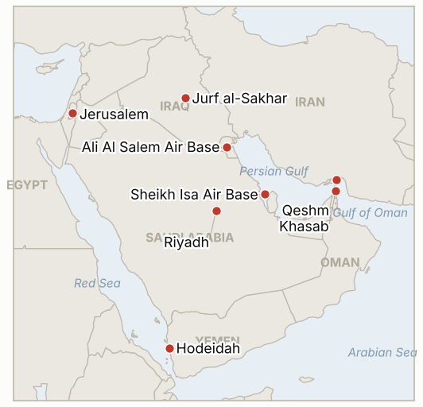

# Middle East Daily Briefing

**November 19, 2026**

- **Reporting window:** ~24 hours, November 18, 06:00 to November 19, 06:00 KST
- **Overall assessment:** Iran answered Tuesday's US strike on Qeshm within hours and widened the target set: its regular army claimed drone strikes on US air defenses in Kuwait, the first attack on Kuwait since September, while Bahrain reported more interceptions (§1.1). A third commercial vessel in two days was confirmed struck in the Strait of Hormuz, again with a crew member missing (§1.2). The Saudi and Houthi war escalated in both directions, and Reuters reported Riyadh expects it to run into 2027 (§1.3). In Israel the opposition took the Knesset speakership (§1.4), and Iraq's standoff with Kataib Hezbollah stayed unresolved two days before the deadline (§1.5). Oil fell anyway: a large US inventory build pushed Brent to $91.95 and WTI to its lowest since August. Seoul recovered, with the KOSPI back above 5,000 and the won firmer. Net: the exchange of fire is spreading to more Gulf hosts, all attacks on bases are still being intercepted, and the oil market continues to price surplus over risk.

**Corrections and updates:**

- The November 18 brief reported the Houthi claim against the Saudi East-West pipeline as naming Pumping Stations 8 and 9 (CBS). Xinhua's account of the same claim names stations 7 and 8, and Reuters says five drones were launched at two stations. The station numbers conflict; the claim itself remains unverified and Saudi Arabia has not confirmed damage.

---

## 1. What Happened

<figure style="float:right; width:46%; margin:2pt 0 8pt 14pt;">

<figcaption style="font-size:8pt; color:#666; text-align:center; margin-top:3pt; font-style:italic;">Major places of discussion</figcaption>
</figure>

### 1.1 Iran widens its attacks to Kuwait after the Qeshm strike

Iran's regular army said early Wednesday that its combat drones struck US Patriot air defense systems and launch pads at Ali Al Salem Air Base in Kuwait, in retaliation for the US strike on Qeshm Island. Kuwait's military said its air defenses intercepted the drones and reported no damage; its foreign ministry called the repeated attacks "criminal" ([AP via Anchorage Daily News](https://www.adn.com/nation-world/2026/11/18/iran-widens-gulf-attacks-by-targeting-us-air-base-in-kuwait-and-sites-in-bahrain/); [ABC News live](https://abcnews.com/International/live-updates/iran-live-updates-tanker-attacked-strait-hormuz-ukmto/?id=138171071)). Bahrain issued two shelter alerts and said it intercepted a number of Iranian attacks; the US embassy in Manama warned Americans of at least four attempted Iranian strikes in a week, and CENTCOM said all launches were intercepted and no US personnel were hurt ([CBS News live](https://www.cbsnews.com/live-updates/iran-war-us-gulf-retaliation-strikes-strait-of-hormuz/)). Army commander Amir Hatami said Iran would respond "more forcefully and severely, without geographical limitations" if the US acts again. CENTCOM chief Brad Cooper met Israel's military chief and the Mossad director in Tel Aviv the same day. Reuters said talks between Iran and the Omani and Qatari mediators continued; no outcome was disclosed. **Confidence: High that the attacks occurred and were intercepted; Low on Iran's claim of hits.**

### 1.2 A third vessel is struck in the strait, with one crew member missing

UKMTO issued a delayed warning on Wednesday that a tanker was hit by an unknown projectile on Tuesday evening about 13 nautical miles off Oman, north of Khasab, with one crew member unaccounted for and a search under way. The UAE's ADNOC L&S said one of its vessels was attacked in the strait on Tuesday evening, leaving one crew member missing and 11 injured, with the rest evacuated; its details match the UKMTO alert, and it did not name the ship ([The National](https://www.thenationalnews.com/business/energy/2026/11/18/adnoc-ls-ship-attacked-at-strait-of-hormuz-with-one-crew-member-missing/); [Reuters via US News](https://www.usnews.com/news/world/articles/2026-11-18/uaes-adnoc-l-s-says-one-crew-member-missing-after-attack-on-its-vessel-in-hormuz)). The National describes the LPG tanker TARA GAS, struck seven nautical miles north of Khasab, as a separate vessel, which makes three ships hit since Monday with ON PHOENIX. No party has claimed the attack. LSEG said vessel data suggests that "normalization of flows through Hormuz is still not possible under current conditions"; a tracking site citing Windward puts Tuesday's transits at four, a figure this brief could not verify at source. **Confidence: High on the attack and casualties; attribution is not established.**

### 1.3 Saudi Arabia and the Houthis escalate, and Riyadh plans for a long war

The Saudi led coalition said its strikes destroyed "60 legitimate military targets" in Sanaa, Amran, Saada and Hodeidah; the Houthis said at least 17 people were killed, 15 of them at a sponge factory in Hodeidah ([CBS News live](https://www.cbsnews.com/live-updates/iran-war-us-gulf-retaliation-strikes-strait-of-hormuz/)). Houthi spokesman Yahya Saree then claimed "a large number of cruise missiles" hit King Khalid International Airport and the financial district in Riyadh. The coalition said it intercepted two cruise missiles and two drones; residents and AFP reported a loud blast and smoke near the airport, and no damage or casualties were confirmed. Reuters, citing two Western officials, reported that Saudi Arabia is preparing for the war to last into 2027 and hopes for ground gains before returning to talks ([Reuters via Euronext](https://live.euronext.com/en/financial-news/oil-down-1-us-oil-stocks-post-larger-expected-rise-eia-says)). **Confidence: High on the strikes and interceptions; Low on the Houthi claim of hits; Medium on Saudi planning.**

### 1.4 The Knesset elects an opposition speaker

The Knesset voted 66 to 52 to elect Matan Kahana of Gadi Eisenkot's Yashar party as speaker, replacing Likud's Amir Ohana, after more than six hours of filibustering by Prime Minister Netanyahu's bloc ([Times of Israel](https://www.timesofisrael.com/liveblog_entry/knesset-votes-66-52-to-elect-yashars-matan-kahana-as-speaker-after-six-hour-filibuster-by-netanyahu-bloc/); [JTA](https://www.jta.org/2026/11/17/israel/knesset-elects-speaker-from-the-change-bloc-opposing-netanyahu)). Kahana had the 48 members of Eisenkot's bloc and 18 of the 19 lawmakers from the two Arab parties. On Wednesday Naftali Bennett met Netanyahu privately; sources in the Eisenkot bloc called the meeting a "strategic attack" on their unity, and the bloc's leaders then declared that replacing Netanyahu is their "top priority" ([Jerusalem Post](https://www.jpost.com/israel-news/politics-and-diplomacy/article-915329); [Ynet](https://www.ynetnews.com/article/bj9l1morgg)). **Confidence: High.**

### 1.5 Iraq's standoff holds two days before the deadline; Washington sanctions Hezbollah finance

Prime Minister Ali al-Zaidi postponed a visit to Lebanon planned for Wednesday; a government official told The National the delay was tied to the standoff at Jurf al-Sakhar, where tanks and armored vehicles surround Kataib Hezbollah's stronghold ahead of a Friday deadline to withdraw ([The National](https://www.thenationalnews.com/news/gulf/2026/11/18/iraqi-pm-delays-lebanon-visit-amid-standoff-with-iran-backed-militia/)). Mediation by Quds Force chief Esmail Qaani had produced no breakthrough by Tuesday evening; a militia leader said a settlement was being shaped under which other Popular Mobilisation Forces units would replace the group. No clashes were reported. Iran nominated an IRGC brigadier general, Abdolreza Masgarian, as ambassador to Baghdad. Separately, the US Treasury sanctioned a Hezbollah linked charity and a gold and cash smuggling network run with the Quds Force. **Confidence: High on the postponement and sanctions; Low on the reported settlement.**

---

## 2. Deep Dive: Incentives and Motives

### 2.1 Why did Iran answer through its regular army, and why in Kuwait?

The earlier attacks on Bahrain were claimed by the IRGC. This one was claimed by the Artesh, the conventional army, and aimed at a different host. Two readings fit. First, it shows the response is a state decision, not a Guard initiative, which matters to an audience in Washington that has tried to treat the IRGC as a separable actor. Second, moving to Kuwait tells every Gulf host of US forces that it is inside the target set, without yet hitting anything. Hatami's phrase "without geographical limitations" states the same point in words. The attack was sized to be intercepted; the message is the widening, not the damage.

### 2.2 Why has Washington not struck again?

The Qeshm strike was framed as self defense against attacks on US personnel. Iran's reply caused no damage and no casualties, so the same framing gives no automatic trigger for a second round. A president who has signalled he wants the war "put away" can let an intercepted attack pass. But the pattern is unstable: each cycle adds a host country and an Iranian service, and a single drone that gets through changes the calculation. The visit of the CENTCOM commander to Tel Aviv shows planning for the larger option is continuing in parallel.

### 2.3 Why is oil falling while ships are being hit?

The market is weighing barrels, not incidents. US crude stocks rose 3.4 million barrels against an expected 58,000, gasoline stocks rose three times the forecast, and both benchmarks are down about 20% this month on the surplus outlook. Attacks on three ships have not yet removed measurable supply, since exports through the Saudi and Iraqi bypass routes are rising. WTI fell far more than Brent because, as one trader noted, arbitrage for US crude to Asia and Europe is shut. The spread tells the Korean buyer that Atlantic barrels are cheap but hard to move, and Gulf barrels carry the risk premium.

### 2.4 Why would Riyadh plan for a war into 2027?

Saudi Arabia re-entered the Yemen war to push the Houthis off its border and away from its export routes. Instead the Houthis hold the Bab el-Mandeb shore, sit about 60 km from Aden and fire at Riyadh daily. Returning to talks now would lock in those gains. Riyadh's stated hope for ground progress first explains the change of commander on Monday and the scale of Wednesday's air strikes. The cost is that the Hormuz bypass, the East-West pipeline, stays under threat for as long as the war lasts.

---

## 3. Policy Implications for South Korea

**Exposure snapshot:** South Korea draws about 70.7% of its crude and 20.4% of its LNG from the Middle East (`instructions/korea-exposure.md`, no update needed). On Wednesday the KOSPI rose 1.99% to 5,067.44, ending a four session fall and reclaiming 5,000; institutions net bought about 549 billion won while foreigners net sold about 328 billion won, a fifth of Tuesday's selling ([Newspim](https://www.newspim.com/news/view/20261118001065)). Samsung Electronics rose 2.31% and SK hynix 4.19% on Nvidia's results. The won closed at 1,333.0 per dollar, 5.2 won stronger ([Newsis](https://newsis.com/view/NISX20261118_0003873523)). Brent settled at $91.95, down $1.19, and WTI at $83.26, down $2.75, its lowest since August 26 ([Reuters via Euronext](https://live.euronext.com/en/financial-news/oil-down-1-us-oil-stocks-post-larger-expected-rise-eia-says)).

**Implications by development:**

- **Kuwait and Bahrain attacks (§1.1):** Kuwait is a direct crude supplier to Korean refiners, so its entry into the target set matters more to Seoul than another attack on Bahrain. Nothing was hit, and loadings are not reported disrupted. The risk to watch is a second US strike and the Iranian reply to it (IND-20261119-1, IND-20261114-1).
- **Third vessel struck (§1.2):** Three ships in two days, two with missing crew, confirms a sustained campaign rather than isolated incidents. Korean owners and insurers should expect war risk terms for the strait to tighten even while flat prices fall (IND-20261119-2, IND-20261112-2, IND-20261114-2).
- **Saudi and Houthi war (§1.3):** A war into 2027 means the Yanbu route, which carries the Saudi barrels that avoid Hormuz, stays within Houthi reach for months. That strengthens the case for the Cheonghae Unit's wider operating area, which still awaits a National Assembly vote (IND-20261116-2, IND-20261117-1, IND-20261112-1).
- **Israel and Iraq (§1.4, §1.5):** Neither changes Korea's near term supply. An opposition speaker lowers the odds of a Netanyahu led escalation by legislative default; a fight at Jurf al-Sakhar would threaten the Iraqi exports that have just restarted through Turkey (IND-20261117-2).
- **Markets:** Cheaper oil and a firmer won ease Korea's import bill at the margin. The rebound in equities came from chips and domestic institutions, and foreigners were still net sellers (IND-20261118-3, IND-20261119-3, IND-20261115-1, IND-20261023-1).

**Resolved today:**

- **IND-20261111-3: Confirmed.** The Knesset elected Matan Kahana speaker by 66 votes to 52, replacing Amir Ohana.
- **IND-20261118-1: Confirmed.** One day after the Qeshm strike, Iran attacked US installations in Kuwait and Bahrain; both hosts acknowledged the attacks. The Kuwait attack was claimed by Iran's regular army, not the IRGC, so the indicator is met on host acknowledgment and in substance, not on its literal wording.
- **IND-20261118-2: Confirmed.** UKMTO reported a tanker hit on Tuesday evening about 13 nautical miles off Oman, matching ADNOC L&S's statement on its own vessel; The National treats it as separate from TARA GAS, making it the third distinct ship since Monday.

**Testable indicators:**

- **IND-20261119-1** (open, new): A second disclosed US strike on Iranian territory or forces, described by a US official or CENTCOM, by ~2026-11-26 confirms a continuing exchange; none falsifies.
- **IND-20261119-2** (open, new): A UKMTO report of an attack on a fourth distinct commercial vessel in or near the Strait of Hormuz by ~2026-11-26 confirms the campaign continues; none falsifies. Iranian mine claims alone do not count.
- **IND-20261119-3** (open, new): A USD/KRW 3:30pm close below 1,325 on any session by ~2026-11-26 confirms the won is strengthening despite the Gulf exchange; none falsifies.
- **IND-20261118-3** (open): KOSPI closed 5,067.44, above 5,000 but below 5,100.50.
- **IND-20261112-2** (open, due ~2026-11-19), **IND-20261114-2** (open): the ADNOC vessel was hit by a projectile and is unnamed; no confirmed mine strike and no LNG carrier.
- **IND-20261113-1, IND-20261115-1** (open): Brent settled $91.95; neither above $100 nor below $90.
- **IND-20261113-3** (open): won closed 1,333.0, below 1,350.
- **IND-20261114-1** (open): no US or Israeli strike beyond the Hormuz coast; the CENTCOM chief met Israeli commanders.
- **IND-20261111-1** (open, due ~2026-11-20): mediator talks continue; no disclosed US and Iranian meeting in Qatar.
- **IND-20261117-1** (open): Houthis still reported about 60 km from Aden; no fighting inside Aden governorate reported.
- **IND-20261117-2** (open, due ~2026-11-24): no entry into Jurf al-Sakhar; mediation continues before Friday's deadline.
- **IND-20261112-1, IND-20261113-2, IND-20261114-3, IND-20261115-2, IND-20261116-2, IND-20261023-1, IND-20260714-4** (open): see `tracking/indicators.md`.

---

## 4. Watch List

- **Any US response to the Kuwait and Bahrain attacks, and whether Iran names a further host (IND-20261119-1).**
- **Identification of the ADNOC L&S vessel, the two missing seafarers, and any claim of responsibility (IND-20261119-2).**
- **Friday's deadline at Jurf al-Sakhar and whether a Popular Mobilisation Forces handover is announced (IND-20261117-2).**
- **Saudi confirmation or denial of damage in Riyadh and on the East-West pipeline (IND-20261116-2).**
- **Any disclosed US and Iranian contact in Doha or Muscat before the weekend (IND-20261111-1).**
- **Whether Brent tests $90 as the inventory build and a hawkish Federal Reserve weigh on prices (IND-20261115-1).**
- **Thursday's Seoul session: whether foreign buying returns and the KOSPI clears 5,100 (IND-20261118-3, IND-20261119-3).**
- **The IAEA Board of Governors session and any resolution on Iran (IND-20261115-2).**
- **The first agenda set by speaker Kahana and the effect of the Bennett and Netanyahu meeting on coalition talks.**

---

## 5. Source Quality Summary

| Claim | Sources | Confidence |
| --- | --- | --- |
| Iran's army claims drone strikes on Patriot systems at Ali Al Salem Air Base | Iranian army via state broadcaster; AP, ABC, CBS | High (claim); Low (hits) |
| Kuwait intercepted the drones; no damage reported; attacks called "criminal" | Kuwaiti military and foreign ministry via AP | High |
| Bahrain intercepted further Iranian attacks; US embassy security alert | Bahrain military and interior ministry; US embassy via AP, CBS | High |
| All launches intercepted, no US personnel hurt | CENTCOM via CBS | High |
| Hatami: Iran will respond "without geographical limitations" | Iranian army commander via ABC | High |
| CENTCOM chief met Israel's military chief and Mossad director | Israeli officials via CBS, AP | High |
| Talks with Omani and Qatari mediators continued | Reuters | Medium |
| Tanker hit Tuesday evening about 13 nm off Oman; one crew missing | UKMTO via ABC, Middle East Eye | High |
| ADNOC L&S vessel attacked; one missing, 11 injured | ADNOC L&S via Reuters, The National, AP | High |
| ADNOC vessel is distinct from TARA GAS | The National; differing casualty counts and positions | Medium to High |
| Four transits on Nov 17 | Windward via a third party tracker | Low |
| Coalition destroyed 60 military targets in Yemen | Coalition spokesman via CBS | High (claim) |
| At least 17 killed, 15 at a Hodeidah sponge factory | Houthi authorities via CBS | Medium |
| Cruise missiles hit Riyadh's airport and financial district | Houthi spokesman via CBS | Low |
| Coalition intercepted two cruise missiles and two drones; blast heard in Riyadh | Coalition; AFP and residents via CBS | High |
| Saudi Arabia is preparing for a war into 2027 | Reuters, two Western officials | Medium |
| Kahana elected speaker 66 to 52 after a six hour filibuster | Times of Israel, JTA, Jerusalem Post | High |
| Bennett met Netanyahu; Eisenkot bloc calls replacing Netanyahu its "top priority" | Jerusalem Post, Ynet | High |
| Al-Zaidi postponed his Lebanon visit because of the Jurf al-Sakhar standoff | Iraqi News Agency; government official via The National | High (postponement); Medium (reason) |
| A settlement replacing Kataib Hezbollah with other PMF units is being shaped | Unnamed militia leader via The National | Low |
| US Treasury sanctioned Hezbollah finance networks | US Treasury via CBS, ABC | High |
| KOSPI 5,067.44, up 1.99%; institutions bought, foreigners sold | Newspim | High |
| USD/KRW 1,333.0 at 3:30pm | Newsis, Newspim | High |
| Brent $91.95, WTI $83.26 (Wednesday settlements); US crude stocks up 3.4 million barrels | Reuters via Euronext; Newspim, Etoday | High |
| Hormuz daily transit count | No primary count published | Not reported |
