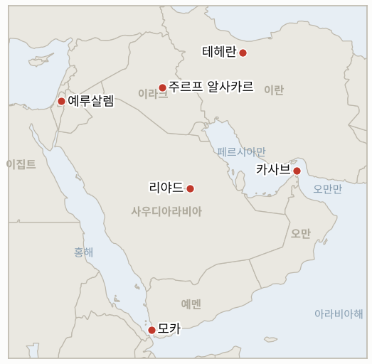

# 중동 일일 브리핑

**2026년 11월 20일**

- **보고 기간:** 약 24시간, 11월 19일 06:00 ~ 11월 20일 06:00 (한국시간)
- **종합 평가:** 미국과 이란의 교전은 하루 동안 멈췄다. 트럼프 대통령은 이란 문제에 대한 어떤 결정도 "서두르지 않는다"며 새해 이후까지 기다리겠다고 말했다. 네타냐후 총리가 새 공습 작전을 압박한다는 보도가 나오는 가운데서였고, 미 상원은 전쟁을 제약하지 않기로 했다(§1.1). 압력은 다른 곳으로 옮겨 갔다. 카사브 인근에서 사흘 사이 네 번째 상선이 피격됐고(§1.2), 후티 미사일이 사우디 국부펀드가 입주한 리야드의 타워를 손상시켰다(§1.3). 두 건의 정치적 대치는 누그러지거나 국면이 바뀌었다. 이라크와 카타이브 헤즈볼라는 시한을 몇 시간 앞두고 주르프 알사카르 문제에서 타협했고(§1.4), 이스라엘에서는 가디 아이젠코트가 정부 구성안을 표결에 부칠 계획이라고 보도됐다(§1.5). 유가는 보합으로 브렌트가 91.98달러였다. 서울 증시는 이틀째 올라 코스피가 5,137.89, 원·달러 환율이 1,330.0원에 마감했다. 종합하면, 미국의 대규모 타격 위험은 대통령 본인의 말로 1월 이후로 물러났지만 선박과 리야드에 대한 공격은 매일 이어지고 있다.

---

## 1. 무슨 일이 있었나

<figure style="float:right; width:46%; margin:2pt 0 8pt 14pt;">

<figcaption style="font-size:8pt; color:#666; text-align:center; margin-top:3pt; font-style:italic;">주요 논의 지점</figcaption>
</figure>

### 1.1 트럼프는 이란 결정을 미루겠다고 하고, 네타냐후는 새 작전을 압박

트럼프 대통령은 선전 정상회의를 마치고 귀국하는 기내에서 이스라엘 채널12와 액시오스에 이란 문제에 대해 "어떤 결정도 서두르지 않는다"며 "새해가 시작된 뒤 어떻게 되는지 보겠다"고 말했다([Times of Israel](https://www.timesofisrael.com/liveblog_entry/trump-says-hes-not-rushing-into-iran-strike-will-wait-until-january/); [CBS News live](https://www.cbsnews.com/live-updates/iran-war-us-gulf-retaliation-strikes-strait-of-hormuz/)). 그보다 몇 시간 앞서 뉴욕타임스는 트럼프가 또 한 차례의 대규모 타격을 저울질하고 있고 네타냐후가 4~7일간의 합동 공습 작전을 압박하고 있으며, 이란의 미사일 재건에 관한 이스라엘 정보의 신빙성을 두고 미 당국자들의 의견이 갈린다고 보도했다([Iran International](https://www.iranintl.com/en/202611193868); [Jerusalem Post](https://www.jpost.com/international/article-915391)). 이스라엘 고위 당국자는 네타냐후가 트럼프를 압박했다는 설명을 부인했다. 트럼프는 폭스뉴스에 이란이 화학무기나 생물무기를 들여다보고 있다는 "징후"가 있다고도 말했다. 이란 외무부 대변인 에스마일 바가에이는 이 주장을 2003년 콜린 파월의 이라크 관련 발표에 빗댔다. 미 상원은 하원을 통과한 전쟁권한 결의안을 48 대 51로 부결했고, 미 국방부 당국자는 전쟁 비용이 480억 달러를 넘었다고 밝혔다. 항공모함 조지 워싱턴함이 역내를 떠나 2척이 남았다. 보고 기간 중 미국의 타격이나 걸프 주둔국에 대한 이란의 공격은 보도되지 않았다. **신뢰도: 트럼프의 발언과 상원 표결은 높음; 이스라엘의 압박과 미국 내부 논쟁에 관한 보도는 중간.**

### 1.2 카사브 인근에서 네 번째 선박 피격, 이란은 새 기뢰 주장

UKMTO는 수요일 16시 45분(GMT) 카사브 북쪽 약 6해리 해상에서 해협을 빠져나가던 유조선 1척의 기관실이 미상의 발사체에 맞았다고 뒤늦게 보고했다. 선원은 무사하며 피해 규모는 아직 알려지지 않았다([Arab News](https://www.arabnews.com/middle-east/tanker-struck-by-projectile-near-omans-khasab-as-attacks-in-hormuz-continue-3012815)). 위치와 시각, 선원 상태가 화요일 저녁 오만 해안 13해리 해상에서 일어난 ADNOC L&S 선박 피격과 다르므로, 이는 월요일 이후 네 번째로 피격된 선박이다. 유조선의 선명은 공개되지 않았고 공격을 자처한 주체도 없다. ADNOC 선박의 요르단인 선장 모하메드 알오타이비는 40시간이 넘도록 실종 상태이며, 그의 아버지가 수색 확대를 호소했다([CBS News live](https://www.cbsnews.com/live-updates/iran-war-us-gulf-retaliation-strikes-strait-of-hormuz/)). 이와 별도로 혁명수비대는 유조선 2척이 추가로 기뢰에 접촉해 폭발했다고 주장했고, 이란 해군은 해협 동쪽에서 유조선 3척이 기뢰로 운항 불능이 됐다고 밝혔다. 로이터는 어느 주장도 검증하지 못했고 두 집계는 서로 맞지 않는다. 국제에너지기구(IEA)의 세계에너지전망은 호르무즈 위기를 에너지 안보 역사상 "최대의 위협"으로 규정하고 누적 손실을 석유 28억 배럴로 추산했다. **신뢰도: UKMTO 보고는 높음; 이란의 기뢰 주장은 낮음.**

### 1.3 후티 미사일, 리야드의 사우디 국부펀드 타워 손상

목요일 동트기 전 발사체가 리야드 킹 압둘라 금융지구의 80층짜리 공공투자펀드(PIF) 타워를 타격해 여러 층의 유리창이 깨지고 외벽에 금이 갔다. 사우디 민방위 당국은 "테러 집단 후티 민병대의 테러 공격"으로 타워와 인접 건물의 여러 층이 손상됐으며 부상자는 없다고 확인했다. 연합군은 미사일에 "대응한" 뒤 잔해가 떨어졌다고 밝혔다([The Telegraph via Yahoo](https://www.yahoo.com/news/world/articles/saudi-sovereign-wealth-fund-skyscraper-145309720.html)). 이 지구가 피격된 것은 11월 8일 아람코 타워에 이어 이달 들어 두 번째다. 후티 군 대변인 야히아 사리는 이를 보복이라 부르며 지잔에 대한 탄도미사일 공격과 카미스 무샤이트 공군기지에 대한 드론 공격도 주장했다. 연합군은 탄도미사일 4기와 순항미사일 1기를 요격하고 사나를 폭격했다고 밝혔다. 후티가 운영하는 사바 통신은 사우디가 모카의 숙박 시설을 공습해 최소 19명이 죽거나 다쳤다고 전했으며, 사우디는 이를 확인하지 않았다. 같은 시간대에 브래드 쿠퍼 미 중부사령관이 무함마드 빈 살만 왕세자를 만났다. **신뢰도: 리야드의 피해는 높음; 직접 명중인지 잔해인지는 미확정; 모카 인명 피해는 중간.**

### 1.4 이라크와 카타이브 헤즈볼라, 주르프 알사카르 문제에서 타협

알리 알자이디 총리는 목요일 늦게 카타이브 헤즈볼라와의 타협에 따라 보안군이 주르프 알사카르에 합동작전센터를 설치하며, 현지 시각 금요일 오전 6시에 문을 연다고 밝혔다([Al Jazeera](https://www.aljazeera.com/news/2026/11/19/iraq-reaches-compromise-with-kataib-hezbollah-over-armed-group-stronghold)). 이 병력은 육군 1개 여단, 연방경찰 1개 여단, 송유관을 지킬 에너지경찰 1개 연대, 그리고 카타이브 헤즈볼라 대원 일부가 포함된 인민동원군(PMF) 2개 여단으로 구성된다. 에스마일 가아니 쿠드스군 사령관은 목요일 이 조직의 사무총장과 바드르 조직 지도자 하디 알아미리, 인민동원군 위원장을 만났다. 카타이브 헤즈볼라는 결과를 "긍정적"이라 평가하고 남은 이견은 "비공개 경로"로 풀겠다고 밝혔다([The National](https://www.thenationalnews.com/news/mena/2026/11/19/irgcs-esmail-qaani-holds-talks-with-kataib-hezbollah-as-showdown-with-iraqi-forces-averted/)). 사드 만 중장은 로이터에 카타이브 병력이 이후 다른 지역으로 이동할 것이라고 말했으나, 이 조직의 성명은 철수를 언급하지 않았다. 병력 배치는 이번 보고 기간이 끝난 뒤에 이뤄진다. **신뢰도: 타협은 높음; 카타이브 헤즈볼라가 실제로 떠나는지는 낮음~중간.**

### 1.5 아이젠코트, 정부 구성안 표결 강행 계획으로 보도

이스라엘 언론은 가디 아이젠코트가 "과반이 없더라도" 정부 구성권이 만료되기 전에 정부 구성안을 크네세트 표결에 부칠 계획이라고 보도했다. 리쿠드는 아이젠코트의 야샤르와 일요일에 새 협의를 한다고 발표하면서 그의 진영이 통합을 가로막는다고 비난했다. 야샤르 의원은 리쿠드가 "통합을 설교하면서" 후속 협의는 거부해 왔다고 반박했다([Times of Israel](https://www.timesofisrael.com/liveblog-november-19-2026/)). 워싱턴포스트는 네타냐후가 군에 알리지 않고 이란에 대한 비밀 작전을 추진했다고 보도했고, 채널12는 그의 새 타격 압박에 정치적 동기가 있다고 의심하는 미 당국자들을 인용했다. 이스라엘군은 베카 계곡 잔타 인근 헤즈볼라 지하 미사일 시설의 출입구를 "복구를 막기 위해" 타격했다고 밝히면서 6월 휴전을 계속 지킨다고 했다. 영국은 정착촌을 건설하는 이스라엘 기업 8곳을 제재했다. **신뢰도: 아이젠코트의 계획은 중간; 리쿠드 협의, 베카 타격, 제재는 높음.**

---

## 2. 심층 분석: 유인과 동기

### 2.1 트럼프는 왜 결정을 1월로 미루려 하나?

세 가지 압력이 같은 방향을 가리킨다. 중간선거는 유권자들이 전쟁에 불만임을 보여 줬고, 상원 표결은 부결됐지만 공화당 의원 3명이 찬성 쪽에 섰다. 전쟁 비용은 이제 480억 달러를 넘었다. 그리고 대통령은 시진핑, 블라디미르 푸틴과의 정상회의를 막 마쳤는데, 그의 설명에 따르면 그와 시진핑은 호르무즈를 통한 원유 흐름에 대해 "강하게 공감"했다. 며칠 뒤의 대규모 타격은 이를 깎아내릴 것이다. 미군 기지에 대한 이란의 공격이 계속 요격되는 한 기다리는 비용은 크지 않다. 화학·생물무기 주장은 명분을 선반에 올려 두되 그것을 쓰겠다는 약속은 하지 않는 방식이다. 항공모함 1척의 이탈은 전력 증강이 아니라 현상 유지 태세에 부합한다.

### 2.2 네타냐후는 왜 지금 작전을 압박하나?

이스라엘 당국자들은 이란이 미사일과 드론 재고를 재건하고 있고, 역내에 전개된 미군 화력이 곧 닫힐 기회의 창을 제공한다고 주장한다. 이는 실질적인 군사 논리다. 그러나 그 시점은 10월에 과반을 잃고, 막 크네세트 의장직까지 잃었으며, 경쟁자가 표결을 준비하는 총리에게도 유리하다. 전시 태세에서는 정부 교체가 무모해 보인다. 채널12가 인용한 미 당국자들이 바로 그렇게 말하고 있고, 군을 우회해 비밀 작전을 계획하려 했다는 보도는 이스라엘 안보 기구가 그를 한목소리로 지지하지 않음을 시사한다. 트럼프의 공개적인 "서두르지 않는다"는 발언은 무엇보다 그 압박에 대한 답이다.

### 2.3 후티는 왜 리야드 금융지구를 계속 때리나?

표적은 그것이 상징하는 바 때문에 선택된다. 아람코 타워와 이번의 공공투자펀드 타워는 비전 2030의 얼굴이며, 이 펀드의 의장은 왕세자다. 금이 간 외벽은 군사적 피해가 거의 없지만 외국 은행과 건설사, 직원들에게 수도가 전쟁 안에 있음을 알린다. 외국인 근로자들이 육로로 떠나고 있다는 보도와 아시안컵 연기는 그 메시지가 먹히고 있음을 보여 준다. 사우디의 공군력에 맞설 수 없는 조직으로서는 사우디의 투자 서사에 드는 비용을 높이는 것이 가장 값싼 압박 수단이며, 사우디가 계획한다는 6개월의 추가 전쟁을 단축시키려는 의도다.

### 2.4 이라크 정부와 카타이브 헤즈볼라는 왜 모두 타협을 받아들였나?

양측 모두 가장 두려워한 결과를 피했다. 알자이디는 2014년 이후 어떤 정부도 들어가지 못한 지역에 연방군과 경찰을 들여보내고, 명령이 이행됐다고 말할 수 있게 됐다. 카타이브 헤즈볼라는 자신이 공식적으로 속한 국가와의 싸움을 피하고, 합동 병력 내 인민동원군 여단을 통해 존재를 유지한다. 이란은 스스로 미국의 군사적 압박을 받는 상황에서 가아니를 통해 이라크 내 동맹 세력 간 충돌을 막았다. 약점은 조건이 의도적으로 모호하다는 것이다. 정부 측 장교는 이 조직이 다른 곳으로 옮겨 간다고 말하지만 조직은 그런 말을 하지 않는다. 명령의 발단이 된 밀수가 멈추는지가 진짜 시험대다.

---

## 3. 한국에 대한 정책적 함의

**익스포저 현황:** 한국은 원유의 약 70.7%, LNG의 20.4%를 중동에서 들여온다(`instructions/korea-exposure.md`, 갱신 불필요). 목요일 코스피는 오전 한때 4,963.61까지 밀렸다가 1.39% 오른 5,137.89에 마감했다. 외국인이 약 4,050억 원, 개인이 약 650억 원을 순매도했고 기관은 약 190억 원을 순매수했다([시사저널e](https://www.sisajournal-e.com/news/articleView.html?idxno=425165)). 수능으로 거래 시간이 평소보다 1시간 늦춰졌다. 한중 통상 합의 소식에 엔터테인먼트와 화장품주가 상승을 이끌었고 SK하이닉스는 3.41%, 삼성전자는 1.13% 올랐다. 원·달러 환율은 달러인덱스가 19개월 만의 최고치를 기록했는데도 장중 1,327.0원까지 내렸다가 3.0원 내린 1,330.0원에 주간 거래를 마쳤다. 브렌트는 3센트 오른 91.98달러, WTI는 5센트 내린 83.21달러에 정산돼 다시 8월 26일 이후 최저를 기록했다([Reuters via Rallies](https://rallies.ai/news/oil-settles-flat-as-hormuz-disruptions-offset-global-surplus-fears-b09bf985c4d9759c)).

**사안별 함의:**

- **트럼프의 결정 유보(§1.1):** 결정이 1월 1일 이후로 미뤄지면 한국에 가장 큰 피해를 줄 시나리오, 즉 광범위한 타격과 걸프 수출 시설에 대한 이란의 보복이 단기에 벌어질 가능성이 낮아진다. 다만 새 결정이 필요 없는 지난주와 같은 소규모 교전까지 사라지는 것은 아니다(IND-20261119-1, IND-20261114-1).
- **네 번째 선박 피격(§1.2):** 사흘 사이 4척이 모두 카사브에서 약 13해리 이내에서 피격된 것은 해협의 오만 쪽이 실제 표적 구역임을 보여 준다. 한국 관련 선박이 통항한다면 이용하게 될 항로다. 이란의 기뢰 주장은 일주일이 지나도록 뒷받침되지 않았고, 관련 지표는 오늘 반증으로 종결한다(IND-20261120-2, IND-20261114-2).
- **리야드 피격(§1.3):** 리야드에 직원을 둔 한국 건설사와 금융사는 이번 전쟁에서 처음으로 직접적인 안전 문제에 직면했다. 손상된 타워에는 증권거래소와 외국 은행이 입주해 있다. 공급에는 영향이 없지만 얀부 우회 경로에 대한 후티의 위협은 계속된다(IND-20261116-2, IND-20261117-1, IND-20261112-1).
- **이라크의 타협(§1.4):** 바그다드 남쪽의 교전을 피한 것은 이번 주 튀르키예를 통해 재개된 이라크 수출을 보호하며, 호르무즈를 거치지 않는 공급에 소폭 긍정적이다(IND-20261117-2, IND-20261120-1).
- **시장:** 유가는 92달러 부근에서 보합이고 원화는 일주일 만에 가장 강해, 둘 다 한국의 수입 부담에 도움이 된다. 그러나 증시 반등은 이틀째 외국인 순매도 속에 이뤄졌으므로 국내 매수세와 걸프와 무관한 업종 재료에 기대고 있다(IND-20261120-3, IND-20261119-3, IND-20261115-1, IND-20261023-1).

**오늘 종결:**

- **IND-20261119-2: 확증.** UKMTO가 수요일 오후 카사브 북쪽 약 6해리 해상에서 유조선 1척이 기관실에 피격됐고 선원은 무사하다고 보고했다. 화요일의 ADNOC L&S 선박 피격과 시각, 위치, 결과가 다르다. 월요일 이후 네 번째 별개 선박이다.
- **IND-20261118-3: 확증.** 코스피가 목요일 5,137.89에 마감해 기준선 5,100.50을 넘었다.
- **IND-20261112-2: 반증.** 선명이 확인된 유조선의 기뢰 접촉이 독립적으로 확인되지 않은 채 11월 19일께의 기한이 지났다. 확인된 사건은 모두 발사체에 의한 것이었고 이란의 기뢰 주장은 여전히 검증되지 않았다.

**검증 가능한 지표:**

- **IND-20261120-1** (진행, 신규): 2026년 11월 27일께까지 이라크 정부나 보안군이 카타이브 헤즈볼라 부대가 주르프 알사카르를 떠났다고 발표하면 타협이 실질적 인계인 것으로 확증; 없으면 반증.
- **IND-20261120-2** (진행, 신규): 2026년 11월 27일께까지 UKMTO가 호르무즈 해협 또는 인근에서 다섯 번째 별개 상선에 대한 공격을 보고하면 공격 지속으로 확증; 없으면 반증. 이란의 기뢰 주장만으로는 인정하지 않는다.
- **IND-20261120-3** (진행, 신규): 2026년 11월 27일께까지 어느 거래일이든 외국인이 유가증권시장에서 순매수를 기록하면 반등이 확산되는 것으로 확증; 없으면 반증.
- **IND-20261119-1** (진행): 미국의 2차 타격 없음; 트럼프는 "서두르지 않는다"며 새해 이후까지 기다리겠다고 발언.
- **IND-20261119-3** (진행): 원·달러 1,330.0원 마감, 장중 저점 1,327.0원; 1,325원 미만 아님.
- **IND-20261113-1** (진행, 11월 20일께 기한), **IND-20261115-1** (진행): 브렌트 정산가 91.98달러; 100달러 초과도 90달러 미만도 아님.
- **IND-20261113-3** (진행, 11월 20일께 기한): 원·달러 1,330.0원 마감, 1,350원 미만.
- **IND-20261111-1** (진행, 11월 20일께 기한): 카타르에서의 미·이란 회동은 공개된 바 없음; 다음 브리핑에서 종결.
- **IND-20261114-1** (진행): 호르무즈 연안 너머에 대한 미국이나 이스라엘의 타격 없음; 이스라엘이 작전을 압박한다는 보도.
- **IND-20261114-2** (진행, 11월 21일께 기한): 네 번째 선박은 선명 미공개 유조선; 선명이 확인된 LNG 운반선의 피해 확인 없음.
- **IND-20261117-2** (진행, 11월 24일께 기한): 연방군은 이번 보고 기간 이후인 금요일 아침 배치 예정; 진입은 아직 확인되지 않음.
- **IND-20261115-2** (진행): IAEA 이사회 개최; 이란 대표는 "무조건적이고 무제한적인" 협력을 배제; 결의 채택은 확인되지 않음.
- **IND-20261117-1** (진행): 후티 병력이 아덴 50km 이내에 있다는 보도 없음.
- **IND-20261112-1, IND-20261113-2, IND-20261114-3, IND-20261116-2, IND-20261023-1, IND-20260714-4** (진행): `tracking/indicators.md` 참조.

---

## 4. 관찰 목록

- **금요일의 주르프 알사카르 배치, 그리고 카타이브 헤즈볼라 부대가 떠나는지 합동 병력 안에 남는지 여부(IND-20261117-2, IND-20261120-1).**
- **이란이나 그 동맹 세력이 미군 기지를 다시 공격하는지 여부. 트럼프가 밝힌 인내심의 시험대가 된다(IND-20261119-1).**
- **네 번째 선박의 선명 확인과 실종된 ADNOC L&S 선장의 생사(IND-20261120-2).**
- **리야드에 대한 후티의 추가 공격과 현지 외국 기업의 인력 운용 변화.**
- **일요일의 리쿠드·야샤르 협의, 그리고 아이젠코트가 정할 표결 날짜.**
- **카타르나 오만을 통한 미·이란 접촉 공개 여부(IND-20261111-1).**
- **IAEA 이사회의 이란 관련 결과(IND-20261115-2).**
- **12월물 WTI가 만기를 맞는 금요일 원유 거래와 브렌트의 90달러 시험 여부(IND-20261115-1).**
- **금요일 서울 시장: 외국인 수급과 원·달러 환율의 1,325원 하향 돌파 여부(IND-20261120-3, IND-20261119-3).**
- **국회의 청해부대 동의안 처리(IND-20261112-1).**

---

## 5. 출처 신뢰도 요약

| 주장 | 출처 | 신뢰도 |
| --- | --- | --- |
| 트럼프: 이란 문제에 "어떤 결정도 서두르지 않는다"; 새해 이후 보겠다 | 채널12, 액시오스 via Times of Israel, CBS | 높음 |
| 트럼프가 대규모 타격을 저울질; 네타냐후는 4~7일 작전 압박 | New York Times via Iran International, Jerusalem Post, Times of Israel | 중간 |
| 미 당국자들 정보 평가 엇갈림; 이스라엘 당국자는 압박 보도 부인 | New York Times via Iran International | 중간 |
| 트럼프: 이란이 화학·생물무기를 들여다본다는 "징후"; 바가에이 반박 | 폭스뉴스 인터뷰; 이란 외무부 via CBS | 높음(발언); 낮음(실체) |
| 상원, 전쟁권한 결의안 48 대 51 부결 | CBS | 높음 |
| 전쟁 비용 480억 달러 초과 | 미 국방부 부감사관 via CBS | 높음 |
| 조지 워싱턴함 역내 이탈; 항공모함 2척 잔류 | CBS | 높음 |
| 카사브 북쪽 약 6해리에서 유조선 기관실 피격; 선원 무사 | UKMTO via Arab News, CBS | 높음 |
| 월요일 이후 네 번째 별개 선박 | UKMTO의 위치·시각·선원 상태로부터의 추론 | 중간~높음 |
| ADNOC L&S 선박의 요르단인 선장 여전히 실종 | 가족 via CBS; 요르단 외무부 | 높음 |
| 유조선 2척 추가 기뢰 접촉(혁명수비대); 유조선 3척 기뢰로 운항 불능(해군) | 이란 국영 매체 via CBS, CNBC, 글로벌이코노믹 | 낮음 |
| 호르무즈는 에너지 안보 "최대의 위협"; 28억 배럴 손실 | IEA 세계에너지전망 via CBS, Reuters | 높음 |
| 리야드 PIF 타워 미사일 피해, 부상자 없음 | 사우디 민방위; AFP 목격자; The Telegraph | 높음 |
| 피해는 요격 잔해에 의한 것 | 사우디 주도 연합군 | 중간 |
| 후티의 지잔·카미스 무샤이트 공격 | 후티 군 대변인 via The Telegraph | 낮음 |
| 연합군, 탄도미사일 4기와 순항미사일 1기 요격 | 연합군 via The Telegraph | 높음(주장) |
| 사우디의 모카 공습으로 최소 19명 사상 | 후티 운영 사바 통신 via CBS | 중간 |
| 금요일 오전 6시부터 주르프 알사카르 합동작전센터; 병력 구성 | 알자이디; 이라크군 대변인 via Al Jazeera, The National | 높음 |
| 카타이브 헤즈볼라는 다른 지역으로 이동 | 사드 만 중장 via Reuters | 낮음~중간 |
| 가아니, 카타이브 헤즈볼라·바드르·인민동원군 지도부와 회동 | 카타이브 헤즈볼라 성명 via The National, Al Jazeera | 높음 |
| 아이젠코트, 과반 없이도 정부 구성권 만료 전 표결 계획 | 이스라엘 언론 via Times of Israel | 중간 |
| 리쿠드·야샤르 협의 일요일 예정 | 리쿠드 via Times of Israel | 높음 |
| 네타냐후, 군에 알리지 않고 대이란 비밀 작전 추진 | Washington Post via Times of Israel | 중간 |
| 이스라엘, 잔타 인근 헤즈볼라 시설 타격 | 이스라엘군 via Times of Israel | 높음 |
| 코스피 5,137.89, 1.39% 상승; 외국인 약 4,050억 원 순매도 | 시사저널e | 높음 |
| 원·달러 주간 종가 1,330.0원, 저점 1,327.0원 | 시사저널e, 서울경제 | 높음 |
| 브렌트 91.98달러, WTI 83.21달러(목요일 정산가) | Reuters via Rallies | 높음 |
| 호르무즈 일일 통항량 | 1차 출처의 집계 없음 | 미보고 |
