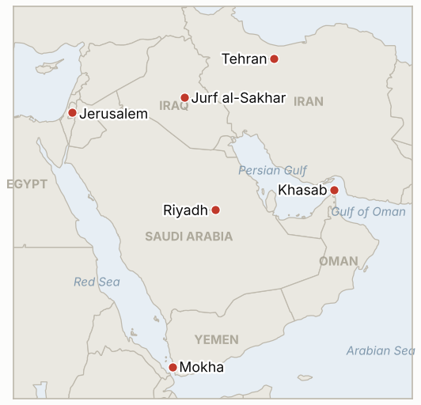
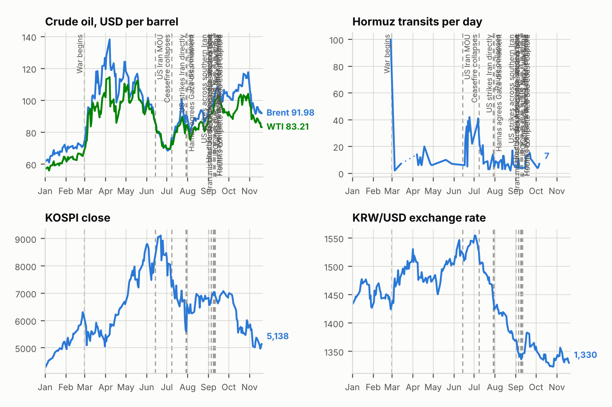

# Middle East Daily Briefing

**November 20, 2026**

- **Reporting window:** ~24 hours, November 19, 06:00 to November 20, 06:00 KST
- **Overall assessment:** The exchange between Washington and Tehran paused for a day. President Trump said he is "not rushing" any decision on Iran and will wait until after the New Year, even as reports described Prime Minister Netanyahu pressing for a new air campaign; the Senate declined to restrain the war (§1.1). The pressure moved elsewhere. A fourth commercial vessel in three days was struck near Khasab (§1.2), and a Houthi missile damaged the tower that houses Saudi Arabia's sovereign wealth fund in Riyadh (§1.3). Two political standoffs eased or shifted: Iraq and Kataib Hezbollah reached a compromise over Jurf al-Sakhar hours before the deadline (§1.4), and in Israel Gadi Eisenkot reportedly plans to force a vote on a government (§1.5). Oil was flat, with Brent at $91.98. Seoul rose a second day, the KOSPI closing at 5,137.89 and the won at 1,330.0. Net: the risk of a large US strike has receded into January on the president's own words, but attacks on ships and on Riyadh continue daily.

---

## 1. What Happened

<figure style="float:right; width:46%; margin:2pt 0 8pt 14pt;">

<figcaption style="font-size:8pt; color:#666; text-align:center; margin-top:3pt; font-style:italic;">Major places of discussion</figcaption>
</figure>

### 1.1 Trump says he will wait on Iran as Netanyahu presses for a new campaign

President Trump told Israel's Channel 12 and Axios on his flight home from a summit in Shenzhen: "I am not rushing into any decision" on Iran, and "we will see what happens after the beginning of the year" ([Times of Israel](https://www.timesofisrael.com/liveblog_entry/trump-says-hes-not-rushing-into-iran-strike-will-wait-until-january/); [CBS News live](https://www.cbsnews.com/live-updates/iran-war-us-gulf-retaliation-strikes-strait-of-hormuz/)). The New York Times had reported hours earlier that he is weighing another round of extensive strikes while Netanyahu presses for a joint air campaign of four to seven days, and that US officials are divided over the strength of Israeli intelligence on Iran's missile rebuilding ([Iran International](https://www.iranintl.com/en/202611193868); [Jerusalem Post](https://www.jpost.com/international/article-915391)). A senior Israeli official disputed that Netanyahu had pressured Trump. Trump also told Fox News there is an "indication" Iran is looking at chemical or biological weapons; Iran's foreign ministry spokesman Esmaeil Baqaei compared the claim to Colin Powell's 2003 presentation on Iraq. The Senate rejected a House passed war powers resolution by 48 to 51, and a Pentagon official put the war's cost above $48 billion. The carrier USS George Washington left the region, leaving two. No US strike and no Iranian attack on a Gulf host were reported in the window. **Confidence: High on Trump's remarks and the Senate vote; Medium on the reported Israeli push and internal US debate.**

### 1.2 A fourth vessel is struck near Khasab, and Iran makes new mine claims

UKMTO reported, after a delay, that an unknown projectile hit the engine room of an outbound tanker about six nautical miles north of Khasab on Wednesday at 16:45 GMT; the crew are safe and the damage is not yet known ([Arab News](https://www.arabnews.com/middle-east/tanker-struck-by-projectile-near-omans-khasab-as-attacks-in-hormuz-continue-3012815)). The position, time and crew status differ from Tuesday evening's attack on the ADNOC L&S vessel 13 nautical miles off Oman, which makes this the fourth ship hit since Monday. The tanker is unnamed and no party has claimed the attack. The Jordanian captain of the ADNOC vessel, Mohammed al-Otaibi, was still missing after more than 40 hours, and his father appealed for a wider search ([CBS News live](https://www.cbsnews.com/live-updates/iran-war-us-gulf-retaliation-strikes-strait-of-hormuz/)). Separately the IRGC claimed two more tankers hit mines and exploded, and Iran's navy said three tankers were disabled by mines east of the strait; Reuters could not verify either claim, and the two counts do not match. The IEA's World Energy Outlook called the Hormuz crisis the "largest threat" to energy security in history and put cumulative losses at 2.8 billion barrels of oil. **Confidence: High on the UKMTO report; Low on the Iranian mine claims.**

### 1.3 A Houthi missile damages the Saudi wealth fund tower in Riyadh

A projectile struck the 80 storey Public Investment Fund tower in Riyadh's King Abdullah Financial District before dawn on Thursday, shattering windows and cracking the facade across several floors. Saudi civil defense confirmed a "terrorist attack by the terrorist Houthi militia" that damaged floors of the tower and neighbouring buildings and caused no injuries; the coalition said debris fell after it "dealt with" a missile ([The Telegraph via Yahoo](https://www.yahoo.com/news/world/articles/saudi-sovereign-wealth-fund-skyscraper-145309720.html)). It is the second hit on the district this month, after the Aramco tower on November 8. Houthi spokesman Yahya Saree called it retaliation and also claimed ballistic missile strikes on Jizan and a drone attack on the Khamis Mushait air base; the coalition said it intercepted four ballistic missiles and a cruise missile and bombed Sanaa. The Houthi run Saba agency said a Saudi strike on a lodging house in Mokha killed or wounded at least 19 people, which Riyadh has not confirmed. CENTCOM chief Brad Cooper met Crown Prince Mohammed bin Salman during the same hours. **Confidence: High on the damage in Riyadh; whether by direct hit or debris is unresolved; Medium on the Mokha toll.**

### 1.4 Iraq and Kataib Hezbollah reach a compromise over Jurf al-Sakhar

Prime Minister Ali al-Zaidi said late Thursday that security forces will set up a joint operations centre in Jurf al-Sakhar, opening at 6am Friday local time, as a compromise with Kataib Hezbollah ([Al Jazeera](https://www.aljazeera.com/news/2026/11/19/iraq-reaches-compromise-with-kataib-hezbollah-over-armed-group-stronghold)). The force combines an army brigade, a Federal Police brigade, an Energy Police regiment to guard pipelines, and two Popular Mobilisation Forces brigades that include some Kataib Hezbollah fighters. Quds Force chief Esmail Qaani met the group's secretary general, the Badr leader Hadi al-Amiri and the PMF chairman on Thursday; the group called the outcome "positive" and said remaining disputes would go through "private channels" ([The National](https://www.thenationalnews.com/news/mena/2026/11/19/irgcs-esmail-qaani-holds-talks-with-kataib-hezbollah-as-showdown-with-iraqi-forces-averted/)). Lt Gen Saad Maan told Reuters that Kataib forces would then move to other areas; the group's own statement did not mention withdrawing. The deployment falls after this window closes. **Confidence: High on the compromise; Low to Medium on whether Kataib Hezbollah actually leaves.**

### 1.5 Eisenkot reportedly plans to force a vote on a government

Israeli media reported that Gadi Eisenkot plans to put a government to a Knesset vote before his mandate expires, "even without a majority." Likud announced fresh talks with Eisenkot's Yashar party, set for Sunday, and accused his bloc of obstructing unity; a Yashar lawmaker replied that Likud "preaches unity" while refusing follow up talks ([Times of Israel](https://www.timesofisrael.com/liveblog-november-19-2026/)). The Washington Post reported that Netanyahu sought a covert operation against Iran without informing the military, and Channel 12 cited US officials who suspect his push for new strikes is politically motivated. The Israeli military struck the entrances of an underground Hezbollah missile site near Janta in the Beqaa Valley "to prevent its rehabilitation," while saying it remains committed to the June ceasefire. Britain sanctioned eight Israeli firms that build settlements. **Confidence: Medium on Eisenkot's plan; High on the Likud talks, the Beqaa strike and the sanctions.**

---

## 2. Deep Dive: Incentives and Motives

### 2.1 Why would Trump put off a decision until January?

Three pressures point the same way. The midterm elections showed voters unhappy with the war, and the Senate vote, though it failed, drew three Republicans. The bill is now above $48 billion. And the president has just left a summit with Xi Jinping and Vladimir Putin where, by his account, he and Xi "felt strongly" about oil flowing through Hormuz; a large strike days later would undercut that. Waiting costs him little so long as Iranian attacks on US bases keep being intercepted. His claim about chemical and biological weapons keeps a justification on the shelf without committing him to use it. The departure of one carrier fits a posture of holding, not building.

### 2.2 Why is Netanyahu pressing for a campaign now?

Israeli officials argue that Iran is rebuilding its missile and drone stocks and that US firepower in the region offers a window that will close. That is a real military argument. But the timing also serves a prime minister who lost his majority in October, has just lost the Knesset speakership, and faces a rival preparing to call a vote. A war footing makes replacing the government look reckless. US officials quoted by Channel 12 say as much, and the reported attempt to plan a covert operation around the military suggests the Israeli security establishment is not united behind him. Trump's public "not rushing" is, among other things, an answer to that pressure.

### 2.3 Why do the Houthis keep hitting Riyadh's financial district?

The targets are chosen for what they represent. The Aramco tower and now the Public Investment Fund tower are the public face of Vision 2030, and the fund is chaired by the crown prince. A cracked facade does little military harm, but it tells foreign banks, contractors and staff that the capital is inside the war. Reports of foreign workers leaving by road, and the postponement of the Asian Cup, show the message is landing. For a movement that cannot match Saudi air power, raising the cost to the kingdom's investment story is the cheapest pressure available, and it is meant to shorten the six more months Riyadh is said to be planning for.

### 2.4 Why did Baghdad and Kataib Hezbollah both accept a compromise?

Each side avoided the outcome it feared most. Al-Zaidi gets federal troops and police inside a district no government has entered since 2014, and can say the order was carried out. Kataib Hezbollah avoids a fight with the state it formally belongs to, and keeps a presence through the PMF brigades in the joint force. Iran, through Qaani, prevents a clash among its Iraqi allies while it is under US military pressure itself. The weakness is that the terms are ambiguous by design: a government officer says the group will move elsewhere, and the group says nothing of the kind. Whether the smuggling that prompted the order stops is the real test.

---

## 3. Policy Implications for South Korea

**Exposure snapshot:** South Korea draws about 70.7% of its crude and 20.4% of its LNG from the Middle East (`instructions/korea-exposure.md`, no update needed). On Thursday the KOSPI rose 1.39% to 5,137.89 after falling as low as 4,963.61 in the morning; foreigners net sold about 405 billion won, institutions net bought about 19 billion won and individuals net sold about 65 billion won ([Sisa Journal e](https://www.sisajournal-e.com/news/articleView.html?idxno=425165)). The session ran one hour later than usual for the college entrance exam. Gains were led by entertainment and cosmetics shares on a Korea and China trade deal, with SK hynix up 3.41% and Samsung Electronics up 1.13%. The won closed daytime trading at 1,330.0 per dollar, 3.0 won stronger, after touching 1,327.0, even as the dollar index reached a 19 month high. Brent settled at $91.98, up 3 cents, and WTI at $83.21, down 5 cents, again its lowest since August 26 ([Reuters via Rallies](https://rallies.ai/news/oil-settles-flat-as-hormuz-disruptions-offset-global-surplus-fears-b09bf985c4d9759c)).

**Implications by development:**

- **Trump's delay (§1.1):** A decision pushed past January 1 lowers the near term odds of the scenario most damaging to Korea, a wide strike followed by Iranian retaliation against Gulf export facilities. It does not remove the smaller exchanges of the past week, which need no new decision (IND-20261119-1, IND-20261114-1).
- **Fourth vessel struck (§1.2):** Four ships in three days, all within about 13 nautical miles of Khasab, shows the Omani side of the strait is the active target area. That is the lane Korean linked tonnage would use on any transit. Iran's mine claims remain uncorroborated after a week, and the indicator on them is closed as falsified today (IND-20261120-2, IND-20261114-2).
- **Riyadh strike (§1.3):** Korean builders and financial firms with staff in Riyadh face a direct safety question for the first time in this war; the damaged tower houses the stock exchange and foreign banks. Supply is unaffected, but the Houthi threat to the Yanbu bypass route persists (IND-20261116-2, IND-20261117-1, IND-20261112-1).
- **Iraq compromise (§1.4):** Avoiding a fight south of Baghdad protects the Iraqi exports that restarted through Turkey this week, a modest positive for non Hormuz supply (IND-20261117-2, IND-20261120-1).
- **Markets:** Oil is flat near $92 and the won is at its strongest in a week, both helpful to Korea's import bill. But the equity rebound has now run two days on foreign net selling, so it rests on domestic buyers and on sector news unrelated to the Gulf (IND-20261120-3, IND-20261119-3, IND-20261115-1, IND-20261023-1).

**Resolved today:**

- **IND-20261119-2: Confirmed.** UKMTO reported a tanker hit in the engine room about six nautical miles north of Khasab on Wednesday afternoon with the crew safe, a different time, position and outcome from Tuesday's attack on the ADNOC L&S vessel. It is the fourth distinct ship since Monday.
- **IND-20261118-3: Confirmed.** The KOSPI closed at 5,137.89 on Thursday, above the 5,100.50 threshold.
- **IND-20261112-2: Falsified.** The deadline of about November 19 passed with no independent confirmation of a mine strike on a named tanker. Every confirmed incident involved a projectile, and Iran's mine claims remain unverified.

**Testable indicators:**

- **IND-20261120-1** (open, new): An Iraqi government or security forces statement that Kataib Hezbollah units have left Jurf al-Sakhar, by ~2026-11-27, confirms the compromise is a real handover; none falsifies.
- **IND-20261120-2** (open, new): A UKMTO report of an attack on a fifth distinct commercial vessel in or near the Strait of Hormuz by ~2026-11-27 confirms the campaign continues; none falsifies. Iranian mine claims alone do not count.
- **IND-20261120-3** (open, new): A session of foreign net buying on the KOSPI main board by ~2026-11-27 confirms the rebound is broadening; none falsifies.
- **IND-20261119-1** (open): no second US strike; Trump says he is "not rushing" and will wait until after the New Year.
- **IND-20261119-3** (open): won closed 1,330.0 with an intraday low of 1,327.0; not below 1,325.
- **IND-20261113-1** (open, due ~2026-11-20), **IND-20261115-1** (open): Brent settled $91.98; neither above $100 nor below $90.
- **IND-20261113-3** (open, due ~2026-11-20): won closed 1,330.0, below 1,350.
- **IND-20261111-1** (open, due ~2026-11-20): no disclosed US and Iranian meeting in Qatar; resolves in the next brief.
- **IND-20261114-1** (open): no US or Israeli strike beyond the Hormuz coast; reports of an Israeli push for a campaign.
- **IND-20261114-2** (open, due ~2026-11-21): the fourth vessel is an unnamed tanker; no named LNG carrier confirmed damaged.
- **IND-20261117-2** (open, due ~2026-11-24): federal forces are due to deploy Friday morning, after this window; entry not yet confirmed.
- **IND-20261115-2** (open): the IAEA Board met; Iran's envoy ruled out "unconditional and unlimited" cooperation; no resolution found.
- **IND-20261117-1** (open): no report of Houthi forces within 50 km of Aden.
- **IND-20261112-1, IND-20261113-2, IND-20261114-3, IND-20261116-2, IND-20261023-1, IND-20260714-4** (open): see `tracking/indicators.md`.

---

## 4. Watch List

- **Friday's deployment into Jurf al-Sakhar and whether Kataib Hezbollah units leave or stay inside the joint force (IND-20261117-2, IND-20261120-1).**
- **Whether Iran or its allies attack a US base again, which would test Trump's stated patience (IND-20261119-1).**
- **Identification of the fourth vessel and the fate of the missing ADNOC L&S captain (IND-20261120-2).**
- **Further Houthi fire on Riyadh and any change in foreign firms' staffing there.**
- **Sunday's Likud and Yashar talks, and the date Eisenkot chooses for a vote.**
- **Any disclosed US and Iranian contact through Qatar or Oman (IND-20261111-1).**
- **The IAEA Board session's outcome on Iran (IND-20261115-2).**
- **Friday's oil session, with the December WTI contract expiring, and whether Brent tests $90 (IND-20261115-1).**
- **Friday's Seoul session: foreign flows and whether the won breaks 1,325 (IND-20261120-3, IND-20261119-3).**
- **The National Assembly's handling of the Cheonghae Unit motion (IND-20261112-1).**

---

## 5. Source Quality Summary

| Claim | Sources | Confidence |
| --- | --- | --- |
| Trump: "not rushing into any decision" on Iran; will see after the New Year | Channel 12, Axios via Times of Israel, CBS | High |
| Trump weighing extensive strikes; Netanyahu pressing for a four to seven day campaign | New York Times via Iran International, Jerusalem Post, Times of Israel | Medium |
| US officials divided on the intelligence; Israeli official disputes the pressure account | New York Times via Iran International | Medium |
| Trump: "indication" Iran is looking at chemical or biological weapons; Baqaei rejects | Fox News interview; Iranian foreign ministry via CBS | High (statements); Low (substance) |
| Senate rejects war powers resolution 48 to 51 | CBS | High |
| War cost above $48 billion | Pentagon deputy comptroller via CBS | High |
| USS George Washington left the region; two carriers remain | CBS | High |
| Tanker hit in engine room about 6 nm north of Khasab; crew safe | UKMTO via Arab News, CBS | High |
| This is a fourth distinct vessel since Monday | Inference from UKMTO position, time and crew status | Medium to High |
| ADNOC L&S vessel's Jordanian captain still missing | Family via CBS; Jordan's foreign ministry | High |
| Two more tankers hit mines (IRGC); three tankers disabled by mines (navy) | Iranian state media via CBS, CNBC, Global Economic | Low |
| Hormuz is the "largest threat" to energy security; 2.8 billion barrels lost | IEA World Energy Outlook via CBS, Reuters | High |
| Missile damage to the PIF tower in Riyadh, no injuries | Saudi civil defense; AFP witnesses; The Telegraph | High |
| Damage caused by debris from an interception | Saudi led coalition | Medium |
| Houthi strikes on Jizan and Khamis Mushait | Houthi spokesman via The Telegraph | Low |
| Coalition intercepted four ballistic missiles and a cruise missile | Coalition via The Telegraph | High (claim) |
| Saudi strike in Mokha killed or wounded at least 19 | Houthi run Saba via CBS | Medium |
| Joint operations centre in Jurf al-Sakhar from 6am Friday; force composition | Al-Zaidi; Iraqi military spokesman via Al Jazeera, The National | High |
| Kataib Hezbollah will move to other areas | Lt Gen Saad Maan via Reuters | Low to Medium |
| Qaani met Kataib Hezbollah, Badr and PMF leaders | Kataib Hezbollah statement via The National, Al Jazeera | High |
| Eisenkot plans a vote before his mandate expires, even without a majority | Israeli media via Times of Israel | Medium |
| Likud and Yashar talks set for Sunday | Likud via Times of Israel | High |
| Netanyahu sought a covert Iran operation without telling the military | Washington Post via Times of Israel | Medium |
| Israeli strike on a Hezbollah site near Janta | Israeli military via Times of Israel | High |
| KOSPI 5,137.89, up 1.39%; foreigners net sold about 405 billion won | Sisa Journal e | High |
| USD/KRW 1,330.0 at the daytime close, low 1,327.0 | Sisa Journal e, Seoul Economic Daily | High |
| Brent $91.98, WTI $83.21 (Thursday settlements) | Reuters via Rallies | High |
| Hormuz daily transit count | No primary count published | Not reported |
