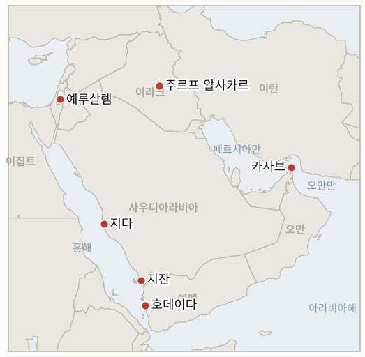

# 중동 일일 브리핑

**2026년 11월 21일**

- **보고 기간:** 약 24시간, 11월 20일 06:00 ~ 11월 21일 06:00 (한국시간)
- **종합 평가:** 사우디와 후티의 전쟁이 항만으로 번졌다. 연합군은 "특수작전"이라며 호데이다항을 폭격했고, 후티는 해운사들에 지다를 떠나라고 통보하고 사우디 영공이 안전하지 않다고 선언하는 것으로 응수했다(§1.1). 호르무즈 해협에서는 닷새 사이 다섯 번째 유조선이 카사브 인근에서 피격돼 불이 났다(§1.2). 미국과 이란은 이날도 서로를 공격하지 않았고, 미국 특사들과 카타르 중재자들의 회동에서는 진전이 보도되지 않았다(§1.4). 이라크 연방군은 교전 없이 주르프 알사카르에 진입했고(§1.3), 가디 아이젠코트는 비상정부를 표결에 부치겠다고 공개적으로 밝혔다(§1.5). 유가는 소폭 올라 브렌트가 92.57달러였지만 주간으로는 3주 연속 내렸다. 서울 증시는 걸프와 무관한 이유로 몇 주 만에 최악의 하루를 보냈다. 미국 기술주 급락에 코스피가 5.21% 내린 4,869.96에 마감했고 원·달러 환율은 1,336.2원으로 올랐다. 종합하면, 미국과 이란의 소강상태는 유지되고 있지만 사우디의 우회 수출을 담당하는 홍해 연안이 이제 명시적인 위협 아래 놓였다.

---

## 1. 무슨 일이 있었나

<figure style="float:right; width:46%; margin:2pt 0 8pt 14pt;">

<figcaption style="font-size:8pt; color:#666; text-align:center; margin-top:3pt; font-style:italic;">주요 논의 지점</figcaption>
</figure>

### 1.1 사우디 주도 연합군이 호데이다항을 폭격하고, 후티는 지다를 위협

연합군은 금요일 민간인과 근로자들에게 대피를 경고한 뒤 "밀수 작전에 쓰인 호데이다항의 작전 역량"을 타격했다고 밝혔다. 투르키 알말리키 대변인(소장)은 이를 "위협의 근원을 무력화하기 위한 특수작전"이라 부르며 사나, 사다, 타이즈의 미사일 시설을 상대로 계속될 것이라고 했다([AFP via France 24](https://www.france24.com/en/live-news/20261120-saudi-coalition-launches-special-operation-yemen-s-houthis-vow-reprisals); [The National](https://www.thenationalnews.com/news/mena/2026/11/20/saudi-led-coalition-tells-civilians-to-leave-yemens-hodeidah-port-ahead-of-strikes/)). 새벽의 사나 공습으로 군사 표적 7곳과 작업장 6곳이 파괴된 것으로 전해졌다. 후티는 호데이다가 공격받으면 지다를 비롯한 사우디의 홍해 항만을 타격하겠다고 경고해 왔다. 공습 이후 후티의 조정센터는 지다항을 이용하는 해운사들에 이메일을 보내 철수를 촉구했고, 야히아 사리 대변인은 메카와 메디나 상공을 제외한 사우디 영공이 모든 항공사에 안전하지 않다고 말했다. 그는 알슈카이크 발전소와 지잔항을 "정확하고 직접적으로" 타격했다고도 주장했다. 연합군은 지잔 상공에서 탄도미사일 2기를 요격했고 잔해가 알슈카이크에 떨어졌다고 밝혔다. 후티는 24시간 동안 연합군 공습으로 41명이 숨졌다고 발표했고, 사우디 항공기가 라스 알아라에서 하이스로 가던 피란민 선박을 공습해 어린이 8명을 포함한 19명이 숨졌다고 주장했다([CBS News live](https://www.cbsnews.com/live-updates/iran-war-us-gulf-retaliation-strikes-strait-of-hormuz/)). 사우디는 선박 공습을 확인하지 않았고, AFP는 어느 쪽의 인명 피해 집계도 검증하지 못했다. 유엔은 호데이다 공습을 "우려하며" 주시하고 있다고 밝혔다. **신뢰도: 호데이다 공습과 후티의 위협은 높음; 인명 피해 수치와 후티의 피해 주장은 낮음~중간.**

### 1.2 카사브 인근에서 다섯 번째 유조선 피격, 화재 발생

UKMTO는 금요일 15시(UTC)께 카사브 북쪽 약 8해리 해상에서 호르무즈 해협을 빠져나가던 유조선 1척이 좌현 선수에 미상의 발사체를 맞았다고 보고했다. 선박에 불이 났으며 인명 피해나 오염은 보고되지 않았다([Reuters via Yahoo](https://www.yahoo.com/news/world/articles/tanker-catches-fire-projectile-strike-170458570.html); [Arab Times](https://www.arabtimesonline.com/news/tanker-struck-by-unknown-projectile-near-omans-khasab/)). 이란 혁명수비대는 이 유조선이 통항을 시도하다 기뢰에 접촉했다고 밝혔는데, 이는 UKMTO의 설명과 어긋난다. 선명은 공개되지 않았다. 월요일 이후 카사브 앞바다에서 피격된 다섯 번째 별개 선박이다. 이와 별도로 케이플러와 민간단체 이란핵반대연합(UANI)은 제재 대상인 수에즈막스급 유조선 올림(Olym)호가 11월 17일 양측 모두 위치 발신기를 끈 상태에서 이란산 원유 약 20만 배럴을 더 작은 유조선에 넘겼다고 전했다. 미 중부사령부는 이튿날 선박 간 환적으로 이란 화물을 넘겨받는 선박은 모두 봉쇄 회피로 간주할 수 있다고 선언했다([AGBI](https://www.agbi.com/analysis/oil-and-gas/2026/11/irans-tanker-transfer-fuels-talk-of-challenge-to-us-blockade/); [Rigzone](https://rigzone.com/news/gulf_sees_iran_oil_movement_as_us_widens_blockade-20-nov-2026-185130-article)). 케이플러는 이번 환적을 봉쇄를 깨려는 조직적 시도로 읽는 것을 경계했다. **신뢰도: UKMTO 보고는 높음; 혁명수비대의 기뢰 주장은 낮음; 원유 환적은 중간.**

### 1.3 이라크 연방군, 주르프 알사카르 진입

이라크 보안군이 금요일 주르프 알사카르에 도착해 약 12년 만에 처음으로 카타이브 헤즈볼라의 거점에 들어갔다([Al Jazeera and Reuters via Yahoo](https://www.yahoo.com/news/world/articles/iraqi-forces-deploy-jurf-al-131700425.html); [France 24](https://www.france24.com/en/middle-east/20261120-iraqi-security-forces-to-deploy-in-hezbollah-stronghold-under-compromise-deal)). 아흐메드 하템 하미드 중장은 통제 본부가 설치됐고 연방경찰이 이를 운영한다고 밝혔으며, 에너지경찰은 이 지역을 지나는 송유관의 경비를 시작했다. 알리 알자이디 총리는 병력이 "전쟁을 벌이는 것이 아니"라며 그곳 사람들을 "여러분의 형제"라 불렀고, 무기를 국가 통제 아래 두겠다는 결정은 최종적이라고 말했다. 목요일의 합의에 따라 카타이브 헤즈볼라는 한 달 안에 이라크의 다른 지역으로 철수할 것으로 예상된다. 다른 보도들은 이 조직이 무기를 유지했으며 합의가 즉각적이거나 완전한 철수를 뜻하지 않는다고 전한다. 위기의 발단이 된 석유 밀수 조사와 관련해 보안·석유 분야 고위 관리 9명이 해임됐다. **신뢰도: 진입은 높음; 철수는 낮음~중간.**

### 1.4 미국 특사들, 카타르 중재자들과 회동했으나 진전 보도 없음

액시오스는 스티브 위트코프와 재러드 쿠슈너가 목요일 베를린에서 카타르 당국자들을 만나 이란 협상을 논의했으며, 소식통들이 큰 진전은 없었다고 전했다고 보도했다. 이번 주 초에는 이란의 실무급 대표단이 도하에서 카타르 측을 만났다([Axios](https://www.axios.com/2026/11/20/witkoff-kushner-meet-qatari-mediators-iran); [Times of Israel](https://www.timesofisrael.com/liveblog-november-20-2026/)). 미국과 이란 당국자 간의 회동은 공개되지 않았다. 이란의 모하마드 모흐베르 고문은 트럼프 대통령이 중국 정상회의에서 "빈손으로" 떠났으며 호르무즈는 여전히 레드라인이라고 말했고, 혁명수비대의 한 고문은 어떤 적대 행위가 있을 경우 "적"이 있는 곳 어디든 미사일로 타격하겠다고 경고했다. 미국의 이란 타격이나 걸프 주둔국에 대한 이란의 공격은 이틀째 보도되지 않았다. 케슘섬의 폭발은 불발탄 처리 때문인 것으로 전해졌다. **신뢰도: 베를린 회동은 중간(단일 매체 보도, 널리 인용됨); 타격 보도가 없다는 점은 높음.**

### 1.5 아이젠코트, 비상정부를 표결에 부치겠다고 발언

가디 아이젠코트는 금요일 폭넓은 연정을 꾸리려는 노력이 실패하면 "국가 비상" 정부를 크네세트 표결에 부치겠다며 베냐민 네타냐후는 물러나야 한다고 말했다([Haaretz](https://www.haaretz.com/israel-news/israel-politics/2026-11-20/ty-article/.premium/eisenkot-ill-put-a-government-led-by-me-to-a-knesset-vote-netanyahu-must-go/000001a1-f932-d381-ade5-fbf389520000); [Times of Israel](https://www.timesofisrael.com/liveblog-november-20-2026/)). 목요일에는 보도로만 전해진 내용을 본인이 공식화한 것이다. 그의 진영은 48석으로 61석에 못 미친다. 보도에 따르면 표결은 이르면 11월 28일이나 29일에 열릴 수 있으며, 라암의 지지와 조인트 리스트의 기권에 기대는 구도다. 그의 정부 구성권은 12월 6일까지다. 채널12는 리쿠드가 통합 정부의 조건으로 10개 요구를 내걸었다고 보도했다. 여기에는 네타냐후가 순번제 없이 4년간 총리를 맡는 것과 연정 파트너들이 이란에 대한 추가 공세를 지지하는 것이 포함된다. 네타냐후는 측근들에게 이란과의 전쟁 재개는 불가피하다고 말한 것으로 전해졌고, 아비그도르 리베르만은 지금은 타격을 정당화할 안보상 이유가 없다고 말했다. 가자에서는 이스라엘군이 부레이지에서 회합 중이던 하마스 대원들을 타격했다고 밝혔고, 팔레스타인 언론은 4명이 숨졌다고 전했다. **신뢰도: 아이젠코트의 발언은 높음; 표결 시기와 리쿠드의 요구에 관한 보도는 중간.**

---

## 2. 심층 분석: 유인과 동기

### 2.1 사우디는 왜 호데이다항을 타격했고, 후티는 왜 지다로 응수하나?

사우디는 가장 아픈 곳에서 밀리고 있었다. 이달 들어 금융지구의 타워 두 곳이 피격됐고 후티는 아덴과 바브엘만데브 방면으로 세력을 넓혔다. 발사 지점에 대한 공습으로는 미사일을 멈추지 못했으므로 연합군은 보급선으로 표적을 옮겼다. 그 항구로 무기가 들어온다는 것이 연합군의 주장이다. 호데이다는 후티의 주된 관세 수입원이자 예멘 북부 식량과 연료 대부분의 반입구이기도 하며, 유엔이 즉각 이의를 제기한 것도 그 때문이다. 후티의 대응은 같은 논리를 되돌려 준다. 그들은 사우디 항공기를 막을 수 없지만, 보험사와 해운사가 지다를 의심하게 만들 수 있고 항공사가 사우디 영공을 의심하게 만들 수 있다. 경고에는 비용이 들지 않으며 공격이 할 일의 일부를 대신할 수 있다. 실제로 행동에 옮기느냐가 이제 핵심 질문이다. 같은 해안에 호르무즈를 우회하는 사우디 원유의 터미널인 얀부가 있기 때문이다.

### 2.2 미국과 이란이 서로 공격을 멈춘 동안에도 선박은 왜 계속 피격되나?

소강상태는 두 나라 군대 사이의 것이지 바다에서의 것이 아니다. 트럼프 대통령이 새해 이후까지 기다리겠다고 말한 뒤로 어느 쪽도 상대를 타격하지 않았다. 그러나 닷새 사이 유조선 5척이 카사브에서 수 해리 이내에서 피격됐고, 그때마다 아무도 자처하지 않는 발사체가 쓰였다. 이란으로서는 케슘 타격을 부른 선을 넘지 않으면서 해협을 위험한 곳으로, 그 값을 비싼 것으로 유지할 수 있다. 피격을 매번 기뢰 접촉이라고 발표하는 것도 같은 목적에 봉사한다. 선주들에게 오만 쪽 항로를 피하라고 경고하고 책임을 항로에 돌리는 것이다. 미국 쪽도 육지가 아니라 바다에서 조이고 있어, 소규모 원유 환적 한 건 이후 봉쇄 규칙을 넓혔다. 양측은 상대가 확전하지 않을 것임을 보여 준 곳에서 압박하고 있다.

### 2.3 이라크 정부는 주르프 알사카르 진입으로 무엇을 얻었나?

존재를 얻었다. 2014년 이후 어떤 이라크 정부도 그곳에서 갖지 못한 것이다. 이제 연방경찰이 이 지역에 본부를 두고 있고, 에너지경찰이 밀수 조사의 대상이었던 송유관을 지키고 있다. 이는 실질적인 변화이며 총 한 발 쏘지 않고 이뤄졌다. 이라크 정부가 얻지 못한 것은 이 조직의 퇴거와 무기다. 합의는 카타이브 헤즈볼라에 한 달을 주었고, 합동 병력에는 이 조직이 속한 인민동원군(PMF)의 여단들이 포함되며, 조직이 떠나야 하는지조차 설명이 엇갈린다. 알자이디는 미국과 걸프 국가들에 국가가 들어갔다는 것을 보여 줄 수 있다. 조직은 추종자들에게 무장 해제되지 않았다는 것을 보여 줄 수 있다. 시험대는 밀수가 멈추는지, 그리고 이 지역이 쫓겨난 주민들에게 열리는지다.

### 2.4 아이젠코트는 왜 과반 없이 표결에 나서려 하나?

그러지 않으면 시간이 네타냐후에게 유리하게 흐르기 때문이다. 아이젠코트의 정부 구성권이 정부 없이 만료되면 네타냐후가 과도 총리로 남아, 타격 여부가 논의되는 몇 주 동안 이란 문제에서 재량을 갖게 된다. 표결은 모든 의원이 새 정부와 또 한 번의 선거 사이에서 공개적으로 선택하도록 강제한다. 아이젠코트는 의장 선출에서 단일 표결에 61표 이상을 모을 수 있음을 이미 보여 줬다. 보도된 리쿠드의 요구, 무엇보다 이란에 대한 추가 공세를 지지하겠다는 서약은 그가 통합 합의를 받아들이기 어렵게 만들고, 따라서 소수 정부 경로의 가능성을 높인다. 전쟁이 불가피하다는 네타냐후의 발언도 같은 경쟁의 일부다. 정부 교체를 안보에 대한 위험으로 규정하는 것이다.

---

## 3. 한국에 대한 정책적 함의

**익스포저 현황:** 한국은 원유의 약 70.7%, LNG의 20.4%를 중동에서 들여온다(`instructions/korea-exposure.md`, 갱신 불필요). 금요일 코스피는 장중 4,831.69까지 밀렸다가 267.93포인트(5.21%) 내린 4,869.96에 마감해 약 10개월 만의 최저 종가를 기록했다. 11시 54분에는 매도 사이드카가 발동돼 프로그램 매도 호가의 효력이 정지됐다([한국경제](https://www.hankyung.com/article/202611200429i); [Business Korea](https://www.businesskorea.co.kr/news/articleView.html?idxno=281841)). 외국인은 6거래일 연속 순매도했다. 보도된 규모는 약 1조 1,300억 원에서 1조 7,300억 원까지 엇갈리며, 개인은 약 1조 6,000억 원을 순매수했다. 원인은 걸프가 아니라 미국 기술주와 반도체주의 급락이었다. 삼성전자는 7.01%, SK하이닉스는 5.92% 내렸다. 원·달러 환율은 장중 1,340.3원까지 올랐다가 6.2원 오른 1,336.2원에 마감했다([뉴스1](https://www.news1.kr/finance/market-exr/6361215)). 브렌트는 59센트 오른 92.57달러, WTI는 77센트 오른 83.98달러에 정산됐다. 미국 추수감사절 연휴를 앞둔 매수 때문이며, 둘 다 주간으로는 3주 연속 내렸고 브렌트의 주간 하락률은 약 4%다([Reuters via Rallies](https://rallies.ai/news/oil-gains-on-iran-war-worries-and-short-covering-ahead-of-thanksgiving-holiday-f7811d2ecb7ac08c)). 로이터는 호르무즈를 통한 원유 수송이 대체로 전쟁 전 수준으로 돌아왔다고 전했으나 수치는 제시하지 않았다.

**사안별 함의:**

- **호데이다와 지다에 대한 위협(§1.1):** 한국의 공급에 가장 중요한 사안이다. 호르무즈를 피하는 사우디 원유는 후티가 이제 지목한 바로 그 홍해 연안의 얀부에서 선적된다. 지다나 얀부가 타격받거나 보험사가 사우디 홍해 항만에 대한 담보를 거두면 사우디산 원유를 아시아로 실어 나르던 경로가 타격을 입는다. 사우디 영공이 안전하지 않다는 주장은 한국 항공사와 여행객에게도 영향을 준다(IND-20261121-1, IND-20261116-2, IND-20261117-1).
- **다섯 번째 유조선 피격(§1.2):** 오만 쪽 항로에서 하루 한 척꼴로 피격되고 있지만, 로이터는 해협을 통한 원유 흐름이 전쟁 전 수준에 근접했다고 전하고 유가는 내리고 있다. 시장은 공격을 봉쇄가 아니라 통항 비용으로 취급하고 있다. 한국 선주들에게 선원이 처한 위험은 달라지지 않았고, 청해부대 동의안은 여전히 국회에 계류돼 있다(IND-20261121-2, IND-20261114-2, IND-20261112-1).
- **이라크(§1.3):** 평화적 진입은 튀르키예를 통한 이라크 수출에 대한 위험을 낮추며, 호르무즈를 거치지 않는 공급에 소폭 긍정적이다(IND-20261120-1).
- **외교(§1.4):** 미·이란 회동도 없고 진전도 보도되지 않아 전쟁 프리미엄을 더 끌어내릴 재료는 아직 없다. 유가를 92달러 부근에 묶어 두는 것은 타격의 소강상태다(IND-20261119-1, IND-20261114-1).
- **시장:** 금요일 서울 증시의 급락은 해외 기술주에서 비롯됐으므로 걸프의 신호로 읽어서는 안 된다. 그러나 부담은 겹친다. 외국인이 6거래일째 팔았고 원화는 약해졌으며 92달러 부근의 유가는 여전히 무역수지를 짓누른다. 원화가 약해지면 원유 1배럴당 원화 비용이 오른다(IND-20261121-3, IND-20261120-3, IND-20261119-3, IND-20261115-1, IND-20261023-1).

**오늘 종결:**

- **IND-20261120-2: 확증.** UKMTO가 금요일 15시(UTC)께 카사브 북쪽 약 8해리 해상에서 유조선 1척이 좌현 선수에 피격돼 불이 났다고 보고했다. 다섯 번째 별개 선박이다. 하루 만에 종결됐다.
- **IND-20261117-2: 확증.** 이라크 연방군이 금요일 주르프 알사카르에 진입해 연방경찰이 통제하는 본부를 설치했다.
- **IND-20261111-1: 반증.** 11월 20일까지 카타르에서의 미·이란 당국자 회동은 공개되지 않았다. 미국 특사들은 베를린에서 카타르 중재자들을 만났고, 이란 당국자들은 도하에서 카타르 측을 따로 만났다.
- **IND-20261113-1: 반증.** 브렌트는 11월 20일까지 100달러 위에서 정산되지 않았다. 기간 중 최고 정산가는 95.84달러였고 금요일 정산가는 92.57달러다.
- **IND-20261113-3: 반증.** 원·달러 환율은 11월 20일까지 1,350원 위에서 마감하지 않았다. 금요일 종가는 1,336.2원, 장중 고점은 1,340.3원이다.

**검증 가능한 지표:**

- **IND-20261121-1** (진행, 신규): 2026년 11월 28일께까지 후티의 미사일이나 드론이 지다 또는 얀부를 타격했거나 그 상공에서 요격됐다고 사우디 당국이나 주요 통신사가 전하면 사우디 홍해 항만에 대한 위협이 실재하는 것으로 확증; 없으면 반증.
- **IND-20261121-2** (진행, 신규): 2026년 11월 28일께까지 UKMTO가 호르무즈 해협 또는 인근에서 여섯 번째 별개 상선에 대한 공격을 보고하면 하루 한 척꼴의 공격이 이어지는 것으로 확증; 없으면 반증. 이란의 기뢰 주장만으로는 인정하지 않는다.
- **IND-20261121-3** (진행, 신규): 2026년 11월 27일께까지 어느 거래일이든 코스피가 4,800 아래에서 마감하면 급락이 심화하는 것으로 확증; 없으면 반증.
- **IND-20261120-1** (진행): 병력 진입; 카타이브 헤즈볼라는 한 달 안에 철수할 것으로 예상되나 부대가 떠났다는 발표는 없음.
- **IND-20261120-3** (진행): 금요일 외국인 6거래일 연속 순매도.
- **IND-20261119-1** (진행): 미국의 2차 타격 없음; 이틀째 잠잠.
- **IND-20261119-3** (진행): 원·달러 1,336.2원 마감; 1,325원 미만 아님.
- **IND-20261115-1** (진행): 브렌트는 장중 90.3달러 부근에서 거래된 뒤 92.57달러에 정산; 90달러 미만 정산 없음.
- **IND-20261114-1** (진행): 호르무즈 연안 너머에 대한 미국이나 이스라엘의 타격 없음; 네타냐후가 전쟁 재개는 불가피하다고 말한 것으로 보도.
- **IND-20261114-2** (진행, 11월 21일께 기한): 다섯 번째 선박은 선명 미공개 유조선; 선명이 확인된 LNG 운반선의 피해 확인 없음. 다음 브리핑에서 종결.
- **IND-20261115-2** (진행): IAEA 이사회의 이란 결의 채택은 확인되지 않음.
- **IND-20261116-2** (진행): 바브엘만데브 인근 선박에 대한 후티 공격을 전한 UKMTO 보고 없음; 후티는 대신 사우디 항만을 위협.
- **IND-20261117-1** (진행): 후티 병력이 아덴 50km 이내에 있다는 보도 없음.
- **IND-20261112-1, IND-20261113-2, IND-20261114-3, IND-20261023-1, IND-20260714-4** (진행): `tracking/indicators.md` 참조.

---

## 4. 관찰 목록

- **후티가 지다나 다른 사우디 홍해 항만을 공격하는지 여부, 그리고 해운사·보험사·항공사의 대응(IND-20261121-1).**
- **호데이다에 대한 연합군의 추가 공습과 예멘 북부로의 식량·연료 반입에 미치는 영향.**
- **다섯 번째 유조선의 선명과 상태, 그리고 카사브 앞바다의 매일 이어지는 공격이 주말에도 계속되는지 여부(IND-20261121-2).**
- **미 중부사령부가 봉쇄 규칙을 넓힌 가운데, 강경 매체들이 촉구하는 대로 이란이 하르그섬에서 유조선 선단 출항을 시도하는지 여부.**
- **카타이브 헤즈볼라 부대가 주르프 알사카르에서 떠나기 시작하는지 여부(IND-20261120-1).**
- **일요일의 리쿠드·야샤르 협의, 그리고 아이젠코트가 정할 표결 날짜.**
- **베를린 회동의 후속 움직임, 그리고 미국과 이란의 타격 소강상태가 유지되는지 여부(IND-20261119-1).**
- **11월 29일 OPEC+ 회의와 미국 연휴 주간의 한산한 원유 거래(IND-20261115-1).**
- **5.21% 급락 이후 월요일 서울 시장의 개장, 외국인 수급과 원·달러 환율(IND-20261121-3, IND-20261120-3).**
- **국회의 청해부대 동의안 처리(IND-20261112-1).**

---

## 5. 출처 신뢰도 요약

| 주장 | 출처 | 신뢰도 |
| --- | --- | --- |
| 연합군, 민간인에 경고한 뒤 "특수작전"으로 호데이다항 타격 | 연합군 대변인 via AFP, The National, Reuters | 높음 |
| 새벽 사나 공습으로 군사 표적 7곳과 작업장 6곳 파괴 | 연합군 via The National | 중간 |
| 후티, 지다항 이용 해운사에 철수 통보; 사우디 영공이 안전하지 않다고 선언 | 후티 조정센터와 대변인 via AFP | 높음(발언) |
| 후티의 알슈카이크 발전소와 지잔항 타격 | 후티 군 대변인 via AFP | 낮음 |
| 지잔 상공에서 탄도미사일 2기 요격, 잔해는 알슈카이크에 낙하 | 연합군 via AFP, The National | 높음(주장) |
| 24시간 동안 연합군 공습으로 41명 사망 | 후티 당국 via AFP | 낮음~중간 |
| 사우디의 선박 공습으로 어린이 8명 포함 19명 사망 | 후티 TV via CBS, AFP | 낮음~중간 |
| 호데이다항 공습에 대한 유엔의 우려 | 유엔 대변인 via AFP | 높음 |
| 카사브 북쪽 약 8해리에서 유조선 좌현 선수 피격·화재, 인명 피해 없음 | UKMTO via Reuters, Arab Times | 높음 |
| 해당 유조선은 기뢰에 접촉 | 혁명수비대 via 이란 국영 매체, Reuters | 낮음 |
| 월요일 이후 카사브 앞바다에서 피격된 다섯 번째 별개 선박 | UKMTO 보고들로부터의 추론 | 중간~높음 |
| 11월 17일 이란산 원유 약 20만 배럴 선박 간 환적 | 케이플러, UANI via AGBI, Rigzone | 중간 |
| 미 중부사령부, 선박 간 환적까지 봉쇄 규칙 확대 | AGBI, Rigzone | 중간~높음 |
| 이라크군 주르프 알사카르 진입; 연방경찰이 본부 운영 | 이라크 국영통신 via Al Jazeera, Reuters, France 24 | 높음 |
| 카타이브 헤즈볼라는 한 달 안에 철수 예상 | Al Jazeera, Reuters | 낮음~중간 |
| 카타이브 헤즈볼라는 무기를 유지 | 역내 언론 | 중간 |
| 위트코프와 쿠슈너, 베를린에서 카타르 중재자들과 회동; 큰 진전 없음 | Axios via Times of Israel | 중간 |
| 보고 기간 중 미국의 이란 타격도 걸프 주둔국에 대한 이란의 공격도 없음 | CBS, Times of Israel, Al Jazeera (보도 부재) | 높음 |
| 모흐베르: 트럼프는 중국에서 빈손으로 떠났다; 호르무즈는 레드라인 | 이란 매체 via Israel National News | 중간 |
| 아이젠코트, 비상정부를 표결에 부치겠다; 네타냐후는 물러나야 | Haaretz, Times of Israel | 높음 |
| 표결은 11월 28일 또는 29일 가능; 라암의 지지와 조인트 리스트의 기권에 의존 | 이스라엘 언론 | 중간 |
| 리쿠드의 10개 요구에 이란 추가 공세 지지 포함 | 채널12 via Times of Israel | 중간 |
| 이스라엘의 부레이지 타격; 4명 사망 | 이스라엘군; 팔레스타인 언론 via Times of Israel | 중간~높음 |
| 코스피 4,869.96, 5.21% 하락; 11시 54분 매도 사이드카 | 한국경제, Business Korea | 높음 |
| 외국인 순매도 1조 1,300억~1조 7,300억 원 | Business Korea, 한국경제, 뉴스1 (수치 엇갈림) | 중간 |
| 원·달러 15시 30분 종가 1,336.2원, 고점 1,340.3원 | 뉴스1, Business Korea | 높음 |
| 브렌트 92.57달러, WTI 83.98달러(금요일 정산가) | Reuters via Rallies | 높음 |
| 호르무즈 통과 원유 수송이 전쟁 전 수준에 근접 | Reuters via Rallies | 중간 |
| 호르무즈 일일 통항량 | 1차 출처의 집계 없음 | 미보고 |
