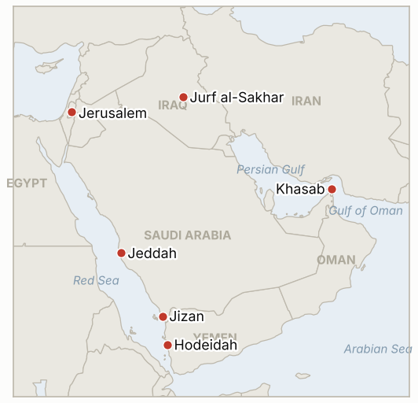

# Middle East Daily Briefing

**November 21, 2026**

- **Reporting window:** ~24 hours, November 20, 06:00 to November 21, 06:00 KST
- **Overall assessment:** The war between Saudi Arabia and the Houthis widened to the ports. The coalition bombed Hodeidah port in what it called a "special operation," and the Houthis answered by telling shipping companies to leave Jeddah and declaring Saudi airspace unsafe (§1.1). In the Strait of Hormuz a fifth tanker in five days was struck near Khasab and set on fire (§1.2). Washington and Tehran again did not fire on each other, and a meeting between US envoys and Qatari mediators produced no reported progress (§1.4). Iraqi federal forces entered Jurf al-Sakhar without a fight (§1.3), and Gadi Eisenkot said in public that he will put an emergency government to a vote (§1.5). Oil rose slightly, with Brent at $92.57, but still fell for a third week. Seoul had its worst day in weeks for reasons unrelated to the Gulf: the KOSPI fell 5.21% to 4,869.96 on a US technology selloff, and the won weakened to 1,336.2. Net: the US and Iranian pause holds, but the Red Sea coast of Saudi Arabia, which carries the kingdom's bypass exports, is now under explicit threat.

---

## 1. What Happened

<figure style="float:right; width:46%; margin:2pt 0 8pt 14pt;">

<figcaption style="font-size:8pt; color:#666; text-align:center; margin-top:3pt; font-style:italic;">Major places of discussion</figcaption>
</figure>

### 1.1 The Saudi led coalition bombs Hodeidah port and the Houthis threaten Jeddah

The coalition said on Friday it had struck "operational capabilities at Hodeida port that were used in smuggling operations," after warning civilians and workers to leave. Its spokesman, Maj Gen Turki al-Malki, called it a "special operation to neutralise the sources of threats" that would continue against missile sites in Sanaa, Saada and Taiz ([AFP via France 24](https://www.france24.com/en/live-news/20261120-saudi-coalition-launches-special-operation-yemen-s-houthis-vow-reprisals); [The National](https://www.thenationalnews.com/news/mena/2026/11/20/saudi-led-coalition-tells-civilians-to-leave-yemens-hodeidah-port-ahead-of-strikes/)). A dawn raid on Sanaa reportedly destroyed seven military targets and six workshops. The Houthis had warned that Jeddah and other Saudi Red Sea ports would be hit if Hodeidah was attacked. After the strike their coordination centre emailed shipping companies that use Jeddah port urging them to evacuate, and spokesman Yahya Saree said Saudi airspace is unsafe for all airlines except over Mecca and Medina. He also claimed "accurate and direct" hits on the Al Shuqaiq power station and Jizan port; the coalition said two ballistic missiles were intercepted over Jizan and debris fell at Al Shuqaiq. The Houthis reported 41 dead from coalition strikes in 24 hours, and said Saudi aircraft hit a boat carrying displaced people from Ras al-Ara to Hays, killing 19 including eight children ([CBS News live](https://www.cbsnews.com/live-updates/iran-war-us-gulf-retaliation-strikes-strait-of-hormuz/)). Riyadh has not confirmed the boat strike, and AFP could not verify either side's toll. The UN said it was following the Hodeidah strikes "with concern." **Confidence: High on the Hodeidah strike and the Houthi threats; Low to Medium on casualty figures and on Houthi damage claims.**

### 1.2 A fifth tanker is struck near Khasab and set on fire

UKMTO reported that a tanker sailing out of the Strait of Hormuz was hit on the port bow by an unknown projectile at about 15:00 UTC on Friday, around eight nautical miles north of Khasab. The ship caught fire; no casualties or pollution were reported ([Reuters via Yahoo](https://www.yahoo.com/news/world/articles/tanker-catches-fire-projectile-strike-170458570.html); [Arab Times](https://www.arabtimesonline.com/news/tanker-struck-by-unknown-projectile-near-omans-khasab/)). Iran's Revolutionary Guards said the tanker hit a mine while trying to transit, which conflicts with the UKMTO account. The vessel is unnamed. It is the fifth distinct ship struck off Khasab since Monday. Separately, Kpler and the campaign group UANI reported that a sanctioned Suezmax, the Olym, passed about 200,000 barrels of Iranian crude to a smaller tanker on November 17 with both ships' trackers off. CENTCOM responded the next day by declaring that any vessel taking Iranian cargo by ship to ship transfer can be treated as evading the blockade ([AGBI](https://www.agbi.com/analysis/oil-and-gas/2026/11/irans-tanker-transfer-fuels-talk-of-challenge-to-us-blockade/); [Rigzone](https://rigzone.com/news/gulf_sees_iran_oil_movement_as_us_widens_blockade-20-nov-2026-185130-article)). Kpler cautioned against reading the transfer as a concerted effort to break the blockade. **Confidence: High on the UKMTO report; Low on the IRGC mine claim; Medium on the crude transfer.**

### 1.3 Iraqi federal forces enter Jurf al-Sakhar

Iraqi security forces arrived in Jurf al-Sakhar on Friday, entering Kataib Hezbollah's stronghold for the first time in about 12 years ([Al Jazeera and Reuters via Yahoo](https://www.yahoo.com/news/world/articles/iraqi-forces-deploy-jurf-al-131700425.html); [France 24](https://www.france24.com/en/middle-east/20261120-iraqi-security-forces-to-deploy-in-hezbollah-stronghold-under-compromise-deal)). Lt Gen Ahmed Hatem Hamid said a control headquarters had been set up and that the Federal Police would run it; Energy Police began securing an oil pipeline through the town. Prime Minister Ali al-Zaidi said the forces were "not waging war," called the people there "your brothers," and said his decision to restrict weapons to the state is final. Under Thursday's deal Kataib Hezbollah is expected to withdraw to other parts of Iraq within a month. Other reports say the group has kept its weapons and that the deal does not mean an immediate or complete withdrawal. Nine senior security and oil officials have been dismissed over the oil smuggling probe that started the crisis. **Confidence: High on the entry; Low to Medium on the withdrawal.**

### 1.4 US envoys meet Qatari mediators with no reported progress

Axios reported that Steve Witkoff and Jared Kushner met Qatari officials in Berlin on Thursday to discuss the Iran negotiations, and that sources described no major progress. A low level Iranian delegation had met Qatari counterparts in Doha earlier in the week ([Axios](https://www.axios.com/2026/11/20/witkoff-kushner-meet-qatari-mediators-iran); [Times of Israel](https://www.timesofisrael.com/liveblog-november-20-2026/)). No meeting between US and Iranian officials was disclosed. Iranian adviser Mohammad Mokhber said President Trump left his summit in China "empty handed" and that Hormuz remains a red line, and an IRGC adviser warned of missile strikes on the "enemy" wherever it is present in the event of any hostile act. No US strike on Iran and no Iranian attack on a Gulf host were reported for a second day. An explosion on Qeshm Island was attributed to the disposal of unexploded munitions. **Confidence: Medium on the Berlin meeting (single outlet, widely carried); High on the absence of reported strikes.**

### 1.5 Eisenkot says he will put an emergency government to a vote

Gadi Eisenkot said on Friday that if efforts to build a broad coalition fail he will bring a "national emergency" government to a Knesset vote, and that Benjamin Netanyahu must go ([Haaretz](https://www.haaretz.com/israel-news/israel-politics/2026-11-20/ty-article/.premium/eisenkot-ill-put-a-government-led-by-me-to-a-knesset-vote-netanyahu-must-go/000001a1-f932-d381-ade5-fbf389520000); [Times of Israel](https://www.timesofisrael.com/liveblog-november-20-2026/)). This puts on the record what was only reported on Thursday. His bloc has 48 seats, short of 61; reports say a vote could come as soon as November 28 or 29, relying on Ra'am's support and a Joint List abstention. His mandate runs to December 6. Channel 12 reported that Likud has ten demands for a unity government, including four years for Netanyahu as prime minister with no rotation and partners' backing for another offensive against Iran. Netanyahu reportedly told aides a renewed war with Iran is unavoidable; Avigdor Liberman said there is no security justification for a strike now. In Gaza the Israeli military said it struck Hamas operatives meeting in Bureij; Palestinian media reported four killed. **Confidence: High on Eisenkot's statement; Medium on the vote timing and on the reported Likud demands.**

---

## 2. Deep Dive: Incentives and Motives

### 2.1 Why did Riyadh strike Hodeidah port, and why do the Houthis answer with Jeddah?

Riyadh has been losing the exchange where it hurts most. Two towers in its financial district have been hit this month and the Houthis have gained ground toward Aden and the Bab el-Mandeb. Air strikes on launch sites have not stopped the missiles, so the coalition has moved to the supply line: it says the port brings in the weapons. Hodeidah is also the Houthis' main source of customs income and the entry point for most of northern Yemen's food and fuel, which is why the UN objected at once. The Houthi reply mirrors the logic. They cannot stop Saudi aircraft, but they can make insurers and shipping lines doubt Jeddah, and they can make airlines doubt Saudi airspace. A warning costs nothing and may do part of the work of an attack. Whether they follow through is now the central question, because the same coast holds Yanbu, the terminal for Saudi crude that bypasses Hormuz.

### 2.2 Why do ships keep being hit while Washington and Tehran hold fire?

The pause is between the two states' forces, not at sea. Since President Trump said he would wait until after the New Year, neither side has struck the other. But five tankers have been hit within a few miles of Khasab in five days, each by a projectile that no one claims. For Iran this keeps the strait dangerous, and its price high, without crossing the line that drew the US strike on Qeshm. Announcing each hit as a mine serves the same end: it warns shipowners off the Omani lane and puts the blame on the route. The US side is also tightening at sea, not on land, by widening the blockade rules after one small crude transfer. Each side is pressing where the other has shown it will not escalate.

### 2.3 What did Baghdad gain by entering Jurf al-Sakhar?

It gained presence, which no Iraqi government has had there since 2014. Federal Police now hold a headquarters in the town and Energy Police stand on the pipeline that the smuggling probe was about. That is a real change, and it was achieved without a shot. What Baghdad has not gained is the group's departure or its weapons. The deal gives Kataib Hezbollah a month, the joint force includes brigades from the Popular Mobilisation Forces that the group belongs to, and accounts differ on whether it must leave at all. Al-Zaidi can show Washington and the Gulf states that the state went in. The group can show its followers that it was not disarmed. The test is whether the smuggling stops and whether the area is opened to its displaced residents.

### 2.4 Why is Eisenkot willing to go to a vote without a majority?

Because the alternative is to let the clock run in Netanyahu's favour. If Eisenkot's mandate expires with no government, Netanyahu stays on as transitional prime minister, with a free hand on Iran during the weeks when a strike is being debated. A vote forces every lawmaker to choose in public between a new government and another election. Eisenkot already showed, with the speaker's election, that he can assemble 61 or more votes for a single ballot. Likud's reported demands, above all the pledge to back another offensive on Iran, make a unity deal harder for him to accept and so make the minority route more likely. Netanyahu's reported remark that war is unavoidable fits the same contest: it frames a change of government as a risk to security.

---

## 3. Policy Implications for South Korea

**Exposure snapshot:** South Korea draws about 70.7% of its crude and 20.4% of its LNG from the Middle East (`instructions/korea-exposure.md`, no update needed). On Friday the KOSPI fell 267.93 points, or 5.21%, to 4,869.96, its lowest close in about ten months, after touching 4,831.69; a sell sidecar halted program selling at 11:54 ([Hankyung](https://www.hankyung.com/article/202611200429i); [Business Korea](https://www.businesskorea.co.kr/news/articleView.html?idxno=281841)). Foreigners net sold for a sixth session; reports of the amount range from about 1.13 trillion to 1.73 trillion won, and individuals net bought about 1.6 trillion won. The cause was a selloff in US technology and chip shares, not the Gulf: Samsung Electronics fell 7.01% and SK hynix 5.92%. The won closed at 1,336.2 per dollar, 6.2 won weaker, after touching 1,340.3 ([News1](https://www.news1.kr/finance/market-exr/6361215)). Brent settled at $92.57, up 59 cents, and WTI at $83.98, up 77 cents, on buying before the US Thanksgiving holiday; both still fell for a third week, Brent by about 4% ([Reuters via Rallies](https://rallies.ai/news/oil-gains-on-iran-war-worries-and-short-covering-ahead-of-thanksgiving-holiday-f7811d2ecb7ac08c)). Reuters reported that crude shipments through Hormuz have returned to roughly pre-war levels, without giving a figure.

**Implications by development:**

- **Hodeidah and the threat to Jeddah (§1.1):** This is the development that matters most for Korean supply. Saudi crude that avoids Hormuz loads at Yanbu on the same Red Sea coast the Houthis have now named. A strike on Jeddah or Yanbu, or insurers pulling cover for Saudi Red Sea ports, would hit the route that has kept Saudi barrels moving to Asia. Korean airlines and travellers are also affected by the claim that Saudi airspace is unsafe (IND-20261121-1, IND-20261116-2, IND-20261117-1).
- **Fifth tanker struck (§1.2):** One ship a day is being hit in the Omani lane, yet Reuters says crude flows through the strait are back near pre-war levels and prices are falling. The market is treating the attacks as a cost of transit, not a closure. For Korean shipowners the risk to crews is unchanged, and the Cheonghae Unit motion remains before the National Assembly (IND-20261121-2, IND-20261114-2, IND-20261112-1).
- **Iraq (§1.3):** A peaceful entry lowers the risk to Iraqi exports through Turkey, a small gain for supply outside Hormuz (IND-20261120-1).
- **Diplomacy (§1.4):** With no US and Iranian meeting and no progress reported, there is nothing yet to bring the war premium down further; the pause in strikes is what is holding oil near $92 (IND-20261119-1, IND-20261114-1).
- **Markets:** Friday's fall in Seoul came from technology shares abroad, so it should not be read as a Gulf signal. But it compounds the pressure: foreigners have sold for six sessions, the won slipped, and oil near $92 still weighs on the trade balance. A weaker won raises the won cost of every barrel (IND-20261121-3, IND-20261120-3, IND-20261119-3, IND-20261115-1, IND-20261023-1).

**Resolved today:**

- **IND-20261120-2: Confirmed.** UKMTO reported a tanker hit on the port bow and set on fire about eight nautical miles north of Khasab on Friday at about 15:00 UTC, a fifth distinct vessel. Resolved in one day.
- **IND-20261117-2: Confirmed.** Iraqi federal forces entered Jurf al-Sakhar on Friday and set up a headquarters under Federal Police control.
- **IND-20261111-1: Falsified.** No meeting between US and Iranian officials in Qatar was disclosed by November 20. US envoys met Qatari mediators in Berlin, and Iranian officials met the Qataris separately in Doha.
- **IND-20261113-1: Falsified.** Brent did not settle above $100 by November 20; its highest settlement in the period was $95.84 and Friday's was $92.57.
- **IND-20261113-3: Falsified.** The won did not close above 1,350 by November 20; Friday's close was 1,336.2 with an intraday high of 1,340.3.

**Testable indicators:**

- **IND-20261121-1** (open, new): A Houthi missile or drone reported by Saudi authorities or a major wire service as striking, or being intercepted over, Jeddah or Yanbu by ~2026-11-28 confirms the threat to Saudi Red Sea ports is real; none falsifies.
- **IND-20261121-2** (open, new): A UKMTO report of an attack on a sixth distinct commercial vessel in or near the Strait of Hormuz by ~2026-11-28 confirms the daily pace continues; none falsifies. Iranian mine claims alone do not count.
- **IND-20261121-3** (open, new): A KOSPI close below 4,800 on any session by ~2026-11-27 confirms the selloff is deepening; none falsifies.
- **IND-20261120-1** (open): forces entered; Kataib Hezbollah is expected to withdraw within a month, and no statement says its units have left.
- **IND-20261120-3** (open): foreigners net sold for a sixth session on Friday.
- **IND-20261119-1** (open): no second US strike; second quiet day.
- **IND-20261119-3** (open): won closed 1,336.2; not below 1,325.
- **IND-20261115-1** (open): Brent settled $92.57 after trading near $90.3 during the session; no settlement below $90.
- **IND-20261114-1** (open): no US or Israeli strike beyond the Hormuz coast; Netanyahu reportedly calls renewed war unavoidable.
- **IND-20261114-2** (open, due ~2026-11-21): the fifth vessel is an unnamed tanker; no named LNG carrier confirmed damaged. Resolves in the next brief.
- **IND-20261115-2** (open): no IAEA Board resolution on Iran found.
- **IND-20261116-2** (open): no UKMTO report of a Houthi attack on shipping near the Bab el-Mandeb; the Houthis threaten Saudi ports instead.
- **IND-20261117-1** (open): no report of Houthi forces within 50 km of Aden.
- **IND-20261112-1, IND-20261113-2, IND-20261114-3, IND-20261023-1, IND-20260714-4** (open): see `tracking/indicators.md`.

---

## 4. Watch List

- **Whether the Houthis fire on Jeddah or another Saudi Red Sea port, and any response from shipping lines, insurers or airlines (IND-20261121-1).**
- **Further coalition strikes on Hodeidah and the effect on food and fuel imports into northern Yemen.**
- **Identification of the fifth tanker, its condition, and whether the daily attacks off Khasab continue through the weekend (IND-20261121-2).**
- **Whether Iran attempts a tanker convoy from Kharg Island, as hardline outlets urge, now that CENTCOM has widened the blockade rules.**
- **Whether Kataib Hezbollah units begin to leave Jurf al-Sakhar (IND-20261120-1).**
- **Sunday's Likud and Yashar talks and the date Eisenkot sets for a vote.**
- **Any follow up to the Berlin meeting, and whether the US and Iranian pause in strikes holds (IND-20261119-1).**
- **The OPEC+ meeting on November 29 and thin oil trading in the US holiday week (IND-20261115-1).**
- **Monday's Seoul open after the 5.21% fall, foreign flows and the won (IND-20261121-3, IND-20261120-3).**
- **The National Assembly's handling of the Cheonghae Unit motion (IND-20261112-1).**

---

## 5. Source Quality Summary

| Claim | Sources | Confidence |
| --- | --- | --- |
| Coalition struck Hodeidah port in a "special operation" after warning civilians | Coalition spokesman via AFP, The National, Reuters | High |
| Dawn raid on Sanaa destroyed seven military targets and six workshops | Coalition via The National | Medium |
| Houthis told shipping firms using Jeddah port to evacuate; called Saudi airspace unsafe | Houthi coordination centre and spokesman via AFP | High (statements) |
| Houthi hits on Al Shuqaiq power station and Jizan port | Houthi spokesman via AFP | Low |
| Two ballistic missiles intercepted over Jizan, debris at Al Shuqaiq | Coalition via AFP, The National | High (claim) |
| 41 killed by coalition strikes in 24 hours | Houthi authorities via AFP | Low to Medium |
| Saudi strike on a boat killed 19 including eight children | Houthi TV via CBS, AFP | Low to Medium |
| UN concern over strikes on Hodeidah port | UN spokesman via AFP | High |
| Tanker hit on the port bow and set on fire about 8 nm north of Khasab, no casualties | UKMTO via Reuters, Arab Times | High |
| The tanker hit a mine | IRGC via Iranian state media, Reuters | Low |
| Fifth distinct vessel struck off Khasab since Monday | Inference from UKMTO reports | Medium to High |
| Ship to ship transfer of about 200,000 barrels of Iranian crude on Nov 17 | Kpler, UANI via AGBI, Rigzone | Medium |
| CENTCOM widened blockade rules to cover ship to ship transfers | AGBI, Rigzone | Medium to High |
| Iraqi forces entered Jurf al-Sakhar; Federal Police run the headquarters | Iraqi News Agency via Al Jazeera, Reuters, France 24 | High |
| Kataib Hezbollah expected to withdraw within a month | Al Jazeera, Reuters | Low to Medium |
| Kataib Hezbollah keeps its weapons | Regional press | Medium |
| Witkoff and Kushner met Qatari mediators in Berlin; no major progress | Axios via Times of Israel | Medium |
| No US strike on Iran and no Iranian attack on a Gulf host in the window | CBS, Times of Israel, Al Jazeera (absence of reports) | High |
| Mokhber: Trump left China empty handed; Hormuz a red line | Iranian media via Israel National News | Medium |
| Eisenkot will put an emergency government to a vote; Netanyahu must go | Haaretz, Times of Israel | High |
| Vote possible November 28 or 29; relies on Ra'am and a Joint List abstention | Israeli media | Medium |
| Likud's ten demands include backing another Iran offensive | Channel 12 via Times of Israel | Medium |
| Israeli strike in Bureij; four killed | Israeli military; Palestinian media via Times of Israel | Medium to High |
| KOSPI 4,869.96, down 5.21%; sell sidecar at 11:54 | Hankyung, Business Korea | High |
| Foreign net selling of 1.13 to 1.73 trillion won | Business Korea, Hankyung, News1 (figures differ) | Medium |
| USD/KRW 1,336.2 at 15:30, high 1,340.3 | News1, Business Korea | High |
| Brent $92.57, WTI $83.98 (Friday settlements) | Reuters via Rallies | High |
| Crude shipments through Hormuz near pre-war levels | Reuters via Rallies | Medium |
| Hormuz daily transit count | No primary count published | Not reported |
