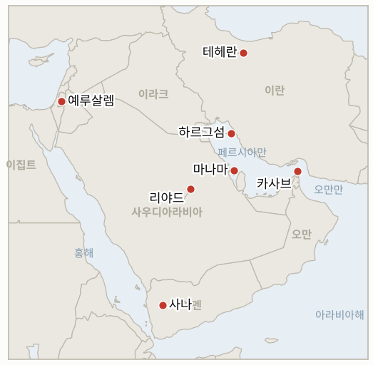

# 중동 일일 브리핑

**2026년 11월 22일**

- **보고 기간:** 약 24시간, 11월 21일 06:00 ~ 11월 22일 06:00 (한국시간)
- **종합 평가:** 이란군과 미군 사이의 이틀간 소강상태가 이란 쪽에서 깨졌다. 토요일 밤 이란의 바레인 공격으로 민간 산업시설에 불이 났다. 약 일주일 사이 네 차례 공격 가운데 피해가 보고된 것은 처음이다(§1.1). 해상에서는 UKMTO가 카사브 인근에서 유조선 2척의 추가 피격을 보고했다(§1.2). 이란은 봉쇄 자체에 대해서도 수위를 높였다. 외무차관이 봉쇄를 전쟁 행위로 규정하며 필요한 모든 조치로 이를 깨겠다고 했고, 하르그섬에는 유조선 14척 이상이 집결했다는 보도가 나왔다(§1.3). 미국은 이란을 타격하지 않았고 트럼프 대통령은 "항구적" 합의를 언급했다. 후티는 리야드에 미사일 3기를 쐈으나 모두 요격됐고, 지다에 대한 위협은 실행하지 않았다(§1.4). 이스라엘에서는 가디 아이젠코트가 일요일부터 리쿠드와 "마라톤" 협상을 하자고 초청했다(§1.5). 시장은 휴장해 금요일 수준이 그대로다. 브렌트는 92.57달러, 코스피는 4,869.96이다. 종합하면, 이란은 걸프 주둔국, 항로, 봉쇄선이라는 세 전선을 동시에 압박하고 있고 미국은 여전히 공격을 자제하고 있다. 하르그섬에서 유조선 선단이 출항하면 미국은 소강상태 덕에 미뤄 온 결정을 내려야 한다.

**정정 및 갱신:**

- 11월 21일자 브리핑은 호르무즈를 지나는 원유 수송이 전쟁 전 수준에 근접했다는 로이터의 서술을 전했다. Iran International이 전한 UKMTO 주간 집계는 11월 18일까지 한 주 동안 해협 통항량이 전쟁 전보다 약 65% 적다고 본다. 두 수치는 측정 대상이 다를 수 있으나(원유 물량과 선박 통항량), 로이터의 서술은 확인되지 않은 것으로 취급해야 한다.

---

## 1. 무슨 일이 있었나

<figure style="float:right; width:46%; margin:2pt 0 8pt 14pt;">

<figcaption style="font-size:8pt; color:#666; text-align:center; margin-top:3pt; font-style:italic;">주요 논의 지점</figcaption>
</figure>

### 1.1 이란의 공격으로 바레인 민간 산업시설에 화재

토요일 저녁 바레인 전역에 사이렌이 울렸고, 이어 내무부는 "극악한 이란의 침략으로 민간 산업시설이 표적이 돼 현장에 화재가 발생했다"며 초기 보고상 물적 피해가 있고 부상자는 없다고 밝혔다. 시설의 이름과 위치는 공개하지 않았다([The Peninsula](https://thepeninsulaqatar.com/article/21/11/2026/iranian-attack-targets-civilian-industrial-facility-in-bahrain-sparks-fire-ministry); [Times of Israel](https://www.timesofisrael.com/liveblog_entry/bahrain-says-iranian-strike-hit-civilian-industrial-facility-sparking-fire-irgc-says-us-bases-targeted/)). 바레인 국영 TV는 방공망이 공격을 요격했다고 전했다. 혁명수비대의 설명은 두 갈래다. 파르스 통신은 셰이크 이사 공군기지와 알주파이르의 미 해군 시설을 표적으로 지목했고, 이후 성명은 미국 드론의 이란 영공 침범에 대한 대응으로 리파와 아왈리의 미군 패트리엇 레이더 2기를 타격했다고 주장했다([Iran International](https://www.iranintl.com/en/liveblog/202611214578)). 미국 당국자는 이번 공격 시도가 미군에 아무 영향도 주지 못했다고 말했다. CBS는 이번을 약 일주일 사이 이란의 네 번째 바레인 공격 시도로 집계하며, 그 가운데 피해가 보고된 것은 이번이 처음이다([CBS News live](https://www.cbsnews.com/live-updates/iran-war-trump-tehran-denies-chemical-weapons/)). 걸프협력회의(GCC)와 요르단은 공격을 규탄했다. 같은 날 앞서 미 중부사령부는 미군 F-16이 피해를 입고 비상 착륙했다는 혁명수비대의 주장을 부인했고, 이란은 케슘섬 상공에서 미국 드론을 격추했다고 밝혔으나 미국은 손실을 확인하지 않았다. 사우디 민방위 당국은 토요일 늦게 메카 지역에 경보를 발령했으며 공격은 보고되지 않았다. **신뢰도: 화재와 바레인 측 발표는 높음; 혁명수비대의 피해 주장과 드론·F-16 주장은 낮음; 메카 경보는 낮음~중간(단일 매체).**

### 1.2 카사브 인근에서 유조선 2척 추가 피격

UKMTO는 토요일 05시(GMT)께 카사브 북쪽 약 11해리 해상에서 호르무즈 해협을 빠져나가던 유조선 1척이 선미에 미상의 발사체를 맞았다고 보고했다. 약 50분 뒤에는 카사브 동쪽 약 17해리 해상에서 유조선 1척이 기관실에 피격됐다고 보고했다. 인명 피해는 보고되지 않았고, 두 보고가 한 척에 관한 것인지 두 척에 관한 것인지는 분명하지 않다([Reuters via gCaptain](https://gcaptain.com/two-tanker-incidents-reported-near-oman-vessel-hit-mine-east-of-hormuz/); [Al Jazeera](https://aljazeera.com/news/2026/11/21/tankers-hit-in-strait-of-hormuz-as-iran-tightens-grip-on-shipping)). 이란 해군은 유조선 1척이 식별 장치를 끈 채 항행하다 해협 동쪽 "제한 구역"에서 기뢰에 접촉해 불이 났다고 밝혔다. 로이터는 이를 검증하지 못했고 두 보고와의 관련성도 확인하지 못했다. 두 선박 모두 선명이 공개되지 않았다. 따라서 금요일 유조선 화재 이후 적어도 별개 선박 1척이 더 피격된 것이며, 11월 16일 이후 카사브 앞바다에서 여섯 번째다. Iran International이 전한 UKMTO 주간 요약은 11월 18일까지 한 주 동안 해협 통항량이 전쟁 전보다 약 65% 적었고 유조선 공격이 6건이며 그중 4건이 해협 안에서 일어났다고 집계했다. 이란 연안 시리크 주민들은 토요일 저녁 바다 쪽에서 큰 폭발음을 들었다고 전했으며 원인은 밝혀지지 않았다. **신뢰도: UKMTO 보고는 높음; 이란의 기뢰 주장은 낮음; 주간 통항량 수치는 중간(전언이며 원문 미확인).**

### 1.3 이란, 봉쇄를 깨겠다고 발언; 하르그섬에 유조선 집결

카젬 가리브아바디 외무차관은 토요일 미국의 봉쇄는 전쟁 행위이며 이란은 이를 깨기 위해 필요한 모든 조치를 하겠다고 말했고, 이 메시지를 미국과 카타르 중재자들에게 전달했다고 밝혔다([Mehr](https://en.mehrnews.com/news/249586/Iran-will-break-US-naval-blockade-Gharibabadi); [Gulf News live](https://gulfnews.com/uae/middle-east-war-trump-says-iran-wants-deal-but-terms-are-unacceptable-1.500755788)). 위성 추적 자료와 이란 매체 보도에 따르면 선원이 탑승한 이란 국적 유조선 14척 이상이 하르그섬 인근에 모여 며칠 안에 오만만 쪽으로 출항할 예정이다. 유로뉴스 페르시아어판은 이를 비공식 보도라고 했고, 출항을 확인하는 자료는 없다([Jerusalem Post](https://www.jpost.com/middle-east/iran-news/article-915644)). 혁명수비대 대변인은 이란 선박이 공격받으면 "더 강하게 타격하겠다"고 말했다. 가리브아바디는 카타르 대표단이 금요일 저녁 테헤란에서 2시간 회담했다고 확인했으며 미국과의 협상은 교착 상태라고 말했다. 아바스 아라그치 외무장관은 봉쇄가 "합리적으로 해제돼야 한다"고 했고 이란의 핵 독트린은 바뀌지 않았다고 말했다. 트럼프 대통령은 폭스뉴스에 "나는 항구적인 합의를 만들 것"이라며 이란 당국자들은 "합의를 하고 다음 날 그 합의를 깬다"고 말했다. 미 중부사령부는 봉쇄 130일째를 맞았다고 밝혔다. 이란 국내에서는 국영 전력회사가 연료 부족으로 일요일부터 약 2시간씩의 순환 정전을 시작한다고 밝혔다. **신뢰도: 발언은 높음; 선단 보도는 낮음~중간.**

### 1.4 연합군, 리야드 상공에서 미사일 3기 요격; 지다는 공격받지 않음

사우디 주도 연합군은 토요일 이른 시각 후티가 리야드를 향해 쏜 "탄도미사일 3기를 요격해 파괴했다"고 밝혔다. 로이터 목격자는 발사체가 하늘을 가로지르는 것을 보고 큰 폭음을 들었으며, AFP 기자는 폭발음을 두 차례 들었다([Jerusalem Post](https://www.jpost.com/middle-east/article-915616); [AFP via Yahoo](https://www.yahoo.com/news/world/articles/saudi-coalition-launches-special-operation-183355371.html)). 연합군은 미사일·드론 시설과 보급 창고를 포함한 사나의 군사 표적을 다시 타격했다고 밝혔고, 후티 매체는 모카의 파손된 발전소 영상을 내보냈다. 후티는 24시간 동안 어린이 11명을 포함해 41명이 숨졌다는 집계를 되풀이했고, 사우디가 지원하는 예멘 정부군은 후티 전투원 193명을 사살하거나 부상시켰다고 주장했다. AFP는 어느 쪽 수치도 검증하지 못했다. 보고 기간 중 지다나 얀부를 향해 미사일이나 드론이 발사됐다는 보도는 없었고, 지다를 떠나겠다고 공개적으로 밝힌 해운사도 없다. 이와 별도로 사우디 국영 통신은 일본이 1,600만 배럴의 추가 저장 시설을 제공하고 사우디 원유를 최대 800만 배럴까지 살 수 있는 합의를 보도했다. **신뢰도: 요격 주장과 사나 공습은 높음; 사상자 수치는 모두 낮음~중간.**

### 1.5 아이젠코트, 리쿠드를 마라톤 협상에 초청

가디 아이젠코트의 야샤르는 토요일 "가능한 한 폭넓은 정부를 구성하려는 진정한 의지"에서 리쿠드를 일요일부터 시작하는 "마라톤 연쇄 협상"에 초청했다고 밝혔다([France 24](https://www.france24.com/en/middle-east/20261121-eisenkot-invites-netanyahu-s-party-for-marathon-israeli-coalition-talks); [Haaretz](https://www.haaretz.com/israel-news/israel-politics/2026-11-21/ty-article/.premium/eisenkot-seeks-marathon-of-talks-with-likud-as-bennett-rules-out-netanyahu/000001a1-ff3d-d381-ade5-fffd68400000)). 리쿠드는 조건으로 답했다. 베냐민 네타냐후에 대한 "정치적 보이콧" 중단, 리쿠드가 테러 지지 세력이라 부르는 정당들을 배제한다는 선언, 팔레스타인 국가 반대, 가자·레바논·시리아의 안보 구역 유지다([Times of Israel](https://www.timesofisrael.com/liveblog-november-21-2026/)). 나프탈리 베네트는 아이젠코트가 이끄는 통합 정부를 지지하며 자신의 당은 네타냐후나 그의 진영에 합류하지 않겠다고 말했다. 라암 대표 만수르 아바스는 "아이젠코트가 이끄는 정부가 구성될 것"이라고 말했다. 이스라엘군 대변인은 이란과의 전쟁 재개 계획 보도가 나오는 가운데 대민 행동 지침에는 변화가 없다고 밝혔다. 가자시티에서는 이스라엘의 차량 공습으로 남성 3명이 숨졌다. 이스라엘군은 이들이 구호 요원으로 위장한 이슬라믹 지하드 대원이라고 했고, 목격자들은 차량이 구호품을 싣고 있었다고 말했다. **신뢰도: 초청과 공개 발언은 높음; 가자 공습의 세부 내용은 중간.**

---

## 2. 심층 분석: 유인과 동기

### 2.1 이란은 왜 이틀간 잠잠하다가 바레인 공격을 재개했나?

트럼프 대통령이 새해까지 기다리겠다고 말한 뒤 이어진 소강상태는 합의가 아니었다. 양측이 쏘지 않기로 각자 선택한 결과였을 뿐이다. 이란이 내세운 토요일 공격의 이유는 미국 드론의 영공 침범이고, 같은 날 내놓은 드론 격추와 F-16 손상 주장도 그 서사에 맞는다. 그러나 더 그럴듯한 동인은 협상력이다. 트럼프는 1월 전에는 결정하지 않겠다고 했고 자신의 조건에 맞는 "항구적" 합의를 원한다. 이는 이란이 아무런 제안도 받지 못한 채 몇 주간 봉쇄를 견뎌야 한다는 뜻이다. 바레인 공격은 걸프 주둔국들에 미군 기지를 두는 비용을 상기시키고, 이들은 그동안 미국에 자제를 촉구해 왔다. 지금까지는 공격이 모두 요격됐다. 민간 공장의 화재는 바레인이 치르는 비용을 바꾸며, 몇 시간 만에 나온 GCC 성명이 이를 보여 준다. 그 타격이 조준된 것인지 잔해에 의한 것인지 이란은 밝히지 않았고, 그 모호함 역시 이란에 유리하다.

### 2.2 이란은 왜 지금 봉쇄를 깨겠다고 말하나?

봉쇄가 국내에서 타격을 주기 시작했고 우회로가 막히고 있기 때문이다. 연료가 모자라 일요일부터 순환 정전이 시작된다. 미국 재무장관은 이란이 이미 판 원유의 대금을 영영 받지 못할 수 있다고 말했고, 미 중부사령부는 지난주 봉쇄 규칙을 선박 간 환적에까지 넓혔다. 선원이 탄 이란 국적 유조선 선단은 선택을 미국에 떠넘긴다. 원유를 통과시키면 봉쇄는 유명무실해지고, 선박을 무력화하면 이란 강경 매체가 이미 위협한 대로 걸프 에너지 시설을 타격할 명분을 이란에 주게 된다. 봉쇄를 미리 "전쟁 행위"라고 부르는 것은 그 논리를 준비하는 일이다. 보도는 비공식이며 중재자들을 겨냥한 허세일 수 있다. 가리브아바디는 경고가 중재자들에게 전달됐다는 점을 굳이 밝혔다. 그러나 허세라 해도 기다리겠다는 트럼프의 의사가 어디까지인지를 시험한다.

### 2.3 후티는 왜 리야드를 다시 치고 지다는 건드리지 않았나?

지다에 대한 위협은 발사 없이도 이미 일정한 효과를 냈다. 해운사와 항공사는 이제 서면 경고를 따져 봐야 하고 보험사는 이를 가격에 반영할 것이다. 실행은 다른 단계다. 지다는 메카의 관문이고, 후티는 두 성지 상공의 영공은 예외로 두는 데 신경을 썼다. 그곳을 타격하면 무슬림 여론에서 대가를 치르고 사우디 국민을 장기전 지지로 결집시킬 수 있다. 리야드는 후티에게 더 안전한 표적이다. 정부 소재지이자 후티가 투자자들에게 떠나라고 한 금융지구가 있는 곳이며, 요격될 때마다 영공이 닫히고 수도가 동요한다. 지다를 남겨 두면 연합군이 호데이다항을 다시 칠 경우에 쓸 다음 단계도 확보된다.

### 2.4 아이젠코트는 왜 네타냐후가 물러나야 한다면서 리쿠드를 초청하나?

초청은 비용이 거의 들지 않고 차선책을 지켜 준다. 베네트와 리베르만은 모두 폭넓은 정부를 선호하고 아랍 정당에 기대는 정부를 꺼리므로, 아이젠코트는 이들에게 소수 내각에 찬성표를 요청하기 전에 통합 경로를 다 써 봤다는 것을 보여야 한다. 총리 네타냐후가 아니라 정당으로서의 리쿠드와 협상하는 것은 리쿠드 안에 네타냐후 없이 움직일 사람이 있는지도 떠보는 일이다. 리쿠드의 답은 한계를 드러낸다. 그 조건은 라암과 조인트 리스트를 배제하도록 쓰였는데, 이들이 바로 아이젠코트의 비상정부에 필요한 표다. 양측은 협상이 결렬될 조건을 각자 쓰고 있다. 아이젠코트에게 쓸모 있는 결과는 약속한 표결 전에 리쿠드 탓으로 돌릴 수 있는 짧고 눈에 띄는 결렬이다.

---

## 3. 한국에 대한 정책적 함의

**익스포저 현황:** 한국은 원유의 약 70.7%, LNG의 20.4%를 중동에서 들여온다(`instructions/korea-exposure.md`, 갱신 불필요). 토요일은 휴장이어서 금요일 수준이 그대로다. 브렌트 92.57달러, WTI 83.98달러, 코스피는 5.21% 내린 4,869.96, 원·달러 환율은 1,336.2원이다. 주간으로 브렌트는 3.4%, WTI는 5.2% 내렸고 코스피는 7.9% 떨어졌으며 원화는 거의 변동이 없었다. 외국인은 유가증권시장에서 6거래일 연속 순매도했고, 국내 언론은 11월 18일 기준 올해 외국인 누적 순매도가 222조 원을 넘었다고 전했다([Nate/Yonhap](https://m.news.nate.com/view/20261118n15098)). 1차 출처의 호르무즈 일일 통항량은 찾지 못했다. UKMTO 주간 집계는 통항량이 전쟁 전보다 약 65% 적다고 본다. 청해부대 동의안은 여전히 국회에 계류 중이며 표결은 보도되지 않았다.

**사안별 함의:**

- **바레인(§1.1):** 공격 재개 이후 걸프 주둔국의 민간 산업시설에 피해가 보고된 것은 처음이다. 바레인과 인접국에서 건설·에너지 서비스 계약을 보유한 한국 기업에 중요한 사안이다(`instructions/korea-exposure.md`). 피해를 낳는 공격이 한 번 더 일어나면 이들 사업의 보험료와 인력 운용 비용이 오르고 미국이 대응할 가능성도 커진다(IND-20261122-2, IND-20261119-1).
- **카사브 앞바다 유조선(§1.2):** 한국행 화물이 이용하는 항로에서 엿새 동안 적어도 6척이 피격됐다. 통항량이 전쟁 전보다 약 65% 적다면 흐름이 정상화됐다는 앞선 판단은 성립하지 않는다. 한국인 선원의 위험은 그대로이며, 이는 국회의 청해부대 표결이 놓인 배경이다(IND-20261112-1).
- **봉쇄와 하르그섬 선단(§1.3):** 다음 주의 가장 큰 위험이다. 미군이 이란 유조선을 무력화하고 이란이 자국 매체의 위협대로 걸프 에너지 시설에 보복하면, 위태로워지는 것은 이란산 원유가 아니라 한국이 사들이는 걸프산 물량이다. 월요일 유가 개장이 시장이 이를 얼마나 심각하게 보는지 보여 줄 것이다(IND-20261122-1, IND-20261122-3, IND-20261115-1).
- **리야드와 지다(§1.4):** 한국행 사우디 원유가 호르무즈를 피해 선적되는 얀부는 공격받지 않았다. 위협은 그대로다. 사우디와 일본의 저장 합의는 같은 처지의 수입국이 산유국을 통해 공급 안정을 보강하는 사례이며, 한국은 같은 목적으로 비축유 스와프를 활용해 왔다(IND-20261121-1, IND-20261116-2).
- **이스라엘(§1.5):** 정부 구성 협상이 길어질수록 이란 재타격이 논의되는 기간에 네타냐후가 과도 총리로 남는 시간도 길어진다(IND-20261114-1).
- **시장:** 월요일 서울 증시는 한 주간의 외국인 매도를 뒤로하고 새로운 걸프 위험을 앞에 둔 채 열린다. 금요일 급락은 미국 기술주에서 비롯됐고, 주말 사이 이란의 수위 상승은 신중해야 할 두 번째 이유를 더한다(IND-20261121-3, IND-20261120-3, IND-20261119-3, IND-20261023-1).

**오늘 종결:**

- **IND-20261121-2: 확증.** UKMTO는 토요일 카사브 북쪽 약 11해리에서 유조선 1척이 선미에, 동쪽 약 17해리에서 유조선 1척이 기관실에 피격됐다고 보고했다. 두 보고가 한 척에 관한 것이라 해도 여섯 번째 별개 선박이다. 하루 만에 종결됐다.
- **IND-20261114-2: 반증.** 11월 21일까지 호르무즈 해협 또는 인근에서 선명이 확인된 LNG 운반선의 피해는 독립적으로 확인되지 않았다. 이번 주 피격된 선박은 원유 또는 LPG 운반선이었고 대부분 선명이 공개되지 않았다.

**검증 가능한 지표:**

- **IND-20261122-1** (진행, 신규): 2026년 11월 29일께까지 미군이 하르그섬에서 출항한 이란 유조선을 정지·무력화·나포했다거나 이란 유조선 여러 척이 봉쇄선을 통과했다고 미 중부사령부 성명이나 주요 통신사가 전하면 봉쇄를 깨려는 실제 시도로 확증; 둘 다 없으면 반증.
- **IND-20261122-2** (진행, 신규): 2026년 11월 29일께까지 바레인 정부가 자국 영토에 피해나 사상자를 낸 이란의 추가 공격을 발표하면 토요일의 타격이 일회성이 아닌 것으로 확증; 없으면 반증.
- **IND-20261122-3** (진행, 신규): 2026년 11월 27일께까지 어느 거래일이든 브렌트가 95달러 위에서 정산되면 시장이 걸프 위험을 다시 가격에 반영하는 것으로 확증; 없으면 반증.
- **IND-20261121-1** (진행): 리야드 상공에서 미사일 3기 요격; 지다나 얀부를 향한 발사 보도 없음.
- **IND-20261121-3** (진행): 휴장; 코스피 4,869.96 그대로.
- **IND-20261120-1** (진행): 카타이브 헤즈볼라 부대가 주르프 알사카르를 떠났다는 발표 없음.
- **IND-20261120-3** (진행): 휴장; 외국인 6거래일 연속 순매도.
- **IND-20261119-1** (진행): 공개된 미국의 2차 타격 없음; 미 중부사령부는 금요일 케슘섬 타격 보도를 부인.
- **IND-20261119-3** (진행): 휴장; 원·달러 1,336.2원 그대로.
- **IND-20261115-1** (진행): 휴장; 브렌트 92.57달러 그대로.
- **IND-20261114-1** (진행): 호르무즈 연안 너머에 대한 미국이나 이스라엘의 타격 없음; CBS는 양국이 새 공격을 검토 중이라고 보도.
- **IND-20261115-2** (진행): IAEA 이사회가 11월 18일부터 열렸으나 이란 결의 채택 보도 없음.
- **IND-20261116-2** (진행): 바브엘만데브 인근 선박에 대한 후티 공격을 전한 UKMTO 보고 없음.
- **IND-20261117-1** (진행): 후티 병력이 아덴 50km 이내에 있다는 보도 없음.
- **IND-20261112-1, IND-20261113-2, IND-20261114-3, IND-20261023-1, IND-20260714-4** (진행): `tracking/indicators.md` 참조.

---

## 4. 관찰 목록

- **유조선이 하르그섬을 떠나는지, 미군이 어떻게 대응하는지 (IND-20261122-1).**
- **이란의 추가 바레인 공격 여부, 피해 시설의 확인, 미국의 대응 여부 (IND-20261122-2, IND-20261119-1).**
- **토요일 피격된 유조선의 선명과 상태, 카사브 앞바다 공격의 지속 여부.**
- **주말 사이 수위가 오른 뒤의 월요일 유가 개장. 미국 연휴로 거래가 한산한 주이며 11월 29일 OPEC+ 회의를 앞두고 있다 (IND-20261122-3, IND-20261115-1).**
- **후티가 지다 위협을 실행하는지, 보험사나 해운사의 대응 (IND-20261121-1).**
- **일요일 야샤르와 리쿠드의 협상, 아이젠코트가 정할 표결 날짜.**
- **카타르 대표단의 테헤란 방문 후속 조치와 미국의 답변.**
- **이란의 순환 정전과 국내 불안 조짐.**
- **카타이브 헤즈볼라 부대가 주르프 알사카르에서 철수를 시작하는지 (IND-20261120-1).**
- **월요일 서울 증시 개장, 외국인 수급과 원화; 한국은행의 11월 결정 (IND-20261121-3, IND-20261120-3, IND-20261023-1).**
- **국회의 청해부대 동의안 처리 (IND-20261112-1).**

---

## 5. 출처 신뢰도 요약

| 주장 | 출처 | 신뢰도 |
| --- | --- | --- |
| 이란의 공격으로 바레인 민간 산업시설에 화재; 물적 피해, 부상자 없음 | 바레인 내무부 via The Peninsula, Times of Israel, CBS | 높음 |
| 바레인 방공망이 공격을 요격 | 바레인 국영 TV via Gulf News | 높음(주장) |
| 혁명수비대가 셰이크 이사와 알주파이르를 겨냥; 이후 리파와 아왈리의 패트리엇 레이더 타격 주장 | Fars, 혁명수비대 via Iran International | 낮음(피해) |
| 미군에 영향 없음 | 미국 당국자 via CBS | 중간~높음 |
| 약 일주일 사이 이란의 네 번째 바레인 공격 시도 | CBS | 중간~높음 |
| GCC와 요르단이 공격을 규탄 | Iran International | 중간~높음 |
| 미 중부사령부, 미군 F-16 손상 주장을 부인 | 미 중부사령부 via Jerusalem Post, Gulf News | 높음 |
| 이란이 케슘섬 상공에서 미국 드론 격추 | 이란 국영 TV via Gulf News, CBS | 낮음 |
| 사우디 민방위 당국의 메카 지역 경보, 공격 보고 없음 | Iran International | 낮음~중간 |
| 카사브 북쪽 약 11해리에서 유조선 선미 피격; 동쪽 약 17해리에서 유조선 기관실 피격; 인명 피해 없음 | UKMTO via Reuters (gCaptain), Al Jazeera | 높음 |
| 유조선 1척이 해협 동쪽에서 기뢰에 접촉해 화재 | 이란 해군 via Reuters | 낮음 |
| 11월 18일까지 한 주 호르무즈 통항량이 전쟁 전보다 약 65% 적음; 유조선 공격 6건 | UKMTO via Iran International | 중간 |
| 가리브아바디: 봉쇄는 전쟁 행위; 이란은 이를 깨기 위해 필요한 모든 조치를 할 것 | Mehr, Gulf News, Jerusalem Post | 높음(발언) |
| 이란 국적 유조선 14척 이상이 하르그섬에 집결 | 위성 추적 자료와 이란 매체 via Jerusalem Post, Euronews Persian | 낮음~중간 |
| 카타르 대표단이 테헤란에서 2시간 회담 | 가리브아바디 via CBS, Gulf News | 높음 |
| 트럼프: "나는 항구적인 합의를 만들 것" | 폭스뉴스 통화 via CBS | 높음 |
| 이란, 일요일부터 순환 정전 | 타바니르 via Iran International, Gulf News | 중간~높음 |
| 리야드 상공에서 탄도미사일 3기 요격 | 연합군 via Reuters (Jerusalem Post), AFP | 높음(주장) |
| 연합군의 사나 공습; 모카 발전소 파손 | 연합군, 후티 매체 via AFP | 중간~높음 |
| 24시간 동안 41명 사망; 후티 전투원 193명 사상 | 후티 매체; 예멘 정부군 via AFP | 낮음~중간 |
| 보고 기간 중 지다나 얀부에 대한 공격 없음 | AFP, Reuters, CBS (보도 부재) | 중간~높음 |
| 사우디와 일본의 저장 및 원유 합의 | 사우디 국영 통신 via Gulf News | 중간~높음 |
| 야샤르가 일요일부터 리쿠드를 마라톤 협상에 초청 | 야샤르 성명 via France 24, Haaretz | 높음 |
| 리쿠드의 협상 조건 | Times of Israel | 중간~높음 |
| 베네트, 네타냐후나 그의 진영에 합류하지 않겠다고 발언 | Jerusalem Post, Times of Israel | 높음 |
| 이스라엘의 가자시티 차량 공습으로 3명 사망 | 시파 병원, 이스라엘군 via Times of Israel, Gulf News | 중간 |
| 올해 외국인의 코스피 누적 순매도 222조 원 초과 | 국내 언론 via Nate | 중간 |
| 브렌트 92.57달러, WTI 83.98달러, 코스피 4,869.96, 원·달러 1,336.2원 (금요일; 토요일 휴장) | 전일 브리핑; 유가는 Gulf News | 높음 |
| 호르무즈 일일 통항량 | 1차 출처 수치 없음 | 미보고 |
