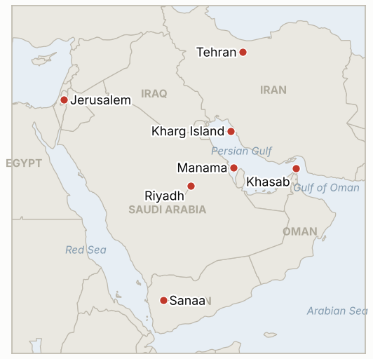

# Middle East Daily Briefing

**November 22, 2026**

- **Reporting window:** ~24 hours, November 21, 06:00 to November 22, 06:00 KST
- **Overall assessment:** The two day pause between Iranian and US forces ended on the Iranian side. An Iranian attack on Bahrain on Saturday night set a civilian industrial facility on fire, the first damage reported there in four attacks in about a week (§1.1). At sea, UKMTO reported two more tankers struck near Khasab (§1.2). Tehran also raised the stakes on the blockade itself: its deputy foreign minister called it an act of war that Iran will break by any action necessary, while more than 14 tankers are reported gathered at Kharg Island (§1.3). The United States did not strike Iran, and President Trump spoke of a "permanent" deal. The Houthis fired three missiles at Riyadh, all intercepted, but did not carry out their threat against Jeddah (§1.4). In Israel, Gadi Eisenkot invited Likud to "marathon" talks from Sunday (§1.5). Markets were closed; Friday's levels stand, with Brent at $92.57 and the KOSPI at 4,869.96. Net: Iran is now pressing on three fronts at once (a Gulf host, the shipping lane and the blockade line) while Washington still holds its fire, and a tanker convoy from Kharg would force a US decision that the pause has so far avoided.

**Corrections and updates:**

- The November 21 brief relayed a Reuters line that crude shipments through Hormuz had returned to roughly pre-war levels. UKMTO's weekly figures, as carried by Iran International, put shipping through the strait about 65% below pre-war levels in the week ending November 18. The two may measure different things (crude volume against vessel traffic), but the Reuters line should be treated as unconfirmed.

---

## 1. What Happened

<figure style="float:right; width:46%; margin:2pt 0 8pt 14pt;">

<figcaption style="font-size:8pt; color:#666; text-align:center; margin-top:3pt; font-style:italic;">Major places of discussion</figcaption>
</figure>

### 1.1 An Iranian attack sets a civilian industrial facility in Bahrain on fire

Sirens sounded across Bahrain on Saturday evening, and the Interior Ministry then said that "as a result of the heinous Iranian aggression, a civilian industrial facility was targeted, causing a fire at the site," with material damage and no injuries in preliminary reports. It did not name or locate the facility ([The Peninsula](https://thepeninsulaqatar.com/article/21/11/2026/iranian-attack-targets-civilian-industrial-facility-in-bahrain-sparks-fire-ministry); [Times of Israel](https://www.timesofisrael.com/liveblog_entry/bahrain-says-iranian-strike-hit-civilian-industrial-facility-sparking-fire-irgc-says-us-bases-targeted/)). Bahraini state television said air defences intercepted the attacks. The Revolutionary Guards gave two accounts: Fars named Sheikh Isa Air Base and the US naval facility in Juffair as targets, and a later statement claimed hits on two US Patriot radars at Riffa and Awali, in answer to alleged US drone flights over Iran ([Iran International](https://www.iranintl.com/en/liveblog/202611214578)). A US official said the attempts had no impact on US forces. CBS counts this as the fourth attempted Iranian attack on Bahrain in about a week, and it is the first of them reported to have caused damage ([CBS News live](https://www.cbsnews.com/live-updates/iran-war-trump-tehran-denies-chemical-weapons/)). The GCC and Jordan condemned the attack. Earlier in the day CENTCOM denied an IRGC claim that a US F-16 had been damaged and forced to land, and Iran said it shot down a US drone over Qeshm; Washington has confirmed no loss. Saudi Civil Defense issued an alert for the Mecca region late on Saturday, with no attack reported. **Confidence: High on the fire and the Bahraini statement; Low on IRGC damage claims and on the drone and F-16 claims; Low to Medium on the Mecca alert (single outlet).**

### 1.2 Two more tankers are struck near Khasab

UKMTO reported on Saturday that a tanker sailing out of the Strait of Hormuz was hit on the stern by an unknown projectile about 11 nautical miles north of Khasab, at around 05:00 GMT. Roughly 50 minutes later it reported a tanker hit in the engine room about 17 nautical miles east of the town. No casualties were reported and it is not clear whether the two reports concern one ship or two ([Reuters via gCaptain](https://gcaptain.com/two-tanker-incidents-reported-near-oman-vessel-hit-mine-east-of-hormuz/); [Al Jazeera](https://aljazeera.com/news/2026/11/21/tankers-hit-in-strait-of-hormuz-as-iran-tightens-grip-on-shipping)). Iran's navy said an oil tanker caught fire after hitting a mine in a "restricted area" east of the strait while sailing with its identification systems off; Reuters could not verify this or link it to either report. Neither vessel is named. At least one more distinct ship has therefore been hit since Friday's tanker fire, the sixth off Khasab since November 16. UKMTO's weekly summary, as carried by Iran International, put shipping through the strait about 65% below pre-war levels in the week to November 18 and counted six tanker attacks, four of them in the strait. Residents of Sirik on the Iranian shore reported a loud blast at sea on Saturday evening, unexplained. **Confidence: High on the UKMTO reports; Low on the Iranian mine claim; Medium on the weekly traffic figure (relayed, not seen first hand).**

### 1.3 Iran says it will break the blockade as tankers gather at Kharg

Deputy Foreign Minister Kazem Gharibabadi said on Saturday that the US blockade is an act of war and that Iran will take any action necessary to break it, a message he said had been passed to US and Qatari mediators ([Mehr](https://en.mehrnews.com/news/249586/Iran-will-break-US-naval-blockade-Gharibabadi); [Gulf News live](https://gulfnews.com/uae/middle-east-war-trump-says-iran-wants-deal-but-terms-are-unacceptable-1.500755788)). Satellite tracking data and Iranian media reports say more than 14 crewed, Iranian flagged tankers are assembling near Kharg Island to sail toward the Gulf of Oman in the coming days; Euronews Persian called the reports unofficial, and nothing confirms a departure ([Jerusalem Post](https://www.jpost.com/middle-east/iran-news/article-915644)). An IRGC spokesman said that if Iranian vessels are attacked "we will strike harder." Gharibabadi also confirmed that a Qatari delegation held two hours of talks in Tehran on Friday evening and said negotiations with Washington have stalled. Foreign Minister Abbas Araghchi said the blockade "must be lifted rationally" and that Iran's nuclear doctrine has not changed. President Trump told Fox News "I'm going to make a deal that is going to be permanent," and said Iran's officials "make a deal and then they break the deal the next day." CENTCOM marked the 130th day of the blockade. Inside Iran, the state power company said rolling cuts of about two hours begin on Sunday because of fuel shortages. **Confidence: High on the statements; Low to Medium on the convoy reports.**

### 1.4 The coalition intercepts three missiles over Riyadh and Jeddah is not attacked

The Saudi led coalition said its air defences "intercepted and destroyed three ballistic missiles" fired by the Houthis toward Riyadh early on Saturday; a Reuters witness saw a projectile cross the sky and heard a loud bang, and an AFP journalist heard two explosions ([Jerusalem Post](https://www.jpost.com/middle-east/article-915616); [AFP via Yahoo](https://www.yahoo.com/news/world/articles/saudi-coalition-launches-special-operation-183355371.html)). The coalition said it again struck military targets in Sanaa, including missile and drone sites and a supply depot, and Houthi media showed a damaged power station at Mocha. The Houthis repeated a toll of 41 dead in 24 hours, including 11 children; Yemen's Saudi backed forces claimed 193 Houthi fighters killed or wounded. AFP could verify neither. No missile or drone was reported fired at Jeddah or Yanbu in the window, and no shipping line has publicly said it is leaving Jeddah. Separately, the Saudi Press Agency reported a deal under which Japan provides 16 million barrels of additional storage and may buy up to 8 million barrels of Saudi crude. **Confidence: High on the interception claim and the Sanaa strikes; Low to Medium on all casualty figures.**

### 1.5 Eisenkot invites Likud to marathon talks

Gadi Eisenkot's Yashar party said on Saturday that it has invited Likud to a "marathon series of talks" beginning Sunday, out of a "genuine commitment to forming the broadest possible government" ([France 24](https://www.france24.com/en/middle-east/20261121-eisenkot-invites-netanyahu-s-party-for-marathon-israeli-coalition-talks); [Haaretz](https://www.haaretz.com/israel-news/israel-politics/2026-11-21/ty-article/.premium/eisenkot-seeks-marathon-of-talks-with-likud-as-bennett-rules-out-netanyahu/000001a1-ff3d-d381-ade5-fffd68400000)). Likud answered with conditions: an end to "political boycotts" of Benjamin Netanyahu, a declaration excluding parties it calls supporters of terror, opposition to a Palestinian state, and keeping security zones in Gaza, Lebanon and Syria ([Times of Israel](https://www.timesofisrael.com/liveblog-november-21-2026/)). Naftali Bennett backed a unity government under Eisenkot and said his party will not join Netanyahu or his bloc. Ra'am leader Mansour Abbas said "a government headed by Eisenkot will be formed." The Israeli military spokesman said public safety guidelines are unchanged amid reports of plans to renew the war with Iran. In Gaza City an Israeli strike on a vehicle killed three men; the military said they were Islamic Jihad operatives posing as aid workers, and witnesses said the vehicle carried aid. **Confidence: High on the invitation and public statements; Medium on the Gaza strike details.**

---

## 2. Deep Dive: Incentives and Motives

### 2.1 Why did Iran return to attacking Bahrain after two quiet days?

The pause that followed President Trump's remark about waiting until the New Year was never an agreement. It was two sides choosing not to fire. Iran's stated reason for Saturday's attack is US drone flights over its territory, and its claims of a downed drone and a damaged F-16 on the same day suit that story. The more likely driver is leverage. Trump has said he will not decide before January and wants a "permanent" deal on his terms, which leaves Tehran facing weeks of blockade with nothing on offer. Attacks on Bahrain remind Gulf hosts of what US basing costs them, and those hosts have been urging Washington toward restraint. Until now the attacks were all intercepted. A fire at a civilian plant changes the cost for Bahrain, and the GCC's statement within hours shows it. Whether the hit was aimed or was debris, Iran has not said, and that ambiguity also serves it.

### 2.2 Why is Tehran talking about breaking the blockade now?

Because the blockade is beginning to bite at home and the alternative routes are closing. Rolling power cuts start on Sunday for want of fuel. The Treasury secretary has said Iran may never be paid for oil it has already sold, and CENTCOM widened its rules last week to cover ship to ship transfers. A convoy of crewed, Iranian flagged tankers would put the choice on Washington: let the oil through and the blockade is hollow, or disable the ships and hand Iran a reason to strike Gulf energy sites, as its hardline press has already threatened. Calling the blockade "an act of war" in advance prepares that argument. The reports are unofficial and may be a bluff meant for the mediators; Gharibabadi made a point of saying the warning had been delivered to them. But even as a bluff it tests how far Trump's wish to wait extends.

### 2.3 Why did the Houthis strike Riyadh again and leave Jeddah alone?

The threat to Jeddah has already done some work without a launch. Shipping companies and airlines now have to weigh a written warning, and insurers will price it. Carrying it out would be a different step: Jeddah is the gateway to Mecca, and the Houthis took care to exempt the airspace over the holy cities. A hit there would cost them with Muslim opinion and could unite the Saudi public behind a longer war. Riyadh is the safer target for them. It is the seat of the government and of the financial district they have told investors to leave, and each interception still closes airspace and unsettles the capital. Holding Jeddah in reserve also keeps a rung on the ladder if the coalition returns to Hodeidah port.

### 2.4 Why is Eisenkot inviting Likud after saying Netanyahu must go?

The invitation costs him little and protects his fallback. Bennett and Liberman both prefer a broad government and dislike one that leans on Arab parties, so Eisenkot must be seen to exhaust the unity route before he asks them to vote for a minority cabinet. Talks with Likud as a party, not with Netanyahu as prime minister, also probe whether anyone in Likud will move without him. Likud's reply shows the limits: its conditions are written to exclude Ra'am and the Joint List, which are exactly the votes Eisenkot's emergency government would need. Each side is drafting the terms on which the talks will fail. For Eisenkot the useful outcome is a short, visible failure that he can blame on Likud before the vote he has promised.

---

## 3. Policy Implications for South Korea

**Exposure snapshot:** South Korea draws about 70.7% of its crude and 20.4% of its LNG from the Middle East (`instructions/korea-exposure.md`, no update needed). Markets were closed on Saturday, so Friday's levels stand: Brent $92.57, WTI $83.98, the KOSPI 4,869.96 after a 5.21% fall, and the won at 1,336.2 per dollar. Over the week Brent fell 3.4% and WTI 5.2%, the KOSPI lost 7.9%, and the won was almost unchanged. Foreign investors have net sold on the KOSPI main board for six straight sessions, and Korean press put their net selling for the year above 222 trillion won as of November 18 ([Nate/Yonhap](https://m.news.nate.com/view/20261118n15098)). No daily Hormuz transit count from a primary source was found; UKMTO's weekly figure puts traffic about 65% below pre-war levels. The Cheonghae Unit motion is still before the National Assembly, with no vote reported.

**Implications by development:**

- **Bahrain (§1.1):** The first reported damage to a civilian industrial site in a Gulf host since the attacks resumed matters for Korean firms, which hold construction and energy service contracts in Bahrain and its neighbours (`instructions/korea-exposure.md`). A second damaging attack would raise insurance and staffing costs for those projects and the odds of a US response (IND-20261122-2, IND-20261119-1).
- **Tankers off Khasab (§1.2):** At least six ships have been hit in six days in the lane that Korean bound cargoes use. With traffic about 65% below pre-war levels, the earlier reading that flows had normalised does not hold. Risk to Korean crews is unchanged, and it is the context for the Assembly's vote on the Cheonghae Unit (IND-20261112-1).
- **Blockade and the Kharg convoy (§1.3):** This is the main risk for the coming week. If US forces disable Iranian tankers and Iran answers against Gulf energy sites, as its press has threatened, the supply at stake is the Gulf output Korea buys, not Iranian oil. Monday's oil open will show how seriously traders take it (IND-20261122-1, IND-20261122-3, IND-20261115-1).
- **Riyadh and Jeddah (§1.4):** Yanbu, where Saudi crude for Korea loads to avoid Hormuz, was not attacked. The threat stands. The Saudi and Japanese storage deal shows a peer importer adding supply security through the producer; Seoul has used reserve swaps for the same purpose (IND-20261121-1, IND-20261116-2).
- **Israel (§1.5):** The longer government talks run, the longer Netanyahu remains caretaker during the period when a renewed strike on Iran is being discussed (IND-20261114-1).
- **Markets:** Monday's Seoul session opens with a week of foreign selling behind it and fresh Gulf risk ahead. Friday's fall came from US technology shares; a weekend of Iranian escalation adds a second reason for caution (IND-20261121-3, IND-20261120-3, IND-20261119-3, IND-20261023-1).

**Resolved today:**

- **IND-20261121-2: Confirmed.** UKMTO reported on Saturday a tanker hit on the stern about 11 nautical miles north of Khasab and a tanker hit in the engine room about 17 nautical miles east of it. Even if both reports concern one ship, it is a sixth distinct vessel. Resolved in one day.
- **IND-20261114-2: Falsified.** No named LNG carrier was independently confirmed damaged in or near Hormuz by November 21. The ships struck during the week were oil or LPG tankers, most of them unnamed.

**Testable indicators:**

- **IND-20261122-1** (open, new): A CENTCOM statement or major wire report by ~2026-11-29 that US forces stopped, disabled or seized an Iranian tanker sailing from Kharg Island, or that a group of Iranian tankers passed the blockade line, confirms a real attempt to break the blockade; neither falsifies.
- **IND-20261122-2** (open, new): A Bahraini government report by ~2026-11-29 of a further Iranian attack that causes damage or casualties on Bahraini soil confirms that Saturday's hit was not a one off; none falsifies.
- **IND-20261122-3** (open, new): A Brent settlement above $95 on any session by ~2026-11-27 confirms the market is repricing Gulf risk; none falsifies.
- **IND-20261121-1** (open): three missiles intercepted over Riyadh; nothing reported fired at Jeddah or Yanbu.
- **IND-20261121-3** (open): no session; KOSPI stands at 4,869.96.
- **IND-20261120-1** (open): no statement that Kataib Hezbollah units have left Jurf al-Sakhar.
- **IND-20261120-3** (open): no session; six straight sessions of foreign net selling.
- **IND-20261119-1** (open): no second US strike disclosed; CENTCOM denied Friday's reported strike on Qeshm.
- **IND-20261119-3** (open): no session; won stands at 1,336.2.
- **IND-20261115-1** (open): no session; Brent stands at $92.57.
- **IND-20261114-1** (open): no US or Israeli strike beyond the Hormuz coast; CBS says both are considering a new assault.
- **IND-20261115-2** (open): the IAEA Board met from November 18; no resolution on Iran reported adopted.
- **IND-20261116-2** (open): no UKMTO report of a Houthi attack on shipping near the Bab el-Mandeb.
- **IND-20261117-1** (open): no report of Houthi forces within 50 km of Aden.
- **IND-20261112-1, IND-20261113-2, IND-20261114-3, IND-20261023-1, IND-20260714-4** (open): see `tracking/indicators.md`.

---

## 4. Watch List

- **Whether tankers leave Kharg Island and how US forces respond (IND-20261122-1).**
- **Any further Iranian attack on Bahrain, identification of the damaged facility, and whether Washington answers (IND-20261122-2, IND-20261119-1).**
- **Names and condition of the tankers hit on Saturday, and whether the attacks off Khasab continue.**
- **Monday's oil open after a weekend of escalation, in a thin US holiday week before the OPEC+ meeting on November 29 (IND-20261122-3, IND-20261115-1).**
- **Whether the Houthis act on the Jeddah threat, and any insurer or shipping line response (IND-20261121-1).**
- **Sunday's talks between Yashar and Likud, and the date Eisenkot sets for a vote.**
- **Follow up to the Qatari visit to Tehran and any reply from Washington.**
- **Rolling power cuts in Iran and signs of domestic strain.**
- **Whether Kataib Hezbollah units begin to leave Jurf al-Sakhar (IND-20261120-1).**
- **Monday's Seoul open, foreign flows and the won; the Bank of Korea's November decision (IND-20261121-3, IND-20261120-3, IND-20261023-1).**
- **The National Assembly's handling of the Cheonghae Unit motion (IND-20261112-1).**

---

## 5. Source Quality Summary

| Claim | Sources | Confidence |
| --- | --- | --- |
| Iranian attack set a civilian industrial facility in Bahrain on fire; material damage, no injuries | Bahrain Interior Ministry via The Peninsula, Times of Israel, CBS | High |
| Bahraini air defences intercepted the attacks | Bahrain state TV via Gulf News | High (claim) |
| IRGC targeted Sheikh Isa and Juffair; later claimed hits on Patriot radars at Riffa and Awali | Fars, IRGC via Iran International | Low (damage) |
| No impact on US forces | US official via CBS | Medium to High |
| Fourth attempted Iranian attack on Bahrain in about a week | CBS | Medium to High |
| GCC and Jordan condemned the attack | Iran International | Medium to High |
| CENTCOM denied that a US F-16 was damaged | CENTCOM via Jerusalem Post, Gulf News | High |
| Iran shot down a US drone over Qeshm | Iranian state TV via Gulf News, CBS | Low |
| Saudi Civil Defense alert for the Mecca region, no attack reported | Iran International | Low to Medium |
| Tanker hit on the stern about 11 nm north of Khasab; tanker hit in the engine room about 17 nm east; no casualties | UKMTO via Reuters (gCaptain), Al Jazeera | High |
| A tanker caught fire after hitting a mine east of the strait | Iran's navy via Reuters | Low |
| Hormuz shipping about 65% below pre-war in the week to Nov 18; six tanker attacks | UKMTO via Iran International | Medium |
| Gharibabadi: blockade is an act of war; Iran will take any action necessary to break it | Mehr, Gulf News, Jerusalem Post | High (statement) |
| More than 14 Iranian flagged tankers assembling at Kharg Island | Satellite tracking and Iranian media via Jerusalem Post, Euronews Persian | Low to Medium |
| Qatari delegation held two hours of talks in Tehran | Gharibabadi via CBS, Gulf News | High |
| Trump: "I'm going to make a deal that is going to be permanent" | Fox News call via CBS | High |
| Rolling power cuts in Iran from Sunday | Tavanir via Iran International, Gulf News | Medium to High |
| Three ballistic missiles intercepted over Riyadh | Coalition via Reuters (Jerusalem Post), AFP | High (claim) |
| Coalition strikes on Sanaa; Mocha power station damaged | Coalition, Houthi media via AFP | Medium to High |
| 41 killed in 24 hours; 193 Houthi fighters killed or wounded | Houthi media; Yemeni government forces via AFP | Low to Medium |
| No attack on Jeddah or Yanbu in the window | AFP, Reuters, CBS (absence of reports) | Medium to High |
| Saudi and Japanese storage and crude deal | Saudi Press Agency via Gulf News | Medium to High |
| Yashar invited Likud to marathon talks from Sunday | Yashar statement via France 24, Haaretz | High |
| Likud's conditions for talks | Times of Israel | Medium to High |
| Bennett will not join Netanyahu or his bloc | Jerusalem Post, Times of Israel | High |
| Israeli strike on a vehicle in Gaza City killed three | Shifa Hospital, Israeli military via Times of Israel, Gulf News | Medium |
| Foreign net selling on the KOSPI above 222 trillion won this year | Korean press via Nate | Medium |
| Brent $92.57, WTI $83.98, KOSPI 4,869.96, USD/KRW 1,336.2 (Friday; no Saturday session) | Prior brief; Gulf News for oil | High |
| Hormuz daily transit count | No primary count published | Not reported |
