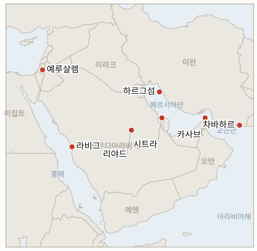

# 중동 일일 브리핑

**2026년 11월 23일**

- **보고 기간:** 약 24시간, 11월 22일 06:00 ~ 11월 23일 06:00 (한국시간)
- **종합 평가:** 일요일에는 미국의 발언 수위가 높아졌고 봉쇄선에서 첫 접촉이 있었을 가능성이 제기됐지만, 어느 쪽의 타격도 확인되지 않았다. 트럼프 대통령은 폭스뉴스에 합의가 없으면 새해 이후 이란 타격을 재개하는 쪽으로 기울어 있다고 말했고, 봉쇄를 시험하는 선박은 "바다 밑바닥"에 가라앉을 것이라고 했다(§1.1). 그보다 몇 시간 앞서 UKMTO는 미국 봉쇄선에 가까운 차바하르 인근 오만만에서 유조선과 "군 병력"이 관련된 사건을 보고했다. 미국도 이란도 설명하지 않았다(§1.2). 바레인은 토요일 공격의 피해를 부상 2명, 그중 1명 위중으로 수정하고 자위권을 언급했다(§1.3). 후티는 사우디 홍해 연안의 라비그 정유시설을 직접 타격했다고 주장했으나 사우디 당국은 확인하지 않았다(§1.4). 이스라엘에서는 야샤르와 리쿠드의 첫 회동이 다시 만나자는 합의만 남겼다(§1.5). 시장은 휴장이었고 금요일 수준이 그대로다. 브렌트는 92.57달러, 코스피는 4,869.96이다. 종합하면 미군과 이란군 사이의 소강상태는 이제 트럼프의 새해 시간표 하나에 기대고 있다. 그 사이 호르무즈 통항은 거의 멈췄고, 후티의 공세는 사우디가 해협을 우회하는 데 쓰는 홍해 연안으로 옮겨 갔다.

**정정 및 업데이트:**

- 11월 22일 브리핑은 토요일 공격으로 부상자가 없다는 바레인의 잠정 발표를 전했다. 바레인 내무부는 일요일 2명이 다쳤다고 밝혔다. 바레인 국민 1명은 안정적이고 파키스탄 국적 거주자 1명은 위중하다. 주민 증언과 사진 설명에 따르면 피해 공장은 시트라섬에 있다(§1.3).
- 같은 브리핑은 11월 16일 이후 카사브 앞바다에서 피격된 선박을 6척으로 집계했다. 합동해양정보센터(JMIC)는 이 기간 해협에서 유조선 7척이 피격됐고 그중 3척은 11월 20일과 21일 카사브 인근에서 피격됐다고 집계한다(§1.2).

---

## 1. 무슨 일이 있었나

<figure style="float:right; width:46%; margin:2pt 0 8pt 14pt;">

<figcaption style="font-size:8pt; color:#666; text-align:center; margin-top:3pt; font-style:italic;">주요 논의 지점</figcaption>
</figure>

### 1.1 트럼프, 새해 이후 이란 타격 쪽으로 기울어 있다고 발언

트럼프 대통령은 일요일 폭스뉴스에 양측이 합의에 이르지 못하면 새해 이후 이란 타격을 명령하는 쪽으로 기울어 있다고 말했다. 그는 이란 협상단을 "프로 탭댄서들"이라고 부르며 "그들은 늘 말만 한다. 하는 일이 말뿐이다"라고 했고, 이란이 "선거 전보다 지금 더 공격적"이라고 했다([Fox News](https://www.foxnews.com/politics/trump-warns-new-strikes-against-iran-after-new-year-calls-negotiators-professional-tap-dancers); [Jerusalem Post](https://jpost.com/international/article-915744)). 이란 선박이 봉쇄를 시험할 가능성에 대해서는 "그러길 바란다. 나머지 해군처럼 전부 바다 밑바닥에 가 있게 될 것"이라고 했다. 결정을 발표하지는 않았다. 폭스뉴스는 미 항공모함 전단 2개가 아라비아해에 있다고 전했다. 아바스 아라그치 이란 외무장관은 "외교의 길은 계속된다"고 했고, 이란 외무차관은 협상이 이어지고 있으며 이란은 어떤 시나리오에도 대비돼 있다고 했다. 카타르가 계속 메시지를 전달하고 있다([Iran International](https://www.iranintl.com/en/liveblog/202611214578)). 이란 의원 2명이 공개적으로 핵무기 제조를 요구했고, 그중 1명은 이란 선박이 공격받으면 사우디아라비아, 아랍에미리트, 바레인, 쿠웨이트의 석유 시설을 치겠다고 위협했다. 이스라엘에서는 채널12가 군 정보국이 네타냐후 총리에게 단독 이란 타격은 여러 전선을 한꺼번에 열 수 있다고 경고했다고 보도했다([Times of Israel](https://www.timesofisrael.com/liveblog-november-22-2026/)). **신뢰도: 트럼프 발언은 높음; 채널12 보도는 중간; 의원들의 주장이 정책이라는 점은 낮음.**

### 1.2 오만만에서 유조선과 군 병력이 맞닥뜨리고 호르무즈 통항은 0에 근접

UKMTO는 일요일 오후(GMT 16시 20분께) "오만만에서 유조선과 군 병력이 관련된 사건에 대한 보고"를 받았다고 밝혔다. 선사 보안책임자가 알렸고 조사가 진행 중이라고 했다. 선박도 병력의 소속도 밝히지 않았다([Reuters via Arab News](https://www.arabnews.com/middle-east/ukmto-reports-incident-involving-tanker-and-military-forces-in-gulf-of-oman-3013574)). 유로뉴스는 사건 위치를 해협 동쪽 차바하르 인근, 미국 봉쇄선에 가까운 곳으로 전했고, 일요일 아침 이란 유조선 1척이 하르그섬을 떠났다는 보도가 엇갈린다고 했다. 한 선박 추적업체는 선단 출항이 임박했다는 관측을 반박한다([Euronews](https://www.euronews.com/2026/11/22/tanker-incident-involving-military-forces-reported-in-strait-of-hormuz)). 미 중부사령부는 아무 말도 하지 않았다. UKMTO가 10월에 같은 표현을 썼을 때는 미 중부사령부가 그 해역에서 선박 1척을 막 무력화한 뒤였다. 이와 별도로 혁명수비대 해군은 유조선 2척이 "허가되지 않은 항로"에서 가남섬 북쪽의 기뢰에 부딪혀 "폭발하고 멈춰 섰다"고 했고, 혁명수비대는 해협 동쪽에서 미국 MQ-1 드론을 격추했다고 주장했다. 어느 것도 확인되지 않았다([ABC News live](https://abcnews.com/International/live-updates/iran-live-updates-tanker-attacked-strait-hormuz-ukmto/?id=138171071)). JMIC는 11월 16일 이후 해협에서 유조선 7척이 피격됐고 11월 19일부터 21일까지 재화중량 1,000톤을 넘는 화물선은 1척도 통과하지 않았다고 집계한다. 케이플러 집계로 해협을 통과한 원자재 운반선은 토요일 5척, 일요일은 보도 시점까지 0척이었다. 직전 주말에는 31척이었다([아시아투데이](https://asiatoday.co.kr/kn/view.php?key=20261122010008467)). **신뢰도: UKMTO 보고는 높음; 누가 관련됐는지는 낮음; 이란의 기뢰 및 드론 주장은 낮음; 통항 집계는 중간(전언).**

### 1.3 바레인, 부상 2명 발표하고 자위권 언급

바레인 내무부는 일요일, 토요일 이란이 민간 산업 공장을 공격해 2명이 다쳤다고 밝혔다. 바레인 국민 1명은 안정적이고 파키스탄 국적 거주자 1명은 위중하다([The National](https://www.thenationalnews.com/news/gulf/2026/11/22/two-injured-one-critically-in-iranian-attack-on-industrial-plant-in-bahrain/)). 주민들은 AFP에 시트라섬 상공에서 연기를 봤다고 말했다. 시트라섬에는 바프코 정유시설을 비롯한 산업시설이 있다. 바레인은 아직 공장 이름을 밝히지 않았다([RTÉ/AFP](https://www.rte.ie/news/middle-east/2026/1122/1600172-middle-east-iran/)). 바레인 외무부는 미군 패트리엇 레이더를 타격했다는 혁명수비대의 주장을 일축하고 표적은 순전히 민간 시설이었다고 했다. 또 유엔헌장 제51조를 들어 바레인은 "주권을 지키기 위해 필요한 모든 조치를 취할 고유한 권리를 보유한다"고 밝혔다. 사우디아라비아는 이번 공격을 "극악하다"고 했고 아랍에미리트, 카타르, 쿠웨이트도 규탄했다. 미 국무부는 바레인에 있는 미국인에게 "경계를 한층 높일 것"을 당부했다([CBS News live](https://www.cbsnews.com/live-updates/iran-war-trump-tehran-denies-chemical-weapons/)). 일요일에는 바레인에 대한 새 공격이 보고되지 않았다. **신뢰도: 사상자와 성명은 높음; 시트라 위치는 중간.**

### 1.4 후티, 라비그 정유시설 직접 타격 주장

후티 군 대변인 야히아 사리는 일요일 사우디아라비아 홍해 연안의 라비그 정유시설을 겨냥해 "직접 타격"했다고 밝혔다. 사우디 당국은 논평하지 않았고, 로이터에 따르면 지금까지 정유시설에 대한 어떤 공격도 확인한 적이 없다([Reuters via Jerusalem Post](http://www.jpost.com/middle-east/article-915746)). 지다 북쪽 약 165km에 있는 라비그에는 사우디 아람코와 일본 스미토모화학의 정유·석유화학 합작사 페트로라비그가 있다. 연합군은 방공망이 사우디 서부 지역을 향한 탄도미사일 1기, 리야드 지역을 향한 드론 1기, 남부를 향한 드론 1기를 파괴했다고 밝혔다([Gulf News](https://gulfnews.com/world/gulf/saudi/saudi-led-coalition-intercept-houthi-missile-in-western-region-1.500756878)). 사리는 리야드주 다와시르 지역의 레이더를 타격했다고도 주장했다. 후티 매체는 토요일 저녁 연합군이 호데이다를 두 번째로 공습했다고 보도했으나 연합군은 내용을 밝히지 않았다. 지다항이나 얀부에 대한 타격은 보고되지 않았고, 지다를 떠나겠다고 밝힌 해운사도 없다. **신뢰도: 주장과 요격 발표는 높음; 라비그의 피해 여부는 낮음; 호데이다 2차 공습은 낮음~중간.**

### 1.5 야샤르와 리쿠드, 다시 만나자는 데만 합의

가디 아이젠코트의 야샤르와 리쿠드 대표들이 일요일 만났고 후속 회동을 열기로 했다고 밝혔다. 합의 조건은 발표되지 않았다([Haaretz](https://www.haaretz.com/israel-news/israel-politics/2026-11-22/ty-article/.premium/members-of-eisenkots-yashar-netanyahus-likud-meet-for-coalition-talks/000001a2-030b-d175-abf6-1f3f54b90000)). 앞선 협상에 참여했던 나프탈리 베네트의 당은 참석하지 않았다. 채널12는 야샤르와 토라 유대교 연합(UTJ)이 초정통파 징집 문제를 놓고 "의미 있는" 회동을 했으나 양측이 "초안을 주고받기에는 아직 멀다"고 보도했다. 아이젠코트 진영은 총리 재임을 8년으로 제한하고 기소된 정치인의 정부 구성을 금지하는 법안을 준비하고 있으며, 채널12는 이 법안이 협상 지렛대로 쓰일 것으로 본다([Times of Israel](https://www.timesofisrael.com/liveblog-november-22-2026/)). 아이젠코트는 협상을 질질 끌게 두지 않겠다고 거듭 말했다. 그 밖에 레바논 총리는 이스라엘군 대변인이 남부 완충지대의 학교를 방문한 일을 규탄했고, 이스라엘 외무장관은 라말라 인근 마을에 대한 정착민 방화 공격을 규탄했다. **신뢰도: 회동과 결과는 높음; 채널12 보도는 중간.**

---

## 2. 심층 분석: 유인과 동기

### 2.1 트럼프는 왜 시간표는 그대로 두고 발언 수위만 높였나?

트럼프는 지난주 새해 이후까지 기다리겠다고 했고 "영구적인" 합의를 원한다고 했다. 이란은 바레인에서 민간인을 다치게 한 공격과 유조선 추가 피격, 봉쇄를 깨겠다는 발언으로 답했다. 일요일 발언은 날짜를 옮기지 않고 위협만 되살린다. 그는 1월을 결정 시점으로 유지했다. 이로써 미국 연휴 기간과 카타르 채널에 걸쳐 소강상태는 유지된다. 다만 이제는 타격 쪽으로 기울어 있다고 말한다. 이 메시지의 청중은 셋이다. 이란에는 시간 끌기에 대가가 따른다고 알린다. 시트라 피격으로 흔들린 걸프 주둔국들에는 미국이 물러지지 않았다고 알린다. 더 이른 작전을 압박해 온 네타냐후에게는 결정권이 워싱턴에 있다고 알린다. 단독 행동을 경계하는 이스라엘 정보당국의 경고가 흘러나온 것도 같은 방향을 가리킨다. 그 대가는 정해진 날짜가 이란에 값을 올릴 시간이 얼마나 남았는지 알려 준다는 점이다.

### 2.2 오만만 사건은 왜 설명 없이 남겨지고 있나?

어느 쪽도 아직 그 사건에 이름을 붙일 이유가 없다. 미군이 이란 유조선을 세우거나 사격했다면, 미 중부사령부의 성명은 이란이 걸프 에너지 시설을 치겠다는 약속을 실행하도록 떠밀게 된다. 이란 외무차관과 강경파 의원들이 그 위협을 바로 이런 상황에 묶어 두었기 때문이다. 이란이 먼저 발표하면 혁명수비대는 보복하거나 물러선 것으로 비치거나 둘 중 하나를 택해야 한다. 침묵은 양쪽 모두 선을 시험할 수 있게 해 준다. 보도된 14척의 선단이 아니라 유조선 1척이라는 점도 이 논리에 맞는다. 이란은 봉쇄가 어떻게 집행되는지 탐색할 수 있고, 미국은 봉쇄가 도전받았다고 선언하지 않고도 집행할 수 있다. 선박들이 "허가되지 않은 항로"에서 기뢰에 부딪혔다는 혁명수비대 해군의 설명은 손상된 유조선에 대해 어느 쪽에도 책임을 묻지 않는 해명으로 쓰일 수 있다. 이 모두는 표현과 위치에서 끌어낸 추론이며, 사건은 그보다 작은 일로 드러날 수도 있다.

### 2.3 후티는 왜 지다가 아니라 라비그를 지목했나?

라비그를 치면 후티는 홍해 연안에 대한 위협을 실행하면서도 가장 큰 대가가 따르는 단계에는 이르지 않는다. 지다는 메카로 가는 관문이고, 후티는 경고에서 성지 상공을 제외했다. 북쪽으로 165km 떨어진 정유시설은 종교적 무게가 없는 경제 표적이다. 일본 자본이 일부 들어가 있어서 후티가 리야드 금융지구에 대해 이미 낸 경고를 외국 투자자에게 다시 전하는 효과도 있다. 사우디가 침묵하는 한 "직접 타격"이라는 주장에는 비용이 들지 않는다. 사우디 당국은 지금까지 정유시설 피격을 한 번도 확인하지 않았고 그래서 쉽게 반박하기도 어렵다. 시점은 후티가 의존하는 호데이다항에 대한 연합군의 두 번째 야간 공습 직후다. 후티는 항구에는 항구로 맞서며 해안을 따라 얀부 쪽으로 올라가고 있다.

### 2.4 베네트의 당은 왜 리쿠드와의 회동에 나오지 않았나?

베네트는 자신의 당이 네타냐후 밑에 들어가지 않겠다고 말해 왔고, 리쿠드와의 협상에 참석하면 지지층에게 그 선이 흐려진다. 불참은 아이젠코트에게도 유리하다. 야샤르와 리쿠드만의 회동은 자기 진영을 가르지 않고 실패할 수 있고, 아이젠코트는 베네트와 리베르만에게 통합 정부의 길을 시도했다고 보고할 수 있다. 한편 토라 유대교 연합과의 병행 협상이 리쿠드와의 협상보다 더 중요하다. 초정통파 정당들이 징집 방안을 받아들이게 되면 아이젠코트는 리쿠드 없이도, 아랍 정당에만 기대지 않고도 네타냐후 진영에서 의석을 얻는다. 임기 제한 법안은 리쿠드 의원들에게 네타냐후 없는 미래를 생각해 보라는 압박이다. 정해진 것은 없고, 리쿠드의 요구는 여전히 아이젠코트의 차선책에 필요한 상대들을 배제한다.

---

## 3. 한국에 대한 정책적 함의

**익스포저 현황:** 한국은 원유의 약 70.7%, LNG의 20.4%를 중동에서 들여온다(`instructions/korea-exposure.md`, 갱신 불필요). 일요일은 휴장이어서 금요일 수준이 그대로다. 브렌트 92.57달러, WTI 83.98달러, 코스피 4,869.96, 원·달러 환율 1,336.2원이다. 케이플러 집계로 토요일 호르무즈를 통과한 원자재 운반선은 5척이었다. 직전 주말에는 31척, 전쟁 전에는 하루 130척 이상이었다. 파이낸셜타임스는 지난 일주일 통과 선박을 263척으로 집계했다. 전주보다 15% 줄었고 유조선은 52척에서 37척으로 줄었다([아시아투데이](https://asiatoday.co.kr/kn/view.php?key=20261122010008467)). 외국인은 지난주 코스피에서 약 3조 4,000억 원을 순매도했다. 이번 주에는 수요일 미국 물가 지표와 11월 26일 목요일 한국은행 금리 결정이 있다. NH투자증권은 기준금리가 3.00%에서 3.25%로 오를 것으로 본다([파이낸셜뉴스](https://www.fnnews.com/news/202611221812425148)). 청해부대 동의안은 여전히 국회에 계류 중이며 표결 보도는 없다.

**사안별 함의:**

- **트럼프의 시간표 (§1.1):** 새해 이후 타격 쪽으로 기울어 있다는 발언은 한국에 계획의 기준일을 준다. 1월과 2월의 비축유 방출, 스와프 약정, 화물 일정은 미국의 작전 재개를 꼬리 위험이 아니라 현실적인 경우로 놓고 짜야 한다 (IND-20261114-1, IND-20261119-1).
- **오만만과 호르무즈 통항 (§1.2):** 하루 원자재 운반선 5척, 일요일 0척은 한국행 원유 대부분이 지나는 항로가 거의 멈췄다는 뜻이다. 오만만 사건이 미군의 이란 유조선 대응으로 드러나면 이란이 공언한 답은 걸프 에너지 시설 공격이고, 그 경우 타격을 받는 것은 한국이 실제로 사는 물량이다 (IND-20261122-1, IND-20261123-2, IND-20261112-1).
- **바레인 (§1.3):** 민간 공장에서 사상자가 나고 바레인이 제51조를 언급하면서 걸프 전역의 한국 건설사와 인력의 위험이 커졌다. 시트라는 바레인의 정유·산업 중심지다 (IND-20261122-2).
- **라비그 (§1.4):** 사우디 홍해 연안은 사우디 원유가 호르무즈를 지나지 않고 한국에 닿는 경로다. 라비그 피격이 확인되면 이 우회로가 후티의 사정권에 있다는 뜻이 되고, 얀부는 같은 해안의 더 북쪽에 있다. 라비그의 석유화학 생산은 한국 정유사와 나프타 분해 업체가 가격 기준으로 삼는 역내 나프타 및 제품 수급에도 영향을 준다 (IND-20261123-1, IND-20261121-1).
- **이스라엘 (§1.5):** 협상이 더디면 네타냐후가 트럼프의 결정 시점 직전 몇 주까지 과도 총리로 남는다. 보도된 정보당국의 경고는 1월 이전 이스라엘의 타격 가능성을 낮추지만 없애지는 않는다 (IND-20261123-3, IND-20261114-1).
- **시장:** 월요일 서울 증시는 한 주간의 대규모 외국인 매도, 금요일 미국 증시 급락, 걸프 위험이 다시 커진 주말을 뒤로하고 열린다. 유가는 브렌트가 95달러 선보다 2.43달러 낮고 90달러보다 2.57달러 높은 수준에서 다시 열린다. 한국은행은 목요일에 회의를 연다 (IND-20261122-3, IND-20261115-1, IND-20261121-3, IND-20261120-3, IND-20261023-1).

**오늘 종결:** 없음. 보고 기간에 조건을 충족한 지표가 없고 시장도 열리지 않았다.

**검증 가능한 지표:**

- **IND-20261123-1** (진행, 신규): 2026년 11월 30일께까지 사우디 당국, 사우디 아람코, 페트로라비그 또는 스미토모화학이 라비그의 피해나 가동 차질을 확인하면 후티의 주장이 확증; 없으면 반증.
- **IND-20261123-2** (진행, 신규): 2026년 11월 30일께까지 사우디아라비아, 아랍에미리트, 쿠웨이트 또는 카타르의 정부나 국영 에너지 기업이 이란의 미사일이나 드론이 자국 석유·가스 시설을 타격했거나 그 상공에서 요격됐다고 발표하면 이란이 걸프 에너지 시설 위협을 실행하는 것으로 확증; 없으면 반증.
- **IND-20261123-3** (진행, 신규): 2026년 11월 30일께까지 아이젠코트가 리쿠드를 뺀 정부를 크네세트에 올리는 공식 절차(표결 일정 요청 또는 표결 자체)를 밟으면 통합 정부 협상이 실패한 것으로 확증; 없으면 반증.
- **IND-20261122-1** (진행): UKMTO가 봉쇄선 인근 오만만에서 유조선과 군 병력이 관련된 사건을 보고; 미 중부사령부 성명이 없고 하르그섬 출항 유조선과의 연관도 확인되지 않아 조건은 아직 충족되지 않음.
- **IND-20261122-2** (진행): 일요일 바레인에 대한 새 공격 보도 없음; 발표된 부상자는 토요일 공격의 피해.
- **IND-20261122-3** (진행): 휴장; 브렌트 92.57달러 그대로.
- **IND-20261121-1** (진행): 후티가 라비그 타격을 주장했고 연합군은 서부 지역을 향한 미사일을 요격; 지다나 얀부 자체에 대한 보도는 없음.
- **IND-20261121-3** (진행): 휴장; 코스피 4,869.96 그대로.
- **IND-20261120-1** (진행): 카타이브 헤즈볼라 부대가 주르프 알사카르를 떠났다는 발표 없음.
- **IND-20261120-3** (진행): 휴장; 외국인은 지난주 약 3조 4,000억 원 순매도.
- **IND-20261119-1** (진행): 공개된 미국의 2차 타격 없음; 트럼프는 교전이 계속될 것이라고 발언.
- **IND-20261119-3** (진행): 휴장; 원·달러 1,336.2원 그대로.
- **IND-20261115-1** (진행): 휴장; 브렌트 92.57달러 그대로.
- **IND-20261114-1** (진행): 호르무즈 연안 너머에 대한 미국이나 이스라엘의 타격 없음; 트럼프는 새해 이후 타격 쪽으로 기울어 있다고 발언.
- **IND-20261023-1** (진행): 한국은행은 11월 26일 결정; NH투자증권은 3.25%로의 인상을 예상.
- **IND-20261116-2** (진행): 바브엘만데브 인근 선박에 대한 후티 공격 보도 없음.
- **IND-20261117-1** (진행): 후티 병력이 아덴 50km 이내에 있다는 보도 없음.
- **IND-20261112-1, IND-20261113-2, IND-20261114-3, IND-20261115-2, IND-20260714-4** (진행): `tracking/indicators.md` 참조.

---

## 4. 관찰 목록

- **오만만 사건에 대한 미 중부사령부나 이란의 설명, 유조선의 하르그섬 출항 여부 (IND-20261122-1).**
- **이란이 걸프 에너지 시설 위협을 실행하는지, 바레인에 대한 추가 공격 여부 (IND-20261123-2, IND-20261122-2).**
- **라비그 피해에 대한 사우디, 아람코, 스미토모화학의 확인 또는 부인, 얀부나 지다를 향한 움직임 (IND-20261123-1, IND-20261121-1).**
- **11월 29일 OPEC+ 회의를 앞둔 미국 연휴 주간의 한산한 장에서 월요일 유가 개장 (IND-20261122-3, IND-20261115-1).**
- **주말 사이 거의 멈춘 뒤의 호르무즈 일일 통항 집계.**
- **야샤르와 리쿠드의 후속 회동, 토라 유대교 연합과의 협상, 임기 제한 법안 (IND-20261123-3).**
- **트럼프 발언 이후 카타르를 통한 메시지와 이란의 공식 반응.**
- **이란 내 시위, 정전, 식품 수출 금지.**
- **카타이브 헤즈볼라 부대가 주르프 알사카르에서 철수를 시작하는지 (IND-20261120-1).**
- **월요일 서울 증시 개장, 외국인 수급과 원화; 목요일 한국은행 결정 (IND-20261121-3, IND-20261120-3, IND-20261023-1).**
- **국회의 청해부대 동의안 처리 (IND-20261112-1).**

---

## 5. 출처 신뢰도 요약

| 주장 | 출처 | 신뢰도 |
| --- | --- | --- |
| 트럼프, 합의가 없으면 새해 이후 이란 타격 재개 쪽으로 기울어 있다고 발언; "프로 탭댄서들" | Fox News, Jerusalem Post, Iran International | 높음 |
| 트럼프: 봉쇄를 시험하는 선박은 "바다 밑바닥"에 가 있게 될 것 | Fox News | 높음 |
| 미 항공모함 전단 2개가 아라비아해에 있음 | Fox News via Iran International | 중간~높음 |
| 아라그치: "외교의 길은 계속된다"; 카타르가 계속 메시지 전달 | Iran International | 중간~높음 |
| 이란 의원들이 핵무기를 요구하고 걸프 석유 시설을 위협 | Didban Iran, Tabnak via Iran International | 중간(발언); 낮음(정책 여부) |
| 이스라엘 군 정보국이 네타냐후에게 단독 타격은 여러 전선을 열 수 있다고 경고 | 채널12 via Times of Israel | 중간 |
| UKMTO: 오만만에서 유조선과 군 병력이 관련된 사건 | UKMTO via Reuters (Arab News), Iran International | 높음 |
| 사건은 미국 봉쇄선에 가까운 차바하르 인근에서 일어났고 미군이 관련됐을 수 있음 | Euronews (추론) | 낮음 |
| 이란 유조선 1척이 일요일 하르그섬을 떠남 | 엇갈리는 보도 via Euronews | 낮음 |
| 유조선 2척이 가남섬 북쪽에서 기뢰에 부딪힘 | 혁명수비대 해군 via 이란 국영 매체, ABC News | 낮음 |
| 혁명수비대가 해협 동쪽에서 미국 MQ-1 드론을 격추 | IRNA via ABC News | 낮음 |
| 11월 16일 이후 해협에서 유조선 7척 피격; 11월 19~21일 재화중량 1,000톤 초과 화물선 통과 없음 | JMIC via Iran International | 중간 |
| 11월 21일 호르무즈 통과 원자재 운반선 5척, 11월 22일은 보도 시점까지 0척; 일주일간 263척으로 15% 감소 | Kpler, Financial Times via 아시아투데이 | 중간 |
| 토요일 바레인 공격으로 2명 부상, 1명 위중 | 바레인 내무부 via The National, ABC News | 높음 |
| 피해 공장은 시트라섬에 있음 | 주민 증언 via AFP (RTÉ), The National 사진 설명 | 중간 |
| 바레인은 제51조에 따른 권리를 보유한다고 밝힘 | 바레인 외무부 via The National | 높음 |
| 사우디아라비아, 아랍에미리트, 카타르, 쿠웨이트가 공격을 규탄 | ABC News, CBS News | 높음 |
| 미 국무부가 바레인 내 미국인에게 안전 경보 발령 | CBS News | 높음 |
| 후티가 라비그 정유시설 직접 타격을 주장 | 후티 대변인 via Reuters (Jerusalem Post), Gulf News | 높음(주장); 낮음(피해) |
| 연합군이 서부 지역을 향한 탄도미사일 1기와 드론 2기를 요격 | 연합군 대변인 via Gulf News, The National | 높음(주장) |
| 토요일 저녁 연합군의 호데이다 2차 공습 | Al-Masirah via House of Saud | 낮음~중간 |
| 야샤르와 리쿠드가 만나 후속 회동에 합의; 베네트의 당은 불참 | Haaretz, Times of Israel | 높음 |
| 야샤르와 토라 유대교 연합의 징집 협상 진전; 임기 제한 법안 | 채널12 via Times of Israel | 중간 |
| 외국인은 지난주 코스피에서 약 3조 4,000억 원 순매도; 한국은행은 11월 26일 회의 | 파이낸셜뉴스 | 중간~높음 |
| 브렌트 92.57달러, WTI 83.98달러, 코스피 4,869.96, 원·달러 1,336.2원 (금요일; 주말 휴장) | 이전 브리핑 | 높음 |
