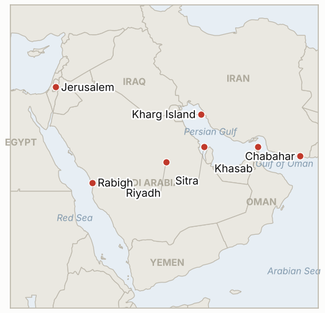

# Middle East Daily Briefing

**November 23, 2026**

- **Reporting window:** ~24 hours, November 22, 06:00 to November 23, 06:00 KST
- **Overall assessment:** Sunday brought sharper words from Washington and a possible first contact at the blockade line, but no confirmed strike by either side. President Trump told Fox News he is inclined to resume strikes on Iran after the New Year if there is no deal, and that any ships testing the blockade would end up "at the bottom of the sea" (§1.1). Hours earlier UKMTO reported an incident between a tanker and "military forces" in the Gulf of Oman near Chabahar, close to the US blockade line; neither the United States nor Iran has explained it (§1.2). Bahrain revised the toll of Saturday's attack to two injured, one critically, and invoked its right of self defence (§1.3). The Houthis claimed a direct hit on the Rabigh refinery on the Saudi Red Sea coast, which Saudi authorities have not confirmed (§1.4). In Israel the first Yashar and Likud meeting produced only an agreement to meet again (§1.5). Markets were closed; Friday's levels stand, with Brent at $92.57 and the KOSPI at 4,869.96. Net: the pause between US and Iranian forces now rests on Trump's New Year timetable alone, while traffic through Hormuz has almost stopped and the Houthi campaign has moved to the Red Sea coast that Saudi exports rely on to avoid the strait.

**Corrections and updates:**

- The November 22 brief relayed Bahrain's preliminary statement that Saturday's attack caused no injuries. The Interior Ministry said on Sunday that two people were hurt, a Bahraini citizen in stable condition and a Pakistani resident in critical condition. Residents and a photo caption place the damaged plant on Sitra Island (§1.3).
- The same brief counted six ships hit off Khasab since November 16. The Joint Maritime Information Center (JMIC) now counts seven tankers struck in the strait over that period, three of them near Khasab on November 20 and 21 (§1.2).

---

## 1. What Happened

<figure style="float:right; width:46%; margin:2pt 0 8pt 14pt;">

<figcaption style="font-size:8pt; color:#666; text-align:center; margin-top:3pt; font-style:italic;">Major places of discussion</figcaption>
</figure>

### 1.1 Trump says he is inclined to strike Iran after the New Year

President Trump told Fox News on Sunday that he is inclined to order strikes on Iran after the New Year if the two sides do not reach an agreement. He called Iran's negotiators "professional tap dancers," said "they talk all the time, all they do is talk," and said Iran is "more aggressive now than before the election" ([Fox News](https://www.foxnews.com/politics/trump-warns-new-strikes-against-iran-after-new-year-calls-negotiators-professional-tap-dancers); [Jerusalem Post](https://jpost.com/international/article-915744)). Asked about Iranian ships testing the blockade, he said: "I hope they do, they'll all be at the bottom of the sea like the rest of the navy." He announced no decision. Fox reported two US carrier strike groups in the Arabian Sea. Foreign Minister Abbas Araghchi said "the path of diplomacy continues," and Iran's deputy foreign minister said talks go on while Iran is ready for any scenario; Qatar is still carrying messages ([Iran International](https://www.iranintl.com/en/liveblog/202611214578)). Two Iranian lawmakers called publicly for building a nuclear weapon, and one threatened oil facilities in Saudi Arabia, the UAE, Bahrain and Kuwait if Iranian vessels are attacked. In Israel, Channel 12 reported that Military Intelligence warned Prime Minister Netanyahu that a unilateral strike on Iran could open several fronts at once ([Times of Israel](https://www.timesofisrael.com/liveblog-november-22-2026/)). **Confidence: High on Trump's remarks; Medium on the Channel 12 report; Low on the lawmakers' claims as policy.**

### 1.2 A tanker and military forces meet in the Gulf of Oman as Hormuz traffic nears zero

UKMTO said on Sunday afternoon (about 16:20 GMT) that it had received "a report of an incident involving a tanker and military forces in the Gulf of Oman," reported by a company security officer, with investigations under way. It named neither the ship nor the forces ([Reuters via Arab News](https://www.arabnews.com/middle-east/ukmto-reports-incident-involving-tanker-and-military-forces-in-gulf-of-oman-3013574)). Euronews placed the incident east of the strait near Chabahar, close to the US blockade line, and noted conflicting reports that an Iranian tanker left Kharg Island on Sunday morning; one tracking firm disputes that a convoy is imminent ([Euronews](https://www.euronews.com/2026/11/22/tanker-incident-involving-military-forces-reported-in-strait-of-hormuz)). CENTCOM has said nothing. When UKMTO used the same wording in October, CENTCOM had just disabled a vessel there. Separately, the IRGC navy said two tankers "exploded and stopped" after hitting mines north of Ghanam Island on "unauthorized routes," and the IRGC claimed to have shot down a US MQ-1 drone east of the strait; neither is confirmed ([ABC News live](https://abcnews.com/International/live-updates/iran-live-updates-tanker-attacked-strait-hormuz-ukmto/?id=138171071)). JMIC counts seven tankers struck in the strait since November 16 and says no cargo vessel above 1,000 deadweight tons transited from November 19 to 21. Kpler counted five commodity carriers through the strait on Saturday and none on Sunday as of the report, against 31 the previous weekend ([Asia Today](https://asiatoday.co.kr/kn/view.php?key=20261122010008467)). **Confidence: High on the UKMTO report; Low on who was involved; Low on Iranian mine and drone claims; Medium on the traffic counts (relayed).**

### 1.3 Bahrain reports two injured and invokes self defence

Bahrain's Interior Ministry said on Sunday that two people were injured in Saturday's Iranian attack on a civilian industrial plant: a Bahraini citizen, in stable condition, and a Pakistani resident, in critical condition ([The National](https://www.thenationalnews.com/news/gulf/2026/11/22/two-injured-one-critically-in-iranian-attack-on-industrial-plant-in-bahrain/)). Residents told AFP they saw smoke over Sitra Island, which holds industrial sites including the Bapco refinery; Bahrain has still not named the plant ([RTÉ/AFP](https://www.rte.ie/news/middle-east/2026/1122/1600172-middle-east-iran/)). The Foreign Ministry rejected the Revolutionary Guards' claim that they hit US Patriot radars, said the target was purely civilian, and said Bahrain "reserves its inherent right to take all necessary measures to safeguard its sovereignty," citing Article 51 of the UN Charter. Saudi Arabia called the attack "heinous," and the UAE, Qatar and Kuwait also condemned it. The US State Department urged Americans in Bahrain to exercise "heightened vigilance" ([CBS News live](https://www.cbsnews.com/live-updates/iran-war-trump-tehran-denies-chemical-weapons/)). No new attack on Bahrain was reported on Sunday. **Confidence: High on the casualties and statements; Medium on the Sitra location.**

### 1.4 The Houthis claim a direct hit on the Rabigh refinery

Houthi spokesman Yahya Saree said on Sunday that the group had targeted the Rabigh oil refinery on Saudi Arabia's Red Sea coast and scored "a direct hit." Saudi authorities did not comment and, Reuters notes, have not confirmed any attack on a refinery ([Reuters via Jerusalem Post](http://www.jpost.com/middle-east/article-915746)). Rabigh, about 165 km north of Jeddah, hosts Petro Rabigh, a refining and petrochemical venture of Saudi Aramco and Japan's Sumitomo Chemical. The coalition said its air defences destroyed a ballistic missile fired toward the kingdom's western region, a drone aimed at the Riyadh region and a second drone aimed at the south ([Gulf News](https://gulfnews.com/world/gulf/saudi/saudi-led-coalition-intercept-houthi-missile-in-western-region-1.500756878)). Saree also claimed a strike on a radar in the Dawasir area of Riyadh province. Houthi media reported a second wave of coalition strikes on Hodeidah on Saturday evening, which the coalition has not detailed. No strike on Jeddah port or Yanbu was reported, and no shipping line has said it is leaving Jeddah. **Confidence: High on the claim and the interception statements; Low on any damage at Rabigh; Low to Medium on the Hodeidah second wave.**

### 1.5 Yashar and Likud agree only to meet again

Representatives of Gadi Eisenkot's Yashar party and Likud met on Sunday and said a follow up meeting will be held; no terms were announced ([Haaretz](https://www.haaretz.com/israel-news/israel-politics/2026-11-22/ty-article/.premium/members-of-eisenkots-yashar-netanyahus-likud-meet-for-coalition-talks/000001a2-030b-d175-abf6-1f3f54b90000)). Naftali Bennett's Together party, present at the earlier round, did not attend. Channel 12 reported "significant" meetings between Yashar and United Torah Judaism on ultra-Orthodox conscription, though the sides remain "far from exchanging draft proposals." Eisenkot's bloc is preparing a bill that would limit prime ministers to eight years and bar an indicted politician from forming a government, which Channel 12 expects to be used as leverage ([Times of Israel](https://www.timesofisrael.com/liveblog-november-22-2026/)). Eisenkot repeated that he will not let the process drag on. Elsewhere, Lebanon's prime minister condemned a visit by an Israeli military spokeswoman to a school in the southern buffer zone, and Israel's foreign minister condemned settler arson attacks on villages near Ramallah. **Confidence: High on the meeting and its outcome; Medium on the Channel 12 reports.**

---

## 2. Deep Dive: Incentives and Motives

### 2.1 Why did Trump harden his words without changing his timetable?

Last week Trump said he would wait until after the New Year and wanted a "permanent" deal. Iran answered with an attack that wounded civilians in Bahrain, more tanker strikes and talk of breaking the blockade. Sunday's remarks restore the threat without moving the date. He keeps January as the decision point, which preserves the pause through the US holidays and the Qatari channel, but he now says his inclination is to strike. The message has three audiences. Tehran is told that stalling has a cost. Gulf hosts, shaken by Sitra, are told that Washington has not gone soft. And Netanyahu, who has pressed for an earlier campaign, is told that the decision stays in Washington; the leak of an Israeli intelligence warning against acting alone points the same way. The cost is that a fixed date tells Iran how long it has to raise the price.

### 2.2 Why is the Gulf of Oman incident being left unexplained?

Neither side has an interest in naming it yet. If US forces stopped or fired on an Iranian tanker, a CENTCOM statement would oblige Tehran to act on its promise to hit Gulf energy sites, since Iran's deputy foreign minister and its hardline lawmakers have tied that threat to exactly this event. If Iran announces it, the IRGC must either retaliate or be seen to back down. Silence lets both test the line. A single tanker, not the reported convoy of fourteen, fits that logic: Iran can probe how the blockade is enforced, and the United States can enforce it, without either declaring that the blockade has been challenged. The IRGC navy's story of ships hitting mines on "unauthorized routes" offers a ready explanation for a damaged tanker that blames neither party. All of this is inference from wording and location; the incident may prove to be something smaller.

### 2.3 Why did the Houthis name Rabigh and not Jeddah?

Rabigh lets the Houthis make good on their threat to the Red Sea coast while staying short of the step that would cost them most. Jeddah is the gateway to Mecca, and the group exempted the holy cities' airspace from its warning. A refinery 165 km to the north is an economic target with no religious weight, and it is partly Japanese owned, which carries the warning to foreign investors that the Houthis already issued about Riyadh's financial district. Claiming "a direct hit" also costs nothing if Riyadh stays silent, because Saudi authorities have so far declined to confirm any refinery strike and so cannot easily rebut one. The timing follows the second night of coalition strikes on Hodeidah, the port the Houthis depend on. The group is matching port for port and moving up the coast toward Yanbu.

### 2.4 Why did Bennett's party stay away from the Likud meeting?

Bennett has said his party will not sit under Netanyahu, and attending talks with Likud would blur that line for his voters. Staying away also suits Eisenkot. A meeting between Yashar and Likud alone can fail without splitting his own bloc, and he can report to Bennett and Liberman that the unity route was tried. Meanwhile the parallel track with United Torah Judaism matters more than the Likud one: if the ultra-Orthodox parties can be brought to accept a conscription formula, Eisenkot gains seats from Netanyahu's bloc without needing Likud or leaning only on Arab parties. The term limit bill is pressure on Likud members to consider a future without Netanyahu. None of this is settled, and Likud's demands still exclude the partners Eisenkot's fallback requires.

---

## 3. Policy Implications for South Korea

**Exposure snapshot:** South Korea draws about 70.7% of its crude and 20.4% of its LNG from the Middle East (`instructions/korea-exposure.md`, no update needed). Markets were closed on Sunday, so Friday's levels stand: Brent $92.57, WTI $83.98, the KOSPI 4,869.96 and the won at 1,336.2 per dollar. Kpler counted five commodity carriers through Hormuz on Saturday, against 31 the previous weekend and more than 130 a day before the war, and the Financial Times counted 263 transits over the past week, down 15%, with tankers down from 52 to 37 ([Asia Today](https://asiatoday.co.kr/kn/view.php?key=20261122010008467)). Foreign investors net sold about 3.4 trillion won on the KOSPI last week. The week ahead holds US price data on Wednesday and the Bank of Korea's rate decision on Thursday, November 26, where NH Investment and Securities expects a rise from 3.00% to 3.25% ([Financial News](https://www.fnnews.com/news/202611221812425148)). The Cheonghae Unit motion is still before the National Assembly, with no vote reported.

**Implications by development:**

- **Trump's timetable (§1.1):** A stated inclination to strike after the New Year gives Seoul a planning date. Reserve releases, swap arrangements and cargo scheduling for January and February should assume a renewed US campaign as a live case, not a tail risk (IND-20261114-1, IND-20261119-1).
- **Gulf of Oman and Hormuz traffic (§1.2):** Five commodity carriers in a day, and none recorded on Sunday, is a near halt in the lane that carries most Korean crude. If the Gulf of Oman incident proves to be US action against an Iranian tanker, Iran's stated answer is an attack on Gulf energy sites, which would hit the supply Korea actually buys (IND-20261122-1, IND-20261123-2, IND-20261112-1).
- **Bahrain (§1.3):** Casualties at a civilian plant, and Bahrain's reference to Article 51, raise the risk for Korean contractors and staff across the Gulf. Sitra is Bahrain's refining and industrial hub (IND-20261122-2).
- **Rabigh (§1.4):** The Saudi Red Sea coast is the route that lets Saudi crude reach Korea without passing Hormuz. A confirmed hit at Rabigh would show that this bypass is within Houthi reach, and Yanbu lies further up the same coast. Rabigh's petrochemical output also matters for regional naphtha and product balances that Korean refiners and crackers price against (IND-20261123-1, IND-20261121-1).
- **Israel (§1.5):** Slow talks keep Netanyahu as caretaker into the weeks before Trump's decision point. The reported intelligence warning lowers, but does not remove, the chance of an Israeli strike before January (IND-20261123-3, IND-20261114-1).
- **Markets:** Monday's Seoul session opens after a week of heavy foreign selling, a sharp US fall on Friday and a weekend in which Gulf risk rose again. Oil reopens with Brent $2.43 below the $95 line and $2.57 above $90; the Bank of Korea meets on Thursday (IND-20261122-3, IND-20261115-1, IND-20261121-3, IND-20261120-3, IND-20261023-1).

**Resolved today:** None. No indicator met its condition in the window, and no market session took place.

**Testable indicators:**

- **IND-20261123-1** (open, new): A statement by Saudi authorities, Saudi Aramco, Petro Rabigh or Sumitomo Chemical by ~2026-11-30 confirming damage or an operational disruption at Rabigh confirms the Houthi claim; none falsifies.
- **IND-20261123-2** (open, new): A government or state energy company statement by ~2026-11-30 that an Iranian missile or drone struck or was intercepted over an oil or gas facility in Saudi Arabia, the UAE, Kuwait or Qatar confirms Iran is acting on its threat against Gulf energy sites; none falsifies.
- **IND-20261123-3** (open, new): A formal step by Eisenkot by ~2026-11-30 to present a government without Likud to the Knesset (a request to schedule the vote, or the vote itself) confirms the unity talks have failed; none falsifies.
- **IND-20261122-1** (open): UKMTO reported an incident between a tanker and military forces in the Gulf of Oman near the blockade line; no CENTCOM statement and no confirmed link to a tanker from Kharg, so the condition is not yet met.
- **IND-20261122-2** (open): no new attack on Bahrain reported on Sunday; the injuries reported belong to Saturday's attack.
- **IND-20261122-3** (open): no session; Brent stands at $92.57.
- **IND-20261121-1** (open): the Houthis claimed Rabigh and the coalition intercepted a missile fired at the western region; nothing reported at Jeddah or Yanbu themselves.
- **IND-20261121-3** (open): no session; KOSPI stands at 4,869.96.
- **IND-20261120-1** (open): no statement that Kataib Hezbollah units have left Jurf al-Sakhar.
- **IND-20261120-3** (open): no session; foreigners net sold about 3.4 trillion won last week.
- **IND-20261119-1** (open): no second US strike disclosed; Trump said exchanges of fire will continue.
- **IND-20261119-3** (open): no session; won stands at 1,336.2.
- **IND-20261115-1** (open): no session; Brent stands at $92.57.
- **IND-20261114-1** (open): no US or Israeli strike beyond the Hormuz coast; Trump says he is inclined to strike after the New Year.
- **IND-20261023-1** (open): the Bank of Korea decides on November 26; NH expects a rise to 3.25%.
- **IND-20261116-2** (open): no report of a Houthi attack on shipping near the Bab el-Mandeb.
- **IND-20261117-1** (open): no report of Houthi forces within 50 km of Aden.
- **IND-20261112-1, IND-20261113-2, IND-20261114-3, IND-20261115-2, IND-20260714-4** (open): see `tracking/indicators.md`.

---

## 4. Watch List

- **Any CENTCOM or Iranian account of the Gulf of Oman incident, and whether tankers leave Kharg Island (IND-20261122-1).**
- **Whether Iran acts on its threat against Gulf energy sites, and any further attack on Bahrain (IND-20261123-2, IND-20261122-2).**
- **Saudi, Aramco or Sumitomo Chemical confirmation or denial of damage at Rabigh, and any move against Yanbu or Jeddah (IND-20261123-1, IND-20261121-1).**
- **Monday's oil open in a thin US holiday week before the OPEC+ meeting on November 29 (IND-20261122-3, IND-20261115-1).**
- **Daily Hormuz transit counts after a near halt at the weekend.**
- **The follow up meeting between Yashar and Likud, the track with United Torah Judaism, and the term limit bill (IND-20261123-3).**
- **Messages through Qatar after Trump's remarks, and Tehran's formal response.**
- **Protests, power cuts and food export bans inside Iran.**
- **Whether Kataib Hezbollah units begin to leave Jurf al-Sakhar (IND-20261120-1).**
- **Monday's Seoul open, foreign flows and the won; the Bank of Korea's decision on Thursday (IND-20261121-3, IND-20261120-3, IND-20261023-1).**
- **The National Assembly's handling of the Cheonghae Unit motion (IND-20261112-1).**

---

## 5. Source Quality Summary

| Claim | Sources | Confidence |
| --- | --- | --- |
| Trump is inclined to resume strikes on Iran after the New Year if there is no deal; "professional tap dancers" | Fox News, Jerusalem Post, Iran International | High |
| Trump: ships testing the blockade will be "at the bottom of the sea" | Fox News | High |
| Two US carrier strike groups in the Arabian Sea | Fox News via Iran International | Medium to High |
| Araghchi: "the path of diplomacy continues"; Qatar still passing messages | Iran International | Medium to High |
| Iranian lawmakers call for a nuclear weapon and threaten Gulf oil facilities | Didban Iran, Tabnak via Iran International | Medium (statements); Low (as policy) |
| Israeli Military Intelligence warned Netanyahu a unilateral strike could open several fronts | Channel 12 via Times of Israel | Medium |
| UKMTO: incident involving a tanker and military forces in the Gulf of Oman | UKMTO via Reuters (Arab News), Iran International | High |
| The incident was near Chabahar, close to the US blockade line, and may involve US forces | Euronews (inference) | Low |
| An Iranian tanker left Kharg Island on Sunday | Conflicting reports via Euronews | Low |
| Two tankers hit mines north of Ghanam Island | IRGC navy via Iranian state media, ABC News | Low |
| IRGC shot down a US MQ-1 drone east of the strait | IRNA via ABC News | Low |
| Seven tankers struck in the strait since November 16; no cargo vessel above 1,000 dwt transited November 19 to 21 | JMIC via Iran International | Medium |
| Five commodity carriers through Hormuz on November 21, none so far on November 22; 263 transits in a week, down 15% | Kpler, Financial Times via Asia Today | Medium |
| Two injured in Saturday's attack on Bahrain, one critically | Bahrain Interior Ministry via The National, ABC News | High |
| The damaged plant is on Sitra Island | Residents via AFP (RTÉ), The National photo caption | Medium |
| Bahrain reserves its right to act under Article 51 | Bahrain Foreign Ministry via The National | High |
| Saudi Arabia, the UAE, Qatar and Kuwait condemned the attack | ABC News, CBS News | High |
| US State Department security alert for Americans in Bahrain | CBS News | High |
| Houthis claim a direct hit on the Rabigh refinery | Houthi spokesman via Reuters (Jerusalem Post), Gulf News | High (claim); Low (damage) |
| Coalition intercepted a ballistic missile aimed at the western region and two drones | Coalition spokesman via Gulf News, The National | High (claim) |
| Second wave of coalition strikes on Hodeidah on Saturday evening | Al-Masirah via House of Saud | Low to Medium |
| Yashar and Likud met and agreed to a follow up meeting; Bennett's party absent | Haaretz, Times of Israel | High |
| Progress between Yashar and United Torah Judaism on conscription; term limit bill | Channel 12 via Times of Israel | Medium |
| Foreigners net sold about 3.4 trillion won on the KOSPI last week; Bank of Korea meets November 26 | Financial News | Medium to High |
| Brent $92.57, WTI $83.98, KOSPI 4,869.96, USD/KRW 1,336.2 (Friday; no weekend session) | Prior briefs | High |
