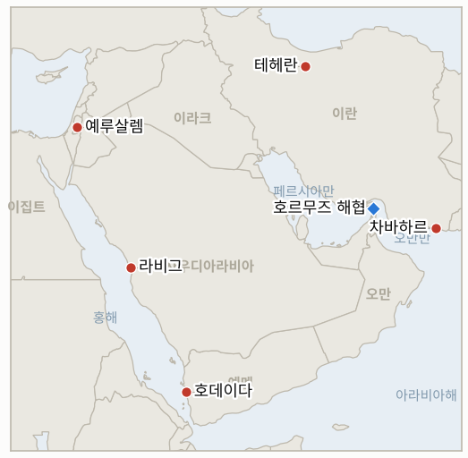

# 중동 일일 브리핑

**2026년 11월 24일**

- **보고 기간:** 약 24시간, 11월 23일 06:00 ~ 11월 24일 06:00 (한국시간)
- **종합 평가:** 월요일은 성명과 제재로 압박을 주고받은 하루였고, 미군과 이란군 사이에 새로 확인된 타격은 없었다. 이란 외무부는 미국의 봉쇄에 "가용한 모든 수단"으로 맞서겠다고 했고, 미국이 조건을 받아들이면 이틀 안에 호르무즈를 다시 열 수 있다고 제안했다(§1.1). 미국은 이란의 그림자 금융망을 제재하는 것으로 답했고, 같은 날 루비오 국무장관은 카타르 총리를 맞았다. 카타르 총리는 협상을 되살리려 노력하고 있다고 말했다(§1.2). 예멘에서는 후티 매체가 호데이다 통신 단지 공습의 사망자를 17명으로 집계했다(§1.3). 원유 시장은 이 모두를 지나쳤다. 브렌트는 89.37달러로 8월 이후 처음 90달러 아래에서 마감했다(§1.4). 이스라엘에서는 네타냐후와 아이젠코트가 이란이 당면한 위협인지를 놓고 공개적으로 맞섰다(§1.5). 서울에서는 코스피가 3.31% 내린 4,708.54로 마감했고 원·달러 환율은 1,345.9원으로 올랐다. 걸프보다는 미국 기술주 급락의 영향이 컸다. 종합하면 시장은 공급 과잉과 1월까지 이어질 소강상태를 가격에 반영하고 있다. 그러나 봉쇄선에서 일어난 사건은 여전히 설명되지 않았고, 호르무즈를 지나는 것으로 집계되는 선박은 하루 한 자릿수에 머물러 있다.

---

## 1. 무슨 일이 있었나

<figure style="float:right; width:46%; margin:2pt 0 8pt 14pt;">

<figcaption style="font-size:8pt; color:#666; text-align:center; margin-top:3pt; font-style:italic;">주요 논의 지점</figcaption>
</figure>

### 1.1 이란, 봉쇄에 가용한 모든 수단으로 맞서겠다며 호르무즈 재개방의 조건을 제시

에스마일 바가에이 이란 외무부 대변인은 주간 기자회견에서 이란은 미국의 봉쇄를 "결코 용납하지 않을 것"이며 "가용한 모든 수단"으로 맞서겠다고 말했다. 그는 봉쇄를 "군사적 침략"이라고 부르고 유엔헌장 제51조의 자위권을 언급했다([CBS News live](https://www.cbsnews.com/live-updates/iran-war-us-trump-blockade-strait-of-hormuz-ship-attacks/); [Gulf News live](https://gulfnews.com/world/mena/trump-threatens-to-sink-iranian-vessels-as-us-strikes-oil-tanker-ghalibaf-calls-for-lasting-security-1.500757421)). 또 미국이 봉쇄 해제를 포함한 이란의 조건을 받아들이면 호르무즈 해협을 이틀 안에 다시 열 수 있다고 했고, 카타르와 파키스탄이 중재를 계속하고 있다고 했다. 모하마드 바게르 갈리바프 국회의장은 이란이 "전쟁도 평화도 아닌 상태"에 머물 수 없다며 "지속 가능한 억지력"을 요구했다. 한 미국 당국자는 알아라비야에 미국은 언제든 대규모 타격을 할 준비가 돼 있다며 "이란이 봉쇄를 깨려 한다면 우리 역량을 시험해 보게 두라"고 말했다([Iran International](https://www.iranintl.com/en/liveblog/202611214578)). 일요일 차바하르 인근에서 유조선과 "군 병력"이 관련된 사건은 여전히 설명되지 않았다. 한 해상 보안 분석가는 미군이 이란산 원유를 실은 유조선을 타격했다고 썼다. 미 중부사령부도 이란도 이를 확인하지 않았고, UKMTO의 공지는 선박도 병력의 소속도 밝히지 않는다([Beinsure](https://beinsure.com/news/us-naval-blockade-of-iran-tanker-incident-reported-near-strait-of-hormuz/)). 이란 정규군은 해협 동쪽에서 미국 LUCAS 드론을 격추했다고 주장했다. 이란 사법부는 미국이 이란에 2,900억 달러를 빚지고 있으며 나포한 미국 관련 선박을 그 일부로 충당하겠다고 했으나, 구체적인 내용이나 확인은 뒤따르지 않았다. 이란은 또 자국의 공격을 규탄한 독일·카타르 공동성명을 문제 삼아 카타르 대사대리를 초치했다. **신뢰도: 성명은 높음; 분석가의 유조선 타격 주장은 낮음; 드론 격추와 선박 나포 주장은 낮음.**

### 1.2 미국은 제재를 추가하고 루비오는 카타르 총리를 맞이

미 재무부는 이란, 아랍에미리트, 튀르키예, 홍콩의 환전소와 위장 회사를 통해 이란의 자금을 옮긴 것으로 지목한 기업 22곳과 개인 8명을 제재했다. 그중 16곳이 두바이에 있다. 재무부 금융범죄단속국(FinCEN)은 2025년 1월부터 2026년 8월까지 이란과 연계됐을 가능성이 있는 거래 약 147억 달러를 파악했다고 밝혔다. 스콧 베센트 재무장관은 "이란 경제는 물에 잠겼고 지도자들은 공황에 빠졌다"고 말했다([Iran International](https://www.iranintl.com/en/liveblog/202611214578); [CBS News live](https://www.cbsnews.com/live-updates/iran-war-us-trump-blockade-strait-of-hormuz-ship-attacks/)). CBS는 이란으로 들어가는 육로를 차단하기 위한 미국의 태스크포스도 전했다. 아바스 아라그치 외무장관은 이란의 국토 크기와 많은 이웃 나라를 들어 육상 봉쇄는 "거의 불가능하다"고 답했다([Mehr News](https://en.mehrnews.com/news/249644/Land-blockade-of-Iran-practically-impossible-FM-Araghchi)). 이란 외무차관은 육상 국경이 거의 모두 가동 중이며 교역이 남부 항만에서 육상 국경으로 옮겨 갔다고 말했다. 워싱턴에서는 마코 루비오 국무장관이 셰이크 무함마드 빈 압둘라흐만 알사니 카타르 총리 겸 외무장관을 만나 "카타르의 세계적 중재 노력에 사의를 표했다." 알사니 총리는 알자지라에 카타르가 협상을 되살리려 노력하고 있으며 이 지역은 또 한 차례의 충돌을 감당할 수 없다고 말했다. 협상 날짜는 발표되지 않았다. **신뢰도: 제재와 회동은 높음; 육로 태스크포스는 중간(단일 매체, 세부 내용 없음).**

### 1.3 후티 매체, 호데이다 통신 단지 공습으로 17명 사망 보도

후티 계열 매체는 호데이다의 국영 통신 단지가 공습을 받아 17명이 숨지고 11명이 다쳤다고 전했다. 같은 날 앞선 집계는 사망 4명, 이어 10명이었다. 후티는 사우디 전투기의 소행이라고 주장하며, 직원 숙소와 모스크, 통신탑이 파괴됐고 시내 일부에서 전화와 인터넷이 끊겼다고 했다([Xinhua](https://english.news.cn/20261124/dabb567e6907437eae42ccc4a2ccbcb3/c.html)). 연합군은 논평하지 않았고 사망자 수는 독립적으로 확인되지 않았다. 국제사회가 인정하는 예멘 정부는 연합군이 몇 시간 만에 647차례 타격했고 후티 지휘관과 대원 122명을 "무력화"했다고 밝혔다. 후티는 24시간 동안 사우디의 공습과 미사일 공격이 67차례 있었다고 집계했다. 예멘 정부는 타이즈에서 민간인 2명이 숨지고 7명이 다친 미사일 공격을 후티의 소행으로 지목했다([CBS News live](https://www.cbsnews.com/live-updates/iran-war-us-trump-blockade-strait-of-hormuz-ship-attacks/)). 라비그에 대해서는 사우디 당국, 아람코, 스미토모화학이 여전히 아무 말도 하지 않았다. 화재 영상이 온라인에 돌았으나 확인되지 않았고 가동 중단 보도도 없다([The New Arab](https://www.newarab.com/news/yemens-houthis-attack-saudi-arabias-rabigh-oil-refinery)). 지다나 얀부에 대한 새 공격은 보고되지 않았다. **신뢰도: 호데이다 공습은 중간; 사망자 수와 양측의 타격 횟수는 낮음; 라비그의 피해 여부는 낮음.**

### 1.4 유가, 8월 이후 처음으로 90달러 아래에서 마감

브렌트는 월요일 3.20달러(3.46%) 내린 89.37달러에 마감했다. 8월 31일 이후 가장 낮은 종가다. WTI는 장중 79.95달러까지 내렸다가 3.24달러(3.88%) 내린 80.17달러에 마감했다. 8월 10일 이후 가장 낮은 종가다([Reuters via Yahoo Finance](https://finance.yahoo.com/news/oil-prices-fall-amid-equity-022442236.html)). 로이터는 중동 공급 증가와 리비아 샤라라 송유관 재가동이 주말 사이의 선박 공격, 바레인 공격, 라비그 타격 주장을 압도했다고 설명했다. JP모건은 2027년 상반기 유가를 70달러대 후반으로 예상한다. 뱅크오브아메리카는 재고가 낮아 지정학이 여전히 가장 큰 변수라고 본다. 골드만삭스에 따르면 두바이드 브렌트(현물)가 선물보다 비싼 폭은 10월 초 약 31달러에서 약 1달러로 줄었다([OilPrice](https://oilprice.com/Latest-Energy-News/World-News/Brent-Drops-Below-90-as-Wall-Street-Splits-on-2027-Oil-Outlook.html)). IG의 크리스 보샹은 "하루하루 지날수록 트럼프가 다시 공격할 가능성은 낮아 보인다"고 말했다. 한 미국 당국자는 알아라비야에 일주일 동안 1억 800만 배럴이 호르무즈를 통과했다고 말했다. 하루 약 1,500만 배럴이다. 선박 추적 자료는 다른 모습을 보여 준다. AIS 기반의 한 집계 사이트는 일요일 해협을 통과한 상선을 3척, 월요일 늦은 시각까지 4척으로 기록했다([hormuz.now](https://hormuz.now/traffic)). 두 수치는 서로 맞지 않는다(§2.1 참조). OPEC+는 11월 29일에 회의를 연다. **신뢰도: 종가는 높음; 미국 당국자의 물량 수치는 중간; AIS 집계는 중간~낮음(AIS 차단 운항 선박은 잡히지 않음).**

### 1.5 네타냐후와 아이젠코트, 이란 위협의 시급성을 놓고 충돌

가디 아이젠코트는 새 정부가 구성되기 전에 행동해야 할 만큼 이란의 "당면한 위협"은 보이지 않는다고 말했고, 이란의 농축 우라늄 비축분을 "가장 중대한 위협"으로 꼽았다. 네타냐후 과도 총리는 이스라엘이 "심각하고 중대한 위협"에 직면해 있다며 이를 "축소"하지 말라고 경고했고, 통합 정부를 다시 촉구했다([CBS News live](https://www.cbsnews.com/live-updates/iran-war-us-trump-blockade-strait-of-hormuz-ship-attacks/)). 다비드 바르네아 전 모사드 국장은 이스라엘이 "모든 조건이 갖춰지는 대로" 이란과 전쟁에 나서야 한다고 말했다. 야샤르와 리쿠드 협상단은 월요일 2시간 동안 만나 "사법 문제"를 논의했다고 밝혔고 다음 회동을 잡았다. 세 번째 회동이다. 채널13은 아이젠코트가 리쿠드와의 협상에 시한을 두려 하고 나프탈리 베네트는 이에 반대한다고 보도했다. 아이젠코트의 정부 구성권은 12월 6일까지이며 대통령이 2주 연장할 수 있다([Times of Israel](https://www.timesofisrael.com/liveblog-november-23-2026/)). 이와 별도로 재러드 쿠슈너 미국 특사는 네타냐후가 평화이사회(Board of Peace)의 가자 계획을 막고 있는 점을 들어 이스라엘이 "세계의 외톨이"가 되어 가고 있다고 경고했다. **신뢰도: 발언과 회동은 높음; 채널13 보도는 중간.**

---

## 2. 심층 분석: 유인과 동기

### 2.1 걸프의 긴장이 높아지는데 유가는 왜 내리나?

세 가지가 함께 가격에 반영되고 있다. 첫째는 공급이다. IEA는 이번 분기 하루 약 170만 배럴의 공급 과잉을 예상하고, 걸프 산유량은 대부분 회복됐으며, 월요일에는 리비아 물량이 더해졌다. 둘째는 트럼프의 시간표다. 그는 1월을 지목함으로써 앞으로 5주 동안 미국이 작전에 나설 위험을 걷어냈다. IG의 발언이 가리키는 바다. 셋째는 사건과 물량 사이의 간극이다. 유조선이 피격되고 AIS 집계에는 하루 몇 척만 잡히는데, 미국 당국자는 주간 물량이 전쟁 전 수준에 가깝다고 말한다. 대부분의 화물이 AIS를 끄고, 호위를 받거나, 추적 업체가 보지 못하는 선단으로 움직인다면 둘 다 부분적으로 사실일 수 있다. 그러나 둘을 맞춰 주는 자료를 공개한 곳은 없다. 시장은 물량 수치를 믿는 쪽을 택했고, 현물 프리미엄의 붕괴가 그 선택을 뒷받침한다. 이 가격의 위험은 당국자의 수치 하나와 날짜 하나에 기대고 있다는 점이다. 걸프 수출 시설 피격이 확인되거나 1월 이전에 타격이 이뤄지면, 재고는 낮고 리스크 프리미엄은 거의 남지 않은 시장이 그 충격을 받게 된다.

### 2.2 미국은 왜 타격 대신 제재와 육로 태스크포스를 더하나?

트럼프는 새해 이후까지 기다리겠다고 했다. 그때까지 행정부는 기다림이 약함이 아니라는 것을 이란과 공격받는 걸프 주둔국 모두에게 보여 줘야 한다. 환전소 제재는 군사적 비용 없이 그 일을 하고, 이란이 지금 기대는 경로를 겨냥한다. 남부 항만이 봉쇄되면서 교역과 결제가 육상 국경과 두바이, 튀르키예, 홍콩으로 옮겨 갔기 때문이다. 이 조치는 제재 대상 16곳이 있는 아랍에미리트에 자국 금융 부문을 단속하라는 압박이기도 하다. 같은 날 카타르 총리를 맞은 것은 외교 채널이 열려 있음을 드러낸다. 이 조합은 이란에 시간 끌기의 값이 매주 오르지만 출구는 남아 있다고 알린다. 한계는 아라그치가 지목한 그대로다. 이란의 육상 국경은 길고, 이웃 나라가 모두 협조하지는 않는다.

### 2.3 이란은 왜 제51조를 내세우면서 동시에 이틀 내 재개방을 제안하나?

두 발언은 서로 다른 청중을 향한다. 제51조는 법적 주장이다. 봉쇄가 무력 공격이라면 유조선 피격과 걸프 국가 내 미군 거점 공격을 포함해 이란이 봉쇄에 맞서 하는 모든 행동을 자위권 행사로 내세울 수 있다. 바레인이 일요일 같은 조항을 이란을 상대로 썼고, 이란은 그 명분을 두고 다투고 있다. 이틀 내 재개방 제안은 중재국과 원유 수입국을 겨냥한다. 해협 폐쇄는 이란이 빠르게 되돌릴 수 있는 선택이고, 걸림돌은 봉쇄를 풀지 않는 미국이라는 뜻이다. "전쟁도 평화도 아닌 상태"가 계속될 수 없다는 갈리바프의 말은 두 발언 뒤에 있는 압박을 보여 준다. 봉쇄되고 물가가 오르는 경제는 무한정 기다릴 수 없으므로, 이란은 1월 이전에 완화를 얻어내거나 위기를 만들어야 한다. 카타르의 중재에 기대면서 카타르 대사대리를 초치한 것도 밀어붙이기와 흥정을 함께 하는 같은 방식이다.

### 2.4 네타냐후와 아이젠코트는 왜 이란이 당면한 위협인지를 놓고 다투나?

그 답이 누가 통치할지를 정하기 때문이다. 위협이 당면한 것이라면 네타냐후가 이끌고, 서둘러, 지금의 연정 상대들과 함께 꾸리는 통합 정부의 명분이 강해지고, 과도 총리가 후임이 취임하기 전에 행동할 근거도 생긴다. 당면한 위협이 아니라면 아이젠코트는 정부 구성권이 허락하는 시간을 다 쓰면서 리쿠드의 조건에 버틸 수 있고, 네타냐후가 그 사이에 타격에 나설 이유를 주지 않을 수 있다. 참모총장 출신인 아이젠코트는 유약하다고 몰아세우기 어렵다. 그는 우라늄 비축분을 가장 중대한 위협으로 꼽아 위험은 인정하면서 시급성은 부정한다. "모든 조건이 갖춰지는 대로" 전쟁에 나서야 한다는 바르네아의 발언은 네타냐후 쪽 논리에 힘을 싣지만, 그 조건에는 기한이 없다. 시한을 둘지를 놓고 아이젠코트와 베네트가 갈리는 것은 지연의 비용이 아이젠코트 진영 안에서도 커지고 있음을 보여 준다.

---

## 3. 한국에 대한 정책적 함의

**익스포저 현황:** 한국은 원유의 약 70.7%, LNG의 20.4%를 중동에서 들여온다(`instructions/korea-exposure.md`, 갱신 불필요). 월요일 브렌트는 89.37달러, WTI는 80.17달러에 마감했다. WTI 등락은 지난주 기록한 만기 12월물의 83.98달러가 아니라 금요일 1월물 종가 83.41달러를 기준으로 한 것이다. 코스피는 161.42포인트(3.31%) 내린 4,708.54로 1월 13일 이후 가장 낮은 종가를 기록했고, 매도 사이드카가 2거래일 연속 발동됐다. 외국인은 7거래일째 순매도했다. 규모는 보도에 따라 약 2,400억~2,600억 원이며, 7거래일 누적은 약 5조 3,000억 원이다. 삼성전자는 3.06%, SK하이닉스는 2.52% 내렸다([Business Korea](https://www.businesskorea.co.kr/news/articleView.html?idxno=281954)). 원·달러 환율은 9.7원 오른 1,345.9원에 마감했다. 장중 1,351.6원까지 올라 11월 9일 이후 가장 높았고, 1,350원 위에서는 수출업체의 달러 매도가 나왔다([서울경제](https://www.sedaily.com/article/20117842)). 두 건의 설문에서 전문가 전원이 한국은행이 목요일 기준금리를 3.00%에서 3.25%로 올릴 것으로 예상했다([아시아경제](https://view.asiae.co.kr/article/2026112210490320195)). 국회 국방위원회는 월요일 청해부대 수정동의안을 상정해 소위원회에 회부했다. 소위는 화요일에 열리고 국방위 전체회의 처리는 목요일로 예상된다. 동의안은 작전구역을 오만 남쪽 해역까지 넓히고 병력을 320명에서 395명으로 늘리며 초계기 1대와 무인 기뢰 제거 장비를 추가한다. 여당 간사는 호르무즈 해협에 진입하려면 별도의 국회 동의를 받도록 하는 부대의견을 제안했고, 국방부 장관은 취지에 공감한다고 답했다([한국경제](https://www.hankyung.com/article/2026112350501)).

**사안별 함의:**

- **이란의 조건과 봉쇄선 (§1.1):** 이란의 이틀 내 재개방 제안은 봉쇄 해제를 조건으로 하는데 미국은 봉쇄를 조이고 있다. 따라서 화물 계획에는 달라지는 것이 없다. 차바하르 인근의 설명되지 않은 사건과 미국 당국자의 도발적 발언을 고려하면, 이란이 걸프 수출 시설을 상대로 행동에 나서게 할 가장 가까운 계기는 여전히 봉쇄선에서의 충돌이다 (IND-20261122-1, IND-20261123-2).
- **제재 (§1.2):** 새로 지정된 기업 중 16곳이 두바이에 있다. 아랍에미리트의 환전소나 무역회사를 거쳐 결제하는 한국의 은행, 정유사, 무역업체는 2차 제재 위험이 적용되므로 거래 상대를 새 명단과 다시 대조해야 한다.
- **예멘과 라비그 (§1.3):** 연합군의 호데이다 공습이 거세지면 후티가 사우디 홍해 연안에서 보복할 가능성이 커진다. 이 연안은 사우디 원유가 호르무즈를 지나지 않고 한국에 닿는 경로다. 라비그 피격은 여전히 확인되지 않았다 (IND-20261123-1, IND-20261121-1).
- **유가 (§1.4):** 브렌트가 90달러 아래로 내려가면 한국의 수입 부담이 줄고 한국은행 회의를 앞둔 물가 압력도 덜어진다. 그렇다고 공급 위험이 지나갔다는 뜻은 아니다. 이 가격은 선박 집계가 뒷받침하지 않는 물량 수치와 1월이라는 날짜에 기대고 있다. 한국은 낮아진 가격을 민간 재고와 전략 비축을 다시 채우는 데 써야 하며 대비를 늦추는 근거로 삼아서는 안 된다 (IND-20261124-1, IND-20261122-3).
- **이스라엘 (§1.5):** 새 정부 구성 전에는 행동이 필요하지 않다는 아이젠코트의 발언은, 그가 이긴다면 앞으로 몇 주 안에 이스라엘이 타격에 나설 가능성을 낮춘다. 네타냐후는 여전히 과도 총리이고 반대 견해를 갖고 있다 (IND-20261114-1, IND-20261123-3).
- **시장:** 월요일 서울 증시 하락은 미국 기술주와 외국인 매도에서 비롯됐고, 유가는 한국에 유리하게 움직였다. 원화 약세가 원유 가격 하락분의 일부를 상쇄한다. 외국인 주주에 대한 배당금 지급이 12월 초까지 달러 수요를 더할 수 있다 (IND-20261124-3, IND-20261120-3, IND-20261119-3, IND-20261023-1).
- **청해부대 (§3 익스포저 현황):** 부대의견은 오만 남쪽 해역의 해적 대응과 호르무즈에서의 역할 사이에 선을 긋는다. 채택되면 동의안은 통과시키되 실제 위험이 따르는 단계에는 두 번째 표결을 요구하게 된다 (IND-20261124-2, IND-20261112-1).

**오늘 종결:**

- **IND-20261115-1: 확증.** 브렌트는 11월 23일 89.37달러로 90달러 아래에서 마감했고, 이는 11월 27일께인 시한 안이다. 11월 15일에 제시한 공급 과잉과 자제의 해석이 주말의 긴장 고조를 눌렀다.
- **IND-20261121-3: 확증.** 코스피는 11월 23일 4,708.54로 4,800 아래에서 마감했고, 이는 11월 27일께인 시한 안이다. 급락은 더 깊어졌고 그 원인은 주로 미국 기술주에 있다.

**검증 가능한 지표:**

- **IND-20261124-1** (진행, 신규): 2026년 12월 1일께까지 어느 거래일이든 브렌트가 85달러 아래에서 마감하면 공급 과잉 해석이 걸프 위험을 계속 누르는 것으로 확증; 없으면 반증.
- **IND-20261124-2** (진행, 신규): 2026년 11월 27일께까지 국회 국방위원회가 호르무즈 해협 진입에 별도 동의를 요구하는 부대의견을 달아 청해부대 동의안을 의결하면 확증; 국방위 의결이 없거나 그런 부대의견 없이 의결되면 반증.
- **IND-20261124-3** (진행, 신규): 2026년 12월 1일께까지 어느 거래일이든 원·달러 환율이 15시 30분 종가 기준 1,360원을 넘으면 원화 약세가 이어지는 것으로 확증; 없으면 반증.
- **IND-20261123-1** (진행): 사우디 당국, 아람코, 페트로라비그, 스미토모화학의 발표 없음; 화재 영상은 확인되지 않음.
- **IND-20261123-2** (진행): 걸프 국가 정부나 국영 에너지 기업이 석유·가스 시설에 대한 이란의 타격이나 요격을 발표하지 않음.
- **IND-20261123-3** (진행): 야샤르와 리쿠드가 세 번째 회동을 잡음; 리쿠드를 뺀 표결을 향한 절차는 없음.
- **IND-20261122-1** (진행): 한 분석가가 미군이 이란산 원유를 실은 유조선을 타격했다고 주장; 미 중부사령부 성명도 통신사의 확인도 없어 조건은 충족되지 않음.
- **IND-20261122-2** (진행): 바레인에 대한 새 공격 보도 없음.
- **IND-20261122-3** (진행): 브렌트 89.37달러 마감으로 95달러 기준선에서 멀어짐.
- **IND-20261121-1** (진행): 지다나 얀부에 대한 보도 없음.
- **IND-20261120-1** (진행): 카타이브 헤즈볼라 부대가 주르프 알사카르를 떠났다는 발표를 찾지 못함.
- **IND-20261120-3** (진행): 외국인은 11월 23일 7거래일째 순매도.
- **IND-20261119-1** (진행): 공개된 미국의 2차 타격 없음; 시한은 11월 26일께.
- **IND-20261119-3** (진행): 원·달러 1,345.9원 마감으로 1,325원 기준선에서 멀어짐; 시한은 11월 26일께.
- **IND-20261114-1** (진행): 호르무즈 연안 너머에 대한 미국이나 이스라엘의 타격 없음; 아이젠코트는 당장 행동할 필요가 없다고 봄.
- **IND-20261023-1** (진행): 한국은행은 11월 26일 결정; 설문에 응한 전문가 전원이 3.25%를 예상.
- **IND-20261112-1** (진행): 동의안이 11월 23일 국방위에 상정됨; 본회의 표결은 아직 없음.
- **IND-20261116-2** (진행): 바브엘만데브 인근 선박에 대한 후티 공격 보도를 찾지 못함.
- **IND-20261117-1** (진행): 후티 병력이 아덴 50km 이내에 있다는 보도를 찾지 못함.
- **IND-20261113-2, IND-20261114-3, IND-20261115-2, IND-20260714-4** (진행): 변동을 찾지 못함; `tracking/indicators.md` 참조.

---

## 4. 관찰 목록

- **오만만 사건에 대한 미 중부사령부나 이란의 설명, 하르그섬에서의 유조선 움직임 (IND-20261122-1).**
- **이란이 "가용한 모든 수단"을 실행에 옮기는지, 특히 걸프 에너지 시설이나 바레인을 상대로 (IND-20261123-2, IND-20261122-2).**
- **루비오와 카타르 총리의 회동 이후 협상 재개 날짜가 나오는지.**
- **호데이다 공습에 대한 후티의 사우디 홍해 연안 보복, 라비그에 대한 사우디나 기업의 발표 (IND-20261121-1, IND-20261123-1).**
- **미국 연휴 주간의 한산한 장에서 11월 29일 OPEC+ 회의 전까지 브렌트가 90달러 아래를 유지하는지 (IND-20261124-1, IND-20261122-3).**
- **보도된 호르무즈 물량과 한 자릿수에 그치는 선박 집계를 맞춰 줄 자료.**
- **야샤르와 리쿠드의 세 번째 회동, 아이젠코트가 정할 시한 (IND-20261123-3).**
- **이란 내 물가, 연료와 빵 구매 제한, 시위.**
- **카타이브 헤즈볼라 부대가 주르프 알사카르에서 철수하는지 (IND-20261120-1).**
- **외국인 수급, 1,350원 부근의 원화, 목요일 한국은행 결정 (IND-20261124-3, IND-20261120-3, IND-20261023-1).**
- **화요일 국방위 소위원회와 청해부대 동의안의 국방위 의결 (IND-20261124-2, IND-20261112-1).**

---

## 5. 출처 신뢰도 요약

| 주장 | 출처 | 신뢰도 |
| --- | --- | --- |
| 바가에이: 이란은 봉쇄에 "가용한 모든 수단"으로 맞설 것; 제51조; 이란의 조건이 충족되면 호르무즈를 이틀 안에 재개방 가능 | 이란 외무부 via CBS News, Gulf News, Times of Israel | 높음 |
| 갈리바프: 이란은 "전쟁도 평화도 아닌 상태"에 머물 수 없음 | Gulf News, Iran International | 높음 |
| 미국 당국자: 대규모 타격 준비 완료; "이란이 우리 역량을 시험해 보게 두라" | Al Arabiya via Iran International | 중간 |
| 미군이 봉쇄선 인근에서 이란산 원유를 실은 유조선을 타격 | 해상 보안 분석가 via Gulf News; 공식 확인 없음 | 낮음 |
| UKMTO 공지는 선박과 병력의 소속을 밝히지 않음; 미 중부사령부는 침묵 | Beinsure, Gulf News | 높음 |
| 이란 정규군이 해협 동쪽에서 미국 LUCAS 드론을 격추 | 이란 정규군 via Iran International, Mehr | 낮음 |
| 이란 사법부가 2,900억 달러를 청구하고 미국 관련 선박을 나포했다고 발표 | IRIB via CBS News | 중간(주장); 낮음(나포) |
| 이란이 카타르 대사대리를 초치 | Iran International | 중간~높음 |
| 미 재무부가 기업 22곳과 개인 8명을 제재; 16곳이 두바이 소재; 의심 거래 147억 달러 | 미 재무부 via Iran International, CBS News | 높음 |
| 이란행 육로를 차단하기 위한 미국의 태스크포스 | CBS News | 중간 |
| 아라그치: 육상 봉쇄는 "거의 불가능" | Mehr News, Press TV | 높음 |
| 루비오가 카타르 총리와 회동; 알사니 총리는 카타르가 협상을 되살리려 노력 중이라고 발언 | 미 국무부 via Times of Israel, Iran International; Al Jazeera | 높음 |
| 호데이다 통신 단지 공습으로 17명 사망, 11명 부상 | Al-Masirah via Xinhua, CBS News | 중간(공습); 낮음(사망자 수) |
| 연합군 647차례 타격, 후티 122명 "무력화"; 24시간 동안 사우디 67차례 타격 | 예멘 정부; 후티 대변인 via CBS News | 낮음 |
| 타이즈 미사일 공격으로 민간인 2명 사망 | 예멘 정부 via CBS News | 중간 |
| 라비그 피해는 확인되지 않음; 화재 영상은 미확인 | The New Arab, Reuters | 중간 |
| 브렌트 89.37달러(8월 31일 이후 최저), WTI 80.17달러(8월 10일 이후 최저) 마감 | Reuters via Yahoo Finance, Korea Times; InvestingLive (WTI) | 높음 |
| 두바이드 브렌트(현물) 프리미엄이 약 31달러에서 약 1달러로 축소; 투자은행 전망 | Goldman Sachs, JPMorgan, Bank of America via OilPrice, Reuters | 중간~높음 |
| 일주일 동안 1억 800만 배럴이 호르무즈를 통과 | 미국 당국자 via Al Arabiya, Iran International | 중간 |
| 11월 22일 AIS 송출 상선 3척, 11월 23일 늦은 시각까지 4척이 호르무즈 통과 | hormuz.now | 중간~낮음 |
| 아이젠코트: 새 정부 전에는 이란의 당면한 위협 없음; 네타냐후: "심각하고 중대한 위협" | CBS News, Gulf News, Times of Israel | 높음 |
| 바르네아: "모든 조건이 갖춰지는 대로" 이란과 전쟁 | Times of Israel | 높음 |
| 야샤르와 리쿠드가 2시간 회동하고 세 번째 회동을 잡음; 정부 구성권은 12월 6일까지 | Times of Israel | 높음 |
| 아이젠코트와 베네트가 시한을 놓고 이견 | 채널13 via Times of Israel | 중간 |
| 코스피 4,708.54(-3.31%), 외국인 7거래일째 순매도; 원·달러 1,345.9원 | Business Korea, 서울경제 | 높음(수준); 중간(수급 규모) |
| 설문에 응한 전문가 전원이 한국은행의 3.25% 인상을 예상 | 아시아경제, 머니투데이 | 높음 |
| 청해부대 동의안 국방위 상정; 부대의견 제안 | 한국경제, 헤럴드경제 | 높음 |
