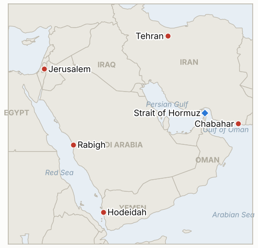

# Middle East Daily Briefing

**November 24, 2026**

- **Reporting window:** ~24 hours, November 23, 06:00 to November 24, 06:00 KST
- **Overall assessment:** Monday was a day of pressure by statement and by sanction, with no confirmed new strike between US and Iranian forces. Iran's Foreign Ministry said it will use "all available means" against the US blockade and offered to reopen Hormuz within two days if Washington meets its terms (§1.1). Washington answered with sanctions on Iran's shadow banking network while Secretary of State Rubio received Qatar's prime minister, who says Doha is trying to revive the talks (§1.2). In Yemen, Houthi media put the toll of a strike on Hodeidah's telecom complex at 17 dead (§1.3). The oil market looked past all of it: Brent settled at $89.37, its first close below $90 since August (§1.4). In Israel, Netanyahu and Eisenkot argued in public over whether Iran is an immediate threat (§1.5). In Seoul the KOSPI fell 3.31% to 4,708.54 and the won weakened to 1,345.9 per dollar, driven by the US technology selloff more than by the Gulf. Net: the market is pricing a supply surplus and a pause that lasts until January, while the incident at the blockade line remains unexplained and daily ship counts through Hormuz remain in single digits.

---

## 1. What Happened

<figure style="float:right; width:46%; margin:2pt 0 8pt 14pt;">

<figcaption style="font-size:8pt; color:#666; text-align:center; margin-top:3pt; font-style:italic;">Major places of discussion</figcaption>
</figure>

### 1.1 Iran vows all available means against the blockade and names its price for Hormuz

Foreign Ministry spokesman Esmaeil Baghaei said at his weekly news conference that Iran "will definitely not tolerate" the US blockade and will use "all available means" to counter it. He called the blockade "military aggression" and cited the right of self defence under Article 51 of the UN Charter ([CBS News live](https://www.cbsnews.com/live-updates/iran-war-us-trump-blockade-strait-of-hormuz-ship-attacks/); [Gulf News live](https://gulfnews.com/world/mena/trump-threatens-to-sink-iranian-vessels-as-us-strikes-oil-tanker-ghalibaf-calls-for-lasting-security-1.500757421)). He also said the Strait of Hormuz could reopen within two days if Washington accepts Iran's conditions, including an end to the blockade, and that Qatar and Pakistan continue to mediate. Parliament Speaker Mohammad Bagher Ghalibaf said Iran cannot remain in "neither war nor peace" and called for "sustainable deterrence." A US official told Al Arabiya that the United States is ready for a large strike at any time: "Let the Iranians test our capabilities if they try to break the blockade" ([Iran International](https://www.iranintl.com/en/liveblog/202611214578)). Sunday's incident between a tanker and "military forces" near Chabahar is still unexplained. A maritime security analyst wrote that US forces struck a tanker carrying Iranian oil; neither CENTCOM nor Iran has confirmed that, and the UKMTO notice names no vessel and no force ([Beinsure](https://beinsure.com/news/us-naval-blockade-of-iran-tanker-incident-reported-near-strait-of-hormuz/)). Iran's army claimed it shot down a US LUCAS drone east of the strait, and the judiciary said the United States owes Iran $290 billion and that seized US linked ships would count toward it; no detail or confirmation followed. Iran also summoned Qatar's chargé d'affaires over a German and Qatari statement condemning its attacks. **Confidence: High on the statements; Low on the analyst's tanker strike claim; Low on the drone and ship seizure claims.**

### 1.2 Washington adds sanctions while Rubio receives Qatar's prime minister

The US Treasury sanctioned 22 companies and eight individuals that it says move money for Iran through exchange houses and front companies in Iran, the UAE, Turkey and Hong Kong. Sixteen of the firms are based in Dubai. The Treasury's financial crimes unit said it had identified about $14.7 billion in transactions potentially linked to Iran between January 2025 and August 2026. Treasury Secretary Scott Bessent said "Iran's economy is underwater, and its leaders are panicking" ([Iran International](https://www.iranintl.com/en/liveblog/202611214578); [CBS News live](https://www.cbsnews.com/live-updates/iran-war-us-trump-blockade-strait-of-hormuz-ship-attacks/)). CBS also reports a US task force to disrupt land routes into Iran. Foreign Minister Abbas Araghchi answered that a land blockade is "almost impossible" given Iran's size and its many neighbours ([Mehr News](https://en.mehrnews.com/news/249644/Land-blockade-of-Iran-practically-impossible-FM-Araghchi)), and a deputy foreign minister said nearly all land borders are operating and that trade has shifted to them from the southern ports. In Washington, Secretary of State Marco Rubio met Qatar's prime minister and foreign minister, Sheikh Mohammed bin Abdulrahman Al Thani, and "expressed appreciation for Qatar's global mediation efforts." Al Thani told Al Jazeera that Qatar is working to revive the negotiations and that the region cannot absorb another round. No date for talks was announced. **Confidence: High on the sanctions and the meeting; Medium on the land route task force (single outlet, no detail).**

### 1.3 Houthi media report 17 dead in a strike on Hodeidah's telecom complex

Houthi run media said an air strike on the state telecommunications complex in Hodeidah killed 17 people and wounded 11. Earlier counts on the same day were four dead, then ten. The group blames Saudi warplanes, and says staff housing, a mosque and a communications tower were destroyed and that phone and internet service was cut in parts of the city ([Xinhua](https://english.news.cn/20261124/dabb567e6907437eae42ccc4a2ccbcb3/c.html)). The coalition has not commented and the toll is not independently verified. Yemen's internationally recognised government said the coalition carried out 647 strikes within hours and that 122 Houthi commanders and fighters were "neutralized"; the Houthis counted 67 Saudi air and missile strikes in 24 hours. The government blamed the Houthis for a missile attack in Taiz that killed two civilians and wounded seven ([CBS News live](https://www.cbsnews.com/live-updates/iran-war-us-trump-blockade-strait-of-hormuz-ship-attacks/)). On Rabigh, Saudi authorities, Aramco and Sumitomo Chemical have still said nothing. Videos of a fire circulated online but are unverified, and no shutdown has been reported ([The New Arab](https://www.newarab.com/news/yemens-houthis-attack-saudi-arabias-rabigh-oil-refinery)). No new attack on Jeddah or Yanbu was reported. **Confidence: Medium on the Hodeidah strike; Low on the toll and on both sides' strike counts; Low on any damage at Rabigh.**

### 1.4 Oil closes below $90 for the first time since August

Brent settled at $89.37 on Monday, down $3.20 or 3.46%, its lowest close since August 31. WTI settled at $80.17, down $3.24 or 3.88%, its lowest close since August 10, after touching $79.95 ([Reuters via Yahoo Finance](https://finance.yahoo.com/news/oil-prices-fall-amid-equity-022442236.html)). Reuters attributed the fall to rising Middle East supply and the restart of Libya's Sharara pipeline, which outweighed the weekend's attacks on shipping, Bahrain and the claimed hit on Rabigh. JPMorgan expects prices in the high $70s in the first half of 2027; Bank of America says geopolitics remains the main driver because inventories are low. Goldman Sachs says the premium of physical Dated Brent over futures has shrunk to about $1 from about $31 in early October ([OilPrice](https://oilprice.com/Latest-Energy-News/World-News/Brent-Drops-Below-90-as-Wall-Street-Splits-on-2027-Oil-Outlook.html)). IG's Chris Beauchamp said "with each passing day it seems less likely that Trump will attack again." A US official told Al Arabiya that 108 million barrels passed through Hormuz in one week, about 15 million barrels a day. Ship trackers show something different: one AIS based counter recorded three commercial ships through the strait on Sunday and four by late Monday ([hormuz.now](https://hormuz.now/traffic)). The two measures do not reconcile; see §2.1. OPEC+ meets on November 29. **Confidence: High on the settles; Medium on the US official's volume figure; Medium to Low on the AIS count (ships running dark are missed).**

### 1.5 Netanyahu and Eisenkot clash over how urgent the Iranian threat is

Gadi Eisenkot said he sees no "immediate threat" from Iran that requires action before a new government is formed, and called Iran's enriched uranium stockpile "the gravest threat." Caretaker Prime Minister Netanyahu said Israel faces "serious and grave threats," warned against "minimizing" them and again called for a unity government ([CBS News live](https://www.cbsnews.com/live-updates/iran-war-us-trump-blockade-strait-of-hormuz-ship-attacks/)). Former Mossad chief David Barnea said Israel must go to war against Iran "as soon as all conditions allow." Yashar and Likud negotiators met for two hours on Monday, said they had discussed "the judicial issue" and scheduled another meeting, their third. Channel 13 reported that Eisenkot wants to set a deadline for the Likud talks and Naftali Bennett opposes one. Eisenkot's mandate runs to December 6 and the president can extend it by two weeks ([Times of Israel](https://www.timesofisrael.com/liveblog-november-23-2026/)). Separately, US envoy Jared Kushner warned that Israel is heading toward "global pariah status" over Netanyahu's blocking of the Board of Peace plan for Gaza. **Confidence: High on the statements and the meeting; Medium on the Channel 13 report.**

---

## 2. Deep Dive: Incentives and Motives

### 2.1 Why is oil falling while the Gulf is escalating?

Three things are being priced together. First, supply: the IEA sees a surplus of about 1.7 million barrels a day this quarter, Gulf output has largely recovered, and Libya added barrels on Monday. Second, Trump's timetable: by naming January he removed the risk of a US campaign from the next five weeks, which is what the IG comment says. Third, the gap between incidents and volume. Tankers are being hit and AIS counters show a handful of visible ships a day, yet a US official puts the weekly flow near pre-war levels. Both can be partly true if most cargoes now move dark, under escort or in convoys that trackers do not see, but nobody has published data that reconciles them. The market is choosing to believe the volume figure, and the collapse of the physical premium supports that choice. The risk in this pricing is that it rests on an official's figure and on a date. A confirmed hit on a Gulf export facility, or a strike before January, would find a market with low inventories and little risk premium left.

### 2.2 Why does Washington add sanctions and a land route task force instead of striking?

Trump has said he will wait until after the New Year. Between now and then his administration needs to show that waiting is not weakness, both to Tehran and to Gulf hosts under fire. Sanctions on the exchange houses do that at no military cost, and they go after the route Iran now relies on: with its southern ports blockaded, trade and payments have moved to land borders and to Dubai, Turkey and Hong Kong. The measure also presses the UAE, where sixteen of the listed firms sit, to police its own financial sector. Receiving Qatar's prime minister on the same day keeps the diplomatic channel visibly open. The combination tells Iran that the price of stalling rises each week while a way out remains. Its limit is the one Araghchi named: Iran has long land borders and neighbours that will not all cooperate.

### 2.3 Why does Tehran invoke Article 51 and offer a two day reopening in the same breath?

The two statements serve different audiences. Article 51 is a legal claim: if the blockade is an armed attack, then anything Iran does against it, including the tanker strikes and attacks on US positions in Gulf states, can be presented as self defence. Bahrain used the same article against Iran on Sunday, and Tehran is contesting that ground. The two day offer is aimed at mediators and at oil importers. It says that the closure is a choice Iran can reverse quickly, and that the obstacle is Washington's refusal to lift the blockade. Ghalibaf's line that "neither war nor peace" cannot continue shows the pressure behind both: a blockaded economy with rising prices cannot wait indefinitely, so Iran needs either relief or a crisis before January. Summoning Qatar's envoy while relying on Qatar's mediation fits the same pattern of pushing and bargaining at once.

### 2.4 Why are Netanyahu and Eisenkot arguing about whether Iran is an immediate threat?

Because the answer decides who should govern. If the threat is immediate, Netanyahu's case for a unity government that he leads, formed quickly and with his current partners, becomes stronger, and a caretaker prime minister has grounds to act before a successor is sworn in. If it is not immediate, Eisenkot can take the time his mandate allows, hold out against Likud's terms and deny Netanyahu a reason to strike in the interim. Eisenkot, a former chief of staff, is hard to paint as soft, and by naming the uranium stockpile as the gravest threat he concedes the danger while rejecting the urgency. Barnea's call for war "as soon as all conditions allow" helps Netanyahu's side of the argument, though its condition is open ended. The dispute between Eisenkot and Bennett over a deadline shows the cost of delay inside Eisenkot's own bloc.

---

## 3. Policy Implications for South Korea

**Exposure snapshot:** South Korea draws about 70.7% of its crude and 20.4% of its LNG from the Middle East (`instructions/korea-exposure.md`, no update needed). Brent settled at $89.37 and WTI at $80.17 on Monday; the WTI change is measured against Friday's January contract settle of $83.41, not the expired December contract's $83.98 logged last week. The KOSPI fell 161.42 points, or 3.31%, to 4,708.54, its lowest close since January 13, with a sell sidecar triggered for a second straight session. Foreign investors net sold for a seventh session, by about 240 to 260 billion won depending on the report, taking the seven session total to about 5.3 trillion won. Samsung Electronics fell 3.06% and SK hynix 2.52% ([Business Korea](https://www.businesskorea.co.kr/news/articleView.html?idxno=281954)). The won closed at 1,345.9 per dollar, 9.7 won weaker, after touching 1,351.6, its weakest since November 9; exporters sold dollars above 1,350 ([Seoul Economic Daily](https://www.sedaily.com/article/20117842)). Every economist in two surveys expects the Bank of Korea to raise its rate from 3.00% to 3.25% on Thursday ([Asia Economy](https://view.asiae.co.kr/article/2026112210490320195)). The National Assembly's defence committee tabled the amended Cheonghae Unit motion on Monday and sent it to its subcommittee, which meets on Tuesday; a committee vote is expected on Thursday. The motion extends the operating area to waters south of Oman, raises the unit from 320 to 395 personnel and adds a patrol aircraft and unmanned mine clearing equipment. The ruling party's committee lead proposed an attached opinion requiring separate Assembly consent before any entry into the Strait of Hormuz, and the defence minister said he agreed with its intent ([Hankyung](https://www.hankyung.com/article/2026112350501)).

**Implications by development:**

- **Iran's terms and the blockade line (§1.1):** Iran's two day offer is conditional on an end to the blockade, which Washington is tightening, so it changes nothing for cargo planning. The unexplained incident near Chabahar and the US official's dare keep a clash at the line as the nearest trigger for Iranian action against Gulf export sites (IND-20261122-1, IND-20261123-2).
- **Sanctions (§1.2):** Sixteen of the newly listed firms are in Dubai. Korean banks, refiners and traders that settle through UAE exchange houses or trading companies should recheck counterparties against the new list, since secondary sanctions risk applies.
- **Yemen and Rabigh (§1.3):** Heavier coalition bombing of Hodeidah raises the odds of Houthi retaliation along the Saudi Red Sea coast, the route that lets Saudi crude reach Korea without passing Hormuz. Rabigh remains unconfirmed (IND-20261123-1, IND-20261121-1).
- **Oil (§1.4):** Brent below $90 lowers Korea's import bill and eases inflation pressure before the Bank of Korea meets. It does not show that the supply risk has passed: the price rests on a volume figure that ship counts do not support and on a January date. Seoul should use the lower price to rebuild commercial and strategic cover, not to relax it (IND-20261124-1, IND-20261122-3).
- **Israel (§1.5):** Eisenkot's statement that no action is needed before a new government forms lowers the chance of an Israeli strike in the coming weeks if he prevails; Netanyahu remains caretaker and holds the opposite view (IND-20261114-1, IND-20261123-3).
- **Markets:** Monday's fall in Seoul came from US technology shares and foreign selling, with oil moving in Korea's favour. A weaker won offsets part of the cheaper crude. Dividend payments to foreign shareholders may add to dollar demand into early December (IND-20261124-3, IND-20261120-3, IND-20261119-3, IND-20261023-1).
- **Cheonghae Unit (§3 snapshot):** The attached opinion would draw a line between counter piracy south of Oman and any role in Hormuz. If adopted, it lets the motion pass while requiring a second vote for the step that carries the real risk (IND-20261124-2, IND-20261112-1).

**Resolved today:**

- **IND-20261115-1: Confirmed.** Brent settled at $89.37 on November 23, below $90, within the deadline of ~November 27. The surplus and restraint reading opened on November 15 has prevailed over the weekend's escalation.
- **IND-20261121-3: Confirmed.** The KOSPI closed at 4,708.54 on November 23, below 4,800, within the deadline of ~November 27. The selloff deepened, for reasons that lie mainly in US technology shares.

**Testable indicators:**

- **IND-20261124-1** (open, new): A Brent settle below $85 on any session by ~2026-12-01 confirms that the surplus reading keeps overriding Gulf risk; none falsifies.
- **IND-20261124-2** (open, new): Approval of the Cheonghae Unit motion by the National Assembly defence committee by ~2026-11-27 with an attached opinion requiring separate consent for entry into the Strait of Hormuz confirms; no committee approval, or approval without such an opinion, falsifies.
- **IND-20261124-3** (open, new): A USD/KRW 15:30 close above 1,360 on any session by ~2026-12-01 confirms that won weakness is extending; none falsifies.
- **IND-20261123-1** (open): no statement from Saudi authorities, Aramco, Petro Rabigh or Sumitomo Chemical; fire videos unverified.
- **IND-20261123-2** (open): no Gulf government or state energy company reported an Iranian strike or interception at an oil or gas facility.
- **IND-20261123-3** (open): Yashar and Likud scheduled a third meeting; no step toward a vote without Likud.
- **IND-20261122-1** (open): an analyst says US forces struck a tanker carrying Iranian oil; no CENTCOM statement and no wire confirmation, so the condition is not met.
- **IND-20261122-2** (open): no new attack on Bahrain reported.
- **IND-20261122-3** (open): Brent settled at $89.37, moving away from the $95 threshold.
- **IND-20261121-1** (open): nothing reported at Jeddah or Yanbu.
- **IND-20261120-1** (open): no statement found that Kataib Hezbollah units have left Jurf al-Sakhar.
- **IND-20261120-3** (open): foreigners net sold a seventh session on November 23.
- **IND-20261119-1** (open): no second US strike disclosed; deadline ~November 26.
- **IND-20261119-3** (open): won closed at 1,345.9, moving away from the 1,325 threshold; deadline ~November 26.
- **IND-20261114-1** (open): no US or Israeli strike beyond the Hormuz coast; Eisenkot sees no immediate need to act.
- **IND-20261023-1** (open): the Bank of Korea decides on November 26; every surveyed economist expects 3.25%.
- **IND-20261112-1** (open): the motion reached the defence committee on November 23; no plenary vote yet.
- **IND-20261116-2** (open): no report found of a Houthi attack on shipping near the Bab el-Mandeb.
- **IND-20261117-1** (open): no report found of Houthi forces within 50 km of Aden.
- **IND-20261113-2, IND-20261114-3, IND-20261115-2, IND-20260714-4** (open): no change found; see `tracking/indicators.md`.

---

## 4. Watch List

- **Any CENTCOM or Iranian account of the Gulf of Oman incident, and any tanker movement from Kharg Island (IND-20261122-1).**
- **Whether Iran acts on "all available means," above all against Gulf energy sites or Bahrain (IND-20261123-2, IND-20261122-2).**
- **Any date for renewed talks after Rubio's meeting with Qatar's prime minister.**
- **Houthi retaliation for Hodeidah along the Saudi Red Sea coast, and any Saudi or company word on Rabigh (IND-20261121-1, IND-20261123-1).**
- **Whether Brent holds below $90 before the OPEC+ meeting on November 29, in a thin US holiday week (IND-20261124-1, IND-20261122-3).**
- **Data that reconciles reported Hormuz volumes with single digit visible ship counts.**
- **The third Yashar and Likud meeting and any deadline Eisenkot sets (IND-20261123-3).**
- **Prices, fuel and bread restrictions, and protests inside Iran.**
- **Whether Kataib Hezbollah units leave Jurf al-Sakhar (IND-20261120-1).**
- **Foreign flows, the won near 1,350 and the Bank of Korea on Thursday (IND-20261124-3, IND-20261120-3, IND-20261023-1).**
- **The defence subcommittee on Tuesday and the committee vote on the Cheonghae Unit motion (IND-20261124-2, IND-20261112-1).**

---

## 5. Source Quality Summary

| Claim | Sources | Confidence |
| --- | --- | --- |
| Baghaei: Iran will use "all available means" against the blockade; Article 51; Hormuz could reopen in two days on Iran's terms | Iranian Foreign Ministry via CBS News, Gulf News, Times of Israel | High |
| Ghalibaf: Iran cannot stay in "neither war nor peace" | Gulf News, Iran International | High |
| US official: ready for a large strike; "let the Iranians test our capabilities" | Al Arabiya via Iran International | Medium |
| US forces struck a tanker carrying Iranian oil near the blockade line | Maritime security analyst via Gulf News; no official confirmation | Low |
| UKMTO notice names no vessel or force; CENTCOM silent | Beinsure, Gulf News | High |
| Iran's army shot down a US LUCAS drone east of the strait | Iranian army via Iran International, Mehr | Low |
| Iran's judiciary claims $290 billion and says US linked ships were seized | IRIB via CBS News | Medium (claim); Low (seizures) |
| Iran summoned Qatar's chargé d'affaires | Iran International | Medium to High |
| US Treasury sanctioned 22 companies and eight individuals; 16 firms in Dubai; $14.7 billion in flagged transactions | US Treasury via Iran International, CBS News | High |
| US task force to disrupt land routes into Iran | CBS News | Medium |
| Araghchi: a land blockade is "almost impossible" | Mehr News, Press TV | High |
| Rubio met Qatar's prime minister; Al Thani says Qatar is working to revive talks | State Department via Times of Israel, Iran International; Al Jazeera | High |
| 17 killed and 11 wounded in a strike on Hodeidah's telecom complex | Al-Masirah via Xinhua, CBS News | Medium (strike); Low (toll) |
| 647 coalition strikes, 122 Houthis "neutralized"; 67 Saudi strikes in 24 hours | Yemeni government; Houthi spokesman via CBS News | Low |
| Missile attack in Taiz killed two civilians | Yemeni government via CBS News | Medium |
| No confirmation of damage at Rabigh; fire videos unverified | The New Arab, Reuters | Medium |
| Brent settled $89.37 (lowest since Aug 31), WTI $80.17 (lowest since Aug 10) | Reuters via Yahoo Finance, Korea Times; InvestingLive (WTI) | High |
| Dated Brent premium down to about $1 from about $31; bank forecasts | Goldman Sachs, JPMorgan, Bank of America via OilPrice, Reuters | Medium to High |
| 108 million barrels passed through Hormuz in a week | US official via Al Arabiya, Iran International | Medium |
| Three AIS visible commercial ships through Hormuz on Nov 22, four by late Nov 23 | hormuz.now | Medium to Low |
| Eisenkot: no immediate threat from Iran before a new government; Netanyahu: "serious and grave threats" | CBS News, Gulf News, Times of Israel | High |
| Barnea: war with Iran "as soon as all conditions allow" | Times of Israel | High |
| Yashar and Likud met for two hours and scheduled a third meeting; mandate runs to December 6 | Times of Israel | High |
| Eisenkot and Bennett disagree over a deadline | Channel 13 via Times of Israel | Medium |
| KOSPI 4,708.54 (-3.31%), foreigners net sold a seventh session; won 1,345.9 | Business Korea, Seoul Economic Daily | High (levels); Medium (flow size) |
| All surveyed economists expect a Bank of Korea rise to 3.25% | Asia Economy, Money Today | High |
| Cheonghae Unit motion tabled in the defence committee; attached opinion proposed | Hankyung, Herald Business | High |
