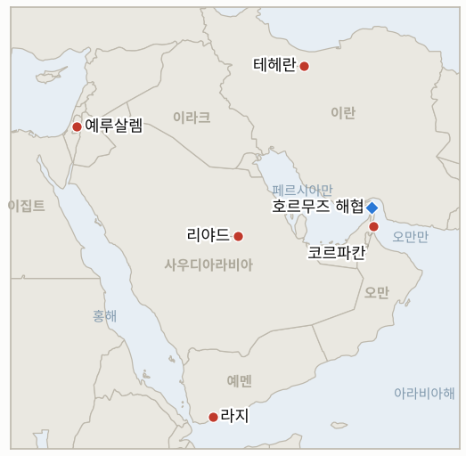

# 중동 일일 브리핑

**2026년 11월 25일**

- **보고 기간:** 약 24시간, 11월 24일 06:00 ~ 11월 25일 06:00 (한국시간)
- **종합 평가:** 화요일은 월요일보다 폭력이 늘었고 외교에는 움직임이 없었다. 리야드 금융지구의 타워가 드론 공격을 받아 11명이 다쳤다. 일주일도 안 돼 두 번째 공격이며, 사우디 주도 연합군은 "단호한 대응"을 예고했다(§1.1). 영국 해사 당국은 호르무즈 해협에서 선박 3척이 더 피격됐다고 알렸고, 이란 육군 참모총장은 해협을 "날마다 더" 닫으라고 명령했으며, 미 중부사령부는 미군 보호 아래 통항이 늘고 있다고 밝혔다(§1.2). 이스라엘 국방장관은 이란이 화학무기를 개발하고 있다며 선제 타격을 거론했고, 이란은 선전이라고 일축했다(§1.3). 유가는 월요일 하락분의 일부를 되찾아 브렌트가 91.40달러에 마감했다(§1.4). 이스라엘에서는 아이젠코트가 첫 연정 합의에 서명했고 중도좌파 협상 상대 하나가 협상장을 떠났다(§1.5). 서울에서는 미국 기술주 반등에 힘입어 코스피가 6.32% 오른 5,006.03으로 마감했다. 외국인은 9거래일 만에 순매수로 돌아섰고 원·달러 환율은 1,342.4원으로 내렸다. 종합하면 미국과 이란은 서로를 타격하지 않았지만 선박과 사우디 수도에 대한 공격은 이어졌고, 원유 시장은 자신감을 조금 덜어냈다.

---

## 1. 무슨 일이 있었나

<figure style="float:right; width:46%; margin:2pt 0 8pt 14pt;">

<figcaption style="font-size:8pt; color:#666; text-align:center; margin-top:3pt; font-style:italic;">주요 논의 지점</figcaption>
</figure>

### 1.1 리야드 금융지구 타워에 드론 공격, 11명 부상

사우디 민방위 당국은 화요일 후티의 공격이 리야드 킹 압둘라 금융지구의 타워 한 곳을 타격해 11명이 다쳤다고 밝혔다. 사우디인 2명, 인도인 2명, 네팔인 3명, 이집트인 4명이다. 부상 정도는 밝히지 않았다. 투르키 알말리키 연합군 대변인(소장)은 이를 드론을 이용한 "비겁한 테러 공격"이라고 부르고 "단호한 대응"을 예고했다([Al Jazeera](https://www.aljazeera.com/news/2026/11/24/saudi-led-coalition-condemns-terrorist-attack-on-tower-in-riyadh); [Anadolu](https://www.aa.com.tr/en/middle-east/11-injured-in-houthi-attack-on-riyadh-s-financial-district-tower-saudi-civil-defense/4136093)). 목격자 3명은 AFP에 피격 건물이 사우디에서 가장 높은 공공투자펀드(PIF) 타워라고 말했다. 연합군은 건물 이름을 밝히지 않았다. 이 지구가 공격받은 것은 11월 19일에 이어 일주일도 안 돼 두 번째이고, 이 지구에서 부상자가 보고된 것은 처음이다. 알자지라 보도에는 후티가 자신들의 소행이라고 밝혔다는 내용이 없다. 걸프협력회의, 카타르, 아랍에미리트, 쿠웨이트, 파키스탄, 미국이 공격을 규탄했고, 마코 루비오 국무장관은 파이살 빈 파르한 사우디 외무장관과 통화했다. 예멘에서는 후티 계열 매체가 사우디가 라지주에서 버스와 트럭을 공습해 25명이 숨지거나 실종됐다고 전했고, 9월 2일 이후 민간인 사망자를 1,421명으로 집계했다([CBS News live](https://www.cbsnews.com/live-updates/iran-war-us-trump-blockade-strait-of-hormuz-ship-attacks/)). 두 수치 모두 독립적으로 확인되지 않았다. 지다, 얀부, 라비그에 대한 공격은 보고되지 않았다. **신뢰도: 공격과 부상자는 높음; 건물과 무기 종류는 중간; 후티의 인명 피해 수치는 낮음.**

### 1.2 호르무즈에서 선박 3척이 더 피격되고 이란은 해협을 더 닫으라고 명령

영국 해사무역기구(UKMTO)는 화요일, 호르무즈 해협을 동쪽으로 항해하던 선박 3척이 월요일 20시 25분(GMT)께 미상의 발사체에 맞았다고 알렸다. 세 척 모두 항해를 계속했고 선원은 전원 무사하다. 별도의 공지는 아랍에미리트 코르파칸 북동쪽 약 23해리, 디바 앞바다에 정박해 있던 벌크선이 일요일 좌현에 피격돼 불이 났으며 인명 피해는 보고되지 않았다고 전했다([Xinhua](https://english.news.cn/20261124/c5565ede37184f688b6a99a060145776/c.html); [Jerusalem Post](http://www.jpost.com/middle-east/article-915961)). 일부 매체는 3척 피격을 일요일로 적었다. 이 브리핑은 신화통신이 전한 월요일 시각을 따른다. 이란 혁명수비대 해군은 선박자동식별장치를 끈 유조선들이 미군의 공중 호위를 받던 중 기뢰에 부딪혔다고 주장했고, 화요일에는 컨테이너선 한 척이 "허가받지 않은" 항로에서 기뢰에 부딪혔다고 했다. UKMTO는 피격의 주체를 지목하지 않는다. 아미르 하타미 이란 육군 참모총장(소장)은 미국이 이란의 7개 조건을 충족할 때까지 해협을 "날마다 더 닫힌 상태"로 만들라고 해군에 명령했다. 모하마드 바게르 갈리바프 국회의장은 "가까운 시일 안에" 봉쇄를 깨기 위한 군사 행동이 있을 수 있다고 경고했고, 조건이 충족되기 전에는 협상이 없다고 말했다([Euronews](https://www.euronews.com/2026/11/24/iran-orders-hormuz-closed-further-day-by-day-as-qatar-seeks-to-revive-peace-talks)). 미국 쪽에서는 팀 호킨스 중부사령부 대변인이 지난주 1억 800만 배럴 넘게 미군 보호 아래 해협을 통과했다고 밝혔고, 트럼프 대통령은 미국이 "지금 호르무즈 해협으로 전쟁 전보다 더 많은 원유를 통과시키고 있다"고 말했다. 합동해양정보센터(JMIC)는 11월 19~21일에 "미국의 지원을 받은" 통항을 114건으로 기록했다. 월스트리트저널은 미국 당국이 원유와 화학제품을 실은 선박 최대 50척에 대한 사이버 공격을 수사하고 있으며 이란이 주된 용의자라고 보도했다. 한 사이트는 미국이 호르무즈 인근 이란 자산을 새로 타격했다는 도이체벨레 보도를 인용했으나, 이를 뒷받침하는 미 중부사령부 성명이나 통신사 보도는 없다. **신뢰도: UKMTO 공지와 이란 측 발언은 높음; 기뢰 주장은 낮음; 미국의 물량 수치는 중간; 미국의 새 타격 보도는 낮음.**

### 1.3 이스라엘 국방장관, 이란이 화학무기를 개발 중이라고 발언

이스라엘 카츠 이스라엘 국방장관은 이란이 "화학무기를 개발하는 과정에 있지만 아직 그것으로 이스라엘을 공격할 능력에는 이르지 못했다"고 말하고 선제 타격 가능성을 거론했다. 시기는 밝히지 않았다. 보도에 따르면 시기는 미국이 언제 동참할 의사를 갖느냐에 달려 있다. 이스라엘군은 시급하다는 그의 평가를 뒷받침하지 않았다([Jerusalem Post](https://www.jpost.com/israel-news/defense-news/article-915994); [CBS News live](https://www.cbsnews.com/live-updates/iran-war-us-trump-blockade-strait-of-hormuz-ship-attacks/)). 아바스 아라그치 이란 외무장관은 이 주장을 "이라크전식 선전"이라고 일축했다. 외교 쪽에서는 AP가 카타르 총리가 월요일 루비오와 회동한 뒤 JD 밴스 부통령을 약 10분간 만났다고 보도했다. 협상 날짜는 나오지 않았다([Euronews](https://www.euronews.com/2026/11/24/iran-orders-hormuz-closed-further-day-by-day-as-qatar-seeks-to-revive-peace-talks)). 트럼프는 폭스뉴스에 이란 당국자들이 "늘 말만 한다. 하는 일이라곤 말뿐인데 전부 헛소리"라고 말했다. 알리 압돌라히 이란군 참모총장(소장)은 미군이 어디로 옮기든 "사정권 안에 남을 것"이라고 말했다. 이란 안에서는 월요일 미국의 환전소 제재 이후 달러가 시장에서 약 5% 오른 282만 리알 안팎에 거래됐다. **신뢰도: 발언은 높음; 화학무기 주장의 내용은 낮음(장관 한 명의 발언, 공개된 증거 없음, 군이 뒷받침하지 않음); 리알화 환율은 중간.**

### 1.4 유가 반등, 브렌트 91달러 위로

브렌트는 화요일 2.03달러(2.27%) 오른 91.40달러에, WTI는 1.88달러(2.35%) 오른 82.05달러에 마감했다. 두 유종 모두 장 초반 약 3개월 만의 최저 수준으로 내려가 브렌트가 88달러 부근까지 밀렸다가, 호르무즈에서 선박이 피격됐다는 소식에 방향을 바꿨다([통신 기사 via Rallies](https://rallies.ai/news/oil-settles-up-2-as-traders-weigh-continued-hormuz-ship-attacks-49ed49d098482c83); [FinanceFeeds](https://financefeeds.com/brent-crude-oil-price-89-08-tuesday-24-percent-monthly-slide-opec-plus-29-november-bull-92-bear-86/)). 종가는 전재된 통신 기사 한 건에서 나온 것이지만 월요일 종가와 이후의 시세 표시와 맞는다. 분석가들은 여전히 공급 과잉이 가격을 누를 것으로 본다. 도이체방크는 10월 재고 증가가 하루 170만 배럴의 세계 공급 과잉을 뜻한다고 했다. DBS의 수브로 사르카르는 "호르무즈 해협 폐쇄가 이어지는데도 공급 여건은 양호하다"면서도 다시 오를 가능성을 "배제할 수 없다"고 말했다([OilPrice](https://oilprice.com/Latest-Energy-News/World-News/Oil-Prices-Hold-Near-Three-Month-Lows-Despite-Hormuz-Mine-Claims.html)). 브렌트 2월물은 1월물보다 약 2.60달러 낮게 거래된다. 구매자들이 당장 인도받을 물량에 여전히 웃돈을 낸다는 뜻이다. OPEC+ 장관들은 11월 29일 일요일에 만나 2027년 생산 틀을 정한다. AIS 기반의 한 집계 사이트는 월요일 해협을 통과한 상선을 6척으로 기록했다([hormuz.now](https://hormuz.now/traffic)). 합동해양정보센터가 사흘 동안 호위 통항 114건을 보고한 것과 대비되는데, 두 수치는 집계 기준이 다르다. **신뢰도: 종가는 중간~높음(단일 전재 기사); AIS 집계는 중간~낮음.**

### 1.5 아이젠코트는 첫 연정 합의에 서명하고 민주당은 협상을 중단

가디 아이젠코트의 야샤르는 화요일 밤 아비그도르 리베르만의 이스라엘 베이테누와 연정 합의에 서명했다고 밝혔다. 10월 27일 총선 이후 두 정당이 맺은 첫 공식 합의다. 이 발표는 야이르 골란이 이끄는 민주당이 야샤르와의 협상을 중단한 지 몇 분 뒤에 나왔다. 민주당은 협상의 "교착"과 야샤르와 리쿠드 사이의 "진전"을 이유로 들었다. 골란은 아랍계 정당의 지지에 기대는 정부를 요구해 왔다. 야샤르와 리쿠드는 수요일에 네 번째 회동을 열어 총리직 순번제, 연정 상대, 10월 7일 사태에 대한 국가조사위원회를 논의한다. 토라 유대교 연합(UTJ)의 한 소식통은 아이젠코트 쪽과의 접촉이 "기대 이상으로" 진행되고 있다고 말했고, 네타냐후는 이 당 의원 2명과 연락이 닿지 않은 것으로 전해졌다([Times of Israel](https://www.timesofisrael.com/liveblog-november-24-2026/)). 아이젠코트의 정부 구성권은 12월 6일까지다. **신뢰도: 합의 서명과 민주당의 발표는 높음; 토라 유대교 연합 관련 보도는 중간.**

---

## 2. 심층 분석: 유인과 동기

### 2.1 후티는 왜 리야드 금융지구를 계속 때리나?

표적은 그것이 상징하는 바 때문에 골랐다. 금융지구와 국부펀드의 타워는 외국 자본을 끌어들이려는 사우디 계획의 진열장이고, 후티는 투자자들에게 사우디를 떠나라고 말해 왔다. 그 지구에서 외국인 근로자를 다치게 하는 드론 한 대는 보험료를 올리고 항공편과 행사를 취소시키며, 리야드에 직원을 둔 모든 기업 앞에 안전 문제를 올려놓는다. 방어가 갖춰진 석유 시설을 때리는 것보다 비용이 훨씬 적게 든다. 이는 연합군의 호데이다 폭격에 대한 같은 방식의 응수이기도 하다. 후티는 공습을 멈출 수 없지만, 공습이 사우디 수도를 지켜 주지 못한다는 것은 보여 줄 수 있다. 사우디가 예고한 "단호한 대응"은 예멘에 대한 추가 공습을 뜻하고, 후티는 그것을 다음 공격의 명분으로 삼을 것이다. 어느 쪽도 먼저 멈출 유인이 없으며, 루비오의 통화는 미국이 이 공방에서 사우디 편에 서 있음을 보여 준다.

### 2.2 미국은 호위 통항이 기록적이라는데 이란은 왜 해협을 더 닫으라고 명령하나?

양측은 같은 바다를 서로 다른 청중에게 설명하고 있다. 일주일에 1억 800만 배럴, 사흘에 호위 통항 114건이라는 미국의 수치는 시장과 걸프 동맹국에 호위 체계가 작동하고 이란의 폐쇄는 실패했다고 말한다. 이란의 답은 호위가 곧 안전한 통항은 아니라는 것이다. 이란 해군은 거의 매일 기뢰 피격을 주장하며, 선박들이 미군의 공중 엄호를 받던 중에 맞았다고 말한다. UKMTO 공지는 무언가가 선박을 때리고 있음을 보여 주지만 그것이 무엇이고 누구의 것인지는 말해 주지 않는다. 하타미의 명령과 갈리바프의 경고에는 두 번째 목적이 있다. 봉쇄로 자국 수출이 거의 0이 된 이란에 남은 지렛대는 다른 나라의 해운에 지울 수 있는 비용이다. 이란은 트럼프가 타격할 수 있다고 한 1월이 오기 전에 그 비용이 눈에 보이게 해야 한다. 보도된 선박 사이버 공격은 같은 목적을 더 싼 수단으로 추구하는 것이다.

### 2.3 카츠는 왜 지금 화학무기를 꺼내나?

카츠는 과도 정부의 리쿠드 소속 장관이고, 그 정부의 수반은 이란의 위협이 너무 시급해 새 연정을 기다릴 수 없다고 주장하고 있다. 월요일에 아이젠코트는 당면한 위협이 보이지 않는다고 했고, 화요일에 카츠는 새로운 위협을 내놓았다. 이 주장은 그의 정당이 발표했고, 군은 시급성을 인정하지 않았으며, 카츠 자신도 이란이 아직 그런 무기를 이스라엘에 쓸 수 없다고 말한다. 그래서 이 주장은 정보로서는 약하고 정치로서는 쓸모가 있다. 서둘러 통합 정부를 꾸려야 한다는 네타냐후의 명분을 받쳐 주고, 트럼프가 새해 이후까지 기다리겠다고 한 미국을 향해서도 말한다. 아라그치가 이라크에 빗댄 것도 같은 미국 청중을 겨냥한다. 이스라엘이나 미국의 정보기관, 또는 화학무기금지기구가 달리 말하기 전까지 이 주장은 입증되지 않은 것으로 다뤄야 한다.

### 2.4 민주당은 왜 아이젠코트가 리베르만과 서명한 바로 그때 협상장을 떠났나?

아이젠코트는 두 개의 정부를 동시에 짓고 있다. 하나는 리쿠드와의 통합 정부이고, 다른 하나는 네타냐후에 반대한 정당들로 꾸리고 어쩌면 초정통파가 합류하는 더 좁은 정부다. 리베르만과의 합의는 어느 쪽에도 맞는다. 민주당은 두 번째에만 맞고, 그 정부가 아랍계 정당에 기대기를 원했는데 리베르만은 이를 거부한다. 골란은 협상장을 떠나면서 야샤르와 리쿠드의 진전을 이유로 지목함으로써 지지자들에게 경고하고 아이젠코트에게 선택을 압박하고 있다. 아이젠코트에게는 토라 유대교 연합과의 접촉이 더 강한 패다. 그와 대화하는 초정통파 의원이 한 명 늘 때마다 네타냐후 진영은 약해지고, 수요일에 리쿠드가 부를 수 있는 값은 내려간다.

---

## 3. 한국에 대한 정책적 함의

**익스포저 현황:** 한국은 원유의 약 70.7%, LNG의 20.4%를 중동에서 들여온다(`instructions/korea-exposure.md`, 갱신 불필요). 화요일 브렌트는 91.40달러, WTI는 82.05달러에 마감했다. 코스피는 297.49포인트(6.32%) 오른 5,006.03으로 마감했다. 10월 28일 이후 가장 큰 상승이며 3거래일 만에 5,000선을 되찾았다. 9시 6분에 매수 사이드카가 발동됐고 지수는 장중 5,065.74까지 올랐다. 원인은 미국에 있었다. 엔비디아 이사회가 젠슨 황의 최고경영자 복귀를 승인한 뒤 엔비디아가 31% 올랐고 나스닥은 6.5% 올랐다. 외국인은 코스피 시장에서 약 7,390억 원을 순매수해 국내 언론 집계로 8거래일 이어진 순매도를 끝냈고(이 브리핑은 7거래일로 세어 왔다), 기관은 약 8,680억 원을 순매수했다. 삼성전자는 6.70%, SK하이닉스는 6.73% 올랐다([시사저널e](https://www.sisajournal-e.com/news/articleView.html?idxno=425292)). 원·달러 환율은 1,338.3원과 1,348.7원 사이에서 움직인 뒤 3.5원 내린 1,342.4원에 마감했다. 수출업체의 달러 매도가 환율 상단을 막았고, 외국인 주주 배당금 송금에 대한 우려가 원화 강세 폭을 제한했다([서울경제](https://m.sedaily.com/article/20118403)). 한국은행은 목요일에 기준금리를 결정한다. 국회 국방위원회 소위원회는 화요일에 청해부대 수정동의안을 심사할 예정이었으나, 보고 기간이 끝날 때까지 결과를 전한 보도를 찾지 못했다. 국방위 전문위원 검토보고서는 "유사시 우리 국민 보호"를 위한 해역을 추가하는 문구가 국회 동의 없이 작전구역을 넓히는 근거로 읽힐 수 있다고 지적했고, 국방부 장관은 호르무즈 해협 진입에는 별도의 동의가 필요하다고 말했다([한국경제](https://www.hankyung.com/article/202611234218i)). 국방위 전체회의 처리는 목요일로 예상된다.

**사안별 함의:**

- **리야드 (§1.1):** 한국인 피해는 보고되지 않았다. 한국이 우려할 점은 사우디 수도의 업무지구가 이제 반복되는 표적이고 부상자 가운데 외국인 근로자가 있었다는 것이다. 리야드에 직원을 둔 한국 건설, 엔지니어링, 금융 기업은 사무실 위치와 대피 계획을 점검해야 한다. 연합군이 예멘에서 "단호한 대응"에 나서면 후티의 추가 공격 가능성이 커지고, 여기에는 사우디 원유를 호르무즈 밖으로 한국에 실어 나르는 홍해 항만도 포함된다 (IND-20261125-1, IND-20261121-1).
- **호르무즈 (§1.2):** 걸프를 빠져나오던 선박 3척이 하루 저녁에 피격됐고, 해협 밖 아랍에미리트 정박지에서는 벌크선이 불탔다. 호위는 많은 물량을 움직이고 있지만 피격을 막지는 못하며, 한국 선박이 대기하고 급유하는 오만만 쪽 정박지도 이제 사정권 안에 있다. 한국 선주는 코르파칸과 푸자이라의 대기 해역을 위험 구역의 일부로 다뤄야 한다 (IND-20261123-2, IND-20261122-1).
- **화학무기 주장 (§1.3):** 이 주장이 미국의 지지를 얻으면 1월 이전 타격의 명분이 되고 시간표가 앞당겨진다. 지금으로서는 장관 한 명의 발언이다 (IND-20261114-1, IND-20261119-1).
- **유가 (§1.4):** 화요일의 반등은 공급 과잉 속에서도 선박 피격이 확인되면 가격이 반응한다는 것을 보여 준다. 90달러 안팎의 브렌트는 여전히 한국의 수입 부담에 유리하고, 월요일의 권고는 그대로다. 이 가격을 비축을 다시 채우는 데 써야 한다 (IND-20261124-1, IND-20261122-3).
- **이스라엘 (§1.5):** 리쿠드를 포함한 통합 정부는 네타냐후 진영을 이란 관련 결정 안에 남겨 두고, 아이젠코트의 좁은 정부는 그렇지 않다. 수요일 회동이 다음 신호다 (IND-20261125-3, IND-20261123-3).
- **시장:** 코스피의 상승과 월요일의 하락은 모두 걸프가 아니라 미국 기술주에서 비롯됐다. 두 거래일 사이에 위아래로 6%씩 움직인 것은 공매도 청산 매수와 얕은 확신을 가리키며, 12월 1일과 3일의 미 의회 청문회가 이를 되돌릴 수 있다. 원화는 거의 움직이지 않았는데, 달러 수요가 줄지 않았다는 뜻이다 (IND-20261125-2, IND-20261124-3, IND-20261119-3, IND-20261023-1).
- **청해부대 (§3 익스포저 현황):** 검토보고서의 우려는 부대의견이 답하려는 바로 그 문제다. 소위의 문안을 보면 그 한계가 동의안의 조건에 적히는지 의견으로만 남는지 알 수 있다 (IND-20261124-2, IND-20261112-1).

**오늘 종결:**

- **IND-20261120-3: 확증.** 외국인은 11월 24일 코스피 시장에서 약 7,390억 원을 순매수했고, 이는 11월 27일께인 시한 안이다. 이 지표는 11월 19일의 반등 뒤에 열었는데, 매수는 두 거래일 동안 8% 넘게 더 내린 뒤에야 나왔다. 따라서 이번 확증은 지표가 검증하려던 반등에 대해서는 말해 주는 바가 적다.

**검증 가능한 지표:**

- **IND-20261125-1** (진행, 신규): 2026년 12월 2일께까지 사우디 당국이 리야드의 건물이 후티 공격을 받아 피해나 사상자가 났다고 다시 발표하면 사우디 수도를 겨냥한 공세가 지속되는 것으로 확증; 없으면 반증.
- **IND-20261125-2** (진행, 신규): 2026년 12월 2일께까지 어느 거래일이든 코스피가 4,800 아래에서 마감하면 11월 24일의 상승이 공매도 청산에 따른 반등이었던 것으로 확증; 없으면 반증.
- **IND-20261125-3** (진행, 신규): 2026년 12월 6일께까지 야샤르와 리쿠드가 통합 정부에 대한 합의(원칙적 합의 또는 서명)를 발표하면 아이젠코트가 통합 정부의 길을 택한 것으로 확증; 없으면 반증.
- **IND-20261124-1** (진행): 브렌트 91.40달러 마감으로 85달러 기준선에서 멀어짐.
- **IND-20261124-2** (진행): 소위는 11월 24일에 열릴 예정이었음; 결과 보도를 찾지 못함.
- **IND-20261124-3** (진행): 원·달러 1,342.4원 마감으로 1,360원 기준선에서 멀어짐.
- **IND-20261123-1** (진행): 사우디 당국이나 해당 기업의 라비그 관련 발표 없음.
- **IND-20261123-2** (진행): 걸프 국가 정부나 국영 에너지 기업이 석유·가스 시설에 대한 이란의 타격이나 요격을 발표하지 않음; 선박 피격은 해당하지 않음.
- **IND-20261123-3** (진행): 야샤르가 이스라엘 베이테누와 서명했고 수요일에 리쿠드를 다시 만남; 리쿠드를 뺀 표결을 향한 절차는 없음.
- **IND-20261122-1** (진행): 이란 유조선이 저지됐다거나 유조선들이 봉쇄선을 통과했다는 미 중부사령부나 통신사 보도 없음; 트럼프는 이란 선박이 한 척도 통과하지 못했다고 말함.
- **IND-20261122-2** (진행): 바레인에 대한 새 공격 보도 없음.
- **IND-20261122-3** (진행): 브렌트 91.40달러 마감으로 95달러 기준선 아래; 시한은 11월 27일께.
- **IND-20261121-1** (진행): 후티 공격은 리야드를 타격; 지다나 얀부에 대한 보도 없음.
- **IND-20261120-1** (진행): 카타이브 헤즈볼라 부대가 주르프 알사카르를 떠났다는 발표를 찾지 못함.
- **IND-20261119-1** (진행): 공개된 미국의 2차 타격 없음; 확인되지 않은 보도 한 건, 미 중부사령부 성명 없음; 시한은 11월 26일께.
- **IND-20261119-3** (진행): 원·달러 1,342.4원 마감으로 1,325원 기준선 위; 시한은 11월 26일께.
- **IND-20261114-1** (진행): 호르무즈 연안 너머에 대한 미국이나 이스라엘의 타격 없음; 카츠는 시기 없이 선제 타격을 거론.
- **IND-20261023-1** (진행): 한국은행은 11월 26일 결정.
- **IND-20261112-1** (진행): 동의안은 소위 심사 단계; 본회의 표결은 아직 없음.
- **IND-20261116-2** (진행): 보도된 선박 피격은 호르무즈와 아랍에미리트 앞바다에서 일어났고 바브엘만데브 인근이 아님.
- **IND-20261117-1** (진행): 후티 병력이 아덴 50km 이내에 있다는 보도를 찾지 못함.
- **IND-20261113-2, IND-20261114-3, IND-20261115-2, IND-20260714-4** (진행): 변동을 찾지 못함; `tracking/indicators.md` 참조.

---

## 4. 관찰 목록

- **연합군의 예멘 내 "단호한 대응"과 후티의 다음 표적, 리야드인지 홍해 연안인지 (IND-20261125-1, IND-20261121-1).**
- **호르무즈에서 피격된 선박 3척의 신원, UKMTO가 피격 원인을 기뢰, 미사일, 드론 중 무엇으로 밝히는지.**
- **이란이 "가까운 시일 안에" 봉쇄를 깨기 위해 행동하겠다는 갈리바프의 경고를 실행하는지 (IND-20261122-1, IND-20261123-2).**
- **미국이나 이스라엘 군이 카츠의 화학무기 주장을 뒷받침하는지 (IND-20261114-1).**
- **카타르의 워싱턴 회동 이후 협상 재개 날짜가 나오는지.**
- **미국 연휴와 11월 29일 OPEC+ 회의를 앞둔 90달러 안팎의 브렌트 (IND-20261124-1, IND-20261122-3).**
- **수요일 야샤르와 리쿠드의 네 번째 회동, 토라 유대교 연합의 공식 협상 개시 결정 (IND-20261125-3, IND-20261123-3).**
- **환전소 제재 이후 이란 내 리알화, 물가, 시위.**
- **카타이브 헤즈볼라 부대가 주르프 알사카르에서 철수하는지 (IND-20261120-1).**
- **서울 증시의 외국인 매수가 이틀째 이어지는지, 목요일 한국은행 결정 (IND-20261125-2, IND-20261124-3, IND-20261023-1).**
- **국방위 소위의 문안과 목요일 청해부대 동의안의 국방위 의결 (IND-20261124-2, IND-20261112-1).**

---

## 5. 출처 신뢰도 요약

| 주장 | 출처 | 신뢰도 |
| --- | --- | --- |
| 리야드 킹 압둘라 금융지구 타워에 대한 후티 공격으로 11명 부상(사우디인 2명, 인도인 2명, 네팔인 3명, 이집트인 4명) | 사우디 민방위 당국 via Al Jazeera, Anadolu, CBS News | 높음 |
| 연합군은 드론을 이용한 "비겁한 테러 공격"이라며 "단호한 대응"을 예고 | 연합군 대변인 via Al Jazeera | 높음 |
| 피격 건물은 공공투자펀드(PIF) 타워 | 목격자 3명 via AFP, Al Jazeera | 중간 |
| 루비오가 사우디 외무장관과 통화하고 후티 공격을 규탄 | 미 국무부 via CBS News | 높음 |
| 사우디의 라지주 공습으로 25명 사망 또는 실종; 9월 2일 이후 민간인 1,421명 사망 | Saba, Al-Masirah via CBS News | 낮음 |
| 월요일 20시 25분(GMT)께 호르무즈를 동쪽으로 항해하던 선박 3척이 미상의 발사체에 피격; 모두 항해 계속 | UKMTO via Xinhua, Jerusalem Post, ABC News | 높음(사건); 중간(날짜) |
| 일요일 디바 앞바다에서 벌크선이 피격돼 화재 | UKMTO via Xinhua, CBS News | 높음 |
| 유조선들과 컨테이너선 한 척이 미군 호위 중 이란 기뢰에 부딪힘 | 혁명수비대 해군 via Euronews, Times of Israel | 낮음 |
| 하타미: 7개 조건이 충족될 때까지 해협은 "날마다 더 닫힌 상태"가 돼야 함 | 이란 육군 via Euronews, CBS News | 높음 |
| 갈리바프: "가까운 시일 안에" 봉쇄를 깨기 위한 군사 행동; 조건 충족 전에는 협상 없음 | Euronews | 높음 |
| 지난주 1억 800만 배럴 넘게 미군 보호 아래 호르무즈 통과; 4월 7일 이후 통항 8,000건 이상 | 미 중부사령부 대변인 via CBS News | 중간 |
| 11월 19~21일 미국 지원 통항 114건 | JMIC via Euronews | 중간~높음 |
| 미국이 선박 최대 50척에 대한 사이버 공격을 수사 | Wall Street Journal via CBS News, Times of Israel | 중간 |
| 11월 24일 미국이 호르무즈 인근 이란 자산을 새로 타격 | House of Saud가 인용한 Deutsche Welle; 공식 확인 없음 | 낮음 |
| 카츠: 이란이 화학무기를 개발 중; 선제 타격 가능 | 리쿠드 발표 via Jerusalem Post, CBS News, Arab News | 높음(발언); 낮음(내용) |
| 아라그치: "이라크전식 선전" | CBS News, Jerusalem Post | 높음 |
| 카타르 총리가 밴스를 약 10분간 만남 | AP via Euronews | 중간~높음 |
| 달러가 시장에서 282만 리알 안팎에 거래 | CBS News | 중간 |
| 브렌트 91.40달러(+2.03달러), WTI 82.05달러(+1.88달러) 마감 | 통신 기사 via Rallies; 장중 수준은 FinanceFeeds, OilPrice | 중간~높음 |
| 10월 재고가 뜻하는 하루 170만 배럴의 세계 공급 과잉; "공급 여건은 양호" | Deutsche Bank; DBS via Reuters, OilPrice | 중간~높음 |
| 11월 23일 AIS 송출 상선 6척이 호르무즈 통과 | hormuz.now | 중간~낮음 |
| 야샤르가 이스라엘 베이테누와 연정 합의에 서명; 민주당은 협상 중단; 리쿠드와의 네 번째 회동은 수요일 | Times of Israel | 높음 |
| 토라 유대교 연합과의 접촉이 "기대 이상으로" 진행 | 당 소식통 via Times of Israel | 중간 |
| 코스피 5,006.03(+6.32%), 매수 사이드카, 외국인 약 7,390억 원 순매수; 원·달러 1,342.4원 | 시사저널e, 서울경제, 뉴스1 | 높음 |
| 청해부대 동의안 소위 심사; 검토보고서가 작전구역 문구를 지적 | 한국경제, 서울경제, 뉴스1 | 높음(절차); 11월 24일 소위 결과는 찾지 못함 |
