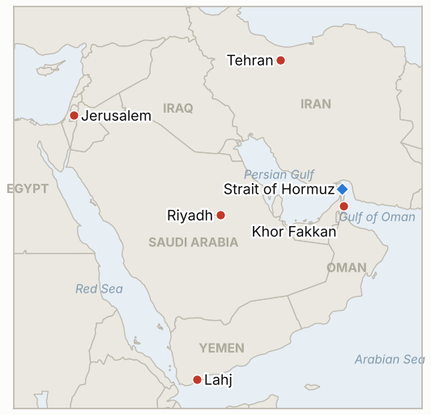

# Middle East Daily Briefing

**November 25, 2026**

- **Reporting window:** ~24 hours, November 24, 06:00 to November 25, 06:00 KST
- **Overall assessment:** Tuesday brought more violence than Monday and no movement in diplomacy. A drone hit a tower in Riyadh's financial district and injured 11 people, the second strike there in under a week, and the Saudi led coalition promised a "firm response" (§1.1). The UK maritime agency reported three more vessels struck in the Strait of Hormuz, Iran's army chief ordered the strait closed "further day by day," and US Central Command said traffic under its protection is rising (§1.2). Israel's defence minister said Iran is developing chemical weapons and raised a preemptive strike; Iran called that propaganda (§1.3). Oil recovered part of Monday's fall, with Brent settling at $91.40 (§1.4). In Israel, Eisenkot signed his first coalition deal while a centre left partner walked out of talks (§1.5). In Seoul the KOSPI rose 6.32% to 5,006.03 on a rebound in US technology shares, foreign investors bought for the first time in nine sessions and the won firmed to 1,342.4 per dollar. Net: the United States and Iran did not strike each other, but attacks on ships and on Saudi Arabia's capital continued, and the oil market gave back a little of its confidence.

---

## 1. What Happened

<figure style="float:right; width:46%; margin:2pt 0 8pt 14pt;">

<figcaption style="font-size:8pt; color:#666; text-align:center; margin-top:3pt; font-style:italic;">Major places of discussion</figcaption>
</figure>

### 1.1 A drone hits a Riyadh financial district tower and injures 11

Saudi Civil Defence said a Houthi attack on Tuesday struck one of the towers in Riyadh's King Abdullah Financial District and injured 11 people: two Saudis, two Indians, three Nepalis and four Egyptians. It gave no detail on how badly they were hurt. Coalition spokesman Major General Turki al-Maliki called it a "cowardly terrorist attack" by drone and promised a "firm response" ([Al Jazeera](https://www.aljazeera.com/news/2026/11/24/saudi-led-coalition-condemns-terrorist-attack-on-tower-in-riyadh); [Anadolu](https://www.aa.com.tr/en/middle-east/11-injured-in-houthi-attack-on-riyadh-s-financial-district-tower-saudi-civil-defense/4136093)). Three witnesses told AFP the building hit was the Public Investment Fund tower, the country's tallest; the coalition has not named it. It is the second attack on the district in under a week, after the strike of November 19, and the first there to cause reported injuries. Al Jazeera's report carried no Houthi claim of responsibility. The Gulf Cooperation Council, Qatar, the UAE, Kuwait, Pakistan and the United States condemned the attack, and Secretary of State Marco Rubio phoned Saudi Foreign Minister Prince Faisal bin Farhan. In Yemen, Houthi run media said a Saudi strike on buses and trucks in Lahj governorate left 25 people dead or missing, and put civilian deaths since September 2 at 1,421 ([CBS News live](https://www.cbsnews.com/live-updates/iran-war-us-trump-blockade-strait-of-hormuz-ship-attacks/)). Neither figure is independently verified. No attack on Jeddah, Yanbu or Rabigh was reported. **Confidence: High on the attack and the injuries; Medium on the building and the weapon; Low on the Houthi casualty figures.**

### 1.2 Three more vessels are struck in Hormuz as Iran orders the strait closed further

The UK Maritime Trade Operations agency (UKMTO) said on Tuesday that three vessels sailing east through the Strait of Hormuz were struck by unknown projectiles at about 20:25 GMT on Monday. All three continued their voyages and all crew are accounted for. A separate notice said a bulk carrier anchored off Dibba, about 23 nautical miles northeast of Khor Fakkan in the UAE, was hit on its port side and caught fire on Sunday, with no casualties reported ([Xinhua](https://english.news.cn/20261124/c5565ede37184f688b6a99a060145776/c.html); [Jerusalem Post](http://www.jpost.com/middle-east/article-915961)). Some outlets date the three vessel incident to Sunday; this brief follows the Monday time given by Xinhua. Iran's Revolutionary Guards navy said tankers that had switched off their transponders hit mines while under US air escort, and on Tuesday said a container ship hit a mine on an "unauthorized" route. UKMTO attributes the strikes to no one. Iran's army commander, Major General Amir Hatami, ordered the navy to keep the strait "increasingly closed day by day" until Washington meets Iran's seven conditions. Parliament Speaker Mohammad Bagher Ghalibaf warned of military action to break the blockade "in the near future" and said there would be no talks before the conditions are met ([Euronews](https://www.euronews.com/2026/11/24/iran-orders-hormuz-closed-further-day-by-day-as-qatar-seeks-to-revive-peace-talks)). On the US side, CENTCOM spokesman Tim Hawkins said more than 108 million barrels moved through the strait under US protection last week, and President Trump said the United States is "taking more oil through the Hormuz Strait right now" than before the war. The Joint Maritime Information Center recorded 114 passages "with the assistance of the United States" over November 19 to 21. The Wall Street Journal reported that US authorities are investigating cyberattacks on up to 50 ships carrying oil and chemicals, with Iran the main suspect. One site cited a Deutsche Welle report of new US strikes on Iranian assets near Hormuz; no CENTCOM statement or wire report supports it. **Confidence: High on the UKMTO notices and the Iranian statements; Low on the mine claims; Medium on the US volume figures; Low on the report of new US strikes.**

### 1.3 Israel's defence minister says Iran is developing chemical weapons

Israeli Defence Minister Israel Katz said Iran "is in the process of developing chemical weapons but has not yet reached the capability to attack Israel with them," and raised the option of a preemptive strike. He gave no timing; reports say that would depend on when Washington is willing to join. The Israeli military has not backed his assessment of urgency ([Jerusalem Post](https://www.jpost.com/israel-news/defense-news/article-915994); [CBS News live](https://www.cbsnews.com/live-updates/iran-war-us-trump-blockade-strait-of-hormuz-ship-attacks/)). Iranian Foreign Minister Abbas Araghchi dismissed the claim as "Iraq War-style propaganda." On the diplomatic side, the Associated Press reported that Qatar's prime minister met Vice President JD Vance for about ten minutes on Monday after his meeting with Rubio; no date for talks followed ([Euronews](https://www.euronews.com/2026/11/24/iran-orders-hormuz-closed-further-day-by-day-as-qatar-seeks-to-revive-peace-talks)). Trump told Fox News that Iranian officials "talk all the time, all they do is talk, but it's all BS." Iran's armed forces chief of staff, Major General Ali Abdollahi, said US forces will "remain within range" wherever they move. Inside Iran, the dollar traded near 2.82 million rials on the open market, about 5% higher, after Monday's US sanctions on exchange houses. **Confidence: High on the statements; Low on the substance of the chemical weapons claim (one minister, no evidence published, not backed by the military); Medium on the rial rate.**

### 1.4 Oil rebounds, with Brent back above $91

Brent settled at $91.40 on Tuesday, up $2.03 or 2.27%, and WTI at $82.05, up $1.88 or 2.35%. Both had fallen to their lowest levels in about three months earlier in the session, with Brent near $88, before the reports of ships struck in Hormuz turned prices around ([wire report via Rallies](https://rallies.ai/news/oil-settles-up-2-as-traders-weigh-continued-hormuz-ship-attacks-49ed49d098482c83); [FinanceFeeds](https://financefeeds.com/brent-crude-oil-price-89-08-tuesday-24-percent-monthly-slide-opec-plus-29-november-bull-92-bear-86/)). The settles come from a single syndicated wire item; they are consistent with Monday's closes and with later price tickers. Analysts still expect excess supply to cap prices: Deutsche Bank said October inventory growth implied a global surplus of 1.7 million barrels a day, and DBS's Suvro Sarkar said "supply conditions remain benign despite the continued closure of the Strait of Hormuz," while adding that a new rise "cannot be ruled out" ([OilPrice](https://oilprice.com/Latest-Energy-News/World-News/Oil-Prices-Hold-Near-Three-Month-Lows-Despite-Hormuz-Mine-Claims.html)). February Brent trades about $2.60 below January, a sign that buyers still pay more for prompt barrels. OPEC+ ministers meet on Sunday, November 29, to set the 2027 framework. One AIS based counter recorded six commercial ships through the strait on Monday ([hormuz.now](https://hormuz.now/traffic)), against the 114 escorted passages over three days that the Joint Maritime Information Center reports; the two are counted on different bases. **Confidence: Medium to High on the settles (single syndication); Medium to Low on the AIS count.**

### 1.5 Eisenkot signs his first coalition deal as the Democrats halt talks

Gadi Eisenkot's Yashar party said on Tuesday night that it had signed a coalition agreement with Avigdor Liberman's Yisrael Beytenu, the first formal deal between any two parties since the October 27 election. It came minutes after the Democrats, led by Yair Golan, suspended their talks with Yashar, citing a "stalemate" and Yashar's "progress" with Likud; Golan had pushed for a government resting on the Arab parties' support. Yashar and Likud are to hold a fourth round on Wednesday on a rotating premiership, the choice of partners and a state inquiry into October 7. A source in United Torah Judaism said its contacts with Eisenkot are going "beyond expectations," and Netanyahu reportedly failed to reach two of that party's lawmakers ([Times of Israel](https://www.timesofisrael.com/liveblog-november-24-2026/)). Eisenkot's mandate runs to December 6. **Confidence: High on the signed deal and the Democrats' statement; Medium on the reports about United Torah Judaism.**

---

## 2. Deep Dive: Incentives and Motives

### 2.1 Why do the Houthis keep hitting Riyadh's financial district?

The target is chosen for what it stands for. The financial district and the sovereign wealth fund's tower are the showcase of Saudi Arabia's plan to draw foreign capital, and the Houthis have told investors to leave the kingdom. A drone that injures foreign workers in that district raises insurance costs, cancels flights and events and puts the question of safety before every company with staff in Riyadh, at far lower cost than a strike on a defended oil site. It also answers the coalition's bombing of Hodeidah in kind: the Houthis cannot stop the air campaign, but they can show that it does not protect the Saudi capital. For Riyadh, the "firm response" it has promised means more strikes in Yemen, which the Houthis will use to justify the next attack. Neither side has an incentive to stop first, and Rubio's call shows Washington backing the Saudi side of that exchange.

### 2.2 Why does Iran order the strait closed further while Washington reports record escorted traffic?

Each side is describing the same water to a different audience. Washington's figures, 108 million barrels in a week and 114 escorted passages in three days, tell markets and Gulf allies that the escort system works and that Iran's closure has failed. Tehran's answer is that an escort is not safe passage: its navy claims a mine strike almost daily and says the ships were under US air cover when hit. The UKMTO notices show that something is hitting ships, though not what or who. Hatami's order and Ghalibaf's warning serve a second purpose. With its own exports near zero under the blockade, Iran's remaining leverage is the cost it can impose on others' shipping, and it needs that cost to be visible before January, when Trump says he may strike. The reported cyberattacks on ships fit the same aim by cheaper means.

### 2.3 Why does Katz raise chemical weapons now?

Katz is a Likud minister in a caretaker government whose leader is arguing that the Iranian threat is too urgent to wait for a new coalition. On Monday Eisenkot said he saw no immediate threat; on Tuesday Katz supplied a new one. The claim was published by his party, the military has not endorsed its urgency, and Katz himself says Iran cannot yet use such weapons against Israel. That makes it weak as intelligence and useful as politics: it supports Netanyahu's case for a unity government formed quickly, and it speaks to Washington, where Trump has said he will wait until after the New Year. Araghchi's comparison with Iraq is aimed at the same American audience. The claim should be treated as unproven until an Israeli or US intelligence body, or the chemical weapons watchdog, says otherwise.

### 2.4 Why did the Democrats walk out just as Eisenkot signed with Liberman?

Eisenkot is building two governments at once. One is a unity government with Likud; the other is a narrower one with the parties that opposed Netanyahu, perhaps joined by the ultra-Orthodox. The Liberman deal fits either. The Democrats fit only the second, and they wanted it to rest on the Arab parties, which Liberman rejects. By walking out and naming Yashar's progress with Likud as the reason, Golan is warning his voters and pressing Eisenkot to choose. For Eisenkot, the contacts with United Torah Judaism are the stronger card: every ultra-Orthodox lawmaker who talks to him weakens Netanyahu's bloc and lowers the price Likud can ask on Wednesday.

---

## 3. Policy Implications for South Korea

**Exposure snapshot:** South Korea draws about 70.7% of its crude and 20.4% of its LNG from the Middle East (`instructions/korea-exposure.md`, no update needed). Brent settled at $91.40 and WTI at $82.05 on Tuesday. The KOSPI rose 297.49 points, or 6.32%, to 5,006.03, its largest gain since October 28 and its first close above 5,000 in three sessions; a buy sidecar was triggered at 09:06 and the index touched 5,065.74. The cause was in the United States: Nvidia rose 31% after its board approved Jensen Huang's return as chief executive, and the Nasdaq gained 6.5%. Foreign investors net bought about 739 billion won of KOSPI shares, ending a run of net selling that the Korean press counts as eight sessions (this brief had counted seven), and institutions bought about 868 billion won. Samsung Electronics rose 6.70% and SK hynix 6.73% ([Sisa Journal e](https://www.sisajournal-e.com/news/articleView.html?idxno=425292)). The won closed at 1,342.4 per dollar, 3.5 won stronger, after trading between 1,338.3 and 1,348.7; exporter dollar sales capped the rate and worries over dividend payments to foreign shareholders limited the won's gain ([Seoul Economic Daily](https://m.sedaily.com/article/20118403)). The Bank of Korea decides its rate on Thursday. The National Assembly defence committee's subcommittee was due to review the amended Cheonghae Unit motion on Tuesday; no report of its outcome was found by the end of the window. The committee's staff review noted that wording which adds waters for "protecting Korean nationals in a contingency" could be read as a basis for widening the operating area without Assembly consent, and the defence minister said entry into the Strait of Hormuz would need separate consent ([Hankyung](https://www.hankyung.com/article/202611234218i)). The committee vote is expected on Thursday.

**Implications by development:**

- **Riyadh (§1.1):** No Korean casualty was reported. The concern for Seoul is that the Saudi capital's business district is now a repeated target and that foreign workers were among the injured. Korean construction, engineering and financial firms with staff in Riyadh should review office locations and evacuation plans. A coalition "firm response" in Yemen raises the odds of a further Houthi strike, including on the Red Sea ports that carry Saudi crude to Korea outside Hormuz (IND-20261125-1, IND-20261121-1).
- **Hormuz (§1.2):** Three vessels struck on one evening while sailing out of the Gulf, and a bulk carrier burned at a UAE anchorage outside the strait. Escorts are moving large volumes, but they do not prevent hits, and the anchorages on the Gulf of Oman side that Korean ships use to wait and bunker are now within reach. Korean owners should treat Khor Fakkan and Fujairah waiting areas as part of the risk zone (IND-20261123-2, IND-20261122-1).
- **Chemical weapons claim (§1.3):** If the claim gains US backing it becomes a ground for a strike before January and would bring the timetable forward. For now it is a single minister's statement (IND-20261114-1, IND-20261119-1).
- **Oil (§1.4):** Tuesday's rebound shows that the price responds to confirmed hits on ships even in a surplus. Brent near $90 remains favourable for Korea's import bill, and the advice of Monday stands: use it to rebuild cover (IND-20261124-1, IND-20261122-3).
- **Israel (§1.5):** A unity government including Likud would keep Netanyahu's camp inside decisions on Iran; a narrow Eisenkot government would not. Wednesday's round is the next signal (IND-20261125-3, IND-20261123-3).
- **Markets:** The KOSPI's rise and Monday's fall both came from US technology shares, not from the Gulf. A 6% move in each direction within two sessions points to short covering and thin conviction, and US congressional hearings on December 1 and 3 could reverse it. The won barely moved, which shows that dollar demand has not eased (IND-20261125-2, IND-20261124-3, IND-20261119-3, IND-20261023-1).
- **Cheonghae Unit (§3 snapshot):** The staff review's concern is the same one the attached opinion is meant to answer. The subcommittee's text will show whether the limit is written into the motion's terms or left as an opinion (IND-20261124-2, IND-20261112-1).

**Resolved today:**

- **IND-20261120-3: Confirmed.** Foreign investors net bought about 739 billion won on the KOSPI main board on November 24, within the deadline of ~November 27. The indicator was opened after the November 19 rebound; the buying came only after a further fall of more than 8% over two sessions, so the confirmation says little about the rebound it was meant to test.

**Testable indicators:**

- **IND-20261125-1** (open, new): A further Houthi attack reported by Saudi authorities as striking a building in Riyadh, with damage or casualties, by ~2026-12-02 confirms a sustained campaign against the Saudi capital; none falsifies.
- **IND-20261125-2** (open, new): A KOSPI close below 4,800 on any session by ~2026-12-02 confirms that the November 24 rise was a short covering rebound; none falsifies.
- **IND-20261125-3** (open, new): An announced agreement, in principle or signed, between Yashar and Likud on a unity government by ~2026-12-06 confirms that Eisenkot is taking the unity path; none falsifies.
- **IND-20261124-1** (open): Brent settled at $91.40, moving away from the $85 threshold.
- **IND-20261124-2** (open): the subcommittee was due to meet on November 24; no report of the outcome found.
- **IND-20261124-3** (open): the won closed at 1,342.4, moving away from the 1,360 threshold.
- **IND-20261123-1** (open): no statement on Rabigh from Saudi authorities or the companies.
- **IND-20261123-2** (open): no Gulf government or state energy company reported an Iranian strike or interception at an oil or gas facility; the ship strikes do not count.
- **IND-20261123-3** (open): Yashar signed with Yisrael Beytenu and meets Likud again on Wednesday; no step toward a vote without Likud.
- **IND-20261122-1** (open): no CENTCOM or wire report of an Iranian tanker stopped or of tankers passing the blockade line; Trump says no Iranian ship has passed.
- **IND-20261122-2** (open): no new attack on Bahrain reported.
- **IND-20261122-3** (open): Brent settled at $91.40, below the $95 threshold; deadline ~November 27.
- **IND-20261121-1** (open): the Houthi attack struck Riyadh; nothing reported at Jeddah or Yanbu.
- **IND-20261120-1** (open): no statement found that Kataib Hezbollah units have left Jurf al-Sakhar.
- **IND-20261119-1** (open): no second US strike disclosed; one unverified report, no CENTCOM statement; deadline ~November 26.
- **IND-20261119-3** (open): won closed at 1,342.4, above the 1,325 threshold; deadline ~November 26.
- **IND-20261114-1** (open): no US or Israeli strike beyond the Hormuz coast; Katz floats a preemptive strike without timing.
- **IND-20261023-1** (open): the Bank of Korea decides on November 26.
- **IND-20261112-1** (open): the motion is in subcommittee; no plenary vote yet.
- **IND-20261116-2** (open): the reported ship strikes were in Hormuz and off the UAE, not near the Bab el-Mandeb.
- **IND-20261117-1** (open): no report found of Houthi forces within 50 km of Aden.
- **IND-20261113-2, IND-20261114-3, IND-20261115-2, IND-20260714-4** (open): no change found; see `tracking/indicators.md`.

---

## 4. Watch List

- **The coalition's "firm response" in Yemen and the next Houthi target, in Riyadh or on the Red Sea coast (IND-20261125-1, IND-20261121-1).**
- **Any identification of the three vessels struck in Hormuz, and whether UKMTO attributes the hits to mines, missiles or drones.**
- **Whether Iran acts on Ghalibaf's warning of action to break the blockade "in the near future" (IND-20261122-1, IND-20261123-2).**
- **Any US or Israeli military endorsement of Katz's chemical weapons claim (IND-20261114-1).**
- **Any date for renewed talks after Qatar's meetings in Washington.**
- **Brent around $90 before the US holiday and the OPEC+ meeting on November 29 (IND-20261124-1, IND-20261122-3).**
- **Wednesday's fourth Yashar and Likud round and United Torah Judaism's decision on formal talks (IND-20261125-3, IND-20261123-3).**
- **The rial, prices and protests inside Iran after the exchange house sanctions.**
- **Whether Kataib Hezbollah units leave Jurf al-Sakhar (IND-20261120-1).**
- **Whether foreign buying in Seoul lasts a second session, and the Bank of Korea on Thursday (IND-20261125-2, IND-20261124-3, IND-20261023-1).**
- **The defence subcommittee's text and Thursday's committee vote on the Cheonghae Unit motion (IND-20261124-2, IND-20261112-1).**

---

## 5. Source Quality Summary

| Claim | Sources | Confidence |
| --- | --- | --- |
| Houthi attack on a tower in Riyadh's King Abdullah Financial District injured 11 (two Saudis, two Indians, three Nepalis, four Egyptians) | Saudi Civil Defence via Al Jazeera, Anadolu, CBS News | High |
| Coalition calls it a "cowardly terrorist attack" by drone and promises a "firm response" | Coalition spokesman via Al Jazeera | High |
| The building was the Public Investment Fund tower | Three witnesses via AFP, Al Jazeera | Medium |
| Rubio phoned the Saudi foreign minister and condemned the Houthi attacks | State Department via CBS News | High |
| Saudi strike in Lahj left 25 dead or missing; 1,421 civilians killed since September 2 | Saba, Al-Masirah via CBS News | Low |
| Three vessels struck by unknown projectiles eastbound in Hormuz at about 20:25 GMT Monday; all continued | UKMTO via Xinhua, Jerusalem Post, ABC News | High (event); Medium (date) |
| Bulk carrier hit and set on fire off Dibba on Sunday | UKMTO via Xinhua, CBS News | High |
| Tankers and a container ship hit Iranian mines while under US escort | IRGC navy via Euronews, Times of Israel | Low |
| Hatami: the strait must be "increasingly closed day by day" until the seven conditions are met | Iranian army via Euronews, CBS News | High |
| Ghalibaf: military action to break the blockade "in the near future"; no talks before the conditions | Euronews | High |
| More than 108 million barrels moved through Hormuz under US protection last week; over 8,000 transits since April 7 | CENTCOM spokesman via CBS News | Medium |
| 114 passages with US assistance over November 19 to 21 | JMIC via Euronews | Medium to High |
| US investigating cyberattacks on up to 50 ships | Wall Street Journal via CBS News, Times of Israel | Medium |
| New US strikes on Iranian assets near Hormuz on November 24 | Deutsche Welle as cited by House of Saud; no official confirmation | Low |
| Katz: Iran is developing chemical weapons; preemptive strike possible | Likud statement via Jerusalem Post, CBS News, Arab News | High (statement); Low (substance) |
| Araghchi: "Iraq War-style propaganda" | CBS News, Jerusalem Post | High |
| Qatar's prime minister met Vance for about ten minutes | AP via Euronews | Medium to High |
| Dollar near 2.82 million rials on the open market | CBS News | Medium |
| Brent settled $91.40 (+$2.03), WTI $82.05 (+$1.88) | Wire item via Rallies; FinanceFeeds and OilPrice for intraday levels | Medium to High |
| Global surplus of 1.7 million barrels a day implied by October inventories; "supply conditions remain benign" | Deutsche Bank; DBS via Reuters, OilPrice | Medium to High |
| Six AIS visible commercial ships through Hormuz on November 23 | hormuz.now | Medium to Low |
| Yashar signed a coalition deal with Yisrael Beytenu; the Democrats halted talks; fourth Likud round Wednesday | Times of Israel | High |
| United Torah Judaism contacts going "beyond expectations" | Party source via Times of Israel | Medium |
| KOSPI 5,006.03 (+6.32%), buy sidecar, foreigners net bought about 739 billion won; won 1,342.4 | Sisa Journal e, Seoul Economic Daily, News1 | High |
| Cheonghae Unit motion in subcommittee; staff review flags wording on the operating area | Hankyung, Seoul Economic Daily, News1 | High (process); outcome of November 24 session not found |
