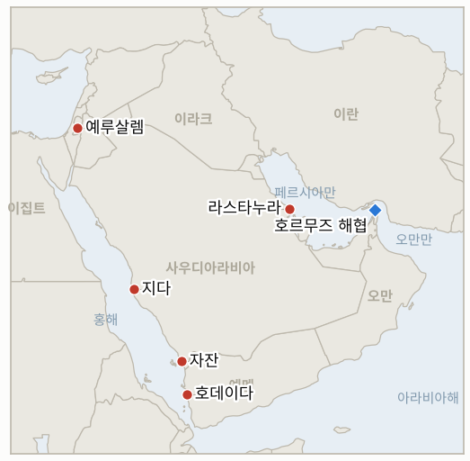

# 중동 일일 브리핑

**2026년 11월 26일**

- **보고 기간:** 약 24시간, 11월 25일 06:00 ~ 11월 26일 06:00 (한국시간)
- **종합 평가:** 수요일의 핵심은 사우디아라비아를 겨냥한 후티의 공세가 리야드에서 사우디의 석유·항만 시설로 넓어진 것이다. 사우디 주도 연합군은 사우디 최대 수출 터미널이 있는 라스타누라 상공에서 드론 4대를 격추했다고 밝혔고, 자잔항에 경미한 피해가 났다고 알렸으며, 지다 이슬람항 인근에서 드론 1대를 격추했다(§1.1). 호르무즈 해협에서는 이란이 가스 운반선이 기뢰에 닿았다고 주장했으나 이를 확인한 독립 감시 기관은 없다(§1.2). 미국은 자국민에게 이란을 즉시 떠나라고 했고, 트럼프 대통령은 전쟁 자금이 1월까지 확보돼 있다고 말했다(§1.3). 유가는 사우디 소식에 반응해 브렌트가 3.21달러 오른 94.61달러에 마감했다(§1.4). 이스라엘에서는 4차 통합 정부 협상이 결과 보도 없이 끝났고, 아이젠코트의 우군은 초정통파가 그에게 다가오고 있다고 말했다(§1.5). 서울에서는 미국 기술주가 다시 급락한 영향으로 코스피가 6.16% 내린 4,697.51에 마감했고, 외국인은 약 1조 9,000억 원어치를 순매도했으며, 원·달러 환율은 1,343.2원에 마감했다. 국회 국방위원회 소위는 세 가지 원칙을 담은 부대의견을 붙여 청해부대 동의안을 의결했다. 종합하면, 미국과 이란은 이날도 서로를 타격하지 않았지만 예멘 전쟁은 이제 사우디의 양쪽 해안에 닿았고, 유가는 두 거래일 사이에 5.24달러를 되찾았다.

---

## 1. 무슨 일이 있었나

<figure style="float:right; width:46%; margin:2pt 0 8pt 14pt;">

<figcaption style="font-size:8pt; color:#666; text-align:center; margin-top:3pt; font-style:italic;">주요 논의 지점</figcaption>
</figure>

### 1.1 후티의 공격이 라스타누라, 자잔, 지다에 닿다

후티는 수요일 사우디 걸프 연안의 라스타누라 정유소를 공격해 "정확하고 직접적인" 명중으로 화재를 일으켰다고 주장했고, 화요일 리야드 금융지구 공격은 세 단계로 이뤄졌다고 밝혔다. 사우디 주도 연합군은 방공망이 라스타누라 상공에서 드론 4대를 요격해 파괴했다고 발표했으며, 정유소가 피격됐다고는 말하지 않았다. 보고 기간이 끝날 때까지 사우디 정부와 사우디 아람코는 피해에 대해 언급하지 않았다. 온라인에 올라온 영상과 Reuters가 전한 위성사진에는 시설 인근의 연기가 보이는데, 후티의 주장만으로는 그 원인을 알 수 없다([Reuters via Al-Monitor](https://www.al-monitor.com/originals/2026/11/yemens-houthis-claim-attack-saudi-arabias-largest-refinery); [The National](https://www.thenationalnews.com/news/gulf/2026/11/25/yemens-houthis-say-they-attacked-saudi-arabias-ras-tanura-refinery/)). 이 정유소는 하루 55만 배럴을 처리하고, 인접한 터미널은 하루 약 650만 배럴을 선적할 수 있다. 같은 날 늦게 연합군은 후티의 발사체가 자잔항에 떨어져 경미한 피해가 났고, 지다 이슬람항 인근에서 드론 1대를 격추했다고 밝혔다. 두 경우 모두 민간인 부상은 없었다. Anadolu는 사우디 서부 상공에서 순항미사일 1기도 요격됐다고 보도했다. 후티는 연합군의 호데이다 공습에 대한 대응으로 두 항만을 타격했다고 주장했다. 호데이다는 대피 경고에 이어 수요일에도 공습을 받았고, 야히아 사리 후티 군 대변인은 사우디 홍해 연안의 항만 근로자들에게 떠나라고 말했다([Anadolu](https://aa.com.tr/en/middle-east/saudi-led-coalition-intercepts-houthi-drone-near-jeddah-islamic-port/4138036); [CBS News live](https://www.cbsnews.com/live-updates/iran-war-us-military-ai-weapons-oil/); [Times of Israel](https://www.timesofisrael.com/liveblog-november-25-2026/)). 톰 플레처 유엔 인도주의 사무차장은 8월 이후 예멘에서 다시 벌어진 전투로 36만 4,000명 넘게 피란했다고 말했다. **신뢰도: 연합군 발표는 높음; 라스타누라의 연기는 중간; 직접 명중했다는 후티의 주장과 정유소 피해 여부는 낮음.**

### 1.2 이란, 호르무즈에서 LNG 운반선이 기뢰에 닿았다고 주장

이란 혁명수비대 해군은 수요일 오후, 액화천연가스(LNG) 운반선 한 척이 위치 추적 장치를 끈 채 이란이 허가하지 않은 항로를 지나다가 호르무즈 해협 남쪽에서 기뢰에 닿아 폭발했다고 밝혔다. 선박 이름은 밝히지 않았다. 수요일에 선박이 피격됐다고 보고한 독립 감시 기관은 없고, 미군은 항로에 기뢰가 없다고 말한다([CBS News live](https://www.cbsnews.com/live-updates/iran-war-us-military-ai-weapons-oil/); [TASS](https://tass.com/world/2224855)). 트럼프 대통령은 이란의 기뢰·선박 공격 주장이 에너지 가격을 올리려는 거짓말이라고 했다. 모하마드 아크라미니아 이란 육군 대변인(준장)은 총사령관의 명령에 따라 해협의 통제와 감시를 강화했다고 밝혔고, 육군은 미국의 MQ-9와 LUCAS 드론을 격추했다고 주장했으나 미국은 이를 확인하지 않았다. 이란의 페르시아만 해협청(PGSA)은 예인선 26척을 "비준수 목록"에 추가해, 압박 대상을 유조선에서 항만이 의존하는 지원 선박으로 넓혔다([Iran Dossier](https://irandossier.online/posts/tugboats-on-the-blacklist-iran-widens-its-hormuz-campaign-as-vahidi-warns-the-next-round-will-not-stay-local/)). 아흐마드 바히디 혁명수비대 총사령관은 새 교전이 벌어지면 지난번의 지리적 범위 안에 머물지 않을 것이라고 경고했다. 통항 집계는 여전히 엇갈린다. AIS 기반 집계 한 곳은 화요일 해협을 지난 상선을 4척으로 기록했고([hormuz.now](https://hormuz.now/traffic)), Al Jazeera가 인용한 MarineTraffic 자료는 11월 17~23일에 125척이 지나 이달 첫 주의 226척보다 줄었다고 전했다([Al Jazeera](https://www.aljazeera.com/news/2026/11/24/hormuz-oil-traffic-is-down-40-percent-are-irans-tanker-attacks-working)). 한편 Kpler는 11월 들어 지금까지 카타르 라스라판에 LNG 운반선이 36차례 접안해 전쟁 발발 이후 가장 많았고, 그 가운데 29차례는 AIS를 송출하지 않는 선박이었다고 집계했다. 분석가들은 수출량이 전쟁 전의 약 40% 수준이라고 본다([Reuters via BOE Report](https://boereport.com/2026/11/25/qatar-lng-exports-hit-post-war-high-despite-rising-insurance-costs/)). **신뢰도: 그런 주장이 나왔다는 사실은 높음; LNG 운반선과 드론 격추 주장은 낮음; 통항 집계는 중간; Kpler 수치는 중간~높음.**

### 1.3 미국, 자국민에게 이란을 떠나라고 경보; 트럼프는 1월이라는 자금 시한을 언급

미국의 주이란 가상 대사관은 수요일 보안 경보를 내고 미국 시민에게 "이란을 즉시 떠나라"고 했으며, 교전이 빠르게 격화할 수 있다고 경고했다. 경보는 바레인과 쿠웨이트의 미국 자산에 대한 이란의 공격과 후티의 리야드 타격을 들었고, 이란과 후티, 그 동맹 세력이 역내 전역에서 미국의 이익을 겨냥할 수 있다고 밝혔다([Euronews](https://euronews.com/2026/11/25/us-tells-citizens-to-leave-iran-warns-hostilities-could-escalate-fast)). 같은 날 주아랍에미리트 미국 공관도 보안 안내를 냈다. 트럼프는 New York Post에 전쟁 자금이 1월 말께까지 "확보돼 있다"고 말했고, 자신의 관심사는 이란의 핵 프로그램이지 정권 교체가 아니라고 했다. 정권 교체는 "아마 가능할 것"이라고 덧붙였다([Times of Israel](https://www.timesofisrael.com/trump-says-iran-war-funded-through-january-suggesting-limited-window-for-new-op/)). NBC News는 행정부 당국자들이 전쟁을 끝내기 위해 이란 고위 지도자들을 살해할지를 논의하고 있으며 트럼프는 결정을 내리지 않았다고 보도했다. 스콧 베센트 미국 재무장관은 이란을 "가라앉는 배"라고 부르며 "바다 위에 팔 기름이 한 방울도 남아 있지 않다"고 말했다. 모하마드 레자 아레프 이란 제1부통령은 북쪽 국경을 통해 교역할 수 있으므로 걱정하지 않는다고 했다. 아바스 아라그치 이란 외무장관은 이스라엘이 미국으로 하여금 자국을 대신해 "또 하나의 전쟁"을 치르게 하려 한다고 비난했다. 미국과 이란이 서로를 타격했다는 보도는 없었고, 회담 일정도 나오지 않았다. **신뢰도: 경보와 발언은 높음; NBC 보도는 중간(익명 당국자).**

### 1.4 브렌트, 라스타누라 주장에 3% 넘게 급등

브렌트는 수요일 3.21달러(3.51%) 오른 94.61달러에, WTI는 1.63달러(1.99%) 오른 83.68달러에 마감했다. 브렌트는 이틀 연속 올랐고, 월요일 종가보다 5.24달러 높다. PVM의 분석가 타마스 바르가는 "후티의 성명이 수요일의 가격 상승을 촉발했다"고 말했고, 목요일 미국 추수감사절 연휴를 앞두고 매도 포지션을 정리하려는 매수가 상승폭을 키웠다고 덧붙였다([CNBC](https://www.cnbc.com/2026/11/25/oil-wti-brent-hormuz-middle-east.html)). 공급 지표는 반대 방향을 가리켰다. 미국 에너지정보청(EIA)은 11월 20일로 끝난 주에 원유 재고가 110만 배럴 늘어 4억 1,890만 배럴이 됐다고 발표했다. 분석가 예상치 150만 배럴보다 조금 적다. 휘발유 재고는 170만 배럴 늘었다. 리비아의 샤라라 송유관은 다시 열렸다. OPEC+ 장관들은 11월 29일 일요일에 모여 2027년 정책을 정한다. 이라크와 카자흐스탄이 생산능력 추정치를 높여 달라고 요구하는 것으로 전해진다. 미국 시장은 목요일에 휴장하고 금요일에는 단축 거래를 한다. **신뢰도: 종가는 높음(CNBC, 화요일 종가와 산술이 맞음).**

### 1.5 야샤르와 리쿠드의 4차 협상, 결과 보도 없이 종료

가디 아이젠코트의 야샤르와 베냐민 네타냐후의 리쿠드 협상단은 수요일, 2주 사이 네 번째로 만났다. 보고 기간이 끝날 때까지 결과도, 5차 협상 일정도 보도되지 않았다([Jerusalem Post via Yahoo](https://www.yahoo.com/news/politics/articles/eisenkots-yashar-netanyahus-likud-teams-174640582.html)). 화요일에 아이젠코트와 서명한 아비그도르 리베르만은 토라 유대교 연합(UTJ) 의원들이 협상에 대해 랍비들의 승인을 받았고, 아이젠코트가 다음 주말까지 "분명한 유대인 다수" 연정을 구성할 수 있으며, "소수 정부는 없을 것"이라고 말했다. 채널13은 이스라엘 베이테누가 법무부, 국방부, 이민부를 약속받았다고 보도했다. 화요일에 협상을 중단한 민주당은 통합 정부라는 선택지를 "협상 테이블에서 치워야 한다"고 했다. 네타냐후는 이스라엘이 "거대하고 즉각적인 위험"에 직면해 있으며 단결이 "그에 대처하는 유일한 길"이라고 말했고, 기소된 의원이 총리를 맡지 못하게 하는 법안을 비난했다. 리쿠드는 최대 120개 투표함의 개표 결과에 이의를 제기했다([Times of Israel](https://www.timesofisrael.com/liveblog-november-25-2026/)). 채널12는 재러드 쿠슈너가 네타냐후에게 전화로 미국의 가자 계획을 진행하라고 압박했다고 보도했다. **신뢰도: 협상이 열렸다는 사실은 높음; 토라 유대교 연합에 관한 리베르만의 설명과 채널13 보도는 중간.**

---

## 2. 심층 분석: 유인과 동기

### 2.1 후티는 왜 이제 사우디의 석유·항만 시설을 겨누나?

지난주 후티는 해운사들에 지다를 떠나라고 했고, 호데이다 공습의 대가를 사우디 항만이 치를 것이라고 했다. 수요일은 연합군 스스로 그런 시설 세 곳, 곧 걸프 연안의 라스타누라와 홍해 연안의 자잔·지다에 대한 공격을 발표한 첫날이다. 논리는 같은 것으로 되갚는다는 것이다. 호데이다는 후티가 장악한 북부에 식량과 물자가 들어오는 항구이고, 연합군이 그곳을 칠 때마다 사우디 항만이 답으로 돌아온다. 라스타누라에는 구매자와 보험사를 향한 두 번째 메시지가 있다. 사우디 최대의 수출 터미널이 1,000km 넘게 떨어진 예멘에서 닿는 거리에 있다는 것이다. 드론이 격추되더라도 후티는 얻는 것이 있다. 연합군의 발표 자체가 공격이 도달했음을 확인해 주고, 나머지는 유가가 해 주었기 때문이다. 리야드로서는 드론 4대를 파괴했다고만 말하는 편이 피해에 쏠리는 관심을 줄인다. 연기에 대한 아람코의 침묵이 지켜볼 빈자리다.

### 2.2 이란은 왜 아무도 확인할 수 없는 기뢰 피격을 발표하나?

이란의 해협 통제는 선주들이 무엇을 믿느냐에 달려 있다. 선박이 "허가받지 않은 항로"에서 기뢰에 닿았다는 주장을 날마다 내놓으면, 선주들은 미국의 호위가 통항을 안전하게 해 주지 않으며 안전한 항로는 이란군과 조율한 항로뿐이라는 말을 듣게 된다. 이 주장은 비용이 들지 않고, 지금은 많은 선박이 송신기를 끄고 다니기 때문에 반박하기도 어렵다. 미국은 물동량 수치와, 그 주장이 가격을 올리려는 거짓말이라는 트럼프의 발언으로 같은 방식의 답을 한다. 영국 해사 당국의 공지는 실제 피격이 일어난다는 것을 보여 주고, 확인되지 않은 주장은 거기서 힘을 얻는다. 예인선 26척을 명단에 올린 것도 같은 믿음을 다른 쪽에서 건드린다. 미국이 정한 항로의 선박을 돕는 데는 대가가 따른다고 이웃 나라 항만의 지원 업체들에 경고하는 것이다. 이 가운데 어느 것도 이란이 미국 군함에 발포할 것을 요구하지 않는다. 그것이야말로 트럼프에게 1월 이전에 타격할 이유를 줄 행동이다.

### 2.3 트럼프는 왜 전쟁 자금이 1월까지만 확보돼 있다고 말하나?

이 발언은 그가 11월 20일 이후 해 온 말과 맞는다. 서두르지 않고, 새해가 지난 뒤 결정한다는 것이다. 자금 시한은 그 말을 테헤란과 의회, 이스라엘이 각자 읽을 수 있는 기한으로 바꾼다. 테헤란에는 합의의 창이 두 달쯤 뒤에 닫힌다고 말한다. 이달 중간선거로 뽑힌 의회에는 전쟁을 계속하는 비용을 내놓으면서, 예산이 거부되면 그 책임을 미리 민주당에 돌린다. 이스라엘에는, 자신의 관심사가 정권 교체가 아니라 핵 프로그램이라는 말로 미국이 어디까지 함께할지에 선을 긋는다. 이스라엘 국방장관이 화학무기를 꺼낸 다음 날이다. 이란 지도자 살해 논의에 관한 NBC 보도와 자국민에게 이란을 떠나라고 한 조치는 그사이 위협의 신빙성을 유지한다. 기한을 밝히는 데 따르는 위험은 이란도 그에 맞춰 계획을 세운다는 것이다. 다음 교전은 "국지전에 머물지 않을 것"이라는 바히디의 경고가 테헤란의 답이다.

### 2.4 초정통파가 다가오고 있다면 아이젠코트는 왜 여전히 리쿠드와 협상하나?

한쪽 협상이 다른 쪽에서 그의 값을 올려 주기 때문이다. 토라 유대교 연합 의원들이 야샤르 진영에 합류하면 아이젠코트는 리쿠드 없이, 아랍계 정당 없이 과반에 다가선다. 리베르만이 내건 조건이 바로 그것이다. 그는 이 전망을 리쿠드와의 협상 테이블에 들고 간다. 네타냐후는 총리직과 사법 문제에서 더 많이 내놓든지, 자기 진영이 갈라지는 것을 지켜봐야 한다. 수요일에 리쿠드가 낸 투표함 이의 제기와 네타냐후의 "즉각적인 위험" 발언은 시간을 늦추고 초정통파의 이동을 막으려는 시도다. 통합 정부를 "협상 테이블에서 치우라"는 민주당의 요구는 아이젠코트의 반대편에서 치르는 비용을 보여 준다. 리베르만과 초정통파에 기대는 정부에는 야이르 골란의 당이 설 자리가 좁다. 리베르만의 "다음 주말"은 이해 당사자의 주장이고, 토라 유대교 연합은 스스로 결정을 발표하지 않았다.

---

## 3. 한국에 대한 정책적 함의

**익스포저 현황:** 한국은 원유의 약 70.7%, LNG의 20.4%를 중동에서 들여온다(`instructions/korea-exposure.md`, 갱신 불필요). 수요일 브렌트는 94.61달러, WTI는 83.68달러에 마감했다. 코스피는 308.52포인트(6.16%) 내린 4,697.51에 마감해 화요일 상승분을 모두 내주었고, 1월 13일 이후 가장 낮은 종가를 기록했다. 4,809.00에 출발해 장중 4,672.55까지 밀렸고 장 초반 매도 사이드카가 발동됐다. 방향을 가리지 않고 보면 4거래일 연속 사이드카다. 원인은 이번에도 미국에 있었다. 화요일 엔비디아가 5.86%, 마이크론이 11.01%, 필라델피아 반도체지수가 7.88% 내렸고, 국내 언론은 미 무역대표부의 과잉생산 조사 결과 발표를 앞둔 추가 관세 우려도 원인으로 꼽았다. 외국인은 코스피에서 약 1조 9,000억 원을 순매도했다(보도에 따라 1조 8,993억 원, 1조 9,527억 원). 9거래일 만에 순매수로 돌아선 지 하루 만이다. 삼성전자는 9.87%, SK하이닉스는 11.05% 내렸다([Blockmedia](https://www.blockmedia.co.kr/archives/1170476)). 원·달러 환율은 장중 1,349.0원까지 오른 뒤 0.8원 오른 1,343.2원에 마감했다. 수출업체의 월말 달러 매도가 1,350원 부근에서 상단을 막았고, 시장은 금요일 삼성전자 배당금 지급에 따른 외국인 역송금 수요를 주시하고 있다([세계일보](https://www.segye.com/newsView/20261125513717)). 한국은행은 이번 보고 기간이 끝난 뒤인 목요일 오전에 기준금리를 결정한다. 국회 국방위원회 소위는 수요일 여야 합의로 청해부대 수정 동의안을 의결하고, 전쟁 불개입, 장병 안전 최우선, 자위권 원칙 준수라는 세 가지 원칙을 담은 부대의견을 붙였다. 여당은 더 구체적인 문구를 원했고 야당인 국민의힘은 "전략적 모호성"을 남겨야 한다고 주장해, 원칙을 적는 선에서 절충했다. 보도에는 호르무즈 해협 진입 시 별도의 국회 동의를 받도록 하는 조항이 보이지 않는다. 대통령은 청해부대의 임무는 넓히되 호르무즈 해협과 그 인근 해역은 활동 범위에서 제외되며 전쟁 불개입 원칙은 "분명히 지킬 것"이라고 밝혔다([파이낸셜뉴스](https://www.fnnews.com/news/202611251821349152); [오마이뉴스](https://www.ohmynews.com/NWS_Web/View/at_pg.aspx?CNTN_CD=A0003288403)). 국방위 전체회의는 목요일에 표결하며, 그 뒤에는 본회의 표결만 남는다.

**사안별 함의:**

- **사우디 석유·항만 시설 (§1.1):** 라스타누라는 지금도 호르무즈를 거쳐 한국에 오는 사우디 원유의 상당 부분이 선적되는 곳이고, 지다와 얀부는 한국이 해협을 피하려고 쓰는 홍해 쪽 출구다. 수요일에는 양쪽 해안 모두에서, 또는 그 인근에서 공격이 보고됐다. 선적 차질은 확인되지 않았지만, 국내 정유사는 아람코에 라스타누라의 선적 상황을 문의하고, 홍해 항만에서 두 번째 사건이 나면 12월 선적 일정을 재검토할 사유로 삼아야 한다 (IND-20261126-1, IND-20261126-2, IND-20261123-1).
- **호르무즈 (§1.2):** LNG 운반선 사건 주장은 확인되지 않았다. 한국에는 Kpler 수치가 더 중요하다. 카타르의 선적은 전쟁 발발 이후 가장 많지만 여전히 평시의 약 40%이고, 다섯 척 가운데 네 척은 송신기를 끈 채 선적한다. 걸프 항차마다 선체 가액의 최대 5%에 이르는 전쟁위험 보험료는 이제 모든 카타르산 화물의 비용에 들어간다 (IND-20260714-4, IND-20261122-1).
- **워싱턴 (§1.3):** 1월이라는 자금 시한은 한국의 계획 담당자에게 날짜를 준다. 미국의 새 타격 결정이 1월에 내려진다고 가정하고, 비축과 화물 확보는 2월까지 버틸 수 있게 짜야 한다 (IND-20261114-1, IND-20261119-1).
- **유가 (§1.4):** 브렌트는 두 거래일 사이 5.24달러 올라, 이 브리핑이 추적해 온 95달러 선을 0.39달러 남겨 두고 있다. 월요일에 권고한, 물량 확보에 유리한 가격 구간은 좁아졌다. 남은 구간은 일요일 OPEC+ 회의 전에 활용하는 것이 좋다 (IND-20261122-3, IND-20261124-1).
- **이스라엘 (§1.5):** 다음 주에 리쿠드 없이 정부가 구성되면, 트럼프가 자신의 결정 시기로 정해 둔 몇 주 동안 네타냐후 진영은 이란 관련 결정에서 빠지게 된다 (IND-20261125-3, IND-20261123-3, IND-20261126-3).
- **시장:** 코스피는 최근 두 거래일에 각각 6% 넘게, 최근 네 거래일에 각각 3% 넘게 움직였고, 매번 미국 기술주가 원인이었다. 외국인이 약 1조 9,000억 원을 팔았는데도 환율이 1,350원을 넘지 못한 것은 수출업체가 오를 때마다 달러를 팔고 있음을 보여 준다. 그 지지력은 금요일 배당금 역송금에서 시험받는다 (IND-20261124-3, IND-20261119-3, IND-20261023-1).
- **청해부대 (§3 익스포저 현황):** 보도된 부대의견은 원칙을 정할 뿐이고, 작전 구역의 한계는 정부가 밝힌 의도에 맡긴다. 월요일에 제안된 별도 동의 조항보다 약하다. 전체회의가 같은 문안을 채택하면, 부대를 호르무즈 쪽으로 옮기는 것을 막는 법적 장치는 대통령의 발언과 동의안의 작전 구역 표시에 기대게 된다 (IND-20261124-2, IND-20261112-1).

**오늘 종결:**

- **IND-20261121-1: 확증.** 사우디 주도 연합군은 11월 25일 지다 이슬람항 인근에서 후티 드론을 요격해 파괴했다고 발표했고, 이는 11월 28일께인 시한 안이다. 사우디 홍해 항만에 대한 후티의 위협은 실재한다. 얀부에서는 보고된 것이 없다.
- **IND-20261125-2: 확증.** 코스피는 지표를 연 지 한 거래일 만인 11월 25일 4,800 아래인 4,697.51에 마감했다. 화요일의 6.32% 상승은 반등이었고 이어지지 못했다.

**검증 가능한 지표:**

- **IND-20261126-1** (진행, 신규): 2026년 12월 3일께까지 사우디 당국이나 사우디 아람코가 11월 25일 공격으로 라스타누라 정유소나 터미널에 피해 또는 가동 차질이 생겼다고 발표하면 후티의 주장이 확증; 없으면 반증.
- **IND-20261126-2** (진행, 신규): 2026년 12월 3일께까지 사우디 당국이 지다나 얀부에서 후티 공격으로 피해나 사상자가 났다고 발표하면 홍해 항만 공세가 방공망을 뚫고 있는 것으로 확증; 없으면 반증.
- **IND-20261126-3** (진행, 신규): 2026년 12월 4일께까지 토라 유대교 연합이 아이젠코트가 이끄는 연정에 합류한다고 발표하거나 합의에 서명하면 리베르만의 일정이 확증; 없으면 반증.
- **IND-20261125-1** (진행): 리야드 건물에 대한 추가 타격 보도 없음; 후티는 화요일 공격이 세 단계였다고 설명.
- **IND-20261125-3** (진행): 야샤르와 리쿠드의 4차 협상이 열림; 합의 보도 없음.
- **IND-20261124-1** (진행): 브렌트 94.61달러 마감으로 85달러 기준선에서 더 멀어짐.
- **IND-20261124-2** (진행): 소위가 11월 25일 세 가지 원칙의 부대의견을 붙여 동의안을 의결; 호르무즈에 대한 별도 동의 조항은 보도되지 않음; 전체회의 표결은 11월 26일.
- **IND-20261124-3** (진행): 원·달러 1,343.2원 마감(고가 1,349.0원)으로 1,360원 기준선 아래.
- **IND-20261123-1** (진행): 사우디 당국이나 해당 기업의 라비그 관련 발표 없음.
- **IND-20261123-2** (진행): 라스타누라 상공의 드론은 후티가 주장한 것이어서 해당하지 않음; 걸프 국가 정부가 석유·가스 시설에 대한 이란의 타격이나 요격을 발표하지 않음.
- **IND-20261123-3** (진행): 리쿠드를 뺀 표결을 향한 공식 절차 없음; 리베르만은 다음 주말까지 정부 구성을 언급.
- **IND-20261122-1** (진행): 이란 유조선이 저지됐다거나 유조선들이 봉쇄선을 통과했다는 보도 없음; 베센트는 이란이 바다 위에 남은 기름이 없다고 발언.
- **IND-20261122-2** (진행): 바레인에 대한 새 공격 보도 없음; 바레인은 화요일 한때 영공을 닫음.
- **IND-20261122-3** (진행): 브렌트 94.61달러 마감으로 95달러 기준선에 0.39달러 못 미침; 시한은 11월 27일께.
- **IND-20261120-1** (진행): 한 보도는 11월 22일까지 카타이브 헤즈볼라 병력의 약 3분의 1이 주르프 알사카르를 떠났으나 핵심 거점은 유지한다고 전함; 부대가 떠났다는 공식 발표는 없음.
- **IND-20261119-1** (진행): 공개된 미국의 2차 타격 없음; 시한은 11월 26일께.
- **IND-20261119-3** (진행): 원·달러 1,343.2원 마감으로 1,325원 기준선 위; 시한은 11월 26일께.
- **IND-20261114-1** (진행): 호르무즈 연안 너머에 대한 미국이나 이스라엘의 타격 없음; 시한은 11월 27일께.
- **IND-20261023-1** (진행): 한국은행은 11월 26일 결정.
- **IND-20261112-1** (진행): 동의안이 소위를 통과; 전체회의 표결은 11월 26일, 본회의 표결은 아직 남음.
- **IND-20261116-2** (진행): 바브엘만데브 인근에서 후티가 상선을 공격했다는 UKMTO나 JMIC 보고 없음.
- **IND-20261117-1** (진행): 후티 병력이 아덴 50km 이내에 있다는 보도를 찾지 못함.
- **IND-20260714-4** (진행): Kpler 집계로 11월 들어 라스라판 LNG 접안 36차례, 전쟁 중 최고치; 주간 감소 보도 없음.
- **IND-20261113-2, IND-20261114-3, IND-20261115-2** (진행): 변동을 찾지 못함; `tracking/indicators.md` 참조.

---

## 4. 관찰 목록

- **라스타누라에 대한 아람코나 사우디 에너지부의 발표, 그리고 연기의 원인 (IND-20261126-1).**
- **호데이다와 사우디 홍해 항만 사이의 다음 공방, 그리고 얀부가 표적이 되는지 (IND-20261126-2).**
- **수요일 호르무즈에서 LNG 운반선이나 다른 선박이 피격됐다는 독립적인 보고가 나오는지.**
- **이란이 명단에 오른 예인선 26척이나 이를 운용하는 항만에 대해 행동에 나서는지.**
- **표적 살해에 관한 NBC 보도의 후속, 그리고 자국민 경보 이후 미군의 움직임 (IND-20261114-1, IND-20261119-1).**
- **미국 연휴와 11월 29일 OPEC+ 회의를 지나는 동안 95달러 부근의 브렌트 (IND-20261122-3, IND-20261124-1).**
- **토라 유대교 연합의 자체 발표, 야샤르와 리쿠드의 5차 협상, 민주당의 다음 행보 (IND-20261126-3, IND-20261125-3, IND-20261123-3).**
- **이란 내 리알화, 물가, 시위.**
- **카타이브 헤즈볼라가 주르프 알사카르 철수를 마치는지 (IND-20261120-1).**
- **목요일 한국은행 결정, 금요일 삼성전자 배당금, 1,350원 부근의 원·달러 환율 (IND-20261023-1, IND-20261124-3).**
- **목요일 국방위 전체회의의 청해부대 동의안 표결과 부대의견 최종 문안 (IND-20261124-2, IND-20261112-1).**

---

## 5. 출처 신뢰도 요약

| 주장 | 출처 | 신뢰도 |
| --- | --- | --- |
| 연합군 방공망이 라스타누라 상공에서 드론 4대를 파괴; 정유소가 피격됐다는 발표는 없음 | 사우디 주도 연합군 via Reuters (Al-Monitor), The National | 높음 |
| 후티, 라스타누라 정유소를 "정확하고 직접적으로" 명중시켜 화재가 났다고 주장 | 후티 대변인 via Reuters, CBS News | 높음(주장 사실); 낮음(내용) |
| 라스타누라 정유소 인근의 연기 | 온라인 영상, 위성사진 via Reuters, The National | 중간 |
| 사우디 정부와 아람코는 피해에 대해 언급하지 않음 | Reuters via Al-Monitor | 중간~높음 |
| 후티 발사체가 자잔항에 떨어져 경미한 피해, 민간인 부상 없음 | 연합군 via CBS News, Times of Israel, Khaleej Times | 높음 |
| 지다 이슬람항 인근에서 드론 격추, 부상 없음; 서부 지역 상공에서 순항미사일 요격 | 연합군 via Anadolu, Saudi Gazette, Times of Israel | 높음(드론); 중간(순항미사일, 단일 매체) |
| 연합군이 수요일 호데이다를 다시 공습 | 연합군 via Khaleej Times; Al-Masirah via CBS News | 중간~높음 |
| 8월 이후 예멘에서 36만 4,000명 넘게 피란 | 유엔 인도주의 사무차장 via CBS News | 높음 |
| LNG 운반선이 호르무즈 해협 남쪽에서 기뢰에 닿음 | 혁명수비대 해군 via CBS News, TASS; 독립적인 보고 없음 | 낮음 |
| 이란 육군이 해협 통제를 강화; MQ-9와 LUCAS 드론 격추 주장 | 이란 육군 via CBS News, Khaleej Times, Defa Press | 높음(발언); 낮음(드론 격추 주장) |
| 해협청이 예인선 26척을 비준수 목록에 추가 | PGSA via CBS News, Iran Dossier | 중간~높음 |
| 바히디: 새 교전은 지난번의 지리적 범위에 머물지 않을 것 | Defa Press via Iran Dossier | 중간 |
| 11월 24일 호르무즈를 지난 AIS 송출 상선 4척 | hormuz.now | 중간~낮음 |
| 11월 17~23일 125척 통과, 11월 1~7일은 226척 | MarineTraffic via Al Jazeera | 중간 |
| 11월 들어 라스라판 LNG 접안 36차례, 29차례는 AIS 미송출; 수출은 전쟁 전의 약 40% | Kpler via Reuters (BOE Report) | 중간~높음 |
| 미국 주이란 가상 대사관, 자국민에게 이란을 즉시 떠나라고 경보 | Euronews | 높음 |
| 트럼프: 전쟁 자금은 1월 말께까지 "확보"; 관심사는 핵 프로그램이지 정권 교체가 아님 | New York Post via Times of Israel | 높음 |
| 행정부가 이란 지도자 표적 살해를 논의; 결정은 없음 | NBC News via Times of Israel | 중간 |
| 베센트: 이란은 "바다 위에 팔 기름이 한 방울도 남아 있지 않다"; 아레프: 이란은 걱정하지 않음 | CBS News | 높음(발언) |
| 브렌트 94.61달러(+3.21달러, +3.51%), WTI 83.68달러(+1.99%) 마감 | CNBC; 화요일 종가와 일치 | 높음 |
| 미국 원유 재고 110만 배럴 증가해 4억 1,890만 배럴 | EIA via CNBC, Investing.com | 높음 |
| 야샤르와 리쿠드의 4차 협상 개최; 결과 보도 없음 | Jerusalem Post via Yahoo | 높음(회동); 결과는 찾지 못함 |
| 리베르만: 토라 유대교 연합이 랍비들의 승인을 받음; 다음 주말까지 연정 가능 | 리베르만 via Jerusalem Post, Times of Israel | 중간 |
| 이스라엘 베이테누가 법무부, 국방부, 이민부를 약속받음 | 채널13 via Times of Israel | 중간 |
| 코스피 4,697.51(-6.16%), 매도 사이드카, 외국인 약 1조 9,000억 원 순매도; 원·달러 1,343.2원 | Blockmedia, 세계일보, 뉴스핌 | 높음 |
| 국방위 소위가 세 가지 원칙의 부대의견을 붙여 청해부대 동의안을 의결 | 파이낸셜뉴스, 오마이뉴스 | 높음(의결); 중간(정확한 문구는 공개되지 않음) |
