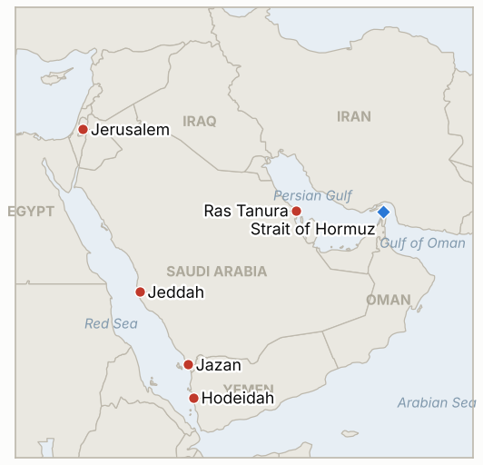

# Middle East Daily Briefing

**November 26, 2026**

- **Reporting window:** ~24 hours, November 25, 06:00 to November 26, 06:00 KST
- **Overall assessment:** Wednesday's main event was the widening of the Houthi campaign against Saudi Arabia from Riyadh to the kingdom's oil and port sites. The Saudi led coalition said it destroyed four drones over Ras Tanura, the site of the country's largest export terminal, reported minor damage at Jazan port and shot down a drone near Jeddah Islamic Port (§1.1). In the Strait of Hormuz, Iran claimed that a gas carrier hit a mine, which no independent monitor confirmed (§1.2). Washington told US citizens to leave Iran immediately, and President Trump said the war is funded through January (§1.3). Oil reacted to the Saudi news: Brent rose $3.21 to settle at $94.61 (§1.4). In Israel, a fourth round of unity talks produced no reported result while Eisenkot's allies said the ultra-Orthodox are moving toward him (§1.5). In Seoul the KOSPI fell 6.16% to 4,697.51 on another US technology selloff, foreign investors sold about 1.9 trillion won of shares and the won closed at 1,343.2 per dollar. The National Assembly's defence subcommittee approved the Cheonghae Unit motion with an attached opinion of three principles. Net: the United States and Iran again did not strike each other, but the war in Yemen now reaches both Saudi coasts, and the oil market has taken back $5.24 in two sessions.

---

## 1. What Happened

<figure style="float:right; width:46%; margin:2pt 0 8pt 14pt;">

<figcaption style="font-size:8pt; color:#666; text-align:center; margin-top:3pt; font-style:italic;">Major places of discussion</figcaption>
</figure>

### 1.1 Houthi attacks reach Ras Tanura, Jazan and Jeddah

The Houthis said on Wednesday that they had attacked the Ras Tanura refinery on Saudi Arabia's Gulf coast with an "accurate and direct" hit that caused fires, and that Tuesday's attack on Riyadh's financial district came in three phases. The Saudi led coalition said its air defences intercepted and destroyed four drones over Ras Tanura; it did not say the refinery was struck. Neither the Saudi government nor Saudi Aramco had commented on damage by the end of the window. Footage online and satellite images carried by Reuters showed smoke near the site, which the claim alone does not explain ([Reuters via Al-Monitor](https://www.al-monitor.com/originals/2026/11/yemens-houthis-claim-attack-saudi-arabias-largest-refinery); [The National](https://www.thenationalnews.com/news/gulf/2026/11/25/yemens-houthis-say-they-attacked-saudi-arabias-ras-tanura-refinery/)). The refinery processes 550,000 barrels a day and the adjoining terminal can load about 6.5 million barrels a day. Later in the day the coalition said a Houthi projectile fell on Jazan port and caused minor damage, and that it destroyed a drone near Jeddah Islamic Port, with no civilian injuries in either case; Anadolu also reported a cruise missile intercepted over western Saudi Arabia. The Houthis said they had hit both ports in answer to coalition strikes on Hodeidah, which was bombed again on Wednesday after an evacuation warning, and spokesman Yahya Saree told port workers on the Saudi Red Sea coast to leave ([Anadolu](https://aa.com.tr/en/middle-east/saudi-led-coalition-intercepts-houthi-drone-near-jeddah-islamic-port/4138036); [CBS News live](https://www.cbsnews.com/live-updates/iran-war-us-military-ai-weapons-oil/); [Times of Israel](https://www.timesofisrael.com/liveblog-november-25-2026/)). UN humanitarian chief Tom Fletcher said renewed fighting has displaced more than 364,000 people in Yemen since August. **Confidence: High on the coalition's statements; Medium on smoke at Ras Tanura; Low on the Houthi claims of direct hits and on any damage to the refinery.**

### 1.2 Iran claims an LNG carrier hit a mine in Hormuz

The navy of Iran's Revolutionary Guards said on Wednesday afternoon that a liquefied natural gas carrier exploded after hitting a mine in the southern Strait of Hormuz while sailing with its tracking systems off on a route Iran has not authorised. It named no ship. No independent monitor reported a vessel hit on Wednesday, and the US military says the shipping lanes are free of mines ([CBS News live](https://www.cbsnews.com/live-updates/iran-war-us-military-ai-weapons-oil/); [TASS](https://tass.com/world/2224855)). President Trump called Iran's mine and ship attack claims lies meant to raise energy prices. Iran's army spokesman, Brigadier General Mohammad Akraminia, said control and monitoring of the strait had been tightened on the commander's orders, and the army claimed to have shot down a US MQ-9 and a LUCAS drone, which Washington has not confirmed. Iran's Persian Gulf Strait Authority added 26 tugboats to its "Non-Compliance List," extending its pressure from tankers to the service vessels that ports depend on ([Iran Dossier](https://irandossier.online/posts/tugboats-on-the-blacklist-iran-widens-its-hormuz-campaign-as-vahidi-warns-the-next-round-will-not-stay-local/)). Revolutionary Guards commander Ahmad Vahidi warned that a new round of fighting would not stay within the geography of the last one. Counts of traffic still conflict: one AIS based counter recorded four commercial ships through the strait on Tuesday ([hormuz.now](https://hormuz.now/traffic)), while MarineTraffic data cited by Al Jazeera showed 125 vessels over November 17 to 23, down from 226 in the first week of the month ([Al Jazeera](https://www.aljazeera.com/news/2026/11/24/hormuz-oil-traffic-is-down-40-percent-are-irans-tanker-attacks-working)). Separately, Kpler counted 36 LNG carrier berthings at Qatar's Ras Laffan so far in November, the most since the war began, 29 of them by ships not transmitting AIS; analysts put exports at about 40% of the level before the war ([Reuters via BOE Report](https://boereport.com/2026/11/25/qatar-lng-exports-hit-post-war-high-despite-rising-insurance-costs/)). **Confidence: High that the claims were made; Low on the LNG carrier and drone claims; Medium on the traffic counts; Medium to High on the Kpler figures.**

### 1.3 Washington tells citizens to leave Iran as Trump names a January funding limit

The US Virtual Embassy in Iran issued a security alert on Wednesday telling American citizens to "leave Iran immediately" and warning that hostilities could escalate rapidly. It cited Iran's attacks on US assets in Bahrain and Kuwait and the Houthi strike on Riyadh, and said Iran, the Houthis and allied groups may target US interests across the region ([Euronews](https://euronews.com/2026/11/25/us-tells-citizens-to-leave-iran-warns-hostilities-could-escalate-fast)). The US mission in the UAE issued a security reminder the same day. Trump told the New York Post that the war is "funded" until about the end of January and that he is concerned with Iran's nuclear programme, not with changing its government, which he called "probably doable" ([Times of Israel](https://www.timesofisrael.com/trump-says-iran-war-funded-through-january-suggesting-limited-window-for-new-op/)). NBC News reported that administration officials are debating whether to kill senior Iranian leaders to end the war, and that Trump has made no decision. Treasury Secretary Scott Bessent called Iran a "sinking ship" that "doesn't have a drop of oil on the water left to sell"; First Vice President Mohammad Reza Aref said Iran is not worried because it can trade across its northern borders. Foreign Minister Abbas Araghchi accused Israel of trying to make the United States fight "yet another war" on its behalf. No US or Iranian strike on the other was reported, and no date for talks emerged. **Confidence: High on the alert and the statements; Medium on the NBC report (unnamed officials).**

### 1.4 Brent jumps more than 3% on the Ras Tanura claim

Brent settled at $94.61 on Wednesday, up $3.21 or 3.51%, and WTI at $83.68, up $1.63 or 1.99%. It was Brent's second rise in a row and left it $5.24 above Monday's close. "The Houthi statement triggered Wednesday's price rally," said PVM analyst Tamas Varga, adding that traders closing short positions before Thursday's US Thanksgiving holiday added to the move ([CNBC](https://www.cnbc.com/2026/11/25/oil-wti-brent-hormuz-middle-east.html)). Supply data pointed the other way. The US Energy Information Administration reported that crude stocks rose 1.1 million barrels to 418.9 million in the week to November 20, a little less than the 1.5 million analysts expected, and gasoline stocks rose 1.7 million barrels. Libya's Sharara pipeline reopened. OPEC+ ministers meet on Sunday, November 29, to set 2027 policy; Iraq and Kazakhstan are reported to be pressing for higher capacity estimates. US markets are closed on Thursday and trade a short session on Friday. **Confidence: High on the settles (CNBC, arithmetic consistent with Tuesday's closes).**

### 1.5 A fourth Yashar and Likud round ends without a reported result

Negotiators for Gadi Eisenkot's Yashar and Benjamin Netanyahu's Likud met on Wednesday for the fourth time in two weeks. No outcome and no date for a fifth round were reported by the end of the window ([Jerusalem Post via Yahoo](https://www.yahoo.com/news/politics/articles/eisenkots-yashar-netanyahus-likud-teams-174640582.html)). Avigdor Liberman, who signed with Eisenkot on Tuesday, said lawmakers of United Torah Judaism had received their rabbis' approval for talks, that Eisenkot could form a coalition with a "clear Jewish majority" by the end of next week, and that "there will be no minority government." Channel 13 reported that Yisrael Beytenu is promised the justice, defence and immigration ministries; the Democrats, who suspended their talks on Tuesday, said the unity option "must be taken off the table." Netanyahu said Israel faces "massive, immediate dangers" and that unity is "the only way to deal with them," and denounced a bill that would bar an indicted lawmaker from serving as prime minister. Likud filed an appeal against results from up to 120 ballot boxes ([Times of Israel](https://www.timesofisrael.com/liveblog-november-25-2026/)). Channel 12 reported that Jared Kushner pressed Netanyahu by phone to move ahead with the US plan for Gaza. **Confidence: High that the round took place; Medium on Liberman's account of United Torah Judaism and on the Channel 13 report.**

---

## 2. Deep Dive: Incentives and Motives

### 2.1 Why are the Houthis now aiming at Saudi oil and port sites?

Last week the Houthis told shipping firms to leave Jeddah and said Saudi ports would pay for strikes on Hodeidah. Wednesday was the first day on which the coalition itself reported attacks at three such sites: Ras Tanura on the Gulf, Jazan and Jeddah on the Red Sea. The logic is exchange in kind. Hodeidah is the port through which the Houthi north is fed and supplied, and each coalition raid on it is answered against a Saudi port. Ras Tanura adds a second message, aimed at buyers and insurers: the kingdom's largest export terminal lies within reach from Yemen, more than 1,000 km away. The Houthis gain even when the drones are shot down, because the coalition's own statement confirms that the attack arrived, and the oil price did the rest. For Riyadh, saying only that four drones were destroyed keeps attention off any damage. Aramco's silence about the smoke is the gap to watch.

### 2.2 Why does Iran announce mine strikes that no one else can confirm?

Iran's control of the strait rests on what shipowners believe. A daily claim that a ship struck a mine on an "unauthorized route" tells owners that US escort does not make the passage safe and that the only safe route is the one coordinated with Iran's forces. The claim costs nothing and cannot easily be disproved, because many ships now sail with transponders off. Washington answers in the same currency, with volume figures and Trump's statement that the claims are lies to raise prices. The UK maritime agency's notices show that real hits do occur, which gives the unverified claims their force. The blacklisting of 26 tugboats works on the same belief from another side: it warns the service companies in neighbouring ports that helping ships on the US route has a price. None of this requires Iran to fire at a US warship, which is the step that would give Trump a reason to strike before January.

### 2.3 Why does Trump say the war is funded only through January?

The statement fits what he has said since November 20: no rush, and a decision after the New Year. A funding limit turns that into a deadline that Tehran, Congress and Israel can each read. To Tehran it says the window for a deal closes in about two months. To the Congress elected in this month's midterms, it puts the cost of continuing the war on the table and blames the Democrats in advance if money is refused. To Israel, his remark that he cares about the nuclear programme and not regime change sets a limit on what he will join, a day after Israel's defence minister raised chemical weapons. The NBC report of a debate over killing Iranian leaders, and the order to citizens to leave Iran, keep the threat credible in the meantime. The risk in a stated deadline is that Iran also plans around it; Vahidi's warning that the next round "will not stay local" is Tehran's answer.

### 2.4 Why is Eisenkot still talking to Likud if the ultra-Orthodox are coming to him?

Because each track raises his price on the other. If United Torah Judaism's lawmakers join Yashar's bloc, Eisenkot nears a majority without Likud and without the Arab parties, which is the condition Liberman has set. That prospect is what he brings to the table with Likud: Netanyahu must offer more, on the premiership and on the judicial questions, or watch his own bloc break up. Likud's moves on Wednesday, the ballot box appeal and Netanyahu's talk of "immediate dangers," are attempts to slow the clock and to keep the ultra-Orthodox from moving. The Democrats' demand that unity be "taken off the table" shows the cost on Eisenkot's other side: a government resting on Liberman and the ultra-Orthodox has little room for Yair Golan's party. Liberman's "end of next week" is a claim by an interested party, and United Torah Judaism has not itself announced a decision.

---

## 3. Policy Implications for South Korea

**Exposure snapshot:** South Korea draws about 70.7% of its crude and 20.4% of its LNG from the Middle East (`instructions/korea-exposure.md`, no update needed). Brent settled at $94.61 and WTI at $83.68 on Wednesday. The KOSPI fell 308.52 points, or 6.16%, to 4,697.51, giving back all of Tuesday's gain and closing at its lowest level since January 13. It opened at 4,809.00, fell as far as 4,672.55, and a sell sidecar was triggered early in the session, the fourth session in a row with a sidecar in one direction or the other. The cause was again in the United States: Nvidia fell 5.86%, Micron 11.01% and the Philadelphia Semiconductor Index 7.88% on Tuesday, and the Korean press also cited worry over further US tariffs ahead of a trade representative's finding on overcapacity. Foreign investors net sold about 1.9 trillion won of KOSPI shares (reports give 1.8993 and 1.9527 trillion), one session after their first net purchase in nine. Samsung Electronics fell 9.87% and SK hynix 11.05% ([Blockmedia](https://www.blockmedia.co.kr/archives/1170476)). The won closed at 1,343.2 per dollar, 0.8 won weaker, after touching 1,349.0; month end dollar sales by exporters capped the rate near 1,350, and traders are watching Samsung Electronics' dividend payment on Friday for foreign remittance demand ([Segye Ilbo](https://www.segye.com/newsView/20261125513717)). The Bank of Korea decides its rate on Thursday morning, after this window closes. The National Assembly defence committee's subcommittee approved the amended Cheonghae Unit motion on Wednesday by agreement of both main parties, with an attached opinion stating three principles: no involvement in the war, the safety of the troops first, and adherence to the right of self defence. The ruling party had sought more specific wording; the opposition People Power Party argued for keeping "strategic ambiguity," and principles were the compromise. The reports do not show a clause requiring separate Assembly consent for entry into the Strait of Hormuz. The president said the unit's mission will widen but that the strait and nearby waters are excluded and the principle of staying out of the war "will be clearly kept" ([Financial News](https://www.fnnews.com/news/202611251821349152); [OhmyNews](https://www.ohmynews.com/NWS_Web/View/at_pg.aspx?CNTN_CD=A0003288403)). The full committee votes on Thursday, after which only the plenary vote remains.

**Implications by development:**

- **Saudi oil and port sites (§1.1):** Ras Tanura is where much of the Saudi crude that still reaches Korea through Hormuz is loaded, and Jeddah and Yanbu are the Red Sea outlets Korea uses to avoid the strait. On Wednesday attacks were reported at or near both coasts. No disruption to loading has been confirmed, but Korean refiners should ask Aramco for loading status at Ras Tanura and treat a second Red Sea port incident as a reason to review December lifting schedules (IND-20261126-1, IND-20261126-2, IND-20261123-1).
- **Hormuz (§1.2):** The claimed LNG carrier incident is unverified. The Kpler figures matter more for Korea: Qatar's loadings are at their highest since the war began, yet still about 40% of normal, and four in five ships load with transponders off. War risk cover of up to 5% of hull value per Gulf voyage is now part of the cost of every Qatari cargo (IND-20260714-4, IND-20261122-1).
- **Washington (§1.3):** A January funding limit gives Korean planners a date. Reserve and cargo cover should be arranged to last through February on the assumption that a US decision on new strikes falls in January (IND-20261114-1, IND-20261119-1).
- **Oil (§1.4):** Brent has risen $5.24 in two sessions and stands $0.39 below the $95 level this brief has been tracking. The price window recommended on Monday for rebuilding cover has narrowed; what remains of it is best used before the OPEC+ meeting on Sunday (IND-20261122-3, IND-20261124-1).
- **Israel (§1.5):** A government formed next week without Likud would remove Netanyahu's camp from decisions on Iran during the weeks Trump has marked for his own decision (IND-20261125-3, IND-20261123-3, IND-20261126-3).
- **Markets:** The KOSPI has moved more than 6% in each of the last two sessions and more than 3% in each of the last four, on US technology shares each time. Foreign selling of about 1.9 trillion won did not move the won beyond 1,350, which shows that exporters are selling dollars into each rise; the test of that support is Friday's dividend remittance (IND-20261124-3, IND-20261119-3, IND-20261023-1).
- **Cheonghae Unit (§3 snapshot):** The opinion as reported sets principles and leaves the limits of the operating area to the government's stated intent. That is weaker than the separate consent clause proposed on Monday. If the full committee adopts the same text, the legal bar to moving the unit toward Hormuz will rest on the president's word and the motion's map (IND-20261124-2, IND-20261112-1).

**Resolved today:**

- **IND-20261121-1: Confirmed.** The Saudi led coalition said on November 25 that it intercepted and destroyed a Houthi drone near Jeddah Islamic Port, within the deadline of ~November 28. The Houthi threat to the Saudi Red Sea ports is real. Nothing was reported at Yanbu.
- **IND-20261125-2: Confirmed.** The KOSPI closed at 4,697.51 on November 25, below 4,800, one session after the indicator was opened. Tuesday's 6.32% rise was a rebound and did not last.

**Testable indicators:**

- **IND-20261126-1** (open, new): A statement by Saudi authorities or Saudi Aramco by ~2026-12-03 confirming damage or an operational disruption at the Ras Tanura refinery or terminal from the November 25 attack confirms the Houthi claim; none falsifies.
- **IND-20261126-2** (open, new): A Houthi attack reported by Saudi authorities as causing damage or casualties at Jeddah or Yanbu by ~2026-12-03 confirms that the Red Sea port campaign is getting through the defences; none falsifies.
- **IND-20261126-3** (open, new): An announcement by United Torah Judaism, or a signed agreement, by ~2026-12-04 that it is joining an Eisenkot led coalition confirms Liberman's timetable; none falsifies.
- **IND-20261125-1** (open): no further strike on a Riyadh building reported; the Houthis described Tuesday's attack as three phases.
- **IND-20261125-3** (open): fourth Yashar and Likud round held; no agreement reported.
- **IND-20261124-1** (open): Brent settled at $94.61, moving further from the $85 threshold.
- **IND-20261124-2** (open): the subcommittee approved the motion on November 25 with an attached opinion of three principles; no separate consent clause for Hormuz is reported; full committee vote on November 26.
- **IND-20261124-3** (open): the won closed at 1,343.2 (high 1,349.0), below the 1,360 threshold.
- **IND-20261123-1** (open): no statement on Rabigh from Saudi authorities or the companies.
- **IND-20261123-2** (open): the drones over Ras Tanura were claimed by the Houthis and do not count; no Gulf government reported an Iranian strike or interception at an oil or gas facility.
- **IND-20261123-3** (open): no formal step toward a vote without Likud; Liberman speaks of a government by the end of next week.
- **IND-20261122-1** (open): no report of an Iranian tanker stopped or of tankers passing the blockade line; Bessent says Iran has no oil left on the water.
- **IND-20261122-2** (open): no new attack on Bahrain reported; Bahrain closed its airspace for a time on Tuesday.
- **IND-20261122-3** (open): Brent settled at $94.61, $0.39 below the $95 threshold; deadline ~November 27.
- **IND-20261120-1** (open): one report says about a third of Kataib Hezbollah's personnel had left Jurf al-Sakhar by November 22 while the group holds key positions; no official statement that its units have left.
- **IND-20261119-1** (open): no second US strike disclosed; deadline ~November 26.
- **IND-20261119-3** (open): won closed at 1,343.2, above the 1,325 threshold; deadline ~November 26.
- **IND-20261114-1** (open): no US or Israeli strike beyond the Hormuz coast; deadline ~November 27.
- **IND-20261023-1** (open): the Bank of Korea decides on November 26.
- **IND-20261112-1** (open): the motion passed the subcommittee; committee vote November 26, plenary vote still to come.
- **IND-20261116-2** (open): no UKMTO or JMIC report of a Houthi attack on a commercial vessel near the Bab el-Mandeb.
- **IND-20261117-1** (open): no report found of Houthi forces within 50 km of Aden.
- **IND-20260714-4** (open): Kpler counts 36 LNG berthings at Ras Laffan so far in November, a wartime high; no weekly fall reported.
- **IND-20261113-2, IND-20261114-3, IND-20261115-2** (open): no change found; see `tracking/indicators.md`.

---

## 4. Watch List

- **Any statement from Aramco or the Saudi energy ministry on Ras Tanura, and the source of the smoke (IND-20261126-1).**
- **The next exchange between Hodeidah and the Saudi Red Sea ports, and whether Yanbu is targeted (IND-20261126-2).**
- **Any independent report of an LNG carrier or other ship hit in Hormuz on Wednesday.**
- **Whether Iran moves against the 26 blacklisted tugboats or the ports that operate them.**
- **Follow up to the NBC report on targeted killings, and any US military movement after the alert to citizens (IND-20261114-1, IND-20261119-1).**
- **Brent near $95 through the US holiday and the OPEC+ meeting on November 29 (IND-20261122-3, IND-20261124-1).**
- **United Torah Judaism's own announcement, a fifth Yashar and Likud round, and the Democrats' next step (IND-20261126-3, IND-20261125-3, IND-20261123-3).**
- **The rial, prices and protests inside Iran.**
- **Whether Kataib Hezbollah completes its withdrawal from Jurf al-Sakhar (IND-20261120-1).**
- **The Bank of Korea decision on Thursday, Friday's Samsung Electronics dividend and the won near 1,350 (IND-20261023-1, IND-20261124-3).**
- **Thursday's defence committee vote on the Cheonghae Unit motion and the final text of the attached opinion (IND-20261124-2, IND-20261112-1).**

---

## 5. Source Quality Summary

| Claim | Sources | Confidence |
| --- | --- | --- |
| Coalition air defences destroyed four drones over Ras Tanura; no statement that the refinery was hit | Saudi led coalition via Reuters (Al-Monitor), The National | High |
| Houthis claim an "accurate and direct" hit on the Ras Tanura refinery that caused fires | Houthi spokesman via Reuters, CBS News | High (claim made); Low (substance) |
| Smoke near the Ras Tanura refinery | Online footage, satellite image via Reuters, The National | Medium |
| No comment from the Saudi government or Aramco on damage | Reuters via Al-Monitor | Medium to High |
| Houthi projectile fell on Jazan port, minor damage, no civilian injuries | Coalition via CBS News, Times of Israel, Khaleej Times | High |
| Drone destroyed near Jeddah Islamic Port, no injuries; cruise missile intercepted over the western region | Coalition via Anadolu, Saudi Gazette, Times of Israel | High (drone); Medium (cruise missile, one outlet) |
| Coalition struck Hodeidah again on Wednesday | Coalition via Khaleej Times; Al-Masirah via CBS News | Medium to High |
| More than 364,000 displaced in Yemen since August | UN humanitarian chief via CBS News | High |
| An LNG carrier hit a mine in the southern Strait of Hormuz | IRGC navy via CBS News, TASS; no independent report | Low |
| Iran's army tightened control of the strait; claims an MQ-9 and a LUCAS drone shot down | Iranian army via CBS News, Khaleej Times, Defa Press | High (statement); Low (drone claims) |
| Strait authority added 26 tugboats to its Non-Compliance List | PGSA via CBS News, Iran Dossier | Medium to High |
| Vahidi: a new round will not stay within the previous geography | Defa Press via Iran Dossier | Medium |
| Four AIS visible commercial ships through Hormuz on November 24 | hormuz.now | Medium to Low |
| 125 vessels crossed over November 17 to 23, against 226 over November 1 to 7 | MarineTraffic via Al Jazeera | Medium |
| 36 LNG berthings at Ras Laffan so far in November, 29 without AIS; exports about 40% of the level before the war | Kpler via Reuters (BOE Report) | Medium to High |
| US Virtual Embassy tells citizens to leave Iran immediately | Euronews | High |
| Trump: the war is "funded" through about the end of January; nuclear programme, not regime change | New York Post via Times of Israel | High |
| Administration debating targeted killings of Iranian leaders; no decision | NBC News via Times of Israel | Medium |
| Bessent: Iran "doesn't have a drop of oil on the water left to sell"; Aref: Iran is not worried | CBS News | High (statements) |
| Brent settled $94.61 (+$3.21, +3.51%), WTI $83.68 (+1.99%) | CNBC; consistent with Tuesday's settles | High |
| US crude stocks +1.1 million barrels to 418.9 million | EIA via CNBC, Investing.com | High |
| Fourth Yashar and Likud round held; no outcome reported | Jerusalem Post via Yahoo | High (meeting); outcome not found |
| Liberman: United Torah Judaism has its rabbis' approval; coalition possible by the end of next week | Liberman via Jerusalem Post, Times of Israel | Medium |
| Yisrael Beytenu promised the justice, defence and immigration ministries | Channel 13 via Times of Israel | Medium |
| KOSPI 4,697.51 (-6.16%), sell sidecar, foreigners net sold about 1.9 trillion won; won 1,343.2 | Blockmedia, Segye Ilbo, Newspim | High |
| Defence subcommittee approved the Cheonghae Unit motion with an attached opinion of three principles | Financial News, OhmyNews | High (approval); Medium (exact wording not published) |
