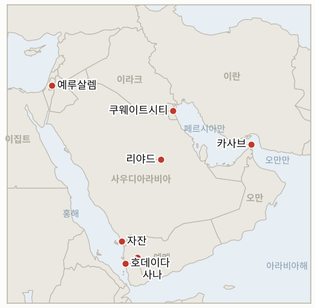

# 중동 일일 브리핑

**2026년 11월 27일**

- **보고 기간:** 약 24시간, 11월 26일 06:00 ~ 11월 27일 06:00 (한국시간)
- **종합 평가:** 목요일에는 최근 며칠 동안 주로 주장과 요격만 이어지던 두 전선에서 사망자가 나왔다. 발사체가 사우디아라비아의 자잔 정유소를 타격해 네팔인 근로자 1명이 숨지고 가동이 일부 중단됐다. 사우디 에너지부는 이를 확인했는데, 라스타누라에 대해서는 그렇게 한 적이 없다(§1.1). 쿠웨이트에서는 방공 시설에 대한 드론 공격으로 이탈리아인 기술자 2명이 숨졌다. 쿠웨이트는 이란을 지목했고 이란은 부인했다(§1.2). 호르무즈 해협에서는 영국 해사무역기구가 수요일에 유조선 한 척이 피격됐다고 확인했고, 재러드 쿠슈너는 이란 당국자들을 여러 차례 만났다고 밝혔다(§1.3). 브렌트는 연휴로 한산한 거래 속에 사흘째 올라 96.57달러에 마감했다(§1.4). 이스라엘에서는 가디 아이젠코트의 정당이 민주당과의 합의를 발표했고, 초정통파 토라 유대교 연합이 그와의 공식 협상 쪽으로 움직였다(§1.5). 서울에서는 한국은행이 기준금리를 3.25%로 올렸고, 코스피는 약 11개월 만에 가장 적은 거래대금 속에 0.29% 오른 4,711.21에 마감했으며, 원·달러 환율은 1,342.7원에 마감했다. 국회 국방위원회는 청해부대 동의안을 의결했다. 종합하면, 미국과 이란은 여전히 서로를 직접 타격하지 않았지만 유럽 국가 하나가 걸프에서 사망자를 냈고, 사우디 정유소 한 곳이 일부 멈췄으며, 유가는 세 거래일 사이에 7.20달러를 되찾았다.

---

## 1. 무슨 일이 있었나

<figure style="float:right; width:46%; margin:2pt 0 8pt 14pt;">

<figcaption style="font-size:8pt; color:#666; text-align:center; margin-top:3pt; font-style:italic;">주요 논의 지점</figcaption>
</figure>

### 1.1 자잔 정유소 피격으로 근로자 1명 사망, 일부 가동 중단

사우디 국영 통신 SPA는 목요일 에너지부 당국자를 인용해, 예멘 국경에 가까운 홍해 연안 자잔의 정유소에 발사체가 떨어졌다고 전했다. 발표문은 "이 공격으로 네팔인 근로자 1명이 숨지고 여러 국적의 근로자 여러 명이 다쳤다"고 밝혔다. 화재가 났다가 진화됐고, 피해를 조사하는 동안 일부 가동이 일시 중단됐다. 에너지부는 공격 주체를 밝히지 않았고 부상자 수도 공개하지 않았다([Arab News](https://www.arabnews.com/saudi-arabia/houthi-attack-on-saudi-arabias-jazan-refinery-kills-nepali-worker-3014153); [Middle East Monitor](https://www.middleeastmonitor.com/20261126-worker-killed-several-others-injured-in-attack-on-saudi-arabias-jazan-oil-refinery/)). 사우디 주도 연합군은 후티가 정유소를 타격했으며, 공격에 쓰인 호데이다의 탄도미사일 발사대를 파괴했다고 밝혔다. 투르키 알말리키 대변인은 민간인에 대한 공격에 "단호한 군사적 대응"을 하겠다고 했다. 보고 기간이 끝날 때까지 자잔 정유소에 대한 후티의 주장은 찾지 못했다. 사우디 아람코가 소유한 이 정유소는 하루 최대 40만 배럴을 처리하도록 설계됐다. 수요일 자정 무렵에는 연합군이 리야드를 겨냥한 탄도미사일 2기를 파괴했다고 밝혔고, 리야드 주민들과 AFP 기자가 폭발음을 들었다. 후티 매체는 밤사이 사우디가 사나를 공습했다고 보도했으나 AP는 이를 확인하지 못했다. 파키스탄 국방장관은 사우디, 튀르키예, 파키스탄이 이슬라마바드에서 만나 예멘 문제를 논의할 것이라고 말했다([Gulf News live](https://gulfnews.com/world/mena/middle-east-conflict-saudi-arabia-intercepts-missiles-and-drones-as-trump-keeps-iran-options-open-1.500761343)). 아람코와 사우디 정부는 수요일 후티가 주장한 라스타누라 타격에 대해 여전히 언급하지 않고 있다. **신뢰도: 자잔의 사망과 일부 가동 중단은 높음(사우디 국영 매체); 후티 소행이라는 판단은 중간~높음(연합군 발표, 후티 주장은 찾지 못함); 사나 공습은 중간.**

### 1.2 쿠웨이트에서 드론 공격으로 이탈리아인 기술자 2명 사망

쿠웨이트 육군은 목요일 이란의 드론 공격이 "핵심 시설"을 겨냥했고, 쿠웨이트군이 적 드론 여러 대에 대응했으며, 떨어진 파편에 이탈리아인 2명, 파키스탄인 1명, 쿠웨이트인 1명 등 4명이 다쳤다고 밝혔다. 국방부는 이후 이탈리아인 2명이 숨졌다고 발표했다. 이탈리아 외무부는 두 사람이 방공 체계를 정비하던 라인메탈 이탈리아 소속 기술자라고 밝혔고, 안토니오 타야니 외무장관은 이란제 드론 여러 대가 그 체계를 겨냥했다고 말했다. 조르자 멜로니 총리는 "깊은 슬픔"을 표했다([ABC News live](https://www.goodmorningamerica.com/news/live-updates/iran-live-updates-tehran-strait-hormuz-safe-demands-138369648); [The New Arab](https://www.newarab.com/news/iran-denies-deadly-kuwait-attack-houthis-target-saudi-refinery)). 이란은 두 차례 공격을 부인했다. 아볼파즐 셰카르치 이란군 대변인은 IRNA에 이란이 역내에서 "군사적이거나 공세적인 작전"을 한 적이 없다고 말하고, 이스라엘과 미국의 "위장 작전"이라고 주장했다. 아바스 아라그치 외무장관은 쿠웨이트 외무장관에게 이란이 공격의 배후가 아니라고 말하고 조사에 참여하겠다고 제안했다. 우르줄라 폰데어라이엔 유럽연합 집행위원장은 이란에 대한 압박을 강화해야 한다고 촉구했다. 이번 공방 국면에서 유럽인이 걸프 영토에서 숨졌다는 기록은 이 브리핑에 이전까지 없다. 이란 육군은 11월 18일 쿠웨이트 알리 알살렘 기지의 미군 방공망을 공격했다고 공개적으로 밝힌 바 있어, 이번의 부인 자체가 변화다. **신뢰도: 사망 사실과 쿠웨이트가 이란을 지목했다는 점은 높음; 누가 드론을 쏘았는지는 낮음~중간(제3자가 규명한 바 없음).**

### 1.3 UKMTO, 카사브 인근 유조선 피격 확인; 쿠슈너는 이란과의 회동을 확인

영국 해사무역기구(UKMTO)는 수요일 아랍에미리트 시간 17시께 오만 카사브 동쪽 약 18해리에서 출항 중이던 유조선 한 척이 미상의 발사체에 맞았다고 밝혔다. 선원은 모두 안전이 확인됐고 오염은 보고되지 않았다. 이란 혁명수비대는 같은 날의 일로 보이는 사건을 다르게 설명했다. 이란의 허가 없이 항해하던 유조선 2척이 카사브 북쪽에서 "기뢰에 닿아" 불이 났고, 그 가운데 한 척은 원유 200만 배럴 이상을 실은 초대형 유조선이라는 것이다. 이 주장은 독립적으로 확인되지 않았고, 두 설명은 선박 수와 무기가 서로 다르다. ADNOC는 11월 17일 해협에서 자사 선박이 공격받은 뒤 실종됐던 요르단인 선원이 숨진 채 발견됐다고 밝혔다. AIS 기반 집계 한 곳은 수요일 해협을 지난 상선을 6척으로 기록했다([hormuz.now](https://hormuz.now/traffic)). 외교 쪽에서는 재러드 쿠슈너가 목요일 공개된 팟캐스트 인터뷰에서 "밴스 부통령 아래에서" 일하며 이란 대표들을 여러 차례 만났다고 밝히고, "트럼프 대통령은 언제나 모든 선택지를 테이블 위에 둔다"고 말했다([Dawn](https://www.dawn.com/news/2047164/kushner-confirms-talks-with-iranian-officials-says-trump-keeping-all-options-on-the-table)). 아라그치는 카타르와 파키스탄 중재자들이 여전히 테헤란과 워싱턴 사이에서 메시지를 전하고 있다고 말했다. 에피 데프린 이스라엘군 대변인은 이스라엘이 미국 없이도 "언제든" 이란을 타격할 준비가 돼 있다고 했고, 미국의 한 연구소는 이스파한 인근에서 지하 시설이 이례적으로 빠르게 건설되고 있다고 보고했다([Times of Israel](https://www.timesofisrael.com/liveblog-november-26-2026/)). 미국과 이란이 서로를 타격했다는 보도는 없었다. **신뢰도: UKMTO 공지와 쿠슈너의 발언은 높음; 기뢰 주장과 초대형 유조선 관련 내용은 낮음; 통항 집계는 중간~낮음.**

### 1.4 브렌트 96.57달러 마감, 사흘 연속 상승

브렌트는 목요일 유럽 오전장에서 내렸다가(09:39 GMT 기준 93.79달러) 1.96달러 오른 96.57달러에 마감했다. 월요일 종가 89.37달러보다 7.20달러 높다. WTI는 미국 추수감사절 휴일로 정산가가 나오지 않았고, 18:21 GMT 기준 1.16달러 오른 84.84달러였다. 통신 기사는 상승 요인으로 라스타누라 주장과 혁명수비대의 기뢰 주장을 들었고, 자잔과 쿠웨이트 소식은 장중에 전해졌다. Price Futures Group의 필 플린은 "이 때문에 시장이 연휴를 앞두고 긴장을 늦추지 못하고 있다"고 말했다. Commodity Context의 로리 존스턴은 브렌트가 90달러 아래로 내려갔을 때 시장이 "과매도" 상태였다고 했고, 호르무즈 통항 둔화, 낮은 재고, 세계 공급의 약 15%에 대한 "알려진 급성 위험"을 근거로 들었다([Reuters via Yahoo Finance](https://finance.yahoo.com/energy/articles/oil-rises-supply-concerns-iran-030849858.html)). Morgan Stanley는 해협을 우회하는 경로를 포함한 중동 원유 수출이 지난주 하루 약 1,530만 배럴이었다고 추정했다. OPEC+ 소식통 두 명은 장관들이 일요일 회의에서 현재의 생산 목표를 적어도 2027년 1분기까지 유지할 수 있다고 말했다. 연휴로 거래량이 적어 가격 변동이 어느 방향으로든 커지기 쉬웠고, 미국 시장은 금요일에 단축 거래를 한다. **신뢰도: 브렌트 종가는 높음(1.96달러 상승폭이 수요일 종가 94.61달러와 맞음); 확보한 통신 기사 본문의 등락률 1.2%는 산술상 약 2.1%와 맞지 않아 여기서는 달러 수치만 쓴다.**

### 1.5 아이젠코트, 민주당과 합의; 초정통파는 협상 쪽으로

가디 아이젠코트의 야샤르와 야이르 골란의 민주당은 목요일 연정 합의에 이르렀다고 발표했다. 민주당이 야샤르와 리쿠드의 협상을 이유로 대화를 중단한 지 이틀 만이다. 민주당은 확대된 국가안보부, 노동복지부, 통신부, 문화체육부 등 네 개 부처를 맡는다. 크네세트 헌법위원회 위원장과 법관선정위원회 위원 자리도 갖는다. 합의에는 "사법 개편을 전면 폐지한다는 약속"이 들어 있으며, 서명에 앞서 세부 사항을 조율하고 있다([Times of Israel](https://www.timesofisrael.com/eisenkot-edges-closer-to-government-as-his-party-announces-coalition-deal-with-democrats/)). 이날 밤늦게 토라 유대교 연합(UTJ)의 원로 랍비 도브 란도와 모셰 힐렐 히르슈가 아이젠코트와의 공식 협상 개시를 승인한 것으로 전해졌고, 공영방송 칸은 병역법의 원칙에 합의가 이뤄졌다고 보도했다. 입대 할당을 없애고, 예시바 학생에 대한 감독을 강화하며, 새 복무 경로를 만든다는 내용이다. 이 당은 각료직을 논의했다는 보도를 부인했고, 당 대표는 주말 동안 히르슈 랍비의 승인을 받아야 한다. 소속 의원 네 명은 일요일에 변호사와 함께 협상을 준비할 예정이다. 아이젠코트는 이르면 다음 주에 정부를 출범시키는 것을 목표로 하며, 의원 약 55명에 아랍계 정당의 외부 지지를 더한 구성이 거론된다. 나프탈리 베네트는 아이젠코트와의 회동을 취소했고, 네타냐후 측근들과 접촉한 사실을 확인했으며, 초정통파와 아랍계 정당에 기대는 정부를 "더 나쁜 대안"이라고 불렀으나 배제하지는 않았다. 야샤르와 리쿠드의 5차 협상은 보도되지 않았다. 한편 이스라엘 카츠 국방장관은 하마스가 무장해제하지 않으면 "가자 주민 100만 명"을 이주시키는 새 가자 공세에 나서겠다고 위협했고, 이스라엘 공군은 레바논 베카 계곡에서 군이 라드완 부대 훈련장이라고 밝힌 곳을 타격했다. **신뢰도: 합의 발표는 높음; 랍비들의 승인과 병역법 원칙은 중간(단일 매체 보도); 55석이라는 수치는 중간.**

---

## 2. 심층 분석: 유인과 동기

### 2.1 리야드는 왜 라스타누라에는 침묵하면서 자잔 피격은 확인했나?

자잔은 숨길 수 없었고 라스타누라는 아직 관리할 수 있기 때문이다. 외국인 근로자가 숨지고, 여러 국적의 직원이 다치고, 예멘 국경에서 멀지 않은 정유소에 불이 났다면 각국 대사관과 협력 업체가 몇 시간 안에 알게 된다. 그래서 에너지부가 먼저, 자신의 표현으로 발표했다. 발사체가 떨어졌고, 불은 꺼졌으며, "일부" 가동이 일시 중단됐다는 것이다. 자잔은 주로 내수용 제품을 생산하므로 이곳이 멈춰도 수출 계약이 위태로워지지 않는다. 라스타누라는 다르다. 사우디의 주된 수출 통로여서, 그곳의 피해를 공식 확인하는 순간 보험료와 구매자의 계획이 곧바로 움직인다. 화물 선적이 이어지는 한 그곳에서는 솔직함보다 침묵의 비용이 적다. 연합군 발표는 후티를 향한 것이었다. 발사 지점으로 호데이다를 지목하고 그곳을 타격해, 항만에는 항만으로 답하는 구도를 유지했다. 후티는 보고 기간 안에 자잔 공격을 주장하지 않았다. 후티로서는 드문 일인데, 효과를 노려 발표를 미루고 있거나, 아시아인 근로자의 죽음이 그들이 원한 메시지가 아니었을 수 있다.

### 2.2 쿠웨이트 공격으로 누가 이익을 얻고, 이란은 왜 부인하나?

이란은 지난주 알리 알살렘 타격을 자신이 했다고 밝혔고 바레인에 대한 공격도 주장해 왔다. 이번에는 군과 외무장관이 몇 시간 안에 모두 책임을 부인했고, 외무장관은 공동 조사까지 제안했다. 차이는 희생자에 있다. 이탈리아인이 숨지면 미국의 작전과 거리를 둬 온 유럽 정부가 끌려 들어오고, 폰데어라이엔의 압박 강화 촉구가 그 비용을 보여 준다. 드론이 이란의 것이라면, 이전 공격처럼 방공 시설이 표적이었고 그 자리에 민간 기술자가 있으리라고 예상하지 못했다는 해석이 가장 그럴듯하다. 그렇다면 부인은 피해 수습이다. 이란의 설명이 사실이라면 다른 누군가가 이란제 드론을 쓴 것인데, 이라크 민병대도 그런 드론을 갖고 있다. 쿠웨이트는 동맹국의 방공 지원을 더 받고자 하므로 이란을 지목할 유인이 있고, 로마는 대응을 정하기 전에 사실관계를 규명할 유인이 있다. 어느 쪽이든 실질적인 결과는 같다. 걸프의 방공망을 유지하는 유럽 기술 인력이 위험에 노출돼 있다는 점이 드러났고, 이탈리아는 이들을 철수시킬지 보강할지 선택해야 한다.

### 2.3 쿠슈너는 왜 지금 이란과의 회동을 공개하나?

수요일에 트럼프는 전쟁 자금이 1월까지 확보돼 있다고 말했고 NBC는 이란 지도자 살해 논의를 보도했다. 목요일에는 그의 사위가 대화가 줄곧 이어져 왔고 모든 선택지가 열려 있다고 말했다. 두 메시지는 서로 맞물린다. 채널을 공개하면 테헤란과 석유 시장에 출구가 있으며 그 출구를 부통령 아래 최고위급이 맡고 있다는 신호가 간다. 워싱턴에 외교 경로가 없다고 비판하는 국내와 유럽의 목소리에 대한 답이기도 하다. 같은 날 카타르와 파키스탄이 여전히 메시지를 전한다고 한 아라그치의 말은, 이란에 아무 의무도 지우지 않으면서 반대편에서 그 채널을 확인해 준다. 쿠슈너의 두 번째 주제, 곧 이스라엘이 "전시 사고방식"에서 벗어나야 한다는 말은 이스라엘군 대변인이 단독으로도 이란을 칠 수 있다고 말하는 시점에 예루살렘을 향한 것이다. 워싱턴은 이스라엘에는 새 타격의 시기를 미국이 정한다고, 이란에는 제안에 기한이 있다고 말하고 있다.

### 2.4 아이젠코트는 왜 초정통파보다 민주당과 먼저 합의했나?

목요일 전까지 아이젠코트는 리쿠드와의 협상을 자기 진영 우군의 요구를 낮추는 데 썼고, 민주당은 그 때문에 협상장을 떠났다. 두 가지가 바뀌었다. 토라 유대교 연합의 랍비들이 공식 협상 쪽으로 움직여 약 55석에 외부 지지를 더하는 길이 열렸고, 베네트가 네타냐후 측과 따로 접촉해 온 사실이 공개되면서 통합 정부 경로가 지렛대라기보다 자기 진영에 대한 위험으로 보이게 됐다. 민주당과 먼저 서명하면 가장 어려운 흥정이 시작되기 전에 왼쪽 측면이 고정된다. 그 값은 합의문에 드러나 있다. 사법 개편 폐지 약속과 골란의 당에 돌아간 국가안보부는 둘 다 리쿠드와의 합의를 거의 불가능하게 만든다. 초정통파의 값도 오른다. 이들은 이미 민주당 소속 교육부 장관 후보를 거부했고, 병역법이 자신들에게 유리하게 정리되기를 원할 것이다. 남은 변수는 베네트다. 그는 떠오르는 정부를 "더 나쁜 대안"이라고 부르면서도 자기 당은 이탈하지 않겠다고 한다. 표결 때까지 네타냐후가 공략할 여지는 베네트 당의 의원들에게 있다는 뜻이다.

---

## 3. 한국에 대한 정책적 함의

**익스포저 현황:** 한국은 원유의 약 70.7%, LNG의 20.4%를 중동에서 들여온다(`instructions/korea-exposure.md`, 갱신 불필요). 목요일 브렌트는 96.57달러에 마감했고 WTI는 정산가가 없다. 한국은행 금융통화위원회(금통위)는 목요일 오전 기준금리를 0.25%포인트 올려 3.25%로 정했다. 올해 세 번째 인상이고 약 2년 만에 가장 높은 수준이다. 위원 7명 가운데 5명이 인상에 찬성했고, 황건일·이수형 위원은 3.00% 동결을 주장하는 소수의견을 냈다. 한은은 성장률 전망을 8월의 올해 3.3%, 내년 2.9%에서 3.9%, 4.1%로 올렸고, 금리 전망의 상단은 3.50%에서 3.75%로 높아졌다. 한은은 물가가 상당 기간 목표치 2%를 웃돌 것이며 물가 경로가 국제유가와 환율 움직임에 달려 있다고 밝혔다. 국내 언론은 수요 측 물가 압력의 원인으로 중동 전쟁 장기화에 따른 고유가와 반도체 호황에 따른 소득 증가를 들었다([이투데이](https://www.etoday.co.kr/news/view/2652786); [파이낸셜뉴스](https://www.fnnews.com/news/202611261105330549)). 코스피는 13.70포인트(0.29%) 오른 4,711.21에 마감했다. 4,745.10에 출발해 4,817.77까지 올랐으나 금리 결정 뒤 상승분을 대부분 내줬다. 거래대금은 12조 2,800억 원으로 정규장 기준 지난해 12월 24일 이후 가장 적었다. 외국인은 1,120억 원, 개인은 1조 400억 원을 순매도했고 기관은 7,529억 원을 순매수했다. 삼성전자는 0.35%, SK하이닉스는 2.23% 올랐다([폴리뉴스](https://www.polinews.co.kr/news/articleView.html?idxno=749335)). 원·달러 환율은 0.5원 내린 1,342.7원에 마감했고 장중 1,339.3원까지 내렸다. 금리 인상과 수출업체의 달러 매도가 원화를 받쳤고, 금요일 삼성전자 배당금 지급을 앞둔 달러 수요가 하락폭을 제한했다. 국회 국방위원회는 목요일 여야 합의로 청해부대 동의안을 의결했다. 동의안은 작전 구역을 아덴만에서 호르무즈 해협과 약 650km 떨어진 오만 남방 외해까지 넓히고, 해상초계기 1대와 무인 소해장비, 폭발물처리반(EOD)을 추가 배속하며, 파견 기간을 2027년 12월 31일까지로 한다. 부대의견은 세 가지를 담았다. 특정 국가 간 전쟁이나 군사적 분쟁에 개입하지 않고 장병 안전을 우선할 것, 자위권 원칙을 지킬 것, 외교적 마찰을 방지할 것이다. 진성준 국방위원장이 각 항목을 강신철 국방부 장관에게 읽어 주며 확인했고, 장관은 세 가지를 모두 수용했다. 부대의견에는 호르무즈 해협 진입 때 국회의 별도 동의를 받아야 한다는 요건이 없다. 조국혁신당은 부대의견이 정부를 법적으로 구속하지 못한다고 비판했고, 진보당은 본회의 처리를 멈추라고 요구했으며, 국회에서는 대학생들의 기습 시위가 있었다. 아랍에미리트 아크부대의 파견을 1년 연장하는 동의안은 원안대로 의결됐다([아이뉴스24](https://m.inews24.com/v/2030971); [헤럴드경제](https://biz.heraldcorp.com/article/10950691)). 이제 본회의 표결만 남았다.

**사안별 함의:**

- **자잔과 사우디 홍해 연안 (§1.1):** 자잔은 한국행 원유의 선적항이 아니지만, 리야드가 스스로 사망과 가동 중단을 확인한 사우디 석유 시설이다. 라비그와 라스타누라에 대해서는 그런 확인이 없었다. 같은 미사일이 한국이 호르무즈를 피하려고 쓰는 출구인 얀부와 지다에 닿는다. 12월에 홍해에서 선적할 물량이 있는 정유사는 지금 아람코에 선적 일정을 확인하고, 터미널이 피격되면 회사가 무엇을 알려 줄지 물어야 한다 (IND-20261127-1, IND-20261126-2, IND-20261126-1).
- **쿠웨이트 (§1.2):** 쿠웨이트는 한국에 원유를 공급하고, 한국 건설·플랜트 인력이 그곳에서 일한다. 이번 공격은 석유 시설이 아니라 방공 시설을 겨냥했지만, 방어 대상 시설에서 일하는 외국인 기술 인력이 위험에 노출돼 있음을 보여 준다. 쿠웨이트의 산업·군사 시설에서 일하는 한국인 근로자에 대한 외교부의 안전 지침을 이번 주에 점검해야 한다 (IND-20261127-2, IND-20261123-2).
- **호르무즈와 외교 (§1.3):** UKMTO는 11월 22일, 23일, 25일에 선박 피격을 보고했고, AIS 기준 통항 수는 한 자릿수에 머문다. 쿠슈너의 회동 공개는 위험을 낮출 수 있는 경로가 있다는, 한 주 만의 첫 신호다. 다만 회담이 발표되기 전까지는 화물 계획을 바꿀 근거가 되지 않는다 (IND-20261122-1, IND-20260714-4).
- **유가 (§1.4):** 브렌트는 월요일 종가보다 7.20달러 높고, 이 브리핑이 추적해 온 95달러 선을 넘었다. 90달러 아래에서 물량을 확보할 수 있던 구간은 세 거래일 만에 닫혔다. OPEC+가 일요일에 목표를 그대로 둘 것으로 예상되는 만큼, 다음 가격 변수는 걸프 자체다 (IND-20261124-1, IND-20261127-1).
- **한국은행 (익스포저 현황):** 한은은 물가 경로를 좌우할 두 변수로 유가와 환율을 꼽았다. 둘 다 서울 못지않게 걸프에서 정해진다. 브렌트가 95달러 위에 머물면 인상에 찬성한 위원 다섯 명의 논거가 강해지고 전망 상단의 3.75%가 현실에 가까워진다. 기준금리가 높아지면 원유 수입이 만들어 내는 달러 수요에 맞서 원화를 받치는 효과도 있다 (IND-20261127-3, IND-20261124-3).
- **이스라엘 (§1.5):** 다음 주에 리쿠드 없는 정부가 출범하면, 워싱턴이 이란에 대한 자체 결정 시기로 정해 둔 몇 주 사이에 임기를 시작하게 된다. 국방부와 국가안보부 장관은 네타냐후의 전쟁 수행에 반대하며 선거를 치른 정당에서 나오게 되고, 그만큼 미국의 동의 없는 이스라엘의 타격 가능성은 낮아진다 (IND-20261126-3, IND-20261125-3, IND-20261123-3).
- **청해부대 (익스포저 현황):** 국방위는 월요일에 제안된 별도 동의 조항이 아니라 원칙을 채택했다. 따라서 부대를 호르무즈 쪽으로 옮기는 데 대한 제한은 동의안에 적힌 구역, 장관이 회의록에 남긴 부대의견 수용, 대통령의 발언에 달려 있다. 소해장비와 폭발물처리반이 배속되면 청해부대는 동맹국이 해협에서 도움을 요청할 때 필요로 할 능력을 갖추게 된다. 정부는 본회의 표결 전에 그런 요청에 어떻게 답할지 정해 둬야 한다 (IND-20261112-1).

**오늘 종결:**

- **IND-20261023-1: 확증.** 한국은행은 11월 26일 5대 2로 기준금리를 3.25%로 올렸다. 10월의 전망과 설문 조사가 맞았다.
- **IND-20261122-3: 확증.** 브렌트는 시한 하루 전인 11월 26일 95달러를 넘는 96.57달러에 마감했다. 사우디 석유 시설에 대한 공격 이후 시장이 걸프 위험을 다시 가격에 반영하고 있다.
- **IND-20261124-2: 반증.** 국방위는 11월 26일 세 가지 원칙의 부대의견을 붙여 동의안을 의결했고, 호르무즈 해협 진입에 대한 별도 동의 요건은 들어가지 않았다. 11월 23일 여당이 낸 제안은 야당과의 절충에서 살아남지 못했다.
- **IND-20261119-1: 반증.** 시한인 11월 26일께까지 이란 영토나 병력에 대한 미국의 2차 타격은 공개되지 않았다. 케슘 타격은 계속되는 공방으로 이어지지 않았고, 워싱턴은 한 주 동안 이어진 이란의 공격에 경고와 1월이라는 자금 시한 언급으로 답했다.
- **IND-20261119-3: 반증.** 원·달러 환율은 11월 26일까지 어느 거래일에도 1,325원 아래에서 마감하지 않았다. 11월 19일 이후 종가는 1,333.0원에서 1,345.9원 사이였다. 11월 19일에 보인 원화 강세는 이어지지 않았다.

**검증 가능한 지표:**

- **IND-20261127-1** (진행, 신규): 2026년 12월 4일께까지 사우디 당국이 사우디 정유소나 석유 터미널에서 피해나 사상자를 낸 추가 공격을 발표하면 사우디 에너지 시설에 대한 공세가 반복해서 방공망을 뚫고 있는 것으로 확증; 없으면 반증.
- **IND-20261127-2** (진행, 신규): 2026년 12월 4일께까지 쿠웨이트 정부가 자국 영토에서 사상자를 낸 추가 드론 또는 미사일 공격을 발표하면 11월 26일 공격이 일회성이 아닌 것으로 확증; 없으면 반증.
- **IND-20261127-3** (진행, 신규): 2026년 12월 4일께까지 어느 거래일이든 원·달러 환율이 15시 30분 종가 기준 1,330원 아래에서 마감하면 유가 상승에도 금리 인상이 원화를 강하게 하고 있는 것으로 확증; 없으면 반증.
- **IND-20261126-1** (진행): 라스타누라에 대한 아람코나 사우디 정부의 발표 없음; 자잔 관련 발표는 해당하지 않음.
- **IND-20261126-2** (진행): 보고 기간 중 지다나 얀부에서 보고된 것 없음; 자잔 정유소는 정의 밖.
- **IND-20261126-3** (진행): 토라 유대교 연합의 랍비들이 공식 협상을 승인한 것으로 전해짐; 당은 합류를 발표하지 않았고 각료직 논의를 부인.
- **IND-20261125-1** (진행): 리야드를 겨냥한 탄도미사일 2기가 요격됐고 폭발음이 들림; 건물 피격 보도 없음.
- **IND-20261125-3** (진행): 야샤르와 리쿠드의 5차 협상 보도 없음; 야샤르와 민주당의 합의에 사법 개편 폐지가 포함됨.
- **IND-20261124-1** (진행): 브렌트 96.57달러 마감으로 85달러 기준선을 크게 웃돎.
- **IND-20261124-3** (진행): 원·달러 1,342.7원 마감으로 1,360원 기준선 아래.
- **IND-20261123-1** (진행): 라비그 관련 발표 없음.
- **IND-20261123-2** (진행): 쿠웨이트가 방공 시설에 대한 드론 공격의 주체로 이란을 지목했으나 석유·가스 시설이 아니고 이란은 부인; 해당하지 않음.
- **IND-20261123-3** (진행): 크네세트 표결을 요청하는 공식 절차는 아직 없음; 아이젠코트는 다음 주 정부 출범을 목표로 함.
- **IND-20261122-1** (진행): 이란 유조선이 저지됐다거나 유조선들이 봉쇄선을 통과했다는 보도 없음.
- **IND-20261122-2** (진행): 바레인에 대한 새 공격 보도 없음.
- **IND-20261120-1** (진행): 카타이브 헤즈볼라가 주르프 알사카르를 떠났다는 발표 없음; 시한은 11월 27일께.
- **IND-20261114-1** (진행): 호르무즈 연안 너머에 대한 미국이나 이스라엘의 타격 없음; 이스라엘군은 언제든 준비돼 있다고 발언; 시한은 11월 27일께.
- **IND-20261112-1** (진행): 국방위가 11월 26일 동의안을 의결; 본회의 표결이 남음.
- **IND-20261116-2** (진행): 바브엘만데브 인근에서 후티가 상선을 공격했다는 UKMTO나 JMIC 보고 없음.
- **IND-20261117-1** (진행): 후티 병력이 아덴 50km 이내에 있다는 보도를 찾지 못함.
- **IND-20260714-4** (진행): 보고 기간 중 라스라판 선적에 관한 새 수치 없음.
- **IND-20261113-2, IND-20261114-3, IND-20261115-2** (진행): 변동을 찾지 못함; `tracking/indicators.md` 참조.

---

## 4. 관찰 목록

- **자잔 정유소 가동 중단의 범위와 기간, 후티의 주장 여부, 연합군의 "단호한" 대응 (IND-20261127-1).**
- **라스타누라에 대한 아람코의 발표 (IND-20261126-1), 그리고 얀부나 지다가 피격되는지 (IND-20261126-2).**
- **쿠웨이트에서의 사망에 대한 이탈리아의 대응, 쿠웨이트가 받아들이는 조사, 그곳에 대한 추가 공격 (IND-20261127-2).**
- **혁명수비대가 카사브 북쪽에서 기뢰에 닿았다고 한 유조선들에 대한 독립적인 확인.**
- **쿠슈너의 공개 이후 미국과 이란의 회담 발표 여부, 그리고 호르무즈 연안 너머 타격에 관한 금요일 시한 (IND-20261114-1).**
- **금요일의 단축 거래와 11월 29일 일요일 OPEC+ 회의 (IND-20261124-1).**
- **주말 사이 히르슈 랍비의 결정, 야샤르와 민주당 합의의 서명, 베네트 당 의원들 (IND-20261126-3, IND-20261123-3, IND-20261125-3).**
- **카츠의 새 가자 공세 위협과 이스라엘의 베카 계곡 공습.**
- **이슬라마바드에서 열릴 사우디, 튀르키예, 파키스탄의 예멘 관련 회의.**
- **금요일 삼성전자 배당금과 금리 인상 이후의 원·달러 환율 (IND-20261127-3, IND-20261124-3).**
- **청해부대 동의안의 본회의 표결 일정 (IND-20261112-1).**

---

## 5. 출처 신뢰도 요약

| 주장 | 출처 | 신뢰도 |
| --- | --- | --- |
| 발사체가 자잔 정유소를 타격해 네팔인 근로자 1명 사망, 여러 명 부상, 화재와 일부 가동 일시 중단 | 사우디 에너지부 via SPA (Arab News, Middle East Monitor, Gulf News) | 높음 |
| 후티가 호데이다의 발사대에서 자잔을 공격했고 연합군이 그 발사대를 파괴 | 사우디 주도 연합군 via Reuters (Gulf News); 후티 주장은 찾지 못함 | 중간~높음 |
| 리야드를 겨냥한 탄도미사일 2기 파괴; 폭발음 | 연합군, AFP via Gulf News | 높음 |
| 밤사이 사우디의 사나 공습 | Al-Masirah via AP (Gulf News) | 중간 |
| 라스타누라에 대한 아람코나 사우디 정부의 발표 없음 | 통신사와 걸프 언론 검색 | 중간 |
| 쿠웨이트 "핵심 시설"에 대한 드론 공격; 이탈리아인 2명 사망, 파키스탄인과 쿠웨이트인 각 1명 부상 | 쿠웨이트 육군과 국방부 via ABC News, Gulf News | 높음 |
| 사망자는 방공 체계를 정비하던 라인메탈 이탈리아 기술자 | 이탈리아 외무부, 타야니 via The New Arab, Gulf News | 높음 |
| 쿠웨이트 공격은 이란의 소행 | 쿠웨이트 당국; 셰카르치(IRNA)와 아라그치는 부인 | 낮음~중간 |
| 11월 25일 카사브 동쪽 18해리에서 출항 유조선이 미상의 발사체에 피격 | UKMTO via Gulf News | 높음 |
| 유조선 2척이 카사브 북쪽에서 기뢰에 닿았고 한 척은 200만 배럴 넘게 실은 초대형 유조선 | 혁명수비대 via Fars, Reuters | 낮음 |
| 11월 17일 공격받은 ADNOC 선박의 요르단인 선원이 숨진 채 발견 | ADNOC via Gulf News | 높음 |
| 11월 25일 호르무즈를 지난 AIS 송출 상선 6척 | hormuz.now | 중간~낮음 |
| 쿠슈너: 이란 대표들을 여러 차례 만남; "모든 선택지가 테이블 위에" | MD Meets 팟캐스트 via Dawn, Gulf News | 높음 |
| 아라그치: 카타르와 파키스탄 중재자가 여전히 메시지를 전달 | Times of Israel | 중간~높음 |
| 데프린: 이스라엘은 필요하면 미국 없이도 언제든 이란을 타격할 준비가 돼 있음 | Gulf News | 중간~높음 |
| 이스파한 인근 지하 시설의 빠른 건설 | 미국 소재 연구소 via Times of Israel | 중간 |
| 브렌트 96.57달러(+1.96달러) 마감; WTI는 정산가 없음, 18:21 GMT 기준 84.84달러 | Reuters via Yahoo Finance; 수요일 종가와 일치 | 높음 |
| OPEC+가 2027년 1분기까지 생산 목표를 유지할 수 있음 | 소식통 2명 via Reuters | 중간 |
| 야샤르와 민주당이 연정 합의: 네 개 부처, 사법 개편 폐지 | 정당 발표 via Times of Israel | 높음 |
| UTJ 랍비들이 공식 협상을 승인; 병역법 원칙 합의 | Times of Israel, 칸 | 중간 |
| 베네트가 아이젠코트와의 회동을 취소하고 네타냐후 측근과의 접촉을 확인 | Times of Israel, Ynet, Haaretz | 중간~높음 |
| 한국은행이 5대 2로 기준금리를 3.25%로 인상; 성장률 전망 3.9%, 4.1% | 이투데이, 파이낸셜뉴스, 한국경제TV | 높음 |
| 코스피 4,711.21(+0.29%), 거래대금 12조 2,800억 원; 원·달러 1,342.7원 | 폴리뉴스, 직썰 | 높음 |
| 국방위가 세 항목의 부대의견을 붙이고 별도 동의 조항 없이 청해부대 동의안을 의결 | 아이뉴스24, 헤럴드경제, 데일리안 | 높음(의결); 중간~높음(문구는 언론 요약 기준) |
