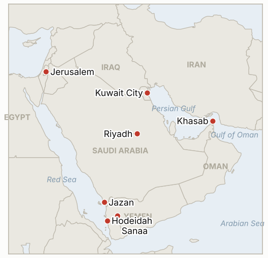

# Middle East Daily Briefing

**November 27, 2026**

- **Reporting window:** ~24 hours, November 26, 06:00 to November 27, 06:00 KST
- **Overall assessment:** Thursday brought deaths in two campaigns that had in recent days produced mostly claims and interceptions. A projectile hit Saudi Arabia's Jazan refinery, killed a Nepali worker and forced a partial shutdown; the Saudi energy ministry confirmed it, which it has not done for Ras Tanura (§1.1). In Kuwait a drone attack on an air defence site killed two Italian technicians; Kuwait blamed Iran and Iran denied it (§1.2). In the Strait of Hormuz the UK maritime agency confirmed that a tanker was hit on Wednesday, and Jared Kushner said he has met Iranian officials several times (§1.3). Brent rose for a third session to settle at $96.57 in thin holiday trade (§1.4). In Israel, Gadi Eisenkot's party announced a deal with the Democrats and the ultra-Orthodox United Torah Judaism moved toward formal talks with him (§1.5). In Seoul the Bank of Korea raised its base rate to 3.25%, the KOSPI closed up 0.29% at 4,711.21 on the lowest turnover in about 11 months, and the won closed at 1,342.7 per dollar. The National Assembly's defence committee approved the Cheonghae Unit motion. Net: the United States and Iran still have not struck each other directly, but a European country now has dead in the Gulf, a Saudi refinery is partly shut, and oil has regained $7.20 in three sessions.

---

## 1. What Happened

<figure style="float:right; width:46%; margin:2pt 0 8pt 14pt;">

<figcaption style="font-size:8pt; color:#666; text-align:center; margin-top:3pt; font-style:italic;">Major places of discussion</figcaption>
</figure>

### 1.1 A strike on the Jazan refinery kills a worker and halts some operations

The Saudi Press Agency, citing an energy ministry official, said on Thursday that a projectile hit the oil refinery in Jazan, on the Red Sea coast near the Yemeni border. "The attack killed a Nepali worker and injured several others of different nationalities," the statement said. A fire broke out and was put out, and some operations were halted temporarily while crews assessed the damage. The ministry did not name the attacker or give the number of injured ([Arab News](https://www.arabnews.com/saudi-arabia/houthi-attack-on-saudi-arabias-jazan-refinery-kills-nepali-worker-3014153); [Middle East Monitor](https://www.middleeastmonitor.com/20261126-worker-killed-several-others-injured-in-attack-on-saudi-arabias-jazan-oil-refinery/)). The Saudi led coalition said the Houthis struck the refinery and that it destroyed a ballistic missile launch platform in Hodeidah used in the attack; spokesman Turki al-Malki promised a "firm military response" to attacks on civilians. No Houthi claim for the Jazan refinery was found by the end of the window. The refinery, owned by Saudi Aramco, is designed to process up to 400,000 barrels a day. Around midnight on Wednesday the coalition also said it destroyed two ballistic missiles aimed at Riyadh, where residents and an AFP journalist heard an explosion. Houthi media reported Saudi air strikes on Sanaa overnight, which AP could not verify. Saudi Arabia, Turkey and Pakistan will discuss Yemen at a meeting in Islamabad, Pakistan's defence minister said ([Gulf News live](https://gulfnews.com/world/mena/middle-east-conflict-saudi-arabia-intercepts-missiles-and-drones-as-trump-keeps-iran-options-open-1.500761343)). Aramco and the Saudi government still have not commented on Wednesday's claimed hit at Ras Tanura. **Confidence: High on the Jazan death and partial shutdown (Saudi state media); Medium to High on the attribution to the Houthis (coalition statement, no claim found); Medium on the Sanaa strikes.**

### 1.2 A drone attack in Kuwait kills two Italian technicians

Kuwait's army said on Thursday that an Iranian drone attack targeted "a vital site," that its forces dealt with several hostile drones, and that falling shrapnel injured four people: two Italians, a Pakistani and a Kuwaiti. The defence ministry later said the two Italians had died. Italy's foreign ministry said they were technicians of Rheinmetall Italia who were maintaining an air defence system, and Foreign Minister Antonio Tajani said the system was the target of several Iranian made drones. Prime Minister Giorgia Meloni expressed her "deepest sorrow" ([ABC News live](https://www.goodmorningamerica.com/news/live-updates/iran-live-updates-tehran-strait-hormuz-safe-demands-138369648); [The New Arab](https://www.newarab.com/news/iran-denies-deadly-kuwait-attack-houthis-target-saudi-refinery)). Iran denied the attack twice. Armed forces spokesman Abolfazl Shekarchi told IRNA that Iran had carried out no "military or offensive operations" in the region and blamed a "false flag" by Israel and the United States. Foreign Minister Abbas Araghchi told his Kuwaiti counterpart that Iran was not behind the attack and offered to take part in an investigation. European Commission President Ursula von der Leyen called for more pressure on Iran. No earlier European deaths on Gulf soil appear in this brief's record of the current round of attacks. Iran's army openly claimed an attack on US air defences at Kuwait's Ali Al Salem base on November 18, so the denial this time is itself a change. **Confidence: High on the deaths and on Kuwait's attribution; Low to Medium on who launched the drones, which no third party has established.**

### 1.3 UKMTO confirms a tanker hit near Khasab as Kushner confirms meetings with Iran

The UK Maritime Trade Operations centre said an outbound tanker was hit by an unidentified projectile at about 17:00 UAE time on Wednesday, some 18 nautical miles east of Khasab, Oman. All crew were accounted for and no pollution was reported. Iran's Revolutionary Guards gave a different account of what may be the same day: two tankers sailing without Iran's permission "were hit by sea mines" north of Khasab and caught fire, one of them a supertanker carrying more than 2 million barrels of crude. That claim is not independently verified, and the two accounts differ on the number of ships and on the weapon. ADNOC said a Jordanian crew member missing since the November 17 attack on one of its vessels in the strait was found dead. One AIS based counter recorded six commercial ships through the strait on Wednesday ([hormuz.now](https://hormuz.now/traffic)). On the diplomatic side, Jared Kushner said in a podcast interview published on Thursday that he has met Iranian representatives several times, working "under Vice President Vance," and that "President Trump always keeps all options on the table" ([Dawn](https://www.dawn.com/news/2047164/kushner-confirms-talks-with-iranian-officials-says-trump-keeping-all-options-on-the-table)). Araghchi said Qatari and Pakistani mediators are still carrying messages between Tehran and Washington. Israel's military spokesman, Effie Defrin, said Israel is ready to strike Iran "at any given moment," even without the United States, and a US based institute reported unusually fast construction of an underground facility near Isfahan ([Times of Israel](https://www.timesofisrael.com/liveblog-november-26-2026/)). No US or Iranian strike on the other was reported. **Confidence: High on the UKMTO notice and on Kushner's remarks; Low on the mine claim and the supertanker detail; Medium to Low on the transit count.**

### 1.4 Brent settles at $96.57, a third rise in a row

Brent settled at $96.57 on Thursday, up $1.96, after trading lower in the European morning ($93.79 at 09:39 GMT). It has now risen $7.20 from Monday's close of $89.37. WTI did not settle because of the US Thanksgiving holiday; it stood at $84.84 at 18:21 GMT, up $1.16. The wire report tied the rise to the Ras Tanura claim and the Revolutionary Guards' mine claims; the Jazan and Kuwait news arrived during the session. "This is keeping the market on edge into the holiday," said Phil Flynn of Price Futures Group. Rory Johnston of Commodity Context said the market had been "oversold" when Brent dipped below $90, citing slowing Hormuz flows, low stocks and a "known, acute risk" to about 15% of world supply ([Reuters via Yahoo Finance](https://finance.yahoo.com/energy/articles/oil-rises-supply-concerns-iran-030849858.html)). Morgan Stanley put Middle East crude exports, including routes that avoid the strait, at about 15.3 million barrels a day last week. Two OPEC+ sources said the group may keep current output targets through at least the first quarter of 2027 when ministers meet on Sunday. Holiday volume was thin, which tends to enlarge moves in either direction, and US markets trade a short session on Friday. **Confidence: High on the Brent settle (the $1.96 change matches Wednesday's $94.61); the percentage in the retrieved wire text, 1.2%, does not match the arithmetic of about 2.1%, so only the dollar figures are used here.**

### 1.5 Eisenkot signs up the Democrats as the ultra-Orthodox move toward talks

Gadi Eisenkot's Yashar party and Yair Golan's Democrats announced on Thursday that they had agreed a coalition deal, two days after the Democrats froze talks over Yashar's negotiations with Likud. The Democrats are to receive four portfolios: an expanded national security ministry, labour and welfare, communications, and culture and sports. They will also chair the Knesset's constitution committee and sit on the Judicial Selection Committee, and the deal includes "a commitment to fully repeal the judicial overhaul"; details were still being finalised before signing ([Times of Israel](https://www.timesofisrael.com/eisenkot-edges-closer-to-government-as-his-party-announces-coalition-deal-with-democrats/)). Late in the evening, United Torah Judaism's senior rabbis, Dov Lando and Moshe Hillel Hirsch, were reported to have approved the opening of official talks with Eisenkot, and Kan reported agreement on the principles of a military draft law: no enlistment quotas, tighter oversight of yeshiva students and new service tracks. The party denied discussing cabinet posts, and its chairman still needs Rabbi Hirsch's approval over the weekend; four of its lawmakers are due to prepare with a lawyer on Sunday. Eisenkot aims to swear in a government as early as next week, reportedly one of about 55 lawmakers with outside support from Arab parties. Naftali Bennett cancelled a meeting with Eisenkot, confirmed contacts with Netanyahu's associates and called a government reliant on the ultra-Orthodox and Arab parties a "worse alternative," without ruling it out. No fifth Yashar and Likud round was reported. Separately, Defence Minister Israel Katz threatened a new Gaza offensive that would displace "a million Gazans" if Hamas does not disarm, and Israeli aircraft struck what the military called a Radwan Force training camp in Lebanon's Beqaa Valley. **Confidence: High on the announced deal; Medium on the rabbis' approval and the draft law principles (single outlet reports); Medium on the 55 seat figure.**

---

## 2. Deep Dive: Incentives and Motives

### 2.1 Why did Riyadh confirm the Jazan strike when it stays silent on Ras Tanura?

Because Jazan could not be hidden and Ras Tanura can still be managed. A dead foreign worker, injured staff of several nationalities and a fire at a refinery a short distance from the Yemeni border will be known to embassies and contractors within hours, so the energy ministry reported it first and in its own terms: a projectile, a fire put out, a temporary halt of "some" operations. Jazan refines mainly for the domestic market and its loss does not threaten export contracts. Ras Tanura is different. It is the kingdom's main export outlet, and any official word of damage there would move insurance rates and buyers' plans at once. Silence there costs less than candour, as long as cargoes keep loading. The coalition's part of the message was aimed at the Houthis: it named Hodeidah as the launch site and struck it, keeping the exchange in the port for port pattern. The Houthis, for their part, did not claim Jazan in the window, which is unusual for them and may mean a claim is being held for effect, or that the death of an Asian worker is not the message they wanted.

### 2.2 Who gains from the attack in Kuwait, and why does Iran deny it?

Iran claimed its strike on Ali Al Salem last week and has claimed attacks on Bahrain; this time its armed forces and its foreign minister both denied responsibility within hours, and the foreign minister offered a joint investigation. The difference is the victims. Dead Italians bring in a European government that has kept its distance from the US campaign, and von der Leyen's call for more pressure shows the cost. If the drones were Iranian, the likeliest reading is that the air defence site was the target, as in earlier attacks, and the contractors were not expected to be there; the denial is then damage control. If Iran's account is true, someone else used Iranian made drones, which Iraqi militias also hold. Kuwait has an interest in naming Iran, because it wants more allied air defence, and Rome now has an interest in establishing the facts before it decides how to respond. The practical effect is the same either way: European contractors who keep Gulf air defences working are now seen to be at risk, and Italy must choose between pulling them back and reinforcing them.

### 2.3 Why does Kushner disclose his meetings with Iran now?

On Wednesday Trump said the war is funded through January and NBC reported a debate over killing Iranian leaders. On Thursday his son in law said that talks have been taking place all along and that every option remains open. The two messages fit together. Disclosure of the channel tells Tehran, and the oil market, that a way out exists and is staffed at the highest level, under the vice president. It also answers critics at home and in Europe who say Washington has no diplomatic track. Araghchi's remark on the same day, that Qatar and Pakistan still carry messages, confirms the channel from the other side without committing Iran to anything. Kushner's second theme, that Israel must leave its "wartime mindset," is addressed to Jerusalem at the moment its military spokesman says Israel can strike Iran alone. Washington is telling Israel that the timing of any new strike is America's to set, while telling Iran that the offer has an end date.

### 2.4 Why did Eisenkot close with the Democrats before the ultra-Orthodox?

Until Thursday Eisenkot was using the talks with Likud to keep his own partners' demands down, and the Democrats walked out over it. Two things changed. United Torah Judaism's rabbis moved toward formal talks, which gives him a path to about 55 seats plus outside support, and Bennett's side contacts with Netanyahu's people became public, which made the unity track look like a danger to his bloc more than a lever. Signing the Democrats first locks in his left flank before the hardest bargain begins. The price is visible in the deal: a pledge to repeal the judicial overhaul and a national security ministry for Golan's party, both of which make an agreement with Likud close to impossible. It also raises the cost of the ultra-Orthodox, who have already vetoed a Democrats candidate for education and who will want the draft law settled in their favour. Bennett is the loose end. He calls the emerging government a "worse alternative" but says his party will not defect, which means his lawmakers are the margin Netanyahu will work on until the vote.

---

## 3. Policy Implications for South Korea

**Exposure snapshot:** South Korea draws about 70.7% of its crude and 20.4% of its LNG from the Middle East (`instructions/korea-exposure.md`, no update needed). Brent settled at $96.57 on Thursday; WTI did not settle. The Bank of Korea's Monetary Policy Board raised the base rate by 0.25 percentage point to 3.25% on Thursday morning, the third rise this year and the highest level in about two years. Five of the seven members voted for the rise; Hwang Kun-il and Lee Soo-hyung dissented in favour of holding at 3.00%. The bank raised its growth forecasts to 3.9% for this year and 4.1% for next year, from 3.3% and 2.9% in August, and the top of its rate projection rose from 3.50% to 3.75%. It said inflation will stay above the 2% target for a considerable time and that the price path depends on international oil prices and the exchange rate; the Korean press cited high oil prices from the long Middle East war and income growth from the chip boom as the sources of demand pressure ([eToday](https://www.etoday.co.kr/news/view/2652786); [Financial News](https://www.fnnews.com/news/202611261105330549)). The KOSPI rose 13.70 points, or 0.29%, to 4,711.21. It opened at 4,745.10 and reached 4,817.77 before giving back most of the gain after the rate decision. Turnover was 12.28 trillion won, the lowest for a regular session since December 24 last year. Foreign investors net sold 112.0 billion won and individuals 1.04 trillion won, while institutions net bought 752.9 billion won. Samsung Electronics rose 0.35% and SK hynix 2.23% ([Polinews](https://www.polinews.co.kr/news/articleView.html?idxno=749335)). The won closed at 1,342.7 per dollar, 0.5 won stronger, after touching 1,339.3; the rate rise and exporters' dollar sales supported it, and demand for dollars ahead of Friday's Samsung Electronics dividend limited the gain. The National Assembly's defence committee approved the Cheonghae Unit motion on Thursday by agreement of the two main parties. It extends the operating area from the Gulf of Aden to the open sea south of Oman, about 650 km from the Strait of Hormuz, adds a maritime patrol aircraft, unmanned minesweeping equipment and an explosive ordnance disposal team, and runs to December 31, 2027. The attached opinion states three points: no involvement in a war or military conflict between particular countries, with the safety of the troops put first; adherence to the right of self defence; and prevention of diplomatic friction. Committee chair Jin Sung-joon read each point to Defence Minister Kang Shin-chul, who accepted all three. The opinion contains no requirement of separate Assembly consent for entry into the Strait of Hormuz. The Rebuilding Korea Party said the opinion does not legally bind the government, the Progressive Party asked for the plenary vote to be stopped, and students staged a protest in the Assembly. A motion extending the Akh Unit in the UAE for one year was approved unchanged ([inews24](https://m.inews24.com/v/2030971); [Herald Business](https://biz.heraldcorp.com/article/10950691)). Only the plenary vote remains.

**Implications by development:**

- **Jazan and the Saudi Red Sea coast (§1.1):** Jazan is not a loading port for Korean crude, but it is a Saudi oil site at which Riyadh itself has confirmed a death and a shutdown, which it has not done for Rabigh or Ras Tanura. The same missiles reach Yanbu and Jeddah, the outlets Korea uses to avoid Hormuz. Refiners with December liftings from the Red Sea should confirm loading windows with Aramco now and ask what the company will say if a terminal is hit (IND-20261127-1, IND-20261126-2, IND-20261126-1).
- **Kuwait (§1.2):** Kuwait supplies Korea with crude and hosts Korean construction and plant staff. The attack struck an air defence site, not an oil facility, but it shows that foreign technicians at defended sites are exposed. The foreign ministry's safety guidance for Korean workers at Kuwaiti industrial and military sites should be reviewed this week (IND-20261127-2, IND-20261123-2).
- **Hormuz and diplomacy (§1.3):** UKMTO has now reported vessels hit on November 22, 23 and 25, and the transit count stays in single digits by the AIS measure. Kushner's disclosure of talks is the first sign in a week of a track that could lower the risk; it does not change cargo planning until a meeting is announced (IND-20261122-1, IND-20260714-4).
- **Oil (§1.4):** Brent is $7.20 above Monday's close and above the $95 level this brief has tracked. The window for rebuilding cover at prices below $90 lasted three sessions and has closed. With OPEC+ expected to keep targets unchanged on Sunday, the next price driver is the Gulf itself (IND-20261124-1, IND-20261127-1).
- **Bank of Korea (snapshot):** The bank named oil and the exchange rate as the two variables that decide the price path. Both are set in the Gulf as much as in Seoul. A Brent price that stays above $95 strengthens the case of the five members who voted for the rise and makes the 3.75% at the top of the projection more likely; a higher base rate also supports the won against the dollar demand that oil imports create (IND-20261127-3, IND-20261124-3).
- **Israel (§1.5):** A government without Likud, sworn in next week, would take office in the weeks Washington has marked for its own decision on Iran. Its defence and national security ministers would come from parties that campaigned against Netanyahu's conduct of the war, which lowers the chance of an Israeli strike made without US agreement (IND-20261126-3, IND-20261125-3, IND-20261123-3).
- **Cheonghae Unit (snapshot):** The committee adopted principles and not the separate consent clause proposed on Monday. The limit on moving the unit toward Hormuz therefore rests on the motion's stated area, the minister's acceptance of the opinion on the record and the president's word. With minesweeping equipment and an ordnance disposal team now attached, the unit will hold the capabilities that an allied request for help in the strait would call for; the government should decide before the plenary vote how it will answer such a request (IND-20261112-1).

**Resolved today:**

- **IND-20261023-1: Confirmed.** The Bank of Korea raised its base rate to 3.25% on November 26 by five votes to two. The October projection and the surveys were right.
- **IND-20261122-3: Confirmed.** Brent settled at $96.57 on November 26, above $95, one day before the deadline. The market is repricing Gulf risk after the attacks on Saudi oil sites.
- **IND-20261124-2: Falsified.** The defence committee approved the motion on November 26 with an attached opinion of three principles and no requirement of separate consent for entry into the Strait of Hormuz. The ruling party's proposal of November 23 did not survive the compromise with the opposition.
- **IND-20261119-1: Falsified.** No second US strike on Iranian territory or forces was disclosed by the deadline of ~November 26. The strike on Qeshm was not followed by a continuing exchange; Washington answered a week of Iranian attacks with warnings and a statement of a January funding limit.
- **IND-20261119-3: Falsified.** The won did not close below 1,325 on any session to November 26; its closes since November 19 ran from 1,333.0 to 1,345.9. The strength seen on November 19 did not extend.

**Testable indicators:**

- **IND-20261127-1** (open, new): A further attack reported by Saudi authorities as causing damage or casualties at a Saudi refinery or oil terminal by ~2026-12-04 confirms that the campaign against Saudi energy sites is getting through repeatedly; none falsifies.
- **IND-20261127-2** (open, new): A further drone or missile attack reported by the Kuwaiti government as causing casualties on Kuwaiti soil by ~2026-12-04 confirms that the November 26 attack was not a one off; none falsifies.
- **IND-20261127-3** (open, new): A USD/KRW 15:30 close below 1,330 on any session by ~2026-12-04 confirms that the rate rise is strengthening the won despite higher oil; none falsifies.
- **IND-20261126-1** (open): no statement from Aramco or the Saudi government on Ras Tanura; the Jazan statement does not count.
- **IND-20261126-2** (open): nothing reported at Jeddah or Yanbu in the window; the Jazan refinery is outside the definition.
- **IND-20261126-3** (open): United Torah Judaism's rabbis reportedly approved official talks; the party has not announced that it is joining and denies discussing posts.
- **IND-20261125-1** (open): two ballistic missiles aimed at Riyadh were intercepted and an explosion was heard; no building reported struck.
- **IND-20261125-3** (open): no fifth Yashar and Likud round reported; Yashar's deal with the Democrats includes repeal of the judicial overhaul.
- **IND-20261124-1** (open): Brent settled at $96.57, far above the $85 threshold.
- **IND-20261124-3** (open): the won closed at 1,342.7, below the 1,360 threshold.
- **IND-20261123-1** (open): no statement on Rabigh.
- **IND-20261123-2** (open): Kuwait blamed Iran for a drone attack on an air defence site, which is not an oil or gas facility; Iran denies it. Does not count.
- **IND-20261123-3** (open): no formal request for a Knesset vote yet; Eisenkot aims to swear in a government next week.
- **IND-20261122-1** (open): no report of an Iranian tanker stopped or of tankers passing the blockade line.
- **IND-20261122-2** (open): no new attack on Bahrain reported.
- **IND-20261120-1** (open): no statement that Kataib Hezbollah has left Jurf al-Sakhar; deadline ~November 27.
- **IND-20261114-1** (open): no US or Israeli strike beyond the Hormuz coast; Israel's military says it is ready at any moment; deadline ~November 27.
- **IND-20261112-1** (open): the defence committee approved the motion on November 26; the plenary vote remains.
- **IND-20261116-2** (open): no UKMTO or JMIC report of a Houthi attack on a commercial vessel near the Bab el-Mandeb.
- **IND-20261117-1** (open): no report found of Houthi forces within 50 km of Aden.
- **IND-20260714-4** (open): no new Ras Laffan loading figure in the window.
- **IND-20261113-2, IND-20261114-3, IND-20261115-2** (open): no change found; see `tracking/indicators.md`.

---

## 4. Watch List

- **The extent and length of the Jazan refinery shutdown, a Houthi claim, and the coalition's "firm" response (IND-20261127-1).**
- **Any word from Aramco on Ras Tanura (IND-20261126-1), and whether Yanbu or Jeddah is hit (IND-20261126-2).**
- **Italy's response to the deaths in Kuwait, any investigation Kuwait accepts, and further attacks there (IND-20261127-2).**
- **Independent confirmation of the tankers the Revolutionary Guards say hit mines north of Khasab.**
- **Any announced US and Iranian meeting after Kushner's disclosure, and Friday's deadline on a strike beyond the Hormuz coast (IND-20261114-1).**
- **Friday's short oil session and the OPEC+ meeting on Sunday, November 29 (IND-20261124-1).**
- **Rabbi Hirsch's decision over the weekend, the signing of the Yashar and Democrats deal, and Bennett's lawmakers (IND-20261126-3, IND-20261123-3, IND-20261125-3).**
- **Katz's threat of a new Gaza offensive and the Israeli strikes in the Beqaa.**
- **The Saudi, Turkish and Pakistani meeting on Yemen in Islamabad.**
- **Friday's Samsung Electronics dividend and the won after the rate rise (IND-20261127-3, IND-20261124-3).**
- **The date of the plenary vote on the Cheonghae Unit motion (IND-20261112-1).**

---

## 5. Source Quality Summary

| Claim | Sources | Confidence |
| --- | --- | --- |
| A projectile hit the Jazan refinery, killed a Nepali worker, injured several others, caused a fire and a temporary halt of some operations | Saudi energy ministry via SPA (Arab News, Middle East Monitor, Gulf News) | High |
| The Houthis carried out the Jazan attack from a launch platform in Hodeidah, which the coalition destroyed | Saudi led coalition via Reuters (Gulf News); no Houthi claim found | Medium to High |
| Two ballistic missiles aimed at Riyadh destroyed; explosion heard | Coalition, AFP via Gulf News | High |
| Saudi air strikes on Sanaa overnight | Al-Masirah via AP (Gulf News) | Medium |
| No Aramco or Saudi government statement on Ras Tanura | Search of wire and Gulf press | Medium |
| Drone attack on "a vital site" in Kuwait; two Italians died, a Pakistani and a Kuwaiti injured | Kuwait army and defence ministry via ABC News, Gulf News | High |
| The dead were Rheinmetall Italia technicians maintaining an air defence system | Italian foreign ministry, Tajani via The New Arab, Gulf News | High |
| Iran carried out the Kuwait attack | Kuwaiti authorities; denied by Shekarchi (IRNA) and Araghchi | Low to Medium |
| Outbound tanker hit by an unidentified projectile 18 nautical miles east of Khasab on November 25 | UKMTO via Gulf News | High |
| Two tankers, one a supertanker with over 2 million barrels, hit mines north of Khasab | IRGC via Fars, Reuters | Low |
| Jordanian crew member of the ADNOC vessel attacked on November 17 found dead | ADNOC via Gulf News | High |
| Six AIS visible commercial ships through Hormuz on November 25 | hormuz.now | Medium to Low |
| Kushner: met Iranian representatives several times; "all options on the table" | MD Meets podcast via Dawn, Gulf News | High |
| Araghchi: Qatari and Pakistani mediators still carry messages | Times of Israel | Medium to High |
| Defrin: Israel ready to strike Iran at any moment, without the US if need be | Gulf News | Medium to High |
| Fast construction of an underground facility near Isfahan | US based institute via Times of Israel | Medium |
| Brent settled $96.57 (+$1.96); WTI no settle, $84.84 at 18:21 GMT | Reuters via Yahoo Finance; consistent with Wednesday's settle | High |
| OPEC+ may keep output targets through the first quarter of 2027 | Two sources via Reuters | Medium |
| Yashar and the Democrats agreed a coalition deal: four portfolios, repeal of the judicial overhaul | Party announcements via Times of Israel | High |
| UTJ rabbis approved official talks; draft law principles agreed | Times of Israel, Kan | Medium |
| Bennett cancelled a meeting with Eisenkot and confirmed contacts with Netanyahu's associates | Times of Israel, Ynet, Haaretz | Medium to High |
| Bank of Korea raised the base rate to 3.25%, five to two; growth forecasts 3.9% and 4.1% | eToday, Financial News, Korea Economic TV | High |
| KOSPI 4,711.21 (+0.29%), turnover 12.28 trillion won; won 1,342.7 | Polinews, Ziksir | High |
| Defence committee approved the Cheonghae Unit motion with a three point attached opinion and no separate consent clause | inews24, Herald Business, Dailian | High (approval); Medium to High (wording, from press summaries) |
