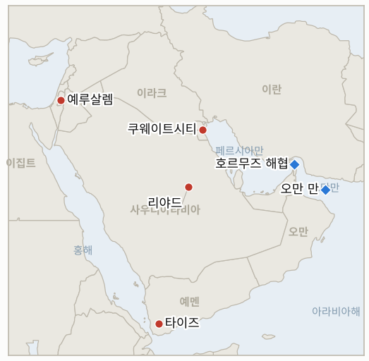

# 중동 일일 브리핑

**2026년 11월 28일**

- **보고 기간:** 약 24시간, 11월 27일 06:00 ~ 11월 28일 06:00 (한국시간)
- **종합 평가:** 금요일에는 미국이 봉쇄선에서 무력을 썼다는 사실이 공개됐다. 대상은 이란 자체가 아니라 선박이었다. 미 중부사령부는 반다르아바스를 떠나 경고를 무시한 화물선을 미군 항공기가 무력화했다고 밝혔고, 트럼프 대통령은 승리가 "눈앞에" 있다고 말했으며, 이란 지휘관들은 봉쇄를 깨겠다고 다짐했다(§1.1). 쿠웨이트는 목요일의 드론 공격으로 사망자가 난 일을 두고 이란 대사를 초치했고, 이란은 다시 부인했다(§1.2). 사우디 주도 연합군은 예멘에서 표적 50곳을 파괴했다고 밝혔고, 후티 매체는 타이즈의 주택이 공습받아 11명이 숨졌다고 보도했으며, 메카협정에 속한 사우디의 동맹국들은 이슬라마바드에서 만났으나 새 지원을 발표하지 않았다(§1.3). 브렌트는 1.13달러 내린 95.44달러에 마감했지만 주간으로는 약 3% 올랐다(§1.4). 이스라엘에서는 가디 아이젠코트가 8일 안에 정부를 구성하겠다고 밝히고 리쿠드가 시간을 끌고 있다고 비판했다(§1.5). 서울에서는 외국인이 돌아오면서 코스피가 4.34% 오른 4,915.68에 마감했고, 원·달러 환율은 1,337.9원으로 내렸으며, 조현 외교부 장관은 이란 외무장관에게 한국이 전쟁에 참여하지 않는다고 말했다. 청해부대 동의안은 아직 본회의 표결을 기다리고 있다. 종합하면, 워싱턴은 탄약을 써서 봉쇄를 집행하면서 그보다 큰 행동의 시기는 스스로 정한다고 말하고 있고, 이란은 자신이 했다고 인정하는 공격보다 주장과 경고로 답하고 있다.

---

## 1. 무슨 일이 있었나

<figure style="float:right; width:46%; margin:2pt 0 8pt 14pt;">

<figcaption style="font-size:8pt; color:#666; text-align:center; margin-top:3pt; font-style:italic;">주요 논의 지점</figcaption>
</figure>

### 1.1 미국, 봉쇄선에서 화물선을 무력화; 트럼프는 승리가 눈앞이라고 발언

미 중부사령부(CENTCOM)는 금요일, 미군이 11월 26일 오만 만에서 팔라우 선적 벌크선 퍼시픽 아처호를 무력화했다고 밝혔다. 이 배는 반다르아바스를 떠난 뒤 여러 차례의 경고를 무시했고, 항공기가 선미에 정밀 유도탄을 쏴 추진 장치를 멈췄다. 민간인 선원은 다치지 않았다. 사령부는 지금까지 지시에 따른 선박 158척을 돌려보냈고 따르지 않은 6척을 무력화했다고 밝혔다. AP는 봄에 봉쇄가 시작된 뒤 적어도 15척, 여름에 봉쇄가 재개된 뒤로는 6척이 무력화된 것으로 집계한다([CENTCOM](https://www.centcom.mil/MEDIA/PUBLIC-RELEASES/Article/4660484/us-forces-disable-commercial-vessel-during-blockade-enforcement-against-iran/); [Fox News](https://www.foxnews.com/world/us-military-disables-tanker-ship-attempting-slip-through-iran-blockade-thanksgiving-day)). 트럼프 대통령은 마러라고에서 추수감사절을 맞아 장병들과 통화하며 미국의 승리가 "눈앞에" 있고 추가 행동은 "내가 원할 때 언제든 일어날 것"이라고 말했다. 그는 항공모함 한 척을 역내에 추가로 보냈고, 이란이 "큰 실수"를 하고 있으며, 타격이 재개되면 나탄즈 인근의 지하 시설 픽액스 마운틴이 표적이 될 것이라고 했다([Iran International](https://iranintl.com/en/202611270476); [Gulf News live](https://gulfnews.com/world/mena/middle-east-tensions-trump-signals-victory-as-iran-offers-kuwait-drone-probe-1.500762639)). 이란은 성명과 주장으로 답했다. 혁명수비대 항공우주군 사령관 마지드 무사비는 이란의 적들이 공중과 해상에서의 행동을 예상해야 한다고 말하고, 봉쇄를 깨는 일을 "확고한 임무"라고 불렀다. 혁명수비대는 방공망이 경고 사격을 해 헹감섬 인근에서 미군 F-16 한 대를 돌아가게 했다고 주장했고, "허가받지 않은" 항로로 가던 유조선 한 척이 오만 가남섬 북쪽에서 기뢰에 닿아 폭발했으며 두 번째 유조선은 뱃머리를 돌렸다고 주장했다. 이란 해군 사령관은 미군이 "훔쳐 간" 유조선 2척을 되찾았다고 말했다. 워싱턴은 세 주장 가운데 어느 것도 확인하지 않았고, 새 사건에 관한 UKMTO 공지도 찾지 못했다. AIS 기반 집계 한 곳은 목요일 해협을 지난 상선을 2척으로 기록했고 둘 다 출항 선박이었다([hormuz.now](https://hormuz.now/traffic)). **신뢰도: 퍼시픽 아처호 무력화(CENTCOM 발표)와 트럼프의 발언은 높음; F-16, 기뢰, 유조선 회수 주장은 이란 국영 매체에만 근거해 낮음; 통항 집계는 중간~낮음.**

### 1.2 쿠웨이트, 이란 대사 초치; 테헤란은 거듭 부인

쿠웨이트 외무부는 금요일 모하마드 토톤지 이란 대사를 초치해 "계속되는 이란의 공격"에 대한 항의 서한을 전달했다. 방공 시설에 대한 드론 공격으로 라인메탈 소속 이탈리아인 기술자 2명이 숨진 지 하루 만이다. 아바스 아라그치 외무장관은 안토니오 타야니 이탈리아 외무장관에게 전화해 "이란은 이 사건의 발생에 어떤 역할도 하지 않았고 전혀 관여하지 않았다"고 말했다. 그는 이란을 향한 지목이 "미리 짜 둔 전쟁 각본"일 수 있다고 했고, 공동 조사 제안을 되풀이하면서 이번에는 쿠웨이트뿐 아니라 이탈리아도 대상에 넣었다([Gulf News live](https://gulfnews.com/world/mena/middle-east-tensions-trump-signals-victory-as-iran-offers-kuwait-drone-probe-1.500762639); [Middle East Eye live](https://www.middleeasteye.net/live/live-israelis-head-polls-netanyahu-fights-political-life)). 사우디아라비아는 쿠웨이트에 대한 "이란의 침략"을 규탄했고, 영국은 공격이 "무모하다"고 했으며, 안토니우 구테흐스 유엔 사무총장은 공격을 규탄하고 "모든 당사자에게 자제"를 요청했다([Times of Israel](https://www.timesofisrael.com/liveblog-november-27-2026/)). 쿠웨이트나 이탈리아가 조사 제안을 받아들였다는 보도는 없었고, 보고 기간 중 쿠웨이트에 대한 새 공격도 보도되지 않았다. **신뢰도: 초치와 부인은 높음; 누가 드론을 쏘았는지는 낮음~중간(여전히 규명되지 않음).**

### 1.3 연합군은 예멘 표적 50곳 타격을 발표, 후티 매체는 11명 사망 보도, 메카협정 회의 개최

사우디 주도 연합군의 투르키 알말리키 대변인은 사나, 호데이다, 사다에서 "정당한 군사 표적" 50곳을 파괴했으며 여기에는 목요일 자잔 정유소 공격에 쓰인 발사대가 포함된다고 밝혔다. 후티가 운영하는 사바 통신은 사우디 항공기가 타이즈시 남쪽 알투르바의 주거용 건물을 타격해 "시민 11명이 숨졌고 대부분 어린이"라고 보도했다. 구조대는 시신 8구를 수습했고 3명이 실종 상태다. Al Jazeera는 이 보도를 확인하지 못했고 연합군은 이에 대해 언급하지 않았다([Al Jazeera](https://www.aljazeera.com/news/2026/11/27/saudi-strike-kills-11-civilians-in-yemens-taiz-houthi-media)). 연합군은 사우디 남부로 향하던 드론 1대와 리야드 지역으로 향하던 드론 1대를 파괴했다고 밝혔다. 사우디 석유 시설에 대한 새 타격은 보도되지 않았고, 사우디 당국은 자잔 정유소의 가동 중단이나 라스타누라에 대해 더 밝힌 것이 없다. 이슬라마바드에서는 메카협정의 전략정치국방위원회가 외무장관, 국방장관, 군 수뇌가 참석한 가운데 약 두 시간 반 동안 열렸다. 파키스탄의 이샤크 다르는 세 나라가 "후티 민병대의 끈질기고 극악한 공격"을 규탄했으며 사우디의 안보를 지원하기 위한 "노력을 이어 가고 강화하겠다"고 했다고 밝혔다. 구체적인 새 조치는 발표되지 않았다. 튀르키예의 하칸 피단은 예멘에 병력을 보낸다는 결정은 없다고 말했고, 파키스탄은 예멘 안의 후티를 공격하지 않겠다는 입장이다. 위원회는 새 회원국 가입을 위한 로드맵에 원칙적으로 합의했고, 튀르키예는 같은 날 협정 비준을 마쳤다([Al Jazeera](https://www.aljazeera.com/news/2026/11/27/mecca-pact-allies-condemn-heinous-houthi-attacks-on-saudi-arabia)). **신뢰도: 연합군과 이슬라마바드 회의의 발표는 높음; 타이즈 사망자 수는 낮음~중간(후티 매체뿐).**

### 1.4 브렌트 95.44달러로 하락, 그래도 11월 들어 첫 주간 상승

브렌트는 금요일 단축 거래에서 장중 11월 9일 이후 최고치를 찍은 뒤 1.13달러(1.2%) 내린 95.44달러에 마감했다. WTI는 수요일 종가보다 60센트 내린 83.08달러에 마감했다. 목요일에는 정산가가 없었다. 주간으로 브렌트는 2.87달러, 약 3% 올랐다. 3주 연속 내린 뒤 11월 들어 첫 주간 상승이다. WTI는 주간으로 90센트 내렸다([통신 기사 via Rallies.ai](https://rallies.ai/news/oil-notches-first-weekly-gain-in-november-on-supply-fears-24b1b0295756c425)). 기사는 한 주의 상승 요인으로 호르무즈 해협의 유조선과 자잔 정유소를 비롯한 사우디 에너지 시설에 대한 공격을 들었고, 우크라이나의 드론 공격으로 러시아 정유소에 불이 난 사실도 언급했다. 협의 내용을 아는 세 사람은 OPEC+가 일요일 화상 회의에서 2027년 1분기 생산 목표를 그대로 둘 계획이라고 말했다. 이라크 석유장관은 바그다드가 생산 상한을 높이기 위해 OPEC과 협상하고 있다고 말했다. 브렌트 1월물은 월요일에 만기가 되므로 화요일부터 인용되는 근월물 가격은 2월물 가격이다. **신뢰도: 종가는 높음(등락폭이 목요일의 96.57달러, 수요일의 83.68달러와 맞음); OPEC+ 결과는 회의 전까지 중간.**

### 1.5 아이젠코트, 8일 안에 정부를 구성하겠다며 리쿠드가 시간을 끈다고 비판

가디 아이젠코트는 금요일, 12월 6일까지인 정부 구성권 시한의 남은 8일 안에 정부를 구성하겠다고 밝혔다. 그는 야샤르와 리쿠드가 2주 동안 다섯 차례 만났지만 리쿠드가 "실질적인 쟁점에서 진전을 이룰 의지를 보이지 않았고" 협상을 총리직 순번제에만 묶어 두었다고 말했다. 이스라엘 베이테누, 민주당과의 연정 합의는 서명됐고, 나프탈리 베네트의 당과도 합의하려고 노력하고 있으며, 리쿠드에 대한 문은 열려 있다고 했다([Anadolu](https://www.aa.com.tr/en/middle-east/israel-s-eisenkot-vows-to-form-government-within-8-days-despite-deadlock-with-likud/4140764)). 저녁에는 채널13이 네타냐후 총리가 순번제에서 두 번째로 총리를 맡겠다고 밝힐 준비를 하고 있다고 보도했다. 측근들의 의견은 갈리고 아이젠코트는 "매우 회의적"이라고 한다. 채널12는 아이젠코트가 아비그도르 리베르만과 야이르 골란에게 두 사람의 동의 없이는 리쿠드와 통합 정부를 꾸리지 않겠다고 약속했다고 보도했다. 또 아랍계 정당 라암이 "완전한 연정 규율"을 지키며 임기 전체에 걸쳐 그의 정부를 지지하겠다고 약속하고 각료직을 요구하고 있다고 전했다. 베네트는 통합 정부 협상이 실패하면 소수 정부를 받아들이겠다는 뜻을 내비쳤다. 토라 유대교 연합(UTJ)의 당 대표는 협상에 "극적인" 진전이 있다는 보도를 부인했다. 채널12에 따르면 이 당은 정부 출범 전에 병역 기피자 체포를 중단하는 법을 통과시키라고 요구하고 있고 야샤르는 이를 거부한다([Times of Israel](https://www.timesofisrael.com/liveblog-november-27-2026/)). 가자에서는 하마스가 지도자 칼릴 알하야의 아들이 새벽 가자시티에서 가족을 겨냥한 이스라엘의 공습에서 살아남았다고 밝혔고, 팔레스타인 매체는 이날 이스라엘의 공습으로 적어도 4명이 숨졌다고 보도했다. **신뢰도: 아이젠코트의 성명은 높음; 채널12와 채널13 보도는 중간(단일 매체, 익명 소식통).**

---

## 2. 심층 분석: 유인과 동기

### 2.1 워싱턴은 왜 이란 타격은 미루면서 화물선을 공격하고 그 사실을 공개하나?

선박을 무력화하면 적은 비용으로 봉쇄를 집행할 수 있다. 다치는 사람이 없고, 이란 영토가 아니라 외국 선적의 선체를 맞히며, 지시를 어기고 이란 항구를 떠나는 배가 어떻게 되는지를 모든 선주에게 보여 준다. 이란은 한 주 내내 봉쇄를 깨겠다고 말해 왔고, 유조선들이 이를 시도하려고 모이고 있다는 보도도 있었다. 무력화 6척, 회항 158척이라는 누계와 함께 퍼시픽 아처호 사례를 공개한 것은 그 말에 기록으로 답한 것이다. 같은 날 트럼프가 한 말과도 맞는다. 승리가 눈앞에 있고, 더 큰 행동의 시기는 자신이 정하며, 전쟁 자금은 1월까지 확보돼 있다는 것이다. 시간이 자기 편이라고 믿는 대통령은 압박을 꾸준히, 눈에 보이게 유지하려 하고, 시계를 처음으로 되돌릴 타격은 피하려 한다. 그가 언급한 항공모함과 픽액스 마운틴 지목은 더 큰 위협을 쓰지 않으면서 그 신뢰성을 유지하는 수단이다. 이 접근의 위험은 선박과 국가 사이의 틈에 있다. 배가 한 척 무력화될 때마다 이란은 바다에서 답하라는 압력을 받고, 다음 사상자는 미국인이거나 중립국 선원일 수 있다.

### 2.2 이란은 왜 자신이 했다고 인정하는 공격이 아니라 주장과 경고로 답하나?

금요일 이란은 F-16을 쫓아냈고, 유조선이 기뢰에 닿아 폭발했으며, 해군이 배 두 척을 되찾았다고 말했다. 다른 누구도 이를 확인하지 않았다. 동시에 사람이 숨진 유일한 공격, 곧 쿠웨이트 공격은 이틀째 부인했다. 이런 양상은 지도부가 국민과 자국 군대에 봉쇄에 맞서고 있음을 보여 줘야 하지만, 트럼프가 타격을 앞당기겠다고 한 "도발"의 구실은 워싱턴에 주고 싶지 않다는 뜻으로 읽힌다. 경고 사격과 기뢰에 관한 주장은 첫 번째 목적을 싼값에 채운다. 쿠웨이트에 대한 부인은 두 번째 목적에 맞고, 아라그치가 카타르와 파키스탄이 여전히 맡고 있다고 한 중재도 보호한다. 비용도 있다. 확인되지 않는 주장이 하나 나올 때마다 다음 주장의 값이 떨어진다. 지휘관들이 날마다 되풀이하는 봉쇄 돌파 약속은 국내에 기대를 만들어 내는데, 퍼시픽 아처호가 방금 그 기대와 어긋나는 결과를 보여 줬다. 혁명수비대가 약속을 지켜야 한다고 느낀다면 그 장소는 오만 만의 봉쇄선 자체일 가능성이 가장 높다.

### 2.3 메카협정 회의는 왜 규탄만 내놓고 새 전력은 내놓지 않았나?

사우디아라비아는 정유소가 피격되고, 근로자가 숨지고, 수도가 거의 매일 밤 표적이 된 한 주를 보낸 뒤 이슬라마바드에 갔다. 외무장관, 국방장관, 참모총장이 함께 갔다. 들고 돌아온 것은 성명이다. 두 동맹국이 저마다 예멘 앞에서 선을 그었기 때문이다. 파키스탄은 사우디 영토는 방어하겠지만 예멘 안의 후티는 공격하지 않겠다고 밝혀 왔고, 워싱턴과 테헤란 사이의 중재자이기도 하다. 이란의 동맹을 상대로 전쟁에 나서면 그 역할은 끝난다. 튀르키예는 필요한 지원을 하고 있다면서도 예멘 파병 결정은 없다고 하며, 협정 비준을 금요일에야 마쳤다. 두 나라 모두 동맹의 더 느린 작업에서 이익을 얻는다. 피단은 그 작업을 방위산업 역량을 모으고 본부와 사령부를 세우는 일이라고 설명했다. 합의된 조건으로 새 회원국을 받는 일도 두 나라에 이익이다. 리야드에도 회의의 가치는 있다. 후티와 이란에 사우디가 혼자가 아님을 보여 주고, 사우디 내 신속 배치를 위해 전력을 제공한다는 10월의 결정도 유효하다. 그러나 예멘 상공의 공중전, 그리고 타이즈 보도가 사실이라면 그에 따르는 민간인 피해는 여전히 사우디가 져야 할 몫이다.

### 2.4 네타냐후는 왜 지금 순번제의 두 번째 자리를 저울질한다고 전해지나?

2주 동안 리쿠드의 협상 입장은 네타냐후가 먼저 총리를 맡는다는 것이었다. 아이젠코트의 금요일 성명은 이를 시간 끌기라는 공개 비판으로 바꾸고, 8일 안에 정부를 구성한다는 날짜를 붙였다. 라암이 임기 전체의 지지를 약속하고 베네트가 소수 정부도 받아들일 수 있다는 신호를 보내면서, 리쿠드 없이도 숫자가 채워질 수 있게 됐다. 두 번째를 맡겠다는 제안은 아이젠코트 진영을 아직 가를 수 있는 유일한 수다. 베네트가 통합 정부를 선호하고 아이젠코트 자신의 지지자 일부도 그렇기 때문이다. 보도가 흘러나온 시점은 그렇게 설명된다. 리베르만과 골란의 동의 없이는 통합 정부 합의를 하지 않겠다는 약속이 전해진 것도 같은 이유다. 아이젠코트는 그 제안이 통하지 않을 것임을 우군에게 미리 알리고 있다. 네타냐후 측근의 의견이 갈리는 것은 제안이 실패하더라도 값을 치르기 때문이다. 자신이 더는 첫 번째 자리를 요구하지 않는다는 점을 인정하는 셈이 된다. 남은 문제는 초정통파다. 정부 출범 전에 병역 기피자 체포를 멈추는 법을 통과시키라는 요구는 예비역이 많은 야샤르 지지층이 받아들이기 어렵다.

---

## 3. 한국에 대한 정책적 함의

**익스포저 현황:** 한국은 원유의 약 70.7%, LNG의 20.4%를 중동에서 들여온다(`instructions/korea-exposure.md`, 갱신 불필요). 금요일 브렌트는 95.44달러, WTI는 83.08달러에 마감했다. 코스피는 204.47포인트(4.34%) 오른 4,915.68에 마감해 수요일의 6.16% 하락분을 대부분 되찾았다. 4,728.80에 출발해 4,682.43까지 밀렸다가 4,922.94까지 올랐다. 외국인은 1조 1,300억 원, 기관은 2,388억 원을 순매수했고 개인은 1조 7,700억 원을 순매도했다. 삼성전자는 4.55%, SK하이닉스는 5.41% 올랐다. 코스닥은 8.13% 오른 708.99에 마감했고 매수 사이드카가 발동됐다. 보도는 나스닥100 선물이 2% 넘게 오른 점, 반도체주에 대한 우려가 누그러진 점, 그리고 금융위원회가 11월 30일 긴급 시장안정 회의를 열어 약 10조 원 규모인 증시안정펀드의 확대를 논의할 계획이라는 점을 배경으로 들었다([Businesskorea](https://www.businesskorea.co.kr/news/articleView.html?idxno=282403)). 원·달러 환율은 4.8원 내린 1,337.9원에 마감했다. 1,345.0원에 출발해 삼성전자 배당금과 관련된 달러 수요로 1,347.1원까지 올랐다가, 외국인의 주식 매수와 수출업체의 월말 달러 매도로 방향을 바꿨다([산경투데이](https://www.sankyungtoday.com/news/articleView.html?idxno=64470)). 조현 외교부 장관은 11월 26일 아바스 아라그치 이란 외무장관과 통화했다. 청해부대 동의안이 국무회의를 통과한 뒤 첫 통화다. 외교부는 조 장관이 임무 확대가 우리 국민 보호와 경제적 이익 수호를 위한 조치임을 설명하고 전쟁 불개입 원칙을 재확인했다고 밝혔다. 이란 타스님 통신은 아라그치가 외국 군대의 주둔이 "긴장을 고조시키고 분쟁의 범위를 확대할 것"이라고 말했고, 조 장관은 한국이 전쟁에 참여할 의사가 없으며 중동에 병력을 파견할 계획도 없다고 말했다고 보도했다. 뒤의 문구는 외교부 발표에는 없다. 이재명 대통령은 엑스(X)에 청해부대의 임무는 넓히되 "전쟁 불개입 원칙은 분명히 지킬 것"이라고 썼다([세계일보](https://www.segye.com/newsView/20261127504517)). 부대의 인원 상한을 75명 늘려 395명으로 하는 내용도 담은 이 동의안은 본회의 표결을 기다리고 있으며 표결 날짜는 확인하지 못했다. 현재의 파견 기한은 12월 31일까지다([이투데이](https://www.etoday.co.kr/news/view/2653587)).

**사안별 함의:**

- **봉쇄선 (§1.1):** 퍼시픽 아처호가 무력화된 오만 만은 청해부대의 새 작전 구역과 맞닿은 바다다. 동의안은 미군 항공기가 선박에 사격하고 이란이 "공중과 해상에서의" 행동을 다짐하는 곳 가까이, 오만 남쪽에 한국 함정을 두게 된다. 조 장관에 대한 아라그치의 경고는 서울이 무엇이라고 부르든 테헤란이 이 파견을 외국 군대의 주둔으로 읽는다는 점을 보여 준다. 국방부는 본회의 표결 전에, 어느 쪽에 의해서든 무력화된 선박의 조난 신호에 부대가 어떻게 대응할지에 관한 규칙을 정해 둬야 한다 (IND-20261128-1, IND-20261122-1, IND-20261112-1).
- **호르무즈 (§1.1):** 목요일 AIS 송출 선박 2척이 해협을 지났다. 이란의 기뢰 주장은 확인되지 않았지만 이제 거의 날마다 나오고 있고, 출항 유조선이 쓰는 가남섬 북쪽 항로를 지목한다. 한국 선주들은 UKMTO가 달리 알리기 전까지 그 항로를 분쟁 수역으로 다뤄야 한다 (IND-20260714-4).
- **쿠웨이트 (§1.2):** 쿠웨이트는 "계속되는" 공격을 말하고 이란은 부인한다. 조사에 합의가 이뤄지기 전까지 쿠웨이트의 한국 기업은 누가 무엇을 향해 쏘는지 판단할 근거가 없다. 방어 대상 시설에서 일하는 인력의 안전 지침을 점검하라는 어제의 권고는 그대로다 (IND-20261127-2, IND-20261123-2).
- **사우디아라비아와 메카협정 (§1.3):** 협정은 리야드에 말만 주었고 새 방어 수단은 주지 않았다. 따라서 얀부, 지다, 라스타누라의 방어는 이미 배치된 사우디와 미국의 체계에 달려 있다. 금요일에는 사우디 석유 시설이 피격됐다는 보도가 없었다. 나쁜 이틀 뒤의 조용한 하루일 뿐 아직 추세는 아니다 (IND-20261127-1, IND-20261126-2, IND-20261126-1, IND-20261125-1).
- **유가 (§1.4):** 브렌트는 주간으로 약 3% 올라 95달러 위에서 한 주를 마쳤다. OPEC+가 일요일에 목표를 유지할 것으로 예상되므로 공급 정책에서는 완화 요인이 나오지 않고, 가격은 걸프를 따라갈 것이다. 정유사는 다음 주에 근월물이 2월물로 바뀐다는 점에 유의해야 한다. 그것만으로도 인용되는 가격 수준이 달라질 수 있다 (IND-20261128-3, IND-20261124-1).
- **증시와 원화 (익스포저 현황):** 이번 반등은 외국인의 반도체주 매수와 당국의 지원에 대한 기대에서 나왔고, 유가는 여전히 역풍으로 남아 있다. 원화는 삼성전자 배당금 유출에도 강해졌다. 그쪽에서 오는 압력은 지나갔다는 뜻으로 읽힌다 (IND-20261127-3, IND-20261124-3).
- **이스라엘 (§1.5):** 8일 안에 리쿠드 없는 정부가 구성되면 워싱턴이 이란에 대한 다음 수를 저울질하는 동안 임기를 시작하게 된다. 막판에 순번제 합의가 이뤄지면 네타냐후는 내각에 남는다. 한국에는 이 차이가 미국의 동의 없는 이스라엘의 이란 타격 가능성과 관련되며, 그 가능성은 첫 번째 경우에 더 낮다 (IND-20261128-2, IND-20261126-3, IND-20261125-3, IND-20261123-3).

**오늘 종결:**

- **IND-20261114-1: 반증.** 시한인 11월 27일께까지 호르무즈 연안 너머 이란 영토에 대한 미국이나 이스라엘의 타격은 공개되지 않았다. 이 기간에 워싱턴이 공개한 무력 사용은 케슘 타격과 선박 무력화였고, 트럼프는 그 이상의 행동 시기는 자신이 정한다고 말한다.
- **IND-20261120-1: 반증.** 11월 27일께까지 이라크 정부, 보안미디어실, 인민동원군, 또는 카타이브 헤즈볼라 자신이 이 조직의 부대가 주르프 알사카르를 떠났다고 발표한 일은 없었다. 보도들은 이 조직이 스스로 정한 일정에 따라 부분적이고 단계적으로 이동하고 있다고 전한다.

**검증 가능한 지표:**

- **IND-20261128-1** (진행, 신규): 2026년 12월 5일께까지 미군이 봉쇄를 집행하면서 선박을 적어도 한 척 더 무력화하거나 나포했다고 CENTCOM이 발표하면 퍼시픽 아처호 이후에도 선박들이 봉쇄선으로 보내지고 있는 것으로 확증; 없으면 반증.
- **IND-20261128-2** (진행, 신규): 2026년 12월 6일께까지 크네세트의 신임 투표로 아이젠코트가 이끄는 정부가 출범하면 8일 약속이 지켜진 것으로 확증; 없으면 반증.
- **IND-20261128-3** (진행, 신규): 2026년 12월 5일께까지 어느 거래일이든 브렌트 근월물이 100달러 이상에서 마감하면 OPEC+ 회의 뒤에도 걸프 위험이 가격에 더 반영되고 있는 것으로 확증; 없으면 반증.
- **IND-20261127-1** (진행): 보고 기간 중 사우디 당국이 발표한 정유소나 석유 터미널에 대한 추가 공격 없음.
- **IND-20261127-2** (진행): 쿠웨이트가 "계속되는" 공격을 이유로 이란 대사를 초치; 사상자를 낸 새 공격 보도 없음.
- **IND-20261127-3** (진행): 원·달러 1,337.9원 마감으로 1,330원 아래가 아님.
- **IND-20261126-1** (진행): 라스타누라에 대한 아람코나 사우디 정부의 발표 없음.
- **IND-20261126-2** (진행): 지다나 얀부에서 보고된 것 없음.
- **IND-20261126-3** (진행): 토라 유대교 연합 당 대표가 "극적인" 진전을 부인; 당은 합류를 발표하지 않음.
- **IND-20261125-1** (진행): 리야드 지역으로 향하던 드론 1대가 파괴됨; 건물 피격 보도 없음.
- **IND-20261125-3** (진행): 아이젠코트는 리쿠드와의 다섯 차례 협상이 성과가 없었다고 밝힘; 네타냐후가 순번제의 두 번째 자리를 저울질한다는 보도; 합의 없음.
- **IND-20261124-1** (진행): 브렌트 95.44달러 마감으로 85달러 기준선을 크게 웃돎.
- **IND-20261124-3** (진행): 원·달러 1,337.9원 마감으로 1,360원 기준선 아래.
- **IND-20261123-1** (진행): 라비그 관련 발표 없음.
- **IND-20261123-2** (진행): 이란이 걸프의 석유·가스 시설을 타격했거나 그 상공에서 요격됐다는 발표 없음.
- **IND-20261123-3** (진행): 아이젠코트가 8일 안에 정부를 구성하겠다고 밝힘; 크네세트 표결을 요청하는 공식 절차는 아직 보도되지 않음; 시한은 11월 30일께.
- **IND-20261122-1** (진행): CENTCOM이 무력화한 것은 반다르아바스에서 온 팔라우 선적 벌크선으로, 하르그섬에서 출항한 이란 유조선이 아니어서 해당하지 않음; 유조선 2척을 되찾았다는 이란의 주장은 확인되지 않음; 시한은 11월 29일께.
- **IND-20261122-2** (진행): 바레인에 대한 새 공격 보도 없음; 시한은 11월 29일께.
- **IND-20261112-1** (진행): 본회의 표결 아직 없음; 시한은 11월 30일께.
- **IND-20261116-2** (진행): 바브엘만데브 인근에서 후티가 상선을 공격했다는 UKMTO나 JMIC 보고 없음.
- **IND-20261117-1** (진행): 후티 병력이 아덴 50km 이내에 있다는 보도를 찾지 못함.
- **IND-20260714-4** (진행): 보고 기간 중 라스라판 선적에 관한 새 수치 없음.
- **IND-20261113-2, IND-20261114-3, IND-20261115-2** (진행): 변동을 찾지 못함; `tracking/indicators.md` 참조.

---

## 4. 관찰 목록

- **퍼시픽 아처호 무력화에 대한 이란의 해상 대응, 그리고 추가로 무력화되는 선박 (IND-20261128-1, IND-20261122-1).**
- **혁명수비대가 가남섬 북쪽에서 기뢰에 닿았다고 한 유조선에 대한 독립적인 확인, 그리고 F-16 주장에 대한 미국의 언급.**
- **쿠웨이트나 이탈리아가 이란의 공동 조사 제안을 받아들이는지, 그리고 쿠웨이트에 대한 새 공격 (IND-20261127-2).**
- **타이즈 사망 보도에 대한 연합군의 언급, 후티의 대응, 자잔 정유소의 상태 (IND-20261127-1).**
- **일요일 OPEC+ 회의와 월요일 브렌트 1월물 만기 (IND-20261128-3, IND-20261124-1).**
- **네타냐후가 순번제 제안을 공개적으로 내놓는지, 토라 유대교 연합의 결정, 크네세트 표결 날짜 (IND-20261128-2, IND-20261123-3, IND-20261125-3, IND-20261126-3).**
- **미국의 가자 구상에 따른 조치를 다룰 이스라엘 안보내각 논의와 가자 공습.**
- **월요일 금융위원회의 시장안정 회의와 1,330원에 가까워진 원·달러 환율 (IND-20261127-3).**
- **청해부대 동의안의 본회의 표결 날짜; 관련 지표의 시한은 11월 30일 (IND-20261112-1).**
- **IAEA 이사회와 이란의 NPT 법안을 포함해 진행 중인 지표 11개의 11월 29일·30일 시한.**

---

## 5. 출처 신뢰도 요약

| 주장 | 출처 | 신뢰도 |
| --- | --- | --- |
| 미군 항공기가 11월 26일 반다르아바스를 떠난 팔라우 선적 벌크선 퍼시픽 아처호를 오만 만에서 무력화; 선원 무사; 무력화 6척, 회항 158척 | CENTCOM 발표; Fox News, AP via 제휴사, Middle East Eye | 높음 |
| 트럼프: "승리가 눈앞에"; 행동은 "내가 원할 때 언제든"; 항공모함 추가 파견; 타격 재개 시 픽액스 마운틴이 표적 | Iran International, Gulf News | 높음 |
| 무사비: 적들은 공중과 해상에서의 행동을 예상해야 함 | 이란 매체 via Middle East Eye, Khaleej Times | 중간~높음 |
| 경고 사격으로 헹감섬 인근에서 미군 F-16이 돌아감 | 혁명수비대 via IRIB; 미국의 확인 없음 | 낮음 |
| 유조선 한 척이 가남섬 북쪽에서 기뢰에 닿아 폭발, 두 번째는 회항 | 혁명수비대 해군 via Gulf News, Pakistan Today | 낮음 |
| 이란 해군이 미국에 나포된 유조선 2척을 되찾음 | 해군 사령관 via 타스님 통신(Gulf News); 미국의 언급 없음 | 낮음 |
| 11월 26일 호르무즈를 지난 AIS 송출 상선 2척 | hormuz.now | 중간~낮음 |
| 쿠웨이트가 이란 대사를 초치해 항의 서한 전달 | 쿠웨이트 외무부 via Gulf News, Middle East Eye | 높음 |
| 아라그치가 타야니에게: 이란은 "어떤 역할도 하지 않았고 전혀 관여하지 않았다" | Gulf News | 높음(발언 사실) |
| 구테흐스가 쿠웨이트 공격을 규탄 | Times of Israel | 높음 |
| 연합군이 사나, 호데이다, 사다에서 표적 50곳 파괴 | 연합군 대변인 via Gulf News | 중간~높음(주장으로서) |
| 사우디의 공습으로 타이즈 알투르바에서 11명 사망, 대부분 어린이 | 사바 통신 via Al Jazeera, AFP; 미확인 | 낮음~중간 |
| 메카협정 위원회가 이슬라마바드에서 만나 후티의 공격을 규탄, 새 조치 발표 없음 | Al Jazeera, Dawn, TRT World | 높음 |
| 브렌트 95.44달러(-1.13달러), WTI 83.08달러 마감; 브렌트 주간 약 3% 상승 | 통신 기사 via Rallies.ai; 이전 종가와 일치 | 높음 |
| OPEC+가 2027년 1분기 목표를 유지할 계획 | 소식통 3명 via 같은 통신 기사 | 중간 |
| 아이젠코트: 8일 안에 정부 구성; 리쿠드가 시간을 끎; 이스라엘 베이테누, 민주당과의 합의 서명 | Anadolu, Times of Israel, Middle East Eye | 높음 |
| 네타냐후가 순번제에서 두 번째를 맡겠다고 제안할 준비 | 채널13 via Times of Israel; Jerusalem Post | 중간 |
| 라암이 임기 전체의 지지를 약속; 아이젠코트가 리베르만과 골란에게 한 약속 | 채널12 via Times of Israel | 중간 |
| 칼릴 알하야의 아들이 가자시티에서 이스라엘의 공습에서 살아남음 | 하마스 관계자 via Reuters (Middle East Eye), Times of Israel | 중간~높음 |
| 코스피 4,915.68(+4.34%); 외국인 1조 1,300억 원 순매수; 원·달러 1,337.9원 | Businesskorea, 매일일보, 산경투데이 | 높음 |
| 조현 장관이 아라그치에게 전쟁 불개입 원칙을 밝힘; 아라그치는 외국 군대 주둔을 경고 | 외교부와 타스님 통신 via 세계일보 | 높음(통화와 외교부 설명); 중간(타스님이 전한 조 장관 발언의 문구) |
| 청해부대 동의안이 본회의 표결 대기; 인원 상한 395명으로 상향 | 이투데이, 헤럴드경제 | 높음 |
