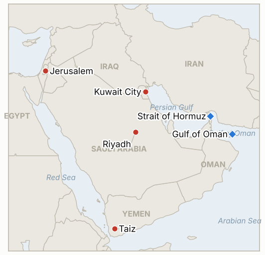

# Middle East Daily Briefing

**November 28, 2026**

- **Reporting window:** ~24 hours, November 27, 06:00 to November 28, 06:00 KST
- **Overall assessment:** Friday brought a disclosed use of US force at the blockade line, against a ship and not against Iran itself. US Central Command said its aircraft disabled a cargo ship that left Bandar Abbas and ignored warnings, while President Trump said victory is "at hand" and Iran's commanders promised to break the blockade (§1.1). Kuwait summoned Iran's ambassador over Thursday's deadly drone attack, which Iran again denied (§1.2). The Saudi led coalition reported 50 targets destroyed in Yemen, Houthi media reported 11 dead in a strike on a house in Taiz, and Saudi Arabia's allies in the Mecca pact met in Islamabad without announcing new help (§1.3). Brent slipped $1.13 to $95.44 but ended the week about 3% higher (§1.4). In Israel, Gadi Eisenkot said he will form a government within eight days and accused Likud of stalling (§1.5). In Seoul the KOSPI rose 4.34% to 4,915.68 as foreign investors returned, the won strengthened to 1,337.9 per dollar, and Foreign Minister Cho Hyun told his Iranian counterpart that Korea will not join the war. The Cheonghae Unit motion still awaits its plenary vote. Net: Washington is enforcing the blockade with munitions while saying the timing of anything larger is its own to choose, and Iran is answering with claims and warnings more than with attacks it admits to.

---

## 1. What Happened

<figure style="float:right; width:46%; margin:2pt 0 8pt 14pt;">

<figcaption style="font-size:8pt; color:#666; text-align:center; margin-top:3pt; font-style:italic;">Major places of discussion</figcaption>
</figure>

### 1.1 The US disables a cargo ship at the blockade line as Trump says victory is at hand

US Central Command said on Friday that its forces disabled the Palau flagged bulk carrier M/V Pacific Archer in the Gulf of Oman on November 26. The ship had left Bandar Abbas and ignored several warnings; aircraft then fired precision munitions at its stern and stopped its propulsion. The civilian crew was not harmed. The command said its forces have redirected 158 compliant vessels and disabled six that refused to comply; AP counts at least 15 ships disabled since the blockade began in the spring and six since it resumed in the summer ([CENTCOM](https://www.centcom.mil/MEDIA/PUBLIC-RELEASES/Article/4660484/us-forces-disable-commercial-vessel-during-blockade-enforcement-against-iran/); [Fox News](https://www.foxnews.com/world/us-military-disables-tanker-ship-attempting-slip-through-iran-blockade-thanksgiving-day)). In Thanksgiving calls to troops from Mar-a-Lago, President Trump said the United States has "victory at hand" and that further action "will happen whenever I want it to happen." He said an additional aircraft carrier has been sent to the region, that Iran is making "big mistakes," and that Pickaxe Mountain, an underground site near Natanz, would be a target if strikes resume ([Iran International](https://iranintl.com/en/202611270476); [Gulf News live](https://gulfnews.com/world/mena/middle-east-tensions-trump-signals-victory-as-iran-offers-kuwait-drone-probe-1.500762639)). Iran answered with statements and claims. Majid Mousavi, who commands the Revolutionary Guards' aerospace force, said Iran's enemies should expect action in the air and at sea and called breaking the blockade a "firm mission." The Guards said air defences fired warning shots that forced a US F-16 to turn back near Hengam Island, and that a tanker on an "unauthorised" route exploded on mines north of Oman's Ghanam Island while a second turned back. Iran's navy chief said it had recovered two tankers "stolen" by the US military. Washington confirmed none of the three claims, and no UKMTO notice of a new incident was found. One AIS based counter recorded two commercial ships through the strait on Thursday, both outbound ([hormuz.now](https://hormuz.now/traffic)). **Confidence: High on the disabling of the Pacific Archer (CENTCOM release) and on Trump's remarks; Low on the F-16, mine and recovered tanker claims, which rest on Iranian state media alone; Medium to Low on the transit count.**

### 1.2 Kuwait summons Iran's ambassador as Tehran repeats its denial

Kuwait's foreign ministry summoned Iran's ambassador, Mohammad Totonji, on Friday and handed him a protest note over "continued Iranian attacks," a day after a drone attack on an air defence site killed two Italian technicians of Rheinmetall. Foreign Minister Abbas Araghchi telephoned Italy's Antonio Tajani and said "Iran had no role or involvement whatsoever in the occurrence of this event." He called the accusation a possible "precooked recipe for war" and repeated his offer of a joint investigation, now with Italy as well as Kuwait ([Gulf News live](https://gulfnews.com/world/mena/middle-east-tensions-trump-signals-victory-as-iran-offers-kuwait-drone-probe-1.500762639); [Middle East Eye live](https://www.middleeasteye.net/live/live-israelis-head-polls-netanyahu-fights-political-life)). Saudi Arabia condemned "Iranian aggression" against Kuwait, Britain called the attacks "reckless," and UN Secretary General Antonio Guterres condemned the attack and asked "all parties to exercise restraint" ([Times of Israel](https://www.timesofisrael.com/liveblog-november-27-2026/)). No acceptance of the investigation offer by Kuwait or Italy was reported, and no new attack on Kuwait was reported in the window. **Confidence: High on the summons and the denial; Low to Medium on who launched the drones, which remains unestablished.**

### 1.3 The coalition reports 50 targets hit in Yemen, Houthi media report 11 dead, and the Mecca pact meets

The Saudi led coalition's spokesman, Turki al-Malki, said 50 "legitimate military targets" were destroyed in Sanaa, Hodeidah and Saada, including the launcher used against the Jazan refinery on Thursday. The Houthi run Saba agency said Saudi aircraft hit a residential building in Al-Turba, south of Taiz city, and killed "11 citizens, most of them children"; rescuers recovered eight bodies and three people were missing. Al Jazeera could not verify the report and the coalition did not comment on it ([Al Jazeera](https://www.aljazeera.com/news/2026/11/27/saudi-strike-kills-11-civilians-in-yemens-taiz-houthi-media)). The coalition said it destroyed one drone heading for southern Saudi Arabia and another heading for the Riyadh region. No new hit on a Saudi oil site was reported, and Saudi authorities said nothing further on the Jazan refinery's shutdown or on Ras Tanura. In Islamabad the Mecca pact's Strategic Political and Defence Committee met for about two and a half hours at the level of foreign ministers, defence ministers and military chiefs. Pakistan's Ishaq Dar said the three countries condemned "persistent and heinous attacks by the Houthi militia" and would "continue and intensify efforts" to support Saudi security. No concrete new measure was announced. Turkey's Hakan Fidan said no decision has been taken to send troops into Yemen, and Pakistan has ruled out attacking the Houthis inside Yemen. The committee agreed in principle on a roadmap for new members; Turkey completed ratification of the pact on the same day ([Al Jazeera](https://www.aljazeera.com/news/2026/11/27/mecca-pact-allies-condemn-heinous-houthi-attacks-on-saudi-arabia)). **Confidence: High on the coalition and Islamabad statements; Low to Medium on the Taiz toll (Houthi media only).**

### 1.4 Brent slips to $95.44 but ends its first rising week of November

Brent settled at $95.44 on Friday, down $1.13, or 1.2%, after touching its highest level since November 9 earlier in a shortened session. WTI settled at $83.08, down 60 cents from Wednesday's close; it had no settlement on Thursday. Over the week Brent rose $2.87, about 3%, its first weekly gain in November after three weekly falls, while WTI lost 90 cents ([wire report via Rallies.ai](https://rallies.ai/news/oil-notches-first-weekly-gain-in-november-on-supply-fears-24b1b0295756c425)). The report tied the week's rise to the attacks on tankers in the Strait of Hormuz and on Saudi energy sites, including the Jazan refinery, and noted a fire at a Russian refinery after a Ukrainian drone attack. Three people familiar with the talks said OPEC+ plans to keep its output targets for the first quarter of 2027 unchanged when it meets online on Sunday. Iraq's oil minister said Baghdad is negotiating with OPEC for a higher production ceiling. The January Brent contract expires on Monday, so the front month price quoted from Tuesday will be that of the February contract. **Confidence: High on the settles (the changes match Thursday's $96.57 and Wednesday's $83.68); Medium on the OPEC+ outcome until the meeting.**

### 1.5 Eisenkot vows a government within eight days and accuses Likud of stalling

Gadi Eisenkot said on Friday that he will form a government within the eight days left on his mandate, which runs to December 6. He said his Yashar party and Likud had met five times in two weeks, that Likud "has shown no willingness to make progress on substantive issues" and that it had confined the talks to a rotation of the premiership. He said the coalition agreements with Yisrael Beytenu and the Democrats are signed, that he is working for one with Naftali Bennett's party, and that his door stays open to Likud ([Anadolu](https://www.aa.com.tr/en/middle-east/israel-s-eisenkot-vows-to-form-government-within-8-days-despite-deadlock-with-likud/4140764)). In the evening Channel 13 reported that Prime Minister Netanyahu is preparing to say he would serve second in a rotation, with his circle divided and Eisenkot "highly skeptical." Channel 12 reported that Eisenkot promised Avigdor Liberman and Yair Golan he would not form a unity government with Likud without their consent, and that the Arab party Ra'am pledged to back his government for its full term with "full coalition discipline" and is seeking cabinet posts. Bennett indicated he would accept a minority government if unity talks fail. United Torah Judaism's chairman denied "dramatic" progress in its talks, and Channel 12 said the party wants a law halting arrests of draft evaders passed before a government is sworn in, which Yashar refuses ([Times of Israel](https://www.timesofisrael.com/liveblog-november-27-2026/)). In Gaza, Hamas said a son of its leader Khalil al-Hayya survived an Israeli strike on his family in Gaza City at dawn, and Palestinian media reported at least four killed in Israeli strikes during the day. **Confidence: High on Eisenkot's statement; Medium on the Channel 12 and Channel 13 reports (single outlets, unnamed sources).**

---

## 2. Deep Dive: Incentives and Motives

### 2.1 Why does Washington strike a cargo ship, and say so, while holding off on Iran?

Disabling a ship enforces the blockade at low cost. It harms no one, it hits a foreign flagged hull and not Iranian territory, and it shows every shipowner what happens to a vessel that leaves an Iranian port against orders. Iran has spent a week saying it will break the blockade, and reports spoke of tankers gathering to try. Publishing the Pacific Archer case, with the running total of six ships disabled and 158 turned back, answers that talk with a record. It also fits what Trump said on the same day: that victory is at hand, that the timing of any larger action is his, and that the war is funded through January. A president who believes time is on his side has reason to keep the pressure steady and visible and to avoid a strike that would reset the clock. The carrier he mentioned and the naming of Pickaxe Mountain keep the larger threat credible without using it. The risk in this approach lies in the gap between ships and states: each disabled vessel invites Iran to answer at sea, where the next casualty may be American or a neutral crew.

### 2.2 Why does Iran answer with claims and warnings and not with an attack it owns?

On Friday Iran said it drove off an F-16, that a tanker exploded on mines, and that its navy took back two ships. None was confirmed by anyone else. At the same time it denied, for the second day, the one attack that killed people, in Kuwait. The pattern suggests a leadership that needs to show its public and its own forces that the blockade is being resisted, but that does not want to hand Washington the "provocation" Trump has said would bring strikes forward. Claims about warning shots and mines serve the first aim cheaply. The denial over Kuwait serves the second, and it also protects the mediation that Araghchi says Qatar and Pakistan still carry. There is a cost. Every unverified claim lowers the value of the next, and the commanders' promises to break the blockade, repeated daily, create an expectation at home that the Pacific Archer has just contradicted. If the Guards feel bound to make good on the promise, the likeliest place is the Gulf of Oman line itself.

### 2.3 Why did the Mecca pact meeting produce a condemnation and no new force?

Saudi Arabia went to Islamabad after a week in which a refinery was hit, a worker was killed and the capital was targeted almost nightly. It brought its foreign minister, its defence minister and its chief of staff. It left with a statement. The reason is that its two allies have each drawn a line short of Yemen. Pakistan has said it will defend Saudi territory but will not attack the Houthis inside Yemen, and it is also a mediator between Washington and Tehran, a role that a war against Iran's ally would end. Turkey says the needed support is being given but that no decision exists on troops in Yemen; it completed ratification of the pact only on Friday. Both gain from the alliance's slower work, which Fidan described as pooling defence industries and building a headquarters and a command, and both gain from admitting new members on agreed terms. For Riyadh the meeting still has value: it shows the Houthis and Iran that the kingdom is not alone, and the October decision to supply forces for rapid deployment in the kingdom stands. But the air war over Yemen, and its civilian toll if the Taiz report is true, remains Saudi Arabia's to carry.

### 2.4 Why is Netanyahu said to be weighing second place in a rotation now?

For two weeks Likud's position in the talks was that Netanyahu serves first. Eisenkot's statement on Friday turned that into a public charge of stalling, with a date attached: a government within eight days. Ra'am's pledge of support for a full term, and Bennett's signal that he could live with a minority government, mean the numbers may be there without Likud. An offer to go second is the one move that could still split Eisenkot's camp, because Bennett prefers unity and some of Eisenkot's own voters do too. That explains the timing of the leak. It also explains the reported promise to Liberman and Golan that no unity deal will be made without their consent: Eisenkot is telling his partners in advance that the offer will not work. Netanyahu's circle is divided because the offer has a price even if it fails, since it concedes that he no longer claims first place. The ultra-Orthodox remain the open question. Their demand for a law stopping arrests of draft evaders before the swearing in is one that Yashar's voters, many of them reservists, would find hard to accept.

---

## 3. Policy Implications for South Korea

**Exposure snapshot:** South Korea draws about 70.7% of its crude and 20.4% of its LNG from the Middle East (`instructions/korea-exposure.md`, no update needed). Brent settled at $95.44 and WTI at $83.08 on Friday. The KOSPI rose 204.47 points, or 4.34%, to 4,915.68, recovering most of Wednesday's 6.16% fall. It opened at 4,728.80, dipped to 4,682.43 and reached 4,922.94. Foreign investors net bought 1.13 trillion won and institutions 238.8 billion won, while individuals net sold 1.77 trillion won. Samsung Electronics rose 4.55% and SK hynix 5.41%; the KOSDAQ rose 8.13% to 708.99 and a buy sidecar was triggered. Reports cited a rise of more than 2% in Nasdaq 100 futures, easing worry about chip stocks, and the Financial Services Commission's plan to hold an emergency market stability meeting on November 30 to discuss enlarging the stabilisation fund of about 10 trillion won ([Businesskorea](https://www.businesskorea.co.kr/news/articleView.html?idxno=282403)). The won closed at 1,337.9 per dollar, 4.8 won stronger. It opened at 1,345.0 and touched 1,347.1 on demand for dollars linked to Samsung Electronics' dividend, then reversed on foreign stock buying and exporters' month end dollar sales ([Sankyung Today](https://www.sankyungtoday.com/news/articleView.html?idxno=64470)). Foreign Minister Cho Hyun spoke by telephone with Iran's Abbas Araghchi on November 26, their first call since the cabinet approved the Cheonghae Unit motion. The foreign ministry said Cho explained that the wider mission is meant to protect Korean nationals and economic interests and reaffirmed the principle of non-involvement in the war. Iran's Tasnim agency reported that Araghchi said the presence of foreign forces "will heighten tensions and widen the scope of the conflict," and that Cho said Korea has no intention of joining the war and no plan to send troops to the Middle East; the ministry's own account does not contain the second phrase. President Lee Jae-myung wrote on X that the unit's mission will be widened "but the principle of non-involvement in the war will be clearly kept" ([Segye Ilbo](https://www.segye.com/newsView/20261127504517)). The motion, which also raises the unit's ceiling by 75 to 395 personnel, awaits a plenary vote for which no date was found; the current mandate ends on December 31 ([eToday](https://www.etoday.co.kr/news/view/2653587)).

**Implications by development:**

- **The blockade line (§1.1):** The Pacific Archer was disabled in the Gulf of Oman, the sea the Cheonghae Unit's new area borders. The motion places Korean ships south of Oman while US aircraft are firing on vessels and Iran is promising action "in the air and at sea" nearby. Araghchi's warning to Cho shows that Tehran reads the deployment as a foreign military presence whatever Seoul calls it. The defence ministry should set, before the plenary vote, the unit's rules for responding to a distress call from a ship disabled by either side (IND-20261128-1, IND-20261122-1, IND-20261112-1).
- **Hormuz (§1.1):** Two AIS visible ships crossed on Thursday. Iranian mine claims are unverified, but they are now made almost daily and name a route north of Ghanam Island that outbound tankers use. Korean shipowners should treat that route as contested until UKMTO says otherwise (IND-20260714-4).
- **Kuwait (§1.2):** Kuwait speaks of "continued" attacks and Iran denies them. Until an investigation is agreed, Korean firms in Kuwait have no basis for judging who is firing or at what. Yesterday's advice stands: review safety guidance for staff at defended sites (IND-20261127-2, IND-20261123-2).
- **Saudi Arabia and the Mecca pact (§1.3):** The pact gave Riyadh words and no new defences, so the protection of Yanbu, Jeddah and Ras Tanura rests on Saudi and US systems already in place. No Saudi oil site was reported hit on Friday, which is one quiet day after two bad ones and not yet a trend (IND-20261127-1, IND-20261126-2, IND-20261126-1, IND-20261125-1).
- **Oil (§1.4):** Brent ended the week about 3% higher and above $95. With OPEC+ expected to hold targets on Sunday, supply policy offers no relief, and the price will follow the Gulf. Refiners should note that the front month changes to the February contract next week, which can shift the quoted level by itself (IND-20261128-3, IND-20261124-1).
- **Markets and the won (snapshot):** The rebound came from foreign buying of chip stocks and the hope of official support, with oil unchanged as a headwind. The won gained despite the Samsung dividend outflow, which suggests the pressure from that source has passed (IND-20261127-3, IND-20261124-3).
- **Israel (§1.5):** A government formed within eight days without Likud would take office while Washington weighs its next step on Iran; a late rotation deal would keep Netanyahu at the cabinet table. For Korea the difference bears on the chance of an Israeli strike on Iran made without US agreement, which is lower under the first outcome (IND-20261128-2, IND-20261126-3, IND-20261125-3, IND-20261123-3).

**Resolved today:**

- **IND-20261114-1: Falsified.** No US or Israeli strike on Iranian territory beyond the Hormuz coast was disclosed by the deadline of ~November 27. Washington's disclosed use of force in the period was the strike on Qeshm and the disabling of ships; Trump says the timing of anything further is his to choose.
- **IND-20261120-1: Falsified.** No statement by the Iraqi government, its security media cell, the Popular Mobilisation Forces or the group itself said that Kataib Hezbollah units have left Jurf al-Sakhar by ~November 27. Reports describe a partial and phased move on the group's own timetable.

**Testable indicators:**

- **IND-20261128-1** (open, new): A CENTCOM statement by ~2026-12-05 that US forces disabled or seized at least one more vessel while enforcing the blockade confirms that ships are still being sent at the line after the Pacific Archer; none falsifies.
- **IND-20261128-2** (open, new): A Knesset vote of confidence that swears in a government led by Eisenkot by ~2026-12-06 confirms his eight day pledge; none falsifies.
- **IND-20261128-3** (open, new): A front month Brent settle at or above $100 on any session by ~2026-12-05 confirms that Gulf risk is still being priced upward after the OPEC+ meeting; none falsifies.
- **IND-20261127-1** (open): no further attack on a Saudi refinery or oil terminal reported by Saudi authorities in the window.
- **IND-20261127-2** (open): Kuwait summoned Iran's ambassador over "continued" attacks; no new attack with casualties reported.
- **IND-20261127-3** (open): the won closed at 1,337.9, not below 1,330.
- **IND-20261126-1** (open): no statement from Aramco or the Saudi government on Ras Tanura.
- **IND-20261126-2** (open): nothing reported at Jeddah or Yanbu.
- **IND-20261126-3** (open): United Torah Judaism's chairman denies "dramatic" progress; the party has not announced that it is joining.
- **IND-20261125-1** (open): a drone heading for the Riyadh region was destroyed; no building reported struck.
- **IND-20261125-3** (open): Eisenkot says five rounds with Likud produced nothing; Netanyahu is reported to be weighing second place in a rotation; no agreement.
- **IND-20261124-1** (open): Brent settled at $95.44, far above the $85 threshold.
- **IND-20261124-3** (open): the won closed at 1,337.9, below the 1,360 threshold.
- **IND-20261123-1** (open): no statement on Rabigh.
- **IND-20261123-2** (open): no statement of an Iranian strike on or interception over a Gulf oil or gas facility.
- **IND-20261123-3** (open): Eisenkot vows a government within eight days; no formal request for a Knesset vote reported yet; deadline ~November 30.
- **IND-20261122-1** (open): CENTCOM disabled a Palau flagged bulk carrier from Bandar Abbas, which is not an Iranian tanker from Kharg Island and does not count; Iran's claim to have recovered two tankers is unverified; deadline ~November 29.
- **IND-20261122-2** (open): no new attack on Bahrain reported; deadline ~November 29.
- **IND-20261112-1** (open): no plenary vote yet; deadline ~November 30.
- **IND-20261116-2** (open): no UKMTO or JMIC report of a Houthi attack on a commercial vessel near the Bab el-Mandeb.
- **IND-20261117-1** (open): no report found of Houthi forces within 50 km of Aden.
- **IND-20260714-4** (open): no new Ras Laffan loading figure in the window.
- **IND-20261113-2, IND-20261114-3, IND-20261115-2** (open): no change found; see `tracking/indicators.md`.

---

## 4. Watch List

- **Iran's response at sea to the disabling of the Pacific Archer, and any further ship disabled (IND-20261128-1, IND-20261122-1).**
- **Independent word on the tanker the Revolutionary Guards say hit mines north of Ghanam Island, and any US comment on the F-16 claim.**
- **Whether Kuwait or Italy accepts Iran's offer of a joint investigation, and any new attack on Kuwait (IND-20261127-2).**
- **A coalition comment on the reported deaths in Taiz, a Houthi reply, and the state of the Jazan refinery (IND-20261127-1).**
- **Sunday's OPEC+ meeting and Monday's expiry of the January Brent contract (IND-20261128-3, IND-20261124-1).**
- **Whether Netanyahu makes the rotation offer in public, United Torah Judaism's decision, and a date for a Knesset vote (IND-20261128-2, IND-20261123-3, IND-20261125-3, IND-20261126-3).**
- **The Israeli security cabinet's discussion of steps under the US plan for Gaza, and the strikes there.**
- **Monday's Financial Services Commission meeting on market stability and the won near 1,330 (IND-20261127-3).**
- **The date of the plenary vote on the Cheonghae Unit motion, due before its November 30 indicator deadline (IND-20261112-1).**
- **Month end deadlines on November 29 and 30 for eleven open indicators, including the IAEA Board and Iran's NPT bills.**

---

## 5. Source Quality Summary

| Claim | Sources | Confidence |
| --- | --- | --- |
| US aircraft disabled the Palau flagged bulk carrier Pacific Archer in the Gulf of Oman on November 26 after it left Bandar Abbas; crew unharmed; six disabled and 158 redirected | CENTCOM release; Fox News, AP via affiliates, Middle East Eye | High |
| Trump: "victory at hand"; action "whenever I want"; an additional carrier sent; Pickaxe Mountain a target if strikes resume | Iran International, Gulf News | High |
| Mousavi: enemies should expect action in the air and at sea | Iranian media via Middle East Eye, Khaleej Times | Medium to High |
| Warning shots forced a US F-16 to turn back near Hengam Island | IRGC via IRIB; no US confirmation | Low |
| A tanker exploded on mines north of Ghanam Island and a second turned back | IRGC Navy via Gulf News, Pakistan Today | Low |
| Iran's navy recovered two tankers seized by the US | Navy chief via Tasnim (Gulf News); no US comment | Low |
| Two AIS visible commercial ships through Hormuz on November 26 | hormuz.now | Medium to Low |
| Kuwait summoned Iran's ambassador and handed over a protest note | Kuwaiti foreign ministry via Gulf News, Middle East Eye | High |
| Araghchi to Tajani: Iran had "no role or involvement whatsoever" | Gulf News | High (that he said it) |
| Guterres condemned the Kuwait attack | Times of Israel | High |
| Coalition destroyed 50 targets in Sanaa, Hodeidah and Saada | Coalition spokesman via Gulf News | Medium to High (as a claim) |
| Saudi strike killed 11, mostly children, in Al-Turba, Taiz | Saba via Al Jazeera, AFP; unverified | Low to Medium |
| Mecca pact committee met in Islamabad, condemned Houthi attacks, announced no new measures | Al Jazeera, Dawn, TRT World | High |
| Brent settled $95.44 (-$1.13); WTI $83.08; Brent up about 3% on the week | Wire report via Rallies.ai; consistent with earlier settles | High |
| OPEC+ plans to hold first quarter 2027 targets | Three sources via the same wire report | Medium |
| Eisenkot: government within eight days; Likud stalling; deals with Yisrael Beytenu and the Democrats signed | Anadolu, Times of Israel, Middle East Eye | High |
| Netanyahu preparing to offer to serve second in a rotation | Channel 13 via Times of Israel; Jerusalem Post | Medium |
| Ra'am pledges full term support; Eisenkot's promise to Liberman and Golan | Channel 12 via Times of Israel | Medium |
| Khalil al-Hayya's son survived an Israeli strike in Gaza City | Hamas officials via Reuters (Middle East Eye), Times of Israel | Medium to High |
| KOSPI 4,915.68 (+4.34%); foreigners net bought 1.13 trillion won; won 1,337.9 | Businesskorea, Maeil Ilbo, Sankyung Today | High |
| Cho told Araghchi Korea keeps to non-involvement; Araghchi warned against foreign forces | Foreign ministry and Tasnim via Segye Ilbo | High (call and ministry account); Medium (Tasnim's wording of Cho's remarks) |
| Cheonghae motion awaits a plenary vote; ceiling raised to 395 | eToday, Herald Business | High |
