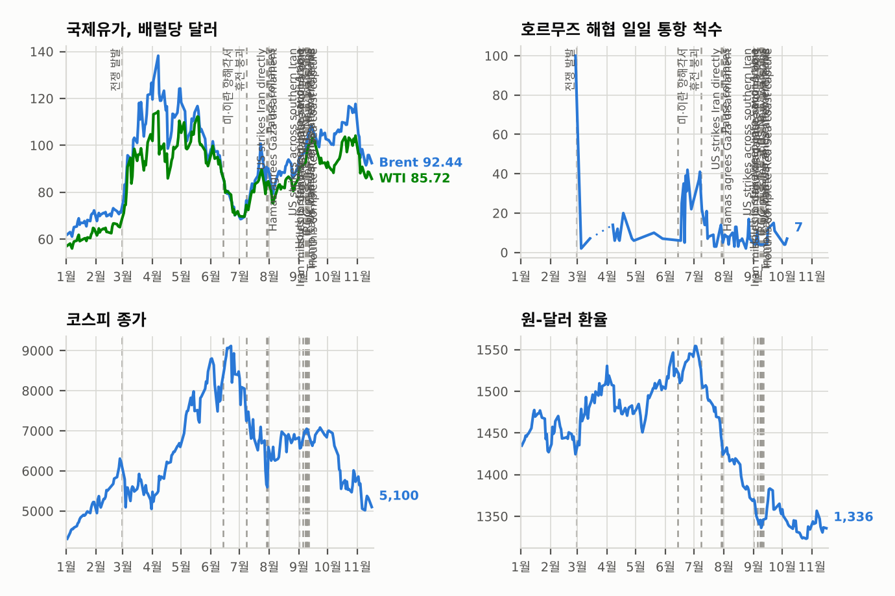

# 중동 주간 리뷰

**2026년 11월 16일 ~ 11월 22일**

- **주간 요약:** 봉쇄 대치가 카사브 앞바다에서 매일 이어지는 유조선 전쟁과 몇 달 만의 미·이란 직접 교전으로 번졌다가, 트럼프가 새해까지 기다리겠다고 말하면서 소강상태에 들어갔다. 주말에는 이란이 바레인에 피해를 낸 공격과 봉쇄를 깨겠다는 위협으로 다시 압박에 나섰다. 사우디와 후티의 전쟁은 항만으로 번졌고 이라크 연방군은 주르프 알사카르에 진입했다. 브렌트는 3.4% 내린 92.57달러, 코스피는 기술주 급락으로 7.9% 떨어진 4,869.96에 한 주를 마쳤다.

---

## 1. 이번 주의 흐름

지난주는 양측이 봉쇄를 안정된 종착 상태로 취급하는 가운데 끝났다. 이번 주는 그것이 해상에서는 안정적이지 않다는 점을 보여 줬다. UKMTO는 11월 16일부터 거의 매일 카사브 인근에서 선박 피격을 확인했다. 유조선 ON PHOENIX, LPG 운반선 TARA GAS(두 차례 피격, 선원 1명 실종), 11명이 다친 ADNOC L&S 선박, 이어 11월 18일, 20일, 21일의 선명 미공개 유조선이다. 지난주의 양상은 누구도 확인하지 못한 이란의 기뢰 주장이었다. 이번 주의 양상은 해상 기관이 확인한 실제 피격이며, 이란은 여전히 이를 기뢰라고 설명한다. UKMTO는 11월 18일까지 한 주의 해협 통항량이 전쟁 전보다 약 65% 적다고 집계했다.

육상에서는 한 주가 세 국면으로 나뉘었다. 먼저 수위가 올랐다. 혁명수비대가 닷새 사이 세 번째로 바레인을 드론으로 공격하자 미군 전투기가 11월 17일 케슘섬의 혁명수비대 미사일 기지를 타격했고, 이란 정규군은 쿠웨이트의 미군 방공 자산을 공격하는 것으로 답했다. 다음은 소강이었다. 트럼프는 이스라엘 방송에 "서두르지 않는다"며 "새해가 시작된 뒤" 보겠다고 말했고, 상원은 전쟁권한 결의를 48 대 51로 부결했으며, 이틀 동안 어느 쪽도 상대를 공격하지 않았다. 소강상태는 11월 21일 이란의 공격으로 바레인 민간 산업시설에 불이 나면서 끝났고, 이란은 필요한 모든 조치로 봉쇄를 깨겠다고 밝혔으며 하르그섬에 유조선이 모이고 있다는 보도가 나왔다. 외교는 간접 접촉에 머물렀다. 아라그치의 무스카트 방문, 미국 특사들과 카타르 측의 베를린 회동, 카타르 대표단의 테헤란 방문이 있었으나 미·이란 당국자 회동은 없었다.

구조적으로 달라진 점은 전쟁의 부차적 전선이 주 전선보다 빠르게 움직였다는 것이다. 후티 미사일이 리야드의 공공투자펀드(PIF) 타워를 파손한 뒤 사우디 주도 연합군은 호데이다항을 폭격했고, 후티는 지다를 비롯한 사우디 홍해 항만을 표적으로 지목했다. 사우디의 우회 수출로가 처음으로 명시적 위협 아래 놓인 것이다. 이라크에서는 연방군이 타협에 따라 카타이브 헤즈볼라의 거점 주르프 알사카르에 진입했다. 약 12년 만의 첫 국가 주둔이다. 이스라엘에서는 아이젠코트 진영이 크네세트 의장을 66 대 52로 선출했고, 그는 통합 협상이 실패하면 비상정부를 표결에 부치겠다고 말했다. 과도 총리 네타냐후는 미국에 이란에 대한 새 작전을 압박하고 있다.

한국에서 이번 주를 움직인 것은 걸프가 아니라 기술주였다. 코스피는 화요일 5,000 아래로 내려갔다가 회복한 뒤 금요일 5.21% 급락해 약 10개월 만의 최저 종가를 기록했고, 외국인은 모든 거래일에 순매도했다. 원화는 거의 움직이지 않았다. 청해부대 동의안은 국회에 계류된 상태가 이어졌다.

---

## 2. 지표 현황

이번 주 21개 지표(IND-20261116-1~IND-20261122-3)가 신규 설정됐고 19개가 종결됐다: **확인 12**, **반증 7**, 만료 없음. 확인된 예측은 두 영역에 몰렸다. 하나는 유조선 공격으로, "또 다른 별개 선박"을 묻는 연속 지표(IND-20261118-2, IND-20261119-2, IND-20261120-2, IND-20261121-2)가 각각 하루 이틀 만에 종결됐다. 다른 하나는 날짜가 정해졌거나 물리적 기준이 분명한 사건으로, 크네세트 의장 표결(IND-20261111-3), 미국의 타격(IND-20261118-1), 이라크군의 주르프 알사카르 진입(IND-20261117-2)이다. 반증된 예측은 임계값과 기한을 건 것들이다. 카타르에서의 미·이란 회동(IND-20261111-1), 브렌트 100달러 상회(IND-20261113-1), 원·달러 1,350원 상회(IND-20261113-3), 선명이 확인된 기뢰 피격(IND-20261112-2), 선명이 확인된 LNG 운반선(IND-20261114-2), 코스피 5,383.80 상회(IND-20261111-2), 트럼프의 "선거 뒤 전쟁 종료"(IND-20260910-3)다. **19개 지표가 진행 중**이며, 가장 가까운 기한은 11월 26일의 IND-20261119-1(미국의 2차 타격)과 IND-20261119-3(원·달러 1,325원 하회), 이어 11월 27일의 브렌트 90달러 하회(IND-20261115-1)와 코스피 4,800 하회(IND-20261121-3)를 포함한 5개다. IND-20260714-4(카타르 LNG 선적)는 기한도 새 수치도 없이 여전히 진행 중이다.

**보정 메모:** 적중률이 지난주 19개 중 3개에서 19개 중 12개로 올랐다. 일부는 실질적 개선이다. 외교 발표를 기다리지 말고 관측 가능한 비용을 추적하라는 지난주의 교훈을 적용했다. 일부는 쉬운 채점이기도 하다. 확인 12건 가운데 4건은 선박이 매일 피격되던 주에 다음 유조선을 묻는 같은 질문이었다. 하루 만에 종결되는 지표는 독자에게 알려 주는 것이 적다. 다음 주 해상 지표는 한국 관련 선박의 선명, 사상자, 주간 통항량 변화처럼 더 어려운 것을 물어야 한다. 극단적인 시장 임계값(브렌트 100달러, 원·달러 1,350원)은 계속 빗나가고 있다. 시장은 3주째 좁은 범위에서 움직였으므로 임계값을 그 범위에 더 가깝게 잡아야 한다.

---

## 3. 데이터 추이

브렌트는 92.44달러(11월 16일), 93.14달러, 91.95달러, 91.98달러, 92.57달러(11월 20일)로 정산돼 일주일 전 95.84달러에서 3.4% 내리며 3주 연속 주간 하락했다. WTI는 85.72달러, 86.01달러, 83.26달러, 83.21달러, 83.98달러로 정산돼 88.56달러에서 5.2% 내렸고, 미국 원유 재고가 340만 배럴 늘어난 뒤 8월 말 이후 최저치를 찍었다. 선박이 거의 매일 피격되고 미군과 이란군이 교전한 주에 유가가 내렸다는 것은 시장이 개별 사건보다 IEA의 공급 과잉 전망과 트럼프가 밝힌 인내를 더 무겁게 본다는 뜻이다. 주말의 바레인 화재와 봉쇄 위협은 아직 가격에 반영되지 않았다. 코스피는 5,100.50, 4,968.48, 5,067.44, 5,137.89, 4,869.96으로 마감해 5,290.53에서 7.9% 떨어졌다. 월요일 3.59%, 금요일 5.21%의 하락은 반도체와 미국 기술주에 따른 것이었고 외국인은 5거래일 모두 순매도했다. 원·달러 환율은 1,335.7원, 1,338.2원, 1,333.0원, 1,330.0원, 1,336.2원으로 마감해 1,336.7원에서 거의 변동이 없었다. 호르무즈: 1차 출처의 정확한 일일 통항량은 발표되지 않았으며, UKMTO의 주간 추정은 전쟁 전보다 약 65% 적은 수준이다.

---

## 4. 느린 흐름

- **사우디 홍해 항만(IND-20261121-1):** 후티의 지다 위협은 실행되지 않았지만 이제 한국행 사우디 원유가 선적되는 얀부에도 드리워져 있다. 보험사와 해운사의 대응을 지켜봐야 한다.
- **봉쇄 자체(IND-20261122-1):** 미 중부사령부는 규칙을 선박 간 환적으로 넓혔고, 이란은 순환 정전을 시작하며 선단을 거론한다. 봉쇄는 배경 조건에서 다음 충돌이 일어날 가능성이 큰 지점으로 옮겨 가고 있다.
- **카타이브 헤즈볼라(IND-20261120-1):** 국가는 주르프 알사카르 안에 들어갔고, 이 조직은 무기를 유지하며, 떠난 것으로 확인된 부대는 없다.
- **이란 핵 문제(IND-20261113-2, IND-20261114-3, IND-20261115-2):** 사찰단이 부셰르 외의 모든 시설에서 여전히 배제된 가운데 IAEA 이사회가 열렸다. 미국과 유럽 주요국은 접근을 요구했고 새 결의는 보도되지 않았다.
- **이스라엘 정부 구성:** 아이젠코트의 권한은 12월 초까지다. 리쿠드와의 협상이 일요일 시작되며 소수 정부 표결이 차선책이다.
- **아덴(IND-20261117-1):** 후티 병력이 도시 가까이 왔다고 보도되지만 50km 이내는 아니다.
- **청해부대 작전구역 확대(IND-20261112-1):** 여전히 국회 표결을 기다리고 있으며 기한은 이달 말이다.
- **카타르 LNG 선적(IND-20260714-4):** 또 한 주 동안 새 주간 수치가 없었다.

---

## 5. 수정과 교훈

`instructions/korea-exposure.md`에 대한 중대한 수정은 필요하지 않았다. 한 가지 서술은 철회했다. 11월 21일자 브리핑은 호르무즈 원유 흐름이 전쟁 전 수준에 근접했다는 로이터의 서술을 전했으나 UKMTO의 주간 통항량 수치는 이를 뒷받침하지 않는다. 수치가 없는 물동량 서술은 앞으로 신뢰도를 최대 "중간"으로 표기하고, 집계가 뒷받침하기 전에는 함의 절에 쓰지 않는다. 교훈: 이번 주 한국 시장의 움직임은 걸프 밖에 원인이 있었고, 브리핑이 이를 전쟁에 끼워 맞추지 않고 매일 그렇게 밝힌 것은 옳았다. "이란의 사건 주장은 검증할 수 없다"는 기존 전제는 나눠야 한다. 기뢰 주장은 여전히 확인되지 않지만 발사체 피격은 이제 거의 매일 확인되기 때문이다. 그리고 한 지도자가 밝힌 소강은 휴전이 아니므로, 조용한 날은 일주일을 넘기기 전까지 추세가 아니라 관측으로 기록해야 한다.
